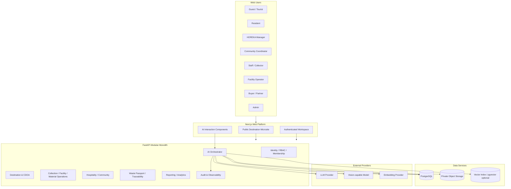
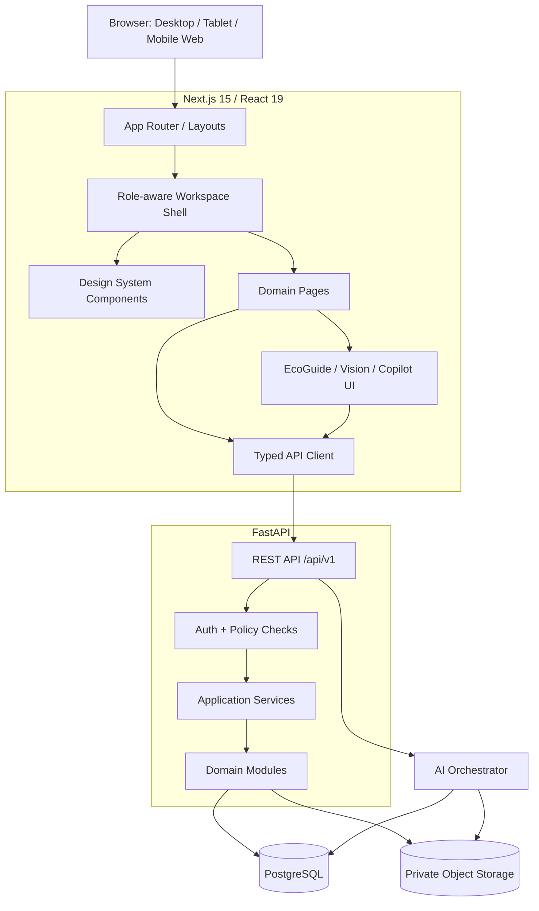
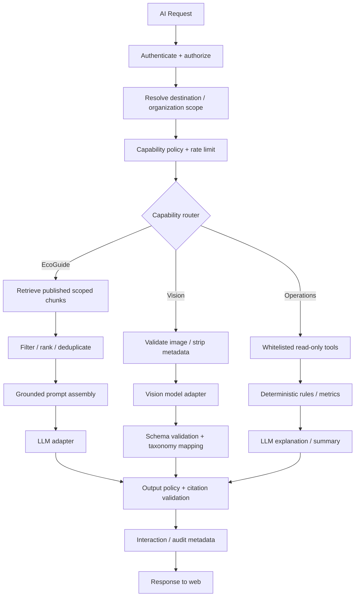
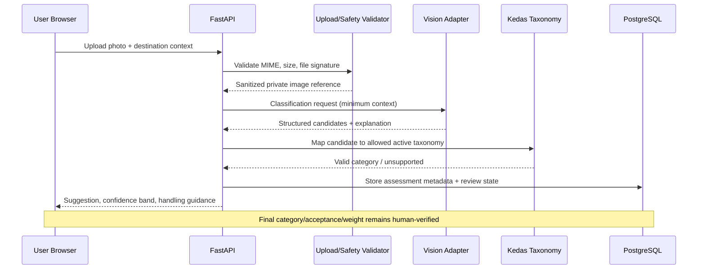
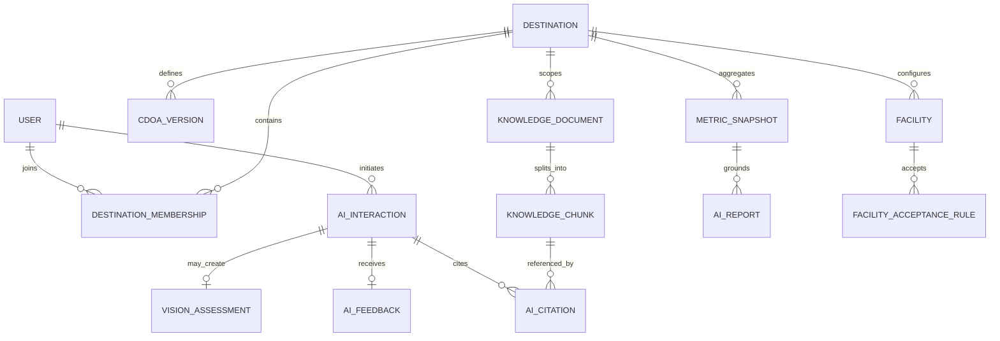
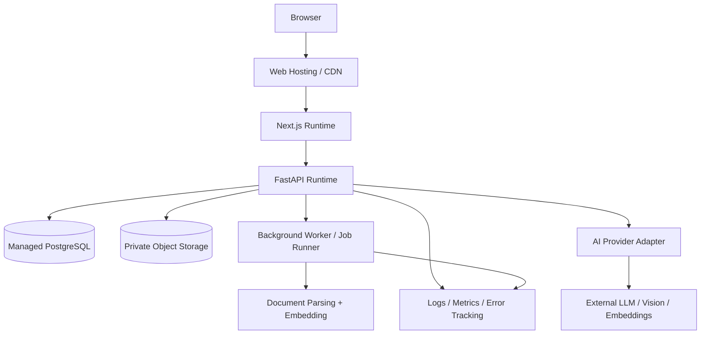

# KEDAS — High-Level Design Document (HDD)
## AI-Powered Community & Green Tourism Web Platform

> Versi 2.0 | 30 Oktober 2026  
> **Definisi HDD:** dokumen desain sistem tingkat tinggi (*High-Level Design Document*; istilah yang lebih umum di sebagian organisasi adalah HLD). Bukan dokumen hardware.

---

## 1. Tujuan dan Baseline Arsitektur

Dokumen ini menjabarkan struktur teknis target Kedas berdasarkan PRD/SRS revisi AI Web Innovation. Desain berangkat dari baseline yang dilaporkan: Next.js 15/React 19, FastAPI/Python 3.13, PostgreSQL, modular monolith, 48 endpoint API, 19 model data, dan hasil audit 185/185 test. Seluruh hal tersebut wajib diverifikasi ulang terhadap repository dan deployment config sebelum implementasi.

### 1.1 Keputusan utama

- Web-first: tidak membangun native mobile baru.
- Backend modular monolith tetap dipertahankan.
- AI orchestration menjadi module/service internal yang terisolasi.
- PostgreSQL tetap menjadi sumber kebenaran transaksi.
- Provider AI dipanggil hanya dari backend melalui adapter.
- LLM tidak memperoleh akses SQL bebas atau database credential.
- Write action tetap melalui domain service existing dan persetujuan manusia.
- Existing API dan database identifiers dipertahankan kecuali ada ADR dan migration plan.

---

## 2. Logical System Context

---

## 3. Architecture Principles

### 3.1 Source of truth

| Data/decision | Source of truth |
|---|---|
| Identity and authorization | Existing auth/IAM service + database |
| Destination and CDOA | Published configuration in application database |
| Facility eligibility | Deterministic domain rules + current facility data |
| Weight/material status | Existing transaction records + human verification |
| Knowledge facts | Published knowledge documents and source metadata |
| AI answer | Model-generated synthesis grounded in retrieved sources; not itself authoritative |
| AI visual category | Probabilistic suggestion only |
| Analytics | Backend metric/read-model snapshots |
| Report narrative | AI-generated text referring to metric snapshot; not source of numeric truth |

### 3.2 Modular monolith boundaries

1. `identity_access`: authentication, users, roles, permissions, membership.
2. `destination`: destination profile, area, CDOA, public context.
3. `knowledge`: source registration, ingestion, chunking, publishing, versioning.
4. `collection`: pickup requests, assignment, status transitions.
5. `facility`: acceptance rules, capacity, operating state, intake.
6. `material_traceability`: passport, batch events, handover lineage.
7. `hospitality`: HOREKA ledger and reports.
8. `community`: community programs, issues, activities.
9. `circular_market`: material demand, offers, buyer handover.
10. `analytics_reporting`: metric definitions, snapshots, aggregation.
11. `ai_orchestration`: EcoGuide, Vision, Operations Copilot, tool registry, safety.
12. `audit_observability`: audit log, AI interaction log, provider usage and alerts.

Nama modul hanya target logical boundary. Agent harus memetakan ke struktur kode yang nyata; jangan merename seluruh modul hanya untuk mencocokkan daftar ini.

---

## 4. Web Application Architecture

### 4.1 Frontend responsibilities

- render server/client components sesuai kebutuhan;
- menyajikan data sesuai API response dan authorization state;
- melakukan form validation untuk UX, sementara backend tetap melakukan validation final;
- menangani streaming response bila provider/API mendukung dan UX memerlukannya;
- menjaga AI citations, confidence, source details, and errors terlihat;
- tidak menyimpan API key atau business rules yang menentukan akses.

### 4.2 Backend responsibilities

- authentication, authorization, tenant/destination scope;
- business rules dan transaksi;
- AI request orchestration, retrieval, schema validation, safety checks;
- provider adapter, timeout, retry, quota, cost metadata;
- audit and observability.

---

## 5. AI Architecture

### 5.1 AI orchestration overview

### 5.2 EcoGuide RAG pipeline

1. **Document registration:** metadata, scope, owner, type, source URI, version, effective date, expiry, language, review status.
2. **Ingestion:** MIME/type validation, file extraction, malware scan if available, checksum, parsing status.
3. **Normalization:** preserve page/section headings, remove boilerplate where safe, detect empty or malformed content.
4. **Chunking:** chunk by structural boundaries; retain page/section metadata; avoid cross-document concatenation.
5. **Embedding/indexing:** use provider adapter; vector store may be pgvector if extension is available. Do not assume extension exists.
6. **Publication:** only `PUBLISHED` content enters retrieval; publish action requires permission.
7. **Query:** resolve user + destination + role + public/private visibility, then filter retrieval before semantic ranking.
8. **Prompt:** instructions treat source text as untrusted factual context, not as commands; include only retrieved context.
9. **Generation:** ask model for answer with structured citation IDs and abstention state.
10. **Validation:** verify citation IDs belong to retrieved chunks; reject unsupported citations; apply safety filter.
11. **Response:** answer, citations, freshness warning, limitations, feedback controls.
12. **Logging:** interaction ID, scope, source IDs, provider/model, duration, usage, status; redact unnecessary PII.

### 5.3 Vision pipeline

Image storage: private by default; signed URL with short expiry for permitted viewing. Never use image recognition as weight calculation or final safety certification.

### 5.4 Operations Copilot tool architecture

Tools must be explicit, typed, narrow, and read-only by default:

| Tool | Allowed input | Return |
|---|---|---|
| `get_destination_summary` | destination, period | aggregate metrics |
| `list_service_eligible_facilities` | destination, category, requested window, quantity | facilities passing hard constraints |
| `get_facility_capacity` | facility ID, time window | capacity snapshot + freshness |
| `list_overdue_requests` | permitted service area, period | request summary IDs |
| `get_material_trace_summary` | authorized batch/passport ID | event timeline/status |
| `get_hospitality_period_metrics` | organization, period | aggregate verified/self-reported metrics |
| `get_material_demand_matches` | category/specification/destination | eligible demand/offers |
| `get_exception_summary` | destination/period | exceptions and source records |

Do not add arbitrary `execute_sql`, unrestricted ORM query, shell, or generic URL fetch tools. Any future write tool must be separately specified, permission-checked, confirmation-gated, idempotent, and audited.

### 5.5 Deterministic facility matching

**Hard constraints** (must pass):
- destination/service-area compatibility;
- category/subcategory accepted;
- facility active and not in maintenance;
- available capacity sufficient or policy explicitly permits split allocation;
- operating window and requested time valid;
- required handling capability exists;
- no policy or safety prohibition.

**Ranking criteria** (only after hard constraints):
- distance/route estimate if reliable data exists;
- remaining capacity;
- expected queue/wait;
- material-specific handling suitability;
- operational availability.

LLM may explain the ranking; it may not invent candidates or override hard constraints. If required data is unknown/stale, output `UNKNOWN` or request operator review.

### 5.6 AI reports

- Backend computes all numeric measures.
- Create immutable `metric_snapshot` with period, destination, filters, query version, provenance.
- LLM receives only snapshot data and metric definitions.
- Output contains sections: highlights, issues, suggested actions, limitations, data provenance.
- Validate all reported numbers against snapshot before showing/exporting.

---

## 6. Conceptual Data Design

### 6.1 Existing entities

Keep existing user, role, pickup, weighing, material, facility, batch, partner, reward/ledger, funding, notification, and audit structures unless code/schema audit identifies gaps.

### 6.2 New conceptual entities

| Entity | Key attributes | Notes |
|---|---|---|
| Destination | id, code, name, timezone, status, public config | Scoped operating region |
| DestinationMembership | account, destination, membership, scope, status | Do not duplicate account roles |
| CDOAVersion | destination, version, status, effective dates, content | Immutable published history |
| KnowledgeDocument | destination/org scope, owner, version, status, URI, hash | Source registry |
| KnowledgeChunk | document/version, section, page, text, embedding | Retrieval unit |
| KnowledgeIngestionJob | document, parser, status, errors | Async processing |
| AIInteraction | capability, actor/session, scope, model, latency, status | Observability |
| AICitation | interaction, chunk/document/version, retrieval score | Evidence |
| AIFeedback | interaction, feedback, reason, reviewer | QA |
| VisionAssessment | image ref, candidates, confidence, review state | Human-in-loop |
| MetricSnapshot | destination/org, period, metric schema, provenance | Report truth |
| AIReport | snapshot, narrative, generated_by, approval state | AI text distinct from source numbers |

This list is conceptual only. Before migration, reuse existing entities and add only missing concepts.

### 6.3 Conceptual ER diagram

### 6.4 Data integrity

- Foreign keys and unique constraints for document version and external IDs.
- Store source checksum to detect duplicate/changed documents.
- Published version immutable; edits create new version.
- AI citations reference the exact document version/chunk used.
- Metric snapshot stores definition/version and provenance.
- Audit logs are append-only or correction-based.

---

## 7. API Design and Error Handling

### 7.1 Existing contract first

Before adding endpoint, inspect OpenAPI and frontend API client. Reuse current routes and naming. Do not copy conceptual route examples from this document blindly.

### 7.2 API layers

- Router: parse request and attach auth context.
- Policy: authorization and scope.
- Use case: orchestrate domain/AI behavior.
- Domain service: rules and transaction.
- Repository: persistence.
- Provider adapter: external AI provider.
- Response mapper: schema validation and safe output.

### 7.3 Provider adapter interface

Suggested internal interface:
- `embed_documents(chunks, metadata)`
- `embed_query(text)`
- `generate_grounded_answer(messages, schema)`
- `classify_image(image_ref, allowed_taxonomy, schema)`
- `generate_summary(metric_snapshot, schema)`

Provider-specific SDK imports remain inside adapter. Domain services depend on interface, not a named provider.

### 7.4 Failure modes

| Failure | Handling |
|---|---|
| Provider timeout | bounded retry, return `AI_TEMPORARILY_UNAVAILABLE` |
| Quota exceeded | rate-limit message and admin metric |
| Knowledge ingestion fail | document status `FAILED`, retain error trace |
| Empty retrieval | abstain |
| Invalid model JSON | schema retry limited once or fail safely |
| Citation not retrieved | remove/reject unsupported citation; do not present as source |
| Vector store unavailable | no unsupported answer; fallback to curated static info if safe |
| Image invalid | reject before provider call |
| Capacity stale/unknown | no positive availability claim |

---

## 8. Security and Responsible AI Architecture

### 8.1 Trust boundaries

1. Browser is untrusted.
2. Uploaded document/image is untrusted.
3. Retrieved document content is untrusted data, not system instruction.
4. LLM output is untrusted until schema/policy validated.
5. External provider is a processor with contractual/data handling constraints.
6. Existing database and domain service are trusted only after authorization and validation.

### 8.2 Threat controls

- Prompt injection in user text and retrieved documents.
- Cross-destination retrieval leakage.
- IDOR through passport/document/image IDs.
- Upload malware or parser exploit.
- AI output used as action parameter.
- Sensitive content appearing in logs.
- API key leakage through frontend bundle.
- Abuse/cost spikes from public guest endpoint.

### 8.3 Controls

- server-side authorization and scoped retrieval;
- strict document publication and upload controls;
- allowlisted read-only tools;
- output schemas and citation verification;
- rate limits, quotas, and max token/image size;
- short-lived signed URLs;
- secret manager/environment variables;
- PII minimization/redaction;
- audit and alerting;
- human confirmation for consequential actions.

---

## 9. UX and Design System Architecture

- Implement one token/component foundation across all web workspaces.
- Provide specialized AI components: citation card, source drawer, confidence badge, AI suggestion review, operations recommendation card, metric snapshot reference, stale knowledge warning.
- AI output must never look like a verified admin decision.
- Provide empty/loading/error/abstain/provider-unavailable states.
- Respect reduced motion and keyboard accessibility.
- Avoid distracting animation in operational forms and tables.

---

## 10. Deployment and Environments

### 10.1 Environment separation

- local development;
- shared staging/demo;
- production/pilot (only after approval).

AI provider keys and vector store credentials are environment-specific. Demo seed data must be resettable and visibly simulated. Do not point demo environment at production customer data.

### 10.2 Deployment diagram

### 10.3 Background jobs

Document parsing, embedding, and large report generation should be asynchronous where execution time may exceed API timeout. Use the repository's existing job mechanism if available. Do not introduce an unnecessary queue technology for a small demo without an ADR.

---

## 11. Architecture Decision Records

| ADR | Decision | Status |
|---|---|---|
| ADR-AI-001 | Modular monolith remains | Accepted |
| ADR-AI-002 | AI provider adapter server-side | Required |
| ADR-AI-003 | RAG over curated published sources | Required |
| ADR-AI-004 | Citation IDs validated against retrieval | Required |
| ADR-AI-005 | Operations tools read-only by default | Required |
| ADR-AI-006 | Hard facility eligibility deterministic | Required |
| ADR-AI-007 | AI vision suggestion never final acceptance/weight | Required |
| ADR-AI-008 | Metric snapshots ground narratives | Required |
| ADR-AI-009 | pgvector only if verified available | Open |
| ADR-AI-010 | Native mobile feature development frozen for challenge | Accepted for scope |
| ADR-AI-011 | Public guest AI has separate quota and public-only scope | Required |

---

## 12. Implementation and Migration Strategy

1. Inventory current schemas and API.
2. Map existing domain entities and services.
3. Add only missing fields/entities through reversible migrations.
4. Backfill destination/scope only where the source data is reliable.
5. Deploy AI functions behind feature flags.
6. Seed non-production knowledge and demo records.
7. Run evaluation/security tests before enablement.
8. Monitor token/cost/error metrics.
9. Keep the old workflow available as fallback.
10. Roll back AI feature flags without rolling back core transactional data.

### 12.1 Feature flags

Suggested flags (adapt to existing config):
- `KEDAS_AI_ECOGUIDE_ENABLED`
- `KEDAS_AI_VISION_ENABLED`
- `KEDAS_AI_OPERATIONS_ENABLED`
- `KEDAS_AI_GUEST_ENABLED`
- `KEDAS_KNOWLEDGE_INGESTION_ENABLED`

Flags must be server-enforced; hiding UI alone is insufficient.

---

## 13. Test Architecture

- Domain unit tests.
- API integration/contract tests.
- Retrieval scope and citation tests.
- Prompt injection and data isolation tests.
- Image upload and schema tests.
- Rule-engine hard constraint tests.
- AI evaluation dataset tests.
- Playwright browser E2E for primary journeys.
- Accessibility audit and responsive visual regression.
- Load/cost tests for public AI endpoints.

---

## 14. Open Architecture Decisions

- Exact model/provider and contractual data processing terms.
- Current database support for vector search.
- Current storage provider and upload controls.
- Current role and permission map.
- Actual destination and published local source documents.
- Actual AI evaluation labels and reviewer process.
- Retention and deletion rules.
- Current deployment hosting and observability stack.
