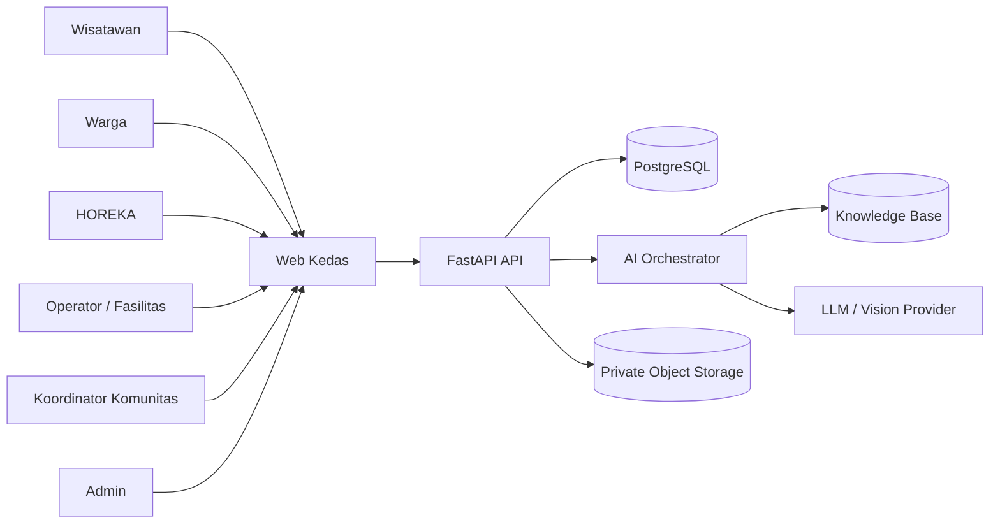

# KEDAS — Software Requirements Specification (SRS)
## AI-Powered Community & Green Tourism Web Platform

> Versi 2.0 | 30 Oktober 2026 | Status: Revisi untuk implementasi web AI  
> Acuan: PRD Kedas AI Web Innovation, laporan as-built yang diberikan tim, repository aktual, dan strategi Community & Green Tourism.

---

## 1. Tujuan, Ruang Lingkup, dan Konvensi

### 1.1 Tujuan

Dokumen ini menetapkan kebutuhan software yang dapat diuji untuk Kedas sebagai platform web AI. Kebutuhan ini mencakup web UX, API, role/permission, knowledge management, tiga kemampuan AI, workflow destination, keamanan, privasi, performa, observability, serta acceptance criteria.

### 1.2 Cakupan web

- Next.js web frontend sebagai satu-satunya permukaan produk yang dibangun untuk kompetisi.
- FastAPI backend dan PostgreSQL sebagai baseline dari sistem yang ada, wajib diverifikasi.
- Existing native mobile code tidak dihapus; tidak menjadi target feature development baru.
- Tidak ada kewajiban IoT/hardware.

### 1.3 Konvensi requirement

- **MUST:** wajib dipenuhi untuk acceptance yang ditetapkan.
- **SHOULD:** sangat disarankan; boleh ditunda dengan alasan tercatat.
- **MAY:** opsional.
- **P0/P1/P2:** prioritas implementasi.
- Requirement diberi ID unik dan diuji melalui acceptance criteria.

### 1.4 Status

Setiap requirement memiliki status implementation: `EXISTING_VERIFIED`, `EXISTING_PARTIAL`, `NEW`, `DEFERRED`, atau `OUT_OF_SCOPE`. Status tidak boleh diubah menjadi verified tanpa bukti kode/test.

---

## 2. Gambaran Sistem

### 2.1 Deskripsi

Kedas adalah web platform yang menggabungkan destination operations dan AI intelligence untuk membantu pengguna memperoleh informasi lokal, mengklasifikasikan material secara asistif, memeriksa kelayakan layanan, mengelola workflow, serta menghasilkan laporan berbasis data.

### 2.2 Komponen logis

1. Public destination microsite / Guest Green Companion.
2. Authenticated role-aware web workspace.
3. Existing FastAPI REST API.
4. Domain services: identity, destination, community, hospitality, collection, facilities, material traceability, reporting, audit.
5. AI orchestration: retrieval, vision, tools, output validation, safety, evaluation.
6. PostgreSQL and private object storage.
7. External AI provider(s) through server-side adapter.

### 2.3 Diagram konteks



---

## 3. Aktor, Role, Organization Membership, dan Authorization

### 3.1 Aktor

Aktor bisnis tidak otomatis sama dengan role akun. Role aktual yang ditemukan pada laporan dan source code harus dipertahankan. SRS ini tidak menciptakan enum role baru tanpa pemeriksaan.

| Aktor | Use case utama | Scope |
|---|---|---|
| Public guest | Membuka microsite dan pertanyaan publik | Data publik satu destination |
| Authenticated resident/user | EcoGuide, Vision, setoran, histori milik sendiri | Ownership + destination |
| Collector/staff | Tugas, inspeksi, penimbangan, evidence | Assignment dan service area |
| Community coordinator | Program komunitas dan insight | Membership komunitas |
| HOREKA manager | Ledger dan laporan organisasi | Organization membership |
| Facility operator | Acceptance, capacity, intake, batches | Facility membership |
| Buyer/partner | Demand, offer, handover | Organization membership dan transaksi terkait |
| Admin/operator | Konfigurasi serta pengawasan | Permission scope eksplisit |
| Sponsor/public program viewer | Laporan agregat yang disetujui | Program/destination scope |

### 3.2 Authorization model

SRS-ACL-001 (MUST): Backend harus memeriksa autentikasi, role/permission, resource ownership, organization membership, destination scope, dan status akun sesuai kebutuhan endpoint.

SRS-ACL-002 (MUST): `active_workspace` dan `active_role` pada frontend hanya konteks navigasi; tidak memberi hak akses.

SRS-ACL-003 (MUST): User tidak boleh membaca dokumen knowledge private organisasi lain.

SRS-ACL-004 (MUST): AI retrieval wajib menerapkan scope filter yang sama dengan data biasa.

SRS-ACL-005 (MUST): Public guest hanya dapat mengakses dokumen dan metrik yang secara eksplisit dipublikasikan.

SRS-ACL-006 (MUST): Semua mutasi penting memakai domain service existing dan audit log.

---

## 4. Functional Requirements — Platform Web

### 4.1 Navigation and workspace

- **SRS-WEB-001 (MUST/P0):** Web harus memiliki app shell konsisten untuk public dan authenticated areas.
- **SRS-WEB-002 (MUST/P0):** Navigasi yang ditampilkan bergantung pada izin pengguna, bukan sekadar active role dari client.
- **SRS-WEB-003 (MUST/P0):** Halaman penting mendukung desktop, tablet, dan mobile browser.
- **SRS-WEB-004 (MUST/P0):** Semua page memiliki loading, empty, success, error, dan forbidden states yang jelas.
- **SRS-WEB-005 (SHOULD/P1):** Search/filter/sort pada tabel operasional memiliki query state yang dapat dipertahankan.
- **SRS-WEB-006 (MUST/P0):** Data demo diberi label visible `DEMO` dan tidak dicampur dengan metrik nyata.

### 4.2 Authentication and profile

- **SRS-AUTH-001:** Integrasi registrasi/login/session existing dipertahankan.
- **SRS-AUTH-002:** API key AI tidak pernah dikirim ke browser.
- **SRS-AUTH-003:** Logout, expiry, revoked session, dan unauthorized handling harus konsisten.
- **SRS-AUTH-004:** Pendaftaran publik hanya memberikan akses default yang sudah ditetapkan sistem.
- **SRS-AUTH-005:** Role istimewa memerlukan approval/grant oleh pihak berwenang.

### 4.3 Destination and CDOA

- **SRS-DEST-001 (MUST/P0):** Admin berizin dapat membuat/mengelola destination/kawasan.
- **SRS-DEST-002:** Destination memiliki timezone, area scope, informasi publik, kontak pengelola, dan status.
- **SRS-DEST-003:** CDOA menyimpan aturan pemilahan, kategori diterima, jadwal layanan, fasilitas terhubung, prosedur kontaminasi, jalur khusus, dan versi dokumen.
- **SRS-DEST-004:** Perubahan CDOA melalui draft → review → publish → retire.
- **SRS-DEST-005:** Hanya versi publish yang aktif dapat digunakan EcoGuide dan rule engine.
- **SRS-DEST-006:** Transaksi historis tetap merujuk ke versi rule saat transaksi dilakukan.
- **SRS-DEST-007:** CDOA change mencatat actor, timestamp, reason, approval, dan diff.

### 4.4 Knowledge base management

- **SRS-KB-001 (MUST/P0):** Admin/editor dapat mengunggah atau mendaftarkan dokumen PDF, DOCX, MD, TXT, atau URL yang disetujui sesuai kemampuan repository.
- **SRS-KB-002:** Dokumen mempunyai owner, destination scope, category, source URL/reference, version, effective date, expiry/review date, status, and checksum.
- **SRS-KB-003:** Dokumen tidak dapat dipakai retrieval sebelum lolos review dan publish.
- **SRS-KB-004:** Pipeline ingestion mengekstrak teks, membersihkan konten, membuat chunks, dan menyimpan metadata sumber/page/section.
- **SRS-KB-005:** Retrieval membatasi hasil berdasarkan destination, organization visibility, status, dan tanggal berlaku.
- **SRS-KB-006:** Admin dapat retire dokumen yang kedaluwarsa; jawaban baru tidak menggunakan versi retired.
- **SRS-KB-007:** Upload gagal/berkas tidak terbaca harus ditandai dan tidak dipublikasikan diam-diam.
- **SRS-KB-008:** Metadata dan sumber asli tetap tersedia untuk audit.

### 4.5 Kedas EcoGuide — RAG assistant

- **SRS-AI-ECO-001 (MUST/P0):** User dapat mengajukan pertanyaan bahasa natural pada destination context.
- **SRS-AI-ECO-002:** Backend melakukan retrieval dari knowledge base yang sesuai scope sebelum menyusun jawaban.
- **SRS-AI-ECO-003:** Jawaban terkait aturan, kategori, jadwal, fasilitas, dan layanan harus memiliki citation/source cards.
- **SRS-AI-ECO-004:** Setiap citation memuat nama sumber, versi/tanggal, dan bagian halaman/section jika tersedia.
- **SRS-AI-ECO-005:** Jika retrieval tidak menemukan bukti cukup, assistant menyatakan informasi tidak tersedia dan tidak mengarang.
- **SRS-AI-ECO-006:** AI membedakan informasi umum dari aturan lokal.
- **SRS-AI-ECO-007:** Assistant tidak memberi instruksi berbahaya untuk material yang belum teridentifikasi; arahkan ke petugas/pengelola berwenang.
- **SRS-AI-ECO-008:** Assistant mendukung Bahasa Indonesia dan Inggris pada P0.
- **SRS-AI-ECO-009:** Percakapan tidak boleh mengakses private context di luar authorization scope.
- **SRS-AI-ECO-010:** UI memberi feedback helpful/not helpful dan alasan opsional.
- **SRS-AI-ECO-011:** Sistem mencatat anonymized/model metadata, retrieval sources, latency, token/cost metadata, safety outcome, dan feedback sesuai kebijakan retensi.

### 4.6 Kedas Vision — visual material assistant

- **SRS-AI-VIS-001 (MUST/P0):** User dapat mengunggah foto melalui browser dengan batas tipe, ukuran, dan jumlah file.
- **SRS-AI-VIS-002:** Backend memvalidasi file, menghapus metadata yang tidak diperlukan, dan menyimpan foto secara private.
- **SRS-AI-VIS-003:** AI mengembalikan schema terstruktur: candidate category, explanation, visible contamination, confidence band, handling suggestion, and human-review flag.
- **SRS-AI-VIS-004:** Kategori output harus berasal dari taxonomy Kedas yang aktif, bukan label bebas yang tidak dikenal sistem.
- **SRS-AI-VIS-005:** Confidence rendah/ambiguous/mixed image harus menghasilkan `NEEDS_REVIEW`.
- **SRS-AI-VIS-006:** Foto tidak boleh digunakan sebagai sumber berat final.
- **SRS-AI-VIS-007:** AI tidak boleh menjadi validator final B3/limbah khusus atau keselamatan.
- **SRS-AI-VIS-008:** User dapat mengoreksi hasil saran; koreksi disimpan sebagai feedback, bukan langsung training data tanpa kurasi.
- **SRS-AI-VIS-009:** Sistem tidak boleh menyimpan gambar lebih lama dari retention policy.

### 4.7 Kedas Operations Copilot

- **SRS-AI-OPS-001 (MUST/P0):** Operator berizin dapat bertanya tentang metrik operasional dalam bahasa natural.
- **SRS-AI-OPS-002:** Pertanyaan diterjemahkan ke tools/read models yang sudah di-whitelist; LLM tidak membuat dan mengeksekusi SQL bebas.
- **SRS-AI-OPS-003:** Semua tool memeriksa destination scope, organization scope, dan role/permission.
- **SRS-AI-OPS-004:** Rekomendasi fasilitas hanya boleh diambil dari kandidat yang lolos hard constraints.
- **SRS-AI-OPS-005:** Hard constraints minimal mencakup material acceptance, service area, status fasilitas, capacity, operating window, dan capability.
- **SRS-AI-OPS-006:** AI harus menjelaskan alasan rekomendasi, data yang digunakan, data yang tidak tersedia, dan alternatif.
- **SRS-AI-OPS-007:** Rekomendasi tidak otomatis menugaskan petugas, mengubah status, atau memindahkan material.
- **SRS-AI-OPS-008:** Operator melakukan aksi melalui UI/domain service normal dengan konfirmasi eksplisit.
- **SRS-AI-OPS-009:** Anomaly alerts harus dapat ditelusuri ke record, rule, dan threshold; AI tidak boleh mengubah record sumber.
- **SRS-AI-OPS-010:** AI report generator hanya memakai aggregated metrics yang sudah dihitung backend.
- **SRS-AI-OPS-011:** Narasi laporan menandai verified, self-reported, estimated, and simulated metrics secara terpisah.

### 4.8 Facility Intelligence and service eligibility

- **SRS-FAC-001 (MUST/P0):** Fasilitas memiliki kategori material yang diterima, status operasi, area, jadwal, kapasitas total, kapasitas terpakai, dan kapasitas tersedia jika data tersedia.
- **SRS-FAC-002:** Perubahan acceptance rule memerlukan permission dan audit.
- **SRS-FAC-003:** Availability result dihitung dari rule engine deterministik.
- **SRS-FAC-004:** Jika data kapasitas tidak tersedia/stale, UI harus menandai `CAPACITY_UNKNOWN`, bukan menganggap tersedia.
- **SRS-FAC-005:** AI hanya menjelaskan hasil dan menawarkan kandidat valid.
- **SRS-FAC-006:** Overload/maintenance/status inactive membuat fasilitas tidak eligible sesuai rule.

### 4.9 Green Hospitality Ledger

- **SRS-HOS-001 (P0):** HOREKA manager dapat melihat dashboard organisasi sendiri.
- **SRS-HOS-002:** Input ledger memiliki period, category, quantity/weight, source type, evidence, and verification status sesuai skema existing.
- **SRS-HOS-003:** Data self-reported dibedakan dari verified intake.
- **SRS-HOS-004:** AI menjelaskan aturan dan menolong melengkapi klasifikasi tanpa mengubah transaksi tanpa konfirmasi.
- **SRS-HOS-005:** Laporan periode dapat diekspor dalam format yang didukung dan mencantumkan periode, scope, sumber data, disclaimer, serta metrik.
- **SRS-HOS-006:** Laporan tidak boleh diklaim sebagai sertifikasi kepatuhan resmi.

### 4.10 Community EcoLoop

- **SRS-COM-001 (P1):** Koordinator dapat membuat kegiatan dan target komunitas.
- **SRS-COM-002:** Laporan isu lingkungan memuat kategori, lokasi umum/area, foto opsional, status verifikasi, dan tindak lanjut.
- **SRS-COM-003:** Data personal pelapor hanya ditampilkan kepada peran yang memerlukannya.
- **SRS-COM-004:** AI dapat mengelompokkan ringkasan isu sebagai saran, tetapi tidak menetapkan kebenaran laporan secara otomatis.

### 4.11 Guest Green Companion

- **SRS-GUEST-001 (P1):** Microsite dapat dibuka melalui QR tanpa login.
- **SRS-GUEST-002:** Konten hanya berasal dari data publik dan knowledge sources yang dipublikasikan.
- **SRS-GUEST-003:** Bahasa Indonesia dan Inggris disediakan.
- **SRS-GUEST-004:** Tidak menampilkan kapasitas detail, data pengguna, alamat personal, atau informasi operasional privat.
- **SRS-GUEST-005:** Guest dapat membuka EcoGuide dalam public-only mode.

### 4.12 Waste Passport and traceability

- **SRS-WP-001 (P0):** Setiap pickup/material batch yang relevan memiliki identifier unik yang tidak dapat ditebak.
- **SRS-WP-002:** Timeline menampilkan status dan event yang benar-benar tercatat.
- **SRS-WP-003:** Pengguna hanya melihat passport yang dimiliki atau diizinkan oleh membership/scope.
- **SRS-WP-004:** “Recycled/processed” tidak boleh ditampilkan jika hanya ada bukti pickup/intake.
- **SRS-WP-005:** Event correction tidak menghapus event historis; gunakan correction/reversal event dengan audit.

### 4.13 Reporting and analytics

- **SRS-REP-001 (P0):** Dashboard menggunakan query/read model yang terukur dan teruji.
- **SRS-REP-002:** Semua angka menampilkan periode, unit, scope, dan status verified/self-reported/estimated/simulated.
- **SRS-REP-003:** AI report narrative harus mengacu pada metric IDs/data snapshot.
- **SRS-REP-004:** DCLI hanya dapat ditampilkan jika formula, sumber data, bobot, dan keterbatasannya didokumentasikan.
- **SRS-REP-005:** Export report menyimpan tanggal pembuatan dan data period.

### 4.14 Audit and administration

- **SRS-AUD-001:** Perubahan CDOA, knowledge source publish/retire, capacity, acceptance rules, permission, weight, points, and transactions memiliki audit trail.
- **SRS-AUD-002:** AI interaction log menyimpan metadata minimum untuk debugging/evaluation tanpa menyimpan secret.
- **SRS-AUD-003:** Admin dapat melihat error provider, usage, quota, dan ingestion status sesuai permission.

---

## 5. API and Integration Requirements

### 5.1 Prinsip API

- Pertahankan `/api/v1` dan kontrak yang existing.
- Audit OpenAPI aktual sebelum membuat endpoint.
- Jangan menduplikasi endpoint yang sudah tersedia.
- Provider AI hanya diakses server-side.
- Semua response memakai error envelope dan correlation/request ID yang konsisten.

### 5.2 Kontrak endpoint konseptual

Path berikut adalah usulan konseptual, bukan klaim bahwa endpoint sudah tersedia. Agent harus memetakan ke endpoint existing dan menyesuaikan penamaan.

| Domain | Contoh endpoint konseptual | Operasi |
|---|---|---|
| Knowledge | `GET/POST /api/v1/knowledge-documents` | List/register document |
| Knowledge | `POST /api/v1/knowledge-documents/{id}/publish` | Publish after review |
| EcoGuide | `POST /api/v1/ai/eco-guide/query` | RAG query |
| Vision | `POST /api/v1/ai/vision/classify` | Image suggestion |
| Feedback | `POST /api/v1/ai/interactions/{id}/feedback` | Feedback |
| Ops | `POST /api/v1/ai/operations/query` | Whitelisted read-only query |
| Ops | `POST /api/v1/ai/operations/recommendations/{id}/feedback` | Operator feedback |
| Facility | Existing facilities API / read model | Capacity/acceptance |
| Reports | Existing reporting API + AI narrative endpoint | Summary |

### 5.3 AI response schema

EcoGuide response minimum:
```json
{
  "interaction_id": "opaque-id",
  "answer": "...",
  "status": "ANSWERED|INSUFFICIENT_CONTEXT|REFUSED|ERROR",
  "citations": [
    {"document_id":"...","title":"...","version":"...","section":"...","source_uri":"..."}
  ],
  "destination_id": "...",
  "generated_at": "ISO-8601"
}
```

Vision response minimum:
```json
{
  "interaction_id": "opaque-id",
  "status": "SUGGESTED|NEEDS_REVIEW|UNSUPPORTED|ERROR",
  "candidate": {"category_code":"...","subcategory_code":"..."},
  "confidence_band": "HIGH|MEDIUM|LOW",
  "visible_contamination": [],
  "handling_steps": [],
  "requires_human_review": true,
  "disclaimer": "Saran AI; hasil akhir mengikuti pemeriksaan dan aturan fasilitas."
}
```

Operations response minimum:
```json
{
  "interaction_id": "opaque-id",
  "answer": "...",
  "recommendations": [],
  "metrics_snapshot_id": "...",
  "explanations": [],
  "limitations": [],
  "mutations_performed": false
}
```

---

## 6. Data Requirements

### 6.1 Data groups

- Identity, account roles, organization memberships, permission scopes.
- Destination, CDOA, service areas, facility configuration.
- Knowledge document metadata, versions, chunks, embeddings, ingestion jobs.
- AI interaction metadata, feedback, evaluation, cost/latency.
- Vision image metadata and prediction output.
- Existing pickup, weighing, batch, material, reward, partner, ledger, and audit records.
- Aggregated metric snapshots and report artifacts.

### 6.2 Proposed AI entities (conceptual)

Jangan langsung membuat seluruh tabel. Cocokkan dengan model existing terlebih dahulu.

| Entity | Data utama | Kegunaan |
|---|---|---|
| KnowledgeDocument | owner, scope, type, version, dates, status, source | Document registry |
| KnowledgeChunk | document, page/section, text, token count, embedding ref | Retrieval |
| KnowledgeIngestionJob | status, error, processed time, checksum | Pipeline tracking |
| AIInteraction | capability, user/session, scope, model, status, latency, usage | Audit/observability |
| AICitation | interaction, document/version/chunk, score | Traceable answer |
| AIFeedback | interaction, rating, reason, reviewer | Evaluation |
| VisionAssessment | image ref, candidate, confidence band, review status | Vision output |
| MetricSnapshot | scope, period, metric IDs/values, generated_at | Reporting grounding |

### 6.3 Data provenance

Setiap metrik harus memiliki `source_type`: `VERIFIED`, `SELF_REPORTED`, `ESTIMATED`, atau `SIMULATED`. Jangan menggabungkan kategori ini tanpa disclosure.

---

## 7. Non-Functional Requirements

### 7.1 Security

- **SRS-NFR-SEC-001:** HTTPS pada staging/production.
- **SRS-NFR-SEC-002:** provider secret hanya di server environment/secret manager.
- **SRS-NFR-SEC-003:** rate limit login, AI endpoints, upload, dan public guest query.
- **SRS-NFR-SEC-004:** file upload divalidasi MIME/content, size, extension, malware scanning bila tersedia.
- **SRS-NFR-SEC-005:** authorization dijalankan server-side.
- **SRS-NFR-SEC-006:** retrieval dan tools tidak boleh mem-bypass tenant/destination scope.
- **SRS-NFR-SEC-007:** prompt injection dari user dan dokumen diperlakukan sebagai untrusted input.
- **SRS-NFR-SEC-008:** AI output divalidasi schema sebelum ditampilkan atau dipakai sebagai parameter tindakan.
- **SRS-NFR-SEC-009:** log tidak menyimpan API keys/password/session secrets.
- **SRS-NFR-SEC-010:** audit untuk setiap mutasi penting.

### 7.2 Privacy

- Data pribadi minimum dalam prompt.
- Hapus EXIF pada gambar jika relevan.
- Informasikan penggunaan AI dan data yang dikirim ke provider.
- Tetapkan retention/purge policy untuk gambar dan prompt.
- User dapat menghapus/menarik data sesuai kebijakan produk dan kewajiban audit.
- Jangan memakai konten pengguna sebagai training dataset tanpa persetujuan dan tata kelola khusus.

### 7.3 Performance targets

Target awal di staging dengan test profile tercatat:

| Area | Target |
|---|---|
| Non-AI API p95 | ≤ 700 ms pada skenario beban demo yang ditentukan |
| Dashboard initial interactive | ≤ 3.5 s pada koneksi uji yang didokumentasikan |
| Largest Contentful Paint | ≤ 2.5 s p75 pada halaman prioritas jika environment memungkinkan |
| AI EcoGuide | respons normal ≤ 20 s target; timeout/fallback terkontrol |
| AI Vision | ≤ 25 s target pada ukuran gambar yang diizinkan |
| AI Operations | ≤ 20 s target; query data backend tetap terukur |
| Upload | batas ukuran dan progres jelas; tidak memblokir UI tanpa feedback |

AI latency bergantung provider/model dan harus dicatat sebagai distribution, bukan dijanjikan mutlak.

### 7.4 Accessibility

- Target WCAG 2.2 AA untuk halaman utama.
- Keyboard navigation, visible focus, semantic labels, contrast, error association.
- Motion respecting `prefers-reduced-motion`.
- Chart tidak hanya mengandalkan warna.
- AI response dapat dibaca screen reader; streaming tidak mengganggu.

### 7.5 Reliability and graceful degradation

- Provider AI timeout tidak boleh merusak operasi transaksi inti.
- Jika AI down, pengguna tetap dapat membuka panduan statis dan menggunakan workflow non-AI yang sudah tersedia.
- Retry hanya untuk kegagalan transient dan harus dibatasi.
- Idempotency untuk request yang dapat menghasilkan artefak atau biaya.
- Status provider `AVAILABLE`, `DEGRADED`, `UNAVAILABLE` dapat ditampilkan admin.

### 7.6 Observability

Setiap AI request memiliki request ID/interaction ID, capability, scope, provider/model, latency, token/cost metadata jika tersedia, retrieval IDs, outcome, error class, dan safety result. Hindari menyimpan prompt penuh jika tidak diperlukan.

---

## 8. AI Evaluation Requirements

### 8.1 EcoGuide evaluation

Dataset uji berisi pertanyaan yang dijawab, pertanyaan yang harus abstain, pertanyaan multi-dokumen, aturan kedaluwarsa, dan pertanyaan prompt-injection. Penilaian:
- groundedness;
- citation correctness;
- relevance;
- completeness;
- abstention correctness;
- destination-scope isolation;
- language quality.

### 8.2 Vision evaluation

Kumpulan foto berizin/sintetis yang diberi label oleh reviewer. Pisahkan kategori, kondisi foto, campuran material, tingkat kontaminasi, dan safety-sensitive cases. Laporkan confusion matrix, precision/recall per kelas, dan rate `NEEDS_REVIEW`. Jangan klaim akurasi tinggi tanpa evaluasi.

### 8.3 Operations evaluation

- Hard-constraint violation harus 0.
- Tool authorization leakage harus 0.
- AI recommendation dapat dijelaskan ke data sumber.
- AI tidak mengeksekusi mutasi.
- Laporan menampilkan provenance metric.

### 8.4 Release gate AI

Tidak boleh dirilis jika ditemukan:
- private document cross-tenant retrieval;
- recommendation fasilitas yang gagal hard constraints;
- AI-generated weight/reward/status final;
- report yang membuat angka tanpa snapshot;
- prompt injection berhasil memperoleh secret atau data terlarang.

---

## 9. UX Requirements

- Satu design system untuk public, user, HOREKA, facility, community, operator, dan admin workspace.
- Dashboard memprioritaskan tindakan berikutnya, bukan hanya kartu statistik.
- AI assistant tidak menutupi form/tugas utama.
- Jawaban AI mempunyai citation panel, feedback, copy, dan state abstain/error.
- Vision menampilkan preview gambar, kandidat, confidence, dan konfirmasi manual.
- Operations Copilot menampilkan data snapshot, alasan, batasan, dan tombol menuju workflow standar.
- Empty/loading/error/forbidden states wajib dirancang.
- Animasi tidak boleh mengganggu pekerjaan cepat operator.

---

## 10. Test and Acceptance Strategy

### 10.1 Test layers

1. Unit: domain service, permission, RAG filters, schema validation, rule engine.
2. Integration: database, object storage adapter, provider mock, retrieval.
3. Contract: FastAPI OpenAPI, response schemas, frontend API client.
4. E2E: guest → EcoGuide; resident → Vision; HOREKA → ledger; operator → Copilot.
5. Security: auth, IDOR, tenant isolation, upload, prompt injection, secret scanning.
6. Accessibility and responsive regression.
7. AI evaluation dataset.

### 10.2 Minimum acceptance scenarios

| ID | Scenario | Expected |
|---|---|---|
| AT-001 | EcoGuide with published local rule | Answer has correct source citation |
| AT-002 | EcoGuide with no supporting document | Abstains; no invented local rule |
| AT-003 | Ask another destination's private SOP | Access denied/no retrieval |
| AT-004 | Vision clear recyclable item | Candidate category + confidence + human check policy |
| AT-005 | Vision ambiguous mixed material | NEEDS_REVIEW |
| AT-006 | Vision dangerous unknown item | Safe stop/escalation; no definitive B3 classification |
| AT-007 | Copilot facility recommendation | Every result satisfies hard constraints |
| AT-008 | Copilot asks to assign collector | Shows proposed workflow; requires explicit action |
| AT-009 | Report narrative | Every metric references snapshot/provenance |
| AT-010 | Provider unavailable | Graceful fallback; core app remains usable |
| AT-011 | Public guest query | Only public knowledge and information |
| AT-012 | Desktop/mobile web | Main flows accessible and responsive |

### 10.3 Final release criteria

- Existing baseline test suite rerun and no unexplained regression.
- All P0 requirements accepted.
- No P0 security/AI safety issue open.
- API contract and migration review complete.
- Demo data marked and resettable.
- Known limitations documented.

---

## 11. Traceability Matrix

| PRD capability | SRS section | HDD section | Test evidence |
|---|---|---|---|
| EcoGuide RAG | 4.5, 4.4, 7, 8 | 6, 7 | groundedness/citation/scope tests |
| Vision | 4.6 | 7, 8 | labeled evaluation set |
| Operations Copilot | 4.7, 4.8, 4.13 | 7, 8 | hard constraint + no mutation tests |
| CDOA | 4.3 | 5, 6 | version/publish tests |
| Green Hospitality | 4.9 | 5, 6 | org-scope tests |
| Community EcoLoop | 4.10 | 5, 6 | membership tests |
| Guest Companion | 4.11 | 4, 9 | public-only isolation tests |
| Waste Passport | 4.12 | 5, 6 | state/lineage tests |
| AI governance | 4.14, 7, 8 | 8, 10 | security and evaluation report |

---

## 12. Open Decisions

- Exact AI provider/model and data-processing terms.
- Whether PostgreSQL `pgvector` is already available or a managed retrieval store is needed.
- Retention duration for images/prompts/logs.
- Whether public Guest EcoGuide permits free-form question quota.
- Actual pilot destination and official CDOA documents.
- Which categories have sufficient labeled image samples.
- Official AI Web Innovation Challenge eligibility, rubric, and submission artifacts.
