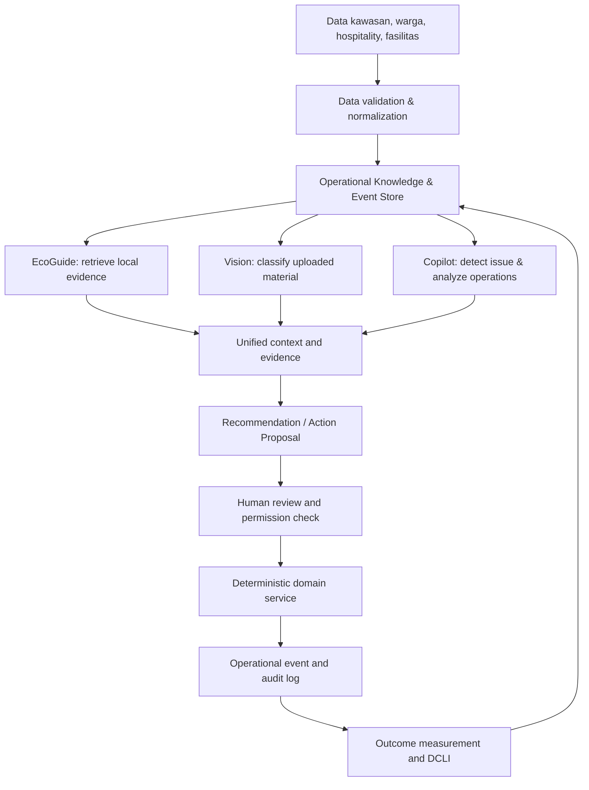
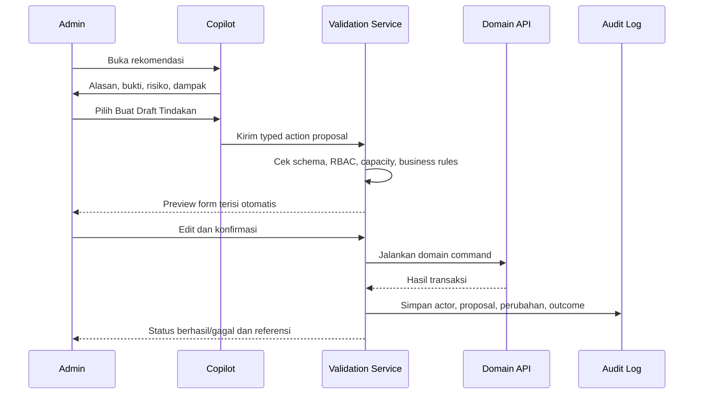

# Analisis Strategis Optimalisasi Kedas untuk AI Web Innovation Challenge

**Nama produk:** Kedas  
**Positioning:** AI-Powered Community & Green Tourism Intelligence Platform  
**Basis analisis:** *Kedas — Laporan Akhir Audit Gap Analysis & Optimalisasi Fitur*, tanggal 30 Oktober 2026  
**Tujuan:** Menentukan peluang pengembangan, perbaikan kompleksitas sistem web, prioritas implementasi, metrik pembuktian AI, dan strategi demonstrasi kompetisi.

---

## 1. Executive Assessment

Kedas tidak perlu dibangun ulang. Laporan audit mencatat fondasi yang cukup luas: 44 tabel ORM, 10 migrasi Alembic, 116 endpoint REST, 38 rute Next.js, 203/203 automated tests lulus, serta skor kematangan fitur rata-rata 3,42/5. Sistem juga telah memiliki tiga kapabilitas AI utama: EcoGuide, Vision, dan Operations Copilot.

Namun, **kelulusan test dan jumlah endpoint bukan bukti bahwa seluruh nilai AI sudah terbukti**. Tantangan Kedas berikutnya adalah mengubah kapabilitas yang terpisah menjadi sistem yang:

1. memahami konteks lokal dan sumber pengetahuannya;
2. mengenali material dengan tingkat keyakinan dan batas ketidakpastian yang terukur;
3. mengubah analisis operasional menjadi rekomendasi yang dapat diperiksa dan ditindaklanjuti;
4. menghubungkan rekomendasi, tindakan, hasil, dan bukti dalam satu siklus;
5. menyajikan hasil dengan visualisasi yang dapat dipahami warga, pengelola kawasan, fasilitas, serta usaha pariwisata.

### Rekomendasi strategis

Bangun Kedas sebagai **Evidence-Grounded Environmental Decision Intelligence Platform**. Keunggulan utamanya bukan sekadar memiliki chatbot, klasifikasi gambar, dan dashboard, tetapi menghubungkan ketiganya ke data operasional yang sama dan menghasilkan keputusan yang dapat ditelusuri.

> **Core product promise:** Kedas membantu kawasan wisata dan komunitas memahami masalah sampah, menentukan tindakan yang tepat, menjalankan tindakan yang tervalidasi, dan mengukur hasilnya berdasarkan bukti.

---

## 2. Kondisi As-Built dan Interpretasi Audit

| Area | Kondisi yang dicatat audit | Interpretasi strategis |
|---|---|---|
| Backend | 116 endpoint, 44 tabel ORM | Fondasi domain telah luas; fokus pada kontrak API, konsistensi domain, dan integrasi alur. |
| Web frontend | 38 rute Next.js | Cakupan halaman cukup luas; perlu memastikan data dinamis, alur per role, dan UX lintas modul konsisten. |
| Automated tests | 203/203 lulus | Indikasi baseline engineering baik; belum dengan sendirinya membuktikan UAT, load, security assessment independen, atau operasi lapangan. |
| AI provider | Dual-mode provider adapter | Pertahankan abstraksi provider dan jangan mengekspos secret ke browser. |
| EcoGuide | Retrieval leksikal berbasis exact token intersection | Perlu hybrid retrieval untuk sinonim, variasi istilah, dan pertanyaan multibahasa. |
| Vision | Alur upload, klasifikasi, konfirmasi manual telah didemonstrasikan | Perlu benchmark dataset lokal dan evaluasi per kelas sebelum klaim akurasi. |
| Operations Copilot | Menghasilkan rekomendasi; CTA masih berupa toast | Perlu action proposal yang dapat ditinjau, dipreview, divalidasi, dan dikonfirmasi manusia. |
| Destination | Halaman area layanan masih menggunakan data statis | Data publik dan CDOA harus terhubung ke API dan status aktual. |
| Hospitality | Model B2B tersedia, workspace mandiri belum ada | Peluang ekspansi penting untuk Green Tourism dan sumber data operasional. |
| Field workflow | Form petugas memerlukan koneksi aktif | Offline-first adalah kebutuhan pilot lapangan; bukan prioritas demo web jika waktu terbatas. |
| DCLI | Formula backend tersedia, radar chart belum ada | Perlu penjelasan dimensi, tren, kelengkapan data, dan drill-down, bukan chart dekoratif saja. |
| Knowledge admin | Endpoint ingestion tersedia, form admin belum ada | Knowledge governance perlu menjadi workflow web yang dapat digunakan admin nonteknis. |

### Catatan interpretasi

- Angka 203/203 test harus selalu disebut sebagai hasil automated test pada snapshot repository yang diaudit, bukan jaminan bebas bug.
- Klaim “production ready” pada laporan perlu dipahami sesuai ruang lingkup bukti yang tersedia. Untuk kompetisi, istilah yang lebih aman adalah **demo-ready berdasarkan bukti audit**, sementara production/field readiness tetap bergantung pada UAT, data nyata, mitra, observability, serta validasi operasional.
- Audit mencatat 100% pertahanan pada 10 kategori prompt injection dan 100% sanitasi PII dalam rangkaian uji yang dilakukan. Klaim ini tidak boleh diperluas menjadi “AI kebal terhadap seluruh serangan”. Dokumentasikan jumlah kasus, metodologi, dan batas uji.
- Audit menyebut estimasi 1,82 kg CO2e/kg pada Waste Passport. Faktor ini perlu diperiksa: sumber, jenis material, batas sistem, kondisi baseline, dan metodologi. Jangan gunakan satu faktor generik untuk semua material tanpa justifikasi.

---

## 3. Product Strategy: Satu Siklus Kecerdasan, Bukan Tiga AI Terpisah

### 3.1 Target positioning

**Kedas — AI-Powered Community & Green Tourism Intelligence Platform**

Sistem web yang mengintegrasikan pengetahuan lokal, identifikasi material, operasi fasilitas, dan analisis kawasan untuk membantu komunitas serta pelaku pariwisata mengambil keputusan pengelolaan sampah yang lebih tepat.

### 3.2 Tiga AI core

#### A. Kedas EcoGuide — Local Knowledge Intelligence

Fungsi:
- Menjawab pertanyaan pemilahan sampah berdasarkan aturan kawasan dan sumber resmi/terverifikasi.
- Menjelaskan SOP fasilitas, jadwal, jenis material yang diterima, dan etika lingkungan kawasan.
- Mendukung pertanyaan Bahasa Indonesia dan Inggris; bahasa Bali dapat ditambahkan berdasarkan dataset dan validasi penutur/ahli lokal.
- Memberikan sitasi, tanggal berlaku dokumen, pemilik sumber, dan tautan sumber.
- Menolak menjawab atau meminta klarifikasi ketika bukti tidak cukup.

Keunggulan yang harus dibuktikan:
- Paham konteks kawasan tertentu, bukan menjawab sebagai chatbot generik.
- Jawaban dapat ditelusuri ke dokumen yang berlaku.
- Dapat membedakan aturan umum, aturan lokal, dan informasi yang sudah kedaluwarsa.

#### B. Kedas Vision — Waste Recognition & Sorting Assistant

Fungsi:
- Mengidentifikasi kategori material dari foto.
- Memberikan kandidat subkategori, potensi kontaminasi, dan saran pemilahan.
- Menampilkan confidence atau tingkat keyakinan dengan interpretasi yang benar.
- Meminta konfirmasi manusia untuk prediksi ambigu atau berisiko.
- Menghubungkan hasil klasifikasi dengan aturan penerimaan fasilitas di kawasan yang dipilih.

Keunggulan yang harus dibuktikan:
- Bukan hanya mengenali “plastik/kertas/organik”, tetapi memberi saran berdasarkan aturan penerimaan lokal.
- Tidak memaksakan prediksi saat gambar buram, banyak objek, pencahayaan buruk, atau kelas tidak dikenal.
- Memisahkan hasil prediksi AI dari kategori final yang disahkan pengguna/petugas.

#### C. Kedas Operations Copilot — Decision Intelligence

Fungsi:
- Menganalisis kapasitas fasilitas, antrean, jenis material, jadwal, dan data penerimaan.
- Mengidentifikasi anomali, misalnya overload, ketidaksesuaian berat, keterlambatan, atau pola kontaminasi.
- Menyusun beberapa rekomendasi tindakan dengan alasan dan data pendukung.
- Membuat *action proposal* terstruktur yang dapat dipreview dan diedit.
- Menjalankan tindakan hanya melalui service/domain API yang berotorisasi dan membutuhkan konfirmasi aktor yang tepat.
- Membandingkan kondisi sebelum dan sesudah tindakan.

Keunggulan yang harus dibuktikan:
- Rekomendasi spesifik pada data dan aturan Kedas, bukan jawaban generik.
- Setiap saran memiliki alasan, bukti, risiko, estimasi dampak, dan tingkat keyakinan.
- AI tidak melakukan mutasi transaksi langsung. Aturan bisnis deterministik dan validasi backend tetap menjadi otoritas.

### 3.3 Unified Intelligence Loop

---

## 4. Gap Analysis Mendalam dan Usulan Optimalisasi

## 4.1 GAP-001 — Data Area Layanan Masih Statis (P0)

**Kondisi audit:** `/area-layanan` memakai array statis pada frontend, padahal data service area/CDOA tersedia pada backend.

**Mengapa ini penting:** Halaman publik menjadi sumber informasi bagi warga dan wisatawan. Data statis dapat menyebabkan jadwal, fasilitas penerima, atau kuota yang ditampilkan berbeda dengan kondisi operasional.

**Optimalisasi:**
1. Hubungkan halaman publik ke endpoint service area.
2. Tambahkan status publik: aktif, terbatas, sementara tutup, atau belum tersedia.
3. Tampilkan jam layanan, jenis material yang diterima, kontak resmi, jadwal, serta tanggal pembaruan.
4. Terapkan loading, empty, stale, dan error state.
5. Gunakan cache dengan invalidation yang jelas; jangan menganggap data cache sebagai status real-time.
6. Sediakan preview sebelum admin mempublikasikan perubahan CDOA.

**Acceptance criteria:**
- Data yang terlihat berasal dari API, bukan hardcoded array.
- Perubahan admin tampil sesuai kebijakan cache.
- Area tanpa data tidak menampilkan informasi palsu.
- Setiap area menampilkan waktu pembaruan dan status layanan.

**Target uji:** 100% kartu area pada halaman publik menggunakan data API; uji contract dan error-state mencakup skenario kosong, timeout, dan layanan tidak aktif.

## 4.2 GAP-002 — Operations Copilot Belum Actionable (P1, direkomendasikan naik menjadi P0 untuk demo AI)

**Kondisi audit:** CTA rekomendasi hanya menampilkan toast. Admin masih harus membuka form lain dan memasukkan data ulang.

**Optimalisasi: Action Proposal Workflow**

**Spesifikasi:**
- Setiap rekomendasi berisi `recommendation_id`, `issue_type`, `evidence_refs`, `proposed_action`, `parameters`, `expected_effect`, `risk_level`, `confidence`, dan `created_at`.
- Gunakan schema terketik dan allowlist action. Jangan menerima SQL atau kode bebas dari LLM.
- Preview menggunakan form domain yang sudah ada dengan nilai terisi otomatis.
- Validasi server-side mengulang pemeriksaan kapasitas, hak akses, status entitas, serta constraint transaksi.
- Konfirmasi manusia wajib untuk mutasi operasional.
- Terapkan idempotency key untuk mencegah aksi ganda.
- Jika data berubah setelah proposal dibuat, lakukan revalidation dan tampilkan perubahan kondisi.
- Catat rekomendasi yang diterima, diedit, ditolak, gagal, atau dibatalkan.

**Demo moment:** Copilot mendeteksi risiko overload, menjelaskan data yang mendasari, menawarkan draft pemindahan slot/penyesuaian penugasan, lalu admin memeriksa dan mengonfirmasi. Jangan mengklaim sistem mengoptimalkan rute jika belum ada algoritma routing yang teruji.

## 4.3 GAP-003 — EcoGuide Retrieval Masih Leksikal (P1)

**Kondisi audit:** exact token set intersection. Presisi sitasi dilaporkan 100%, tetapi variasi sinonim, bahasa campuran, dan istilah lokal belum tertangkap secara semantik.

**Optimalisasi: Hybrid RAG**

Tahapan pipeline:
1. Document ingestion dengan tipe dokumen, pemilik, wilayah, tanggal berlaku, tanggal kedaluwarsa, versi, status review, dan checksum.
2. Ekstraksi teks, OCR hanya bila dokumen berupa scan dan melalui review.
3. Chunking berdasarkan heading/struktur dokumen, bukan potongan karakter tanpa konteks.
4. Simpan lexical index dan vector embedding.
5. Retrieval hybrid: lexical + dense vector.
6. Reranking kandidat dengan relevansi dan filter metadata kawasan/masa berlaku.
7. Context assembly dengan source ID dan span kutipan.
8. Generation dengan instruksi anti-hallucination.
9. Citation validation: setiap klaim faktual harus terhubung ke sumber yang mendukung.
10. Abstention saat tidak ditemukan bukti cukup.

**Governance knowledge:**
- Dokumen memiliki status `draft`, `in_review`, `approved`, `published`, `expired`, `withdrawn`.
- Hanya dokumen approved/published yang dapat dipakai untuk jawaban publik.
- Perubahan SOP harus menyimpan versi sebelumnya.
- Admin kawasan dapat mengusulkan dokumen, tetapi reviewer yang ditunjuk menyetujui publikasi.
- Tampilkan tanggal berlaku dan wilayah cakupan.

**Evaluasi:**
- Buat gold question set 100–200 pertanyaan awal (jumlah ini target rencana, bukan data yang sudah ada).
- Variasikan Bahasa Indonesia, istilah lokal Bali yang telah divalidasi, Inggris, typo, sinonim, pertanyaan multi-hop, dan pertanyaan tanpa jawaban.
- Ukur Recall@K, MRR/nDCG, citation correctness, answer groundedness, abstention precision/recall, latency, dan biaya per pertanyaan.
- Bandingkan lexical-only vs hybrid secara eksperimen.
- Jangan menetapkan target recall >94% sebagai klaim sebelum benchmark selesai.

## 4.4 GAP-004 — Hospitality Workspace Belum Tersedia (P2)

**Kondisi audit:** model B2B tersedia, tetapi belum ada portal mandiri `/hospitality`.

**Optimalisasi workspace:**
- Dashboard organisasi dan lokasi usaha.
- Log sampah harian per kategori dan sumber kegiatan.
- Foto/bukti dan catatan kontaminasi.
- Jadwal pickup dan status permintaan.
- Riwayat timbang, penerimaan, serta Waste Passport.
- Kontrak mitra, service agreement, dan jadwal pengangkutan.
- Laporan bulanan dan ekspor bukti.
- Role organisasi: owner/admin, waste coordinator, viewer/auditor.
- Multi-location untuk grup hotel jika didukung model tenancy.

**Keunggulan AI:**
- AI membantu merangkum pola sampah, mendeteksi data log yang tidak wajar, dan memberikan saran pengurangan berdasarkan data historis.
- AI tidak boleh menyatakan bisnis “patuh regulasi” hanya berdasarkan self-report. Gunakan istilah “catatan pengelolaan” atau “evidence report” kecuali ada audit resmi.

**Acceptance criteria:** organisasi hanya dapat melihat data tenant sendiri; data agregat untuk kawasan dianonimkan dan mengikuti persetujuan.

## 4.5 GAP-005 — Offline Capture Petugas (P1)

**Kondisi audit:** form penimbangan/inspeksi membutuhkan internet aktif.

**Rekomendasi:** bangun offline-first secara terbatas untuk draft inspeksi dan input berat.

Desain:
- IndexedDB untuk outbox lokal.
- Setiap event mempunyai UUID/idempotency key, actor ID, entity ID, timestamp perangkat, dan `client_sequence`.
- Status lokal: `draft`, `queued`, `syncing`, `synced`, `conflict`, `failed`.
- Server menjadi sumber kebenaran untuk transaksi final.
- Konflik berat/status tidak boleh diselesaikan dengan “last write wins” tanpa aturan.
- Tampilkan indikator belum tersinkron.
- Enkripsi/retensi data lokal dan logout cleanup harus dirancang.
- Foto dapat disimpan sebagai antrean terpisah dengan batas ukuran dan retry policy.

**Prioritas kompetisi:** bukan headline innovation utama kecuali demonstrasi lapangan menjadi kebutuhan penilaian. Letakkan sesudah jalur AI inti dan actionability Copilot.

## 4.6 GAP-006 — DCLI Belum Memiliki Visualisasi Interaktif (P2, bisa dinaikkan untuk storytelling demo)

**Optimalisasi dashboard:**
- Radar chart 4 dimensi menggunakan nilai backend tanpa menulis ulang formula di frontend.
- Tampilkan skor total dan breakdown per dimensi.
- Tampilkan periode dan perbandingan antarperiode.
- Tampilkan jumlah record, kelengkapan data, dan freshness.
- Sediakan drill-down dari dimensi ke indikator/transaksi sumber.
- Gunakan tooltip metodologi, bobot, dan batas interpretasi.
- Berikan status “data belum cukup” ketika coverage di bawah ambang yang ditetapkan.

**Catatan:** jangan mengarang nama atau formula empat dimensi. Ambil definisi dari endpoint, source code, dan dokumentasi DCLI aktual.

## 4.7 GAP-007 — Admin Belum Memiliki Knowledge Upload UI (P1)

**Optimalisasi:** halaman `/admin/pengetahuan` dengan:
- Upload PDF/DOCX/TXT atau format yang benar-benar didukung backend.
- Metadata: kategori, wilayah, pemilik, tanggal berlaku, expiry, bahasa, dan tingkat kerahasiaan.
- Preview hasil ekstraksi dan chunk.
- Validasi ukuran, MIME, antivirus/malware scanning sesuai infrastruktur.
- Review dan approval workflow.
- Tombol publish/withdraw dengan konfirmasi.
- Version history, ingestion status, error report, dan re-index.
- Uji retrieval sebelum publish agar admin mengetahui bagaimana dokumen akan ditemukan.

---

## 5. Pengembangan AI yang Lebih Dalam

## 5.1 EcoGuide — dari chatbot menjadi Local Knowledge System

Prioritas tertinggi AI bukan menambah persona atau animasi chat, melainkan kualitas sumber dan kemampuan retrieval.

| Komponen | Upgrade |
|---|---|
| Knowledge model | Versioning, jurisdiction, validity date, owner, approval status |
| Retrieval | Hybrid BM25/lexical + vector + metadata filter |
| Ranking | Reranker dan deduplication |
| Grounding | Claim-to-source mapping dan citation validation |
| Safety | Prompt injection separation, document trust boundary, abstention |
| UX | Source drawer, answer confidence explanation, feedback, report incorrect answer |
| Evaluation | Gold set dan regression evaluation per release |

**Unique differentiator:** jawaban dapat berubah berdasarkan kawasan yang dipilih dan aturan yang berlaku, dengan sumber dan tanggal berlakunya terlihat.

## 5.2 Vision — dari hasil prediksi menjadi assisted sorting

Audit mencatat rencana kurasi 500 foto sampah lokal Bali sebagai benchmark. Jadikan 500 foto sebagai dataset awal yang terkurasi, bukan bukti final generalisasi.

Data harus memiliki:
- Label kategori dan subkategori yang konsisten.
- Label kontaminasi dan kondisi gambar.
- Provenance/consent gambar.
- Split train/validation/test pada tingkat sumber/pengambilan, bukan random frame yang berisiko leakage.
- Contoh kondisi low-light, blur, objek campuran, occlusion, dan material lokal.

Metrik:
- Precision, recall, F1 per class dan macro-F1.
- Confusion matrix.
- Calibration/error confidence.
- Abstention rate pada gambar ambigu.
- Human correction rate.
- Latency dan biaya inference.

UX:
1. User mengambil/mengunggah gambar.
2. Sistem memeriksa kualitas gambar.
3. Model memberikan top-k kandidat dan confidence yang terkalibrasi.
4. UI memberi rekomendasi pemilahan dan aturan fasilitas lokal.
5. User mengonfirmasi atau mengoreksi.
6. Koreksi disimpan sebagai feedback hanya jika consent dan governance mengizinkan.

Jangan membuat klaim akurasi sebelum test set terkunci dan evaluasi dapat diulang.

## 5.3 Operations Copilot — dari insight ke controlled action

Copilot adalah peluang demonstrasi paling kuat karena memperlihatkan AI memahami data dan membantu tindakan.

Gunakan arsitektur:
- LLM untuk interpretasi, ringkasan, dan penyusunan proposal.
- Query/service terotorisasi untuk mengambil data.
- Rule engine untuk kapasitas, kuota, izin, dan constraint.
- Domain API untuk mutasi.
- Human approval untuk tindakan yang berdampak.
- Audit log untuk semua keputusan.

Contoh demo:
1. Dashboard menunjukkan fasilitas mendekati kapasitas penuh.
2. Copilot menyebut data aktual dan threshold.
3. Copilot mengusulkan penyesuaian jadwal/tujuan sesuai fasilitas yang memenuhi acceptance rules.
4. Admin membuka preview yang sudah terisi.
5. Backend memvalidasi ulang kapasitas dan permission.
6. Admin mengonfirmasi.
7. Sistem menyimpan hasil dan menunjukkan perubahan indikator.

Tidak boleh ada eksekusi langsung dari teks bebas LLM.

---

## 6. Fitur Penghubung yang Belum Maksimal

Fitur berikut dapat memberi nilai lebih besar daripada menambah halaman baru.

### 6.1 Shared Area Context

Setiap modul harus menggunakan `area_id`/konteks kawasan yang sama sesuai model aktual:
- public service area;
- CDOA dan aturan lokal;
- facility acceptance rules;
- EcoGuide knowledge filter;
- hospitality logs;
- waste passport;
- DCLI;
- Copilot recommendations.

Perubahan CDOA harus berdampak konsisten pada informasi publik, jawaban EcoGuide, dan validasi proses operasional. Terapkan versioning dan cache invalidation agar perubahan tidak menghasilkan konteks yang berbeda-beda.

### 6.2 Evidence Chain

Setiap klaim atau rekomendasi AI perlu menunjuk ke:
- data record;
- dokumen knowledge;
- event transaksi;
- waktu pengambilan data;
- versi model/prompt (untuk AI output);
- actor yang menyetujui tindakan.

### 6.3 Outcome Measurement

Hubungkan rekomendasi dengan hasil:
- masalah yang terdeteksi;
- tindakan yang dipilih;
- siapa yang menyetujui;
- data sebelum dan sesudah;
- dampak yang terukur;
- apakah rekomendasi membantu atau tidak.

Ini membuat Kedas dapat mempelajari keberhasilan rekomendasi tanpa mengubah AI menjadi pengendali transaksi otonom.

---

## 7. Prioritas Pengembangan untuk Kompetisi

### Horizon 0 — Competition Gate dan bukti

| ID | Tindakan | Alasan | Kriteria selesai |
|---|---|---|---|
| GATE-01 | Konfirmasi eligibility kategori peserta S1 kepada panitia | Audit menandai risiko administratif P0 | Bukti jawaban tertulis/resmi tersimpan |
| GATE-02 | Bekukan commit/build yang menjadi dasar demo | Menghindari hasil demo berbeda dari audit | Tag/commit hash, env, dan test result terdokumentasi |
| GATE-03 | Verifikasi klaim demo AI | Menghindari klaim unsupported | Semua angka punya metode, sample, dan bukti |

### Horizon 1 — Demo-critical (prioritas tertinggi)

| ID | Inisiatif | Prioritas rekomendasi | Estimasi kompleksitas relatif | Hasil yang diharapkan |
|---|---|---|---|---|
| H1-01 | Dynamic Service Area & CDOA API binding | P0 | S | Data publik sinkron dengan backend |
| H1-02 | Copilot Action Proposal + Preview + Approval | P0 | M | Rekomendasi bisa ditindaklanjuti secara aman |
| H1-03 | Admin Knowledge Upload + Review + Publish | P0 | M | Knowledge bisa dikelola nondeveloper |
| H1-04 | AI evaluation harness untuk EcoGuide dan Vision | P0 | M | Klaim AI dapat dibuktikan dan dibandingkan |
| H1-05 | DCLI interactive breakdown/radar + data coverage | P1 | S–M | Dampak kawasan mudah dipahami |
| H1-06 | Evidence drawer pada EcoGuide/Copilot/Waste Passport | P1 | M | Pengguna dapat menelusuri bukti |

### Horizon 2 — Product completeness

| ID | Inisiatif | Prioritas | Kompleksitas | Nilai |
|---|---|---|---|---|
| H2-01 | Hybrid RAG dengan pgvector + reranker | P1 | M–L | Pencarian makna dan bahasa campuran meningkat |
| H2-02 | Hospitality workspace | P1/P2 | L | Pengguna B2B memiliki ruang kerja mandiri |
| H2-03 | Shared Area Context dan versioning CDOA | P1 | M | Konsistensi aturan lintas modul |
| H2-04 | Waste Passport evidence chain dan mass balance drill-down | P1 | M | Traceability dapat diaudit |
| H2-05 | Offline-first capture petugas | P2 | L | Operasi tetap berjalan saat koneksi lemah |

### Horizon 3 — Advanced innovation

| ID | Inisiatif | Prioritas | Kompleksitas | Nilai |
|---|---|---|---|---|
| H3-01 | Dataset lokal Vision dan calibration | P1 Research | L | Kualitas model tervalidasi |
| H3-02 | Seasonal waste forecasting | P2 | L | Perencanaan berdasarkan pola historis |
| H3-03 | Bluetooth/WebSerial weighing integration | P2 | L/Hardware dependency | Mengurangi input manual setelah pilot |
| H3-04 | Multi-area benchmark dan comparative analytics | P2 | M–L | Perbandingan destinasi yang fair |

**Rekomendasi:** jangan memasukkan semua Horizon 2/3 ke scope kompetisi. Selesaikan jalur demo-critical dan buktikan tiga fitur AI secara mendalam.

---

## 8. Metrik Keberhasilan yang Harus Disiapkan

Metrik berikut adalah **usulan pengukuran**, bukan hasil aktual. Target final ditetapkan setelah baseline.

| Domain | Metrik | Cara pengukuran |
|---|---|---|
| EcoGuide | Recall@5, citation correctness, groundedness, abstention quality | Gold question set dan expert review |
| EcoGuide | Answer latency dan cost/query | Instrumentasi backend |
| Vision | Macro-F1, per-class precision/recall, calibration, human correction rate | Test set terkunci dan label reviewer |
| Vision | Abstention rate untuk foto ambigu | Challenge set low-quality/unknown |
| Copilot | Recommendation acceptance rate | Proposal diterima dibanding total proposal yang ditinjau |
| Copilot | Action completion rate | Aksi berhasil dibanding proposal yang dikonfirmasi |
| Copilot | Time-to-action | Waktu dari alert sampai tindakan tervalidasi |
| Operations | Facility overload incidents | Jumlah insiden pada periode yang sama |
| Operations | Weight discrepancy rate | Selisih bobot pickup dan intake dengan definisi yang disepakati |
| Destination | DCLI coverage/completeness | Data tersedia dibanding data yang diperlukan |
| UX | Task completion rate, time-on-task, error rate | Moderated usability test |
| Reliability | API p95 latency, error rate, uptime pada demo | Observability/load test |
| Security | Authz regression, IDOR, injection, upload validation | Automated + manual security test |

Hindari menjadikan “jumlah AI response” atau “jumlah prompt” sebagai indikator keberhasilan utama.

---

## 9. Rekomendasi User Experience untuk Web Competition

### 9.1 Satu dashboard berdasarkan konteks peran

- Warga: panduan, setoran, status, Waste Passport, dan poin.
- Petugas: tugas, inspeksi, timbang, status sinkronisasi.
- Admin kawasan: peta area, service capacity, CDOA, Copilot, dan laporan.
- Hospitality: log harian, jadwal, bukti, laporan organisasi.
- Guest: informasi lingkungan kawasan dan EcoGuide tanpa wajib login.

### 9.2 AI interaction pattern

Setiap fitur AI harus memiliki empat bagian:
1. **Input/context:** data atau pertanyaan apa yang digunakan.
2. **AI result:** hasil atau rekomendasi.
3. **Evidence/uncertainty:** sumber, confidence, kekurangan data, dan batasan.
4. **Next action:** konfirmasi, edit, simpan, eskalasi, atau tidak melakukan tindakan.

### 9.3 Visual polish yang fungsional

Prioritaskan:
- skeleton state dan progressive loading;
- status async AI yang menjelaskan tahap proses;
- source drawer dan preview action;
- chart dengan definisi dan empty state;
- responsive dashboard;
- keyboard navigation dan focus state;
- `prefers-reduced-motion`;
- Bahasa Indonesia/Inggris dengan istilah domain konsisten.

Animasi tidak boleh menutupi status, memperlambat tugas, atau mengaburkan ketidakpastian AI.

---

## 10. Rencana Validasi dan Pengujian

### 10.1 Technical validation

- Unit, integration, contract, and end-to-end tests.
- API authorization per role/tenant.
- Database migration rehearsal pada environment disposable.
- Idempotency dan concurrency untuk transaksi.
- File upload security dan ukuran batas.
- AI provider timeout, retry, fallback, dan rate limit.
- Observability untuk request ID, prompt/model version, token/cost, latency, dan failure reason.

### 10.2 AI validation

- Dataset evaluasi terpisah dari data tuning.
- Versioning prompt, model, embedding, dan knowledge base.
- Regression test saat prompt atau model berubah.
- Human review pada jawaban/klasifikasi berisiko.
- Prompt injection test dengan dokumen tidak tepercaya.
- PII redaction dan data retention policy.
- Fallback ketika provider AI tidak tersedia.

### 10.3 Product validation

Uji tugas nyata dengan setidaknya perwakilan:
- satu admin/pengelola kawasan;
- satu petugas;
- satu pengguna warga;
- satu pelaku HOREKA;
- satu wisatawan/guest.

Catat keberhasilan tugas, kesalahan, durasi, pertanyaan yang tidak terjawab, serta kebutuhan pelatihan. Jumlah partisipan untuk usability testing ditentukan sesuai waktu dan ketersediaan; jangan mengklaim representatif secara statistik bila sampel kecil.

---

## 11. Demo Storyline yang Direkomendasikan

**Judul:** From Local Knowledge to Verified Environmental Action.

Durasi target demonstrasi: 5–7 menit (usulan, disesuaikan dengan aturan lomba).

1. **Context:** pilih satu kawasan wisata dan tampilkan aturan serta area layanan yang benar-benar berasal dari backend.
2. **EcoGuide:** wisatawan/pengelola bertanya bagaimana memilah material tertentu. AI memberi jawaban dengan rujukan SOP lokal yang berlaku.
3. **Vision:** pengguna unggah foto material. Sistem memberi kandidat klasifikasi, confidence, dan aturan fasilitas lokal; pengguna mengonfirmasi.
4. **Operations:** dashboard menampilkan fasilitas dengan kapasitas terbatas. Copilot menjelaskan bukti dan merekomendasikan tindakan.
5. **Action:** admin membuka proposal yang sudah terisi, memeriksa dan mengonfirmasi. Backend memvalidasi aturan dan mencatat audit log.
6. **Impact:** DCLI dan Waste Passport memperlihatkan perubahan yang benar-benar didukung data.

Demo harus menggunakan seeded demo data yang konsisten dan diberi label simulasi. Jangan membuat transaksi nyata atau mengubah angka agar tampak lebih baik.

---

## 12. Risiko, Keputusan, dan Klaim yang Harus Dikendalikan

| Risiko/keputusan | Dampak | Mitigasi |
|---|---|---|
| Kelayakan peserta S1 belum terkonfirmasi (OD-01) | Potensi diskualifikasi administratif | Konfirmasi resmi tertulis ke panitia sebelum submission |
| Hybrid RAG mengambil dokumen yang sudah kedaluwarsa | Jawaban aturan salah | Filter tanggal berlaku/status/version dan abstention |
| AI Vision salah klasifikasi | Salah pemilahan | Human confirmation, unknown class, confidence calibration |
| Copilot mengeksekusi aksi tidak valid | Mutasi data/operasi salah | Typed proposal, deterministic validation, human approval |
| DCLI dibaca sebagai sertifikasi resmi | Klaim misleading | Jelaskan formula, coverage, batas, dan status indeks internal |
| Klaim emisi terlalu besar | Kredibilitas turun | Faktor per material, sumber metodologi, uncertainty, boundary |
| Offline event tersinkron ganda | Duplikasi transaksi | UUID/idempotency, sync state machine, server reconciliation |
| Knowledge upload palsu/tidak sah | AI menyebarkan informasi salah | Document provenance, reviewer approval, version history |
| Test pass dianggap production-safe | Risiko deployment | UAT, load, penetration, backup/restore, monitoring dan incident plan |

---

## 13. Keputusan Teknis dan Produk yang Direkomendasikan

1. **Pertahankan modular monolith** selama kebutuhan skala dan tim belum memerlukan pemisahan layanan. Jangan memecah microservices hanya demi kompleksitas.
2. Pertahankan provider adapter AI dan semua API key di backend.
3. LLM hanya menghasilkan jawaban, analisis, atau typed proposal. Domain service dan rule engine menentukan apakah tindakan valid.
4. Jadikan knowledge governance sebagai bagian produk, bukan pekerjaan teknis tersembunyi.
5. Gunakan satu `area context` konsisten lintas EcoGuide, Vision, Copilot, CDOA, fasilitas, dan laporan.
6. Tambahkan evidence chain dan auditability untuk AI output dan action.
7. Tunda fitur IoT/hardware dan forecasting lanjutan jika belum ada data atau perangkat nyata.
8. Jadikan evaluasi AI sebagai pipeline rutin, bukan uji sekali sebelum lomba.

---

## 14. Roadmap Eksekusi yang Disarankan

| Sprint | Fokus | Deliverable utama |
|---|---|---|
| Sprint 0 | Eligibility, freeze baseline, demo claim verification | Eligibility evidence, commit/tag, claim register |
| Sprint 1 | Dynamic service area + knowledge admin | API-bound area, upload/review/publish workflow |
| Sprint 2 | Copilot actionability | Typed proposal, preview, approval, audit log |
| Sprint 3 | AI evaluation + RAG improvement | Gold datasets, hybrid retrieval experiment, evaluation report |
| Sprint 4 | DCLI + evidence experience | Radar/breakdown, data coverage, source/evidence drawer |
| Sprint 5 | Hospitality workspace | Tenant-isolated log, pickup, evidence report |
| Post-competition | Offline-first, Vision dataset expansion, hardware/forecasting | Pilot hardening and field validation |

Urutan sprint harus disesuaikan dengan deadline nyata kompetisi dan kapasitas tim. Jangan menjanjikan seluruh roadmap selesai sebelum mengukur effort pada repository.

---

## 15. Definisi Selesai untuk Kompetisi

Kedas dapat dinyatakan **competition-demo ready** apabila:

- [ ] Persyaratan peserta/eligibility sudah terkonfirmasi.
- [ ] Demo berjalan dari satu build/commit yang dibekukan.
- [ ] Tiga kemampuan AI dapat didemonstrasikan pada alur end-to-end.
- [ ] EcoGuide menunjukkan sumber yang benar dan dapat menolak pertanyaan tanpa dasar.
- [ ] Vision menunjukkan confidence/ketidakpastian dan konfirmasi manusia.
- [ ] Copilot menghasilkan proposal terstruktur dan aksi melewati validasi backend serta konfirmasi manusia.
- [ ] Data area dan fasilitas demo berasal dari backend, bukan hardcoded mock.
- [ ] DCLI menampilkan metode, coverage, dan periode.
- [ ] Semua angka dampak memiliki metodologi dan label estimasi/terverifikasi.
- [ ] Hak akses dan tenant isolation diuji untuk role utama.
- [ ] Loading, error, empty, timeout, dan AI unavailable state dapat ditangani.
- [ ] Demo dataset diberi label simulasi dan tidak tercampur dengan data produksi.
- [ ] Terdapat README demo, akun demo, seed data, script demo, serta bukti test.

---

## 16. Kesimpulan Akhir

Kedas memiliki cakupan sistem yang sudah luas. Keunggulan kompetitifnya tidak seharusnya dikejar melalui penambahan banyak modul yang berdiri sendiri. Keunggulan paling kuat adalah **closed-loop intelligence**:

- EcoGuide memahami aturan lokal dan menunjukkan sumber.
- Vision membantu mengenali material dan menghubungkan hasilnya dengan aturan penerimaan kawasan.
- Operations Copilot membaca keadaan operasional, menyusun rekomendasi berbukti, lalu membantu pengguna melakukan tindakan yang tervalidasi.
- Waste Passport dan DCLI memperlihatkan hasil dan dampak berdasarkan catatan yang dapat ditelusuri.

Dengan strategi tersebut, Kedas tidak sekadar menjadi website pengelolaan sampah dengan tiga fitur AI. Kedas menjadi sistem web yang menghubungkan *local knowledge → material understanding → operational decision → verified action → measurable outcome*.

**Fokus optimalisasi paling penting:** selesaikan Copilot actionability, knowledge governance dan hybrid retrieval, dynamic area context, serta AI evaluation. Tiga hal ini akan memberikan kedalaman teknis sekaligus cerita inovasi yang jelas untuk AI Web Challenge.

---

## Lampiran A — Sumber Analisis

Dokumen ini disusun berdasarkan laporan yang diberikan pengguna:

- *Kedas — Laporan Akhir Audit Gap Analysis & Optimalisasi Fitur*.
- Status audit: selesai penuh, read-only.
- Tanggal audit: 30 Oktober 2026.
- Rekomendasi merupakan analisis dan usulan pengembangan, bukan klaim bahwa fitur telah diimplementasikan.
