# Ikhtisar Arsitektur Sistem As-Built — Kedas

**Proyek**: Kedas  
**Tanggal**: 30 Oktober 2026  
**Auditor**: Software Architect & Technical Lead

---

## 1. Arsitektur Komponen Aktual

```mermaid
flowchart TD
    subgraph Presentation ["Presentation Layer (Web & Mobile Engine)"]
        WargaUI["Warga Web & PWA (/app)"]
        StaffUI["Petugas POS (/staff)"]
        AdminUI["Admin & Facility Portal (/admin)"]
        MobileClient["Mobile TypeScript Engine (SQLite Offline Queue)"]
    end

    subgraph ApiGateway ["API Routing & Security Middleware"]
        RequestID["X-Request-ID Generator & Tracing"]
        CorsSec["CORS & Security Headers (CSP, HSTS)"]
        AuthGuard["Bearer Token / Session Cookie Auth Engine"]
        IdempotencyFilter["Idempotency Cache (Zero Duplicate)"]
    end

    subgraph ServiceCore ["Backend Application Core (FastAPI / Python 3.13)"]
        AccountMod["Account & RBAC Service (Argon2id, Multi-role)"]
        CollectionMod["Collection & Dispatch State Machine"]
        InspectionMod["Inspection QC & Contamination Scoring"]
        WeightMod["Verified Weighing & Precision Engine"]
        FacilityMod["Facility Processing (Pessimistic Row Lock with_for_update)"]
        WasteBankMod["Waste Bank Double-Entry Savings Ledger"]
        MarketplaceMod["Circular Batch Marketplace & Partner Gating"]
        CommunityMod["Banjar Territorial Aggregator & Manifests"]
        AuditMod["Immutable Audit Trail & Outbox Logger"]
    end

    subgraph Persistence ["Persistence Layer"]
        Postgres[(PostgreSQL / SQLite 2.0 ORM - 8 Migrations)]
        Storage[(Evidence Media Storage - Isolated UUID Filenames)]
    end

    Presentation --> ApiGateway
    ApiGateway --> ServiceCore
    ServiceCore --> Persistence
```

---

## 2. Karakteristik Arsitektur Kunci
1. **Pola Modular Monolith**: Memudahkan deployment lokal dan uji coba hackathon tanpa overhead jaringan microservices.
2. **Kepatuhan Invarian Konkurensi**: Menjamin serialisasi pada pemilahan stok fasilitas (`sort_received_waste`) dan klaim tugas petugas.
3. **Pemisahan Finansial Menyeluruh**: Saldo rupiah nasabah bank sampah terpisah secara fisik dari poin insentif warga.
4. **Resistensi Jaringan Lemah**: Antrean mutasi offline di client mobile menyinkronkan data secara otomatis saat koneksi pulih.
