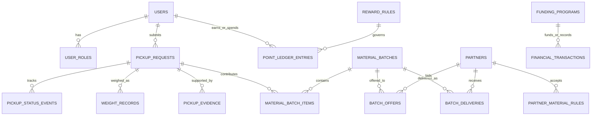

# Product Requirements Document (PRD)
# WasteLink Bali — Platform Pengelolaan Sampah Berbasis Komunitas dan Ekonomi Sirkular

> **Status dokumen:** Draft PRD untuk hackathon / MVP  
> **Versi:** 1.0  
> **Tanggal:** 29 Oktober 2026  
> **Bahasa utama produk:** Bahasa Indonesia  
> **Wilayah pilot yang diasumsikan:** satu banjar atau desa di Bali  
> **Zona waktu:** WITA (`Asia/Makassar`)  
> **Mata uang:** Rupiah (IDR)  
> **Catatan penting:** angka poin, harga material, SLA, biaya, dan contoh transaksi dalam dokumen ini adalah asumsi desain untuk prototipe. Nilai final harus ditetapkan berdasarkan survei harga mitra, biaya operasional, uji lapangan, dan persetujuan pengelola.

---

## 1. Ringkasan Eksekutif

WasteLink Bali adalah platform pengelolaan sampah yang menghubungkan warga, petugas pengangkut, pengolah sampah, bank sampah, pengepul, pengerajin, pelaku usaha, sponsor, dan administrator program. Platform mengelola siklus sampah dari pelaporan atau setoran, pemilahan, penjadwalan, penjemputan, penimbangan, verifikasi kualitas, pemberian reward, sampai distribusi material ke pihak yang mampu mengolahnya.

WasteLink bukan hanya aplikasi penjemputan sampah. Nilai utamanya adalah membuat alur sampah lebih **terlacak, terpilah, terkoordinasi, dan berpotensi menghasilkan nilai ekonomi**.

### 1.1 Masalah yang ingin diselesaikan

1. Warga tidak selalu mengetahui cara memilah atau ke mana harus menyalurkan sampah.
2. Pengangkutan sampah dapat tidak terkoordinasi, terutama jika lokasi, jadwal, kapasitas, atau kebutuhan pengolah tidak jelas.
3. Sampah organik mudah membusuk dan membutuhkan jalur pengumpulan serta pengolahan yang berbeda dari material kering.
4. Sampah daur ulang sering bernilai hanya jika jenis, kebersihan, berat, dan volume memenuhi kebutuhan pembeli.
5. Petugas membutuhkan daftar tugas yang jelas, mekanisme pembuktian pekerjaan, dan pencatatan hasil yang konsisten.
6. Pengelola program membutuhkan data untuk mengetahui volume yang terkumpul, material yang tersalurkan, performa pengangkutan, serta biaya dan sumber pendanaan.
7. Insentif warga perlu dirancang agar menarik tetapi tidak menjanjikan nilai yang lebih besar daripada kemampuan pendanaan program.

### 1.2 Solusi inti

- **Waste Collection:** pelaporan, permintaan penjemputan, penugasan petugas, dan pelacakan status.
- **Waste Sorting:** klasifikasi sampah berdasarkan kategori, subkategori, kondisi, tingkat kontaminasi, dan jalur pengolahan.
- **WastePoints:** pencatatan berat tervalidasi dan pemberian poin berdasarkan aturan yang dapat dikonfigurasi.
- **Circular Marketplace:** pencocokan batch material dengan kebutuhan pengepul, bank sampah, pengolah, dan pengerajin.
- **Operations Dashboard:** dashboard untuk admin/pengelola dalam mengelola pengguna, petugas, kategori, transaksi, mitra, pendanaan, dan laporan dampak.

### 1.3 Prinsip produk

1. **Satu akun, beberapa role:** pengguna dapat memiliki role warga dan petugas sekaligus jika role petugas disetujui. Berpindah role tidak membuat akun baru.
2. **Berat berasal dari penimbangan:** AI boleh membantu klasifikasi visual, tetapi tidak boleh menjadi sumber utama penentuan berat.
3. **Reward diterbitkan setelah verifikasi:** laporan atau foto saja tidak cukup untuk menerbitkan reward berbasis berat.
4. **Sampah mempunyai jalur berbeda:** organik, anorganik bernilai, residu, dan limbah khusus tidak diperlakukan sama.
5. **Pelacakan dari awal sampai akhir:** status setoran, petugas, berat, kualitas, batch, dan penerima material dicatat.
6. **Ekonomi yang bertanggung jawab:** poin, harga, subsidi, dan reward harus dapat diaudit dan didukung pendanaan.
7. **Keselamatan lebih penting daripada penyelesaian tugas:** limbah yang tidak dikenal atau berbahaya tidak boleh diterima melalui alur sampah biasa.
8. **Privasi minimum:** lokasi dan kontak hanya digunakan sejauh diperlukan untuk pelaksanaan layanan.

---

## 2. Latar Belakang dan Pernyataan Masalah

### 2.1 Problem statement

Warga membutuhkan cara praktis untuk memilah dan menyalurkan sampahnya, sedangkan petugas dan pengolah membutuhkan informasi yang benar mengenai lokasi, kategori, kualitas, berat, volume, waktu, dan tujuan material. Tanpa pencatatan end-to-end, sistem sulit memastikan sampah benar-benar diangkut dan tersalurkan, reward diberikan secara adil, atau biaya operasional tertutup.

### 2.2 Pernyataan peluang

WasteLink dapat membuat jaringan operasional lokal yang menghubungkan pasokan material dari warga/usaha dengan kapasitas petugas dan permintaan pihak pengolah. Sistem reward berfungsi sebagai alat untuk mendorong perilaku pemilahan, bukan sebagai tujuan tunggal produk.

### 2.3 Asumsi awal yang perlu diuji

- Warga bersedia memilah sampah apabila panduan mudah dipahami dan jalur penjemputan jelas.
- Sebagian warga akan termotivasi oleh poin, voucher, manfaat komunitas, atau laporan kontribusi.
- Pengangkut bersedia memakai aplikasi jika tugas, lokasi, dan pembuktian kerja tidak terlalu membebani.
- Terdapat calon mitra lokal yang dapat menerima kategori material tertentu dengan spesifikasi yang jelas.
- Organik perlu dijadwalkan lebih cepat daripada sebagian material kering; frekuensi final ditentukan oleh fasilitas pengolahan, cuaca, volume, dan kesepakatan operasional.
- Pada MVP, penimbangan dilakukan menggunakan timbangan fisik dan dimasukkan oleh petugas terverifikasi.
- Sistem pembayaran tunai otomatis belum menjadi kebutuhan MVP.

### 2.4 Hal yang tidak boleh diasumsikan tanpa validasi

- Harga beli per kilogram suatu jenis sampah di wilayah pilot.
- Jaminan bahwa semua material selalu diterima pembeli.
- Kapasitas dan jadwal aktual pengolah organik.
- Ketersediaan integrasi API pemerintah atau operator persampahan.
- Hak WasteLink untuk mengangkut atau memproses setiap jenis limbah.
- Nilai tukar poin menjadi uang tunai.
- Bahwa estimasi dampak karbon dapat dihitung akurat tanpa metodologi dan faktor emisi yang tervalidasi.

---

## 3. Visi, Misi, dan Sasaran Produk

### 3.1 Visi

Menjadi platform pengelolaan sampah berbasis komunitas yang membuat pemilahan dan distribusi material lebih mudah, transparan, dan terhubung ke pihak pengolah.

### 3.2 Misi

- Memudahkan warga melaporkan atau menyetorkan sampah dengan kategori yang tepat.
- Menyediakan operasi penjemputan yang dapat dilacak.
- Mendorong pengumpulan sampah terpilah dengan sistem reward yang bertanggung jawab.
- Menghubungkan material yang terkumpul dengan mitra pengolah sesuai spesifikasi.
- Menyediakan data operasional dan dampak yang dapat ditinjau pengelola.

### 3.3 Tujuan MVP

1. Menyelesaikan satu alur utuh: warga mengajukan setoran → petugas menerima dan menjemput → berat dan kondisi diverifikasi → poin dicatat jika memenuhi ketentuan → material diarahkan ke batch dan mitra.
2. Mendukung satu akun yang mempunyai role `USER` dan `COLLECTOR` dengan switch role yang aman.
3. Menampilkan pemilahan minimal untuk empat kategori besar: organik, anorganik bernilai, residu, dan limbah khusus.
4. Menyediakan proses verifikasi petugas dan transaksi yang dapat diaudit.
5. Mendemonstrasikan pencocokan material daur ulang dengan kebutuhan pembeli.

### 3.4 Bukan tujuan MVP

- Menjadi sistem pengganti resmi layanan darurat atau sistem persampahan pemerintah.
- Menjamin layanan real-time tanpa sumber data yang memadai.
- Membuat timbangan otomatis hanya melalui foto.
- Membeli atau menjual seluruh jenis limbah secara langsung tanpa mitra.
- Menjadi dompet digital atau layanan pembayaran lintas pengguna.
- Mengolah limbah B3 secara mandiri.
- Menjanjikan pengurangan emisi atau dampak lingkungan tertentu tanpa metode pengukuran tervalidasi.
- Mengintegrasikan semua banjar, desa, hotel, restoran, dan pengolah pada tahap pertama.

---

## 4. Pengguna dan Pemangku Kepentingan

### 4.1 Persona utama

#### Persona A — Warga / User
- Ingin membuang atau menyetorkan sampah dengan cara yang benar.
- Membutuhkan panduan yang sederhana dan jadwal yang dapat dipahami.
- Ingin mengetahui apakah laporan sudah diambil.
- Mungkin tertarik pada poin atau manfaat komunitas.
- Tidak harus memiliki pengetahuan teknis pengolahan sampah.

**Kebutuhan:** aplikasi sederhana, status yang transparan, konfirmasi penjemputan, panduan pemilahan, dan riwayat setoran.

#### Persona B — Petugas Sampah / Collector
- Menangani tugas pengumpulan di wilayah tertentu.
- Membutuhkan daftar tugas yang sesuai dengan area, kendaraan, kapasitas, dan jadwal.
- Perlu mencatat berat dan kualitas setelah pemeriksaan.
- Perlu menandai tugas selesai dengan bukti yang memadai.

**Kebutuhan:** tampilan tugas ringkas, navigasi lokasi, informasi material, perubahan status yang mudah, dan riwayat tugas.

#### Persona C — Admin / Operator WasteLink
- Mengelola pengguna, verifikasi petugas, jadwal, kategori, tarif reward, mitra, transaksi, komplain, dan laporan.
- Membutuhkan jejak audit untuk perubahan yang berpengaruh ke operasional atau nilai poin.

**Kebutuhan:** dashboard administrasi, kontrol akses, pengelolaan pengecualian, dan laporan.

#### Persona D — Mitra Pengolah / Buyer
- Pengepul, bank sampah, industri daur ulang, pengolah organik, pengelola kompos/BSF, atau pengerajin.
- Memerlukan material dengan jenis, berat, mutu, volume, dan jadwal yang sesuai.

**Kebutuhan:** profil kebutuhan material, penawaran batch, pencatatan penerimaan, dan riwayat transaksi.

#### Persona E — Sponsor / Mitra Pendanaan
- Perusahaan, merchant, komunitas, atau pihak pendukung program.
- Ingin mendukung kegiatan yang terukur dan memiliki pelaporan yang jelas.

**Kebutuhan:** ringkasan program, alokasi pendanaan, jumlah peserta, volume terkumpul, penggunaan dana, dan laporan hasil.

### 4.2 Role dan permission

Satu akun dapat memiliki lebih dari satu role. `active_role` hanya menentukan konteks tampilan saat ini dan **bukan sumber otorisasi backend**.

Role yang disarankan:

- `USER`: membuat laporan/setoran, melihat status, riwayat, panduan, dan poin milik sendiri.
- `COLLECTOR`: melihat tugas yang tersedia/ditugaskan, menerima tugas, melakukan verifikasi lapangan, memperbarui status, menimbang dan mencatat bukti.
- `BUYER`: mengelola profil organisasi, kebutuhan material, penawaran batch, konfirmasi penerimaan.
- `ADMIN`: mengelola data master dan operasi sesuai scope yang ditentukan.
- `FINANCE`: meninjau pendanaan, biaya, penjualan, reward, rekonsiliasi, dan laporan keuangan.
- `COMMUNITY_COORDINATOR` (opsional MVP): memantau program pada satu banjar/desa tanpa akses ke data sensitif yang tidak diperlukan.

Role `USER` dapat diberikan saat pendaftaran. Role `COLLECTOR`, `BUYER`, `FINANCE`, dan `ADMIN` harus melalui persetujuan atau pemberian hak oleh pihak berwenang. Pendaftaran mandiri tidak boleh otomatis memberi hak istimewa.

### 4.3 Matriks permission ringkas

| Fitur / aksi | User | Collector | Buyer | Admin | Finance |
|---|---:|---:|---:|---:|---:|
| Mengelola profil pribadi | Ya | Ya | Ya | Ya | Ya |
| Membuat laporan setoran | Ya | Tidak wajib | Tidak | Dengan izin khusus | Tidak |
| Melihat laporan pribadi | Ya | Hanya tugas relevan | Tidak | Ya sesuai scope | Ringkasan bila perlu |
| Melihat tugas tersedia | Tidak | Ya | Tidak | Ya | Tidak |
| Menerima/menolak tugas | Tidak | Ya | Tidak | Override terbatas + audit | Tidak |
| Mengisi berat/verifikasi | Tidak | Ya untuk tugasnya | Tidak | Koreksi dengan audit | Tidak |
| Mengubah tarif reward | Tidak | Tidak | Tidak | Ya, dengan audit | Dapat meninjau |
| Melihat/mengubah ledger poin | Melihat milik sendiri | Tidak boleh mengubah | Tidak | Penyesuaian dengan audit | Rekonsiliasi sesuai izin |
| Mengelola kebutuhan material | Tidak | Tidak | Ya | Ya | Tidak |
| Mengonfirmasi batch diterima | Tidak | Tidak | Ya | Ya | Tidak |
| Melihat data keuangan menyeluruh | Tidak | Tidak | Data transaksi sendiri | Terbatas sesuai izin | Ya |
| Mengelola role | Tidak | Tidak | Tidak | Ya | Tidak |

---

## 5. Konsep Switch Role

### 5.1 Tujuan

Memungkinkan satu orang menggunakan akun yang sama sebagai warga dan petugas, tanpa akun duplikat. Contoh: pada hari tertentu pengguna menyetorkan kaleng sebagai warga; pada waktu kerja ia berpindah ke mode petugas untuk menangani tugas penjemputan.

### 5.2 Aturan bisnis

1. Akun yang baru dibuat mempunyai role `USER`.
2. Pengguna dapat mengajukan aktivasi role `COLLECTOR` dari menu profil.
3. Permohonan minimal berisi identitas yang diperlukan, area layanan, jenis kendaraan/peralatan (jika relevan), kontak, persetujuan kebijakan operasional, dan dokumen verifikasi yang ditetapkan pengelola.
4. Status verifikasi petugas: `NOT_APPLIED`, `PENDING`, `APPROVED`, `REJECTED`, `SUSPENDED`, `EXPIRED` jika masa berlaku diterapkan.
5. Hanya akun dengan `COLLECTOR` berstatus `APPROVED` yang dapat mengaktifkan mode petugas.
6. Switch role mengubah dashboard dan menu yang tampil, tetapi tidak menghapus sesi, data, riwayat, atau tugas.
7. Backend memvalidasi role dan status pada setiap endpoint yang memerlukan izin.
8. Perubahan role aktif dicatat sebagai event audit jika dibutuhkan untuk analisis keamanan; perubahan tersebut tidak boleh memberi atau menghilangkan hak permanen.
9. Jika akun petugas `SUSPENDED`, mode petugas tidak dapat digunakan. Pengguna masih dapat memakai role lain yang valid.
10. Jika pengguna mempunyai tugas aktif, switch ke mode User diperbolehkan, tetapi tugas tidak dibatalkan dan tetap muncul saat kembali ke mode petugas. Sistem boleh menampilkan pengingat.
11. Satu tugas tidak dapat dikerjakan dua petugas sekaligus kecuali ada alokasi multi-petugas yang secara eksplisit didukung.
12. Logout menutup sesi; role aktif terakhir boleh disimpan sebagai preferensi UI, bukan sebagai izin backend.

### 5.3 UI switch role

Lokasi yang disarankan: menu profil atau selector yang jelas pada bagian header/sidebar.

Konten selector:
- `Mode User`.
- `Mode Petugas Sampah` (hanya tampil aktif jika role sudah disetujui).
- `Ajukan menjadi Petugas` jika belum terdaftar.
- Status verifikasi dan tindakan lanjutan jika masih menunggu atau ditolak.

### 5.4 Acceptance criteria switch role

- Pengguna dengan role `USER` saja tidak dapat membuka dashboard petugas melalui URL langsung.
- Pengguna dengan `USER` dan `COLLECTOR=APPROVED` dapat berpindah role tanpa login ulang.
- Menu, halaman, dan API mengikuti role aktif di UI sekaligus permission aktual di backend.
- Tugas aktif dan riwayat tetap konsisten setelah pergantian role.
- Jika status petugas ditangguhkan saat pengguna sedang berada di mode petugas, akses aksi petugas selanjutnya ditolak oleh backend dan pengguna menerima pesan yang jelas.

---

## 6. Taksonomi dan Pemilahan Sampah

### 6.1 Prinsip klasifikasi

WasteLink menggunakan dua lapisan:

1. **Kategori operasional:** kategori besar yang dipilih pengguna.
2. **Subkategori material:** jenis yang lebih spesifik, dengan aturan penanganan, kualitas, mitra, dan reward masing-masing.

Kategori final yang diterima di setiap area bergantung pada fasilitas dan mitra yang benar-benar tersedia. Aplikasi harus dapat menonaktifkan jenis material yang belum memiliki jalur pengolahan.

### 6.2 Kategori utama

#### A. Organik
Contoh subkategori:
- Sisa buah dan sayuran.
- Sisa makanan matang.
- Ampas kopi/teh.
- Daun, rumput, dan potongan tanaman.
- Cangkang telur atau material organik lain jika diterima pengolah.

Batasan:
- Tidak dicampur plastik, logam, kaca, baterai, bahan kimia, atau limbah khusus.
- Tulang besar, minyak/kuah berlebih, makanan sangat asin/berminyak, dan jenis tertentu dapat ditolak oleh mitra tertentu; aturan ditetapkan per pengolah.
- Sampah organik basah diprioritaskan berdasarkan kapasitas dan waktu operasi pengolah.

Jalur tujuan:
- Komposting.
- Pengolahan melalui BSF/maggot bila diterima dan aman menurut prosedur mitra.
- Pengolahan organik lain yang tervalidasi.

#### B. Anorganik bernilai / material daur ulang
Contoh subkategori:
- Kaleng aluminium.
- Besi/logam lain.
- Botol plastik PET.
- HDPE atau plastik lain bila diterima.
- Kardus.
- Kertas.
- Kaca sesuai jenis dan keamanan penanganan.

Batasan:
- Kualitas, kebersihan, kekeringan, tutup/label, atau pemisahan material ditentukan berdasarkan spesifikasi buyer.
- Benda tajam, aerosol bertekanan, wadah bekas bahan berbahaya, atau kemasan terkontaminasi tidak masuk alur standar tanpa prosedur khusus.
- Kategori daur ulang tidak otomatis berarti material pasti diterima pembeli.

Jalur tujuan:
- Bank sampah.
- Pengepul.
- Industri daur ulang.
- Pengerajin/upcycling.

#### C. Residu
Contoh yang dapat masuk kategori ini tergantung aturan lokal dan mitra: tisu/pembungkus kotor, popok sekali pakai, kemasan multi-lapis yang tidak diterima, atau material campuran yang tidak dapat dipilah dengan aman.

Aturan:
- Tidak mendapat reward material secara default.
- Sistem tetap boleh mengatur layanan pengangkutan residu jika WasteLink memiliki kerja sama layanan yang sesuai.
- Pengguna menerima alasan apabila permintaan ditolak atau dialihkan.

#### D. Limbah khusus / berpotensi berbahaya
Contoh:
- Baterai.
- Lampu tertentu.
- E-waste.
- Wadah atau sisa bahan kimia rumah tangga.
- Benda tajam atau material lain yang membutuhkan penanganan khusus.

Aturan:
- Tidak digabung dengan setoran biasa.
- Pengguna menerima instruksi aman dan tujuan penyerahan yang sudah diverifikasi.
- Petugas umum tidak boleh menangani material tersebut kecuali secara khusus berwenang, terlatih, dan dilengkapi prosedur/peralatan yang sesuai.
- Jika belum ada jalur mitra, sistem harus menyatakan bahwa kategori tersebut belum tersedia dan tidak membuat janji penjemputan.

### 6.3 Informasi per kategori/subkategori

Setiap `waste_category` atau `material_type` setidaknya mempunyai:
- ID dan nama.
- Kategori induk.
- Deskripsi singkat.
- Contoh yang diterima.
- Contoh yang ditolak.
- Instruksi persiapan sebelum penjemputan.
- Apakah perlu dibilas/dikeringkan/dikemas khusus.
- Apakah dapat dipungut melalui penjemputan umum.
- Apakah berpotensi berbahaya.
- Apakah reward aktif.
- Satuan berat/volume yang digunakan.
- Mitra pengolah/buyer yang menerima.
- Batas berat/volume minimum atau maksimum jika ada.
- Prioritas jadwal/SLA yang dapat dikonfigurasi.
- Versi kebijakan dan tanggal berlaku.

### 6.4 Form setoran warga

Field minimum:
- Kategori utama.
- Subkategori.
- Perkiraan jumlah/volume (opsional sebelum penjemputan, jika berat belum diketahui).
- Foto kondisi sampah (opsional atau wajib sesuai aturan kategori).
- Alamat/titik lokasi penjemputan.
- Catatan untuk petugas.
- Pilihan penjemputan atau drop-off jika tersedia.
- Slot jadwal.
- Persetujuan atas panduan dan aturan penerimaan.

Untuk organik, tambahkan:
- Jenis organik.
- Apakah tercampur sampah lain.
- Perkiraan waktu sejak sampah dihasilkan (opsional, berbentuk rentang).
- Kondisi khusus yang relevan, misalnya berair/berbau, dengan instruksi yang tidak menyalahkan pengguna.

Untuk material daur ulang, tambahkan:
- Jenis material.
- Kondisi kering/basah atau bersih/kotor jika relevan.
- Perkiraan jumlah.
- Informasi penanganan aman untuk benda yang berpotensi tajam.

### 6.5 Dukungan AI untuk klasifikasi

AI dapat:
- Memberikan saran kategori berdasarkan foto.
- Meminta pengguna mengambil foto ulang bila kualitas gambar rendah.
- Menampilkan alasan sederhana, misalnya “kemungkinan botol PET”.
- Menyarankan kategori yang dapat diterima dalam wilayah tersebut.

AI tidak boleh:
- Menentukan berat final hanya dari foto.
- Menjamin material mempunyai nilai jual.
- Memutuskan limbah berbahaya aman ditangani.
- Menetapkan nilai uang/poin tanpa tarif yang disetujui sistem.
- Mengganti keputusan verifikasi petugas untuk kasus yang meragukan.

Jika confidence klasifikasi di bawah ambang konfigurasi, minta pengguna memilih kategori secara manual atau tandai `NEEDS_REVIEW`.

---

## 7. Pengelolaan Sampah Organik yang Mudah Membusuk

### 7.1 Sasaran

Membuat alur organik lebih cepat dan terkontrol agar tidak bercampur dengan material daur ulang, tidak menumpuk tanpa tujuan, serta terkirim ke pengolah yang sesuai.

### 7.2 Proses end-to-end

1. Warga memilih kategori Organik dan subkategori.
2. Sistem menampilkan panduan pemilahan sesuai jenis organik dan ketersediaan pengolah.
3. Warga mengajukan permintaan penjemputan atau drop-off.
4. Sistem menampilkan slot yang memiliki kapasitas pengangkutan/pengolahan.
5. Permintaan menerima prioritas berdasarkan kebijakan operasional (misalnya usia permintaan, jenis organik, kapasitas, dan area), bukan janji SLA yang belum disepakati.
6. Petugas menerima tugas dan melihat panduan penanganan.
7. Petugas memeriksa kontaminasi dan menimbang berat bersih.
8. Jika diterima, material dicatat ke batch organik.
9. Batch dialokasikan ke pengolah yang menerima jenis tersebut dan mempunyai kapasitas.
10. Pengolah mengonfirmasi penerimaan dan status proses sesuai kemampuan integrasi/operasi.
11. Sistem mencatat volume yang diterima, ditolak, kontaminan, tanggal, dan tujuan pengolahan.
12. Reward diterbitkan berdasarkan skema yang aktif dan anggaran tersedia.

### 7.3 Kebijakan jadwal

- Jadwal organik ditentukan berdasarkan kapasitas, frekuensi pengumpulan, waktu tempuh, dan kebutuhan mitra.
- Konfigurasi waktu prioritas dapat berbeda untuk rumah tangga, usaha makanan, dan area tertentu.
- Jika tidak ada pengolah atau kapasitas yang tersedia, sistem tidak boleh menerima permintaan seolah-olah layanan pasti tersedia.
- Apabila terjadi keterlambatan, pengguna dan petugas mendapat notifikasi serta pilihan jadwal ulang/pembatalan sesuai kebijakan.
- Sistem harus mendukung penutupan sementara suatu kategori/area ketika kapasitas pengolahan penuh.

### 7.4 Kontaminasi dan penolakan

Status pemeriksaan organik:
- `ACCEPTED`: memenuhi kriteria.
- `ACCEPTED_WITH_CONTAMINATION`: dapat diterima dengan catatan/penyesuaian sesuai aturan.
- `REJECTED`: tidak dapat diterima.
- `NEEDS_REVIEW`: memerlukan keputusan admin/mitra.

Penolakan harus menyimpan alasan terstruktur, misalnya:
- Tercampur plastik/logam/kaca.
- Mengandung bahan tidak diterima oleh pengolah.
- Kondisi tidak sesuai panduan mitra.
- Tidak ada kapasitas pengolahan.
- Tidak aman ditangani petugas umum.

Petugas tidak boleh menghapus laporan hanya karena ditolak; kejadian tetap dicatat untuk analisis dan transparansi.

### 7.5 Reward organik

Dua model yang dapat dipilih per program:

**Model A — Reward per berat yang diterima**
- Tarif per kg dikonfigurasi berdasarkan subkategori dan program.
- Reward hanya diberikan pada berat bersih yang diterima setelah pemeriksaan.
- Pembayaran dapat disubsidi sponsor/merchant/program lingkungan atau didukung pendapatan hasil pengolahan.

**Model B — Reward partisipasi**
- Poin diberikan untuk setoran yang memenuhi standar pemilahan atau konsistensi partisipasi.
- Tidak mengharuskan adanya harga jual langsung per kg.
- Batas reward per pengguna/per periode dapat diterapkan berdasarkan anggaran.

Kedua model tidak boleh dijumlahkan ganda untuk event setoran yang sama kecuali aturan program dengan jelas mengizinkan bonus tambahan.

---

## 8. Alur Pengumpulan dan Status Permintaan

### 8.1 Status permintaan (pickup request)

Status minimum yang disarankan:

- `DRAFT`: pengajuan belum dikirim.
- `SUBMITTED`: pengajuan diterima sistem.
- `PENDING_ASSIGNMENT`: menunggu petugas.
- `ACCEPTED`: telah diterima satu petugas.
- `SCHEDULED`: jadwal dikonfirmasi.
- `EN_ROUTE`: petugas menuju lokasi, jika fitur ini digunakan.
- `ARRIVED`: petugas tiba, jika konfirmasi kedatangan digunakan.
- `INSPECTION`: pemeriksaan kategori/kualitas.
- `WEIGHED`: berat bersih dicatat.
- `COLLECTED`: sampah telah dikumpulkan.
- `DELIVERED_TO_FACILITY`: diserahkan ke fasilitas/batch tujuan.
- `COMPLETED`: proses operasional selesai sesuai definisi program.
- `CANCELLED_BY_USER`.
- `CANCELLED_BY_COLLECTOR`.
- `CANCELLED_BY_ADMIN`.
- `REJECTED`: permintaan ditolak dengan alasan.
- `RESCHEDULE_REQUIRED`: perlu jadwal ulang.
- `DISPUTED`: ada keberatan dari pengguna/petugas/mitra.

Status dapat disederhanakan untuk MVP UI, tetapi backend perlu menyimpan transisi yang memadai untuk audit.

### 8.2 Aturan transisi

- `SUBMITTED` → `PENDING_ASSIGNMENT` setelah validasi.
- `PENDING_ASSIGNMENT` → `ACCEPTED` hanya oleh petugas yang memenuhi syarat, atau penugasan admin yang sah.
- `ACCEPTED` → `SCHEDULED` bila slot dikonfirmasi.
- `SCHEDULED` → `EN_ROUTE` → `ARRIVED` jika tracking tahapan diaktifkan.
- `ARRIVED` → `INSPECTION` saat petugas memeriksa material.
- `INSPECTION` → `WEIGHED` jika diterima/diterima sebagian dan berat sudah dicatat.
- `INSPECTION` → `REJECTED` atau `RESCHEDULE_REQUIRED` untuk kasus yang sesuai.
- `WEIGHED` → `COLLECTED` setelah sampah benar-benar diserahkan kepada petugas.
- `COLLECTED` → `DELIVERED_TO_FACILITY` setelah batch diserahkan ke tujuan, jika alur pengiriman termasuk dalam layanan.
- `COMPLETED` hanya setelah syarat penyelesaian yang dikonfigurasi dipenuhi.
- Pembatalan setelah petugas menerima tugas harus memiliki alasan dan mengirim notifikasi kepada pihak terkait.
- Transisi mundur atau perubahan berat setelah verifikasi harus dilakukan melalui koreksi yang memiliki audit log; jangan menimpa histori secara diam-diam.

### 8.3 Multi-item dalam satu setoran

MVP sebaiknya memungkinkan satu permintaan berisi beberapa item/kategori hanya bila setiap item tetap dapat ditimbang, diverifikasi, dan dirutekan secara terpisah. Jika ini terlalu kompleks, batasi satu permintaan untuk satu kategori/subkategori dan nyatakan batas tersebut pada UI.

Rekomendasi MVP: **satu permintaan = satu kategori utama dan satu subkategori material** agar reward, kualitas, dan tujuan pengolahan lebih sederhana. Multi-item dapat dijadwalkan sebagai fitur lanjutan.

### 8.4 Penjadwalan dan kapasitas

Setiap slot penjemputan dapat mempunyai:
- Area operasional.
- Rentang waktu.
- Kapasitas tugas/berat/volume.
- Kategori sampah yang dapat dibawa.
- Kapasitas petugas/kendaraan.
- Kapasitas penerimaan pengolah yang terkait.
- Status slot: `OPEN`, `FULL`, `CLOSED`, `CANCELLED`.

Jangan menampilkan slot yang penuh/ditutup. Jika kapasitas berubah setelah permintaan dibuat, sistem perlu memberi tahu pengguna dan menyarankan pilihan lain.

---

## 9. Peran Petugas dan Operasi Lapangan

### 9.1 Onboarding petugas

Data yang dapat diminta sesuai kebutuhan minimum:
- Nama dan informasi kontak.
- Area kerja.
- Jenis layanan/material yang dapat ditangani.
- Jenis kendaraan/peralatan bila diperlukan.
- Ketersediaan waktu.
- Informasi atau dokumen verifikasi sesuai kebijakan operator.
- Persetujuan SOP, privasi, keselamatan, dan kebijakan pembatalan.

Pengumpulan data identitas wajib dibatasi pada yang benar-benar diperlukan. Masa simpan dokumen dan siapa yang dapat mengaksesnya harus ditetapkan sebelum peluncuran.

### 9.2 Daftar tugas petugas

Setiap kartu tugas menampilkan:
- ID permintaan.
- Area dan jarak perkiraan jika perhitungan tersedia.
- Slot waktu.
- Kategori/subkategori.
- Foto dan catatan.
- Estimasi berat/volume, jika diberikan.
- Peringatan kontaminasi atau penanganan khusus.
- Status penugasan.
- Tombol terima/tolak dengan alasan.

Informasi kontak lengkap dan alamat rinci hanya tampil setelah tugas diterima/ditugaskan jika kebijakan privasi mengharuskan.

### 9.3 Penimbangan

- Berat dicatat dalam satuan dasar gram atau kilogram dengan presisi yang konsisten.
- Simpan berat bruto, tara (jika digunakan), dan berat bersih bila proses lapangan membutuhkannya.
- Rumus: `berat_bersih = berat_bruto - berat_tara`.
- Validasi berat tidak boleh negatif dan harus berada dalam batas wajar yang dikonfigurasi per jenis material.
- Simpan siapa yang menimbang, kapan, perangkat/timbangan bila relevan, foto bukti opsional, dan catatan.
- Perubahan berat sesudah verifikasi harus membuat record koreksi atau versi baru, bukan menghilangkan nilai sebelumnya.
- Apabila timbangan tidak tersedia atau gagal, tugas tidak boleh mendapatkan reward berbasis berat otomatis. Sediakan status `WEIGHT_PENDING` atau alur bantuan admin.

### 9.4 Bukti penyelesaian

Bukti dapat berupa:
- Foto material saat diserahkan.
- Berat bersih dan kategori.
- Timestamp server.
- Identitas petugas.
- Konfirmasi pengguna melalui OTP/tombol konfirmasi jika diperlukan.
- Bukti penyerahan ke fasilitas/buyer untuk pelacakan batch.

MVP tidak perlu memaksakan seluruh bukti untuk semua kategori. Persyaratan harus dapat dikonfigurasi berdasarkan jenis sampah, risiko fraud, dan operasi lapangan.

### 9.5 Keselamatan petugas

- Petugas dapat menolak material yang tidak aman atau tidak sesuai SOP.
- Aplikasi menampilkan instruksi kategori khusus sebelum tugas diambil.
- Petugas dapat menandai `UNSAFE_TO_HANDLE` dan mengirim foto/catatan tanpa diwajibkan menyentuh material.
- Material khusus/berbahaya tidak boleh masuk ke rute standar secara otomatis.
- Jika ada insiden, sediakan alur pelaporan insiden yang tidak bergantung pada alur reward.

---

## 10. Sistem WastePoints dan Reward

### 10.1 Tujuan

Mendorong pemilahan yang benar dan partisipasi rutin tanpa membuat insentif yang tidak didukung anggaran atau nilai material.

### 10.2 Istilah yang harus dibedakan

- **Harga material:** nilai beli/jual aktual atau nilai acuan yang disepakati untuk suatu material.
- **Alokasi reward:** bagian yang ditetapkan untuk reward dari sumber dana yang sah.
- **WastePoints:** unit poin internal untuk program reward.
- **Voucher/benefit:** manfaat yang dapat ditukar dengan poin.
- **Pembayaran tunai:** pembayaran uang nyata; tidak otomatis disediakan hanya karena ada poin.
- **Saldo poin tersedia:** poin yang dapat digunakan.
- **Poin tertunda:** poin yang belum dapat digunakan karena menunggu verifikasi, penerimaan buyer, atau aturan program.
- **Poin dibekukan:** poin yang sedang diperiksa karena sengketa/indikasi penyalahgunaan.

### 10.3 Model penerbitan poin

WasteLink mendukung konfigurasi reward per material dan program. Contoh formula:

`nilai_material = berat_bersih_kg × harga_acuan_per_kg × faktor_kualitas`

`alokasi_reward = nilai_material × persentase_reward`

`poin_diterbitkan = floor(alokasi_reward / nilai_tukar_poin)`

Contoh angka untuk demo saja:
- Berat bersih: 2 kg.
- Harga acuan hipotetis: Rp5.000/kg.
- Faktor kualitas: 1,0.
- Porsi reward: 70%.
- Nilai tukar internal untuk program: Rp100 per poin.
- Nilai material hipotetis = Rp10.000.
- Alokasi reward hipotetis = Rp7.000.
- Poin yang diterbitkan = 70 poin.

Semua angka harus dapat diubah oleh admin sesuai program. Contoh tersebut bukan rekomendasi harga pasar atau janji nilai tunai.

### 10.4 Model organik

Karena sampah organik belum tentu mempunyai nilai jual langsung, gunakan salah satu skema berikut:

- `WEIGHT_BASED`: poin per kg organik yang diterima, didanai oleh sponsor, kontrak layanan, program lingkungan, atau pendapatan hasil olahan.
- `PARTICIPATION`: poin tetap ketika pengguna melakukan setoran yang memenuhi standar pemilahan.
- `CAMPAIGN_BONUS`: bonus tambahan dalam kampanye berjangka, dengan batas anggaran.

Aturan sistem harus mencegah reward ganda yang tidak disengaja untuk satu event setoran.

### 10.5 Model material daur ulang

- Reward hanya dihitung setelah berat dan kualitas diverifikasi.
- Tarif dapat berbeda berdasarkan subkategori material, kualitas, wilayah, tanggal berlaku, dan program.
- Harga buyer boleh berubah; sistem harus menyimpan versi tarif yang digunakan ketika reward dihitung.
- Jika harga final baru diketahui setelah buyer menerima material, poin dapat berada dalam status `PENDING_SETTLEMENT` hingga rekonsiliasi selesai.
- Jika material ditolak buyer, aturan koreksi harus jelas dan tidak boleh mengubah saldo pengguna secara diam-diam.

### 10.6 Status transaksi poin

- `PENDING`: menunggu verifikasi/konfirmasi.
- `AVAILABLE`: dapat digunakan.
- `REDEEMED`: telah ditukar.
- `EXPIRED`: kedaluwarsa menurut kebijakan yang diinformasikan sebelumnya.
- `FROZEN`: ditahan untuk pemeriksaan.
- `REVERSED`: dibatalkan melalui transaksi koreksi yang memiliki audit.

### 10.7 Ledger poin

Gunakan ledger append-only: setiap penambahan/pengurangan dicatat sebagai baris transaksi baru; saldo adalah hasil agregasi ledger atau cache yang direkonsiliasi.

Field minimum ledger:
- ID transaksi.
- User ID.
- Jenis transaksi: `EARN`, `REDEEM`, `BONUS`, `ADJUSTMENT`, `REVERSAL`, `EXPIRY`.
- Jumlah poin positif/negatif.
- Status.
- Sumber transaksi (pickup, campaign, redemption, koreksi).
- ID sumber.
- Alasan/keterangan.
- Dibuat oleh / sistem.
- Timestamp.
- `idempotency_key` untuk mencegah transaksi duplikat.
- Referensi persetujuan admin jika transaksi manual.

Jangan mengedit saldo secara langsung tanpa ledger. Penyesuaian manual harus meminta alasan dan menyimpan admin pelaksana.

### 10.8 Penukaran poin

MVP dapat mendukung:
- Voucher merchant.
- Diskon layanan/produk dari mitra.
- Benefit komunitas yang didanai sponsor.
- Donasi poin untuk program lingkungan jika mekanismenya transparan.

MVP tidak perlu mendukung pencairan tunai. Jika kelak poin dapat dicairkan, model hukum, akuntansi, pajak, dan risiko regulasi perlu ditinjau secara profesional sebelum diaktifkan.

### 10.9 Batasan dan pencegahan penyalahgunaan

- Batas reward per permintaan, per pengguna, dan per hari/minggu/bulan dapat dikonfigurasi.
- Poin baru diterbitkan sekali untuk satu event penimbangan yang valid.
- Perubahan berat/kualitas memerlukan audit dan memicu perhitungan ulang sesuai aturan.
- Foto tidak boleh dianggap sebagai bukti berat.
- Transaksi dengan pola abnormal ditandai untuk pemeriksaan, bukan langsung memblokir pengguna tanpa alasan.
- Reward yang sedang disengketakan dapat ditunda/dibekukan dengan notifikasi yang jelas.
- Hindari sistem referral atau leaderboard berbasis volume sebelum mekanisme validasi operasional matang.

---

## 11. Model Pendanaan dan Bisnis

### 11.1 Prinsip

WasteLink perlu membedakan **pendapatan usaha**, **pendanaan program**, dan **nilai reward**. Sponsor atau subsidi dapat menutupi layanan yang tidak cukup dibiayai nilai material. Pendapatan penjualan material tidak boleh dihitung dua kali sebagai pendapatan dan dana reward tanpa pencatatan alokasi.

### 11.2 Sumber pendanaan yang dapat diuji

#### A. Penjualan material daur ulang
WasteLink mengonsolidasikan material yang memenuhi spesifikasi buyer. Potensi margin perlu dihitung setelah ongkos pengumpulan, sortir, penyimpanan, transportasi, reject rate, dan reward.

#### B. Kontrak layanan usaha (B2B)
Hotel, restoran, kafe, vila, perkantoran, atau tempat usaha membayar biaya layanan untuk jadwal pengumpulan, pengelolaan material terpilah, laporan volume, atau dashboard operasional.

#### C. Sponsor / CSR / program lingkungan
Sponsor mendanai kampanye per wilayah, pembelian sarana, poin partisipasi organik, edukasi, atau pengumpulan jenis material tertentu. Perjanjian perlu mendefinisikan jumlah dana, periode, indikator keberhasilan, dan format pelaporan.

#### D. Kemitraan pemerintah/desa/banjar
Dapat berupa lokasi, fasilitas, sarana, tenaga koordinasi, atau dana program jika tersedia dan disetujui pihak terkait. PRD tidak menganggap adanya dana yang sudah pasti.

#### E. Merchant reward
Merchant dapat menyediakan voucher dengan biaya subsidi, diskon komersial, atau kesepakatan promosi. Ketentuan penggunaan dan masa berlaku harus tampil sebelum poin ditukar.

#### F. Layanan marketplace B2B
Potensi fee untuk mempertemukan penjual batch dan buyer, hanya setelah mekanisme transaksi, tanggung jawab material, dan biaya platform jelas. Tidak menjadi sumber utama pada MVP.

### 11.3 Contoh struktur pendapatan dan biaya

Simulasi hipotetis batch material dengan nilai penjualan Rp1.000.000:

| Komponen | Nominal contoh | Catatan |
|---|---:|---|
| Reward warga | Rp300.000 | Alokasi program; bukan persentase baku |
| Pengangkutan/petugas | Rp300.000 | Termasuk upah/operasional sesuai skema |
| Sortir dan operasional fasilitas | Rp150.000 | Perlu validasi biaya nyata |
| Platform/administrasi | Rp100.000 | Alokasi biaya, bukan otomatis laba |
| Cadangan risiko/selisih harga | Rp50.000 | Misalnya reject atau perubahan harga |
| Sisa margin operasional | Rp100.000 | Sebelum biaya lain yang belum dihitung |
| **Total** | **Rp1.000.000** | **Simulasi, bukan proyeksi keuangan** |

### 11.4 Unit economics yang wajib dicatat

Per jenis material dan wilayah:
- Berat yang dikumpulkan.
- Berat yang diterima buyer/pengolah.
- Harga jual per kg.
- Total nilai penjualan.
- Reward diterbitkan.
- Biaya petugas/angkutan.
- Biaya sortir/pengemasan/penyimpanan.
- Biaya penolakan atau material yang tidak tersalurkan.
- Biaya platform yang dialokasikan.
- Dana sponsor/hibah yang dapat digunakan untuk kategori tersebut.
- Margin kontribusi.

Formula dasar:

`margin_kontribusi = pendapatan_material + pendapatan_layanan + subsidi_yang_dialokasikan - biaya_pengumpulan - biaya_sortir - biaya_pengolahan/logistik - reward - biaya_variabel_lain`

Perlakukan dana sponsor terikat sesuai tujuan perjanjiannya; jangan gunakan satu sponsor untuk kategori yang tidak disepakati.

### 11.5 Transparansi dana

Dashboard Finance/Admin perlu memisahkan:
- Pendapatan penjualan material.
- Pendapatan kontrak layanan.
- Dana sponsor/CSR.
- Dana program/hibah.
- Kewajiban reward yang belum ditukar.
- Reward yang sudah ditukar.
- Biaya pengumpulan dan operasional.
- Biaya pembayaran merchant/voucher jika ada.
- Nilai batch yang menunggu settlement.
- Koreksi dan selisih rekonsiliasi.

---

## 12. Circular Marketplace

### 12.1 Tujuan

Mempertemukan material yang tersedia dengan kebutuhan buyer berdasarkan kategori, kualitas, jumlah minimum, wilayah, harga, dan waktu penerimaan.

### 12.2 Tipe mitra

- Bank sampah.
- Pengepul.
- Industri daur ulang.
- Pengolah organik/kompos/BSF.
- Pengerajin/upcycling.
- Pengelola residu atau limbah khusus yang sesuai.

### 12.3 Profil buyer

Field minimum:
- Nama organisasi/usaha.
- Jenis organisasi.
- Kontak bisnis.
- Area layanan/penerimaan.
- Jenis material yang diterima.
- Kriteria kualitas/kontaminasi.
- Jumlah minimum/maksimum.
- Jadwal/kapasitas penerimaan.
- Harga indikatif atau status negosiasi.
- Metode pengiriman/pengambilan.
- Dokumen/verifikasi yang relevan.
- Status aktif/nonaktif.

### 12.4 Batch material

Material dari beberapa setoran dapat digabungkan ke batch jika jenis dan kualitasnya kompatibel.

Field batch:
- ID batch.
- Kategori/subkategori material.
- Total berat bersih.
- Berat per setoran sumber.
- Lokasi penyimpanan sementara.
- Status kualitas.
- Tanggal mulai dan batas pengiriman/penanganan jika relevan.
- Daftar pickup/setoran asal.
- Mitra calon penerima.
- Harga/penawaran.
- Status distribusi.
- Bukti pengiriman dan penerimaan.

Status batch:
- `OPEN`: batch sedang dikumpulkan.
- `READY`: memenuhi kriteria minimum untuk ditawarkan.
- `OFFERED`: ditawarkan kepada buyer.
- `RESERVED`: buyer melakukan reservasi/menyepakati batch.
- `IN_TRANSIT`: sedang dikirim.
- `RECEIVED`: diterima buyer.
- `PARTIALLY_ACCEPTED`: hanya sebagian diterima.
- `REJECTED`: ditolak dengan alasan.
- `SETTLED`: penerimaan dan nilai transaksi direkonsiliasi.
- `CANCELLED`.

### 12.5 Matching buyer-material

Matching awal dapat berbasis aturan sederhana:
- Kategori/subkategori sesuai.
- Wilayah/jarak masuk akal.
- Kuantitas memenuhi minimum dan kapasitas.
- Kualitas sesuai.
- Jendela waktu sesuai.
- Buyer aktif dan terverifikasi.

Skor matching berbobot dapat ditambahkan sebagai fitur lanjutan, tetapi penawaran akhir harus tetap dapat diperiksa manusia. Jangan menyamakan skor matching dengan jaminan buyer akan menerima material.

### 12.6 Transaksi distribusi

MVP cukup mendukung:
1. Admin membuat atau meninjau batch.
2. Sistem menampilkan kandidat buyer.
3. Buyer melihat spesifikasi dan mengirim minat/penawaran.
4. Admin/operator menyetujui kesepakatan.
5. Pengiriman dijadwalkan.
6. Buyer mengonfirmasi jumlah dan kualitas yang diterima.
7. Selisih berat/kualitas dicatat.
8. Nilai transaksi/pendapatan dicatat atau ditandai menunggu settlement.
9. Batch ditutup setelah rekonsiliasi.

Jangan menyatakan transaksi lunas sebelum ada bukti pembayaran atau konfirmasi sesuai prosedur keuangan yang ditetapkan.

---

## 13. Fitur Fungsional — Product Requirements

Prioritas:
- **P0:** wajib ada dalam MVP agar alur inti berjalan.
- **P1:** penting jika waktu memungkinkan.
- **P2:** lanjutan/pengembangan setelah MVP.

### 13.1 Akun dan autentikasi

**FR-AUTH-001 (P0):** Pengguna dapat mendaftar menggunakan email/nomor telepon dan kata sandi atau metode autentikasi yang dipilih tim.

**FR-AUTH-002 (P0):** Sistem memvalidasi input, mencegah duplikasi akun berdasarkan identifier yang ditetapkan, dan menampilkan error yang dapat dipahami.

**FR-AUTH-003 (P0):** Kata sandi disimpan menggunakan password hashing yang aman; tidak pernah disimpan sebagai teks biasa.

**FR-AUTH-004 (P0):** Pengguna dapat login, logout, dan meminta pemulihan akses sesuai mekanisme yang tersedia.

**FR-AUTH-005 (P0):** Sistem menyediakan status akun: `ACTIVE`, `PENDING_VERIFICATION` jika diperlukan, `SUSPENDED`, `DELETED/DEACTIVATED` sesuai kebijakan.

**FR-AUTH-006 (P0):** Pengguna dapat memperbarui profil dasar dan preferensi notifikasi.

**FR-AUTH-007 (P1):** Mendukung login Google atau SSO jika dibutuhkan dan memungkinkan dalam waktu hackathon.

### 13.2 Role dan permission

**FR-ROLE-001 (P0):** Akun dibuat dengan role User.

**FR-ROLE-002 (P0):** Pengguna dapat mengajukan role Petugas Sampah.

**FR-ROLE-003 (P0):** Admin dapat menyetujui, menolak, atau menangguhkan role petugas dengan alasan.

**FR-ROLE-004 (P0):** Pengguna yang memiliki role aktif dan terverifikasi dapat switch role tanpa membuat akun baru.

**FR-ROLE-005 (P0):** Semua API melakukan validasi hak akses di backend.

**FR-ROLE-006 (P0):** Switch role tidak menghapus task, riwayat, atau saldo poin.

**FR-ROLE-007 (P1):** Mendukung role Buyer dan Finance dengan permission terpisah.

**FR-ROLE-008 (P0):** Sistem menolak upaya privilege escalation dari sisi frontend/client.

### 13.3 Katalog dan panduan pemilahan

**FR-SORT-001 (P0):** User dapat melihat kategori dan subkategori material yang tersedia pada area layanan.

**FR-SORT-002 (P0):** Setiap kategori menampilkan contoh diterima/ditolak dan panduan persiapan.

**FR-SORT-003 (P0):** Kategori dapat diaktifkan/nonaktifkan oleh admin tanpa rilis aplikasi baru.

**FR-SORT-004 (P0):** Sistem membedakan sampah organik, anorganik bernilai, residu, dan limbah khusus.

**FR-SORT-005 (P0):** Pengguna mendapat peringatan untuk kategori yang belum memiliki mitra/kapasitas.

**FR-SORT-006 (P1):** Pengguna dapat mengunggah foto untuk saran klasifikasi AI.

**FR-SORT-007 (P1):** Hasil klasifikasi AI ditampilkan sebagai saran dan dapat dikoreksi secara manual.

### 13.4 Laporan dan penjemputan

**FR-PICK-001 (P0):** User dapat membuat permintaan setoran dengan kategori, lokasi, jadwal, dan informasi pendukung.

**FR-PICK-002 (P0):** Validasi server memastikan kategori dan slot tersedia untuk area terkait.

**FR-PICK-003 (P0):** User dapat melihat daftar dan detail permintaannya sendiri.

**FR-PICK-004 (P0):** User dapat membatalkan permintaan sebelum batas/status yang ditentukan oleh kebijakan.

**FR-PICK-005 (P0):** Collector dapat melihat tugas yang tersedia untuk area dan kategori yang menjadi kewenangannya.

**FR-PICK-006 (P0):** Collector dapat menerima atau menolak tugas dengan alasan jika menolak.

**FR-PICK-007 (P0):** Sistem mencegah satu tugas diterima dua petugas pada saat yang sama melalui transaksi/locking yang benar.

**FR-PICK-008 (P0):** Collector dapat memperbarui status mengikuti state machine yang diperbolehkan.

**FR-PICK-009 (P0):** Collector dapat mencatat pemeriksaan, berat, kondisi, dan bukti.

**FR-PICK-010 (P0):** Sistem mencatat setiap perubahan status dengan waktu dan aktor.

**FR-PICK-011 (P1):** Sistem menampilkan peta dan arah navigasi.

**FR-PICK-012 (P1):** Sistem menyusun urutan tugas/rute berdasarkan lokasi dan waktu.

**FR-PICK-013 (P1):** Sistem mendukung notifikasi ketika status berubah.

### 13.5 Penimbangan dan quality control

**FR-WEIGHT-001 (P0):** Berat bersih dapat dicatat dalam satuan standar yang konsisten.

**FR-WEIGHT-002 (P0):** Sistem memvalidasi nilai berat dan batas masuk akal per material.

**FR-WEIGHT-003 (P0):** Berat menyimpan petugas, timestamp, dan referensi setoran.

**FR-WEIGHT-004 (P0):** Perubahan berat yang telah diverifikasi menghasilkan audit/koreksi.

**FR-WEIGHT-005 (P0):** Hanya petugas berwenang atau peran yang ditentukan yang dapat mengirim berat final.

**FR-WEIGHT-006 (P0):** Hasil inspeksi mendukung accepted, accepted with contamination, rejected, dan needs review.

**FR-WEIGHT-007 (P1):** Mendukung foto timbangan/bukti berat.

**FR-WEIGHT-008 (P1):** Mendukung berat bruto, tara, dan bersih bila diperlukan.

### 13.6 WastePoints dan penukaran

**FR-POINT-001 (P0):** User dapat melihat saldo poin tersedia, poin tertunda, dan riwayat transaksi.

**FR-POINT-002 (P0):** Sistem menghitung poin berdasarkan versi aturan reward yang aktif pada saat transaksi.

**FR-POINT-003 (P0):** Reward berbasis berat baru diterbitkan setelah verifikasi yang diwajibkan.

**FR-POINT-004 (P0):** Sistem memakai ledger transaksi poin dan idempotency untuk mencegah duplikasi.

**FR-POINT-005 (P0):** Admin dapat mengonfigurasi tarif/persentase/batas reward berdasarkan material dan program.

**FR-POINT-006 (P0):** Penyesuaian manual wajib mempunyai alasan, aktor, waktu, dan audit.

**FR-POINT-007 (P1):** User dapat menukar poin dengan voucher/benefit yang tersedia.

**FR-POINT-008 (P1):** Sistem mencegah penukaran melebihi saldo tersedia atau menebus voucher di luar masa berlaku.

**FR-POINT-009 (P1):** Sistem mendukung kampanye bonus dengan periode dan anggaran terbatas.

**FR-POINT-010 (P2):** Penebusan uang tunai setelah kajian hukum/keuangan dan kesiapan operasional.

### 13.7 Organik dan penjadwalan cepat

**FR-ORG-001 (P0):** Organik mempunyai subkategori dan panduan tersendiri.

**FR-ORG-002 (P0):** Slot organik hanya terbuka jika pengumpulan/pengolahan tersedia sesuai konfigurasi.

**FR-ORG-003 (P0):** Petugas dapat mencatat kontaminasi dan alasan penolakan organik.

**FR-ORG-004 (P0):** Organik yang diterima dapat dialokasikan ke batch pengolah.

**FR-ORG-005 (P1):** Sistem memberi prioritas pada permintaan organik berdasarkan aturan yang dapat dikonfigurasi.

**FR-ORG-006 (P1):** Pengolah mengonfirmasi berat yang diterima dan kondisi material.

**FR-ORG-007 (P2):** Analisis kapasitas organik dan rekomendasi jadwal.

### 13.8 Marketplace dan mitra

**FR-MKT-001 (P0):** Admin dapat mengelola profil buyer/pengolah dan material yang diterima.

**FR-MKT-002 (P0):** Sistem dapat membuat batch dari satu atau beberapa setoran yang kompatibel.

**FR-MKT-003 (P0):** Sistem mencatat berat batch dan sumber setoran.

**FR-MKT-004 (P0):** Admin dapat mengalokasikan batch ke mitra.

**FR-MKT-005 (P1):** Buyer dapat menyampaikan minat/penawaran untuk batch yang tersedia.

**FR-MKT-006 (P1):** Buyer dapat mengonfirmasi penerimaan, berat aktual, dan kualitas.

**FR-MKT-007 (P1):** Sistem mencatat batch yang diterima sebagian/ditolak beserta alasan.

**FR-MKT-008 (P2):** Matching otomatis berdasarkan harga, jarak, kualitas, dan kapasitas.

### 13.9 Admin dan operasi

**FR-ADM-001 (P0):** Admin dapat mencari/melihat pengguna, role, status, dan riwayat relevan sesuai permission.

**FR-ADM-002 (P0):** Admin dapat mengelola kategori, subkategori, aturan penerimaan, area layanan, slot dan mitra.

**FR-ADM-003 (P0):** Admin dapat meninjau permintaan bermasalah dan melakukan koreksi dengan alasan.

**FR-ADM-004 (P0):** Semua tindakan admin yang berpengaruh pada role, poin, tarif, dan status batch harus diaudit.

**FR-ADM-005 (P0):** Admin dapat mengekspor laporan operasional dalam CSV jika dibutuhkan untuk demo.

**FR-ADM-006 (P1):** Dashboard agregat KPI dan tren.

**FR-ADM-007 (P1):** Pengelolaan program sponsor dan budget reward.

### 13.10 Pendanaan dan laporan

**FR-FIN-001 (P0):** Sistem mencatat nilai material, biaya operasional dasar, reward, dan status settlement per batch bila data tersedia.

**FR-FIN-002 (P0):** Sistem membedakan pendapatan, subsidi/sponsor, biaya, dan kewajiban reward.

**FR-FIN-003 (P1):** Finance dapat melakukan rekonsiliasi penjualan dan pengeluaran.

**FR-FIN-004 (P1):** Sponsor dapat memperoleh laporan program berbasis metrik agregat.

**FR-FIN-005 (P2):** Integrasi sistem pembayaran atau akuntansi eksternal setelah kebutuhan terverifikasi.

### 13.11 Notifikasi dan komunikasi

**FR-NOTIF-001 (P0):** Status penting ditampilkan di aplikasi.

**FR-NOTIF-002 (P1):** Push notification, email, atau WhatsApp integration jika ada izin, provider, dan waktu implementasi.

**FR-NOTIF-003 (P0):** Pesan notifikasi tidak boleh menampilkan data lokasi sensitif pada kanal yang tidak aman.

### 13.12 Komplain dan sengketa

**FR-DIS-001 (P1):** User dapat mengajukan keberatan atas berat, kualitas, status, atau reward dalam periode yang dikonfigurasi.

**FR-DIS-002 (P1):** Admin dapat meninjau bukti dan membuat keputusan dengan alasan.

**FR-DIS-003 (P1):** Transaksi reward dapat ditahan selama sengketa dan dilepas/dikoreksi setelah keputusan.

**FR-DIS-004 (P0):** MVP setidaknya menyediakan kontak atau cara manual yang jelas untuk melaporkan masalah operasional.

---

## 14. User Journey dan Use Case

### 14.1 User membuat setoran organik

1. User login dan masuk ke Mode User.
2. Memilih `Setor Sampah`.
3. Memilih `Organik` → `Kulit buah/sisa sayur`.
4. Membaca panduan pemilahan dan mengonfirmasi bahwa material tidak tercampur benda berbahaya.
5. Memasukkan lokasi dan memilih slot yang tersedia.
6. Mengirim permintaan.
7. Sistem memberi ID permintaan dan status awal.
8. Petugas menerima tugas.
9. User mendapat notifikasi.
10. Petugas datang, memeriksa kondisi, dan mencatat berat.
11. Jika diterima, material dikumpulkan dan diarahkan ke batch organik.
12. Poin diberikan sesuai program yang berlaku.
13. User melihat ringkasan berat, status, poin, dan jalur pengolahan jika informasi tersebut telah dikonfirmasi.

**Kondisi alternatif:** tidak ada slot, pengolah penuh, material tercampur, petugas terlambat, user membatalkan, berat tidak dapat diukur, atau ada sengketa.

### 14.2 User menyetor kaleng untuk poin dan daur ulang

1. User memilih `Anorganik bernilai` → `Kaleng aluminium`.
2. Aplikasi menampilkan persyaratan material dan perkiraan reward bila program aktif.
3. User memilih penjemputan/drop-off.
4. Petugas memeriksa dan memisahkan material yang tidak sesuai.
5. Berat bersih dicatat.
6. Sistem menghitung poin berdasarkan aturan/tarif versi aktif.
7. Poin dicatat sebagai pending atau available sesuai aturan program.
8. Kaleng digabungkan ke batch yang sesuai.
9. Batch ditawarkan/dikirim ke buyer.
10. Buyer mengonfirmasi penerimaan.
11. Admin/Finance merekonsiliasi selisih jika ada.
12. Batch ditutup dan riwayat pengguna diperbarui.

### 14.3 Pengguna berganti menjadi petugas

1. User membuka selector role.
2. Jika role petugas belum disetujui, sistem menampilkan pengajuan/status verifikasi.
3. Jika disetujui, user memilih Mode Petugas.
4. Dashboard petugas memuat daftar tugas dan tugas aktif.
5. User menerima tugas jika sesuai kapasitas.
6. Setelah pekerjaan selesai, user bisa kembali ke Mode User tanpa kehilangan data.

### 14.4 Buyer menerima batch material

1. Buyer memiliki profil aktif dan daftar material yang diterima.
2. Admin membuka batch `READY`.
3. Sistem mencocokkan batch dengan buyer berdasarkan material dan kapasitas.
4. Buyer mengirim minat/penawaran atau admin menugaskan buyer.
5. Kesepakatan dan jadwal dicatat.
6. Batch dipindahkan ke `IN_TRANSIT`.
7. Buyer memeriksa dan mengonfirmasi berat/kualitas aktual.
8. Sistem menghitung selisih dan menandai hasil.
9. Finance mencatat penyelesaian nilai transaksi.
10. Batch menjadi `SETTLED` setelah semua syarat dipenuhi.

---

## 15. Struktur Halaman / Information Architecture

### 15.1 Area publik
- Landing page.
- Penjelasan cara kerja.
- Panduan kategori sampah.
- Daftar area/kategori layanan aktif.
- Halaman FAQ dan kebijakan privasi.
- Login/register.

### 15.2 Mode User
- Dashboard/ringkasan.
- Setor sampah.
- Form laporan/setoran.
- Jadwal tersedia.
- Permintaan aktif.
- Detail permintaan dan status.
- Panduan pemilahan.
- WastePoints/saldo.
- Katalog reward/voucher.
- Riwayat setoran.
- Dampak pribadi (hanya metrik yang dapat dipertanggungjawabkan).
- Profil dan pengaturan.
- Ajukan/periksa status role Petugas.
- Bantuan/komplain.

### 15.3 Mode Petugas
- Dashboard tugas.
- Tugas tersedia.
- Tugas saya.
- Detail tugas.
- Pemeriksaan material.
- Form penimbangan.
- Unggah bukti.
- Update status.
- Riwayat pekerjaan.
- Area/ketersediaan (jika didukung).
- Profil petugas/SOP keselamatan.
- Pelaporan insiden/komplain.

### 15.4 Area Buyer (P1)
- Dashboard buyer.
- Profil dan material yang diterima.
- Kebutuhan material.
- Batch tersedia.
- Penawaran/negosiasi.
- Pengiriman berjalan.
- Riwayat penerimaan.
- Rekap transaksi.

### 15.5 Dashboard Admin
- Ringkasan KPI.
- Permintaan/pengangkutan.
- Pengguna dan role.
- Verifikasi petugas.
- Kategori/subkategori dan panduan.
- Area, slot, kapasitas.
- Mitra/buyer/pengolah.
- Batch dan distribusi material.
- Aturan reward dan kampanye.
- Voucher/merchant.
- Komplain dan sengketa.
- Pendanaan, biaya, dan rekonsiliasi.
- Laporan dan ekspor.
- Audit log.
- Konfigurasi sistem.

---

## 16. Dashboard dan KPI

### 16.1 Dashboard User
- Permintaan aktif.
- Riwayat setoran selesai.
- Total berat setoran tervalidasi.
- Saldo poin tersedia dan tertunda.
- Setoran yang menunggu konfirmasi.
- Informasi program reward yang sedang berlaku.

### 16.2 Dashboard Petugas
- Tugas tersedia dan tugas aktif.
- Tugas selesai dalam periode.
- Berat material terkumpul per kategori.
- Tugas yang terlambat atau membutuhkan tindak lanjut.
- Indikator pembatalan/penolakan.

### 16.3 Dashboard Admin/Operator
- Jumlah permintaan menurut status.
- Rasio permintaan selesai.
- Median waktu dari submission ke pickup.
- Berat yang terkumpul menurut kategori.
- Berat yang diterima pengolah/buyer.
- Persentase kontaminasi/reject.
- Tugas dibatalkan dan alasannya.
- Distribusi material menurut mitra.
- Reward diterbitkan, ditukar, dan tertunda.
- Biaya per kg/per pickup jika data biaya tersedia.
- Batch yang belum tersalurkan.
- Kapasitas pengolah vs volume masuk jika datanya tersedia.

### 16.4 Metrik dampak
Gunakan definisi berikut secara konsisten:
- `Collected weight`: berat yang diambil petugas.
- `Accepted weight`: berat yang diterima pengolah/buyer.
- `Processed weight`: berat yang diproses, hanya jika pengolah mengonfirmasi.
- `Diverted from residual`: hanya dapat dilaporkan bila tujuan akhir dan metode pencatatannya terverifikasi.
- `Participating households`: rumah tangga aktif unik berdasarkan definisi periode.

Jangan menyamakan berat yang dikumpulkan dengan berat yang benar-benar didaur ulang atau dikomposkan. Hindari klaim karbon/CO₂ tanpa metodologi yang terdokumentasi.

---

## 17. Data Model dan Skema Database

Database relasional disarankan. Untuk fitur lokasi, PostgreSQL dengan PostGIS dapat dipakai jika tim familiar; koordinat dasar juga dapat disimpan tanpa PostGIS untuk demo sangat sederhana.

### 17.1 Entitas inti

#### `users`
- `id` UUID / primary key.
- `full_name`.
- `email` nullable jika login memakai telepon.
- `phone` nullable jika login memakai email.
- `password_hash` atau identity provider reference.
- `account_status`.
- `preferred_language`.
- `created_at`, `updated_at`, `last_login_at`.
- `deleted_at` jika soft delete diperlukan.

#### `roles`
- `id`.
- `code` (`USER`, `COLLECTOR`, `BUYER`, `ADMIN`, `FINANCE`, dll.).
- `name`.
- `description`.

#### `user_roles`
- `id`.
- `user_id`.
- `role_id`.
- `verification_status`.
- `requested_at`, `reviewed_at`.
- `reviewed_by`.
- `rejection_reason`.
- `valid_from`, `valid_until` bila perlu.
- Unique constraint pada kombinasi yang sesuai agar satu role tidak terduplikasi.

#### `user_addresses`
- `id`.
- `user_id`.
- `label`.
- `address_text`.
- `latitude`, `longitude` atau geometry.
- `service_area_id`.
- `is_default`.
- `created_at`, `updated_at`.

#### `service_areas`
- `id`.
- `name`.
- `administrative_label`.
- `boundary_geometry` opsional.
- `status`.
- `created_at`, `updated_at`.

#### `waste_categories`
- `id`.
- `parent_id` nullable.
- `code`.
- `name`.
- `description`.
- `acceptance_guide`.
- `rejection_guide`.
- `handling_instructions`.
- `is_hazardous_or_special`.
- `is_perishable`.
- `is_reward_eligible`.
- `is_active`.
- `policy_version`.
- `created_at`, `updated_at`.

#### `material_acceptance_rules`
- `id`.
- `waste_category_id`.
- `service_area_id`.
- `partner_id` nullable.
- `min_weight_grams`, `max_weight_grams` nullable.
- `quality_rules` JSONB atau tabel terpisah.
- `contamination_policy`.
- `pickup_enabled`.
- `dropoff_enabled`.
- `effective_from`, `effective_until`.
- `is_active`.

#### `pickup_requests`
- `id`.
- `request_code` yang mudah dibaca.
- `user_id`.
- `address_id` atau snapshot alamat yang diperlukan untuk mempertahankan histori.
- `service_area_id`.
- `waste_category_id`.
- `description`.
- `estimated_weight_grams` nullable.
- `estimated_volume` nullable.
- `photo_urls` atau relasi media.
- `requested_slot_id`.
- `assigned_collector_id` nullable.
- `status`.
- `cancellation_reason` nullable.
- `submitted_at`, `accepted_at`, `scheduled_at`, `collected_at`, `completed_at`.
- `created_at`, `updated_at`.

#### `pickup_status_events`
- `id`.
- `pickup_request_id`.
- `from_status`.
- `to_status`.
- `actor_user_id`.
- `note`.
- `metadata` JSONB terbatas.
- `created_at`.

#### `pickup_inspections`
- `id`.
- `pickup_request_id`.
- `inspected_by`.
- `inspection_status`.
- `contamination_level` atau nilai yang didefinisikan.
- `contamination_notes`.
- `rejection_reason` nullable.
- `created_at`.

#### `weight_records`
- `id`.
- `pickup_request_id`.
- `gross_weight_grams` nullable.
- `tare_weight_grams` default 0 jika alur menggunakannya.
- `net_weight_grams`.
- `measurement_method`.
- `scale_reference` nullable.
- `measured_by`.
- `photo_evidence_url` nullable.
- `is_final`.
- `supersedes_weight_record_id` nullable.
- `correction_reason` nullable.
- `created_at`.

#### `pickup_evidence`
- `id`.
- `pickup_request_id`.
- `evidence_type`.
- `file_url` atau storage key.
- `captured_by`.
- `captured_at`.
- `notes`.

#### `collection_slots`
- `id`.
- `service_area_id`.
- `start_at`, `end_at`.
- `capacity_tasks`.
- `capacity_weight_grams` nullable.
- `accepted_category_ids` melalui relasi terpisah atau konfigurasi terstruktur.
- `slot_status`.
- `created_at`, `updated_at`.

#### `collector_availability`
- `id`.
- `collector_user_id`.
- `service_area_id`.
- `start_at`, `end_at`.
- `capacity_weight_grams` nullable.
- `vehicle_type` nullable.
- `accepted_category_ids`.

#### `partners`
- `id`.
- `partner_type` (`BANK_SAMPAH`, `COLLECTOR_BUYER`, `RECYCLER`, `ORGANIC_PROCESSOR`, `UPCYCLER`, `RESIDUAL_HANDLER`, `SPECIAL_WASTE_HANDLER`, dll.).
- `name`.
- `contact_name`.
- `contact_email`, `contact_phone`.
- `address`, `latitude`, `longitude`.
- `verification_status`.
- `status`.
- `notes`.
- `created_at`, `updated_at`.

#### `partner_material_rules`
- `id`.
- `partner_id`.
- `waste_category_id`.
- `min_weight_grams`, `max_weight_grams`.
- `quality_specification`.
- `current_capacity_kg` nullable.
- `capacity_updated_at`.
- `price_type` (`FIXED`, `INDICATIVE`, `NEGOTIATED`, `NO_DIRECT_PRICE`).
- `indicative_price_per_kg` nullable.
- `effective_from`, `effective_until`.
- `is_active`.

#### `material_batches`
- `id`.
- `batch_code`.
- `waste_category_id`.
- `service_area_id`.
- `total_net_weight_grams`.
- `batch_status`.
- `storage_location` nullable.
- `quality_summary`.
- `created_by`.
- `created_at`, `updated_at`, `closed_at`.

#### `material_batch_items`
- `id`.
- `batch_id`.
- `pickup_request_id`.
- `weight_record_id`.
- `allocated_weight_grams`.
- `created_at`.
- Unique constraint sesuai aturan agar setoran tidak dimasukkan ganda dalam batch aktif yang sama.

#### `batch_offers`
- `id`.
- `batch_id`.
- `partner_id`.
- `offered_weight_grams`.
- `proposed_price_per_kg` nullable.
- `proposed_total_price` nullable.
- `offer_status`.
- `expires_at` nullable.
- `created_at`, `updated_at`.

#### `batch_deliveries`
- `id`.
- `batch_id`.
- `partner_id`.
- `scheduled_at`.
- `dispatched_at`.
- `received_at`.
- `sent_weight_grams`.
- `accepted_weight_grams` nullable.
- `rejected_weight_grams` nullable.
- `rejection_reason` nullable.
- `delivery_status`.
- `proof_url` nullable.
- `created_at`, `updated_at`.

#### `reward_rules`
- `id`.
- `name`.
- `waste_category_id`.
- `service_area_id` nullable.
- `reward_model` (`WEIGHT_BASED`, `PARTICIPATION`, `CAMPAIGN_BONUS`).
- `price_reference_per_kg` nullable.
- `quality_factor_rules` JSONB atau tabel terpisah.
- `reward_share_percent` nullable.
- `point_value_reference` nullable.
- `points_per_kg` nullable.
- `max_points_per_request` nullable.
- `max_points_per_user_period` nullable.
- `budget_id` nullable.
- `effective_from`, `effective_until`.
- `rule_version`.
- `status`.
- `created_by`, `created_at`.

#### `point_accounts`
- `id`.
- `user_id` unique.
- `available_balance_cache`.
- `pending_balance_cache`.
- `updated_at`.

#### `point_ledger_entries`
- `id`.
- `user_id`.
- `entry_type`.
- `points_delta`.
- `status`.
- `source_type`.
- `source_id`.
- `reward_rule_id` nullable.
- `idempotency_key` unique sesuai skema.
- `description`.
- `created_by` nullable.
- `approved_by` nullable.
- `created_at`.

#### `reward_redemptions`
- `id`.
- `user_id`.
- `reward_catalog_item_id`.
- `points_spent`.
- `redemption_code`.
- `redemption_status`.
- `redeemed_at` nullable.
- `expires_at` nullable.
- `created_at`.

#### `reward_catalog_items`
- `id`.
- `partner_id` nullable.
- `name`.
- `description`.
- `points_cost`.
- `quantity_available` nullable.
- `valid_from`, `valid_until`.
- `terms`.
- `status`.

#### `funding_programs`
- `id`.
- `name`.
- `funding_source_type` (`SPONSOR`, `CSR`, `PUBLIC_PROGRAM`, `SERVICE_REVENUE`, `OTHER`).
- `sponsor_partner_id` nullable.
- `budget_total`.
- `budget_allocated`.
- `budget_spent`.
- `allowed_categories`.
- `start_at`, `end_at`.
- `terms`.
- `status`.

#### `financial_transactions`
- `id`.
- `transaction_type` (`MATERIAL_SALE`, `SERVICE_REVENUE`, `SPONSOR_FUNDING`, `OPERATIONAL_COST`, `REWARD_LIABILITY`, `REDEMPTION_COST`, `ADJUSTMENT`).
- `related_batch_id` nullable.
- `funding_program_id` nullable.
- `amount_idr`.
- `transaction_status`.
- `reference_code` nullable.
- `description`.
- `recorded_by`.
- `approved_by` nullable.
- `transaction_date`.
- `created_at`.

#### `notifications`
- `id`.
- `user_id`.
- `channel`.
- `title`.
- `body`.
- `payload` JSONB terbatas.
- `read_at` nullable.
- `sent_at` nullable.
- `created_at`.

#### `complaints`
- `id`.
- `opened_by`.
- `pickup_request_id` nullable.
- `batch_id` nullable.
- `complaint_type`.
- `description`.
- `evidence_urls`.
- `status`.
- `assigned_admin_id` nullable.
- `resolution_note` nullable.
- `resolved_at` nullable.
- `created_at`, `updated_at`.

#### `audit_logs`
- `id`.
- `actor_user_id`.
- `action`.
- `entity_type`.
- `entity_id`.
- `before_snapshot` JSONB terbatas.
- `after_snapshot` JSONB terbatas.
- `reason`.
- `ip_hash` atau metadata teknis minimum jika diperlukan dan sesuai privasi.
- `created_at`.

#### `media_assets`
- `id`.
- `owner_user_id`.
- `storage_key`.
- `content_type`.
- `file_size_bytes`.
- `purpose`.
- `created_at`.
- `deleted_at` nullable.

### 17.2 Relasi utama

- `users` 1—N `user_roles`.
- `users` 1—N `pickup_requests` sebagai pelapor.
- `users` 1—N `pickup_requests` sebagai petugas yang ditugaskan, bila kolom ini dipakai.
- `pickup_requests` 1—N `pickup_status_events`.
- `pickup_requests` 1—N `weight_records` agar koreksi dapat dipertahankan.
- `pickup_requests` 1—N `pickup_evidence`.
- `pickup_requests` N—N `material_batches` melalui `material_batch_items`.
- `material_batches` 1—N `batch_offers` dan `batch_deliveries`.
- `partners` 1—N `partner_material_rules`.
- `users` 1—N `point_ledger_entries`.
- `reward_rules` 1—N `point_ledger_entries`.
- `funding_programs` dapat mendanai banyak `reward_rules` dan mencatat transaksi keuangan terkait.

### 17.3 Diagram relasi logis



### 17.4 Data integrity

- Gunakan primary key unik.
- Tambahkan foreign key untuk relasi inti.
- Gunakan constraint dan/atau transaksi database untuk mencegah satu pickup diterima dua petugas.
- Simpan harga dan reward rule yang digunakan sebagai snapshot/referensi berversi.
- Jangan menghapus ledger, audit log, atau status event yang sudah menjadi bukti transaksi; koreksi dilakukan sebagai entry baru.
- Gunakan soft delete untuk data operasional bila diperlukan, tetapi rancang penghapusan data pribadi sesuai kebijakan privasi dan kewajiban penyimpanan.
- Simpan koordinat secara terbatas dan hindari menaruh alamat lengkap pada log yang dapat diakses umum.

---

## 18. Rekomendasi Arsitektur Teknis

### 18.1 Stack referensi

Stack ini adalah rekomendasi, bukan syarat mutlak:
- **Frontend:** Next.js App Router + TypeScript.
- **UI:** Tailwind CSS + komponen aksesibel.
- **Backend API:** FastAPI (Python) atau backend Next.js jika tim ingin menyederhanakan demo.
- **Database:** PostgreSQL; PostGIS bila fitur spasial diperlukan.
- **ORM/migrasi:** pilih satu pendekatan konsisten, misalnya SQLAlchemy/Alembic untuk FastAPI atau ORM yang sudah dikuasai tim.
- **Media storage:** object storage kompatibel S3 atau layanan storage terkelola.
- **Authentication:** session/cookie aman atau penyedia autentikasi; hindari menyimpan token sensitif di local storage tanpa pertimbangan keamanan.
- **Maps:** penyedia peta dengan ketentuan penggunaan yang sesuai.
- **AI klasifikasi:** service terpisah atau fungsi backend dengan fallback manual.
- **Deployment demo:** platform yang mendukung frontend, API, database, dan environment variables dengan aman.

### 18.2 Komponen logis

1. Web client.
2. Authentication/authorization layer.
3. User/profile service.
4. Pickup/assignment service.
5. Waste taxonomy/acceptance rules service.
6. Weight and quality-control service.
7. Reward/ledger service.
8. Batch/marketplace service.
9. Finance/reporting service.
10. Notification service.
11. Media storage service.
12. Audit logging.

Untuk hackathon, seluruh domain tidak harus menjadi microservices terpisah. Monolith modular lebih realistis, dengan batas modul yang jelas.

### 18.3 Alur data inti

- Client mengirim request melalui HTTPS.
- Backend memvalidasi session/token dan permission.
- Business rule dijalankan di service layer.
- Database menyimpan transaksi menggunakan transaction boundary yang tepat.
- Perubahan status penting membuat event/audit record.
- Notifikasi dikirim setelah transaksi berhasil, idealnya melalui queue/outbox jika diperlukan.
- Media disimpan di object storage, database hanya menyimpan metadata/storage key.

### 18.4 Environment

Pisahkan:
- Local development.
- Staging/demo.
- Production jika kelak diluncurkan.

Rahasia seperti database credential, API key, dan signing secret disimpan sebagai environment variables/secret manager, tidak ditulis dalam repo. Data demo tidak boleh memakai data pribadi nyata tanpa izin.

---

## 19. Rancangan API (REST)

Semua endpoint di bawah merupakan rancangan. Nama dan struktur final dapat disesuaikan dengan implementasi.

### 19.1 Auth dan profil

- `POST /api/v1/auth/register`
- `POST /api/v1/auth/login`
- `POST /api/v1/auth/logout`
- `POST /api/v1/auth/forgot-password`
- `GET /api/v1/me`
- `PATCH /api/v1/me`
- `GET /api/v1/me/roles`
- `POST /api/v1/me/active-role` — mengubah preferensi role aktif setelah validasi akses.

### 19.2 Role petugas

- `POST /api/v1/collector-applications`
- `GET /api/v1/collector-applications/me`
- `GET /api/v1/admin/collector-applications`
- `POST /api/v1/admin/collector-applications/{id}/approve`
- `POST /api/v1/admin/collector-applications/{id}/reject`
- `POST /api/v1/admin/users/{id}/roles/{role}/suspend`

### 19.3 Kategori dan panduan

- `GET /api/v1/waste-categories?area_id=...`
- `GET /api/v1/waste-categories/{id}`
- `POST /api/v1/admin/waste-categories`
- `PATCH /api/v1/admin/waste-categories/{id}`
- `GET /api/v1/material-acceptance-rules?area_id=...`

### 19.4 Permintaan dan petugas

- `POST /api/v1/pickup-requests`
- `GET /api/v1/pickup-requests/mine`
- `GET /api/v1/pickup-requests/{id}`
- `POST /api/v1/pickup-requests/{id}/cancel`
- `GET /api/v1/collector/tasks/available`
- `GET /api/v1/collector/tasks/mine`
- `POST /api/v1/collector/tasks/{id}/accept`
- `POST /api/v1/collector/tasks/{id}/reject`
- `POST /api/v1/collector/tasks/{id}/status`
- `POST /api/v1/collector/tasks/{id}/inspection`
- `POST /api/v1/collector/tasks/{id}/weight-records`
- `POST /api/v1/collector/tasks/{id}/evidence`

### 19.5 Reward

- `GET /api/v1/points/balance`
- `GET /api/v1/points/ledger`
- `GET /api/v1/rewards/catalog`
- `POST /api/v1/rewards/redemptions`
- `GET /api/v1/rewards/redemptions/mine`
- `POST /api/v1/admin/reward-rules`
- `PATCH /api/v1/admin/reward-rules/{id}`
- `POST /api/v1/admin/points/adjustments`

### 19.6 Marketplace dan batch

- `GET /api/v1/partners`
- `POST /api/v1/admin/partners`
- `PATCH /api/v1/admin/partners/{id}`
- `POST /api/v1/admin/material-batches`
- `GET /api/v1/admin/material-batches`
- `GET /api/v1/material-batches/{id}`
- `POST /api/v1/material-batches/{id}/offers`
- `POST /api/v1/batch-offers/{id}/accept`
- `POST /api/v1/material-batches/{id}/delivery`
- `POST /api/v1/batch-deliveries/{id}/confirm-receipt`

### 19.7 Admin, finance, dan laporan

- `GET /api/v1/admin/dashboard`
- `GET /api/v1/admin/audit-logs`
- `GET /api/v1/admin/reports/collection`
- `GET /api/v1/admin/reports/rewards`
- `GET /api/v1/finance/transactions`
- `POST /api/v1/finance/transactions`
- `POST /api/v1/finance/reconciliations`
- `GET /api/v1/admin/reports/export.csv`

### 19.8 Pola respons API

Contoh sukses:

```json
{
  "success": true,
  "data": {
    "id": "example-id",
    "status": "SUBMITTED"
  },
  "meta": {
    "request_id": "request-trace-id"
  }
}
```

Contoh error:

```json
{
  "success": false,
  "error": {
    "code": "SLOT_UNAVAILABLE",
    "message": "Slot penjemputan ini sudah tidak tersedia.",
    "details": {}
  },
  "meta": {
    "request_id": "request-trace-id"
  }
}
```

Gunakan HTTP status code konsisten: `400` input invalid, `401` unauthenticated, `403` forbidden, `404` not found, `409` conflict/state transition conflict, `422` validation error bila sesuai konvensi framework, `429` rate limit, dan `5xx` server error.

---

## 20. Non-Functional Requirements

### 20.1 Security

- Semua traffic memakai HTTPS pada deployment.
- Password disimpan sebagai hash dengan algoritma yang sesuai.
- Role dan resource authorization diverifikasi di backend pada setiap request.
- Gunakan proteksi terhadap CSRF bila memakai cookie session, rate limit endpoint sensitif, dan validasi input server-side.
- Batasi tipe dan ukuran file upload; lakukan validasi content type, nama file aman, serta pemeriksaan malware bila skala deployment menuntutnya.
- Media pribadi tidak boleh menjadi file publik tanpa alasan yang sah.
- Gunakan URL signed/akses terbatas untuk bukti yang tidak publik.
- Jangan memasukkan token, password, atau alamat lengkap ke log umum.
- Audit action sensitif: perubahan role, tarif, ledger, berat terverifikasi, status batch, dan data keuangan.
- Terapkan least privilege untuk admin/finance/operator.

### 20.2 Privacy

- Jelaskan mengapa data profil, lokasi, foto, dan kontak dikumpulkan.
- Ambil data seminimal mungkin.
- Batasi tampilan alamat kepada petugas yang ditugaskan.
- Jangan membuka nama/riwayat setoran warga ke buyer kecuali diperlukan dan disetujui.
- Dashboard publik/sponsor menggunakan data agregat dan tidak menampilkan identitas rumah tangga.
- Tetapkan retensi dan penghapusan data, prosedur permintaan akses/koreksi, dan penanganan insiden.
- Minta izin sebelum memakai foto pengguna untuk melatih model AI.

### 20.3 Reliability dan data consistency

- Operasi menerima tugas harus atomik untuk mencegah double assignment.
- Penerbitan poin harus idempotent.
- Jika notifikasi gagal, transaksi inti tetap tercatat dan notifikasi dapat diulang.
- Penimbangan dan pembaruan status tidak boleh hilang apabila pengguna melakukan refresh.
- Data ledger dan audit tidak boleh diubah secara diam-diam.
- Sediakan backup database sesuai kemampuan environment.

### 20.4 Performance

Target MVP yang perlu diuji, bukan klaim performa yang telah dicapai:
- API baca umum: p95 di bawah 800 ms dalam kondisi uji demo yang ditetapkan.
- API operasi inti: p95 di bawah 1,5 detik di luar upload media dan layanan eksternal.
- Dashboard dengan data demo terbatas terbuka dalam sekitar 3 detik pada jaringan normal.
- Paginate daftar permintaan, ledger, dan audit log.
- Kompresi/resize foto di client atau backend dengan batas ukuran upload.

### 20.5 Availability dan recovery

- Tampilkan pesan jika peta, AI, atau notifikasi eksternal tidak tersedia; alur inti tetap dapat digunakan dengan fallback yang masuk akal.
- Sediakan retry yang aman untuk request idempotent.
- Siapkan prosedur dasar pemulihan data demo.
- Untuk operasi lapangan, rencanakan status offline/draft hanya sebagai pengembangan lanjutan jika MVP tidak mendukung sinkronisasi offline.

### 20.6 Accessibility dan usability

- UI mobile-first karena warga/petugas kemungkinan menggunakan ponsel.
- Kontras warna memadai dan tidak hanya mengandalkan warna untuk menunjukkan status.
- Tombol aksi utama jelas dan mudah digunakan.
- Label form tidak hanya berupa placeholder.
- Error menyebutkan cara memperbaiki input.
- Foto kategori menggunakan teks alternatif bila relevan.
- Aksi destruktif seperti pembatalan menampilkan konfirmasi.
- Status dapat dipahami dengan bahasa sehari-hari.

### 20.7 Localization

- Bahasa Indonesia sebagai bahasa utama.
- Format angka lokal Indonesia dan IDR.
- Waktu ditampilkan dengan WITA pada wilayah Bali.
- Format tanggal jelas; backend menyimpan timestamp yang konsisten (idealnya UTC), lalu menampilkan menurut zona waktu pengguna/area.
- Bahasa Inggris dapat ditambahkan setelah MVP jika ada kebutuhan wisatawan/mitra internasional.

---

## 21. Analytics dan Event Tracking

Event minimum untuk memahami alur produk:
- `signup_completed`
- `collector_application_submitted`
- `collector_role_approved`
- `role_switched`
- `waste_category_viewed`
- `pickup_request_started`
- `pickup_request_submitted`
- `pickup_request_cancelled`
- `pickup_task_accepted`
- `pickup_inspection_completed`
- `weight_recorded`
- `pickup_completed`
- `batch_created`
- `batch_offered`
- `batch_received`
- `reward_pending_created`
- `reward_available_created`
- `reward_redeemed`
- `complaint_created`

Setiap event harus menghindari data pribadi yang tidak perlu. Jangan gunakan event analytics untuk mengirim alamat lengkap, isi foto, nomor telepon, atau credential.

---

## 22. Edge Cases dan Penanganan

| Kasus | Perilaku yang diharapkan |
|---|---|
| Slot penuh | Tolak pemilihan slot dan tampilkan slot alternatif |
| Tidak ada pengolah organik tersedia | Jangan menerima sebagai layanan terkonfirmasi; beri tahu pengguna atau tawarkan opsi sah yang tersedia |
| Pengguna memilih kategori salah | Petugas dapat mengoreksi dengan alasan; simpan pilihan awal dan koreksi |
| Sampah terkontaminasi | Catat tingkat/alasan; terima bersyarat atau tolak sesuai rule |
| Petugas membatalkan tugas | Wajib alasan; permintaan kembali ke antrean atau jadwal ulang sesuai kebijakan |
| Dua petugas menerima bersamaan | Hanya satu transaksi berhasil; yang lain menerima pesan bahwa tugas sudah diambil |
| Berat diubah sesudah poin terbit | Buat koreksi ledger dan audit; jangan menghapus entry awal |
| Buyer menerima sebagian | Catat berat diterima/ditolak, alasan, dan dampak terhadap settlement/reward sesuai ketentuan |
| Poin tidak cukup untuk voucher | Tolak redemption tanpa mengubah saldo |
| Voucher habis saat checkout | Batalkan redemption secara atomik atau tawarkan item lain; jangan memotong saldo secara permanen |
| Akun petugas ditangguhkan | API petugas langsung menolak aksi; tugas aktif dialihkan oleh operator bila perlu |
| Upload bukti gagal | Pengguna mendapat error; status tidak boleh berubah ke selesai jika bukti wajib |
| AI tidak tersedia | Form manual tetap dapat digunakan |
| GPS ditolak pengguna | Izinkan input lokasi manual jika kategori dan kebijakan memperbolehkan |
| Lokasi di luar area | Jelaskan layanan belum tersedia, jangan membuat pickup aktif |
| Limbah khusus tidak dikenal | Jangan arahkan ke alur umum; minta tidak dicampur dan eskalasi ke pengelola yang sesuai |
| Pengguna meminta penghapusan akun | Jalankan prosedur sesuai kebijakan retensi, kewajiban transaksi, dan privasi |
| Perubahan harga setelah pengajuan | Gunakan versi aturan yang jelas dan komunikasikan dampaknya; jangan mengubah poin secara diam-diam |
| Pendanaan reward habis | Hentikan penawaran reward baru atau ubah ke program non-monetary setelah diinformasikan; hormati kewajiban yang telah dijanjikan |
| Setoran organik terlambat diambil | Berikan status/escalation, tawarkan jadwal ulang, dan jangan mengklaim sudah diproses |
| Berat di bawah ambang timbangan | Catat berdasarkan resolusi alat atau gunakan kebijakan minimum; jangan menciptakan angka presisi palsu |

---

## 23. Acceptance Criteria End-to-End

### 23.1 User membuat permintaan

- Given user sudah login dan berada di area layanan, when user memilih kategori yang aktif, lokasi, dan slot tersedia lalu mengirim, then sistem menyimpan permintaan dengan ID unik dan status yang benar.
- Given slot telah penuh, when user mengirim permintaan, then backend menolak slot tersebut dan tidak membuat permintaan duplikat.
- Given kategori tidak diterima pada area tersebut, when user mencoba membuat permintaan, then sistem menjelaskan alasan dan tidak membuat pickup aktif.

### 23.2 Switch role

- Given user hanya memiliki role User, when mencoba akses endpoint petugas, then backend mengembalikan forbidden.
- Given role Petugas sudah disetujui, when user switch ke mode Petugas, then dashboard petugas tersedia tanpa akun baru.
- Given user mempunyai tugas aktif, when berganti role, then tugas tetap tersimpan dengan status sebelumnya.

### 23.3 Penimbangan dan reward

- Given tugas diterima dan inspeksi lolos, when petugas memasukkan berat final, then sistem menyimpan rekaman berat dan aktor.
- Given berat final sama dikirim ulang karena retry jaringan, when request memakai idempotency key yang sama, then sistem tidak menerbitkan poin ganda.
- Given kategori tidak eligible untuk reward, when berat diverifikasi, then ledger reward tidak dibuat kecuali ada program partisipasi yang sah.
- Given poin perlu menunggu konfirmasi buyer, when penimbangan selesai, then poin berada pada status pending sesuai aturan.

### 23.4 Distribusi batch

- Given batch berisi material yang sesuai, when admin menawarkan kepada buyer yang menerima kategori tersebut, then sistem menyimpan penawaran.
- Given buyer mengonfirmasi sebagian berat saja, when penerimaan dicatat, then sistem menyimpan berat terkirim, diterima, ditolak, dan alasannya tanpa mengubah histori setoran awal.

### 23.5 Audit dan keamanan

- Given admin mengubah reward rule, when perubahan disimpan, then actor, waktu, alasan dan versi rule tercatat.
- Given pengguna mencoba melihat permintaan milik orang lain, when endpoint dipanggil, then sistem menolak akses kecuali role dan kebutuhan operasional mengizinkan.
- Given sebuah transaksi poin sudah tercatat, when terjadi pembatalan/koreksi, then sistem mencatat entry reversal/adjustment, tidak menghapus entry awal.

---

## 24. Test Plan

### 24.1 Unit test
- Perhitungan berat bersih.
- Perhitungan poin untuk tiap model reward.
- Aturan eligibility per kategori.
- State transition pickup.
- Transisi status batch.
- Pengurangan saldo atomik saat redeem.
- Idempotency penerbitan poin.
- Batas maksimum reward per user/per periode.
- Pemeriksaan permission berdasarkan role dan status verifikasi.

### 24.2 Integration test
- Register/login → create pickup → assignment → weight → reward.
- Role application → approval → switch role.
- Batch creation → offer → buyer acceptance → settlement.
- Upload media → penyimpanan metadata → kontrol akses.
- Pembatalan dan reschedule.
- Reward pending → available → redeemed.

### 24.3 Security test minimum
- Akses dashboard petugas dengan role User saja.
- Mengakses ID pickup milik pengguna lain.
- Memodifikasi payload role di client.
- Mengirim berat negatif/di luar batas.
- Mengirim request reward berulang.
- Menebus poin lebih banyak dari saldo.
- Upload file dengan tipe/ukuran yang tidak diizinkan.
- Mengubah status pickup ke `COMPLETED` tanpa menempuh state yang benar.
- Melihat URL bukti media milik pengguna lain.

### 24.4 Uji usability
Libatkan beberapa warga dan petugas dalam tugas sederhana:
- Memilih kategori sampah yang benar.
- Membuat permintaan.
- Menemukan status permintaan.
- Menerima tugas dan mencatat berat.
- Memahami cara poin dihitung.
- Berpindah role.

Catat waktu penyelesaian, kesalahan kategori, kebutuhan bantuan, serta feedback. Jangan menganggap usability tervalidasi hanya karena tim sendiri dapat menggunakan aplikasi.

---

## 25. Roadmap Implementasi

Roadmap bersifat relatif terhadap waktu hackathon dan kapasitas tim; bukan estimasi jadwal pasti.

### Phase 0 — Validasi minimum
- Tentukan area pilot dan persona utama.
- Validasi kategori yang benar-benar diterima.
- Wawancarai minimal satu calon petugas dan satu calon pengolah/pengepul bila memungkinkan.
- Pilih model poin demo dan jelaskan bahwa tarif masih hipotetis.
- Tetapkan scope MVP.

### Phase 1 — Fondasi
- Setup repo dan deployment.
- Database migration.
- Auth dan profil.
- Role/permission dan audit dasar.
- Data master kategori dan area.

### Phase 2 — Alur penjemputan
- Form setoran.
- Jadwal/slot.
- Dashboard User.
- Dashboard Petugas.
- Accept/reject tugas.
- State transition dan bukti.

### Phase 3 — Verifikasi dan poin
- Inspeksi.
- Berat bersih.
- Reward rule.
- Ledger poin.
- Riwayat dan kalkulasi.

### Phase 4 — Organik dan marketplace
- Kategori organik/residu/khusus.
- Batch material.
- Profil buyer/pengolah.
- Penawaran/konfirmasi penerimaan sederhana.

### Phase 5 — Polishing demo
- Dashboard KPI.
- Data seed/skenario demo.
- Handling error dan empty states.
- Audit permission.
- Pengujian end-to-end.
- Pitch deck dan demo script.

### Fitur yang diprioritaskan setelah hackathon
- Integrasi peta/rute.
- Notifikasi push/WhatsApp.
- Klasifikasi AI dengan dataset tervalidasi.
- Offline-first untuk area dengan koneksi terbatas.
- Settlement keuangan dan pembayaran.
- Program sponsor/merchant.
- Dashboard multiwilayah.
- Analitik prediktif dan optimasi rute.

---

## 26. Strategi Demo Hackathon

Gunakan satu skenario konsisten agar juri memahami manfaat end-to-end.

### Skenario A — Kaleng aluminium
1. Login sebagai warga.
2. Pilih kategori kaleng aluminium.
3. Ajukan penjemputan.
4. Switch ke role petugas (akun demo memiliki role petugas yang sudah disetujui).
5. Terima tugas.
6. Catat bahwa material bersih dan berat bersih, misalnya 2 kg.
7. Sistem menghitung poin berdasarkan tarif demo yang tertulis sebagai simulasi.
8. Warga melihat poin tertunda/tersedia sesuai konfigurasi.
9. Admin menggabungkan material ke batch.
10. Buyer demo menerima batch dan mengonfirmasi berat.
11. Dashboard menunjukkan berat terkumpul dan tersalurkan.

### Skenario B — Sampah organik
1. Login sebagai warga.
2. Pilih kulit buah/sisa sayuran.
3. Sistem menampilkan syarat penerimaan dan slot organik.
4. Petugas menerima tugas dan mencatat kondisi/berat.
5. Material masuk ke batch organik.
6. Admin mengalokasikan ke pengolah kompos/BSF demo.
7. Reward partisipasi atau reward per kg muncul sesuai model yang dipilih.
8. Dashboard membedakan `collected` dari `accepted/processed`.

### Data demo wajib diberi label
- Harga per kg.
- Tarif/poin.
- Kapasitas mitra.
- Nilai penjualan batch.
- Dampak lingkungan.
- Jumlah pengguna atau permintaan.

Jangan menyajikan data sintetis sebagai data lapangan nyata.

---

## 27. Risiko dan Mitigasi

| Risiko | Dampak | Mitigasi |
|---|---|---|
| Tidak ada buyer/pengolah untuk suatu kategori | Material menumpuk atau ditolak | Aktifkan kategori hanya jika ada jalur penanganan yang jelas |
| Harga material berubah | Reward dan margin tidak stabil | Versi tarif, periode berlaku, buffer dan pemberitahuan |
| Reward melebihi pendanaan | Kewajiban tidak terpenuhi | Budget cap, ledger kewajiban, pause program, jangan menjanjikan tunai otomatis |
| Kontaminasi sampah | Batch ditolak dan biaya naik | Panduan sederhana, inspeksi, feedback, kategori granular seperlunya |
| Organik membusuk sebelum diproses | Bau, risiko sanitasi, penolakan | Capacity-aware scheduling, batas layanan, SOP, penutupan slot bila penuh |
| Petugas tidak hadir | Layanan terlambat | Reschedule, re-assignment, notifikasi dan metrik reliability |
| Berat/reward dimanipulasi | Kerugian finansial dan hilang kepercayaan | Timbangan fisik, audit, bukti, batas abnormal, review manusia |
| Privilege escalation | Akses data atau aksi ilegal | Authorization backend dan test permission |
| Data lokasi bocor | Risiko privasi dan keamanan | Least privilege, signed URLs, minimisasi dan retensi data |
| Klaim dampak berlebihan | Hilang kredibilitas | Pisahkan collected/accepted/processed; metode dampak harus jelas |
| MVP terlalu luas | Demo tidak selesai | Batasi pilot satu area, beberapa kategori, satu alur utuh |
| Tergantung API eksternal | Demo gagal | Fallback manual dan data demo yang jelas dilabeli |
| Pengolahan limbah khusus tidak aman | Risiko terhadap pengguna/petugas | Jangan terima dalam alur umum; rujuk pengelola yang sesuai |

---

## 28. Definisi Selesai (Definition of Done)

Sebuah fitur dinyatakan selesai bila:
- Kebutuhan dan permission sudah jelas.
- UI mempunyai loading, error, empty, success, dan disabled states yang relevan.
- Validasi dilakukan di frontend dan backend.
- Data inti tersimpan secara konsisten.
- Event/status penting memiliki audit trail.
- Paling tidak ada unit test untuk aturan bisnis kritis.
- Uji happy path dan edge case utama berhasil.
- Tidak ada data rahasia di repo atau log.
- Fitur telah diujicoba pada ukuran layar mobile dan desktop yang ditargetkan.
- Teks antarmuka konsisten dalam Bahasa Indonesia.
- Data contoh diberi label demo/sintetis.
- Batasan fitur didokumentasikan.

---

## 29. Keputusan Produk yang Direkomendasikan untuk MVP

Keputusan awal yang paling realistis:

1. **Role:** User dan Collector sebagai alur utama; admin minimum untuk verifikasi dan operasi. Buyer dapat dimodelkan sebagai mitra yang dikelola Admin jika waktu terbatas.
2. **Switch role:** satu akun dapat memiliki dua role; role petugas harus disetujui.
3. **Setoran:** satu permintaan berisi satu kategori/subkategori pada MVP.
4. **Penimbangan:** petugas mencatat berat fisik; AI hanya memberi saran kategori.
5. **Kategori:** empat kategori utama dengan subkategori terbatas sesuai mitra yang tersedia.
6. **Organik:** slot dan kapasitas ditentukan pengolah; reward berupa poin partisipasi atau reward per kg yang disponsori.
7. **Anorganik bernilai:** poin dihitung berdasarkan berat bersih, kualitas, dan versi tarif; poin dapat berstatus pending sampai verifikasi yang diperlukan selesai.
8. **Redemption:** voucher/benefit; tidak ada pencairan tunai otomatis pada MVP.
9. **Marketplace:** admin menggabungkan setoran menjadi batch dan mengalokasikannya kepada mitra; matching otomatis menjadi fitur lanjutan.
10. **Finansial:** catat pemasukan, sponsor, reward, biaya, dan status settlement; jangan mengklaim profitabilitas sebelum data biaya nyata tersedia.
11. **Dampak:** laporkan collected, accepted, dan processed secara terpisah.
12. **Pilot:** satu wilayah kecil dan sejumlah mitra yang sudah dikonfirmasi lebih baik daripada cakupan Bali penuh yang belum memiliki kapasitas nyata.

---

## 30. Pertanyaan Terbuka Sebelum Pilot Nyata

Pertanyaan berikut tidak menghalangi pembuatan prototipe, tetapi harus dijawab sebelum operasi nyata:

### Operasional
- Area pilot dan siapa operator lokalnya?
- Apakah layanan berupa penjemputan dari rumah, drop-off, atau keduanya?
- Siapa bertanggung jawab atas alat timbang, kendaraan, tempat penampungan sementara, dan keselamatan petugas?
- Berapa frekuensi pengambilan yang sanggup dijalankan?
- Siapa yang mengonfirmasi sampah telah diolah, bukan hanya diambil?

### Material dan mitra
- Material mana yang benar-benar diterima oleh tiap mitra?
- Harga dan spesifikasi material ditinjau seberapa sering?
- Siapa menanggung kerugian jika buyer menolak material?
- Bagaimana kontaminasi, kelembapan, dan susut berat ditangani?
- Apa jalur yang disetujui untuk residu dan limbah khusus?

### Reward dan pendanaan
- Apakah reward bersifat promosi, voucher, poin non-tunai, atau kelak uang tunai?
- Siapa penyandang dana reward organik?
- Apa batas reward per pengguna/per periode?
- Bagaimana kewajiban poin yang belum ditukar dicatat?
- Apa yang terjadi jika sponsor berhenti atau anggaran habis?

### Legal, privasi, dan tata kelola
- Entitas mana yang menjadi operator dan penanggung jawab data?
- Apakah aktivitas pengumpulan/pengangkutan membutuhkan izin/kerja sama tertentu pada wilayah target?
- Ketentuan apa yang berlaku untuk penanganan tiap jenis limbah?
- Bagaimana dokumen petugas diverifikasi dan disimpan?
- Berapa masa simpan data pribadi dan bukti transaksi?
- Apakah voucher/point design menimbulkan kewajiban regulasi atau pajak yang perlu ditinjau?

---

## 31. Referensi Kerja dan Validasi

Dokumen ini merupakan rancangan produk dari brainstorming, bukan pendapat hukum, SOP keselamatan final, atau hasil studi kelayakan. Sebelum pilot, validasikan aspek teknis dan operasional melalui sumber resmi serta pemangku kepentingan terkait, termasuk:

- Pemerintah daerah dan instansi lingkungan hidup terkait di wilayah pilot.
- Pengelola persampahan, bank sampah, dan fasilitas pengolahan yang benar-benar beroperasi.
- Calon pengepul, industri daur ulang, pengerajin, dan pengolah organik.
- Komunitas warga, petugas, banjar/desa, serta pelaku usaha yang berpotensi menjadi pengguna.
- Panduan resmi untuk kategori limbah khusus/B3 dan ketentuan pengangkutan/pengolahan yang relevan.
- Penasihat hukum/akuntansi bila poin dikembangkan menjadi benefit bernilai uang atau transaksi finansial.

Semua nama mitra, harga, kapasitas, klaim dampak, dan aturan operasional pada versi implementasi harus didukung hasil validasi aktual.

---

## Lampiran A — Glossary

| Istilah | Definisi |
|---|---|
| User | Warga/pelapor yang menggunakan layanan setoran |
| Collector | Petugas terverifikasi yang menangani tugas pengumpulan |
| Switch role | Pergantian konteks dashboard dari satu role yang dimiliki akun ke role lain |
| Pickup request | Permintaan setoran/penjemputan dari user |
| Inspection | Pemeriksaan kategori, kondisi, dan kontaminasi |
| Gross weight | Berat sebelum tara dikurangi jika tara digunakan |
| Tare weight | Berat wadah/kemasan atau komponen yang tidak dihitung sebagai material |
| Net weight | Berat bersih material yang diakui |
| WastePoints | Poin reward internal WasteLink |
| Pending points | Poin yang belum dapat digunakan karena masih menunggu verifikasi/settlement |
| Ledger | Catatan transaksi poin yang bersifat append-only |
| Batch | Gabungan material kompatibel untuk ditawarkan atau dikirim ke mitra |
| Buyer | Pihak yang menerima/membeli material |
| Processor | Pihak yang mengolah material, misalnya kompos atau daur ulang |
| Contamination | Material yang tidak sesuai dan tercampur di dalam setoran |
| Settlement | Proses rekonsiliasi dan penutupan nilai transaksi |
| CSR/ESG program | Pendanaan/program perusahaan; istilah dan pelaporan harus mengikuti kesepakatan yang berlaku |
| Idempotency | Mekanisme agar pengulangan request yang sama tidak menghasilkan transaksi ganda |
| Audit log | Rekaman tindakan penting, pelaku, waktu, dan perubahan |

## Lampiran B — Contoh aturan reward berbasis konfigurasi

Contoh berikut hanya untuk seed data demo:

```json
{
  "program_name": "WastePoints Pilot Demo",
  "currency": "IDR",
  "point_models": {
    "aluminum_can": {
      "model": "WEIGHT_BASED",
      "illustrative_reference_price_per_kg": 5000,
      "reward_share_percent": 70,
      "illustrative_idr_reference_per_point": 100,
      "requires_verified_net_weight": true,
      "pending_until_buyer_settlement": false
    },
    "organic_food_scraps": {
      "model": "PARTICIPATION",
      "illustrative_points_per_accepted_pickup": 10,
      "requires_contamination_check": true,
      "funding_program_required": true
    }
  },
  "notes": [
    "Semua harga dan nilai poin adalah contoh hipotetis.",
    "Nilai tukar poin bukan jaminan pencairan tunai.",
    "Aturan yang dipakai untuk transaksi harus disimpan sebagai versi immutable."
  ]
}
```

## Lampiran C — Checklist rilis MVP

- [ ] Cakupan area dan kategori aktif ditetapkan.
- [ ] Setidaknya satu alur setoran lengkap berjalan.
- [ ] Role User, Collector, dan Admin diuji.
- [ ] Switch role tidak melewati permission backend.
- [ ] Petugas harus disetujui sebelum mengakses fitur operasional.
- [ ] Kategori organik memiliki instruksi dan jalur pengolahan yang jelas pada demo.
- [ ] Kategori anorganik mempunyai aturan timbang dan reward.
- [ ] Reward ledger mencegah duplikasi.
- [ ] Ada skenario penolakan/kontaminasi.
- [ ] Ada status dan histori transaksi yang konsisten.
- [ ] Data demo diberi label sintetis.
- [ ] Tidak ada klaim mitra/harga aktual yang belum tervalidasi.
- [ ] Tidak ada pencairan tunai otomatis yang belum melalui kajian.
- [ ] API dan database menggunakan environment variable yang aman.
- [ ] Uji permission dan ownership data berhasil.
- [ ] Penanganan error dan empty state tersedia.
- [ ] Demo script dan akun demo siap.

---

**Akhir dokumen — PRD WasteLink Bali v1.0**
