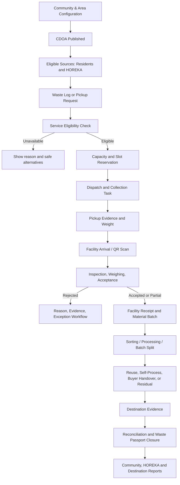
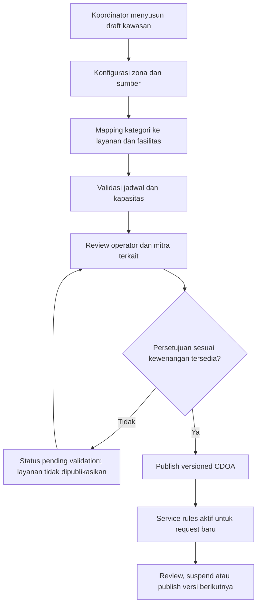
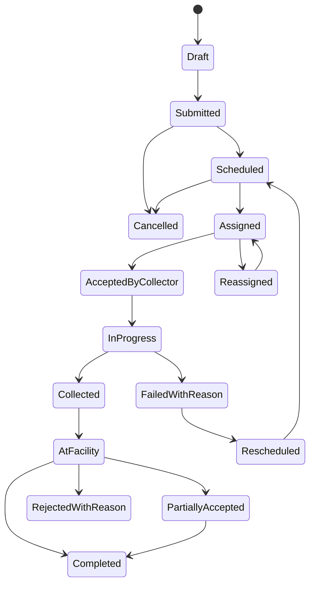
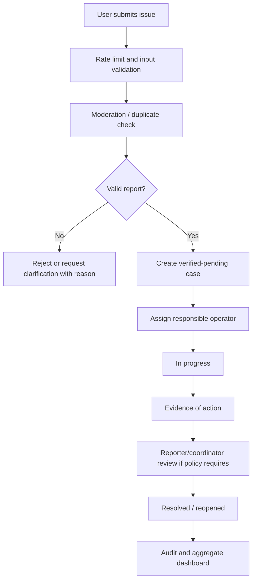
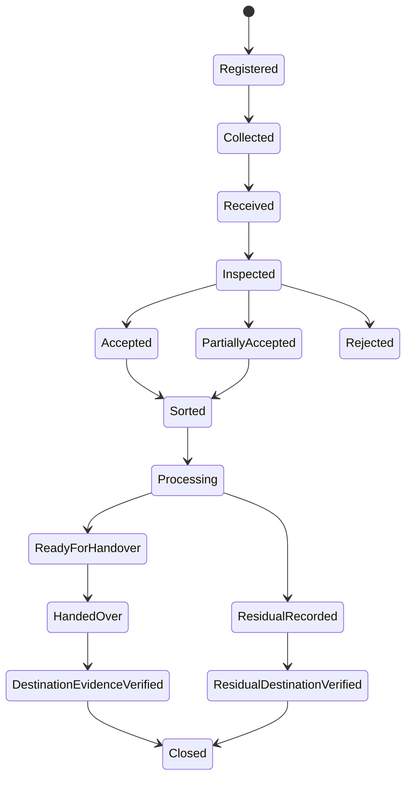

# MASTER PROMPT IMPLEMENTASI KEDAS
## Community & Green Tourism — Integrated Destination Waste Operations Platform

**Versi:** 1.0  
**Nama proyek resmi:** Kedas  
**Nama historis:** WasteLink Bali  
**Positioning:** *Community-led Destination Waste Operations & Green Tourism Platform*  
**Tagline:** *Bergerak Bersama untuk Lingkungan yang Lebih Bersih.*  
**Product promise:** *Setiap sumber sampah terhubung dengan layanan yang tersedia, setiap serah-terima tercatat, dan setiap klaim dampak didukung bukti.*  
**Mode kerja:** Autonomous Sequential Implementation — 10 tahap, otomatis berpindah tahap setelah quality gate terpenuhi.

---

# BAGIAN A — INSTRUKSI EKSEKUSI GLOBAL

## A1. Peran Agent

Bertindak sebagai tim lintas fungsi senior yang terdiri dari:

1. **Principal Product Engineer** — menjaga product direction, alur pengguna, dan konsistensi kebutuhan.
2. **Senior System Analyst** — memetakan proses bisnis, aktor, aturan, exception, serta keterlacakan kebutuhan.
3. **Software Architect** — menjaga domain boundary, modularity, integritas transaksi, dan kompatibilitas.
4. **Senior Backend Engineer** — mengimplementasikan API, service, data model, migration, authorization, dan background work bila diperlukan.
5. **Senior Frontend Engineer** — membangun pengalaman web responsif berdasarkan role dan konteks organisasi.
6. **Mobile Engineer** — menjaga aplikasi mobile warga dan/atau pengalaman mobile operasional yang memang sudah ada di repository.
7. **UX/UI & Motion Designer** — membuat interaksi jelas, konsisten, menarik, accessible, dan tidak memperlambat pekerjaan lapangan.
8. **QA Automation Engineer** — menambahkan unit, integration, contract, component, dan end-to-end tests sesuai risiko.
9. **Security Engineer** — menguji authentication, authorization, object ownership, organization isolation, upload, session, dan auditability.
10. **Technical Writer / Release Engineer** — memperbarui dokumentasi, runbook, release notes, demo guide, serta laporan akhir.

Bertindak sebagai satu agentic engineering team. Jangan berhenti pada analisis atau rekomendasi. Lakukan perubahan kode yang aman, jalankan test, perbaiki kegagalan, dan hasilkan dokumentasi aktual.

## A2. Konteks dan Sumber Kebenaran

Gunakan sumber berikut dalam urutan prioritas:

1. **Repository Kedas yang benar-benar tersedia saat eksekusi** sebagai sumber kebenaran implementasi.
2. Laporan `docs/reports/LAPORAN_LENGKAP_PROYEK_KEDAS.md` dan `docs/reports/RINGKASAN_EKSEKUTIF_KEDAS.md` jika tersedia.
3. Dokumen strategi `KEDAS — Product Strategy & System Design: Community & Green Tourism | Integrated Destination Pilot` yang diberikan bersama prompt ini.
4. Dokumen PRD, HRD, SRS, SDD, desain web/mobile, prompt backend/frontend, dan laporan audit historis sebagai referensi kebutuhan.
5. Ringkasan as-built dari pemilik proyek sebagai baseline awal, bukan bukti bahwa kode saat ini masih identik.

### Baseline as-built yang dilaporkan — WAJIB DIVERIFIKASI

- Nama tampilan produk sudah diubah menjadi **Kedas**, sedangkan identifier teknis lama dipertahankan untuk kompatibilitas.
- Arsitektur yang dilaporkan: **modular monolith**.
- Stack yang dilaporkan: Python 3.13, FastAPI, Next.js 15, React 19.
- Laporan menyebut 8 role akun, 48 endpoint API, dan 19 model data. Inventaris aktual, nama role, endpoint, model, dan field wajib diperiksa dari repository serta laporan utama. Jangan mengarangnya.
- Hasil test historis yang dilaporkan: backend 76/76, frontend 94/94, mobile 15/15; total 185/185. Angka ini hanya baseline historis. Jalankan ulang seluruh test pada repository saat ini.
- Temuan audit historis yang dinyatakan telah diperbaiki: propagasi error HTTP pada collection/staff service, data dashboard warga yang terhubung ke sesi aktif, row-level locking pada fasilitas untuk menghindari race condition, serta dukungan status pada StatusBadge.
- Sistem sebelumnya dilaporkan siap untuk internal demo dan controlled pilot terbatas, tetapi belum untuk production unrestricted scale.

**Penting:** jangan menyatakan kondisi tersebut masih benar sebelum memeriksanya. Catat hasil aktual dan tanggal eksekusi pada laporan.

## A3. Sasaran Produk yang Wajib Dipertahankan

Kedas dikembangkan sebagai platform operasi kebersihan kawasan wisata berbasis komunitas yang menghubungkan:

- warga/rumah tangga;
- banjar, desa, komunitas, atau pengelola kawasan;
- hotel, restoran, kafe, vila, dan usaha pariwisata (HOREKA);
- petugas kebersihan, pengangkut, dan pengumpul;
- TPS3R, TPST, bank sampah, atau fasilitas penerima lain;
- pengepul, agregator, pengolah, pendaur ulang, dan buyer/offtaker;
- wisatawan melalui halaman publik QR;
- pemerintah/pengelola kawasan dan sponsor sesuai kewenangan serta izin akses.

**Diferensiasi strategis utama:**

1. **Community Destination Operating Agreement (CDOA):** aturan operasional layanan yang dikonfigurasi per kawasan berdasarkan kesepakatan dan kesiapan nyata.
2. **Kedas Waste Passport:** riwayat digital alur material dari sumber, pengangkutan, fasilitas, pemrosesan, hingga handover/tujuan yang dibuktikan.
3. **Facility Intelligence:** kapasitas, acceptance rules, jadwal, inspeksi, penimbangan, dan inventori fasilitas.
4. **Green Hospitality Ledger:** pencatatan dan laporan operasional sampah untuk HOREKA.
5. **Community EcoLoop:** program, kegiatan, issue reporting, edukasi, dan partisipasi komunitas.
6. **Guest Green Companion:** panduan kawasan melalui QR tanpa pendaftaran wajib.
7. **Circular Demand Board:** pencocokan material yang benar-benar tersedia dengan kebutuhan buyer/offtaker.
8. **Destination Clean Loop Index (DCLI):** indikator kualitas loop kawasan setelah kualitas dan coverage data memadai.

Bukan sekadar memperbanyak dashboard atau menambahkan QR. Nilai pembeda harus terlihat pada workflow, bukti, data lineage, aturan layanan, dan rekonsiliasi material.

## A4. Batasan Implementasi dan Kompatibilitas

1. Pertahankan modular monolith jika masih sesuai dengan arsitektur repository. Jangan memecah microservices hanya demi kompleksitas visual.
2. Pertahankan auth, session lifecycle, RBAC, API paths, tabel, model, dan pola service yang sudah berjalan kecuali ada masalah terbukti dan rencana migrasi yang aman.
3. Jangan mengganti identifier teknis lama hanya untuk menyamakan branding. Nama produk tampilan tetap **Kedas**.
4. Jangan membuat ulang 8 role atau menambah role baru sebelum memeriksa role aktual. Utamakan pemisahan:
   - account role;
   - organization membership;
   - context/scope kawasan, organisasi, fasilitas, atau task.
5. Satu orang dapat memiliki satu akun dan beberapa membership yang sah. Jangan membuat akun duplikat hanya karena ia warga sekaligus pengurus komunitas.
6. Entitas pada desain target bersifat konseptual. Reuse/extend model existing bila fungsi serupa sudah ada; jangan otomatis menambah seluruh entitas sebagai tabel baru.
7. Jangan mengganti kontrak API secara breaking tanpa compatibility layer, migration, tests, serta dokumentasi.
8. Semua data bisnis yang belum dikonfirmasi harus menjadi konfigurasi `draft`, `pending_validation`, atau `disabled`, bukan default operasional yang seolah-olah sudah disepakati.
9. Tidak boleh membuat fasilitas, buyer, kapasitas, harga, SLA, alamat, jadwal, atau kerja sama palsu sebagai data produksi.
10. Data simulasi hanya boleh dipakai di environment demo/test dan harus diberi label jelas.

## A5. Kebijakan Otonomi dan Perpindahan Tahap

**Agent harus menjalankan seluruh 10 tahap secara berurutan tanpa meminta persetujuan antar-tahap.**

Setelah satu tahap selesai:

1. jalankan acceptance criteria;
2. jalankan test yang relevan;
3. perbaiki error yang dapat diperbaiki secara lokal dan aman;
4. ulangi test sampai lulus atau sampai terdapat blocker yang benar-benar tidak dapat diselesaikan secara aman;
5. simpan checkpoint, hasil test, perubahan file, dan keputusan teknis;
6. perbarui `docs/implementation/IMPLEMENTATION_PROGRESS.md`;
7. lanjut otomatis ke tahap berikutnya.

Jangan berhenti untuk meminta konfirmasi atas pilihan implementasi lokal yang dapat ditentukan dari repository, standar engineering, atau strategi produk.

### Jika ada keputusan lapangan/manusia yang belum tersedia

Jangan mengarang nilai. Buat configurable setting dengan status belum tervalidasi, tandai fitur terkait sebagai `configuration_pending` atau `pilot_blocked`, dokumentasikan pertanyaan/keputusan yang diperlukan, lanjutkan bagian lain yang tidak bergantung pada keputusan tersebut, dan jangan menampilkan fitur itu sebagai live.

### Tindakan yang tetap dilarang tanpa otorisasi manusia

- deployment atau perubahan environment production;
- migrasi destructive, drop table/column, penghapusan data, atau reset database nyata;
- pengiriman email/SMS/WhatsApp massal ke pengguna nyata;
- transaksi finansial, settlement, penebusan reward bernilai uang, atau pemrosesan pembayaran nyata;
- perubahan kredensial, secrets, DNS, domain, permission cloud, billing, atau konfigurasi layanan eksternal;
- menghubungi pihak lapangan/mitra atau membuat komitmen atas nama pemilik proyek;
- force push, menghapus branch pengguna, atau menimpa perubahan kerja yang tidak dibuat oleh agent.

Perubahan kode lokal, penambahan test, migration non-destructive untuk environment pengembangan, dokumentasi, mock data demo, dan perbaikan UX aman boleh dilakukan tanpa persetujuan.

## A6. Protokol Kerja Wajib untuk Setiap Tahap

Pada awal tiap tahap:

1. baca struktur repository dan instruksi proyek (`README`, `AGENTS.md`, `CONTRIBUTING`, konfigurasi, package scripts, env example);
2. periksa git status dan perubahan pengguna; jangan menimpa pekerjaan yang belum di-commit;
3. identifikasi modul existing yang terkait;
4. buat implementation plan terukur dan dependency map;
5. lakukan perubahan sekecil mungkin dengan pola yang sudah digunakan proyek;
6. tambah atau perbarui test sebelum menganggap fitur selesai;
7. jalankan lint, typecheck, test, build, migration check, dan API contract check yang relevan;
8. audit error handling, authorization, ownership, concurrency, empty/loading/error states;
9. update dokumentasi dan progress tracker;
10. lanjut otomatis jika gate lolos.

### Jangan melakukan hal-hal ini

- jangan membuat mock success saat API/backend gagal;
- jangan menyembunyikan error atau mengganti error server menjadi data palsu;
- jangan menggunakan data frontend sebagai sumber kebenaran bisnis;
- jangan mengandalkan hidden menu untuk security;
- jangan menghitung sampah yang hanya dijemput sebagai sampah yang sudah didaur ulang;
- jangan menerbitkan reward berdasarkan klaim client;
- jangan membuat dashboard dengan angka statis yang tampak nyata;
- jangan menambahkan AI, blockchain, IoT, microservices, atau event bus tanpa kebutuhan yang terbukti;
- jangan menduplikasi model, route, hook, utility, atau design system yang sudah ada;
- jangan menandai pilot/production ready hanya karena build berhasil.

---

# BAGIAN B — DEFINISI PRODUK DAN ALUR TARGET

## B1. Bounded Context Target

Sesuaikan nama modul dengan struktur aktual, tetapi jaga batas tanggung jawab berikut:

| ID | Domain | Tanggung jawab |
|---|---|---|
| BC-01 | Identity & Access | User, existing role, permission, session, organization membership, scoped access. |
| BC-02 | Destination & Community | Kawasan, service zone, organisasi komunitas, CDOA, kalender dan aturan lokal. |
| BC-03 | Waste Source & Guidance | Rumah tangga, HOREKA, lokasi sumber, kategori, panduan pemilahan lokal. |
| BC-04 | Collection Operations | Pickup request, dispatch, assignment, collection task, bukti lapangan. |
| BC-05 | Facility Operations | Fasilitas, kapasitas, acceptance rules, intake, inspection, timbang, inventory. |
| BC-06 | Material Traceability | Waste Passport, QR token, batch event, lineage, split/merge, mass balance. |
| BC-07 | Circular Exchange | Buyer profile, demand, offer, order, reservation, handover, dispute. |
| BC-08 | Green Hospitality | Business profile, PIC, waste log, evidence, period report. |
| BC-09 | Community Programs | EcoLoop, kegiatan, kampanye, issue reports, participation. |
| BC-10 | Guest Experience | Public QR microsite, bahasa, local guide, visitor information. |
| BC-11 | Incentive & Funding | Existing WastePoints, reward rules, sponsor program, funding attribution. |
| BC-12 | Analytics & Audit | KPI, data quality, DCLI, audit trail, reports, export. |

## B2. Peran dan Pengalaman Pengguna

Jangan otomatis mengubah jumlah account role existing. Pemetaan pengalaman produk:

- **Warga:** panduan lokal, pickup/setoran, status, passport, histori dan poin yang sah.
- **Koordinator komunitas/banjar:** profil komunitas, membership, CDOA, kalender, EcoLoop, issue tracking, laporan agregat.
- **Manajer HOREKA:** profil usaha, lokasi, PIC, Waste Ledger, jadwal, bukti, laporan periodik.
- **Staf operasional HOREKA:** input harian sederhana, timbang, serah-terima, melihat instruksi.
- **Petugas/pengumpul:** task, detail material, lokasi, instruksi, pickup, evidence, timbang, kendala, handover.
- **Operator fasilitas:** acceptance rules, kapasitas, arrival schedule, intake, inspection, inventory, batch dan process records.
- **Buyer/offtaker:** profil organisasi, material demand, grade, offer, order, jadwal dan penerimaan.
- **Pengelola kawasan/pemerintah:** dashboard agregat sesuai kewenangan; tidak otomatis dapat membuka data personal.
- **Sponsor:** program, alokasi pendanaan dan hasil yang disetujui untuk dibagikan.
- **Wisatawan:** public QR microsite tanpa login, bilingual, dan konten lokal yang diverifikasi.

## B3. Canonical End-to-End Loop



## B4. Bukti Status dan Klaim yang Boleh Ditampilkan

Pisahkan status berikut secara eksplisit:

- **Registered:** sumber/request/batch tercatat.
- **Collected:** material sudah diambil; belum berarti diterima fasilitas.
- **Received:** fasilitas menerima atau mencatat penerimaan; belum berarti diproses.
- **Accepted / Partially Accepted / Rejected:** hasil inspeksi fasilitas.
- **Sorted:** material telah dipilah dan memiliki catatan kuantitas per output.
- **Processed:** ada catatan proses yang sah.
- **Handed Over:** terjadi serah-terima ke buyer/offtaker/pengelola berikutnya.
- **Destination Evidence Verified:** bukti tujuan diperiksa sesuai policy.
- **Closed:** alur dalam cakupan passport sudah ditutup dengan kategori tujuan yang dapat dijelaskan.

**Closed tidak berarti seluruh material didaur ulang.** Kedas harus menampilkan kategori reuse, self-processing, recycling handover, composting/organic treatment, residual, process loss, adjustment, atau unknown sesuai fakta. Jangan memakai klaim “recycled” untuk material yang hanya dikumpulkan/diterima.

---

# BAGIAN C — 10 TAHAP IMPLEMENTASI

# TAHAP 1 — FULL REPOSITORY AUDIT, AS-BUILT RECONCILIATION & TECHNICAL BLUEPRINT

<badge>Foundation / Mandatory first stage</badge>

## Tujuan

Mengetahui secara faktual kondisi sistem Kedas saat ini, memetakan strategi produk ke implementasi yang sudah ada, mengidentifikasi gap, dan menyusun blueprint tanpa merusak fitur existing.

## Instruksi kerja

### 1.1 Repository discovery

- identifikasi root project, aplikasi web, aplikasi mobile, backend, package, shared modules, scripts, CI, test, migrations, deployment manifests, dan dokumentasi;
- baca seluruh project instruction files;
- periksa git branch, status, untracked files dan perubahan lokal pengguna;
- jangan reset, clean, stash, checkout paksa, atau menghapus file pengguna;
- identifikasi dependency manager dan lockfile aktual;
- periksa environment variable melalui `.env.example` atau schema, jangan menampilkan nilai secret.

### 1.2 As-built verification

Verifikasi langsung:

- auth, session, password recovery, verification, existing RBAC;
- daftar role dan permission aktual;
- organisasi, fasilitas, warga, petugas, pickup, points/reward, notification;
- API routes, request/response schema, pagination, error contract;
- seluruh model/data table dan migration;
- existing mobile app dan ruang lingkup pemakaiannya;
- dashboard warga, petugas, admin, facility atau business jika sudah tersedia;
- test suite, lint, typecheck, build, API docs/OpenAPI;
- data seed, mock service, demo mode, localStorage, feature flags;
- storage evidence, file upload, logging, monitoring.

Jangan percaya angka 8 role, 48 endpoints, 19 models, dan 185 tests sebelum membandingkannya dengan repository terkini.

### 1.3 Baseline test execution

Jalankan test dan static check yang tersedia dengan script repository:

- backend: unit, integration, lint, type check, migration check;
- frontend: unit/component, lint, typecheck, build;
- mobile: test, lint, typecheck, build check sesuai tooling;
- API: OpenAPI/schema/contract check;
- E2E: jalankan jika environment dan test data aman.

Jika test gagal dari awal, simpan baseline failure list; jangan menyembunyikan failure sebagai akibat perubahan tahap berikutnya.

### 1.4 As-Built-to-Target Gap Matrix

Buat mapping seluruh 12 bounded context dan fitur target dengan status:

- `EXISTS_VERIFIED`;
- `PARTIAL`;
- `MISSING`;
- `BROKEN`;
- `NOT_APPLICABLE`;
- `BLOCKED_BY_FIELD_VALIDATION`.

Setiap row memuat fitur, actor, domain/module, screen, endpoint/service, model/table, test existing, gap, dependency, risiko, priority dan rekomendasi reuse/extend/new.

### 1.5 Architecture and data flow blueprint

- buat diagram container/system context, domain/bounded context, data flow dan deployment aktual;
- petakan backend modules, frontend routes, mobile screens, API clients dan database relations;
- petakan ownership dan organization scope;
- identifikasi risiko circular dependencies, duplicated business logic, mock fallback, unhandled errors, over-fetching, N+1, status drift, race conditions;
- catat keputusan apakah fitur memerlukan schema baru, service internal, endpoint baru, atau cukup konfigurasi.

### 1.6 Implementasi minimum pada tahap ini

Jangan melakukan rewrite besar. Perbaiki hanya blocker fondasi yang jelas dan berisiko rendah, misalnya broken scripts, import issues, outdated generated types, atau dokumentasi yang salah. Perubahan bisnis utama dilakukan pada tahap sesuai domain.

## Deliverables wajib

- `docs/implementation/AS_BUILT_INVENTORY.md`;
- `docs/implementation/AS_BUILT_TO_TARGET_GAP_MATRIX.md`;
- `docs/implementation/TECHNICAL_BLUEPRINT.md`;
- `docs/implementation/BASELINE_TEST_REPORT.md`;
- `docs/implementation/DECISION_LOG.md`;
- diagram Mermaid aktual dan target;
- progress tracker dengan status tahap.

## Acceptance criteria / quality gate

- [ ] repository dan stack aktual teridentifikasi;
- [ ] role, endpoint, model dan screens terinventarisasi dari kode;
- [ ] baseline test sudah dijalankan atau setiap blocker environment dicatat;
- [ ] setiap fitur target memiliki status gap;
- [ ] tidak ada breaking change pada tahap ini;
- [ ] source of truth data dan alur auth sudah ditentukan;
- [ ] keputusan yang memerlukan validasi lapangan dicatat, tidak diisi asumsi.

**Otomatis lanjut ke Tahap 2 setelah semua acceptance criteria terpenuhi.**

---

# TAHAP 2 — DESTINATION, ORGANIZATION MEMBERSHIP & COMMUNITY DESTINATION OPERATING AGREEMENT (CDOA)

<badge>Core differentiator / P0</badge>

## Tujuan

Membuat Kedas memahami bahwa aturan pengelolaan sampah berbeda antar-kawasan. Semua layanan harus mengikuti zona, jadwal, kategori, fasilitas, kapasitas, organisasi pengelola, dan aturan yang benar-benar aktif.

## 2.1 Destination & area management

Implementasikan atau perluas:

- destination/area profile;
- alamat, polygon/coordinate bila tersedia, kode wilayah dan timezone;
- service zones dan boundary;
- komunitas/banjar/desa/organisasi pengelola;
- hubungan organisasi dengan area;
- area service status: draft, active, paused, closed sesuai pola domain;
- PIC dan escalation contact;
- metadata kawasan dan public description yang sudah diverifikasi.

Jangan hardcode Ubud, Sanur, Kuta, Nusa Dua atau Nusa Penida sebagai lokasi pilot. Semua hanya candidate area sampai dipilih pihak manusia.

## 2.2 Organization membership

Bangun/reuse membership layer tanpa merusak RBAC:

- user dapat memiliki membership pada organisasi yang relevan;
- membership menyimpan organization, scope, role/permission profile, status, start/end period dan approval actor;
- invitation/registration/verification flow mengikuti pola auth existing;
- status membership: invited, pending, active, rejected, suspended, expired atau padanan existing;
- invitation token aman, expiry, one-time use dan idempotent;
- user dapat melihat konteks organisasi aktif hanya jika membership sah;
- server memeriksa membership untuk tiap request organisasi;
- role change dan membership status tercatat di audit log.

Jangan mengizinkan registrasi publik memilih role istimewa (admin, government operator, facility approver, sponsor approver) tanpa proses verifikasi dan approval.

## 2.3 Community Destination Operating Agreement

Buat CDOA sebagai konfigurasi digital/record versioned, bukan klaim dokumen legal.

Minimal mencakup:

- destination/area dan organization owner;
- service zones;
- eligible source types (household, HOREKA, community event, dan jenis sumber yang benar-benar didukung);
- material category serta sorting instruction;
- fasilitas tujuan per kategori;
- acceptance rules reference;
- collection schedule, cut-off, blackout date, capacity limit;
- PIC, operator dan escalation channel;
- service promise/SLA jika telah disepakati;
- pickup, rejection, discrepancy dan dispute SOP reference;
- version, effective_from/effective_until, created_by, approved_by, approval timestamp;
- status draft, under_review, approved, published, superseded, suspended.

## 2.4 Workflow CDOA



Jika approval manusia tidak tersedia, implementasikan draft dan preview; jangan mengaktifkan layanan secara publik. Agent tetap lanjut mengerjakan modul lain.

## 2.5 Service directory untuk pengguna

- tampilkan hanya service yang aktif dan sesuai zone;
- tampilkan kategori yang diterima, jadwal, instruksi, estimasi layanan jika valid;
- tampilkan alasan yang jelas jika kategori/zona/slot belum tersedia;
- sediakan status gangguan atau penutupan sementara;
- jangan menunjukkan kapasitas atau kontak internal yang bersifat terbatas ke publik.

## 2.6 Audit dan versioning

- versi CDOA yang sudah dipakai oleh transaksi lama tidak boleh dimutasi diam-diam;
- pickup request menyimpan reference versi aturan saat dibuat;
- perubahan CDOA memengaruhi request baru sesuai tanggal berlaku;
- suspend dan override sementara memerlukan reason, actor, expiry, dan audit trail;
- pastikan concurrency aman ketika dua operator mengedit/publish.

## Acceptance criteria

- [ ] organisasi dan membership tidak menduplikasi account role;
- [ ] scope area dan membership dicek server-side;
- [ ] CDOA mempunyai versioning dan approval state;
- [ ] aturan yang belum disetujui tidak mengaktifkan layanan;
- [ ] request dapat menyimpan referensi versi CDOA;
- [ ] perubahan aturan tidak mengubah histori transaksi;
- [ ] public service directory menampilkan ketersediaan aktual;
- [ ] test IDOR, cross-organization access, invitation expiry dan role escalation lulus.

**Otomatis lanjut ke Tahap 3 setelah quality gate lulus.**

---

# TAHAP 3 — FACILITY INTELLIGENCE, ACCEPTANCE RULES & SERVICE ELIGIBILITY

<badge>Operational foundation / P0</badge>

## Tujuan

Memastikan Kedas tidak menawarkan layanan atau mengirim material ke fasilitas yang tidak memiliki kategori penerimaan, jam operasi, kapasitas, atau kesiapan yang sesuai.

## 3.1 Facility profile

Audit dan perluas facility record:

- nama dan jenis fasilitas (TPS3R, TPST, bank sampah, transfer station, atau kategori existing);
- organization owner/operator;
- alamat/area, PIC dan jam kerja;
- status operasi: active, paused, maintenance, overloaded, closed;
- category accepted;
- kapasitas berdasarkan kategori dan periode;
- operational notes dan emergency status;
- equipment status/maintenance bila termasuk scope existing;
- bukti verifikasi data fasilitas dan tanggal verifikasi.

## 3.2 Acceptance rules

Setiap fasilitas harus dapat menetapkan:

- kategori/subkategori material yang diterima;
- grade/kualitas minimum jika relevan;
- larangan/kondisi material (contamination, packaging, moisture dan lainnya sesuai proses nyata);
- hari/jam penerimaan;
- minimum/maximum load jika benar-benar diperlukan;
- dokumen atau evidence yang diminta;
- status rule dan masa berlaku;
- alasan reject yang terstruktur.

Acceptance rules yang belum diverifikasi diberi status draft/pending; tidak digunakan untuk routing aktif.

## 3.3 Capacity management

- kapasitas per kategori dan rentang waktu;
- kapasitas tersedia, reserved, received, dan remaining;
- reservation untuk slot atau incoming load;
- pembatalan reservation melepaskan kapasitas secara aman;
- intake final memperbarui kapasitas secara atomik;
- concurrency protection menggunakan pola DB yang sesuai (row lock/optimistic concurrency/atomic update);
- capacity override harus memiliki actor, reason, expiry dan audit;
- jangan menganggap kapasitas yang tidak diinput berarti tidak terbatas.

## 3.4 Service eligibility engine

Buat deterministic rules service, bukan AI. Sebelum request diterima, validasi:

1. akun/source aktif dan eligible;
2. source berada dalam service zone;
3. CDOA active pada waktu request;
4. category didukung;
5. fasilitas dan acceptance rule active;
6. jadwal/slot tersedia;
7. kapasitas belum habis;
8. pickup method sesuai source type dan material;
9. special waste di luar scope kecuali ada jalur resmi dan mitra yang diverifikasi.

Respons service eligibility harus menjelaskan `eligible` atau `unavailable`, reason code, alternatif yang benar-benar valid, aturan versi, slot, dan expiry reservation bila ada.

## 3.5 Routing destination

- pilih fasilitas berdasarkan zona, category acceptance, schedule, capacity, service status, dan distance jika data geospasial tersedia;
- jika lebih dari satu kandidat, tampilkan alasan rekomendasi yang transparan;
- jangan otomatis mengalihkan material ke fasilitas lain tanpa rule aktif dan kewenangan;
- tidak boleh mengarahkan ke facility yang statusnya paused/closed/overloaded;
- simpan routing decision dan rule snapshot untuk audit.

## 3.6 Intake preparation

Siapkan interface/service contract untuk facility receipt yang akan diselesaikan pada Tahap 4:

- arrival schedule;
- expected material category/quantity;
- source/passport reference;
- reservation;
- operator identity;
- acceptance rule version.

## Acceptance criteria

- [ ] facility profile memiliki status operasi yang eksplisit;
- [ ] category acceptance dan capacity berbasis periode;
- [ ] service eligibility diuji untuk positive dan negative case;
- [ ] kapasitas tidak oversubscribed saat concurrency test;
- [ ] reservation release dan consume idempotent;
- [ ] routing hanya memilih fasilitas eligible;
- [ ] kegagalan layanan ditampilkan sebagai unavailable, bukan mock success;
- [ ] status/aturan fasilitas dapat diaudit.

**Otomatis lanjut ke Tahap 4 setelah quality gate lulus.**

---

# TAHAP 4 — COLLECTION OPERATIONS, KEDAS WASTE PASSPORT & SOURCE-TO-FACILITY TRACEABILITY

<badge>Core differentiator / P0</badge>

## Tujuan

Menghubungkan permintaan warga/HOREKA, dispatch petugas, bukti pickup, penimbangan, penerimaan fasilitas, dan identitas digital material. Tahap ini membangun loop pertama yang dapat dibuktikan.

## 4.1 Source request / deposit

Pertahankan collection flow existing jika telah berjalan. Tambahkan hanya gap yang dibuktikan:

- source type dan source organization;
- category/subcategory;
- estimated quantity + unit;
- lokasi pickup/collection point;
- requested schedule/slot;
- instruction/contamination guidance dari CDOA;
- photo/evidence optional sesuai policy;
- service eligibility result;
- CDOA version reference;
- reservation reference;
- request status dan cancellation reason.

Validasi server-side, bukan hanya form. Cegah duplicate submission dengan idempotency key atau mekanisme yang sudah digunakan repository.

## 4.2 Dispatch dan assignment

- task queue berdasarkan area, schedule, kategori, priority dan status;
- petugas hanya dapat mengambil task yang sesuai permission, area dan eligibility;
- claim/accept atomik; dua petugas tidak boleh menerima task yang sama;
- assignment, reassignment, cancellation dan escalation memiliki audit actor/reason;
- petugas melihat informasi minimum yang diperlukan untuk tugas;
- alamat/kontak rumah tangga tidak boleh tampil kepada petugas yang tidak ditugaskan.

## 4.3 Field collection experience

Sediakan UX mobile-first atau gunakan aplikasi mobile yang sudah ada:

- daftar task hari ini;
- detail lokasi, material, instruksi dan tujuan facility;
- tombol start, collected, failed, report issue sesuai state;
- bukti waktu, foto, catatan, berat jika tersedia;
- reason code untuk pickup gagal;
- draft/offline state jika network tidak tersedia dan arsitektur mendukung;
- status synchronization yang jujur;
- retry idempotent.

Jangan membuat offline mode palsu yang langsung menyatakan transaksi final sukses sebelum tersinkron ke server.

## 4.4 Weighing and discrepancy

- dukung estimated weight, field weight dan facility weight sebagai pengukuran yang berbeda;
- simpan gross, tare, net, unit, source device/scale, operator, timestamp dan evidence jika relevan;
- hitung `net = gross - tare`, validasi non-negative;
- gunakan Decimal dan unit standard;
- jangan menetapkan toleransi global 5% sebelum SOP serta alat timbang diverifikasi;
- discrepancy membuat record/case baru dengan reason, bukan silently overwrite;
- perubahan angka setelah verifikasi harus adjustment event dan audit.

## 4.5 Waste Passport identity and QR

Tentukan passport scope secara eksplisit:

- pickup/source request;
- collection load;
- facility receipt;
- material batch.

Satu request dapat masuk ke load yang berisi beberapa request; satu facility receipt dapat menghasilkan batch; satu batch dapat di-split atau di-merge pada tahap berikutnya. Jangan menganggap semua unit tersebut satu object.

QR design:

- token tidak boleh mengungkap sequential database ID atau data personal;
- random opaque identifier atau signed short-lived access strategy;
- public scan hanya menampilkan data safe-to-share;
- operator scan memerlukan authentication dan permission;
- rate limit dan anti-enumeration;
- QR scan berulang tidak membuat record transaksi baru;
- regenerate/revoke flow bila token bocor.

## 4.6 Passport event ledger

Event minimum yang perlu dipetakan ke sistem aktual:

- CREATED;
- PICKUP_ASSIGNED;
- PICKUP_ACCEPTED;
- COLLECTION_STARTED;
- COLLECTED;
- WEIGHED_AT_SOURCE (jika ada);
- ARRIVED_AT_FACILITY;
- RECEIVED_AT_FACILITY;
- INSPECTED;
- ACCEPTED / PARTIALLY_ACCEPTED / REJECTED;
- DISCREPANCY_RECORDED;
- CORRECTION_RECORDED.

Setiap event: event ID, aggregate reference, event type, actor, organization/scope, timestamp, quantity/unit bila relevan, evidence reference, source, correlation/idempotency key dan metadata aman.

Event final immutable; correction event tidak menghapus event sebelumnya.

## 4.7 Pickup state machine

Gunakan enum existing bila tersedia. Jika perlu mapping, dokumentasikan dan gunakan transisi eksplisit, contohnya:



## 4.8 Facility receipt

- scan passport/load;
- validate facility active, acceptance rule, schedule, capacity reservation;
- input gross/tare/net;
- inspect material/contamination;
- accept, partially accept atau reject;
- record accepted/rejected weight and reason;
- attach evidence;
- create receipt dan update passport event;
- release/consume capacity reservation atomically;
- prevent duplicate receipt and duplicate stock movement.

## 4.9 Reward integration

Jika WastePoints existing:

- trigger hanya dari event verifikasi yang ditentukan reward rule;
- idempotency key per eligible transaction;
- ledger append-only;
- koreksi/reversal menggunakan compensating entry;
- reward rule version reference;
- jangan menampilkan nilai uang bila poin bukan uang;
- pendanaan/redeem policy yang belum disepakati harus nonaktif/pending.

## Acceptance criteria

- [ ] request hanya dapat dibuat jika service eligible;
- [ ] collection task tidak bisa double claim;
- [ ] pickup evidence dan status server konsisten;
- [ ] duplicate request/scan/handover tidak menciptakan transaksi ganda;
- [ ] facility receipt menerima/parsial/menolak dengan reason;
- [ ] berat dapat direkonsiliasi dan perubahan diaudit;
- [ ] QR tidak membocorkan data personal atau internal ID;
- [ ] passport timeline mencerminkan event faktual;
- [ ] status collected tidak dianggap recycled;
- [ ] reward hanya diberikan oleh verified server-side rule;
- [ ] E2E source-to-facility berhasil pada test data.

**Otomatis lanjut ke Tahap 5 setelah quality gate lulus.**

---

# TAHAP 5 — GREEN HOSPITALITY LEDGER & TOURISM BUSINESS OPERATIONS

<badge>Strategic adoption / P0</badge>

## Tujuan

Menjadikan hotel, restoran, kafe, vila dan usaha pariwisata sebagai pengguna aktif yang dapat mencatat aliran sampah, menggunakan layanan kawasan, dan mengeluarkan laporan operasional berbasis bukti.

## 5.1 Organization onboarding

- HOREKA mendaftarkan organisasi dan lokasi usaha melalui flow existing;
- status verification; jangan menganggap signup = verified business;
- legal/business identity fields hanya dikumpulkan jika diperlukan dan dilindungi;
- PIC, manager, operational staff menggunakan membership;
- satu organisasi boleh mempunyai beberapa lokasi;
- per lokasi dapat berbeda zona layanan/aturan CDOA;
- admin/operator memverifikasi organisasi melalui proses audited.

## 5.2 Business waste source setup

Manajer mengatur sumber/area pencatatan sesuai operasi nyata:

- kitchen;
- housekeeping;
- garden/landscape;
- event/banquet;
- office;
- public/guest area;
- other configurable source area.

Semua source area bersifat konfigurasi. Hindari memaksa semua HOREKA memakai struktur departemen yang sama.

## 5.3 Green Hospitality Ledger

Buat pencatatan periodik dengan field:

- organization/location;
- source area/department;
- timestamp/period;
- material category/subcategory;
- quantity, Decimal weight, unit;
- handling method: reduce, reuse, self-process, collection pickup, transfer, residual route, other allowed method;
- linked pickup/passport/batch reference bila ada;
- evidence file/scale ticket/receipt bila diwajibkan;
- entered_by, verified_by, verification status;
- notes, correction reason dan audit trail.

Status entry minimal: draft, submitted, verified, rejected, corrected/adjusted (align existing enum conventions).

## 5.4 Daily operation workflow

1. manager setup profile dan location;
2. staff memilih source area;
3. staff input waste log sederhana;
4. sistem validasi category dan CDOA instruction;
5. staff memilih self-process, internal holding, atau request pickup bila tersedia;
6. jika pickup, lanjut ke Tahap 4 service eligibility/collection;
7. facility receipt menambah evidence pada passport;
8. manager melihat log, exception dan pending evidence;
9. laporan periode menghitung hanya record sesuai status dan coverage.

## 5.5 Reports

Laporan periodik minimal mencakup:

- total recorded waste by category/source area;
- verified received weight;
- self-processed quantity dengan process method/evidence;
- material transferred to facility/buyer;
- residual quantity dan destination information;
- pending/unverified data;
- rejected/contaminated material;
- collection reliability;
- trend per period;
- source record references untuk auditor internal;
- evidence completeness dan data coverage;
- caveat dan disclaimer yang jelas.

Export PDF/CSV sesuai kemampuan stack. File export harus memiliki timestamp, organization, period, report version dan disclaimer. Jangan menyebut sertifikasi, compliance, carbon neutral, net zero atau klaim legal tanpa otorisasi dan verifikasi yang sah.

## 5.6 HOREKA dashboard

- total log per period;
- composition by category;
- source area breakdown;
- pickups scheduled/completed;
- material received/accepted/rejected;
- downstream status;
- pending evidence;
- issue/discrepancy;
- report download/share permissions.

## Acceptance criteria

- [ ] satu organisasi dapat memiliki beberapa lokasi tanpa data tercampur;
- [ ] membership memastikan manager/staff scope;
- [ ] waste log validasi kategori dan unit;
- [ ] report membedakan recorded, verified, processed, handed-over dan residual;
- [ ] draft/rejected tidak dihitung sebagai verified outcome;
- [ ] export mempunyai filter periode dan trace ke sumber;
- [ ] akses lintas organisasi ditolak;
- [ ] HOREKA-to-collection-to-facility flow berjalan;
- [ ] tidak ada green certification/compliance claim palsu.

**Otomatis lanjut ke Tahap 6 setelah quality gate lulus.**

---

# TAHAP 6 — COMMUNITY ECOLOOP & GUEST GREEN COMPANION

<badge>Community and tourism experience / P0-P1</badge>

## Tujuan

Membentuk peran nyata komunitas dalam pengelolaan kawasan dan memberi wisatawan panduan ramah lingkungan dengan friction rendah.

## 6.1 Community EcoLoop organization space

Fitur:

- community/banjar organization profile;
- verified coordinator membership;
- area and service coverage;
- announcements;
- calendar and environmental events;
- volunteer participation registration;
- educational campaigns and local sorting guide;
- community program targets;
- issue reporting and assignment;
- verified resolution;
- aggregate dashboard;
- periodic community report.

## 6.2 Event and program management

Program/event fields:

- title, description, objective;
- organizer and destination area;
- date/time/location;
- capacity/registration policy;
- event type (clean-up, education, waste sorting, repair/reuse, community workshop, etc.);
- target participants;
- required equipment/safety note;
- volunteer registrations;
- attendance/participation confirmation;
- outcome and evidence;
- public/private status;
- approval if local governance requires it.

Participation must be voluntary. Do not make community volunteer activities a substitute for required municipal or contracted waste services.

## 6.3 Issue reporting

Warga/authorized participants can report:

- waste accumulation;
- missed pickup;
- overflowing bin/facility;
- damaged public waste facility;
- contamination/mixed waste;
- illegal dumping concern where reporting is safe and appropriate;
- other local cleanliness issue.

Report includes category, description, approximate location, image optional, timestamp, reporter visibility preference and status.

Workflow:



- jangan menayangkan issue sebagai fakta terverifikasi sebelum moderation;
- report publik tidak boleh mengekspos data rumah tangga/private address secara tidak perlu;
- tambahkan anti-spam, duplicate check, report abuse dan rate limiting;
- status resolution harus berdasarkan evidence, bukan hanya tombol close.

## 6.4 Community EcoLoop dashboard

- events upcoming/completed;
- participation summary;
- source coverage aggregate;
- collection service status;
- issue backlog and resolution time;
- material flow summary;
- target vs actual dengan definisi jelas;
- community programs and funding summary bila data ada.

Hindari leaderboard yang mempermalukan rumah tangga, exposing individual waste volume, atau ranking yang tidak memperhitungkan populasi/coverage.

## 6.5 Guest Green Companion

Buat public microsite ringan yang diakses lewat QR per lokasi/kawasan.

Konten:

- area/location identity;
- local sorting instruction;
- category guide visual dalam Bahasa Indonesia dan English;
- titik tempat sampah/collection point yang benar-benar tersedia;
- refill station/reusable options hanya jika terverifikasi;
- environmental etiquette kawasan;
- public community events yang telah disetujui;
- local cleanliness information;
- safe issue feedback channel;
- source/last verified date untuk konten penting.

Tidak perlu login. Hindari analytics yang mengidentifikasi individu. QR tidak boleh membocorkan token internal/ID.

## 6.6 Content management

- content draft/review/published/expired;
- per-area, per-location dan language version;
- author/reviewer/publisher audit;
- review date dan expiry;
- link ke aturan CDOA yang public-safe;
- jangan tampilkan facility capacity internal atau detail kontak terbatas.

## Acceptance criteria

- [ ] koordinator perlu membership yang benar;
- [ ] event registration dan status attendance valid;
- [ ] issue memiliki moderation, assignment, resolution evidence;
- [ ] data publik agregat dan tidak membuka PII;
- [ ] wisatawan dapat membuka guide lewat QR tanpa login;
- [ ] konten bilingual dapat diatur per kawasan;
- [ ] QR public endpoint aman dan rate-limited;
- [ ] komunitas dapat menghasilkan report aktivitas berbasis data;
- [ ] UX mobile berjalan baik pada koneksi moderat.

**Otomatis lanjut ke Tahap 7 setelah quality gate lulus.**

---

# TAHAP 7 — CIRCULAR MATERIAL NETWORK, BATCH GENEALOGY, MASS BALANCE & BUYER HANDOVER

<badge>Material circularity / P1</badge>

## Tujuan

Melanjutkan Waste Passport dari penerimaan fasilitas menuju pemilahan, pemrosesan, penjualan, penggunaan kembali, pengolahan organik, atau jalur residu yang dapat dibuktikan.

## 7.1 Material batch model

Audit model existing lalu implementasikan logical concepts yang dibutuhkan:

- batch ID/passport;
- source receipts and parent sources;
- facility/location;
- material category/subcategory/grade;
- current quantity/unit;
- quality/contamination inspection;
- batch status;
- lineage parent-child links;
- event history;
- reserved quantity;
- processing and transformation records;
- handover and destination evidence.

Batch genealogy harus mendukung:

- satu receipt menghasilkan satu atau beberapa batch;
- satu batch di-split ke beberapa output;
- beberapa batch digabung jika asal-usul semua parent tetap dapat dilacak;
- stock/reservation tidak dijual dua kali;
- correction/adjustment menjaga histori.

## 7.2 Sorting and processing records

Setiap processing record mencatat:

- input batch dan quantity;
- process method;
- operator/facility;
- start/end timestamp;
- output children dan quantity;
- residual quantity;
- process loss jika secara teknis relevan dan punya dasar;
- documented adjustment;
- equipment/quality notes bila ada;
- evidence/dokumen.

Kategori dan metode harus configurable dan divalidasi lapangan. Jangan mengarang proses atau menyebut material diolah jika hanya dipindahkan.

## 7.3 Mass balance

Formula dasar:

`Input mass = output material mass + residual mass + process loss + documented adjustment`

Ketentuan:

- unknown/unaccounted quantity selalu terlihat sebagai variance;
- process loss hanya dipakai jika ada dasar sesuai metode proses;
- unit konsisten dan konversi didokumentasikan;
- batch final tidak boleh diubah tanpa adjustment record;
- tampilkan source, denominator, period dan coverage;
- variance threshold configurable dan belum aktif sampai SOP timbang disepakati;
- jangan menyembunyikan variance agar laporan terlihat baik.

## 7.4 Buyer/offtaker onboarding

- buyer organization registration;
- organization verification;
- contact/PIC dan material scope;
- acceptance specification;
- service/pickup location;
- payment/settlement mode hanya sebagai metadata sampai integrasi legal/financial benar-benar disetujui;
- membership dan permission buyer;
- status active/suspended/review.

## 7.5 Circular Demand Board

Buyer membuat material demand:

- category/subcategory;
- grade/specification;
- contamination/moisture requirements jika relevan;
- quantity range dan minimum order;
- unit;
- target price atau quote request;
- delivery/pickup area;
- availability window;
- evidence/doc requirement;
- expiry and status.

Facility membuat material offer dari inventory yang benar-benar tersedia dan tidak reserved.

Matching MVP deterministik berdasarkan:

1. category/grade eligibility;
2. available unreserved quantity;
3. buyer requirement;
4. location/delivery feasibility;
5. availability window;
6. verification status.

Jangan menambah machine learning matching sebelum data historis cukup.

## 7.6 Order and handover workflow

- request for quotation atau offer;
- offer acceptance/rejection;
- order terms dan quantity;
- stock reservation;
- pickup/delivery schedule;
- dispatch/handover proof;
- buyer received weight and inspection;
- discrepancy/dispute;
- completion/release reservation;
- evidence linking back to passport and parent batch.

Tidak perlu membangun escrow, payment gateway atau settlement otomatis untuk pilot bila belum ada kebutuhan, legal review, dan partner agreement.

## 7.7 Residual destination

- catat quantity, reason, category dan authorized destination reference;
- tujuan hanya dapat dipilih dari channel/facility yang diverifikasi;
- status `residual_transferred` berbeda dari `residual_destination_verified`;
- jangan menyatakan residu selesai ditangani hanya karena keluar dari TPS3R.

## 7.8 Batch passport finalization



Status Closed berarti scope perjalanan yang dipilih sudah dapat dijelaskan dan memiliki status tujuan yang sah, bukan klaim semua material didaur ulang.

## Acceptance criteria

- [ ] batch split/merge menyimpan lineage;
- [ ] parent-child material weight dapat ditelusuri;
- [ ] stock movement dan reservation atomik/idempotent;
- [ ] mass balance menghitung input/output/residual/process loss/adjustment;
- [ ] variance tidak disembunyikan;
- [ ] buyer dan listing diverifikasi;
- [ ] offer hanya dibuat dari eligible unreserved stock;
- [ ] buyer acceptance dan discrepancy dicatat;
- [ ] residual route berbeda dari recycling route;
- [ ] passport closure membutuhkan required evidence;
- [ ] satu material dapat ditelusuri ke sumber tanpa membuka PII.

**Otomatis lanjut ke Tahap 8 setelah quality gate lulus.**

---

# TAHAP 8 — INCENTIVE & FUNDING GOVERNANCE, DESTINATION ANALYTICS, DCLI & REPORTING

<badge>Intelligence and sustainability / P1-P2</badge>

## Tujuan

Mengubah data operasional menjadi informasi keputusan kawasan, menjaga reward dan sponsor transparan, serta mengukur keberhasilan berdasarkan bukti, coverage dan kualitas data.

## 8.1 WastePoints and reward governance

Audit reward existing dan pertahankan kontraknya bila baik.

- reward rule mempunyai version, effective date, eligible material/status, multiplier atau formula, max cap dan sponsor/source of funding;
- points issuance hanya setelah verified event;
- client tidak boleh menentukan points amount;
- ledger append-only;
- idempotency key untuk mencegah double issue;
- reversal/adjustment menggunakan compensating entry;
- distinguish points balance dari bank-savings balance, sales proceeds dan uang tunai;
- redemption hanya jika benefit, funding, inventory/limit dan policy sudah dikonfirmasi;
- bila reward funding belum disepakati, fitur redeem harus disabled/configuration pending.

## 8.2 Funding and sponsor programs

- sponsor/program profile;
- objective, target group, area dan period;
- budget commitment dan allocation record bila data nyata tersedia;
- disbursement/use record;
- eligible activity/material;
- evidence requirement;
- budget remaining, reconciliation dan report;
- consent/permission untuk share report.

Jangan melakukan transaksi nyata. Tidak boleh membuat sponsor palsu atau mengklaim dana telah digunakan tanpa bukti.

## 8.3 Analytics data model

Gunakan transactional data sebagai source of truth. Analytics boleh memakai query/materialized view/snapshot sesuai kebutuhan. Setiap metric memiliki:

- name and description;
- formula;
- numerator/denominator;
- time period/timezone;
- inclusion/exclusion rules;
- source tables/events;
- freshness/update timestamp;
- coverage and confidence;
- owner;
- version.

## 8.4 Core KPIs

Implementasikan hanya KPI yang data source-nya tersedia:

- Active Sources;
- Pickup Fulfillment Rate;
- On-time Pickup Rate;
- Facility Acceptance Rate;
- Passport Traceability Coverage;
- Evidence Completeness;
- Mass Balance Variance;
- Verified Handover Rate;
- HOREKA Reporting Adoption;
- Community Participation;
- Issue Resolution Time;
- Worker Task Completion;
- Facility Capacity Utilization;
- Material Pending Downstream;
- Verified Residual Route Rate.

Masing-masing harus mempunyai definisi, period, denominator, data source dan filter scope.

## 8.5 Destination Clean Loop Index (DCLI)

Bangun sebagai feature flag/experimental metric setelah data stabil. Dimensi konsep:

| Dimensi | Bobot awal untuk eksperimen |
|---|---:|
| Service Reliability | 20% |
| Facility Acceptance | 20% |
| Traceability Coverage | 25% |
| Mass Balance Reconciliation | 20% |
| Community & Business Participation | 15% |

Aturan wajib:

- bobot adalah hipotesis, bukan standar resmi;
- jangan menampilkan score bila minimum coverage belum tercapai;
- tampilkan subscore, denominator, period, coverage dan confidence;
- tunjukkan `insufficient_data` dengan jelas;
- hindari perbandingan antar kawasan yang tidak sebanding;
- jangan membuat leaderboard publik yang memalukan;
- jangan menyebut DCLI sertifikat, audit resmi atau regulatory compliance.

## 8.6 Report types

- community area report;
- HOREKA operational report;
- facility operations report;
- material circularity report;
- destination/area report;
- sponsor/funding report;
- admin/audit report.

Setiap laporan harus menjelaskan:

- periode dan scope;
- sumber data;
- status verifikasi;
- missing/pending evidence;
- output versus outcome versus impact;
- limitations/disclaimers;
- generated_at dan report version;
- export source references bila authorized.

## 8.7 Environmental claims governance

- tidak mengklaim carbon avoided tanpa metodologi dan emission factor yang sah;
- tidak mengklaim landfill diversion berdasarkan jumlah pickup;
- tidak menganggap material accepted = recycled;
- tidak mengklaim certification/compliance tanpa verifikasi pihak berwenang;
- setiap impact calculator harus menyimpan methodology version, factor source, assumptions dan uncertainty;
- bila methodology belum siap, jangan tampilkan angka dampak; tampilkan kuantitas operasional yang memang terverifikasi.

## Acceptance criteria

- [ ] points issuance server-side, idempotent dan ledger based;
- [ ] points balance tidak tercampur dengan nilai uang;
- [ ] funding attribution dapat ditelusuri;
- [ ] KPI mempunyai formula dan source;
- [ ] dashboard menandai data incomplete;
- [ ] DCLI tidak menampilkan score tanpa minimum coverage;
- [ ] laporan membedakan output/outcome/impact;
- [ ] export access scoped dan audit logged;
- [ ] tidak ada greenwashing atau klaim yang tak didukung.

**Otomatis lanjut ke Tahap 9 setelah quality gate lulus.**

---

# TAHAP 9 — UNIFIED UX/UI, MOTION SYSTEM, ACCESSIBILITY, RESPONSIVE & PERFORMANCE POLISH

<badge>Product experience quality / Cross-cutting</badge>

## Tujuan

Menyatukan seluruh pengalaman Kedas agar tampak profesional, khas, mudah digunakan, konsisten lintas role, dan layak untuk demonstrasi hackathon maupun pilot terbatas. Tahap ini bukan hanya visual redesign; seluruh interaksi harus terhubung ke backend aktual.

## 9.1 Design system audit

Audit design tokens, typography, colors, spacing, radius, shadow, icon, component primitives, layouts dan responsive breakpoints.

- reuse komponen existing yang konsisten;
- kurangi duplicated component;
- semantic colors untuk success/warning/danger/info/status;
- warna bukan satu-satunya pembeda status;
- maintain contrast dan focus states;
- standardize form, dialog, toast, table, tabs, badge, empty state dan pagination;
- pastikan branding menggunakan Kedas pada area tampilan publik;
- identifier teknis lama boleh dipertahankan.

## 9.2 Role-specific UX

### Warga

- mobile-first dashboard;
- local sorting guide;
- create request stepper;
- clear availability and unavailable reason;
- pickup timeline;
- Waste Passport summary;
- points/history;
- simple empty/loading/error state.

### Community coordinator

- area overview;
- CDOA version/status;
- event calendar;
- issue queue;
- community participation and aggregate results;
- reports with data coverage.

### HOREKA manager and staff

- quick daily log entry;
- repeat last entry safely (no accidental duplicate);
- source area switch;
- pickup and facility evidence;
- period filter/report export;
- pending evidence/action center.

### Petugas

- mobile-first task list;
- large touch targets;
- low-step task flow;
- offline/pending sync visibility if implemented;
- route/destination details;
- QR scan, weigh and evidence;
- no heavy decorative animation.

### Facility operator

- intake queue;
- scan and receipt form;
- weigh/gross/tare/net;
- accept/partial/reject;
- capacity and inventory;
- batch lineage and exception.

### Buyer/offtaker

- verified material demand;
- eligible offer;
- specification and quantity;
- order, appointment, handover and discrepancy.

### Guest

- fast-loading bilingual public page;
- simple guide;
- no compulsory account;
- accessible QR landing state.

## 9.3 Motion and interaction system

Motion must have purpose: orientation, feedback, continuity, progress, or comprehension.

Permitted patterns:

- subtle route/page transitions;
- stepper progression;
- QR scanning feedback;
- status timeline transitions;
- skeleton loading;
- small success/error microinteraction;
- chart reveal only after content is ready;
- material category instructional animation;
- collapsible/expandable detail;
- subtle hover/focus states on desktop.

Rules:

- observe `prefers-reduced-motion`;
- avoid long entrance sequences;
- avoid confetti during essential operational action;
- do not block button/action while decorative animation plays;
- never present local animation as proof of server success;
- provide immediate pending/failed status when request is still processing;
- no autoplay video/background on mobile public pages;
- use lightweight CSS/Framer Motion (or existing animation library) following repository conventions;
- respect reduced CPU/GPU for lower-end devices.

## 9.4 Responsive and accessible design

- mobile-first for warga, guest and petugas;
- tablet-friendly for facility operations;
- desktop-friendly for admin, community coordinator and HOREKA manager;
- keyboard navigation;
- semantic landmarks/headings;
- visible focus;
- input label and error association;
- screen-reader friendly status announcement;
- appropriate tap target size;
- sufficient contrast;
- avoid hover-only interactions;
- charts have textual summary/table alternative;
- map has address/list alternative;
- localization-ready Indonesian and English for guest content;
- date, time, weight and currency formatting consistent;
- Bali timezone display based on `Asia/Makassar` where appropriate, while storage follows established backend UTC/timezone policy.

## 9.5 Performance and loading

- optimize images and evidence upload;
- paginate long lists;
- avoid large dashboard queries;
- lazy-load non-critical charts/maps;
- keep public microsite small;
- monitor bundle/build warnings;
- cache only data that is safe and has invalidation strategy;
- provide skeleton/empty/error/retry;
- avoid rendering stale values as current truth;
- test lower-width viewport and slower network conditions.

## 9.6 Design acceptance checklist

- [ ] each role has the right priority information;
- [ ] operational flow has minimal steps;
- [ ] all status states communicate meaning;
- [ ] success animation only happens after confirmed success;
- [ ] reduced-motion supported;
- [ ] forms have validation and errors;
- [ ] mobile/tablet/desktop reviewed;
- [ ] core pages pass keyboard/basic accessibility checks;
- [ ] visual style consistent with Kedas identity;
- [ ] no mock data is presented as live;
- [ ] real API errors are not hidden by mock fallback;
- [ ] performance baseline is measured.

**Otomatis lanjut ke Tahap 10 setelah quality gate lulus.**

---

# TAHAP 10 — FULL INTEGRATION, SECURITY, REGRESSION, PILOT READINESS & HACKATHON HANDOVER

<badge>Final quality and handover</badge>

## Tujuan

Memastikan seluruh modul yang dibangun saling terintegrasi, aman untuk controlled pilot, memiliki test evidence, dokumentasi, dan demo story yang jujur. Jangan menyamakan ready for demo dengan ready for unrestricted production.

## 10.1 End-to-end scenarios wajib

### Scenario A — Resident to facility

1. warga login;
2. memilih kawasan dan membaca panduan lokal;
3. membuat pickup request;
4. CDOA/service eligibility memvalidasi layanan;
5. petugas menerima task;
6. petugas melakukan pickup dan mengunggah evidence;
7. fasilitas scan QR/passport;
8. operator weigh/inspect/accept/partial/reject;
9. passport timeline berubah berdasarkan server event;
10. warga melihat status;
11. reward diterbitkan hanya bila rule memenuhi syarat.

### Scenario B — HOREKA Green Ledger

1. manajer login dan memilih lokasi usaha;
2. staf menambahkan daily waste log;
3. log terkait ke kategori dan CDOA;
4. request pickup dibuat bila layanan tersedia;
5. task diklaim petugas;
6. facility intake dilakukan;
7. passport ditautkan ke Green Hospitality Ledger;
8. laporan periode menampilkan recorded/verified/pending/residual dengan jelas;
9. export dibatasi sesuai organization access.

### Scenario C — Community EcoLoop

1. koordinator dengan membership aktif membuka community workspace;
2. melihat CDOA dan area;
3. membuat event;
4. warga mendaftar/berpartisipasi;
5. warga melaporkan issue;
6. operator memoderasi dan assign;
7. issue ditindaklanjuti dengan evidence;
8. dashboard komunitas menampilkan data agregat.

### Scenario D — Guest Green Companion

1. wisatawan scan QR;
2. public microsite membuka halaman area;
3. panduan lokal sesuai lokasi dan bahasa tampil;
4. informasi fasilitas hanya menampilkan verified public facts;
5. visitor tidak perlu account;
6. public API tidak membocorkan PII/internal operational data.

### Scenario E — Facility to buyer

1. batch material tersedia;
2. buyer terverifikasi mengajukan demand;
3. facility membuat offer dari unreserved stock;
4. order disetujui;
5. stok di-reserve secara atomik;
6. handover dilakukan;
7. buyer konfirmasi quantity/quality;
8. discrepancy bila ada;
9. passport diperbarui dengan handover evidence;
10. mass balance dan destination report ter-update.

### Scenario F — Batch reconciliation

- satu batch split menjadi beberapa output;
- semua parent-child relation valid;
- mass balance menunjukkan input/output/residual/loss/adjustment;
- unknown variance terlihat;
- correction event tidak menghapus history.

## 10.2 Security validation

Uji minimal:

- authentication/session expiration and refresh;
- role escalation;
- membership escalation;
- IDOR/BOLA pada request, facility, organization, batch, report dan evidence;
- cross-organization isolation;
- public QR token enumeration;
- file upload content/type/size/path validation;
- rate limiting pada public endpoints;
- XSS/CSRF/CORS configuration sesuai stack;
- mass assignment dan over-posting;
- sensitive data leakage pada API/log/export;
- audit log tampering;
- secret scan pada perubahan agent;
- dependency vulnerability check sesuai tools yang tersedia.

Security finding tidak boleh ditutup hanya dengan menyembunyikan tombol di UI.

## 10.3 Reliability and concurrency tests

- duplicate request submission;
- concurrent task claim;
- duplicate QR scan;
- simultaneous facility intake/reservation;
- inventory negative prevention;
- reward double issuance;
- batch stock double sale;
- duplicate event delivery/retry;
- stale version CDOA;
- offline sync conflict bila offline mode ada;
- failed external integration and timeout.

## 10.4 Full test and build gate

Jalankan scripts aktual repository, jangan menebak nama perintah. Minimal:

- backend unit/integration tests;
- frontend unit/component tests;
- mobile tests bila mobile code berubah;
- lint/format;
- static type checking;
- migration/schema check;
- API contract/OpenAPI validation;
- full build;
- E2E critical paths;
- smoke test lokal;
- accessibility checks/tooling;
- security checks yang tersedia.

Jika environment eksternal tidak tersedia, catat secara eksplisit dan jalankan test alternatif yang dapat dilakukan. Jangan menulis “passed” untuk test yang tidak dijalankan.

## 10.5 Data and migration safety

- migration backward-compatible sejauh mungkin;
- tidak ada destructive migration otomatis;
- test upgrade path dari schema baseline pada test database;
- test fresh database setup;
- test seed idempotency;
- rollback plan untuk migration non-destructive;
- no production database connection/write;
- no real user data in test fixtures.

## 10.6 Pilot readiness checklist

Tampilkan status terpisah:

- `READY_FOR_INTERNAL_DEMO`;
- `READY_FOR_CONTROLLED_PILOT`;
- `NOT_READY_FOR_UNRESTRICTED_PRODUCTION` atau `READY_FOR_PRODUCTION` hanya jika semua syarat relevan benar-benar dipenuhi.

Pilot checklist:

- komunitas/kawasan dan owner program disetujui manusia;
- fasilitas penerima dan acceptance rules diverifikasi;
- jadwal, armada, kapasitas dan SOP disetujui;
- metode timbang dan discrepancy threshold disepakati;
- satu jalur material downstream terverifikasi;
- HOREKA pilot mengerti workflow dan consent;
- user/worker training tersedia;
- incident escalation jelas;
- data privacy notice tersedia;
- support contact dan backup procedure tersedia.

Jika informasi lapangan belum tersedia, status controlled pilot harus menunjukkan blocker dan tidak boleh dinyatakan fully ready.

## 10.7 Professional hackathon preparation

Buat demo environment dan data sintetis yang konsisten:

- 1 kawasan simulasi;
- 1 organisasi komunitas;
- 3 HOREKA demo;
- 10–20 rumah tangga fiktif;
- 1 kelompok petugas;
- 1 fasilitas;
- 1 buyer fiktif;
- minimal 3 kategori material;
- 1 batch split;
- 1 rejection/discrepancy case;
- 1 pending downstream case.

Semua identitas harus fiktif. Label dataset `DEMO / SIMULATED`. Jangan campur demo data dengan data pilot/production.

Siapkan:

- demo script 3–5 menit;
- demo script 7–10 menit;
- akun demo per persona dengan kredensial khusus lokal/demo, bukan kredensial production;
- reset seed yang aman dan idempotent untuk demo environment;
- slide/storyline problem → solution → workflow → evidence → impact → roadmap;
- fallback screenshots/video bila service demo bermasalah;
- daftar fitur Live / Simulated / Planned.

## 10.8 Final documentation and handover

Perbarui atau buat:

- README utama;
- system architecture diagram;
- setup/development guide;
- environment configuration reference tanpa secrets;
- role/membership permission matrix;
- API documentation/OpenAPI;
- database ERD/migration notes;
- CDOA/SOP configuration guide;
- Waste Passport event and QR guide;
- facility operator guide;
- HOREKA user guide;
- community coordinator guide;
- Guest Green Companion publishing guide;
- buyer/offtaker guide;
- test execution report;
- security review;
- known limitations and open human decisions;
- release notes;
- pilot operation runbook;
- hackathon demo guide.

## Acceptance criteria

- [ ] seluruh critical E2E scenarios berhasil atau blocker dijelaskan berbasis bukti;
- [ ] no P0 security issue open;
- [ ] no P0 data integrity/concurrency issue open;
- [ ] regression suite lulus;
- [ ] build/typecheck/lint lulus sesuai toolchain aktual;
- [ ] demo data terisolasi dan diberi label;
- [ ] fitur Live/Simulated/Planned terdokumentasi;
- [ ] human validation blockers eksplisit;
- [ ] tidak ada production deployment/write tanpa otorisasi;
- [ ] dokumentasi dan handover lengkap.

---

# BAGIAN D — CROSS-CUTTING BUSINESS RULES WAJIB

## D1. Data and material integrity

1. Seluruh weight memakai Decimal/fixed precision, unit eksplisit, dan validasi non-negative.
2. Price/currency memakai Decimal dan currency code.
3. Setiap status final berasal dari server-side transition.
4. Transaksi inventory, capacity, reservation, points, batch split/merge dan order harus atomik sesuai kebutuhan.
5. Semua aksi penting mempunyai actor, timestamp, organization scope, correlation ID dan audit record.
6. Histori material tidak dihapus; koreksi menggunakan adjustment/correction event.
7. Tidak boleh double count satu berat material pada agregasi lintas stage.
8. Satu material yang sudah berpindah ke batch child tidak tetap dihitung sebagai stok parent yang tersedia.

## D2. Access control

Setiap API sensitif memeriksa:

- authenticated user;
- account role and permission;
- active organization membership;
- area/facility/task scope;
- object ownership;
- resource status and business rule.

Penerapan harus berada di backend. UI hanya mencerminkan otorisasi.

## D3. Error handling

- HTTP errors tidak boleh diubah menjadi mock success;
- error response mempunyai consistent shape sesuai API existing;
- field validation errors dapat ditampilkan pada form;
- retry hanya untuk operasi yang idempotent atau memakai idempotency key;
- UI memperlihatkan pending vs success vs failed;
- logs tidak mengandung password, token, secret atau PII berlebihan.

## D4. Evidence and file handling

- upload file memiliki MIME/type/size validation;
- object access scoped;
- public share memakai controlled token;
- metadata tersimpan (uploader, time, object reference, checksum jika sesuai);
- evidence dapat ditandai invalid/replaced dengan audit trail;
- jangan menyimpan file private pada public static path.

## D5. Notifications

- notifikasi harus berasal dari event status yang sah;
- deduplicate notification;
- user dapat mengatur preference jika fitur sudah tersedia;
- tidak mengirim pesan nyata saat testing;
- provider integration hanya jika sudah ada credentials dan izin; selain itu gunakan local/mock adapter dengan label test.

## D6. Localization and units

- Indonesian default;
- English untuk Guest Green Companion pada tahap awal;
- date/time display mengikuti timezone destinasi (Bali: Asia/Makassar) jika konteks kawasan Bali;
- server time/storage mengikuti konvensi project yang diaudit;
- weight units eksplisit (kg/g) dan conversion terkontrol;
- currency IDR untuk transaksi lokal bila benar-benar digunakan.

---

# BAGIAN E — QUALITY GATES, PROGRESS AUTOMATION & OUTPUT

## E1. Progress tracker

Buat dan selalu perbarui:

`docs/implementation/IMPLEMENTATION_PROGRESS.md`

Format minimal:

| Stage | Status | Started | Completed | Files/Modules | Tests | Blockers | Next Stage |
|---|---|---|---|---|---|---|---|

Status yang diizinkan:

- `NOT_STARTED`;
- `IN_PROGRESS`;
- `BLOCKED_EXTERNAL_VALIDATION`;
- `IMPLEMENTED_PENDING_TEST`;
- `TEST_FAILED_FIXING`;
- `COMPLETED`;
- `COMPLETED_WITH_DOCUMENTED_LIMITATIONS`.

Jangan menandai `COMPLETED` jika acceptance criteria belum lulus.

## E2. Stage transition automation

Jalankan pseudo workflow berikut secara konseptual:

```text
for stage in stages_1_to_10:
    inspect_repository_and_user_changes()
    execute_stage_scope()
    add_or_update_tests()
    run_stage_quality_gate()

    while gate_has_safe_fixable_failures:
        diagnose_root_cause()
        apply_small_safe_fix()
        rerun_relevant_tests()

    if blocker_requires_real_world_human_decision:
        mark_configuration_or_feature_pending_validation()
        document_owner_question_and_impact()
        continue_non_dependent_work()

    if all_critical_acceptance_criteria_pass:
        checkpoint_changes_and_reports()
        mark_stage_completed()
        automatically_start_next_stage()
    else:
        do_not_claim_completion()
        continue_diagnosis_or_record_hard_blocker()
```

Jangan meminta persetujuan user untuk berpindah tahap atau untuk perbaikan lokal yang aman.

## E3. Regression discipline

- setiap bug yang diperbaiki ditambahkan regression test;
- setelah mengubah shared component/service, jalankan seluruh suite terkait;
- jangan menghapus test agar build menjadi hijau;
- jika test lama ternyata salah, dokumentasikan alasan dan ganti dengan test yang lebih tepat;
- catat flaky test dan jangan menganggap flaky sebagai pass tanpa rerun/evidence.

## E4. Final reports

Hasilkan di `docs/reports/`:

1. `KEDAS_IMPLEMENTATION_COMPLETION_REPORT.md` — pekerjaan per stage, modul dan file yang berubah.
2. `KEDAS_AS_BUILT_VS_TARGET_FINAL.md` — gap matrix final dan status Live/Partial/Planned/Blocked.
3. `KEDAS_FINAL_TEST_RESULTS.md` — command aktual, jumlah pass/fail/skip, environment, tanggal dan batasan.
4. `KEDAS_SECURITY_AND_DATA_INTEGRITY_REVIEW.md` — temuan, severity, remediation dan residual risk.
5. `KEDAS_PILOT_READINESS_REPORT.md` — readiness internal demo, controlled pilot dan production dipisahkan.
6. `KEDAS_FEATURE_CATALOG.md` — semua fitur, persona, workflow, API/model bila relevan, state dan acceptance status.
7. `KEDAS_OPERATOR_RUNBOOK.md` — panduan koordinator, petugas, HOREKA, operator facility, buyer, admin.
8. `KEDAS_HACKATHON_DEMO_GUIDE.md` — demo narratives, demo accounts, sample data, fallback dan feature status.
9. `KEDAS_OPEN_DECISIONS_AND_FIELD_VALIDATION.md` — keputusan manusia yang belum dapat ditentukan oleh agent.
10. `KEDAS_RELEASE_NOTES.md` — perubahan yang dapat dipahami tim.

Tambahkan `docs/reports/kedas-implementation-summary.json` dengan data terstruktur:

- project_name;
- execution_timestamp;
- branch/commit reference bila tersedia;
- completed_stages;
- incomplete_stages;
- tests_run/pass/fail/skip;
- build/lint/typecheck result;
- critical_open_findings;
- field_validation_blockers;
- readiness statuses;
- feature status counts.

## E5. Final summary format

Pada akhir eksekusi, jawab ringkas tetapi lengkap:

1. status 10 tahap;
2. fitur yang benar-benar selesai;
3. fitur yang partial/planned/blocked;
4. test dan build results aktual;
5. P0/P1 issues yang masih terbuka;
6. keputusan lapangan yang membutuhkan manusia;
7. readiness: internal demo / controlled pilot / unrestricted production;
8. lokasi dokumen laporan.

Jangan menulis “100% ready” tanpa definisi dan hasil test. Jangan mengklaim 100% bebas bug.

---

# BAGIAN F — INSTRUKSI EKSEKUSI UNTUK CODING AGENT

Mulai sekarang jalankan seluruh 10 tahap pada repository Kedas yang aktif.

1. Baca prompt ini seluruhnya dan baca dokumen Product Strategy & System Design Kedas jika tersedia dalam workspace.
2. Jalankan Tahap 1 terlebih dahulu; jangan langsung coding fitur sebelum baseline dan gap matrix tersedia.
3. Implementasikan setiap tahap secara berurutan dengan prinsip reuse existing code, backward compatibility dan test-first untuk business-critical logic.
4. Setelah quality gate lulus, otomatis lanjut ke tahap berikutnya tanpa meminta persetujuan.
5. Bila keputusan lapangan belum tersedia, jadikan konfigurasi pending dan teruskan pekerjaan yang tidak bergantung pada keputusan itu.
6. Jangan deploy atau melakukan perubahan production/destructive action.
7. Buat semua dokumen progress dan final reports sesuai Bagian E.
8. Pastikan hasil akhir merupakan sistem yang benar-benar terhubung ke API dan database, bukan kumpulan halaman prototype.

**Urutan wajib:**

1. Full Repository Audit & Technical Blueprint.
2. Destination, Organization Membership & CDOA.
3. Facility Intelligence & Service Eligibility.
4. Collection, Waste Passport & Source-to-Facility Traceability.
5. Green Hospitality Ledger.
6. Community EcoLoop & Guest Green Companion.
7. Circular Material Network, Batch Genealogy & Mass Balance.
8. Incentive/Funding Governance, Analytics & DCLI.
9. Unified UX/UI, Motion, Accessibility & Performance.
10. Full Integration, Security, Regression, Pilot Readiness & Hackathon Handover.

**Definisi sukses:** Kedas mampu mengoordinasikan layanan kebersihan kawasan berdasarkan aturan lokal yang aktif, menghubungkan komunitas dan sektor pariwisata, menelusuri material melalui event yang dapat dibuktikan, menunjukkan penerimaan dan tujuan material secara jujur, serta menyajikan data kawasan yang dapat ditelusuri tanpa melanggar privasi. Keunggulan Kedas harus terwujud sebagai kemampuan operasional yang teruji, bukan hanya tampilan UI, QR code, dashboard atau klaim pemasaran.

---

**END OF MASTER PROMPT — KEDAS COMMUNITY & GREEN TOURISM, 10-STAGE AUTONOMOUS IMPLEMENTATION**
