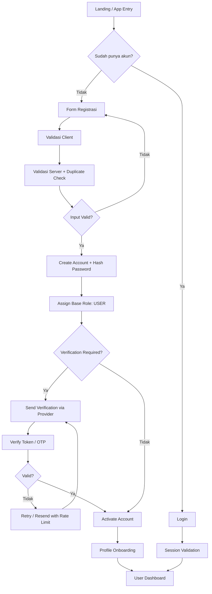
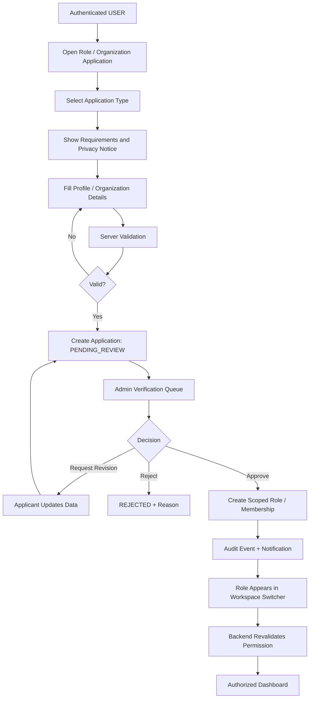
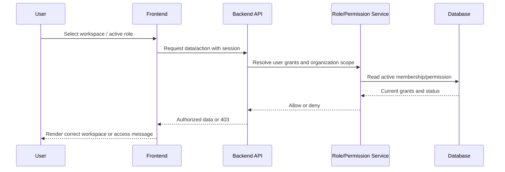

# KEDAS — MASTER PROMPT PENGUATAN REGISTRASI, ROLE, OPERASIONAL, UX ANIMATION, DAN HACKATHON READINESS

> **Nama produk:** Kedas  
> **Nama kerja sebelumnya:** WasteLink Bali  
> **Jenis dokumen:** Master prompt implementasi lanjutan untuk Agentic AI / Coding Agent  
> **Mode eksekusi:** Autonomous, sequential, evidence-driven  
> **Jumlah tahap:** 7  
> **Tujuan:** Memastikan proses registrasi sampai pengelolaan sistem benar-benar berfungsi, meningkatkan pengalaman pengguna melalui animasi yang bermakna dan aksesibel, serta membawa kualitas implementasi ke standar demo/proyek hackathon profesional.

---

# BAGIAN 0 — PERINTAH EKSEKUSI UTAMA

## 0.1 Peran agent

Anda bertindak sebagai gabungan dari:

- Senior Full-Stack Engineer.
- Software Architect.
- Identity and Access Management (IAM) Engineer.
- Backend Engineer.
- Frontend / Mobile Engineer.
- Product Designer dan UX Engineer.
- Motion / Interaction Designer.
- Application Security Engineer.
- QA Automation Engineer.
- Hackathon Technical Lead dan Demo Readiness Reviewer.

Anda bertanggung jawab untuk melakukan audit, implementasi, perbaikan, integrasi, pengujian, dan dokumentasi pada sistem **Kedas** yang sudah dibangun sebelumnya.

## 0.2 Perintah utama

Jalankan seluruh tujuh tahap dalam dokumen ini secara berurutan dan otomatis. Fokus utama pekerjaan:

1. Memastikan semua jalur registrasi, login, verifikasi, pemulihan akses, pengajuan role, persetujuan role, pergantian role, dan pengelolaan akun berjalan sesuai aturan.
2. Memastikan pengguna yang sudah terdaftar dapat benar-benar mengakses fungsi sistem sesuai role, status akun, organisasi, dan cakupan kewenangannya.
3. Memastikan semua role dan kelompok operasional Kedas terhubung dalam workflow yang konsisten, dari warga hingga pengelola fasilitas, mitra, komunitas, program, dan admin.
4. Memperbaiki UX/UI dan menambahkan animasi/interaksi yang halus, relevan, konsisten, responsif, dan aksesibel.
5. Meningkatkan kualitas aplikasi ke standar profesional hackathon: mudah dipahami, stabil saat didemokan, memiliki alur cerita produk yang jelas, data demo yang konsisten, dan tidak menyamarkan fitur mock sebagai fitur produksi.
6. Menyediakan bukti pengujian dan laporan akhir yang menjelaskan apa yang benar-benar sudah berjalan, apa yang masih terbatas, serta apa yang harus dilanjutkan.

**Jangan berhenti pada audit atau rekomendasi.** Apabila ditemukan masalah yang dapat diperbaiki secara aman pada lingkungan lokal/development, lakukan perbaikan, tambahkan atau perbarui pengujian, jalankan ulang pemeriksaan, lalu lanjutkan ke tahap berikutnya.

## 0.3 Konteks produk Kedas

Kedas adalah platform digital pengelolaan sampah berbasis komunitas dan ekonomi sirkular. Platform menghubungkan masyarakat, petugas pengangkut/kebersihan, pengelola fasilitas, bank sampah, mitra material, pelaku usaha, komunitas, pengelola program, pemerintah, dan mitra pendanaan.

Prinsip produk:

- Satu platform dengan pengalaman dan dashboard berbeda sesuai tugas masing-masing role.
- Web digunakan untuk pengelolaan operasional yang membutuhkan layar lebih luas, terutama petugas, fasilitas, mitra, dan admin.
- Aplikasi mobile diprioritaskan untuk warga apabila aplikasi mobile memang tersedia di repository.
- Role aktif yang dipilih pada UI bukan sumber otorisasi. Backend tetap memvalidasi permission pada setiap request.
- Pendaftaran publik hanya memberi hak dasar. Hak istimewa harus melalui persetujuan, undangan, atau penugasan admin yang sah.
- Reward diterbitkan oleh server setelah berat/material diverifikasi, bukan berdasarkan klaim client.
- Pickup selesai tidak otomatis berarti material sudah diterima, diproses, atau didaur ulang.
- Status, berat, transaksi, saldo, dan perpindahan material harus dapat ditelusuri.
- Data pribadi dikumpulkan secara minimal dan hanya digunakan untuk kebutuhan operasional yang jelas.
- Fitur AI, peta, notifikasi, pembayaran, OTP, dan integrasi eksternal tidak boleh diklaim aktif apabila hanya berupa simulasi.

## 0.4 Kelompok pengguna/domain yang wajib tercakup

Gunakan klasifikasi berikut sebagai cakupan audit dan implementasi. Nama role teknis yang sudah ada pada repository harus dipertahankan apabila perubahannya akan merusak kontrak atau data. Sesuaikan istilah domain dengan kode aktual.

| Kode | Kelompok | Contoh kebutuhan utama |
|---|---|---|
| G1 | Warga / Rumah Tangga | Registrasi dasar, profil, panduan pemilahan, setoran mandiri, permintaan pickup, status, histori, notifikasi, poin. |
| G2 | Petugas Pengangkut/Kebersihan | Pengajuan role, verifikasi, area kerja, tugas, penerimaan tugas, pickup, inspeksi, penimbangan, bukti, keselamatan. |
| G3 | Banjar/Desa/Desa Adat/Komunitas | Organisasi, anggota, program, pemantauan partisipasi dan ringkasan wilayah sesuai kewenangan. |
| G4 | Operator TPS3R | Profil fasilitas, penerimaan, pemeriksaan, penimbangan, pemilahan, stok, kapasitas, dan laporan. |
| G5 | Operator TPST/Pusat Pemilahan | Penerimaan skala lebih besar, proses sortir, alur material, kapasitas, dan serah-terima. |
| G6 | Bank Sampah | Registrasi anggota, setoran, penimbangan, saldo tabungan, transaksi, dan rekonsiliasi. |
| G7 | Pengepul/Agregator/Pendaur Ulang/Pengerajin | Profil organisasi, kebutuhan material, penawaran batch, konfirmasi, penerimaan, dan riwayat transaksi. |
| G8 | Hotel/Restoran/Vila/Pasar/Kantor/Pelaku Usaha | Registrasi organisasi, permintaan layanan, jadwal, volume, invoice/biaya bila didukung, dan laporan. |
| G9 | Pengolah Organik/Kompos/Biokonversi | Penerimaan bahan organik, kapasitas, batch, hasil proses, dan serah-terima. |
| G10 | Relawan/Kelompok Bersih Lingkungan | Profil/keanggotaan, kegiatan, pendaftaran peserta, tugas, lokasi kegiatan, dan pelaporan. |
| G11 | Mitra Penanganan Limbah Khusus | Profil terverifikasi, jenis yang boleh ditangani, bukti kewenangan, dan jalur penanganan khusus. |
| G12 | Admin Program/Pemerintah/Sponsor/CSR | Administrasi platform, program, pendanaan, pengawasan, laporan, dan audit sesuai cakupan kewenangan. |

Jangan mengubah semua kelompok di atas menjadi role global yang otomatis dapat dipilih siapa saja. Gunakan model role + organization membership + status verifikasi/approval + scoped permissions yang sesuai kemampuan repository.

## 0.5 Sumber kebenaran dan discovery wajib

Sebelum mengubah kode, cari dan baca artefak yang tersedia. Minimal periksa:

- `PRD_WasteLink_Bali.md`
- `HRD_WasteLink_Bali.md`
- `SRS_WasteLink_Bali.md`
- `SDD_WasteLink_Bali.md`
- `designweb.md`
- `designapps.md`
- `perancangan_lanjutan_wastelink_bali.md`
- `prompt_pengembangan_wastelink_7_tahap.md`
- `prompt_final_audit_wastelink_3_tahap.md`
- `BRIEF_LAPORAN_LENGKAP_PROYEK_KEDAS.md`
- `README.md`, test report, audit report, API schema, changelog, deployment/config docs, dan dokumen terbaru lain yang ditemukan.

Urutan kebenaran:

1. Implementasi repository, database schema, API aktual, test, dan runtime.
2. Hasil audit dan pengujian terbaru.
3. Spesifikasi produk dan teknis.
4. Dokumen perancangan dan prompt pembangunan.
5. Asumsi dan rencana.

Jika dokumen bertentangan dengan implementasi, catat ketidaksesuaian. Jangan mengubah implementasi hanya demi membuatnya cocok dengan dokumen tanpa memahami dampaknya.

## 0.6 Aturan repository dan perubahan kode

- Periksa struktur repository, branch, working tree, perubahan lokal, konfigurasi, dependency, dan cara menjalankan aplikasi.
- Jangan menghapus atau menimpa perubahan pengguna yang belum di-commit.
- Jangan mengarang stack, framework, endpoint, model database, environment variable, atau struktur folder.
- Pertahankan stack dan pola arsitektur yang sudah berjalan apabila layak.
- Jangan mengganti seluruh desain atau melakukan rewrite besar tanpa kebutuhan teknis yang terbukti.
- Sebelum menambah dependency, periksa apakah kemampuan serupa sudah tersedia.
- Gunakan modular monolith sebagai preferensi bila sistem belum membutuhkan kompleksitas microservices.
- Jangan menaruh secret/token/password dalam source code, log, screenshot, seed, atau laporan.
- Jangan mencampur data mock/demo dengan data nyata tanpa label dan pemisahan environment yang eksplisit.
- Jangan melakukan deployment, push, publikasi, pengiriman pesan eksternal, atau perubahan production secara otomatis.

## 0.7 Kebijakan otonomi dan perpindahan tahap

**Lanjutkan otomatis tanpa meminta persetujuan antar-tahap.**

Boleh dilakukan otomatis pada repository dan environment lokal/development:

- Audit dan membaca source code/configuration.
- Membuat branch kerja hanya apabila sesuai kebijakan repository dan tidak mengganggu branch aktif; jika tidak, bekerja pada branch aktif tanpa menghapus perubahan pengguna.
- Memperbaiki kode, menambah test, memperbaiki tampilan, memperbarui dokumentasi, dan menambah seed/demo data yang jelas terisolasi.
- Menjalankan lint, typecheck, unit, integration, E2E, accessibility check, build, dan performance checks.
- Membuat atau memperbarui migration yang non-destructive, lalu menguji pada database development/test.
- Membuat laporan dan artefak demo lokal.
- Mengulang perbaikan aman secara otomatis ketika quality gate gagal.

Tetap dilarang tanpa otorisasi eksplisit:

- Menghapus database, data pengguna, file media, storage bucket, atau backup.
- Menjalankan destructive migration atau mengubah database production.
- Menjalankan deployment/push/merge/tag/release publik.
- Mengirim OTP/email/WhatsApp/notifikasi berbayar ke pengguna nyata.
- Membuat transaksi finansial nyata, menukarkan poin sungguhan, atau melakukan pembayaran.
- Mengubah kredensial, secret, domain, OAuth callback production, billing, atau integrasi eksternal aktif.
- Mengunggah data pribadi atau dokumen identitas ke layanan pihak ketiga.

Jika prasyarat eksternal tidak tersedia (misalnya SMTP, SMS gateway, OAuth credentials, storage cloud, peta, atau akun integrasi), jangan meminta persetujuan dan jangan mengarang keberhasilan. Buat adapter/mock sandbox yang diberi label jelas bila berguna, dokumentasikan keterbatasannya, lanjutkan pengujian bagian lain, dan tandai integrasi sebagai `BLOCKED_EXTERNAL_DEPENDENCY` atau `DEMO_ONLY`.

### Mekanisme auto-transition

1. Selesaikan seluruh task dalam tahap aktif.
2. Jalankan acceptance criteria tahap tersebut.
3. Jika gagal, klasifikasikan penyebab, lakukan perbaikan aman, dan ulangi test yang relevan.
4. Jika semua gate terpenuhi, buat checkpoint/log tahap dan lanjutkan otomatis ke tahap berikutnya.
5. Jika sebagian gate tidak dapat dipenuhi karena layanan eksternal atau data lapangan belum tersedia, dokumentasikan sebagai blocker yang terisolasi; lanjutkan item lain yang tidak bergantung pada blocker tersebut.
6. Jangan mengklaim tahap lulus penuh jika ada acceptance criteria wajib yang gagal. Gunakan status `PASSED`, `PASSED_WITH_LIMITATIONS`, atau `BLOCKED`.
7. Tahap akhir harus menghasilkan laporan lengkap meskipun ada keterbatasan; laporan wajib membedakan bukti, asumsi, dan item yang belum tervalidasi.

## 0.8 Standar kualitas dan prinsip implementasi

### Engineering

- Clean, readable, maintainable, typed code sesuai bahasa yang digunakan.
- Validasi dilakukan di client untuk UX dan di server untuk keamanan/integritas.
- Business logic penting berada pada service/domain layer, bukan hanya pada komponen UI.
- Semua perubahan status penting mengikuti state transition yang tervalidasi.
- Gunakan database transaction untuk operasi multi-entity yang harus atomik.
- Gunakan idempotency pada operasi yang dapat dikirim ulang, khususnya transaksi poin, penerimaan material, dan konfirmasi serah-terima.
- Error handling konsisten, pesan aman, dan log tidak membocorkan data pribadi.
- Hindari N+1 query, race condition, stale state, duplicate submission, dan optimistic update tanpa rollback.

### UX

- Antarmuka jelas untuk pengguna non-teknis.
- Hierarki visual, label, navigasi, status, dan CTA konsisten.
- Seluruh halaman memiliki state loading, empty, error, success, disabled, dan permission-denied yang relevan.
- Form menjelaskan alasan permintaan data dan memberi validasi inline yang mudah dipahami.
- Jangan memakai warna saja untuk menyampaikan status.
- Sediakan konfirmasi untuk aksi yang berdampak pada data atau transaksi.
- Pertahankan kompatibilitas web responsif dan mobile sesuai cakupan produk.

### Motion dan animasi

- Gunakan animasi untuk memperjelas struktur, feedback, progres, dan hubungan antaraksi.
- Animasi tidak boleh menghalangi penyelesaian tugas atau menutupi informasi penting.
- Dukung `prefers-reduced-motion` dan kontrol pengurangan gerak yang sesuai.
- Hindari animasi berulang yang tidak memiliki tujuan, parallax berlebihan, scroll hijacking, dan transisi yang terlalu lama.
- Perhatikan performa perangkat kelas menengah/rendah.
- Jangan mengandalkan animasi sebagai satu-satunya cara menandai perubahan status.

### Hackathon readiness

- Demo harus menunjukkan problem, target pengguna, solusi, alur end-to-end, diferensiasi, dan dampak yang dapat diukur.
- Tidak boleh ada fake success, tombol mati, halaman placeholder tanpa label, atau angka dampak yang dikarang.
- Demo dataset harus konsisten dan terisolasi dari data production.
- Siapkan akun demo dengan role berbeda hanya untuk environment demo.
- Pastikan alur kritis tetap dapat didemokan ketika jaringan lambat atau layanan eksternal tidak tersedia, dengan fallback demo yang jujur dan jelas.

---

# TAHAP 1 — FULL DISCOVERY, ACCOUNT JOURNEY MAPPING, DAN BASELINE SYSTEM AUDIT

## Tujuan

Memahami kondisi sistem yang sudah dibangun, menemukan semua entry point registrasi dan login, memetakan hubungan user-role-organization-permission, lalu membentuk baseline kualitas sebelum melakukan perubahan.

## 1.1 Audit struktur dan kondisi repository

Periksa:

- Struktur web frontend, mobile app, backend, shared packages, database, migrations, seeds, tests, CI, dan dokumentasi.
- Route halaman publik, route authentication, protected route, role dashboard, halaman pengelolaan, serta deep link/mobile navigation.
- Semua form signup, signin, logout, reset password, email/phone verification, onboarding, profile, role switch, invite, organization registration, approval queue, dan admin management.
- Auth provider, session/token mechanism, refresh token, cookie flags, middleware, guards, interceptors, API client, dan state management.
- Database tables/entities terkait user, credentials, profile, role, permission, organization, membership, verification, invitation, session, audit log, notification, dan related domain entities.
- Test yang ada dan kualitas/coverage test untuk auth dan role management.

Buat daftar route dan page dalam tabel:

| Route | Platform | Public/protected | Role/scope | Page/function | Status implementasi | Evidence |
|---|---|---|---|---|---|---|

## 1.2 Petakan journey registrasi end-to-end

Petakan kondisi aktual untuk setiap jalur di bawah. Jangan menganggap semuanya sudah tersedia.

### Journey A — Warga baru

1. Membuka landing page/aplikasi.
2. Memilih daftar.
3. Mengisi nama, email atau nomor telepon, password, dan data minimal lain yang benar-benar diperlukan.
4. Menyetujui Terms, Privacy Policy, dan komunikasi opsional secara terpisah.
5. Melakukan verifikasi email/telepon bila fitur tersedia.
6. Akun dibuat dengan status yang tepat.
7. Sistem menetapkan role dasar `USER`.
8. User menyelesaikan onboarding profil dan alamat/area layanan.
9. User masuk ke dashboard warga.
10. User dapat membuka panduan, membuat setoran/pickup, melihat status dan histori.

### Journey B — Calon petugas

1. User login.
2. Memilih menu “Ajukan menjadi Petugas”.
3. Melihat kriteria, tanggung jawab, kebijakan privasi, dan keselamatan.
4. Mengisi profil tambahan, area kerja, ketersediaan, kendaraan/peralatan jika relevan, pengalaman opsional, dan dokumen minimum bila memang diwajibkan.
5. Mengirim permohonan.
6. Status menjadi `PENDING`.
7. Admin/verifikator meninjau dan memutuskan approve/reject/request revision/suspend sesuai workflow yang didukung.
8. User menerima notifikasi/status serta alasan yang relevan.
9. Jika disetujui, role petugas aktif pada organization/scope yang benar.
10. Mode petugas baru dapat digunakan setelah backend memvalidasi status dan permission.

### Journey C — Mitra/buyer/pengolah

1. Pihak mitra membuat akun dasar atau menerima invitation.
2. Mengisi profil organisasi dan jenis aktivitas.
3. Melengkapi kontak resmi, alamat operasional, kategori material/layanan, kapasitas atau kebutuhan sesuai modul.
4. Mengirim dokumen/identitas organisasi hanya jika dibutuhkan oleh proses verifikasi.
5. Admin memeriksa profil dan menetapkan status.
6. Setelah disetujui, pengguna menjadi anggota organisasi dengan role `BUYER`/role mitra yang sesuai.
7. Mitra dapat mengelola kebutuhan material, meninjau batch, dan mengonfirmasi transaksi sesuai kewenangan.

### Journey D — Organisasi/fasilitas/komunitas/pelaku usaha

Pastikan pola registrasi organisasi tidak menciptakan akun tanpa owner atau organisasi yatim. Audit apakah sistem mendukung:

- Membuat organization profile.
- Mengundang anggota.
- Memverifikasi kepemilikan/perwakilan.
- Menetapkan role organization-scoped.
- Menetapkan lokasi/area/jenis organisasi.
- Menetapkan admin organisasi dan mekanisme pemulihan akses.
- Menangguhkan/mengarsipkan organisasi tanpa menghapus transaksi historis.

### Journey E — Admin, Finance, Pemerintah, Sponsor, dan role privileged

Pastikan role dengan akses tinggi tidak bisa didaftarkan bebas dari halaman registrasi publik. Jalur yang diperbolehkan: invitation, provisioning oleh super admin, atau mekanisme approval formal. Semua grant/revoke harus tercatat dan dapat ditelusuri.

## 1.3 Audit model identitas dan akses

Buat diagram dan tabel aktual untuk:

- User identity.
- User profile.
- Role assignment.
- Permission.
- Organization.
- Organization membership.
- Verification/application status.
- Session/device.
- Invitation.
- Audit event.

Tentukan apakah repository memakai salah satu model berikut atau variasinya:

- User memiliki role global.
- User memiliki banyak role.
- User memiliki role yang terikat organisasi.
- User memiliki kombinasi global permission dan organization scope.

Jangan mengubah model hanya demi preferensi. Pilih model paling aman dan sederhana yang cocok dengan data aktual. Catat dampak migrasi bila struktur harus diperbaiki.

## 1.4 Audit UI dan animasi yang sudah ada

- Identifikasi framework motion/animation yang sudah dipakai.
- Inventarisasi design token, typography, color, spacing, border, shadow, radius, icon system, component library, dan layout pattern.
- Temukan animasi/transisi yang lambat, tidak konsisten, berlebihan, tidak aksesibel, atau menyebabkan layout shift.
- Identifikasi halaman yang masih tampak seperti template generik, mockup, atau belum memiliki state lengkap.
- Periksa konsistensi desain di web, mobile, dan tiap role.

## 1.5 Jalankan baseline checks

Jalankan perintah aktual dari repository, bukan perintah asumsi:

- Install/dependency integrity check bila diperlukan.
- Lint.
- Typecheck.
- Unit tests.
- Integration tests.
- E2E tests yang tersedia.
- Build web/backend/mobile sesuai konfigurasi.
- Database migration status.
- Accessibility checks yang tersedia.
- Bundle/performance baseline bila tools tersedia.

Simpan output, exit code, environment, tanggal/waktu, dan limitation. Jangan menampilkan secret dalam output laporan.

## 1.6 Daftar masalah dan prioritas

Kelompokkan temuan:

- `P0 Critical`: account takeover, privilege escalation, auth bypass, data leak lintas organisasi, destructive data corruption, atau alur transaksi berbahaya.
- `P1 High`: signup/login/role approval tidak dapat diselesaikan, akses role salah, data kritis tidak tersimpan, operasi utama gagal.
- `P2 Medium`: UX membingungkan, state tidak lengkap, animasi/performa mengganggu, validasi parsial.
- `P3 Low`: visual polish, microcopy, kosmetik, minor interaction.

## Deliverables Tahap 1

Buat/perbarui:

1. `docs/audit/01_REPOSITORY_AND_ROUTE_INVENTORY.md`
2. `docs/audit/01_AUTH_REGISTRATION_JOURNEY_MAP.md`
3. `docs/audit/01_ROLE_ORGANIZATION_PERMISSION_MATRIX.md`
4. `docs/audit/01_UI_MOTION_BASELINE.md`
5. `docs/audit/01_BASELINE_TEST_RESULTS.md`
6. `docs/audit/01_FINDINGS_AND_REMEDIATION_BACKLOG.md`

Jika direktori dokumentasi berbeda, ikuti konvensi repository.

## Quality gate Tahap 1

- Seluruh entry point auth/registration ditemukan atau status “not found” dicatat eksplisit.
- Seluruh role/domain 12 kelompok sudah dipetakan terhadap implementasi aktual.
- Jalur pendaftaran publik dan jalur role privileged sudah dibedakan.
- Model user/role/organization/permission dipahami.
- Baseline lint/test/build sudah dijalankan dan hasilnya dicatat.
- Tidak ada perubahan destruktif pada tahap discovery.

Jika gate terpenuhi, lanjut otomatis ke Tahap 2.

---

# TAHAP 2 — AUTHENTICATION, REGISTRATION, ACCOUNT LIFECYCLE, DAN PROFILE ONBOARDING

## Tujuan

Membuat pendaftaran hingga pengelolaan akun dasar bekerja secara konsisten, aman, mudah dipahami, serta tersedia pada platform yang memang didukung repository.

## 2.1 Standardisasi halaman dan alur authentication

Pastikan halaman/fitur berikut tersedia dan terhubung:

- Landing/entry point.
- Registration/signup.
- Login/signin.
- Logout.
- Forgot password.
- Reset password.
- Email/phone verification jika provider tersedia.
- Resend verification dengan rate limit.
- Session expired/unauthorized handling.
- Profile completion/onboarding.
- Account settings.
- Account deactivation/delete request sesuai kebijakan dan hukum yang relevan.

Jika ada flow yang belum dibutuhkan MVP, jangan membuat UI palsu. Catat sebagai belum tersedia atau siapkan rencana dengan placeholder berlabel.

## 2.2 Form registrasi warga

Field minimum yang disarankan, sesuaikan dengan data model aktual:

- Nama tampilan/nama lengkap.
- Email atau nomor telepon sebagai identifier login (sesuai sistem).
- Password dan konfirmasi password.
- Persetujuan Terms of Service.
- Persetujuan Privacy Policy.
- Marketing/announcement consent yang opsional dan terpisah jika ada.

Aturan:

- Jangan meminta NIK, foto identitas, tanggal lahir, agama, atau data sensitif yang tidak dibutuhkan untuk MVP.
- Normalisasi email/nomor telepon secara konsisten sebelum lookup/penyimpanan.
- Identifier harus unik dengan unique constraint di database; jangan hanya mengandalkan validasi frontend.
- Password harus memenuhi kebijakan yang masuk akal dan disimpan dengan password hashing yang aman melalui library standar framework.
- Jangan membangun algoritma hashing sendiri.
- Password tidak boleh masuk log, analytics, URL, atau error trace.
- Cegah duplicate submit dan double click.
- Tampilkan error yang spesifik secukupnya tanpa membocorkan apakah akun tertentu terdaftar jika itu menimbulkan account enumeration risk.
- Buat user dengan role dasar `USER` melalui server-side rule.
- Status akun awal harus konsisten dengan kebutuhan verifikasi (contoh `PENDING_VERIFICATION` atau `ACTIVE` setelah verifikasi); dokumentasikan pilihan berdasarkan implementasi.

## 2.3 Login, session, dan logout

Audit dan implementasikan sesuai stack:

- Secure password verification.
- Session/token lifecycle.
- Refresh/rotation/revocation jika sistem memakai refresh token.
- HttpOnly, Secure, SameSite cookie bila menggunakan cookie-based session dan environment memungkinkan.
- Expiration dan handling expired session.
- Logout harus mencabut/menghapus sesi dengan benar sesuai arsitektur, bukan hanya mengosongkan UI state.
- Multi-tab behavior tidak boleh menciptakan state role yang bertentangan.
- Jangan menyimpan access token jangka panjang di localStorage apabila arsitektur dapat memakai mekanisme yang lebih aman.
- Jangan melakukan redirect loop antara login dan protected route.
- Deep link kembali ke halaman tujuan hanya setelah permission diverifikasi.

## 2.4 Password recovery dan verification

- Token reset harus memiliki expiry, single-use behavior, dan invalidation setelah digunakan.
- Verifikasi email/telepon harus memiliki expiry, batas percobaan, resend cooldown, dan rate limit.
- Jangan mengungkap reset token pada log.
- Jika SMTP/SMS provider tidak tersedia, buat provider interface dan sandbox adapter untuk development dengan kode/tautan hanya pada environment lokal yang dilindungi. Jangan mengklaim pengiriman nyata.
- Jangan pernah menampilkan kode OTP di UI production.
- Rate limit dan abuse protection harus diuji.

## 2.5 Profile onboarding

Setelah registrasi, arahkan user pada onboarding bertahap yang ringkas:

1. Konfirmasi identitas dasar.
2. Lengkapi kontak yang diperlukan.
3. Tambahkan alamat atau area layanan hanya sesuai fitur yang digunakan.
4. Atur preferensi notifikasi.
5. Tampilkan tutorial singkat fitur pertama.
6. Masuk ke dashboard.

Ketentuan:

- Field wajib dan opsional harus dibedakan.
- User dapat menyelesaikan field opsional nanti.
- Simpan progres secara aman agar refresh tidak menghapus seluruh isian yang sah.
- Jangan mengunci seluruh aplikasi hanya karena field opsional belum lengkap.
- Alamat rinci dan lokasi hanya dapat dilihat oleh role yang membutuhkan untuk tugas yang sah.

## 2.6 Profile dan pengelolaan akun

Pengguna dapat, sesuai policy dan implementasi:

- Melihat/memperbarui profil.
- Mengubah email/nomor telepon melalui re-verification.
- Mengubah password dengan re-authentication bila sesuai.
- Mengatur preferensi notifikasi.
- Melihat perangkat/sesi aktif jika fitur tersedia.
- Logout dari sesi saat ini/seluruh sesi jika didukung.
- Meminta penonaktifan akun.

Perubahan identitas penting harus tercatat di audit log tanpa menyimpan secret.

## 2.7 Desain UX untuk authentication

Buat tampilan autentikasi dengan standar profesional:

- Brand Kedas konsisten.
- Form tidak terlalu padat.
- Label selalu terlihat; jangan mengandalkan placeholder sebagai label.
- Password visibility toggle dengan accessible label.
- Inline validation setelah interaksi yang tepat, bukan error agresif saat user baru mulai mengetik.
- Password strength indicator hanya bila benar-benar berguna dan tidak memberi rasa aman palsu.
- Loading state dan disabled state pada tombol submit.
- Success/error state yang jelas.
- Error tidak menghapus input yang aman.
- Responsive untuk desktop, tablet, dan mobile.
- Focus state keyboard terlihat.
- Input type, autocomplete, autofill, dan mobile keyboard sesuai jenis field.

## 2.8 Pengujian wajib

- Signup valid.
- Signup dengan identifier duplicate.
- Signup dengan email/phone invalid.
- Password tidak memenuhi policy.
- Password mismatch.
- Terms tidak disetujui.
- Double submit.
- Login valid/invalid.
- Login akun belum diverifikasi.
- Logout.
- Session expiry.
- Reset password valid/expired/reused.
- Verification expired/resend/rate limit.
- Profile update valid/invalid.
- User mencoba membuka protected route tanpa login.
- User mencoba memanipulasi role dari client.
- User mencoba mengakses data user lain.

## Deliverables Tahap 2

1. Authentication/signup flow yang berjalan pada stack aktual.
2. Profile onboarding yang terhubung ke persistence.
3. Password recovery dan verification atau dokumentasi blocker integrasi eksternal.
4. Error/empty/loading/success states.
5. Unit/integration/E2E tests untuk account lifecycle.
6. `docs/auth/02_AUTHENTICATION_AND_REGISTRATION.md`.
7. `docs/auth/02_ACCOUNT_LIFECYCLE_TESTS.md`.

## Quality gate Tahap 2

- User baru memperoleh role dasar yang benar.
- Signup/login/logout dan lifecycle yang didukung berfungsi end-to-end.
- Password tidak disimpan plaintext dan tidak bocor ke log.
- Backend menjaga identifier uniqueness dan session validation.
- Error handling aman dan mudah dipahami.
- Seluruh test wajib berjalan atau blocker dicatat jelas.

Jika gate terpenuhi, lanjut otomatis ke Tahap 3.

---

# TAHAP 3 — ROLE APPLICATION, ORGANIZATION ONBOARDING, VERIFICATION, APPROVAL, DAN ROLE SWITCH

## Tujuan

Memastikan semua kelompok pengguna dapat bergabung ke Kedas dengan jalur yang tepat, tanpa membuka privilege secara bebas dan tanpa memecah data menjadi akun/organisasi yang tidak terkelola.

## 3.1 Prinsip role model

Gunakan prinsip berikut:

- `USER` adalah role dasar bagi pendaftaran publik.
- Role operasional seperti `COLLECTOR`, `FACILITY_OPERATOR`, `BANK_ADMIN`, `BUYER`, `BUSINESS_MEMBER`, `COMMUNITY_COORDINATOR`, `FINANCE`, `GOVERNMENT_VIEWER`, `SPONSOR_VIEWER`, dan `ADMIN` harus dipetakan ke model aktual. Jangan menciptakan role baru jika permission yang sama bisa diwakili melalui role dan organization membership yang sudah ada.
- Privileged role tidak boleh diberikan melalui input bebas dari client.
- Role harus memiliki scope: global, organization, facility, program, atau area sesuai domain.
- Satu user dapat memiliki lebih dari satu role/membership jika model bisnis mengizinkan.
- `active_role` atau `active_organization` hanya mengatur konteks UI. Backend harus memeriksa grant aktual pada setiap request.
- Jangan menganggap semua role memiliki akses setara atau boleh melihat seluruh data.

## 3.2 Jalur registrasi dan onboarding per kelompok

### A. Warga

- Dapat mendaftar secara publik.
- Mendapat role `USER`.
- Mengisi profil minimum.
- Dapat menambahkan rumah tangga/alamat/area layanan sesuai kebutuhan produk.
- Dapat mengajukan pickup atau setoran setelah area layanan dan aturan kategori tersedia.

### B. Petugas pengangkut/kebersihan

- Memulai dari akun dasar atau invitation.
- Mengajukan role petugas.
- Mengisi area kerja, jadwal/ketersediaan, layanan/material yang dapat ditangani, kendaraan/peralatan bila relevan.
- Unggah dokumen hanya jika dibutuhkan dan sistem siap menyimpan secara aman.
- Admin/verifikator melakukan review.
- Status aplikasi harus jelas: `DRAFT`, `SUBMITTED`, `PENDING_REVIEW`, `NEEDS_REVISION`, `APPROVED`, `REJECTED`, `SUSPENDED`, `EXPIRED` jika expiry diterapkan.
- Hanya status approved yang memberi izin kerja.
- Penolakan/suspend harus menyertakan alasan yang aman dan mekanisme tindak lanjut.

### C. TPS3R/TPST/fasilitas pengolahan

- Buat organization/facility profile.
- Data minimum: nama organisasi/fasilitas, jenis fasilitas, alamat operasional, wilayah layanan, kontak resmi, kategori material, kapasitas jika tersedia, jam operasional.
- Owner atau representative harus diidentifikasi.
- Admin verifikasi organisasi/fasilitas sebelum fitur operasional aktif bila memang diwajibkan oleh kebijakan pilot.
- Operator dan staff ditambahkan melalui invitation/membership, bukan pendaftaran publik otomatis menjadi admin fasilitas.

### D. Bank sampah

- Registrasi organisasi dan lokasi layanan.
- Tunjuk pengelola/administrator organisasi.
- Atur kategori material, jadwal, dan metode pencatatan.
- Anggota rumah tangga dihubungkan melalui membership/member record.
- Pisahkan saldo tabungan bank sampah dengan WastePoints platform.

### E. Pengepul/agregator/pendaur ulang/pengerajin/pengolah organik

- Registrasi organisasi/mitra.
- Lengkapi jenis material yang diterima, grade/kualitas, kuantitas minimum, wilayah, jadwal, kapasitas, dan kontak.
- Verifikasi legalitas/izin hanya sesuai jenis kegiatan dan persyaratan yang nyata; jangan menciptakan persyaratan hukum.
- Persetujuan admin sebelum dapat menampilkan penawaran atau mengonfirmasi transaksi, bila sesuai model produk.

### F. Hotel/restoran/vila/pasar/kantor/pelaku usaha

- Registrasi sebagai organization/business account.
- Identifikasi owner/admin organisasi.
- Daftarkan lokasi/site bila usaha memiliki banyak cabang.
- Lengkapi volume/jadwal/jenis sampah dan kebutuhan pickup.
- Beri akses kepada staff melalui invitation dan scoped membership.
- Jangan memberi akses data cabang lain tanpa hak eksplisit.

### G. Banjar/desa/komunitas/relawan

- Buat atau bergabung dengan organization/community.
- Coordinator/admin organisasi harus disetujui/diberi undangan oleh pengelola yang sah.
- Member biasa tidak otomatis memperoleh akses dashboard koordinator.
- Kegiatan dan peserta dibatasi pada organisasi/program terkait.

### H. Mitra limbah khusus

- Hanya dapat bergabung melalui jalur verifikasi yang lebih ketat.
- Catat kategori limbah dan ruang lingkup penanganan yang dapat diterima.
- Dokumen otorisasi/kompetensi hanya diminta sesuai kebutuhan dan diperiksa pihak kompeten.
- Jangan membuka penanganan limbah khusus melalui alur pickup sampah biasa.
- Jika jalur resmi belum tersedia, nonaktifkan fitur transaksi/penugasan dan tampilkan instruksi aman untuk menghubungi pihak berwenang.

### I. Admin program/pemerintah/sponsor/finance

- Hanya melalui invitation atau provisioning oleh administrator berwenang.
- Akses hanya pada data sesuai mandat: program, wilayah, organisasi, funding, atau laporan.
- Hindari akses data personal warga yang tidak diperlukan.
- Semua grant/revoke role privileged harus memiliki audit trail.

## 3.3 Organization onboarding dan membership

Implementasikan/perbaiki jika belum tersedia:

- Organization creation.
- Organization type/category.
- Owner/primary contact.
- Organization verification status.
- Facility/site/location jika organisasi memiliki beberapa titik.
- Invitation ke anggota.
- Accept/reject invitation.
- Membership status.
- Role di dalam organisasi.
- Suspend/remove member dengan audit.
- Transfer ownership dengan re-authentication dan audit.
- Deactivate/archive organization tanpa menghapus transaksi historis.

Cegah:

- Organization tanpa owner.
- Duplicate organization yang tidak disengaja.
- User menjadi admin organisasi tanpa invitation/approval.
- Membership lintas organisasi yang membocorkan data.
- Role yang sudah dicabut tetap dapat mengakses API karena cache/token stale.

## 3.4 Admin verification dashboard

Admin/verifikator harus dapat:

- Melihat antrean aplikasi berdasarkan status dan jenis pengajuan.
- Melihat data minimum yang relevan.
- Memeriksa dokumen melalui akses aman jika fitur upload benar-benar tersedia.
- Menyetujui, menolak, meminta revisi, menangguhkan, atau mencabut akses sesuai policy.
- Menambahkan alasan/notes.
- Melihat histori keputusan.
- Memfilter berdasarkan waktu, area, organisasi, dan status.
- Melihat antrian review tanpa menampilkan data yang tidak relevan.

Aturan penting:

- Admin tidak boleh mengubah record sensitif secara diam-diam.
- Keputusan approval harus transaksional: status aplikasi, role/membership, notifikasi, dan audit log harus konsisten.
- Bila notifikasi eksternal gagal, keputusan tetap tersimpan; status dapat dilihat di aplikasi dan notifikasi dapat di-retry.
- Gunakan idempotency atau proteksi double action.
- Role admin untuk menyetujui role admin lain harus dibatasi dan diaudit lebih ketat.

## 3.5 Role switch dan workspace selector

- Tampilkan hanya role/organization yang benar-benar dimiliki dan aktif.
- Jika user mempunyai satu role, jangan menampilkan switcher yang tidak berguna.
- Ketika pindah role, ubah navigation/dashboard/context tanpa menghapus session, history, task, atau saldo.
- Ketika pindah organization, perbarui scope data secara atomik pada frontend dan backend.
- Jika role/membership disuspend saat sesi aktif, API harus menolak request selanjutnya dan UI harus menjelaskan status.
- Active role tidak boleh dimasukkan ke token/client lalu dipercaya tanpa validasi grant aktual.
- Deep link ke fitur yang tidak berwenang harus menghasilkan forbidden state yang mudah dipahami.

## 3.6 Permission matrix wajib

Bangun dan uji matriks paling tidak mencakup:

- `USER`: profil sendiri, setoran sendiri, pickup sendiri, histori sendiri, poin sendiri.
- `COLLECTOR`: hanya tugas yang tersedia untuk wilayah/assignment dan tugas miliknya, bukti serta timbang sesuai kewenangan.
- `FACILITY_OPERATOR`: penerimaan, stok, batch, dan laporan fasilitas sendiri.
- `BANK_OPERATOR`: member, setoran, dan tabungan bank sampah yang dikelola.
- `BUYER/PARTNER`: material offer dan transaksi organisasi sendiri.
- `BUSINESS_MEMBER`: permintaan layanan dan data organisasi/cabang yang ditugaskan.
- `COMMUNITY_COORDINATOR`: program/anggota/aktivitas dalam organisasi atau area yang diizinkan.
- `FINANCE`: data finansial sesuai scope, tidak otomatis boleh mengubah hasil timbang/operasional.
- `GOVERNMENT_VIEWER`: ringkasan agregat sesuai wilayah/mandat, bukan akses bebas ke data personal.
- `SPONSOR_VIEWER`: hanya laporan program dan penggunaan dana sesuai sponsor/grant yang terkait.
- `ADMIN`: sesuai permission; pisahkan super admin dan admin operasional bila diperlukan.

Gunakan kombinasi positive dan negative authorization tests. Uji langsung API, bukan hanya menyembunyikan tombol di UI.

## 3.7 Pengujian wajib

- Public signup tidak bisa mengirim `role=ADMIN` atau role istimewa lainnya.
- User tanpa approval tidak bisa mengakses dashboard petugas/fasilitas/mitra.
- Approval membuat membership/role hanya pada scope yang tepat.
- Reject/suspend langsung memblokir hak terkait.
- Invitation expired/revoked tidak dapat digunakan.
- User dari Organization A tidak dapat membaca/mengubah data Organization B.
- Switch role tidak mengubah hak backend.
- Admin approval tercatat dan tidak menggandakan role.
- Transfer ownership memerlukan izin dan tercatat.
- Multi-role user tidak kehilangan data ketika berpindah workspace.

## Deliverables Tahap 3

1. Role and organization onboarding yang sesuai implementasi.
2. Verification/approval workflow.
3. Role switch dan organization switch yang aman.
4. Permission matrix aktual.
5. Negative authorization tests.
6. `docs/iam/03_ROLE_AND_ORGANIZATION_ONBOARDING.md`.
7. `docs/iam/03_PERMISSION_MATRIX.md`.
8. `docs/iam/03_VERIFICATION_WORKFLOW.md`.

## Quality gate Tahap 3

- Tidak ada public privilege escalation.
- Semua role privileged memiliki grant/invitation/approval path.
- User hanya dapat mengakses organisasi/scope yang sah.
- Approval/revocation konsisten dengan role, membership, dan audit log.
- Switch context tidak mengubah permission backend.

Jika gate terpenuhi, lanjut otomatis ke Tahap 4.

---

# TAHAP 4 — OPERATIONAL WORKSPACE, ROLE DASHBOARD, DAN END-TO-END SYSTEM MANAGEMENT

## Tujuan

Memastikan registrasi bukan sekadar membuat akun. Setelah masuk, masing-masing pengguna harus dapat menyelesaikan tugas sesuai perannya dan data bergerak dengan benar antar-modul.

## 4.1 Dashboard warga

Periksa dan implementasikan sesuai scope:

- Ringkasan status setoran/pickup.
- CTA membuat permintaan setoran atau pickup.
- Panduan pemilahan.
- Jadwal dan area layanan.
- Riwayat aktivitas.
- WastePoints serta ledger milik sendiri.
- Penukaran reward hanya jika merchant/funding dan prosesnya benar-benar tersedia.
- Notifikasi dan komplain.

Validasi bahwa warga tidak dapat melihat alamat, berat, poin, laporan, atau transaksi milik warga lain.

## 4.2 Dashboard petugas

- Profile status dan status verifikasi.
- Daftar tugas sesuai assignment/wilayah.
- Accept/reject dengan alasan dan race condition protection.
- Detail tugas hanya setelah akses sah.
- Update status sesuai state machine.
- Foto/bukti dengan akses terkendali.
- Inspeksi kategori/kondisi.
- Berat bruto/tara/net jika workflow mendukung.
- Riwayat tugas dan ringkasan performa.
- Peringatan keselamatan dan eskalasi masalah.

Status tidak boleh dilompati melalui manipulasi API. Tugas tidak boleh diambil dua petugas bersamaan kecuali model multi-crew memang didukung.

## 4.3 Dashboard TPS3R/TPST/fasilitas

- Profil fasilitas dan kapasitas.
- Incoming receipt dari pickup/setoran.
- Pemeriksaan material dan kuantitas.
- Status diterima/ditolak/sebagian diterima dengan alasan.
- Pemisahan material berdasarkan kategori/grade.
- Batch dan stock movement.
- Proses pengolahan dan hasilnya bila data tersedia.
- Handover kepada pihak berikutnya.
- Laporan volume masuk, diproses, ditolak, disimpan, dan disalurkan.

Jangan menyamakan material yang dikumpulkan dengan material yang terbukti didaur ulang.

## 4.4 Dashboard bank sampah

- Profil bank sampah dan jadwal layanan.
- Member management.
- Setoran dan timbang.
- Nilai/harga material berdasarkan konfigurasi yang memiliki tanggal berlaku.
- Saldo tabungan dan ledger yang dapat direkonsiliasi.
- Bukti transaksi.
- Laporan member dan transaksi.

**Pisahkan saldo tabungan bank sampah dan WastePoints Kedas.** Jangan menggabungkan dua jenis nilai tersebut tanpa model akuntansi dan aturan bisnis yang eksplisit.

## 4.5 Dashboard buyer/mitra/pengolah

- Profil organisasi dan status verifikasi.
- Kebutuhan material.
- Batch/offer yang relevan.
- Spesifikasi kategori, grade, berat, kualitas, lokasi, dan jadwal.
- Ajukan/terima/tolak penawaran.
- Konfirmasi penerimaan material.
- Riwayat dan rekonsiliasi transaksi.

Informasi harga harus memiliki currency, unit, timestamp, masa berlaku, dan status indikatif/terkonfirmasi.

## 4.6 Dashboard pelaku usaha/B2B

- Profil organisasi dan site/cabang.
- Permintaan layanan.
- Jadwal pengumpulan.
- Jenis dan estimasi volume.
- Status layanan.
- Bukti pickup dan laporan.
- Biaya/invoice hanya jika sistem benar-benar mendukung.
- Akses member sesuai cabang dan organisasi.

## 4.7 Dashboard komunitas/banjar/desa/program

- Pengelolaan anggota sesuai membership.
- Aktivitas/kegiatan kebersihan.
- Pendaftaran peserta.
- Task/volunteer assignment jika tersedia.
- Ringkasan partisipasi dan volume berdasarkan evidence.
- Pengelolaan program dan area.

## 4.8 Dashboard pemerintah/sponsor/finance/admin

- Admin platform: user, role, kategori, area, schedule, facility, partner, report, complaint, audit log.
- Finance: pendanaan, biaya, penjualan, payout/reward ledger, rekonsiliasi sesuai scope.
- Government viewer: agregat data program/wilayah yang sah.
- Sponsor viewer: laporan program dan dana yang terkait, tanpa akses bebas ke personal data.
- Admin program: target, aktivitas, budget, participant, result, dan report.

## 4.9 Integrasi workflow lintas role

Validasi alur minimum:

### Flow 1 — Warga sampai petugas dan fasilitas

`USER creates pickup → dispatch/assignment → COLLECTOR accepts → pickup/in-field inspection → verified weight → material handed over → FACILITY receipt → reward posting (bila aturan mengizinkan) → USER sees history`

Perhatikan bahwa penerbitan reward harus terjadi pada titik yang ditetapkan oleh aturan bisnis dan bukti verifikasi, bukan selalu ketika petugas menekan “selesai”.

### Flow 2 — Setoran mandiri ke bank sampah

`USER/member registration → deposit appointment or walk-in intake → weighing → material grade → savings ledger update → receipt/history`

### Flow 3 — Fasilitas ke mitra

`facility stock → batch creation → buyer offer/matching → agreement → dispatch/handover → buyer receipt confirmation → reconciliation`

### Flow 4 — Pelaku usaha ke layanan pickup

`business onboarding → service request → schedule/dispatch → pickup → weight/receipt → service report`

### Flow 5 — Program komunitas/CSR

`program setup → funding allocation → activity registration → evidence collection → expense/impact tracking → report`

### Flow 6 — Limbah khusus

`request → route only to verified/authorized partner → documented acceptance/chain-of-custody → close case`

Jika jalur resmi/mitra kompeten tidak terkonfirmasi, jangan buat workflow seolah aman atau operasional. Nonaktifkan dan tampilkan arahan yang sesuai.

## 4.10 Domain invariants

- Berat final berasal dari pihak yang berwenang.
- Perhitungan bersih tidak boleh negatif.
- Reward server-side dan idempotent.
- Ledger append-only secara semantik; koreksi memakai reversal/adjustment.
- Stock movement memiliki source, destination, quantity, unit, time, actor, status, dan evidence yang sesuai.
- Pickup status dan facility receipt status berbeda.
- Satu task tidak dapat diterima oleh dua petugas secara bersamaan kecuali didukung.
- Harga material memiliki waktu berlaku dan jenis status.
- Organization scope harus diterapkan di query/API, bukan sekadar filter UI.
- Semua perubahan hak akses dan aksi kritis masuk audit log.

## Deliverables Tahap 4

- Role dashboards yang benar-benar tersambung dengan API.
- Workflow lintas role berjalan dan statusnya persisten.
- State/empty/loading/error/permission states.
- Integration tests untuk tiap workflow.
- `docs/operations/04_ROLE_WORKSPACE_AND_WORKFLOWS.md`.
- `docs/operations/04_DOMAIN_INVARIANTS.md`.

## Quality gate Tahap 4

- Tidak ada dashboard penting yang hanya tampilan statis tanpa penjelasan status mock.
- Aksi utama role memiliki persistensi backend.
- Alur lintas role dapat dilacak dengan identifier transaksi/tugas.
- Permission, organization scope, dan domain invariants terbukti lewat tests.

Jika gate terpenuhi, lanjut otomatis ke Tahap 5.

---

# TAHAP 5 — PREMIUM UX, MOTION DESIGN, ACCESSIBILITY, DAN RESPONSIVE EXPERIENCE

## Tujuan

Meningkatkan pengalaman visual Kedas agar terasa modern, menarik, ramah pengguna, dan profesional tanpa mengorbankan performa, aksesibilitas, konsistensi, serta kejelasan alur kerja.

## 5.1 Prinsip visual Kedas

Gunakan identitas visual yang sudah ada sebagai sumber utama. Jika belum ada design system matang, bentuk sistem visual yang sesuai dengan tema kebersihan, alam, circular economy, dan teknologi yang tepercaya.

Arah desain:

- Clean, modern, approachable, community-centered, environmentally responsible.
- Hindari UI yang terlalu ramai, neon berlebihan, gradient pada semua komponen, glassmorphism berlebihan, dan dekorasi yang membuat aplikasi terasa seperti template AI.
- Gunakan kontras dan hierarki visual yang kuat.
- Gunakan warna status secara konsisten dan selalu tambah label/icon agar tidak bergantung pada warna saja.
- Ikon harus konsisten dari library yang sudah dipakai.
- Gunakan ilustrasi/foto hanya jika relevan dan lisensinya aman.
- Pertahankan gaya brand yang sama antara web dan mobile, dengan adaptasi layout sesuai platform.

## 5.2 Design system

Buat/perbarui design tokens untuk:

- Color palette: primary, secondary, accent, background, surface, border, text, success, warning, danger, info.
- Typography: display, heading, body, label, caption, numeric/data.
- Spacing scale.
- Radius scale.
- Shadow/elevation.
- Icon sizing/stroke.
- Breakpoints dan responsive containers.
- Layer/z-index.
- Motion duration/easing.
- Focus ring dan disabled state.

Jangan membuat komponen baru dengan style ad hoc jika ada komponen reusable yang sudah cukup.

## 5.3 Motion system yang direkomendasikan

Gunakan library yang sudah terpasang (contoh Framer Motion/Motion, React Native Reanimated, CSS transitions, atau solusi native). Jangan menambahkan library baru hanya demi animasi sederhana.

Tetapkan skala durasi awal yang dapat disesuaikan melalui testing:

- Micro-interaction: sekitar 100–180 ms.
- Component transition: sekitar 160–240 ms.
- Page/section transition: sekitar 220–360 ms.
- Complex onboarding illustration: secukupnya, tidak mengunci interaksi.

Gunakan easing yang konsisten dan hindari transisi panjang yang membuat aplikasi terasa lambat. Durasi di atas adalah pedoman desain, bukan nilai absolut yang wajib diterapkan pada semua komponen.

### Animasi yang direkomendasikan

1. **Page transition:** perpindahan halaman dengan fade/short slide yang ringan; jangan membuat pengguna menunggu.
2. **Onboarding progress:** step indicator dengan progress transition yang jelas.
3. **Form feedback:** input focus, validation success/error, password visibility, loading indicator.
4. **Button interaction:** hover/press/focus/disabled feedback.
5. **Card interaction:** hover elevation atau subtle lift hanya pada desktop; tidak mengandalkan hover di mobile.
6. **Dashboard loading:** skeleton shimmer yang hemat GPU dan tidak terus berjalan tanpa batas.
7. **Pickup tracking:** status timeline dengan perubahan node/connector yang halus.
8. **WastePoints update:** angka/count-up singkat hanya setelah konfirmasi server; angka tidak boleh bertambah sebelum transaksi sukses.
9. **Task acceptance:** visual acknowledgment ketika assignment benar-benar berhasil tersimpan.
10. **Facility intake:** progress step untuk pemeriksaan, timbang, dan receipt.
11. **Empty state:** ilustrasi kecil atau icon motion yang tidak mengganggu.
12. **Notification/toast:** slide/fade halus, tidak menutup CTA penting, auto-dismiss dengan waktu yang cukup dan dapat dibaca.
13. **Modal/drawer:** entry/exit yang ringan, focus management, dan Escape handling.
14. **Navigation:** active state transition yang jelas dan konsisten.
15. **Success state:** animasi singkat yang menunjukkan hasil, bukan confetti berlebihan pada setiap tindakan.

### Animasi yang harus dihindari

- Animasi besar yang menghambat login, signup, submit, atau task completion.
- Scroll hijacking dan parallax yang memaksa cara scrolling tertentu.
- Auto-playing video/audio.
- Gerakan berulang pada elemen penting yang mengalihkan fokus.
- Animasi yang mengubah posisi layout secara besar saat user sedang mengetik.
- Animasi hanya untuk kosmetik jika menyebabkan frame drop di perangkat menengah/rendah.
- Animasi sukses sebelum server mengonfirmasi transaksi.

## 5.4 Motion accessibility

- Implementasikan `prefers-reduced-motion: reduce` untuk web.
- Untuk mobile, hormati accessibility setting reduce motion jika platform/framework menyediakan API.
- Sediakan alternatif tanpa animasi yang tetap memberi feedback dan status.
- Hindari flashing, rapid pulsing, dan gerak yang berpotensi memicu ketidaknyamanan.
- Jangan mengandalkan motion sebagai satu-satunya cara menjelaskan navigasi atau status.
- Pastikan keyboard focus tetap terlihat dan tidak terjebak karena modal/transition.
- Gunakan semantic HTML dan accessible label/role.

## 5.5 Accessibility dan inclusive design

Targetkan praktik WCAG 2.2 AA sejauh relevan dan dapat diverifikasi:

- Color contrast yang memadai.
- Keyboard navigation.
- Focus visibility.
- Screen-reader labels.
- Proper heading hierarchy.
- Form label dan error association.
- Alt text untuk gambar bermakna.
- Touch target yang nyaman di mobile.
- Tidak ada informasi penting hanya pada hover.
- Zoom dan text scaling tidak merusak layout.
- Bahasa sederhana, hindari istilah teknis untuk warga.

Catat item yang belum dapat dipenuhi beserta alasan.

## 5.6 Responsive dan platform adaptation

Uji sekurangnya pada viewport:

- Mobile kecil sekitar 360 px.
- Mobile umum sekitar 390–430 px.
- Tablet sekitar 768 px.
- Desktop sekitar 1280 px.
- Desktop lebar sekitar 1440 px atau lebih.

Angka ini merupakan target pengujian umum, bukan daftar semua device yang harus didukung.

Pastikan:

- Navigasi mobile tidak menutupi konten.
- Form dapat digunakan dengan keyboard layar.
- Table kompleks menjadi card/list atau memiliki horizontal handling yang baik.
- Dialog dan dropdown tidak keluar viewport.
- Sticky header tidak menutupi anchor/focus target.
- Layout petugas/fasilitas/admin tetap efisien untuk workflow harian.

## 5.7 Page-level polish per role

Poles halaman berikut sesuai cakupan aktual:

- Landing page dan product explanation.
- Signup, login, forgot/reset password, verification.
- Onboarding dan profile.
- User dashboard dan create pickup.
- Collector task list dan task detail.
- Facility intake dan inventory/batch.
- Bank sampah transaction/member.
- Partner/buyer workspace.
- Business dashboard.
- Community/program dashboard.
- Admin verification and management.
- Report/analytics.
- Notification center.

Semua page harus memiliki hierarchy dan component pattern konsisten.

## 5.8 Performance guardrail

- Hindari animasi layout pada list besar.
- Utamakan transform/opacity jika memungkinkan.
- Hormati virtualization untuk list panjang.
- Lazy-load image/media non-kritis.
- Gunakan ukuran image yang sesuai.
- Kurangi layout shift.
- Hindari hydration mismatch dan animation mismatch pada SSR.
- Hentikan animation loop ketika component unmount atau page tidak aktif.
- Ukur performa dengan tools yang sudah ada, jangan mengklaim hasil Lighthouse tanpa menjalankannya.

## Deliverables Tahap 5

1. Design system/token terpusat.
2. Reusable motion/transition components.
3. Motion guideline.
4. UI polish seluruh halaman penting.
5. Reduced-motion support.
6. Responsive/accessibility fixes.
7. `docs/design/05_DESIGN_SYSTEM_AND_MOTION_GUIDELINE.md`.
8. `docs/design/05_ACCESSIBILITY_AND_RESPONSIVE_REVIEW.md`.

## Quality gate Tahap 5

- Tidak ada animasi yang menghalangi workflow inti.
- Reduced-motion bekerja.
- Form, status, modal, toast, dan navigation memiliki feedback jelas.
- Responsive layout diuji.
- Tidak ada fake success visual sebelum server response.
- Visual identity konsisten lintas role/platform.

Jika gate terpenuhi, lanjut otomatis ke Tahap 6.

---

# TAHAP 6 — SECURITY, REGRESSION, INTEGRATION, E2E, DAN RELIABILITY HARDENING

## Tujuan

Memastikan seluruh sistem aman, stabil, dan konsisten setelah perubahan registrasi, role, workflow, dan UX.

## 6.1 Authentication dan authorization security

Uji:

- Password hashing/verification.
- Session lifecycle/revocation.
- CSRF protection bila relevan.
- CORS configuration.
- Rate limit signup/login/OTP/reset.
- Account enumeration behavior.
- Brute force protection.
- Role escalation.
- IDOR/BOLA pada user, pickup, photo, point, organization, facility, partner, dan report.
- Organization/tenant isolation.
- Permission cache invalidation setelah role dicabut.
- File access authorization dan upload validation.
- Input validation, injection prevention, output encoding, XSS, dan unsafe redirect.
- Secret exposure pada source, log, build, dan error trace.

Jangan mengaku telah melakukan penetration test profesional bila hanya menjalankan automated checks. Sebut metode dan keterbatasannya.

## 6.2 Security acceptance scenario

1. User mencoba mendaftar sebagai admin melalui request manipulation — harus ditolak.
2. User A meminta data User B — harus ditolak.
3. Petugas yang belum disetujui mencoba menerima task — harus ditolak.
4. Petugas yang sudah suspend mencoba memperbarui tugas — harus ditolak.
5. Operator fasilitas A membaca data fasilitas B — harus ditolak.
6. Buyer mencoba mengubah harga/berat transaksi yang bukan kewenangannya — harus ditolak.
7. Sponsor mencoba membaca data personal warga — harus ditolak.
8. Token reset expired atau reused — harus ditolak.
9. Invitation yang revoked/expired digunakan — harus ditolak.
10. File evidence dibuka oleh role yang tidak berwenang — harus ditolak.

## 6.3 Regression tests

Jalankan seluruh test yang ada dan tambahkan test untuk seluruh bug yang ditemukan pada Tahap 1–5. Hindari test yang hanya memeriksa implementation detail tanpa menguji perilaku penting.

## 6.4 End-to-end journeys wajib

### E2E-01 — Warga baru sampai aktivitas pertama

`landing → signup → verification (if enabled) → onboarding → login/session → dashboard → profile → create pickup/deposit → view status`

### E2E-02 — Petugas baru sampai tugas selesai

`USER account → request collector role → admin review → approval → switch role → view assigned task → accept → pickup workflow → weigh/evidence → complete → audit record`

### E2E-03 — Fasilitas baru sampai penerimaan material

`organization registration/invitation → verification → facility operator membership → facility setup → receive material → inspect/weigh → receipt → stock/batch update`

### E2E-04 — Bank sampah

`organization onboarding → member setup → deposit → weight/grade → savings ledger → transaction history`

### E2E-05 — Buyer/mitra

`partner onboarding → verification → organization workspace → material demand → batch offer → confirmation → handover → receipt`

### E2E-06 — Pelaku usaha

`business registration → site setup → service request → schedule/dispatch → pickup → report`

### E2E-07 — Community/program/sponsor

`organization/program setup → invitation/member access → activity/funding allocation → evidence → aggregate report`

### E2E-08 — Privileged admin

`invited admin → accept invitation → MFA if already supported/required → scoped admin access → manage master data → approve request → audit trail`

### E2E-09 — Role switch and multi-organization

`multi-role account → switch context → access correct data → switch back → session/history intact → revoke one membership → access denied for revoked scope`

Untuk setiap journey, pastikan test mencakup positive path, negative path, error path, retry path, dan refresh/re-login persistence.

## 6.5 Data integrity dan concurrency

Uji:

- Unique signup identifier pada concurrent request.
- Double submit form.
- Duplicate approval.
- Dua petugas menerima task secara bersamaan.
- Duplicate weight submission.
- Double reward posting.
- Concurrent stock adjustment.
- Idempotency untuk callback/retry.
- Transaction rollback ketika salah satu langkah gagal.
- Reconciliation antara task, facility receipt, stock, payout, dan ledger.

## 6.6 UX dan accessibility regression

Uji:

- Keyboard-only navigation.
- Reduced motion.
- Screen reader label pada form utama.
- Contrast dan focus visibility.
- Responsive viewport.
- Loading/empty/error/permission state.
- Animation tidak menutupi feedback atau menyebabkan submit ganda.
- UI tidak menampilkan data role/scope lama setelah switch.

## 6.7 Observability dan error reporting

- Gunakan structured logging tanpa password, OTP, token, document URL privat, atau data personal yang tidak diperlukan.
- Buat error state yang dapat dipahami user dan correlation/request ID untuk debugging bila sistem mendukung.
- Pastikan kegagalan external provider tidak menghilangkan data transaksi internal yang sudah committed.
- Catat retry mechanism untuk email/notification/job bila tersedia.
- Hindari silent failure.

## 6.8 Performance checks

Periksa:

- Critical route load time.
- Signup/login response.
- Dashboard query.
- API payload size.
- Long list rendering.
- Animation frame stability secara observasional.
- Mobile loading.
- Image optimization.

Jangan menetapkan angka target palsu. Catat hasil aktual, environment test, perangkat/browser bila diketahui, dan bottleneck.

## Deliverables Tahap 6

1. Test coverage tambahan untuk registration/role/workflows.
2. Security review.
3. E2E suite untuk journey kritis.
4. Regression report.
5. Performance/accessibility report.
6. `docs/qa/06_SECURITY_AND_AUTHORIZATION_REVIEW.md`.
7. `docs/qa/06_E2E_AND_REGRESSION_RESULTS.md`.
8. `docs/qa/06_PERFORMANCE_ACCESSIBILITY_RESULTS.md`.

## Quality gate Tahap 6

- Tidak ada P0/P1 security issue yang diketahui dan belum dimitigasi.
- Semua E2E journey inti lulus atau blocker eksternal dinyatakan jelas.
- Tidak ada regression pada fitur inti.
- Organization/role isolation diuji.
- Data/ledger/workflow invariants tetap benar.

Jika gate terpenuhi, lanjut otomatis ke Tahap 7.

---

# TAHAP 7 — PROFESSIONAL HACKATHON POLISH, DEMO STORY, RELEASE READINESS, DAN FINAL HANDOVER

## Tujuan

Mempersiapkan Kedas sebagai proyek hackathon yang profesional, meyakinkan, stabil saat presentasi, mudah dinilai juri, dan jujur terhadap kemampuan sistem yang benar-benar telah diimplementasikan.

## 7.1 Hackathon quality standard

Evaluasi produk dari enam dimensi:

### A. Problem-solution fit

- Masalah yang ditangani dijelaskan secara spesifik.
- Target pengguna dan pain point jelas.
- Fitur yang dibuat terhubung langsung dengan masalah.
- Hindari klaim bahwa sistem menyelesaikan seluruh masalah persampahan Bali.

### B. Technical execution

- Aplikasi benar-benar berjalan.
- Frontend/backend/database terhubung.
- Registration dan role workflow dapat didemokan.
- Business logic kritis diuji.
- Error state dan edge case ditangani.
- Tidak ada critical security bug yang diketahui.

### C. User experience

- Onboarding jelas.
- Navigasi mudah dipahami.
- Visual konsisten dan responsif.
- Animasi memberi feedback dan tidak mengganggu.
- Empty/loading/error/success state tersedia.
- Demo dapat digunakan oleh orang yang belum mengenal produk.

### D. Differentiation and innovation

- Jelaskan nilai integrasi multi-stakeholder.
- Tunjukkan traceability material dan koordinasi lapangan jika benar-benar berjalan.
- AI/automation hanya diklaim bila telah diimplementasikan dan diuji.
- Jika AI masih berupa konsep/mock, tampilkan sebagai roadmap atau prototype.

### E. Impact and sustainability

- Tentukan outcome yang dapat diukur.
- Bedakan output (jumlah pickup, kg tercatat, user terdaftar) dari outcome (keteraturan pemilahan, peningkatan material tertangani, pengurangan kontaminasi) dan impact jangka panjang.
- Jangan mengarang angka dampak.
- Model pembiayaan dan mitra lapangan harus dinyatakan sebagai asumsi/validasi bila belum terkonfirmasi.

### F. Pitch and demo readiness

- Alur demo singkat dan mudah diikuti.
- Setiap langkah menunjukkan manfaat produk.
- Demo accounts dan seed data konsisten.
- Tidak ada langkah manual tersembunyi yang membuat juri mengira fitur otomatis.
- Siapkan fallback bila jaringan/API eksternal bermasalah.

## 7.2 Product narrative dan demo script

Susun demo dengan narasi:

1. **Problem:** warga, petugas, fasilitas, dan mitra sering bekerja dengan informasi dan pencatatan yang terpisah.
2. **Solution:** Kedas menyatukan alur pemilahan, pengumpulan, verifikasi, penerimaan fasilitas, dan penyaluran material dalam satu platform berbasis role.
3. **Experience:** tunjukkan warga mendaftar, mengajukan pickup, petugas menyelesaikan tugas, fasilitas menerima material, dan admin memantau aktivitas.
4. **Trust:** tunjukkan approval role, permission, evidence, weight validation, dan audit trail.
5. **Impact potential:** tampilkan metrik yang memang dihitung dari dataset demo/hasil pilot dan jelaskan sumbernya.
6. **Next step:** pilot area, mitra yang harus divalidasi, dan prioritas roadmap.

Buat demo script 3–5 menit dan versi 7–10 menit. Durasi ini adalah panduan presentasi yang dapat disesuaikan dengan batas waktu hackathon.

## 7.3 Demo environment dan akun demo

Bila sistem memiliki environment demo:

- Pisahkan dari production.
- Buat seed data deterministik dan repeatable.
- Siapkan akun per role utama.
- Gunakan kredensial dummy yang hanya berlaku di environment demo.
- Jangan pernah menaruh password demo ke production.
- Siapkan reset script yang tidak menyentuh data production.
- Tandai data demo secara visual atau dokumentasikan dengan jelas.
- Jangan menggunakan data pribadi warga sungguhan tanpa dasar dan izin yang sah.

Akun demo yang disarankan (nama dan email dummy, jangan gunakan email nyata):

- Warga.
- Petugas approved.
- Petugas pending.
- Operator fasilitas.
- Operator bank sampah.
- Mitra/buyer.
- Admin operasional.
- Sponsor/government viewer dengan data agregat.

Jika akun demo tidak dapat dibuat aman, sediakan seed script lokal dan instruksi setup, bukan password yang disimpan dalam source repository.

## 7.4 Demo fallback dan resilience

- Pastikan aplikasi dapat dijalankan dari instruksi README.
- Periksa `.env.example` tanpa secret.
- Sediakan health check/service status bila cocok.
- Jika provider eksternal tidak tersedia, gunakan adapter sandbox hanya untuk demo dan tampilkan label `SIMULATED` atau `DEMO MODE`.
- Sediakan fallback screenshot/video hanya sebagai backup presentasi, bukan sebagai bukti fitur berjalan.
- Jangan memalsukan notifikasi, pembayaran, OTP, peta, AI classification, atau integrasi eksternal.

## 7.5 UI/brand final polish

- Semua display name menggunakan `Kedas`.
- Periksa favicon, app title, metadata, README, login/signup, navigasi, footer, notification template, dan loading screen.
- Cek seluruh link internal dan external.
- Pastikan tidak ada lorem ipsum, placeholder copy, debug text, console error, test badge yang tertinggal, atau broken image.
- Pastikan tidak ada button yang tidak memiliki action.
- Pastikan semua aksi utama memberikan feedback dan hasil yang akurat.
- Rapikan spacing, alignment, typography, icon, responsive breakpoints, dan modal.
- Pastikan animasi tidak mengganggu demo atau menghabiskan waktu presentasi.

## 7.6 Documentation dan submission assets

Buat/perbarui jika sesuai:

1. `README.md` — overview, value proposition, features actual, architecture, screenshots, setup, env, tests, limitations, demo walkthrough.
2. `docs/DEMO_SCRIPT.md` — skenario demo 3–5 dan 7–10 menit.
3. `docs/DEMO_ACCOUNTS.md` — role demo dan cara setup tanpa secret.
4. `docs/ARCHITECTURE_OVERVIEW.md` — diagram arsitektur aktual.
5. `docs/REGISTRATION_AND_ROLE_FLOW.md` — diagram journey registrasi dan approval.
6. `docs/KNOWN_LIMITATIONS.md` — integrasi, keterbatasan, dan asumsi.
7. `docs/HACKATHON_READINESS_REPORT.md` — readiness scorecard dan bukti.
8. `docs/FINAL_CHANGELOG.md` — ringkasan perubahan.

Buat diagram Mermaid yang benar-benar sesuai implementasi:

- Authentication and registration flow.
- User/role/organization approval.
- Role switch and authorization flow.
- End-to-end pickup-to-facility flow.
- Deployment/runtime architecture jika dapat dibuktikan dari repo.

## 7.7 Final scorecard

Nilai tiap dimensi berdasarkan bukti dengan skala 0–5:

| Dimensi | 0 | 3 | 5 |
|---|---|---|---|
| Registration & IAM | Tidak ada/berbahaya | Berfungsi dengan batasan | Lengkap, diuji, scoped dan aman |
| Core workflow | Tidak berjalan | Alur inti berjalan sebagian | Alur lintas role utama berjalan end-to-end |
| UX/UI | Tidak usable | Konsisten dengan beberapa kekurangan | Jelas, responsif, aksesibel, dan polished |
| Motion | Tidak ada/bermasalah | Feedback dasar tersedia | Bermakna, halus, hemat performa, reduced-motion |
| Reliability | Build/test gagal | Mayoritas lulus | Checks utama lulus dan error dapat ditangani |
| Security | Isu kritis terbuka | Baseline diterapkan | Authorization, isolation, session, dan negative tests kuat |
| Demo readiness | Tidak dapat dijalankan | Dapat didemokan dengan bantuan | Repeatable, jelas, dan memiliki fallback |
| Documentation | Tidak ada | Dokumentasi dasar | Setup, architecture, demo, limits, tests lengkap |

Score 5 hanya boleh diberikan jika ada bukti. Jangan menjumlahkan score menjadi klaim “siap produksi” tanpa dasar. Hackathon-ready tidak sama dengan production-ready.

## 7.8 Final release checklist

- [ ] Fresh setup dari README berhasil pada environment yang didukung.
- [ ] Environment variables terdokumentasi tanpa secret.
- [ ] Database migrations dapat dijalankan di development/test.
- [ ] Seed/demo data repeatable dan isolated.
- [ ] Signup/login/logout berhasil.
- [ ] Registration/approval setiap role utama berhasil.
- [ ] Privileged role tidak bisa self-assign.
- [ ] Organization isolation lulus.
- [ ] Role switch lulus.
- [ ] Workflow utama lintas role lulus.
- [ ] Lint/typecheck/unit/integration/E2E/build berhasil atau limitation tercatat.
- [ ] Accessibility/reduced-motion/responsive review selesai.
- [ ] Tidak ada P0/P1 bug terbuka tanpa mitigasi.
- [ ] Tidak ada secret atau data pribadi di repository/log/demo.
- [ ] Semua button/link penting berfungsi.
- [ ] Tidak ada console error kritis.
- [ ] Demo script dan akun demo siap.
- [ ] Known limitations transparan.

## Deliverables Tahap 7

- Final polished application pada repository lokal.
- Demo seed/setup yang aman.
- Demo script.
- README final dan diagram arsitektur/flow.
- Hackathon readiness scorecard.
- Known limitations dan roadmap.
- Final changelog dan handover.

## Quality gate Tahap 7

Status akhir harus salah satu:

- `HACKATHON_READY`: semua jalur demo inti bekerja, tidak ada P0/P1 terbuka, demo repeatable, evidence tersedia.
- `HACKATHON_READY_WITH_LIMITATIONS`: demo utama berjalan tetapi ada keterbatasan eksternal/fitur non-core yang terdokumentasi dan tidak menyesatkan.
- `NOT_READY`: alur registrasi/role/core workflow gagal, ada security issue kritis, atau demo tidak dapat dijalankan.

Agent tidak boleh mengubah status menjadi `HACKATHON_READY` hanya karena build berhasil.

---

# BAGIAN 8 — ARSITEKTUR ALUR REGISTRASI YANG DIHARAPKAN

Diagram berikut adalah target konseptual. Sesuaikan node/status dengan implementasi aktual dan perbarui diagram agar mencerminkan sistem yang benar-benar ada.

## 8.1 Registrasi dasar warga

## 8.2 Role application dan approval

## 8.3 Role switch bukan authorization

---

# BAGIAN 9 — DEFINISI DONE DAN FORMAT LAPORAN EKSEKUSI

## 9.1 Definition of Done lintas tahap

Sebuah task baru dianggap selesai jika:

- Kode benar-benar berubah atau hasil audit membuktikan tidak diperlukan perubahan.
- Perubahan sesuai pola repository dan tidak merusak kontrak lain.
- Validasi client/server sesuai kebutuhan.
- Permission diperiksa pada backend.
- Error/loading/empty/success states ditangani.
- Automated tests relevan ditambahkan/diperbarui.
- Lint/typecheck/build/test relevan dijalankan.
- Dokumentasi dan changelog diperbarui bila perilaku sistem berubah.
- Tidak ada mock yang diklaim sebagai production integration.
- Tidak meninggalkan TODO/FIXME kritis tanpa issue/limitasi terdokumentasi.

## 9.2 Log otomatis tahap

Buat `docs/agent-run/` atau folder log yang sesuai dengan struktur repo, dengan file:

- `STAGE_01_DISCOVERY_LOG.md`
- `STAGE_02_AUTH_REGISTRATION_LOG.md`
- `STAGE_03_ROLE_ORGANIZATION_LOG.md`
- `STAGE_04_OPERATIONAL_WORKFLOW_LOG.md`
- `STAGE_05_UX_MOTION_LOG.md`
- `STAGE_06_SECURITY_QA_LOG.md`
- `STAGE_07_HACKATHON_READINESS_LOG.md`

Setiap log berisi:

1. Tujuan.
2. Files/modules yang diperiksa.
3. Perubahan yang dilakukan.
4. Alasan perubahan.
5. Commands/tests yang dijalankan.
6. Hasil aktual (PASS/FAIL/BLOCKED/SKIPPED).
7. Risiko atau keterbatasan.
8. Keputusan teknis penting.
9. Status gate.
10. Stage berikutnya.

## 9.3 Laporan final wajib

Buat laporan berikut:

### `FINAL_KEDAS_REGISTRATION_AND_IAM_AUDIT.md`

Isi:

- Peta seluruh jalur pendaftaran.
- Authentication/session design aktual.
- Role dan organization membership.
- Verification dan approval flow.
- Permission matrix.
- Temuan security dan perbaikan.
- Negative tests.
- Known limitations.

### `FINAL_KEDAS_UX_MOTION_REVIEW.md`

Isi:

- Design system.
- Motion principle dan implementasi.
- Page-level changes.
- Responsive results.
- Accessibility/reduced-motion.
- Performance observations.
- Remaining UX issues.

### `FINAL_KEDAS_HACKATHON_READINESS.md`

Isi:

- Problem-solution narrative.
- Features implemented vs demo-only vs designed-only.
- Stack dan architecture aktual.
- Role/user journey demo.
- E2E and quality results.
- Demo setup dan script.
- Differentiation dan impact potential.
- Risks, limitation, roadmap.
- Final scorecard/status.

### `FINAL_KEDAS_EXECUTION_SUMMARY.md`

Isi:

- Ringkasan seluruh tujuh tahap.
- Jumlah temuan P0/P1/P2/P3 sebelum dan sesudah perbaikan, hanya jika benar-benar tercatat.
- Daftar perubahan kode utama.
- Test/build result aktual.
- Known blockers.
- File laporan lain.
- Status akhir hackathon readiness.

---

# BAGIAN 10 — PERINTAH EKSEKUSI FINAL UNTUK AGENT

Salin dan jalankan instruksi ini:

> Anda adalah Agentic AI yang bertanggung jawab menyelesaikan penguatan sistem Kedas. Baca seluruh Master Prompt ini beserta dokumentasi proyek dan hasil audit sebelumnya. Mulai dari Tahap 1 dan lanjutkan Tahap 2 sampai Tahap 7 secara berurutan. Jangan meminta persetujuan antar-tahap. Setelah setiap tahap, jalankan quality gate, perbaiki masalah lokal yang aman, ulangi pengujian, tulis log tahap, lalu lanjut otomatis apabila gate terpenuhi. Prioritaskan keberfungsian registrasi hingga account lifecycle, verifikasi role, organization membership, permission enforcement, dan pengelolaan workflow seluruh kelompok pengguna. Setelah itu tingkatkan UI/UX dengan animasi yang halus, bermakna, accessible, reduced-motion friendly, dan responsif. Terapkan standar hackathon profesional dengan demo yang repeatable, data demo yang jelas, dokumentasi yang faktual, serta tidak mengklaim mock atau integrasi yang belum aktif sebagai fitur nyata. Jangan menghapus data, melakukan destructive migration, mengirim komunikasi/transaksi nyata, mengubah production, push, merge, atau deploy tanpa otorisasi eksplisit. Jika layanan eksternal tidak tersedia, gunakan sandbox/mock yang diberi label dan dokumentasikan keterbatasannya, tanpa menghentikan pekerjaan lain yang dapat dilanjutkan. Selesaikan seluruh pekerjaan yang aman, buat seluruh laporan wajib, dan berikan ringkasan akhir yang mencantumkan status setiap tahap, test yang lulus/gagal, perubahan penting, blocker, serta status akhir `HACKATHON_READY`, `HACKATHON_READY_WITH_LIMITATIONS`, atau `NOT_READY` berdasarkan bukti.

**Mulai Tahap 1 sekarang. Lanjutkan otomatis sampai Tahap 7 dan final handover selesai.**
