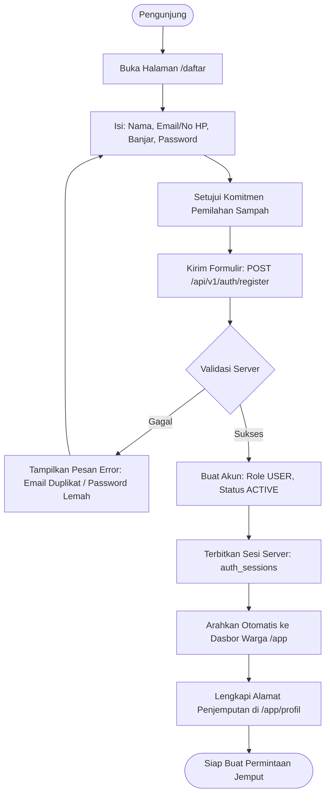
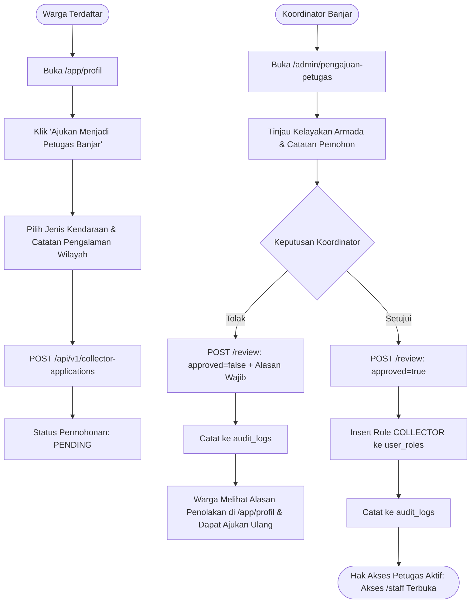

# Alur Registrasi Akun dan Persetujuan Peran — Kedas

**Proyek**: Kedas  
**Tanggal**: 30 Oktober 2026  
**Auditor**: IAM Engineer & Technical Lead

---

## 1. Alur Registrasi Warga Baru (Public Signup)

---

## 2. Alur Pengajuan dan Verifikasi Petugas Kebersihan (Collector Approval)

