# Software Design Document (SDD)
# WasteLink Bali — Platform Pengelolaan Sampah Berbasis Komunitas dan Ekonomi Sirkular

> **Status:** Rancangan teknis untuk hackathon/MVP  
> **Versi:** 1.0  
> **Tanggal:** 29 Oktober 2026  
> **Dokumen acuan:** `PRD_WasteLink_Bali.md` dan `HRD_WasteLink_Bali.md`  
> **Wilayah pilot asumsi:** satu banjar/desa di Bali  
> **Zona waktu operasional:** WITA (`Asia/Makassar`)  
> **Mata uang:** Rupiah (`IDR`)

> **Catatan:** SDD menerjemahkan kebutuhan produk dan kebutuhan tingkat tinggi menjadi rancangan perangkat lunak. Tarif poin, batas berat, SLA, harga material, kapasitas, provider, dan target performa masih perlu divalidasi. Keberadaan fasilitas, mitra, izin, atau integrasi tidak dianggap terkonfirmasi hanya karena tercantum dalam rancangan.

---

## Daftar Isi

1. Tujuan dan Konvensi Dokumen
2. Konteks Produk dan Batas Sistem
3. Ruang Lingkup Desain
4. Stakeholder dan Sasaran Kualitas
5. Prinsip Desain
6. Asumsi dan Dependensi
7. Gambaran Arsitektur
8. Keputusan Teknologi
9. Deployment dan Environment
10. Desain Frontend
11. Desain Backend dan Modul
12. Identitas, Role, dan Otorisasi
13. Waste Collection
14. Inspeksi dan Penimbangan
15. WastePoints dan Reward Ledger
16. Circular Marketplace dan Batch
17. Pendanaan dan Rekonsiliasi
18. Notifikasi dan Media
19. Bantuan Klasifikasi AI
20. Desain Database
21. Relasi Entitas
22. State Machine
23. API REST
24. Kontrak Request/Response/Error
25. Alur End-to-End
26. Keamanan
27. Privasi dan Tata Kelola Data
28. Transaksi dan Idempotensi
29. Kinerja dan Ketersediaan
30. Logging, Monitoring, dan Audit
31. Pengujian dan QA
32. Migrasi dan Data Awal
33. Edge Case dan Kegagalan
34. Kriteria Penerimaan Desain
35. Matriks Keterlacakan PRD–HRD–SDD
36. Rencana Implementasi
37. Risiko Teknis
38. Keputusan Terbuka
39. Glosarium
40. Lampiran A — Struktur Direktori
41. Lampiran B — Environment Variables
42. Lampiran C — Definition of Done

---

## 1. Tujuan dan Konvensi Dokumen

### 1.1 Tujuan

Dokumen ini menjelaskan **bagaimana** WasteLink Bali dirancang: komponen sistem, batas modul, tanggung jawab, alur data, API, model data, transisi status, keamanan, serta strategi pengujian. Dokumen ditujukan untuk Product Owner, UI/UX Designer, frontend/backend developer, database engineer, QA, Data/AI Engineer, serta pengelola operasional.

### 1.2 Hubungan dengan PRD dan HRD

| Dokumen | Fokus | Output |
|---|---|---|
| PRD | Mengapa produk dibuat dan pengalaman yang dibutuhkan | Tujuan, persona, fitur, prioritas, user journey |
| HRD | Kebutuhan apa yang wajib dipenuhi sistem | Kebutuhan fungsional/nonfungsional, aturan, acceptance criteria |
| SDD | Bagaimana kebutuhan diimplementasikan secara teknis | Arsitektur, modul, data, API, state machine, kontrol dan test |

Jika terjadi konflik, kebutuhan produk pada PRD/HRD ditinjau bersama Product Owner; SDD tidak boleh diam-diam mengubah kebijakan reward, keselamatan, peran, atau arti status akhir.

### 1.3 Konvensi

- **MUST:** wajib pada MVP; **SHOULD:** direkomendasikan; **MAY:** opsional.
- `snake_case` untuk kolom DB; `PascalCase` untuk tipe/kelas; `camelCase` untuk variabel TypeScript.
- Diagram Mermaid menjelaskan rancangan logis, bukan bukti bahwa fitur sudah diimplementasikan.
- Timestamp disimpan sebagai waktu absolut/timezone-aware dan ditampilkan dengan zona waktu operasional.
- Berat kanonis menggunakan kilogram (`kg`) dengan presisi decimal yang konsisten.
- Nilai uang tidak menggunakan binary floating-point; gunakan integer rupiah atau Decimal dengan scale yang ditetapkan.
- Poin memakai integer kecuali kebijakan yang disetujui secara eksplisit menyatakan lain.

### 1.4 Status rancangan

Endpoint, schema, stack, dan target teknis dalam dokumen ini adalah rekomendasi desain sampai ditetapkan dalam repository dan diuji. Integrasi eksternal, AI, optimasi rute, dan portal partner tidak boleh dianggap aktif sebelum konfigurasi serta pengujian tersedia.

---

## 2. Konteks Produk dan Batas Sistem

### 2.1 Ringkasan produk

WasteLink Bali menghubungkan warga, petugas pengangkut, pengelola, bank sampah, pengepul, pengerajin, pengolah, pelaku usaha, serta pihak pendanaan. Sistem mencatat alur dari laporan/setoran, pemilahan, penjemputan, inspeksi, penimbangan, reward, pembentukan batch, hingga serah terima material.

Tiga domain inti:

1. **Waste Collection:** setoran, lokasi/jadwal, penugasan, status, inspeksi, timbang, bukti, dan riwayat.
2. **WastePoints:** aturan reward berversi, kelayakan, ledger, saldo, koreksi, dan penukaran.
3. **Circular Marketplace:** profil mitra, aturan penerimaan, batch, penawaran/alokasi, pengiriman, dan konfirmasi penerimaan.

Fungsi lintas domain: akun dan role, konfigurasi area/kategori, notifikasi, media, pendanaan, laporan, audit, serta komplain.

### 2.2 Diagram konteks

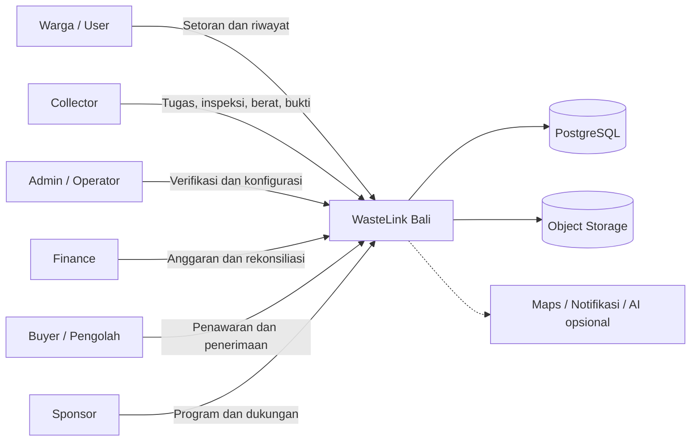

### 2.3 Batas tanggung jawab

**Sistem bertanggung jawab atas:** penyimpanan record; validasi permission dan state transition; pencatatan berat serta bukti; perhitungan reward dari data tervalidasi; ledger dan adjustment; traceability batch; laporan berdasarkan data tercatat; dan audit aksi sensitif.

**Sistem tidak otomatis menjamin:** kualitas material tanpa inspeksi; harga jual atau dana yang belum dikonfirmasi; ketersediaan petugas/pengolah; legalitas suatu jalur limbah; material benar-benar didaur ulang hanya karena sudah dijemput; maupun angka dampak lingkungan tanpa metode terverifikasi.

### 2.4 Alur nilai utama

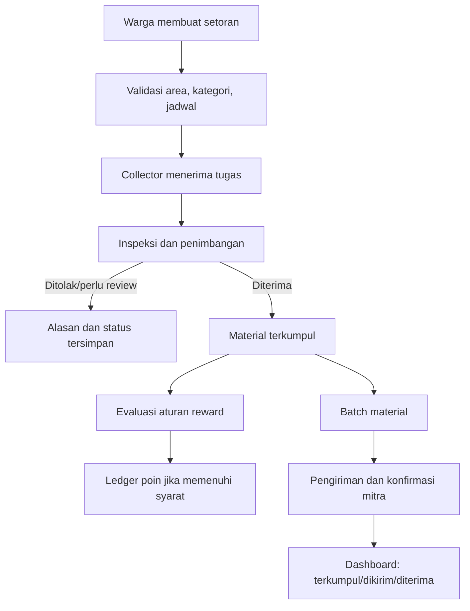

---

## 3. Ruang Lingkup Desain

### 3.1 Cakupan MVP

| ID | Area | Desain yang dicakup |
|---|---|---|
| DS-001 | Akun | Registrasi, login/logout, profil, status akun |
| DS-002 | Role | Role USER default, pengajuan/verifikasi COLLECTOR, switch role |
| DS-003 | Taksonomi | Kategori, subkategori, instruksi, aturan penerimaan per area |
| DS-004 | Collection | Buat/lihat/cancel pickup, daftar task, accept, transisi status |
| DS-005 | QC | Inspeksi, berat, bukti, koreksi tercatat |
| DS-006 | WastePoints | Aturan berversi, ledger append-only, saldo dan adjustment |
| DS-007 | Organik | Jalur dan penjadwalan terpisah menurut kapasitas terkonfigurasi |
| DS-008 | Marketplace | Mitra, batch, offer/alokasi, delivery, receipt |
| DS-009 | Admin | Verifikasi role, master data, audit, laporan dasar |
| DS-010 | Finance | Program pendanaan, transaksi dan rekonsiliasi sesuai izin |
| DS-011 | Notification | Notifikasi in-app dan adapter eksternal opsional |
| DS-012 | Observability | Request ID, log terstruktur, metrik dasar, audit |

### 3.2 Bukan syarat MVP

- Microservices terpisah, Kubernetes, service mesh, atau message broker kompleks.
- GPS real-time kontinu dan optimasi rute multi-stop otomatis.
- Penentuan berat hanya dari foto/AI.
- Pembayaran tunai otomatis atau dompet uang antar pengguna.
- Pengolahan mandiri limbah khusus/B3 tanpa jalur/mitra sah.
- Integrasi pemerintah atau provider yang belum memiliki akses resmi.
- Klaim daur ulang tanpa bukti penerimaan/proses yang sesuai.

### 3.3 Penyederhanaan yang diperbolehkan

- Satu pickup = satu kategori/subkategori pada MVP.
- Dashboard memakai agregasi PostgreSQL selama data masih kecil.
- Notifikasi dimulai dari in-app; email/push ditambahkan setelah provider dipilih.
- Lokasi memakai alamat teks jika peta belum tersedia.
- AI boleh dinonaktifkan; input manual tetap berjalan.
- Buyer/sponsor dapat dioperasikan oleh admin untuk demo sebelum portal mandiri tersedia.

### 3.4 Batas domain

Kategori utama wajib dibedakan: `ORGANIC`, `RECYCLABLE`, `RESIDUAL`, dan `SPECIAL`. Limbah khusus tidak masuk pickup biasa tanpa jalur yang disahkan. `COLLECTED`, `DELIVERED_TO_FACILITY`, `COMPLETED`, dan status pengolahan akhir memiliki makna berbeda. Role aktif hanya konteks UI—bukan otorisasi.

---

## 4. Stakeholder dan Sasaran Kualitas

### 4.1 Stakeholder

| Stakeholder | Fokus | Akses data yang diharapkan |
|---|---|---|
| User | Setoran, jadwal, status, poin, privasi | Data sendiri dan informasi petugas seperlunya |
| Collector | Tugas, lokasi, QC, bukti, keselamatan | Tugas tersedia sesuai aturan dan tugas yang di-assign |
| Admin | Verifikasi, konfigurasi, dispute, laporan | Sesuai permission dan dicatat untuk akses sensitif |
| Finance | Dana, reward budget, rekonsiliasi | Data keuangan yang dibutuhkan, bukan semua data pribadi |
| Buyer/Processor | Spesifikasi, batch, delivery | Batch/offer yang terkait dengan transaksi sendiri |
| Sponsor | Indikator program | Agregat yang disetujui, bukan data individu secara default |

### 4.2 Concern arsitektur

1. **Correctness:** status, berat, saldo, reward, dan volume batch konsisten.
2. **Authorization:** setiap resource dicek berdasarkan role, ownership, assignment, area, dan transaksi.
3. **Auditability:** perubahan penting tidak menghapus sejarah.
4. **Usability:** alur petugas mudah digunakan di ponsel dan jaringan tidak stabil.
5. **Privacy:** alamat, koordinat, kontak, dan foto dibatasi sesuai tugas.
6. **Maintainability:** modul jelas, testable, dan dapat dikembangkan tanpa mengganti seluruh sistem.
7. **Cost-awareness:** infrastruktur sederhana sampai beban dan kebutuhan nyata terbukti.

### 4.3 Atribut kualitas dan verifikasi

| Atribut | Kontrol desain | Verifikasi |
|---|---|---|
| Keamanan | RBAC, ownership check, secure session, audit | Test akses silang role/pengguna |
| Integritas | FK/check/unique constraint, transaksi, idempotency | Test concurrency, duplicate request, correction |
| Kinerja | Pagination, indeks berbasis query, batas payload | Profiling/load test dasar |
| Reliability | Backup, retry aman, fallback provider | Restore test dan simulasi outage |
| Maintainability | Modular monolith, service layer, lint/type-check | Code review dan unit test |
| Aksesibilitas | Label, keyboard, kontras, status bukan warna saja | Checklist manual/automated audit |

---

## 5. Prinsip Desain

### 5.1 Prinsip inti

1. **Modular monolith dahulu:** batas domain jelas tanpa deployment terpisah di awal.
2. **Server sebagai sumber kebenaran:** status, permission, berat final, saldo dan poin dihitung/diperiksa backend.
3. **Jangan percaya input client:** role, harga, aturan reward, poin, dan ownership tidak berasal dari payload frontend sebagai nilai otoritatif.
4. **Append-only untuk histori penting:** status event, ledger, audit dan koreksi disimpan sebagai entry baru.
5. **Transaksi atomik:** operasi lintas tabel yang harus konsisten dikelompokkan dalam satu transaction boundary.
6. **Idempotency:** retry tidak menggandakan accept task, reward, atau redemption.
7. **Konfigurasi berversi:** aturan yang mengubah hasil transaksi memiliki versi/masa berlaku.
8. **Bukti sesuai klaim:** pengangkutan tidak sama dengan penerimaan; penerimaan tidak otomatis sama dengan daur ulang.
9. **AI sebagai saran:** keputusan berat, reward dan keselamatan tidak hanya bergantung pada AI.
10. **Fail-safe untuk kategori khusus:** tanpa jalur aman, jangan buat task pickup umum.

### 5.2 Prinsip pemodelan

- Pisahkan status saat ini dari event histori.
- Simpan actor, waktu, alasan, dan sumber perubahan untuk tindakan penting.
- Simpan snapshot aturan/harga yang memengaruhi transaksi historis.
- Jangan gunakan JSON sebagai pengganti relasi inti.
- Gunakan decimal/integer untuk berat, uang, dan poin sesuai aturan domain.
- Query laporan bersifat read-only terhadap proses bisnis.

### 5.3 Non-goals teknis

Pada MVP tidak perlu message broker, service mesh, data warehouse, GPS stream, atau model AI khusus jika manfaatnya belum dibuktikan. Infrastruktur rumit menambah biaya dan bukan syarat untuk mendemonstrasikan alur produk.

---

## 6. Asumsi dan Dependensi

### 6.1 Asumsi implementasi

- Web app responsif merupakan antarmuka awal.
- Frontend: Next.js App Router + TypeScript.
- Backend yang direkomendasikan: FastAPI/Python.
- PostgreSQL sebagai sumber data transaksi; PostGIS opsional.
- Foto/bukti disimpan di object storage; database hanya menyimpan metadata dan object key.
- Semua mutasi domain masuk melalui backend.
- User adalah role default; role operasional memerlukan grant/verifikasi.
- MVP membutuhkan koneksi saat transaksi; offline penuh di luar cakupan.
- Nilai tarif, poin, SLA, harga, dan kapasitas adalah konfigurasi, bukan konstanta kode.

### 6.2 Dependensi dan fallback

| Dependensi | Dampak kegagalan | Fallback |
|---|---|---|
| PostgreSQL | Tidak bisa menyimpan transaksi | Mutasi gagal dengan pesan aman; jangan memberi sukses palsu |
| Object storage | Bukti tidak dapat diunggah | Jangan tandai bukti wajib lengkap sebelum server mengonfirmasi |
| Email/SMS/push | Notifikasi eksternal tertunda | In-app notification; retry tercatat bila provider aktif |
| Peta/geocoding | Peta/rute tidak tersedia | Alamat teks, input manual |
| AI classifier | Saran kategori hilang | Klasifikasi manual |
| Mitra pengolah | Material belum bisa disalurkan | Batch menunggu mitra, jangan klaim sudah diproses |
| SOP/timbangan | Verifikasi tak terstandar | Jangan aktifkan reward berbasis berat sebelum SOP tersedia |

### 6.3 Keputusan yang belum final

Metode login; provider storage/peta/notifikasi/AI; kebutuhan PostGIS; apakah redemption voucher masuk MVP; role yang mengesahkan penerimaan batch; masa retensi bukti/audit; batas berat; persyaratan operasional/legal mitra; dan skema anggaran reward harus diputuskan sebelum pilot.

---

## 7. Gambaran Arsitektur

### 7.1 Arsitektur logis

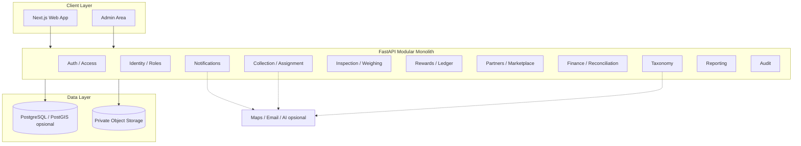

### 7.2 Pembagian lapisan

| Lapisan | Tanggung jawab | Batasan |
|---|---|---|
| Presentation | Render UI, navigasi, validasi UX, loading/error state | Bukan sumber kebenaran bisnis |
| API/transport | Parsing, auth dependency, pagination, mapping HTTP | Tidak memuat seluruh business logic |
| Application/domain service | Use case, aturan, orkestrasi transaksi | Tidak melewati policy/transaction boundary |
| Repository | Query, persistensi, lock, mapping data | Tidak memutuskan kebijakan produk |
| Database | Transaksi, constraint, foreign key, index | Integritas tidak boleh bergantung pada UI |
| Object storage | File dan bukti dengan akses terbatas | Default bukan publik |
| External adapter | Provider API dan fallback | Gagal tidak merusak transaksi utama tanpa alasan |

### 7.3 Gaya arsitektur

Backend disarankan **modular monolith**: satu API deployment dengan modul domain terpisah, kontrak internal jelas, dan satu database relasional. Pilihan ini lebih sederhana untuk tim hackathon, mendukung transaksi atomik, dan mengurangi beban deployment. Service baru dapat dipisah setelah ada kebutuhan beban/organisasi yang terukur.

Batas modularitas:

- Route memanggil service, bukan melakukan query dan aturan bisnis panjang sekaligus.
- Modul rewards tidak boleh dipanggil tanpa konteks transaksi/idempotency.
- Modul reporting tidak memodifikasi record operasional.
- Adapter peta, pesan, dan AI tidak mengandung aturan kategori/reward inti.
- Hindari dependensi siklik antar modul.

### 7.4 Aliran request

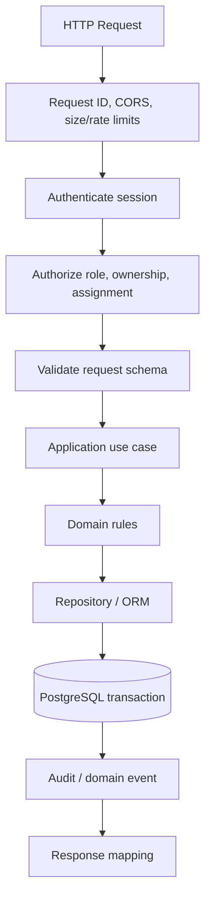

### 7.5 Komunikasi

- HTTPS untuk staging/production.
- JSON UTF-8 dengan prefix `/api/v1`.
- Upload dapat memakai signed URL, tetapi metadata dan hak akses diperiksa backend.
- Provider eksternal dipanggil dengan timeout, error handling, dan log terstruktur.
- Commit database dilakukan sebelum mengirim notifikasi eksternal.
- Outbox dapat ditambahkan bila notifikasi harus dijamin tercatat sebelum diproses.

---

## 8. Keputusan Teknologi

### 8.1 Stack referensi

| Area | Pilihan rekomendasi | Alasan | Alternatif yang dapat diterima |
|---|---|---|---|
| Frontend | Next.js App Router + TypeScript | Routing, layout, ekosistem React | React + Vite jika disepakati tim |
| UI | Tailwind CSS + komponen aksesibel | Konsistensi dan iterasi cepat | CSS Modules/design system lain |
| Backend | FastAPI + Python | REST API, schema validation, integrasi data/AI | Backend Next.js untuk demo sederhana dengan keputusan tertulis |
| API schema | Pydantic + OpenAPI | Kontrak dan dokumentasi | Skema tervalidasi setara |
| Database | PostgreSQL | Transaksi relasional, constraints, query agregasi | DB relasional setara dengan rencana migrasi |
| Spatial | PostGIS opsional | Query area dan jarak | Latitude/longitude biasa untuk pilot kecil |
| ORM/migration | SQLAlchemy 2 + Alembic | Query dan migrasi eksplisit | Tool lain yang dikuasai tim, jangan campur tanpa alasan |
| File storage | Object storage S3-compatible | Pisah file biner dari database, signed URL | Storage terkelola dengan kontrol akses setara |
| Auth | Session opaque di cookie HttpOnly atau provider terkelola | Session dapat dicabut dan token tidak terekspos ke JavaScript | Cookie JWT dengan expiry/revocation yang benar |
| Testing | Pytest; Vitest/Playwright pada frontend | Unit, integration, browser journey | Toolset setara |
| Deploy | Frontend hosting + API runtime + managed PostgreSQL | Sederhana untuk demo/pilot | Platform terpadu dengan secret management memadai |

### 8.2 Architecture Decision Records (ADR)

| ID | Keputusan | Status | Pertimbangan |
|---|---|---|---|
| ADR-001 | Modular monolith backend | Direkomendasikan | Sederhana, transaksi lintas domain lebih mudah |
| ADR-002 | PostgreSQL sebagai sumber kebenaran transaksi | Direkomendasikan | Constraint dan transaksi menjadi penjaga integritas |
| ADR-003 | REST API `/api/v1` | Direkomendasikan | Kontrak eksplisit dan mudah diuji |
| ADR-004 | Append-only ledger untuk poin | Prinsip wajib | Saldo dapat diaudit dan dikoreksi tanpa menghapus riwayat |
| ADR-005 | Weight record ber-versi | Prinsip wajib | Perubahan berat dapat ditelusuri |
| ADR-006 | Private object storage untuk bukti | Direkomendasikan | File tidak publik secara default |
| ADR-007 | AI hanya menyarankan kategori | Prinsip wajib | Manusia tetap memverifikasi kondisi/berat |
| ADR-008 | Transactional outbox | P1 | Ditambahkan saat kebutuhan delivery notification menuntut |
| ADR-009 | PostGIS | Terbuka | Dipilih bila fitur spasial penting pada pilot |
| ADR-010 | Portal buyer/sponsor mandiri | Terbuka/P1 | Dapat dimulai lewat admin-managed workflow |

### 8.3 Mengapa bukan microservices

- Beban dan kebutuhan pemisahan deployment belum terukur.
- Pickup, weight record, status event, dan reward membutuhkan konsistensi lintas tabel.
- Banyak service akan menambah konfigurasi jaringan, secret, observability, dan debugging.
- Modul domain yang terpisah secara kode sudah cukup untuk MVP dan bisa menjadi batas ekstraksi nantinya.

### 8.4 Aturan perubahan stack

Perubahan framework, ORM, autentikasi, atau provider harus mencatat alasan, dampak ke schema dan security, rencana migrasi, serta test yang membuktikan perilaku domain tetap sama. Jangan mengganti kontrak bisnis hanya karena perubahan implementasi.

---

## 9. Deployment dan Environment

### 9.1 Environment

| Environment | Tujuan | Data | Akses |
|---|---|---|---|
| Local | Pengembangan dan unit test | Seed sintetis | Developer |
| CI/test | Unit/integration/migration test | Dataset sementara | Pipeline/tim |
| Staging/demo | Uji integrasi dan demo | Data demo terlabel | Tim/evaluator sesuai kebutuhan |
| Production/pilot | Operasional setelah disetujui | Data lapangan menurut kebijakan | Pengguna terotorisasi |

### 9.2 Diagram deployment konseptual

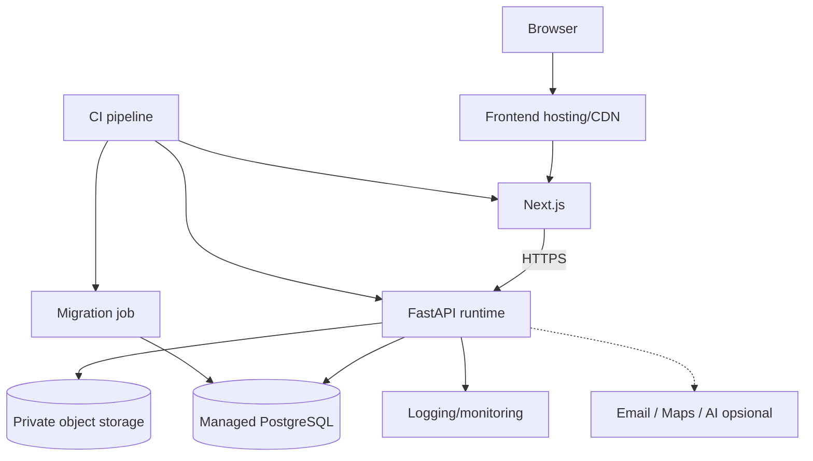

### 9.3 Konfigurasi dan secrets

- Secret tidak boleh disimpan pada repo, README, screenshot, fixture, atau log.
- `.env.example` memuat placeholder saja.
- Setiap environment mempunyai database dan bucket/namespace terpisah.
- `DEBUG` nonaktif untuk staging publik/production.
- CORS, cookie domain, allowed hosts, upload limit, dan base URL dikonfigurasi per environment.
- Gunakan HTTPS dan cookie Secure pada environment publik.
- Production migration dikendalikan dan memiliki rencana rollback/backup.

### 9.4 Backup dan pemulihan

Tentukan jadwal backup berdasarkan frekuensi transaksi dan kemampuan platform. Uji restore ke environment non-production secara berkala. Backup dianggap valid setelah dibuktikan dapat dipulihkan dan relasi penting tetap konsisten, bukan hanya karena job backup berstatus sukses.

### 9.5 Rollback dan migrasi aman

- Migration schema harus berurutan dan direview.
- Jangan mengubah file migration yang sudah diterapkan di environment bersama; buat migration baru.
- Hindari migrasi destruktif tanpa proses backup dan validasi.
- Untuk perubahan berisiko, gunakan pola expand–migrate–contract.
- Rollback aplikasi tidak boleh menghapus ledger, audit, atau transaksi yang sudah terjadi.

---

## 10. Desain Frontend

### 10.1 Prinsip UI

- Navigasi disesuaikan dengan role aktif, tetapi izin selalu diperiksa backend.
- UI memakai kode status domain yang stabil dan label manusia yang konsisten.
- Setiap operasi asynchronous mempunyai loading, success, error, dan retry state.
- Validasi client membantu UX; validasi server wajib untuk integritas.
- List besar memakai pagination/filter server-side.
- Alamat, kontak, bukti, dan detail pickup tidak ditampilkan lintas pengguna tanpa kebutuhan operasional.

### 10.2 Information architecture

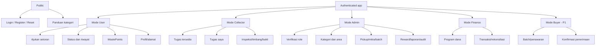

### 10.3 Rute halaman konseptual

| Rute | Role | Fungsi |
|---|---|---|
| `/` | Publik | Informasi produk |
| `/auth/login`, `/auth/register` | Publik | Autentikasi |
| `/guide/categories` | Publik/semua | Panduan pemilahan |
| `/app` | Authenticated | Redirect dashboard role aktif |
| `/app/user` | User | Dashboard dan setoran |
| `/app/user/pickups/new` | User | Form setoran baru |
| `/app/user/pickups/[id]` | Pemilik/akses sah | Detail status dan bukti |
| `/app/user/points` | User | Saldo dan ledger |
| `/app/collector/tasks` | Collector verified | Daftar tugas |
| `/app/collector/tasks/[id]` | Collector yang berwenang | Inspeksi, timbang, bukti, status |
| `/app/admin/users` | Admin berizin | User dan role |
| `/app/admin/categories` | Admin berizin | Kategori/aturan |
| `/app/admin/pickups` | Admin berizin | Operasi pickup |
| `/app/admin/batches` | Admin berizin | Batch dan delivery |
| `/app/admin/rewards` | Admin berizin | Aturan dan koreksi reward |
| `/app/finance` | Finance berizin | Dana dan rekonsiliasi |
| `/app/marketplace` | Buyer/role sah | Offer dan penerimaan |

Nama route boleh berubah; proteksi, scope, dan ownership harus dipertahankan.

### 10.4 Komponen UI utama

- `AppShell`: navigasi, profil, role aktif, logout.
- `RoleSwitcher`: hanya menampilkan role yang dimiliki dan valid.
- `PickupForm`: kategori, alamat, jadwal, estimasi, catatan, foto opsional.
- `PickupStatusTimeline`: status dan histori yang boleh dilihat.
- `WasteCategoryCard`: deskripsi, contoh, panduan persiapan, dan batas penerimaan.
- `CollectorTaskCard`: kategori, lokasi ringkas, waktu, dan aksi yang sah.
- `InspectionForm` dan `WeightSummary`: hasil inspeksi, berat, satuan, actor, waktu.
- `EvidenceUploader`: validasi file, progress, status server-confirmed, retry.
- `PointsBalance` dan `PointsLedgerTable`: saldo/histori hasil API.
- `BatchStatusBadge`: status berbasis teks serta visual yang aksesibel.
- `AuditTable`: hanya untuk role audit/administratif yang berwenang.
- `LoadingState`, `EmptyState`, `ErrorState`, `ConfirmDialog`: behavior reusable.

### 10.5 State management dan cache

- State form lokal berada di komponen/form library.
- Data server memakai mekanisme query/cache dengan invalidasi setelah mutasi.
- Global client state bukan sumber kebenaran status domain.
- Role aktif dapat disimpan sebagai preferensi navigasi, bukan grant permission.
- Setelah accept task, timbang, redemption, atau koreksi, frontend mengambil ulang data yang terpengaruh.
- Logout, suspend, atau perubahan akun harus membersihkan cache user-specific.

### 10.6 Validasi UX

- Tampilkan satuan berat dan zona waktu/jadwal dengan jelas.
- Pesan validasi menunjukkan field yang bermasalah tanpa data sensitif.
- Aksi sulit dibatalkan menampilkan ringkasan/konfirmasi.
- Alasan penolakan, pembatalan, dan koreksi diwajibkan ketika policy meminta.
- Bukti tidak dianggap terunggah sebelum server mengonfirmasi.
- Offline draft hanya diaktifkan bila risiko penyimpanan data di perangkat telah ditinjau.

### 10.7 Aksesibilitas

- Semua input memiliki label; fokus keyboard terlihat.
- Warna bukan satu-satunya indikator status.
- Kontras dan ukuran target sentuh diuji di ponsel.
- Gunakan pesan singkat dan jelas, terutama tentang kategori dan keselamatan.
- Hindari animasi/media yang menghalangi tugas lapangan.

---

## 11. Desain Backend dan Modul

### 11.1 Modul dan batas tanggung jawab

| Modul | Tanggung jawab | Entitas utama |
|---|---|---|
| `auth` | Login/logout, session, recovery | `users`, `auth_sessions` |
| `identity` | Profil, role, pengajuan/verifikasi role, area | `users`, `roles`, `user_roles`, `user_addresses` |
| `taxonomy` | Kategori, panduan, aturan penerimaan | `waste_categories`, `material_acceptance_rules` |
| `collection` | Pickup, assignment, status, cancel | `pickup_requests`, `pickup_status_events`, assignments |
| `quality` | Inspeksi, berat, koreksi, bukti | `inspection_records`, `weight_records`, evidence |
| `rewards` | Rule, kelayakan, ledger, redemption | `reward_rules`, `point_ledger_entries`, `reward_redemptions` |
| `partners` | Profil mitra dan kelayakan | `partners`, `partner_material_rules` |
| `marketplace` | Batch, offer, alokasi, delivery/receipt | `material_batches`, items, offers, deliveries |
| `finance` | Program dana, transaksi, rekonsiliasi | `funding_programs`, `financial_transactions`, reconciliations |
| `notifications` | In-app dan provider adapter | `notifications`, outbox/attempts jika ada |
| `reporting` | Dashboard dan ekspor read-only | Query agregasi domain |
| `audit` | Jejak aksi sensitif | `audit_logs` |

### 11.2 Prinsip layering

- **Router:** parsing HTTP, autentikasi, schema input, response mapping.
- **Service/use case:** aturan bisnis, validasi state, orkestrasi transaksi.
- **Repository:** query, persistensi, locking, dan pemetaan ORM.
- **Schema/DTO:** kontrak input/output API; tidak otomatis sama dengan ORM entity.
- **Policy:** aturan permission, ownership, assignment, dan transisi.
- **Adapter:** integrasi eksternal dengan timeout/fallback.

Hindari business logic panjang di router, query lintas modul yang tidak terkontrol, dan commit tersembunyi di repository.

### 11.3 Pola transaksi

Transaction boundary ditetapkan pada use case. Status event dan audit kritis disimpan dalam transaksi yang sama bila tanpa event tersebut perubahan kehilangan konteks. Notifikasi eksternal dilakukan setelah commit. Jika perlu menjamin pesan tercatat, simpan outbox record dalam transaksi yang sama dan proses dengan retry.

### 11.4 Service yang disarankan

`AuthService`, `RoleManagementService`, `WasteCategoryService`, `PickupRequestService`, `PickupAssignmentService`, `PickupStateTransitionService`, `InspectionService`, `WeightRecordService`, `RewardCalculationService`, `PointsLedgerService`, `RewardRedemptionService`, `MaterialBatchService`, `BatchAllocationService`, `DeliveryReconciliationService`, `FundingService`, `NotificationService`, `AuditService`, dan `ReportingService`.

Nama tersebut adalah contoh, bukan kewajiban membuat class untuk setiap fungsi. Yang wajib adalah tanggung jawab dan kontrak antarbagian jelas.

---

## 12. Identitas, Role, dan Otorisasi

### 12.1 Role konseptual

| Role | Grant | Akses inti |
|---|---|---|
| `USER` | Default | Setoran sendiri, profil, saldo/ledger sendiri |
| `COLLECTOR` | Pengajuan + verifikasi/penetapan | Task yang sesuai, inspeksi, timbang, bukti, status yang diizinkan |
| `ADMIN` | Penetapan terbatas | Konfigurasi dan operasi administratif sesuai permission |
| `FINANCE` | Grant terpisah | Program dana, transaksi, rekonsiliasi sesuai permission |
| `BUYER` | Mitra diverifikasi | Batch/offer/delivery yang menjadi bagiannya |
| `SPONSOR` | Bila diperlukan | Laporan agregat/program yang disetujui |

### 12.2 Status role dan akun

Status role yang disarankan: `PENDING`, `VERIFIED`, `REJECTED`, `SUSPENDED`, `EXPIRED`; role tanpa verifikasi khusus dapat memakai `NOT_REQUIRED`. Status akun terpisah: `ACTIVE`, `PENDING_VERIFICATION`, `SUSPENDED`, `DEACTIVATED`. Akun suspended tidak dapat beroperasi meskipun role sebelumnya verified.

Gunakan `roles` untuk definisi role dan `user_roles` untuk grant/status. Jika riwayat aplikasi perlu dipertahankan secara detail, pisahkan `role_applications` dari grant yang aktif.

### 12.3 Switch role

Server wajib memverifikasi bahwa pengguna memiliki role yang dipilih, akun aktif, dan role berstatus valid. Switch role tidak mengubah assignment, saldo, histori, atau ownership. Client tidak dapat memberi dirinya role baru dengan mengirim `active_role=ADMIN`. Semua endpoint tetap menjalankan pemeriksaan permission.

### 12.4 Permission konseptual

`pickup:create`, `pickup:read:own`, `pickup:read:assigned`, `pickup:read:area`, `pickup:cancel:own`, `pickup:accept`, `pickup:transition`, `pickup:inspect`, `weight:create`, `weight:correct`, `points:read:own`, `points:redeem`, `reward_rule:manage`, `partner:manage`, `batch:manage`, `batch:offer`, `delivery:confirm`, `finance:read`, `finance:write`, `audit:read`, `user_role:review`.

Daftar ini bisa diimplementasikan sebagai policy code pada MVP. Yang wajib: permission dijalankan server-side dan diuji.

### 12.5 Matriks akses ringkas

| Aksi | USER | COLLECTOR | ADMIN | FINANCE | BUYER |
|---|---|---|---|---|---|
| Buat pickup | Milik sendiri | Tidak sebagai petugas | Hanya jika diizinkan | Tidak | Tidak |
| Baca pickup | Milik sendiri | Assigned/eligible | Sesuai permission/area | Ringkasan yang dibutuhkan | Data yang dibagikan untuk transaksi |
| Accept task | Tidak | Ya, terverifikasi | Assign jika berizin | Tidak | Tidak |
| Catat timbang | Tidak | Task miliknya | Review/koreksi jika berizin | Tidak | Tidak |
| Baca ledger poin | Sendiri | Sendiri bila relevan | Akses terbatas/audit | Ringkasan sesuai izin | Tidak |
| Ubah reward rule | Tidak | Tidak | Permission khusus | Persetujuan budget jika ditetapkan | Tidak |
| Kelola batch | Tidak | Kontribusi operasional jika berizin | Ya | Ringkasan keuangan | Offer/batch yang terkait |
| Konfirmasi penerimaan | Tidak | Umumnya tidak | Jika SOP/izin mengizinkan | Tidak | Transaksi sendiri |

### 12.6 Ownership dan pemisahan tugas

Setiap akses berdasarkan ID harus mengecek ownership, assignment aktif, partner scope, atau permission administratif. Aksi sensitif seperti adjustment poin, perubahan reward rule, dan koreksi timbang memerlukan alasan dan audit. Terapkan maker-checker jika kemampuan tim/pilot memungkinkan; jika belum, catat bahwa satu orang melakukan aksi dan review dilakukan kemudian.

---

## 13. Waste Collection

### 13.1 Objek domain

- `PickupRequest`: permintaan pengumpulan.
- `Assignment`: hubungan pickup dan Collector yang aktif.
- `PickupStatusEvent`: histori transisi status.
- `Schedule`: slot diminta dan slot terkonfirmasi.
- `InspectionRecord`: keputusan QC.
- `WeightRecord`: hasil timbang dan revisi.
- `Evidence`: metadata file yang mendukung operasi.

### 13.2 Field pickup minimum

| Field | Kebutuhan | Catatan |
|---|---|---|
| `id` | Wajib | UUID/ID acak yang sulit ditebak |
| `public_code` | Disarankan | Kode ramah pengguna, tidak mengekspos ID internal |
| `reporter_user_id` | Wajib | Pemilik permintaan |
| `service_area_id` | Wajib | Aturan kategori, jadwal, kapasitas |
| `category_id` | Wajib | Kategori aktif pada area |
| `address_id` | Tergantung model | Alamat milik user atau snapshot operasional |
| `requested_slot_start/end` | Jika pakai slot | Timestamp timezone-aware |
| `scheduled_slot_start/end` | Opsional | Waktu hasil konfirmasi |
| `estimated_weight_kg` | Opsional | Estimasi, bukan berat final |
| `description` | Opsional | Batasi panjang dan sanitasi tampilan |
| `status` | Wajib | Enum/kode terkontrol |
| `assigned_collector_id` | Opsional | Alternatif sederhana untuk satu assignment aktif |
| `created_at/updated_at` | Wajib | Timestamp server |
| `cancel_reason` | Bila cancel | Wajib jika diminta policy |

### 13.3 Aturan membuat pickup

1. Akun aktif dan mempunyai permission.
2. Kategori serta jalur penerimaan aktif untuk service area.
3. Alamat berada pada area layanan atau ditandai untuk review manual.
4. Slot valid jika menggunakan scheduler.
5. Organik mengikuti konfigurasi jadwal/kapasitas pengolah.
6. Limbah khusus memerlukan jalur yang dikonfirmasi; tanpa jalur, jangan buat task biasa.
7. Permintaan masuk status awal `SUBMITTED`, lalu setelah validasi menjadi `PENDING_ASSIGNMENT`.
8. Insert pickup dan status event awal berada dalam transaction boundary yang sama.

### 13.4 Penugasan Collector

- Task list difilter berdasarkan status, area, kategori, jadwal, kapasitas, dan status Collector.
- Accept task harus atomic; hanya satu Collector yang dapat berhasil mengklaim task.
- Collector tidak terverifikasi tidak boleh menerima tugas.
- Assignment admin/reassignment memerlukan permission, alasan, dan event historis.
- Jika petugas tidak dapat hadir, status/reason memicu reschedule atau reassignment tercatat.

### 13.5 Histori status

`pickup_status_events` menyimpan `pickup_request_id`, `from_status`, `to_status`, actor, reason code/text, timestamp, request/correlation ID, dan metadata yang tidak memuat data pribadi berlebihan. Status saat ini tidak boleh diperbarui lewat endpoint generik dengan nilai bebas; gunakan command khusus accept/cancel/inspect/weigh/complete.

### 13.6 Pembatalan dan sengketa

- User membatalkan pickup miliknya hanya pada status yang diperbolehkan.
- Setelah tugas diterima, pembatalan memerlukan alasan dan notifikasi.
- Collector tidak menghapus pickup; ia menjalankan alur batal/reschedule yang diizinkan.
- Admin melakukan override dengan alasan dan audit.
- Sengketa tidak menghapus weight record atau ledger yang sudah diposting.
- Perubahan setelah penyelesaian menggunakan correction/adjustment, bukan overwrite histori.

### 13.7 Multi-item

MVP disarankan membatasi satu pickup ke satu kategori/subkategori. Jika multi-item dipakai, setiap item perlu berat, QC, eligibility reward, dan routing sendiri; tidak boleh menghitung reward dari berat campuran memakai satu tarif.

---

## 14. Inspeksi dan Penimbangan

### 14.1 Tujuan QC

QC memastikan kondisi dan berat dicatat sebagai dasar operasional dan reward. Berat berasal dari timbangan fisik; aplikasi memvalidasi catatan, bukan mengukur berat melalui foto.

### 14.2 Inspection record

Field rekomendasi: `id`, `pickup_request_id`, `inspector_user_id`, `result`, `contamination_level`, `inspection_notes`, `rejection_reason_code`, `rejection_reason_text`, `inspected_at`, `created_at`. Nilai `result` dapat berupa `ACCEPTED`, `ACCEPTED_WITH_CONTAMINATION`, `PARTIALLY_ACCEPTED`, `REJECTED`, atau `NEEDS_REVIEW`. Makna operasionalnya harus mengikuti SOP.

### 14.3 Weight record

Field minimum:

- `id`, `pickup_request_id`, `recorded_by_user_id`.
- `gross_weight_kg`, `tare_weight_kg`, `net_weight_kg` sesuai metode yang dipakai.
- `measurement_method` seperti `MANUAL_SCALE`.
- `verification_status`: misalnya `DRAFT`, `SUBMITTED`, `VERIFIED`, `SUPERSEDED`.
- `version_number` atau `supersedes_weight_record_id`.
- Referensi evidence, timestamp, `verified_by_user_id`, dan `correction_reason` bila ada.

Formula jika bruto dan tara benar-benar diukur:

`net_weight_kg = gross_weight_kg - tare_weight_kg`

Jika berat bersih ditimbang langsung, metode dicatat tanpa mengarang nilai tara.

### 14.4 Validasi berat

- Nilai harus numerik, tidak negatif, serta menggunakan unit kanonis `kg`.
- Jika bruto/tara dipakai, tara tidak melebihi bruto dan nilai bersih harus konsisten dengan aturan rounding.
- Berat yang melebihi batas kategori dikirim ke review atau mengikuti konfigurasi khusus.
- Berat nol tidak menerbitkan reward berbasis berat kecuali kebijakan yang disetujui menyatakan pengecualian.
- Frontend tidak boleh mengirim `points_earned` sebagai nilai final.
- Server memvalidasi actor, assignment, state pickup, inspeksi, bukti wajib, dan parameter kategori.

### 14.5 Kontaminasi dan penolakan

Kategori kontaminasi seperti `NONE`, `LOW`, `MEDIUM`, `HIGH` boleh dipakai jika definisinya dikonfigurasi. Sistem tidak boleh mengarang threshold teknis. Penolakan wajib menyimpan alasan; penerimaan sebagian perlu memisahkan kuantitas diterima dan ditolak bila hal itu memengaruhi reward/material.

### 14.6 Koreksi timbang

- Record terverifikasi tidak dihapus atau diedit diam-diam.
- Koreksi membuat revision/record baru dengan referensi ke record sebelumnya dan alasan.
- Jika reward telah terbit, jalankan reevaluasi/ledger adjustment.
- Aktor koreksi harus memiliki permission; maker-checker digunakan jika tersedia.
- Simpan actor, waktu, dan audit log.

### 14.7 Bukti

Foto bukti mendukung inspeksi, tetapi bukan bukti tunggal bahwa berat pasti benar atau material telah didaur ulang. Metadata mencakup object key, MIME, ukuran, uploader, waktu, relasi domain, dan status review jika dibutuhkan.

---

## 15. WastePoints dan Reward Ledger

### 15.1 Sasaran desain

WastePoints adalah sistem poin insentif, bukan otomatis dompet uang digital. Nilai tukar rupiah atau cash-out tidak boleh diasumsikan tanpa kebijakan program dan sumber pendanaan yang jelas.

### 15.2 Komponen domain

- **Reward Rule:** aturan per material/program, masa berlaku, formula, batas, kualitas, dan versi.
- **Reward Evaluation:** hasil evaluasi sebuah setoran berdasarkan data terverifikasi.
- **Points Ledger Entry:** kredit, debit, koreksi, atau reversal secara append-only.
- **Reward Redemption:** permintaan penukaran benefit.
- **Funding Program/Budget:** batas sumber dana atau kuota apabila reward dibatasi program.
- **Adjustment:** entry kompensasi yang merujuk transaksi sebelumnya dan memiliki alasan.

### 15.3 Struktur `reward_rules`

Field yang disarankan: `id`, `code`, `name`, `version`, `category_id`/cakupan program, `calculation_type`, parameter formula, `minimum_net_weight_kg`, `maximum_points_per_pickup`/limit jika perlu, kondisi kualitas, `funding_program_id`, `valid_from`, `valid_until`, `status`, `created_by`, `approved_by`, dan timestamp.

Aturan baru membuat versi baru. Jangan mengubah rule historis yang sudah digunakan untuk memposting transaksi.

### 15.4 Perhitungan reward

Formula konseptual untuk rule berbasis berat:

`eligible_points = floor(net_weight_kg × configured_points_per_kg)`

Setelah formula, sistem menerapkan kondisi kategori, verifikasi berat, hasil inspeksi, ambang kualitas, periode program, batas per pickup, dan anggaran jika berlaku.

- Tarif dan pembulatan harus ditetapkan pengelola; angka pada contoh bukan kebijakan produksi.
- Gunakan Decimal/integer agar binary floating-point tidak memengaruhi nilai final.
- Hanya satu rule utama yang berlaku per event, kecuali bonus tambahan dinyatakan eksplisit.
- Material ditolak tidak memperoleh reward yang mensyaratkan penerimaan.
- Organik dapat memakai formula berbeda atau tidak diberi poin; keputusan harus eksplisit.
- AI tidak menentukan nilai berat maupun poin final.

### 15.5 Struktur `point_ledger_entries`

Field minimum: `id`, `user_id`, `entry_type` (`EARN`, `REDEEM`, `ADJUSTMENT_CREDIT`, `ADJUSTMENT_DEBIT`, `REVERSAL`), `points_delta`, `status`, `source_type`, `source_id`, `idempotency_key`, `reward_rule_id` dan versinya/snapshot, `pickup_request_id` nullable, actor, `reason`, `created_at`, `posted_at`, serta `reverses_entry_id` bila diperlukan.

Pilih satu konvensi konsisten: `points_delta` positif untuk kredit dan negatif untuk debit, atau kolom debit/kredit terpisah. Setelah diposting, ledger tidak diedit untuk mengganti nilai; koreksi dibuat sebagai entry baru.

### 15.6 Sumber saldo dan idempotency

Saldo diperoleh dari total entry posted menurut konvensi ledger. Pada volume MVP dapat memakai query agregasi. Cache saldo di kemudian hari hanya merupakan read model dan harus bisa direkonsiliasi terhadap ledger.

Setiap event reward mempunyai key unik yang terkait sumber transaksi/rule/jenis event. Database menegakkan unique constraint. Request ulang dengan key dan payload sama mengembalikan hasil konsisten; key sama dengan payload berbeda menghasilkan `409 Conflict`.

### 15.7 Penukaran poin

Urutan atomik yang disarankan:

1. Validasi benefit, masa berlaku, dan kuota.
2. Lock atau serialisasi pemeriksaan saldo untuk menghindari double spend.
3. Pastikan saldo mencukupi.
4. Buat `reward_redemptions` dan ledger debit sesuai saat pemotongan yang dipilih.
5. Simpan status `REQUESTED`, `APPROVED`, `FULFILLED`, `REJECTED`, `CANCELLED`, atau state setara.
6. Jika debit sudah diposting dan redemption dibatalkan, buat reversal, jangan menghapus debit.
7. Terapkan idempotency key pada request.

Kuota benefit juga harus dikunci secara atomik agar tidak dijanjikan melebihi stok. Pemilihan apakah poin dipotong saat request atau approval adalah keputusan produk yang harus tetap konsisten.

### 15.8 Anggaran dan koreksi

- Jika reward dibatasi budget, backend mengecek sisa anggaran/kuota sebelum posting.
- Budget habis mengikuti kebijakan terkonfigurasi: hold, alternatif yang telah disetujui, atau tidak menerbitkan reward baru.
- Adjustment administratif memerlukan alasan, actor, waktu, dan audit trail.
- Dashboard membedakan issued, redeemed, adjusted/reversed, saldo, dan nilai program yang didanai.
- Penjualan material bukan hal yang sama dengan poin; jangan menjumlahkannya sebagai pendapatan tanpa definisi finance yang benar.

---

## 16. Circular Marketplace dan Batch Material

### 16.1 Tujuan

Marketplace menelusuri material dari pickup ke batch, offer/alokasi, pengiriman, dan konfirmasi penerimaan. Status terkirim/diterima tidak otomatis membuktikan material didaur ulang.

### 16.2 Profil partner

`partners` minimal menyimpan `id`, nama, tipe, status verifikasi/aktif, kontak operasional seperlunya, alamat operasional, area layanan, dokumen/metadata verifikasi jika perlu, catatan, dan timestamp. Tipe bisa berupa bank sampah, pengepul, pengolah organik, pengerajin, recycler, transporter, merchant, atau institusi pendukung. Tipe tidak berarti seluruh kemampuan partner otomatis terverifikasi.

### 16.3 Aturan penerimaan material

`partner_material_rules` memuat partner, kategori/subkategori, status aktif, rentang kuantitas bila ditetapkan, persyaratan kualitas/kebersihan/kemasan, batas kontaminasi sesuai SOP, area asal, masa berlaku, dan sumber persetujuan. Jika rule penerimaan tidak tersedia, sistem tidak boleh menganggap material pasti cocok.

### 16.4 Struktur batch

`material_batches` memuat `id`, `batch_code`, kategori/grade material, status, creator, service area, quality summary, lokasi penyimpanan jika perlu, timestamp, dan total berat jika snapshot disimpan. `material_batch_items` menghubungkan batch ke material asal dan kuantitas yang dimasukkan agar traceability terjaga.

### 16.5 Status batch

- `DRAFT`: batch disusun.
- `OPEN`: siap ditawarkan/dialokasikan.
- `OFFERED`: ada offer yang aktif.
- `ALLOCATED`: volume dialokasikan.
- `READY_FOR_DISPATCH`: persiapan pengiriman lengkap.
- `IN_TRANSIT`: sedang dikirim.
- `PARTIALLY_RECEIVED`: penerimaan sebagian.
- `RECEIVED`: penerimaan dikonfirmasi sesuai bukti.
- `CLOSED`: transaksi operasional ditutup.
- `CANCELLED`: dibatalkan melalui proses sah.
- `DISPUTED`: ada selisih/sengketa.

Label UI boleh lebih sederhana, tetapi status backend harus membedakan penawaran, alokasi, pengiriman, dan penerimaan.

### 16.6 Offer dan alokasi

- Buyer hanya melihat batch yang ditawarkan atau terkait transaksi miliknya.
- Offer menyimpan buyer, parameter harga/kesepakatan, masa berlaku, status, dan catatan.
- Alokasi menggunakan lock/conditional update untuk mencegah over-allocation.
- Offer kedaluwarsa tidak dapat diterima kecuali diperpanjang secara sah.
- Nilai kesepakatan disimpan sebagai snapshot supaya histori tidak berubah saat konfigurasi diubah.
- Perubahan alokasi setelah delivery dibuat harus lewat revisi/cancel yang tercatat.

### 16.7 Delivery dan penerimaan

`batch_deliveries` memuat batch, partner penerima, berat dikirim, actor pengirim, waktu, bukti, berat diterima, actor penerima, waktu, kondisi, selisih, dispute reason, dan status.

Berat kirim dan terima disimpan terpisah. Selisih tidak dihapus dengan overwrite; sistem menyimpan status review/dispute serta hasil penyelesaiannya.

### 16.8 Definisi indikator material

Dashboard membedakan:

- Berat setoran yang sudah diverifikasi.
- Berat yang sudah dimasukkan ke batch.
- Berat yang sudah dialokasikan.
- Berat yang sudah dikirim.
- Berat yang diterima mitra.
- Berat yang dibuktikan diproses lebih lanjut, jika konfirmasi proses tersedia.

Jangan menyatakan material didaur ulang/dikomposkan berdasarkan status pengangkutan saja.

---

## 17. Pendanaan dan Rekonsiliasi

### 17.1 Pemisahan domain keuangan

Sistem membedakan: (1) funding program sebagai sumber/kuota dana, (2) anggaran/komitmen reward, (3) transaksi keuangan yang tercatat, (4) offer/penjualan material sebagai kesepakatan komersial, dan (5) rekonsiliasi dengan bukti pembanding. SDD bukan penetapan perlakuan akuntansi resmi; model final perlu ditinjau pihak berwenang.

### 17.2 Entitas

- `funding_programs`: program, sumber, periode, status, limit budget, aturan penggunaan.
- `financial_transactions`: tipe, jumlah, mata uang, tanggal efektif, kategori, status, referensi, actor, bukti.
- `financial_reconciliations`: periode, scope, nilai sistem, nilai pembanding, selisih, status review, reviewer, bukti.
- `reward_rules`: referensi program pendanaan jika ada.
- `batch_offers`/`batch_deliveries`: data komersial/material terkait.

### 17.3 Kontrol budget

- Untuk reward berbatas budget, reserve/consume budget secara atomik.
- Jika budget habis, ikuti policy explicit: hold, alternatif yang disetujui, atau hentikan penerbitan reward baru.
- Perubahan program, budget, dan rule memerlukan audit.
- Dashboard Finance menampilkan budget awal, pemakaian, sisa, komitmen/penundaan bila model tersebut dipakai.
- `finance:write` tidak otomatis memberikan izin mengubah weight record, ledger, atau taxonomy.

### 17.4 Rekonsiliasi

Setiap rekonsiliasi mencatat periode, jenis sumber, nilai sistem, nilai pembanding, selisih absolut/relatif, alasan, status, actor pencatat, reviewer jika diperlukan, dan referensi bukti privat. Catatan yang belum diselesaikan ditampilkan sebagai exception, bukan dipaksa menjadi seimbang.

---

## 18. Notifikasi dan Media

### 18.1 Event notifikasi

Notifikasi dapat dipicu pada: pickup dibuat; tugas diterima/ditugaskan; jadwal berubah; status berganti; inspeksi/berat final tersedia; poin diterbitkan/dikoreksi; redemption berubah; batch dialokasikan/dikirim/diterima; role Collector disetujui/ditolak/suspend; dan komplain/dispute berubah.

### 18.2 Model notification

`notifications`: `id`, `recipient_user_id`, `type`, `title`, `body` atau template key, `related_entity_type/id`, `read_at`, `created_at`, dan status pengiriman jika memakai kanal eksternal. Notifikasi tidak memberi akses otomatis ke resource; detail tetap melewati authorization.

### 18.3 Strategi pengiriman

MVP dapat memakai in-app notification. Email/push dilakukan melalui adapter setelah provider dan credential dikonfigurasi.

- Tetapkan timeout dan retry policy.
- Kegagalan provider tidak boleh membatalkan transaksi domain yang sudah commit.
- Untuk pesan yang wajib tercatat, simpan outbox row pada transaksi domain lalu proses dengan retry.
- Outbox worker boleh mengirim ulang; adapter perlu delivery key/idempotency untuk meminimalkan duplikasi.
- Log hanya hasil dan metadata yang diperlukan, bukan credential atau isi sensitif.

### 18.4 Alur upload bukti

1. Client meminta URL upload/endpoint yang terotorisasi.
2. Backend memvalidasi role, state domain, MIME, dan ukuran.
3. File diunggah ke storage privat.
4. Backend menyimpan metadata, uploader, object key, konteks domain, dan timestamp.
5. UI menandai upload selesai setelah konfirmasi server.
6. Download memakai signed URL berumur pendek atau endpoint dengan authorization.
7. Upload gagal tidak boleh dipresentasikan sebagai bukti lengkap.

### 18.5 Validasi file

- Batasi MIME/ukuran; jangan percaya ekstensi atau header browser saja.
- Object key dibuat server, bukan path arbitrer dari user.
- Cegah path traversal dan akses silang pengguna.
- Hapus metadata EXIF/koordinat yang tidak dibutuhkan jika memungkinkan.
- File dapat ditandai pending/quarantined bila threat model memerlukannya.
- Jangan menampilkan credential atau path privat storage.

---

## 19. Bantuan Klasifikasi AI

### 19.1 Batas tanggung jawab

AI hanya memberikan saran kategori dari foto/deskripsi. AI bukan penentu final untuk keselamatan, penerimaan material, berat, poin, atau bukti proses akhir.

### 19.2 Kontrak service

Input: file valid dan daftar kategori yang diperbolehkan; konteks tambahan hanya jika perlu dan tidak sensitif. Output: `suggested_category_id`/kandidat, confidence bila tersedia, model/provider version, warning/`needs_human_review`, timestamp, dan status request. Output tidak memuat `final_weight`, `reward_points`, atau approval otomatis untuk limbah khusus.

### 19.3 Fallback dan evaluasi

- Jika provider timeout, form manual tetap tersedia.
- Confidence rendah atau kategori berisiko memerlukan review manusia.
- Prediksi limbah khusus menampilkan petunjuk aman dan tidak langsung membuat pickup biasa.
- User/petugas dapat memperbaiki saran sesuai permission; perubahan transaksi aktif diaudit.
- Data gambar tidak digunakan untuk tujuan sekunder/pelatihan tanpa tata kelola dan dasar yang sesuai.
- Uji per kategori relevan; ukur kesalahan dan konsekuensinya.
- AI dapat dinonaktifkan melalui konfigurasi tanpa memutus alur manual.

---

## 20. Desain Database

### 20.1 Prinsip data

- PostgreSQL adalah sumber kebenaran transaksi inti.
- UUID direkomendasikan untuk primary key resource yang diekspos via API.
- Pakai foreign key, check constraint, unique constraint, dan indeks sesuai query.
- `JSONB` hanya untuk metadata fleksibel terbatas, bukan mengganti relasi inti.
- Soft delete selektif; untuk ledger, status event, dan audit gunakan append-only/reversal sesuai kebijakan retensi.
- Data lokasi/kontak tidak ditaruh dalam log secara default.
- Untuk enum, pilih PostgreSQL enum atau `VARCHAR` + validation dan kelola migrasi secara konsisten.

### 20.2 Entitas inti

| Entitas | Tujuan |
|---|---|
| `users` | Identitas dan status akun |
| `auth_sessions` | Session yang dapat dicabut bila session dikelola sendiri |
| `roles`, `user_roles` | Daftar role dan grant/status verifikasi |
| `user_addresses`, `service_areas` | Alamat dan cakupan layanan |
| `waste_categories` | Taksonomi material |
| `material_acceptance_rules` | Aturan penerimaan per wilayah/mitra/periode |
| `pickup_requests` | Permintaan dan status saat ini |
| `pickup_status_events` | Histori transisi status |
| `pickup_assignments` atau `assigned_collector_id` | Assignment aktif/histori sesuai model |
| `inspection_records` | Hasil QC |
| `weight_records` | Timbang dan revision |
| `media_assets`/`pickup_evidence` | Metadata file dan relasi bukti |
| `reward_rules` | Aturan reward berversi |
| `point_ledger_entries` | Ledger poin append-only |
| `reward_redemptions` | Request dan status penukaran |
| `funding_programs` | Program/batas pendanaan |
| `financial_transactions`, `financial_reconciliations` | Transaksi dan rekonsiliasi |
| `partners`, `partner_material_rules` | Mitra dan spesifikasi penerimaan |
| `material_batches`, `material_batch_items` | Batch dan asal material |
| `batch_offers`, `batch_deliveries` | Offer, pengiriman, penerimaan |
| `notifications` | Notifikasi dalam aplikasi |
| `audit_logs` | Audit tindakan sensitif |
| `idempotency_records` atau key kolom domain | Pencegahan efek ganda |
| `complaints`/`disputes` | Komplain dan sengketa bila diaktifkan |

### 20.3 `users`, `roles`, dan `user_roles`

`users`: `id UUID PK`, `full_name`, `email` nullable, `phone` nullable, `password_hash` nullable jika memakai provider eksternal, `account_status`, `preferred_language`, `created_at`, `updated_at`, `last_login_at`, `deleted_at` bila digunakan.

`roles`: `id`, `code` unik, `name`, `description`, `is_system_role`.

`user_roles`: `id`, `user_id FK`, `role_id FK`, `verification_status`, `requested_at`, `reviewed_at`, `reviewed_by_user_id`, `rejection_reason`, `valid_from`, `valid_until`, timestamps. User-role tidak boleh terduplikasi menurut model yang dipilih. Jika histori pengajuan kompleks, buat `role_applications` terpisah.

### 20.4 `user_addresses` dan `service_areas`

`user_addresses`: `id`, `user_id`, `label`, `address_text`, `latitude/longitude` atau geometry, `service_area_id`, `is_default`, timestamps.

`service_areas`: `id`, `name`, `administrative_label`, boundary geometry opsional, `status`, timestamps.

Koordinat tidak wajib bila pilot menggunakan alamat teks. Jika koordinat disimpan, scope akses dan retensinya dibatasi.

### 20.5 `waste_categories`

Field: `id`, `parent_id` nullable, `code` unik, `name`, `description`, `acceptance_guide`, `category_type` (`ORGANIC`, `RECYCLABLE`, `RESIDUAL`, `SPECIAL`), `is_active`, `display_order`, timestamps, `deleted_at` bila diperlukan.

Subkategori contoh (bukan jaminan diterima di semua area): sisa makanan/daun, kertas/kardus, plastik tertentu, logam, kaca sesuai SOP, residu, baterai/lampu khusus, serta jenis yang telah divalidasi dengan mitra.

### 20.6 `pickup_requests` dan status events

`pickup_requests`: `id`, `public_code`, `reporter_user_id`, `service_area_id`, `category_id`, `address_id`/snapshot operasional, status, slot requested/scheduled, `estimated_weight_kg`, description, assignment aktif, cancel reason, timestamps, dan `completed_at`.

`pickup_status_events`: `id`, `pickup_request_id`, `from_status`, `to_status`, `actor_user_id`, reason code/text, timestamp, request ID, metadata terkontrol.

Indeks awal: `(reporter_user_id, created_at DESC)`, `(status, service_area_id, requested_slot_start)`, assignment aktif, dan `(pickup_request_id, created_at)` pada event. Constraint delete tidak boleh menghancurkan histori transaksi.

### 20.7 `inspection_records` dan `weight_records`

Inspection record memuat keputusan, inspector, kontaminasi, catatan, reason, dan waktu.

Weight record memuat `id`, pickup, actor, `gross_weight_kg`, `tare_weight_kg`, `net_weight_kg`, method, verification status, version/supersedes reference, evidence, `recorded_at`, `verified_at`, verifier, correction reason. Check constraint memastikan nilai tidak negatif; konsistensi bruto/tara/bersih divalidasi server dan bila memungkinkan constraint database. Satu record final aktif per pickup kecuali multi-item secara eksplisit didukung.

### 20.8 `reward_rules` dan `point_ledger_entries`

Reward rule menyimpan `id`, code/version, scope kategori/program, calculation type/parameter, masa berlaku, status, funding program, creator/approver, timestamp.

Ledger entry menyimpan `id`, user, entry type, `points_delta`, status, source type/id, idempotency key, rule ID/version atau snapshot, pickup reference, actor, reason, reverse reference, created/posted time. Unique idempotency key memiliki scope jelas. Saldo dihitung dari entry posted sesuai sign convention.

### 20.9 `partners`, batch, dan finance

`partners`: `id`, name, partner type, verification/status, kontak dan alamat seperlunya, area layanan, timestamps.

`partner_material_rules`: partner, kategori, rentang quantity jika ditetapkan, quality requirements, validity, status.

`material_batches` dan `material_batch_items` menyimpan kategori/grade, status, area, creator, sumber material dan kuantitas. Snapshot total berat harus dapat direkonsiliasi dengan items, alokasi dan delivery.

`funding_programs`: nama, sumber, periode, budget limit, status, policy. `financial_transactions`: jenis, jumlah, currency, tanggal, kategori, status, referensi, actor, bukti. `financial_reconciliations`: periode, angka sistem/pembanding, selisih, status, reviewer, bukti. Jangan simpan password bank, data kartu, atau provider credentials.

### 20.10 `notifications` dan `audit_logs`

`notifications`: ID, penerima, type/title/body/template, related entity, read time, create time, delivery status bila ada.

`audit_logs`: actor, action, entity type/id, snapshot before/after terpilih, reason, request ID, metadata keamanan yang diizinkan, timestamp. Jangan simpan password, session token, API key, signed URL penuh, atau payload pribadi lengkap.

### 20.11 Indeks dan retensi

Indeks tambahan dipertimbangkan untuk login identifier, `(user_id, created_at DESC)` pada ledger, unique idempotency key, batch status/kategori/area, partner/status pada offer/delivery, notifications `(recipient_user_id, read_at, created_at DESC)`, dan audit time/entity. Finalisasi berdasarkan query aktual dan `EXPLAIN ANALYZE`.

Tetapkan retensi akun, alamat, foto, audit dan transaksi sebelum pilot. Gunakan deactivation/anonymization bila sesuai; jangan menghapus sembarang record dan merusak foreign key/histori. Permintaan penghapusan diproses menurut kebijakan yang telah disetujui.

---

## 21. Relasi Entitas

### 21.1 ERD logis

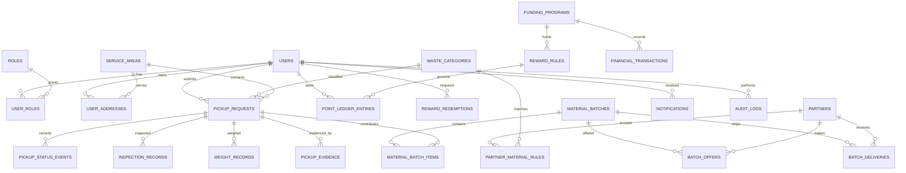

### 21.2 Relasi dan kardinalitas

- Satu pengguna dapat memiliki banyak alamat, role, pickup request, ledger entry, dan notifikasi.
- Satu pickup memiliki banyak status event dan dapat memiliki beberapa weight record bila ada koreksi.
- Pickup terhubung ke item batch agar material dapat ditelusuri.
- Satu batch terdiri dari beberapa item sumber dan dapat memiliki lebih dari satu offer/delivery bila pembagian lot diizinkan.
- Satu partner memiliki banyak aturan penerimaan dan transaksi marketplace.
- Satu reward rule berversi dapat digunakan oleh banyak ledger entry.
- Funding program dapat terhubung ke reward rule dan transaksi terkait.

### 21.3 Snapshot historis

Snapshot dipakai ketika perubahan data master akan mengubah makna histori, misalnya label/kode kategori, rule version/parameter reward, harga offer yang disepakati, dan alamat operasional pada saat pickup. Simpan hanya field yang perlu untuk audit/operasi; hindari menyalin seluruh informasi pribadi berulang kali.

### 21.4 Invariant lintas entitas

- Pickup hanya menerima assignment dari Collector valid.
- Reward yang berasal dari pickup merujuk transaksi yang sah dan memenuhi syarat.
- Satu event reward tidak menghasilkan ledger earn ganda.
- Material batch tidak berisi item melebihi kuantitas yang tersedia.
- Alokasi tidak melampaui volume material yang dapat dikirim.
- Redemption tidak membuat saldo tersedia negatif.
- Perubahan konfigurasi tidak mengubah transaksi historis yang telah diposting.

---

## 22. State Machine dan Aturan Transisi

### 22.1 Prinsip

Setiap transisi divalidasi pada server berdasarkan status asal, actor, role, permission, assignment, dan prasyarat data. Tidak boleh ada endpoint generik yang menerima status arbitrer. Aksi cancel/reject/override/correction memerlukan alasan dan event histori.

### 22.2 Pickup state machine

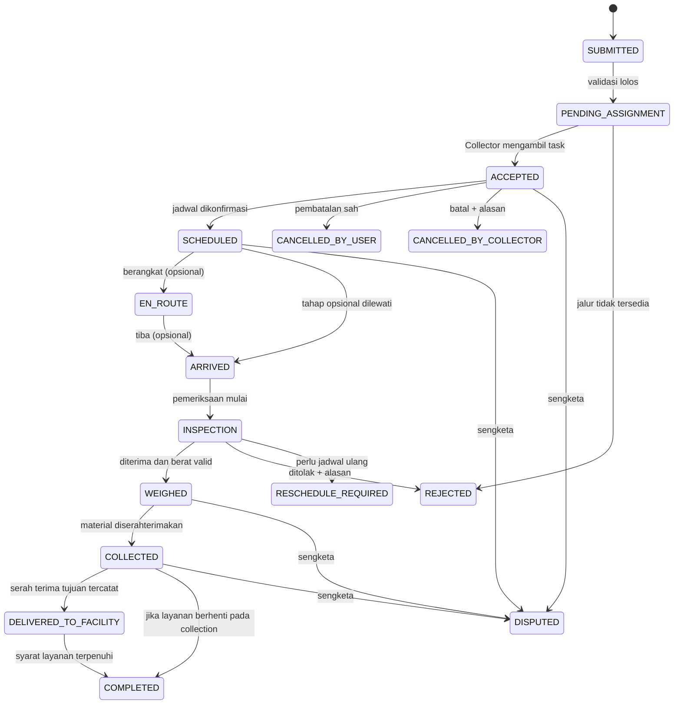

Status opsional hanya diaktifkan jika benar-benar dipakai. `COMPLETED` tidak berarti “sudah didaur ulang” kecuali ada verifikasi proses yang sesuai.

### 22.3 Tabel transisi pickup

| Command | Status asal | Status tujuan | Actor | Prasyarat |
|---|---|---|---|---|
| Submit request | Draft/belum ada | `SUBMITTED` | User | Form, kategori, alamat, jadwal valid |
| Validate request | `SUBMITTED` | `PENDING_ASSIGNMENT` | Sistem/admin | Jalur layanan tersedia |
| Accept task | `PENDING_ASSIGNMENT` | `ACCEPTED` | Collector verified | Tugas tersedia, area/kategori sesuai, claim atomik berhasil |
| Confirm schedule | `ACCEPTED` | `SCHEDULED` | Collector/admin berizin | Slot valid dan kapasitas tersedia |
| Start route | `SCHEDULED` | `EN_ROUTE` | Collector | Assignment masih aktif |
| Arrive | `SCHEDULED`/`EN_ROUTE` | `ARRIVED` | Collector | Assignment masih aktif |
| Start inspection | `ARRIVED` atau status yang disepakati | `INSPECTION` | Collector | Material siap diperiksa |
| Record result | `INSPECTION` | `WEIGHED`/`REJECTED`/`RESCHEDULE_REQUIRED` | Collector | QC dan bukti sesuai |
| Mark collected | `WEIGHED` | `COLLECTED` | Collector | Serah terima sesuai SOP |
| Facility handover | `COLLECTED` | `DELIVERED_TO_FACILITY` | Role berwenang | Penerima/batch/bukti bila diwajibkan |
| Complete | Status yang diizinkan | `COMPLETED` | Role/sistem yang diizinkan | Checklist selesai |
| Cancel | Status yang dapat dibatalkan | `CANCELLED_*` | Actor yang berhak | Alasan dan policy valid |
| Raise dispute | Status relevan | `DISPUTED` | Pihak berhak | Alasan dan bukti jika tersedia |

### 22.4 Redemption state machine

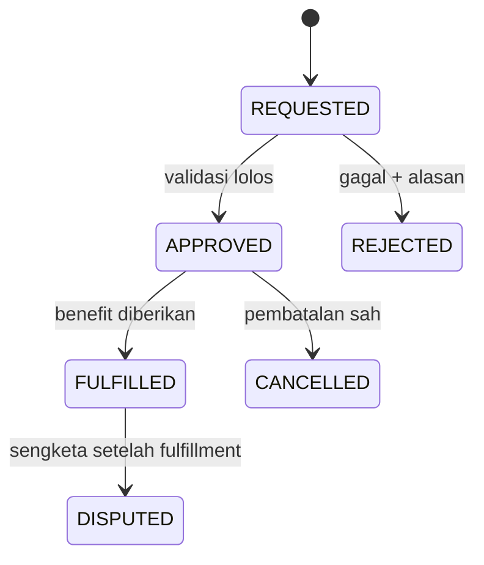

Pilih secara eksplisit apakah poin dipotong saat request atau approval. Bila debit telah diposting lalu redemption dibatalkan, buat reversal yang terlacak. Jangan menghapus ledger debit.

### 22.5 Batch state machine

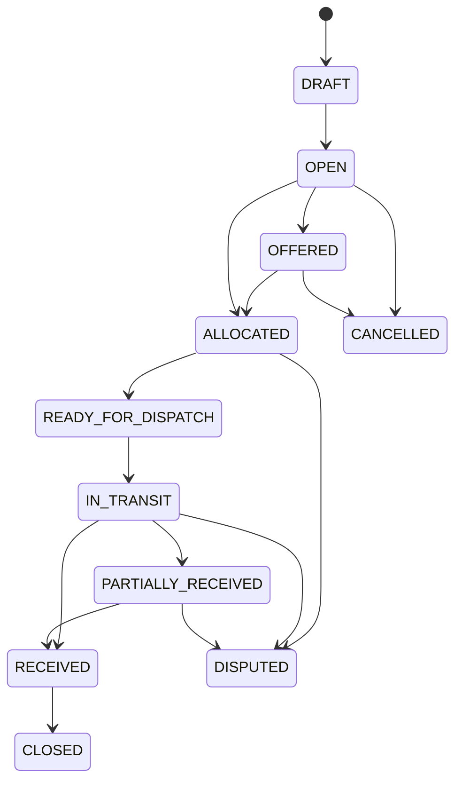

Jika satu batch mendukung beberapa pengiriman, state batch diturunkan dari keseluruhan alokasi/pengiriman, bukan diubah langsung oleh client.

### 22.6 Role application state machine

`PENDING` → `VERIFIED` atau `REJECTED`. Role verified dapat menjadi `SUSPENDED`/`EXPIRED` menurut kebijakan. Grant/suspend/reject menyimpan actor, waktu, dan alasan yang relevan.

### 22.7 Override

Override hanya untuk role/permission tertentu. Catat status before/after, actor, alasan, waktu, dan referensi bukti. Override tidak menghapus event lama dan tidak memicu reward otomatis tanpa evaluasi syarat.

---

## 23. API REST

### 23.1 Prinsip

- Prefix `/api/v1`; JSON UTF-8 kecuali file.
- Autentikasi memakai session cookie aman atau mekanisme terpilih setara.
- Server memeriksa status akun, role, permission, ownership, assignment, area, dan transaksi terkait.
- Daftar menggunakan pagination/filter terbatas; sort tidak boleh menerima nama kolom arbitrer.
- Mutasi sensitif menggunakan `Idempotency-Key` atau key domain dengan constraint unik.
- Response tidak mengekspos hash password, session token, secret, atau data pengguna lain.
- Perubahan API yang breaking memerlukan versi/migrasi yang direncanakan.

### 23.2 Auth dan profil

| Method | Endpoint | Fungsi | Akses |
|---|---|---|---|
| POST | `/api/v1/auth/register` | Membuat akun | Publik, rate-limited |
| POST | `/api/v1/auth/login` | Membuat session | Publik, rate-limited |
| POST | `/api/v1/auth/logout` | Cabut session | Authenticated |
| POST | `/api/v1/auth/forgot-password` | Memulai recovery | Publik; tidak mengungkap keberadaan akun |
| POST | `/api/v1/auth/reset-password` | Ganti credential dengan token sekali pakai | Token valid |
| GET | `/api/v1/me` | Profil current user | Authenticated |
| PATCH | `/api/v1/me` | Update profil yang diizinkan | Authenticated |
| GET | `/api/v1/me/roles` | Role dan status pengguna | Authenticated |
| POST | `/api/v1/me/active-role` | Ubah preferensi role UI | Authenticated |
| GET/POST | `/api/v1/me/addresses` | List/tambah alamat sendiri | Authenticated |
| PATCH/DELETE | `/api/v1/me/addresses/{id}` | Ubah/nonaktifkan alamat sendiri | Auth + ownership |

### 23.3 Role Collector

| Method | Endpoint | Fungsi | Akses |
|---|---|---|---|
| POST | `/api/v1/collector-applications` | Ajukan role | User |
| GET | `/api/v1/collector-applications/me` | Lihat status sendiri | Applicant |
| GET | `/api/v1/admin/collector-applications` | Daftar aplikasi | Admin permission |
| POST | `/api/v1/admin/collector-applications/{id}/approve` | Setujui role | Admin permission |
| POST | `/api/v1/admin/collector-applications/{id}/reject` | Tolak dengan alasan | Admin permission |
| POST | `/api/v1/admin/users/{id}/roles/{role}/suspend` | Suspend grant role | Permission khusus |

### 23.4 Kategori dan acceptance rules

| Method | Endpoint | Fungsi | Akses |
|---|---|---|---|
| GET | `/api/v1/waste-categories` | Daftar kategori/panduan | Public/authenticated sesuai policy |
| GET | `/api/v1/waste-categories/{id}` | Detail kategori | Sesuai policy |
| GET | `/api/v1/material-acceptance-rules` | Aturan penerimaan per area/mitra | Data yang boleh dibagikan |
| POST | `/api/v1/admin/waste-categories` | Buat kategori | Admin |
| PATCH | `/api/v1/admin/waste-categories/{id}` | Ubah/menonaktifkan kategori | Admin |
| POST/PATCH | `/api/v1/admin/material-acceptance-rules` | Kelola rule penerimaan | Admin/role khusus |

### 23.5 Pickup dan task Collector

| Method | Endpoint | Fungsi | Akses |
|---|---|---|---|
| POST | `/api/v1/pickup-requests` | Buat setoran | User/caller berizin |
| GET | `/api/v1/pickup-requests/mine` | Riwayat sendiri | User |
| GET | `/api/v1/pickup-requests/{id}` | Detail pickup | Owner/assigned/admin menurut policy |
| POST | `/api/v1/pickup-requests/{id}/cancel` | Batalkan pickup | Owner/role yang diizinkan |
| GET | `/api/v1/collector/tasks/available` | Task tersedia | Collector verified |
| GET | `/api/v1/collector/tasks/mine` | Task milik/ditugaskan | Collector verified |
| POST | `/api/v1/collector/tasks/{id}/accept` | Accept atomik | Collector verified |
| POST | `/api/v1/collector/tasks/{id}/reject` | Tolak/menarik diri sesuai status | Collector terkait |
| POST | `/api/v1/collector/tasks/{id}/status` | Command transisi | Collector terkait/admin berizin |
| POST | `/api/v1/collector/tasks/{id}/inspection` | Catat inspeksi | Collector assigned |
| POST | `/api/v1/collector/tasks/{id}/weight-records` | Catat berat | Collector assigned |
| POST | `/api/v1/collector/tasks/{id}/evidence` | Hubungkan bukti | Actor berwenang |
| POST | `/api/v1/admin/pickup-requests/{id}/reassign` | Reassign task | Admin permission |
| POST | `/api/v1/pickup-requests/{id}/disputes` | Ajukan sengketa | Pihak yang memenuhi syarat |

### 23.6 WastePoints

| Method | Endpoint | Fungsi | Akses |
|---|---|---|---|
| GET | `/api/v1/points/balance` | Saldo sendiri | User authenticated |
| GET | `/api/v1/points/ledger` | Histori ledger | User authenticated |
| GET | `/api/v1/rewards/catalog` | Benefit tersedia | Sesuai policy |
| POST | `/api/v1/rewards/redemptions` | Ajukan penukaran | User authenticated |
| GET | `/api/v1/rewards/redemptions/mine` | Riwayat redemption | User authenticated |
| GET | `/api/v1/admin/reward-rules` | Daftar aturan | Admin/Finance sesuai izin |
| POST | `/api/v1/admin/reward-rules` | Buat rule version baru | Admin permission |
| PATCH | `/api/v1/admin/reward-rules/{id}` | Ubah status/rule yang diizinkan | Admin permission; histori tidak ditimpa |
| POST | `/api/v1/admin/points/adjustments` | Adjustment ledger | Permission khusus + reason |

### 23.7 Partner dan marketplace

| Method | Endpoint | Fungsi | Akses |
|---|---|---|---|
| GET | `/api/v1/partners` | Daftar mitra yang boleh dilihat | Scope sesuai policy |
| POST/PATCH | `/api/v1/admin/partners` | Buat/ubah mitra | Admin |
| GET | `/api/v1/material-batches` | List batch | Admin/Buyer sesuai scope |
| POST | `/api/v1/admin/material-batches` | Buat batch | Operasional berizin |
| GET | `/api/v1/material-batches/{id}` | Detail batch | Role yang berhak |
| POST | `/api/v1/material-batches/{id}/items` | Tambah sumber material | Operasional berizin |
| POST | `/api/v1/material-batches/{id}/offers` | Submit offer | Buyer/role yang berhak |
| POST | `/api/v1/batch-offers/{id}/accept` | Terima offer/alokasi | Admin/role berizin |
| POST | `/api/v1/material-batches/{id}/delivery` | Buat delivery | Operasional berizin |
| POST | `/api/v1/batch-deliveries/{id}/confirm-receipt` | Konfirmasi penerimaan | Partner penerima/role sah |
| POST | `/api/v1/batch-deliveries/{id}/dispute` | Catat selisih/dispute | Pihak transaksi yang sah |

### 23.8 Admin, finance, dan notifikasi

| Method | Endpoint | Fungsi | Akses |
|---|---|---|---|
| GET | `/api/v1/admin/dashboard` | Ringkasan operasi | Admin |
| GET | `/api/v1/admin/audit-logs` | Cari audit | Audit permission |
| GET | `/api/v1/admin/reports/collection` | Laporan collection | Admin |
| GET | `/api/v1/admin/reports/rewards` | Laporan reward | Admin/Finance sesuai izin |
| GET/POST | `/api/v1/finance/transactions` | Baca/catat transaksi | Finance |
| POST | `/api/v1/finance/reconciliations` | Buat rekonsiliasi | Finance |
| GET | `/api/v1/admin/reports/export.csv` | Export terfilter | Permission khusus + audit |
| GET | `/api/v1/notifications` | Daftar notifikasi sendiri | Authenticated |
| POST | `/api/v1/notifications/{id}/read` | Tandai dibaca | Penerima notifikasi |
| GET | `/health/live` | Proses hidup | Public/infra |
| GET | `/health/ready` | Dependency readiness terbatas | Infra/monitoring |

### 23.9 Pagination dan filters

Parameter bisa mencakup `page`, `page_size`, `cursor`, `status`, `category_id`, `service_area_id`, `from`, `to`, dan `sort`. Batasi `page_size`; validasi tanggal/timezone; filter/sort harus memilih field yang diizinkan. Saring data berdasarkan user/role sebelum diserialisasi. Untuk dataset yang berkembang, pertimbangkan cursor pagination.

---

## 24. Kontrak Request, Response, dan Error

### 24.1 Response sukses

```json
{
  "data": {
    "id": "<uuid>",
    "status": "PENDING_ASSIGNMENT",
    "created_at": "2026-10-29T08:30:00Z"
  },
  "meta": { "request_id": "<request-id>" }
}
```

Ini contoh bentuk response, bukan data produksi.

### 24.2 Response error

```json
{
  "error": {
    "code": "VALIDATION_ERROR",
    "message": "Periksa kembali data yang dimasukkan.",
    "details": [
      { "field": "requested_slot_start", "reason": "Slot tidak tersedia untuk wilayah ini." }
    ]
  },
  "meta": { "request_id": "<request-id>" }
}
```

Jangan mengirim stack trace, query SQL, credential, token, atau detail internal ke client.

### 24.3 HTTP status

| Status | Pemakaian |
|---|---|
| `200` | Query atau mutasi sukses dengan data |
| `201` | Resource baru berhasil dibuat |
| `202` | Proses asynchronous diterima, belum selesai |
| `204` | Sukses tanpa body |
| `400` | Format request tidak dapat diproses |
| `401` | Session tidak ada/tidak valid |
| `403` | Actor tidak punya izin |
| `404` | Resource tidak ada atau tidak boleh diungkap |
| `409` | Status berubah, key/payload konflik, saldo/kuota tidak tersedia |
| `413` | Payload terlalu besar |
| `415` | Media type tidak didukung |
| `422` | Schema terbaca tetapi aturan bisnis tidak terpenuhi |
| `429` | Rate limit |
| `500` | Error internal generik dengan request ID |
| `503` | Dependency/layanan belum siap untuk operasi itu |

### 24.4 Contoh create pickup

```json
{
  "category_id": "<category-uuid>",
  "address_id": "<address-uuid>",
  "requested_slot_start": "2026-10-30T09:00:00+08:00",
  "requested_slot_end": "2026-10-30T11:00:00+08:00",
  "estimated_weight_kg": 2.5,
  "description": "Material sudah dipisahkan dan dikemas.",
  "evidence_asset_ids": []
}
```

Server mengecek ownership alamat, kategori aktif, slot, timezone, dan jalur penerimaan. Berat adalah estimasi warga, bukan berat final.

### 24.5 Contoh weight record

```json
{
  "measurement_method": "MANUAL_SCALE",
  "gross_weight_kg": 3.2,
  "tare_weight_kg": 0.4,
  "net_weight_kg": 2.8,
  "inspection_record_id": "<inspection-uuid>",
  "evidence_asset_ids": ["<asset-uuid>"]
}
```

Server tetap memvalidasi actor, task assignment, status, konsistensi berat, evidence, dan rounding. Nilai contoh bukan batas berat/standar lapangan.

### 24.6 Idempotency key

```http
POST /api/v1/rewards/redemptions HTTP/1.1
Content-Type: application/json
Idempotency-Key: <unique-client-generated-key>
```

Key bukan otorisasi. Ikat key dengan user, operasi, dan hash payload. Key sama/payload sama mengembalikan hasil yang konsisten; key sama/payload berbeda menghasilkan conflict.

### 24.7 Tanggal, berat, uang

- Timestamp ISO 8601 dengan `Z`/offset; simpan sebagai `TIMESTAMPTZ`.
- Jadwal bisnis dihitung dalam zona pilot WITA (`Asia/Makassar`).
- Berat API memakai `kg` dengan presisi yang konsisten; jangan mencampur kg dan gram pada endpoint yang sama.
- Uang menggunakan integer rupiah atau Decimal dengan scale yang ditentukan.
- Poin menggunakan integer jika kebijakan tidak mendukung pecahan.

---

## 25. Alur End-to-End

### 25.1 User membuat pickup

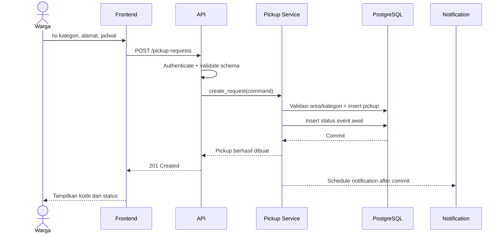

### 25.2 Dua Collector menerima task yang sama

```mermaid
sequenceDiagram
    actor C1 as Collector A
    actor C2 as Collector B
    participant API as API
    participant S as Assignment Service
    participant DB as PostgreSQL
    C1->>API: POST task/accept
    C2->>API: POST task/accept
    API->>S: Validate Collector permissions
    S->>DB: Atomic claim / conditional update
    DB-->>S: Satu claim berhasil
    S-->>API: Success untuk Collector A
    API-->>C1: 200/201 accepted
    S->>DB: Claim kedua
    DB-->>S: Tidak eligible; sudah diambil
    S-->>API: Conflict
    API-->>C2: 409 Conflict
```

Gunakan conditional update/row lock atau strategi setara. Invariant yang dituju: satu pickup hanya memiliki satu assignment aktif jika modelnya single-collector.

### 25.3 Timbang dan reward

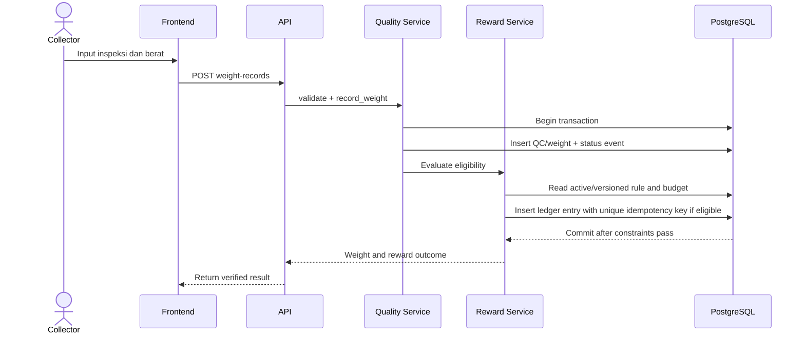

Jika tidak memenuhi syarat reward, weight record tetap tersimpan bila memang valid, tetapi ledger earn tidak dibuat. Jika bisnis memilih reward asynchronous, gunakan status `PENDING` yang eksplisit dan proses retry idempoten. Jangan mengembalikan sukses final sebelum transaksi benar-benar commit.

### 25.4 Koreksi berat/reward

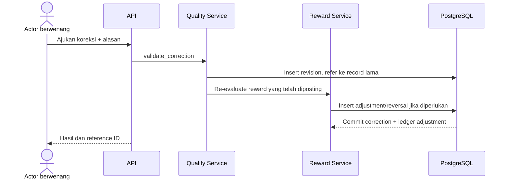

### 25.5 Batch sampai penerimaan buyer

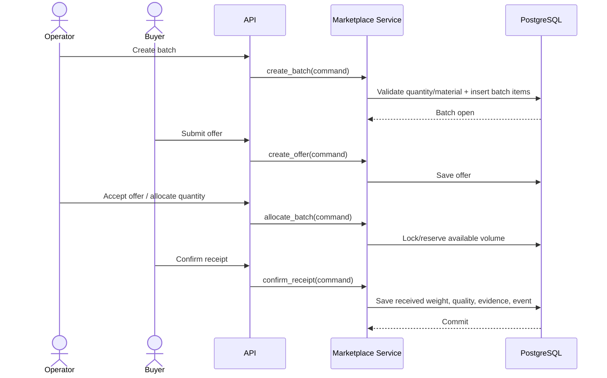

### 25.6 Switch role

1. Frontend meminta daftar role pengguna.
2. Server mengembalikan role beserta status verifikasinya.
3. Pengguna memilih role yang tersedia.
4. Frontend mengirim command active role.
5. Server memvalidasi account status dan grant role.
6. Server menyimpan preferensi, jika digunakan, dan mengembalikan hasil.
7. Frontend memperbarui navigasi serta membersihkan cache yang terkait konteks lama.
8. Setiap request berikutnya tetap menjalankan permission check penuh.

---

## 26. Keamanan Aplikasi

### 26.1 Threat model minimum

| Ancaman | Contoh | Kontrol utama |
|---|---|---|
| Broken access control | User membaca pickup user lain | Ownership checks server-side, query scope, negative tests |
| Privilege escalation | Client mengirim `active_role=ADMIN` | Grant role diverifikasi dari server/database |
| Credential attack | Brute force/login abuse | Rate limit, password hashing, recovery token sekali pakai |
| Session theft | Cookie bocor | HTTPS, HttpOnly, Secure, SameSite, CSP, mitigasi XSS |
| CSRF | Request mutasi dikirim oleh situs lain | SameSite, CSRF token/origin check untuk mutasi cookie-based |
| IDOR | Menebak ID bukti/batch/pickup | Authorization untuk setiap object ID |
| Duplicate reward | Retry menggandakan poin | Idempotency key, unique constraint, transaksi |
| File abuse | Upload executable/terlalu besar | MIME/size validation, private storage, key server-side |
| Audit tampering | Histori transaksi diubah | Append-only event/ledger, pembatasan akses |
| Data leakage | Alamat masuk log/export | Minimasi data, redaction, scoped access, export audit |
| Dependency compromise | Library/provider rentan | Lockfile, review, scanning, update terkendali |

### 26.2 Autentikasi

- Password disimpan memakai password hashing yang sesuai, misalnya Argon2id atau bcrypt dengan konfigurasi aman.
- Password tidak pernah disimpan plaintext atau dimasukkan ke log.
- Login, reset password, dan endpoint sensitif diberi rate limit.
- Pemulihan credential tidak mengungkap secara langsung apakah email/nomor terdaftar.
- Reset token memiliki masa berlaku, hanya sekali pakai, dan tidak ditulis ke log.
- Session dicabut pada logout, suspend akun, perubahan credential, atau insiden relevan.
- Cookie session menggunakan `HttpOnly`, `Secure` pada HTTPS, dan `SameSite` yang sesuai. Domain/path dibuat sesempit mungkin.
- Jika JWT dipilih, tetapkan expiry, refresh rotation, revocation, dan penyimpanan; hindari token akses panjang tanpa pencabutan.

### 26.3 Otorisasi

- Semua endpoint privat membutuhkan authentication dependency.
- Mutasi domain memeriksa permission serta ownership/scope objek.
- Status grant role harus segar atau mekanisme invalidasinya jelas ketika role berubah/suspend.
- Buyer hanya mengakses offer/delivery/batch yang relevan dengan partner/account-nya.
- Admin sensitif memerlukan permission khusus, alasan, serta audit.
- Frontend guard hanya untuk UX dan bukan pengganti keamanan backend.

### 26.4 Validasi input

- Validasi format, panjang, numeric bounds, tanggal, UUID, enum, dan hubungan antarfield.
- Gunakan parameterized query/ORM; jangan interpolasi input pengguna ke SQL mentah.
- Batasi ukuran request dan upload file.
- Escape/output encode data sesuai konteks untuk mengurangi XSS.
- Batasi field filter/sort/export yang dapat diminta client.
- Jika ada fetch URL eksternal, validasi tujuan dan cegah SSRF.

### 26.5 Mutasi berbasis cookie

Jika session memakai cookie:

- Set SameSite sesuai arsitektur login.
- Terapkan CSRF token dan/atau cek Origin/Referer untuk mutasi yang relevan.
- `GET` tidak boleh mengubah state.
- Jangan gunakan wildcard CORS dengan credentials.
- Uji perilaku cookie dan cross-origin pada domain deployment aktual.

### 26.6 Secrets dan konfigurasi

- API key, DB password, session secret, dan storage credential hanya di secret manager/environment.
- Pisahkan credentials local, staging, dan production.
- Rotasi secret jika terpapar.
- Jangan masukkan credential aktif di README, screenshot, ticket, fixture, atau repository.
- Beri provider akses minimum yang diperlukan.

### 26.7 Audit aksi sensitif

Audit minimum mencakup pengajuan/verifikasi/suspend role; accept/reassign/cancel/override pickup; koreksi timbang; posting/reversal/adjustment ledger; perubahan reward rule/budget; perubahan partner/batch/offer/delivery; ekspor data sensitif; dan perubahan permission.

Log tidak boleh menyimpan password, session token, API key, atau isi pribadi penuh. Audit log berbeda dari application log: audit menjelaskan aksi bisnis, sedangkan application log membantu debugging dan reliability.

### 26.8 Checklist secure development

- Lockfile dan dependency review terjaga.
- Lint/type-check/static analysis berjalan di CI.
- Tidak ada secret di repo.
- Endpoint sensitif punya negative authorization tests.
- Error response tidak menampilkan traceback.
- CORS, cookie, upload limits, dan rate limits sudah diuji.
- Akun admin demo tidak menggunakan password default pada deployment publik.

---

## 27. Privasi dan Tata Kelola Data

### 27.1 Data sensitif operasional

Nama, email, telepon, alamat lengkap/koordinat, foto rumah/material/orang, jadwal pickup, bukti transaksi, dokumen mitra, catatan keuangan, dan lokasi petugas bila tracking diaktifkan merupakan data yang perlu dibatasi.

### 27.2 Prinsip privasi

1. Kumpulkan hanya data yang diperlukan untuk layanan.
2. Jelaskan tujuan penggunaan alamat, foto, notifikasi, dan aktivitas.
3. Batasi akses berdasarkan tugas dan role.
4. Jangan membagikan alamat warga kepada buyer/sponsor secara default.
5. Gunakan data agregat untuk laporan sponsor kecuali ada kebutuhan dan persetujuan yang jelas.
6. Tetapkan retensi/penghapusan sebelum pilot.
7. Redaksi data sensitif dari log umum.
8. Jangan menggunakan foto untuk tujuan sekunder atau pelatihan tanpa tata kelola yang sesuai.

### 27.3 Scope informasi per aktor

- User melihat data setoran miliknya dan informasi petugas yang diperlukan.
- Collector melihat lokasi/kontak yang diperlukan untuk tugas, bukan seluruh direktori warga.
- Buyer menerima data batch/kualitas/delivery, bukan identitas warga asal secara default.
- Sponsor menerima laporan agregat yang disetujui.
- Admin dan Finance mengakses sesuai permission; akses luas harus dibatasi dan diaudit.

### 27.4 Data lokasi dan retensi

- Jangan meminta lokasi browser tanpa alasan yang jelas; sediakan input alamat manual.
- Hindari GPS kontinu pada MVP.
- Alamat snapshot hanya disimpan bila dibutuhkan untuk pelaksanaan/pembuktian.
- Tetapkan retensi akun, alamat, foto, status event, audit, dan transaksi sebelum pilot.
- Gunakan deactivation/anonymization sesuai kebijakan; jangan menghapus data transaksi secara sembarang sehingga histori dan relasi rusak.
- Kebijakan legal final harus ditinjau pihak yang berwenang, bukan diasumsikan selesai melalui SDD.

---

## 28. Transaksi dan Idempotensi

### 28.1 Invariant kritis

- Maksimal satu assignment aktif per pickup jika model single-collector.
- Pickup tidak bisa maju ke `WEIGHED` tanpa QC dan weight record valid.
- Reward tidak dapat diposting tanpa transaksi sumber dan prasyarat yang sah.
- Retry tidak membuat ledger earn ganda.
- Redemption tidak menghabiskan saldo di bawah nol.
- Alokasi batch tidak melebihi kuantitas yang tersedia.
- Koreksi tidak menghapus record sebelumnya.

### 28.2 Transaction boundary

**Accept task:** validasi task → atomic conditional update/lock → assignment → status event → commit.

**Record weight + reward:** validasi actor/state/QC → insert weight → event status → pilih rule version → cek budget/eligibility → ledger idempoten bila eligible → audit → commit sesuai atomicity kebijakan.

**Redeem points:** validasi benefit/kuota → serialisasi saldo → insert redemption + debit ledger → commit.

**Allocate batch:** validasi offer/material → lock volume tersedia → alokasi dan update status/event → commit.

### 28.3 Concurrency

- Gunakan conditional write, row-level lock, atau isolation strategy yang sesuai.
- Unique constraint adalah garis pertahanan terakhir terhadap duplikasi.
- Deadlock/serialization failure dapat di-retry secara terbatas jika operasi aman/idempoten.
- Jangan retry operasi non-idempoten tanpa key.
- Gunakan `409 Conflict` ketika state sudah berubah oleh actor lain.

### 28.4 Outbox dan efek samping

Jika transaksi domain sukses tetapi notifikasi gagal, state domain tetap benar. Untuk notifikasi yang perlu dijamin tercatat, tulis outbox row pada transaksi yang sama. Worker memproses dengan semantics at-least-once; adapter memakai delivery key atau toleransi duplikasi.

### 28.5 Rekonsiliasi berkala

- Cocokkan ledger reward dengan transaksi QC yang memenuhi syarat.
- Cocokkan material batch dengan item, alokasi, dan delivery.
- Pastikan jumlah issued/reversed tercermin di dashboard.
- Pastikan penggunaan funding program sesuai limit.
- Pastikan delivery mempunyai berat kirim/terima yang konsisten dengan status.
- Pantau notification yang gagal/stuck tanpa mengubah domain state secara keliru.

---

## 29. Kinerja dan Ketersediaan

### 29.1 Target awal untuk diuji

Angka berikut adalah sasaran awal pengujian, bukan SLA production.

| Aktivitas | Target awal | Catatan |
|---|---|---|
| Query detail | p95 sekitar 500–800 ms pada dataset pilot | Di luar latency jaringan eksternal |
| Mutasi domain sederhana | p95 sekitar 800–1200 ms | Bergantung pada validasi/transaksi |
| Dashboard agregat | p95 sekitar 1–2 detik pada data pilot | Optimasi setelah profiling |
| Daftar | Responsif dengan pagination | Tidak mengambil semua histori sekaligus |
| Upload | Dalam batas ukuran konfigurasi | Tergantung jaringan/storage; tampilkan progress |

Target harus diuji pada hosting, perangkat, jaringan, dan ukuran data yang sebenarnya.

### 29.2 Optimasi

- Gunakan pagination/filter server-side.
- Buat indeks setelah memahami query aktual.
- Hindari N+1 query ORM dan response list yang terlalu besar.
- Simpan file di object storage, bukan blob di tabel utama.
- Kompres/resize gambar untuk UX jika sesuai; server tetap memvalidasi konten.
- Cache master data hanya jika invalidasi jelas.
- Jangan cache saldo atau permission lama sampai bisa menghasilkan keputusan salah.
- Gunakan query profiling dan `EXPLAIN ANALYZE` sebelum menambah infrastruktur.

### 29.3 Graceful degradation

- AI gagal → klasifikasi manual tersedia.
- Peta gagal → alamat teks tetap ditampilkan.
- Provider notifikasi gagal → transaksi domain tetap tersimpan dan notifikasi di-retry bila tersedia.
- Storage gagal pada bukti wajib → jangan menyelesaikan proses yang mensyaratkan bukti tersebut.
- Database gagal → mutasi gagal aman tanpa sukses palsu.
- Dashboard yang tertunda menampilkan waktu pembaruan/indikasi data parsial bila perlu.

### 29.4 Evolusi skalabilitas

1. Ukur query dan traffic pilot.
2. Optimalkan query, pagination, indeks.
3. Pindahkan notifikasi/ekspor ke worker jika perlu.
4. Pisahkan read model laporan jika query mengganggu transaksi.
5. Ekstrak service hanya bila beban/struktur tim membutuhkannya.
6. Tambahkan PostGIS/routing bila kebutuhan spasial benar-benar prioritas.

---

## 30. Logging, Monitoring, dan Audit

### 30.1 Structured logging

Field yang disarankan: `timestamp`, `level`, `service`, `environment`, `request_id`, route/operation, actor ID internal jika dibutuhkan, entity reference, duration, response status, dan error code. Jangan log password, cookie, Authorization header, reset token, API key, signed URL penuh, alamat lengkap, foto, atau isi form pribadi tanpa kebutuhan khusus.

### 30.2 Metrik teknis

- Jumlah request, status response, latency p50/p95/p99.
- Error rate per endpoint.
- Koneksi/pool database dan slow query.
- Upload failure dan latency storage.
- Notification success/failure/retry.
- Idempotency/concurrency conflict.
- Login failure/rate-limit events.

### 30.3 Metrik domain

- Pickup baru/pending/accepted/completed/cancelled/disputed.
- Median waktu submit → accept dan submit → complete.
- Berat terverifikasi, berat dibatch, dikirim, diterima.
- Reward issued/redeemed/adjusted/reversed.
- Budget used/remaining bila program dibatasi budget.
- Data quality issue: task tanpa assignment terlalu lama, weight tanpa bukti wajib, batch dengan selisih unresolved.

Definisi metrik harus konsisten; jangan menyamakan berat terkumpul dengan berat diterima atau diproses.

### 30.4 Alert awal

Pertimbangkan alert untuk error rate naik, database tidak tersedia/pool habis, upload banyak gagal, notification job stuck, pola duplicate reward tidak normal, invariant batch gagal, serta percobaan login/akses sensitif berulang. Ambang ditentukan berdasarkan volume pilot agar tidak menghasilkan alert fatigue.

---

## 31. Pengujian dan Quality Assurance

### 31.1 Piramida pengujian

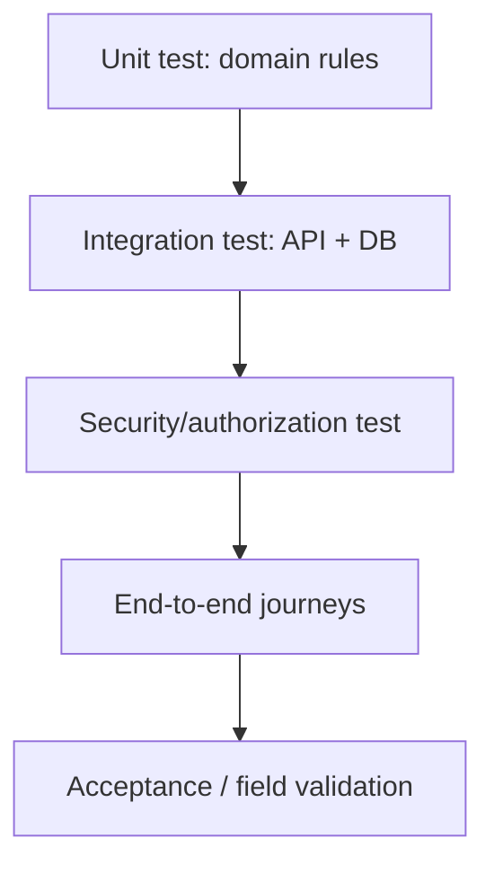

### 31.2 Unit test wajib

- Transisi status pickup yang valid/invalid.
- Kalkulasi berat bersih dan rounding.
- Validasi kategori/jalur khusus.
- Pemilihan rule version berdasarkan periode.
- Formula dan limit reward.
- Ledger entry dan reversal.
- Saldo dan pencegahan double redemption.
- Batas volume batch dan selisih delivery.
- Permission/ownership policy.
- Mapping domain error ke HTTP response.

### 31.3 Integration test wajib

- Register/login/logout/session revocation.
- Pengajuan dan persetujuan Collector.
- User membuat pickup dan hanya bisa melihat setoran sendiri.
- Collector verified menerima pickup.
- Dua Collector menerima task bersamaan: hanya satu sukses.
- Inspeksi/timbang menulis status event.
- Reward diterbitkan sekali setelah syarat dipenuhi.
- Koreksi berat mempertahankan histori dan adjustment bila perlu.
- Redemption tidak menghabiskan saldo berlebih.
- Batch tidak dapat dialokasikan di atas volume yang tersedia.
- Buyer hanya mengonfirmasi transaksi miliknya.
- Bukti privat tidak bisa diambil user lain.
- Role suspended tidak bisa menjalankan aksi Collector.

### 31.4 Contract/API test

- Request/response sesuai OpenAPI.
- Error code dan HTTP status konsisten.
- Filter/pagination tidak membocorkan resource lintas pengguna.
- Idempotency key payload sama aman diulang; payload berbeda conflict.
- Date/timezone, decimal, nullability konsisten.
- Field internal/credential tidak keluar lewat serializer.

### 31.5 Security test minimum

IDOR pada pickup/alamat/ledger/evidence/batch/delivery/audit; role escalation; CSRF jika cookie; rate limit; upload MIME/ukuran; XSS pada deskripsi; SQL injection lewat filter/sort; session setelah logout/suspend; export yang keluar scope.

### 31.6 End-to-end journey

**A — Anorganik bernilai:** user buat setoran → Collector accept → inspeksi/timbang → reward dievaluasi → user melihat ledger → operator membuat batch → buyer konfirmasi penerimaan → dashboard membedakan berat terkumpul/dikirim/diterima.

**B — Organik:** user pilih kategori dan slot tersedia → pickup diproses → berat dan tujuan pengolah tercatat → hasil pengolahan tidak diklaim sebelum konfirmasi.

**C — Limbah khusus:** jika jalur belum tersedia, tampilkan panduan dan jangan buat pickup biasa. Bila jalur tersedia, alur hanya ke aktor/mitra yang dikonfigurasi.

**D — Koreksi reward:** ajukan dengan alasan → reviewer memeriksa evidence/rule version → system membuat revision/adjustment → saldo dan audit dapat direkonsiliasi.

### 31.7 Test data dan exit criteria

- Seed data sintetis berlabel `DEMO`.
- Sertakan state role pending/verified/suspended, berat valid/invalid, budget habis, batch discrepancy, dan provider gagal.
- Jangan memakai data pribadi nyata tanpa izin/tata kelola.
- Semua test MUST lulus; tidak ada bug kritis authorization, ledger, ownership, atau limbah khusus.
- Migrasi database kosong, smoke test deployment, dan demo end-to-end harus berhasil.
- Risiko tersisa dicatat sebelum presentasi/pilot.

---

## 32. Migrasi dan Data Awal

### 32.1 Migrasi schema

- Gunakan Alembic atau tool terpilih.
- Setiap perubahan schema dibuat sebagai migration baru dan direview.
- Jangan edit migration yang sudah diterapkan di environment bersama.
- Uji migrasi data pada salinan sintetis representatif.
- Review ekstra untuk perubahan ledger, status event, dan audit.
- Jalankan migration check di CI.

### 32.2 Seed awal

Seed bisa memuat role sistem yang digunakan, kategori/subkategori demo, service area demo, acceptance rules, reward rules berlabel `SIMULATION`, dan akun demo terkendali. Jangan mengaktifkan tarif atau kategori pada production tanpa persetujuan pengelola.

### 32.3 Data demo

Semua user/pickup/mitra/harga/berat/transaksi demo harus sintetis atau memiliki izin. Dashboard dan laporan diberi label demo; data demo tidak dicampur laporan pilot. Script reset demo harus menolak berjalan di production.

### 32.4 Perubahan master data

Kategori, acceptance rules, reward rules, partner rules, serta service area perlu status aktif/nonaktif dan masa berlaku bila memengaruhi transaksi. Menonaktifkan master data tidak boleh merusak pembacaan histori lama.

---

## 33. Edge Case dan Kegagalan

### 33.1 Akun dan role

| Kasus | Respons yang diharapkan |
|---|---|
| Pengajuan Collector ganda | Cek pengajuan aktif dan cegah duplikasi |
| Collector suspended saat punya task | Blok aksi baru; arahkan ke reassignment tercatat |
| Payload berisi role ADMIN | Tolak/abaikan; grant berasal dari server |
| Logout tetapi tab lain terbuka | Request berikutnya gagal aman dan meminta login ulang |
| Identifier login duplikat | Constraint unik dan pesan konsisten |

### 33.2 Pickup dan jadwal

| Kasus | Respons yang diharapkan |
|---|---|
| Kategori dinonaktifkan setelah form dibuka | Tolak submit dan minta pilih ulang |
| Slot penuh saat submit | Conflict/validation; tidak membuat booking palsu |
| Dua Collector accept bersamaan | Satu menang; lainnya `409 Conflict` |
| Collector batal setelah accept | Alasan wajib, reschedule/reassignment tercatat |
| User cancel setelah complete | Tolak; gunakan dispute/correction bila relevan |
| Collector membuka alamat yang bukan tugasnya | Tolak akses tanpa membocorkan data |
| Limbah khusus tanpa jalur | Tidak membuat pickup biasa; tampilkan panduan aman |
| Koneksi putus setelah submit | Cek status/idempotency sebelum membuat ulang |

### 33.3 Berat dan reward

| Kasus | Respons yang diharapkan |
|---|---|
| Berat negatif/unit tidak jelas | Tolak validasi |
| Bruto < tara | Tolak atau koreksi sesuai metode |
| Reward rule kedaluwarsa | Gunakan policy rule yang berlaku atau hold untuk review |
| Request reward diulang | Tidak ada ledger ganda |
| Budget habis | Ikuti policy eksplisit; jangan posting tanpa sumber valid |
| Dua redemption paralel | Lock/serialisasi; saldo tidak negatif |
| Admin memperbaiki poin | Entry adjustment/reversal, bukan overwrite |
| Ledger anomali | Tandai untuk rekonsiliasi |

### 33.4 Media dan provider

| Kasus | Respons yang diharapkan |
|---|---|
| Upload gagal | Tidak mengklaim evidence lengkap |
| Signed URL expired | Minta URL baru setelah authorization ulang |
| AI timeout | Manual flow tetap ada |
| Email provider gagal | Domain transaction tetap tersimpan, retry jika aktif |
| Peta gagal | Alamat teks tetap tersedia |
| Respons provider tidak valid | Abaikan dengan aman, log redacted, fallback |

### 33.5 Marketplace dan finance

| Kasus | Respons yang diharapkan |
|---|---|
| Alokasi melebihi volume | Constraint/transaksi menolak |
| Buyer bukan pihak transaksi | Tolak akses/konfirmasi |
| Berat terima beda dari berat kirim | Simpan keduanya, catat discrepancy/dispute |
| Offer kedaluwarsa | Tidak dapat diterima tanpa perpanjangan sah |
| Partner dinonaktifkan ketika offer aktif | Tahan aksi baru dan minta review transaksi berjalan |
| Transaksi Finance tanpa referensi wajib | Tolak atau minta reason sesuai jenis transaksi |

---

## 34. Kriteria Penerimaan Desain

### 34.1 Akun dan switch role

- Area terproteksi tidak dapat diakses tanpa session valid.
- User hanya bisa memilih role milik sendiri yang statusnya valid.
- Collector perlu verifikasi sesuai policy.
- Switch role tidak mengubah saldo, assignment, histori, dan ownership.
- Endpoint sensitif memiliki negative authorization test.

### 34.2 Waste Collection

- User membuat pickup hanya untuk kategori/area aktif.
- Server menolak kategori/jadwal tidak tersedia.
- Collector hanya melihat task sesuai permission dan scope.
- Atomic accept mencegah assignment ganda.
- Setiap transisi status mempunyai event, actor, waktu.
- Cancel/reject/override mengikuti policy alasan.
- Status akhir tidak mengklaim pengolahan tanpa bukti.

### 34.3 QC dan reward

- Berat memakai unit/presisi konsisten.
- Record final mempunyai actor, waktu, dan evidence jika wajib.
- Koreksi mempertahankan histori.
- Reward hanya diterbitkan jika syarat verifikasi terpenuhi.
- Rule version dapat ditelusuri setelah perubahan rule.
- Retry tidak menambah poin ganda.
- Saldo berasal dari ledger yang konsisten.
- Adjustment mempunyai alasan/actor/referensi asal.

### 34.4 Marketplace dan finance

- Material dapat ditelusuri dari pickup ke batch.
- Alokasi tidak melebihi volume tersedia.
- Konfirmasi penerimaan mempunyai berat/actor/waktu.
- Discrepancy bisa ditinjau.
- Dashboard membedakan collected, shipped, received.
- Dana/reward bisa direkonsiliasi sesuai model yang dipilih.

### 34.5 Operasi dan keamanan

- Evidence tidak bisa diakses oleh pihak tidak berwenang.
- Secret tidak berada di repo/response.
- Error response tidak mengekspos traceback.
- Migration berhasil dari database kosong.
- Backup/restore diuji sebelum pilot.
- Flow manual tetap berjalan ketika AI/peta/notifikasi gagal.
- Data demo jelas ditandai.

---

## 35. Matriks Keterlacakan PRD–HRD–SDD

| Kebutuhan | Acuan PRD/HRD | Desain SDD | Test minimum |
|---|---|---|---|
| Register/login | Akun dan autentikasi | Modul `auth`, session/recovery | Login/logout/reset/rate limit |
| Multi-role | Switch role dan access control | `identity`, `user_roles`, policies | Invalid role/suspend/escalation |
| Panduan pemilahan | Taksonomi kategori | `taxonomy`, acceptance rules | Category active/inactive dan area |
| Buat pickup | Laporan/penjemputan | `collection`, pickup API | Input valid/invalid, slot, ownership |
| Assign task | Operasional Collector | Assignment service, atomic claim | Concurrent accept |
| Status end-to-end | Status pickup | State machine/status event | Valid/invalid transition |
| QC dan berat | Timbang/kualitas | `quality`, weight revision | Unit, tare, correction |
| WastePoints | Reward/ledger | Rule version, append-only ledger | Formula, duplicate, reversal, budget |
| Organik | Jalur organik | Schedule/acceptance routing | No route/capacity unavailable |
| Limbah khusus | Safety routing | Gating pada request/assignment | No ordinary pickup without valid route |
| Marketplace | Batch/matching | Partner, batch, offer, delivery | Over-allocation/partner scope |
| Pendanaan | Funding/finance | Program, transactions, reconciliation | Budget, audit, reconciliation |
| Notifikasi | Notification | Service/adapter/outbox | Provider failure tidak membatalkan transaksi |
| Audit/privacy | Security/privacy | Audit log, scope, redaction | IDOR/export scope/sensitive fields |
| Dashboard | KPI/reporting | Read-only aggregation | Collected vs shipped vs received |
| AI | AI assistance | Optional adapter/manual fallback | Timeout/low confidence/manual review |
| Recovery | NFR/availability | Backup, health, retry, env separation | Restore/provider outage |

---

## 36. Rencana Implementasi

### 36.1 Urutan dependency

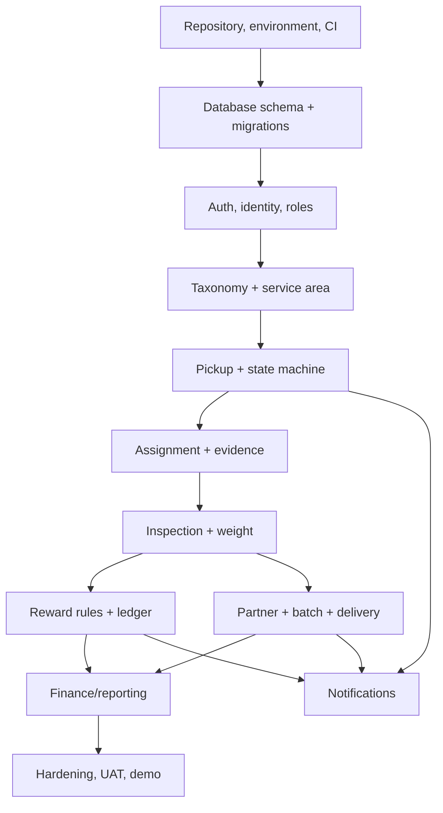

### 36.2 Fase 0 — Engineering foundation

- Tetapkan repository, branching, lint, format, type-check, dan test commands.
- Siapkan `.env.example`, PostgreSQL local, migration tool, seed sintetis.
- Tetapkan API envelope, error schema, timezone, decimal, upload rules.
- Tambahkan request ID dan health endpoint.

### 36.3 Fase 1 — Auth dan role

- Register/login/logout/session dan profile/address.
- Role grant, application Collector, approval/reject/suspend dengan audit.
- Frontend route guard untuk UX dan permission check di backend.
- Negative security tests untuk endpoint sensitif.

### 36.4 Fase 2 — Taxonomy dan collection

- Kategori/subkategori, service area, acceptance rules.
- Create/list/detail/cancel pickup.
- Task list dan atomic accept.
- State machine/status events dan in-app notification.
- Putuskan dan validasi batas satu kategori per pickup pada MVP.

### 36.5 Fase 3 — QC, timbang, bukti

- Inspection result dan rejection reason.
- Weight record dengan unit/precision dan correction history.
- Private object storage serta bukti.
- Test upload, permission, weight validation, concurrent accept.

### 36.6 Fase 4 — WastePoints

- Rule version dan eligibility evaluator.
- Append-only ledger, idempotency, saldo dan histori.
- Correction/reversal dan budget guard bila reward dibatasi program.
- Redemption hanya setelah saldo/kuota/concurrency diuji.

### 36.7 Fase 5 — Marketplace dan finance

- Partner profile dan acceptance rules.
- Batch/items, offer/allocation atomik, delivery/receipt.
- Finance transaction/reconciliation sesuai prioritas.
- Dashboard membedakan collected/shipped/received.

### 36.8 Fase 6 — Hardening dan demo

- Jalankan unit/integration/API/security suite.
- Uji task concurrency, idempotent reward, redemption, allocation.
- Uji AI/peta/notifikasi outage dan backup restore.
- Siapkan seed sintetis dan skenario end-to-end.
- Labeli simulasi, asumsi, dan integrasi yang belum aktif.

### 36.9 Prioritas

**P0/MUST:** auth, role/access, taxonomy, pickup, assignment, state events, QC/weight, audit, reward ledger dasar, permission security, demo journey.

**P1/SHOULD:** kanal notifikasi eksternal, redemption voucher, buyer portal lengkap, finance reconciliation tambahan, peta, dan workflow evidence lebih matang.

**P2/COULD:** optimasi rute, AI klasifikasi teruji, integrasi eksternal formal, analitik lanjutan, multi-area skala besar, observability lanjutan.

---

## 37. Risiko Teknis

| Risiko | Dampak | Mitigasi |
|---|---|---|
| Scope terlalu luas | Banyak modul tidak selesai | Prioritaskan satu flow lengkap; sederhanakan portal non-inti |
| CRUD tanpa state machine | Status invalid dan sulit diaudit | Commands khusus dan tests transisi |
| Poin dihitung di frontend | Mudah dimanipulasi | Kalkulasi server, rule version, ledger |
| Race condition task | Dua petugas mengklaim satu task | Atomic claim + constraint/lock |
| Histori ditimpa | Tidak bisa menjelaskan koreksi | Status events, ledger append-only, revisions |
| AI salah klasifikasi | Salah routing/risiko keselamatan | Manual review dan fail-safe untuk limbah khusus |
| Bukti file publik | Kebocoran privasi | Private storage, signed URL, authorization, retensi |
| Anggaran reward tidak cukup | Reward tidak terdanai | Budget guard, approval, reporting |
| Mitra belum terverifikasi | Material tidak tersalurkan | Batch menunggu mitra; klaim dibatasi |
| Provider gagal | Notifikasi/peta/AI tidak tersedia | Adapter, timeout, fallback, retry |
| Demo dianggap real | Klaim dampak tidak akurat | Data sintetis dengan label DEMO |
| Retensi belum jelas | Risiko privasi | Tetapkan sebelum pilot |
| DB/query lambat | Dashboard tidak responsif | Pagination, profiling, index sesuai query |

---

## 38. Keputusan Terbuka

### 38.1 Operasional

- Apakah satu pickup hanya boleh satu kategori/subkategori?
- Status apa yang wajib per jenis layanan dan definisi `COMPLETED`?
- Self-service task accept atau assignment oleh admin?
- Aturan cancel, no-show, reschedule, dan dispute?
- Siapa menetapkan slot/kapasitas, dan bagaimana update-nya?
- Jalur limbah khusus apa yang benar-benar tersedia di wilayah pilot?

### 38.2 Data dan teknologi

- Login email, telepon, Google/SSO, atau gabungan?
- Provider storage dan pola upload yang akan dipakai?
- Apakah PostGIS diperlukan untuk pilot pertama?
- ORM/migration tool final dan convention decimal/timezone?
- Apakah audit perlu sink terpisah saat pilot?
- Backup schedule serta RPO/RTO yang realistis?

### 38.3 Reward dan finance

- Formula reward, rounding, limit, periode, dan syarat kualitas per kategori?
- Apakah organik mendapat poin dan apa tujuannya?
- Budget hard limit, soft limit, atau subsidi program?
- Benefit berupa voucher, program komunitas, atau simulasi?
- Siapa menyetujui koreksi reward/redemption bermasalah?
- Bagaimana penjualan material dan dana masuk direkonsiliasi?

### 38.4 Privasi dan kemitraan

- Retensi akun, alamat, foto, log, transaksi?
- Proses permintaan akses/penghapusan data?
- Syarat verifikasi pengangkut/pengolah?
- Data yang dibagikan ke buyer dan sponsor?
- Apakah foto memerlukan moderasi/redaction?
- Integrasi apa yang mempunyai akses/perjanjian resmi?

---

## 39. Glosarium

| Istilah | Makna |
|---|---|
| API | Antarmuka bagi client/komponen untuk meminta fungsi sistem |
| Audit log | Catatan actor, aksi, objek, waktu, dan konteks perubahan sensitif |
| Batch | Kumpulan material kompatibel yang dilacak sebagai satu lot |
| Buyer | Mitra penerima/pembeli material sesuai kesepakatan |
| Collector | Petugas yang diverifikasi untuk tindakan operasional |
| Domain service | Komponen use case dan aturan bisnis |
| Idempotency | Request berulang tidak menggandakan efek bisnis |
| Ledger | Catatan transaksi append-only untuk saldo dan koreksi |
| Modular monolith | Satu deployment dengan modul domain terpisah secara logis |
| Object storage | Penyimpanan file terpisah dari database relasional |
| Ownership check | Pemeriksaan actor berhak mengakses resource |
| Partner material rule | Aturan penerimaan material pada kondisi tertentu oleh mitra |
| Pickup request | Permintaan penjemputan/setoran |
| PostGIS | Ekstensi PostgreSQL untuk data spasial |
| RBAC | Role-Based Access Control |
| Reward rule | Parameter berversi untuk kelayakan dan perhitungan poin |
| State machine | Daftar status dan transisi yang diperbolehkan |
| WastePoints | Poin insentif yang dilacak melalui ledger |
| Weight record | Catatan berat yang dapat ditelusuri dan dikoreksi |
| WITA | Zona waktu operasional Bali, `Asia/Makassar` |

---

## 40. Lampiran A — Struktur Direktori

Struktur referensi ini dapat disesuaikan dengan repository aktual; tujuannya menunjukkan pemisahan frontend, backend, domain modules, migrasi, dan dokumentasi.

```text
wastelink-bali/
├── apps/
│   └── web/
│       ├── app/
│       │   ├── (public)/
│       │   ├── (auth)/
│       │   └── app/
│       │       ├── user/
│       │       ├── collector/
│       │       ├── admin/
│       │       ├── finance/
│       │       └── marketplace/
│       ├── components/
│       ├── features/
│       │   ├── auth/
│       │   ├── pickup/
│       │   ├── taxonomy/
│       │   ├── points/
│       │   └── marketplace/
│       ├── lib/
│       ├── types/
│       └── tests/
├── services/
│   └── api/
│       ├── app/
│       │   ├── api/v1/
│       │   ├── core/
│       │   ├── db/
│       │   ├── modules/
│       │   │   ├── auth/ identity/ taxonomy/ collection/
│       │   │   ├── quality/ rewards/ partners/ marketplace/
│       │   │   └── finance/ notifications/ reporting/ audit/
│       │   └── main.py
│       ├── migrations/
│       ├── tests/
│       ├── pyproject.toml
│       └── alembic.ini
├── docs/
│   ├── PRD_WasteLink_Bali.md
│   ├── HRD_WasteLink_Bali.md
│   └── SDD_WasteLink_Bali.md
├── scripts/
├── .env.example
├── .gitignore
└── README.md
```

### 40.1 Pola modul backend

```text
modules/<domain>/
├── router.py       # transport HTTP
├── schemas.py      # request/response DTO
├── models.py       # ORM models jika sesuai
├── repository.py   # query/persistensi
├── service.py      # use case/domain behavior
├── policies.py     # permission dan transition rules
└── tests/
```

Tidak semua modul perlu setiap file; hindari boilerplate yang tidak menambah kejelasan. Frontend dapat memakai pola feature: `api.ts`, `schemas.ts`, `types.ts`, `hooks.ts`, `components/`, dan `tests/`. Types frontend sebaiknya mengikuti OpenAPI/kontrak API yang disepakati.

---

## 41. Lampiran B — Environment Variables

Contoh nama variabel; nilainya harus disesuaikan environment/provider.

```dotenv
APP_ENV=local
APP_NAME=WasteLink Bali
DEBUG=false
API_V1_PREFIX=/api/v1
FRONTEND_ORIGIN=http://localhost:3000
PUBLIC_APP_URL=http://localhost:3000

DATABASE_URL=postgresql+psycopg://<user>:<password>@<host>:5432/<database>
DB_POOL_SIZE=<configured-size>
DB_MAX_OVERFLOW=<configured-overflow>

SESSION_COOKIE_NAME=<session-cookie-name>
SESSION_TTL_MINUTES=<configured-ttl>
SESSION_SECRET=<secret-from-environment>
CSRF_SECRET=<secret-from-environment>

OBJECT_STORAGE_ENDPOINT=<provider-endpoint>
OBJECT_STORAGE_BUCKET=<private-bucket-name>
OBJECT_STORAGE_ACCESS_KEY=<secret-from-environment>
OBJECT_STORAGE_SECRET_KEY=<secret-from-environment>
OBJECT_STORAGE_REGION=<provider-region>
MAX_UPLOAD_BYTES=<configured-limit>

EMAIL_PROVIDER_API_KEY=<optional-secret>
MAPS_API_KEY=<optional-secret>
CLASSIFICATION_PROVIDER_API_KEY=<optional-secret>
LOG_LEVEL=INFO
SENTRY_DSN=<optional-secret-or-empty>
```

**Peringatan:** semua nilai di atas merupakan placeholder, bukan credential siap pakai. Jangan meng-commit secret nyata. Database URL lokal harus memakai akun/password lokal yang sesuai dan tidak disalin ke environment publik.

---

## 42. Lampiran C — Definition of Done

### 42.1 Per fitur

- [ ] Kebutuhan terkait PRD/HRD memiliki referensi.
- [ ] UI memiliki loading, empty, success, dan error state.
- [ ] Request/response schema terdokumentasi.
- [ ] Authorization dan ownership diperiksa backend.
- [ ] Server memvalidasi semua input penting.
- [ ] Constraint/transaction melindungi invariant domain.
- [ ] Status event/audit dibuat untuk tindakan penting.
- [ ] Idempotency digunakan pada operasi berisiko duplikasi.
- [ ] Unit/integration tests ditambahkan.
- [ ] Log tidak memuat credential/data pribadi berlebih.
- [ ] Konfigurasi/fallback terdokumentasi.

### 42.2 Sebelum demo hackathon

- [ ] Database dapat dibangun dari migration kosong.
- [ ] Seed demo berhasil dan diberi label sintetis.
- [ ] Akun demo mempunyai role/permission sesuai skenario.
- [ ] Alur warga → Collector → timbang → reward → batch dapat didemonstrasikan, atau keterbatasannya dijelaskan.
- [ ] Concurrent accept dan reward idempotency sudah diuji.
- [ ] Limbah khusus tanpa jalur tidak menciptakan pickup biasa.
- [ ] Evidence tidak publik tanpa authorization.
- [ ] Dashboard membedakan collected, shipped, received, dan processed.
- [ ] Integrasi yang belum terhubung diberi label simulasi/nonaktif.
- [ ] Tidak ada secret nyata pada repository atau screenshot.
- [ ] Known issues dan keputusan terbuka dicatat.

### 42.3 Sebelum pilot

- [ ] SOP collection, keselamatan, timbang, kontaminasi, cancel, dan dispute disepakati.
- [ ] Mitra, area, kategori, acceptance rules diverifikasi.
- [ ] Formula reward dan sumber dana disetujui.
- [ ] Kebijakan privasi, retensi, penghapusan, dan akses data disetujui.
- [ ] Backup dan restore diuji.
- [ ] Alert serta kontak eskalasi ditentukan.
- [ ] Role Admin/Finance dan persetujuan koreksi ditetapkan.
- [ ] Jalur limbah khusus tervalidasi.
- [ ] UAT dan risiko tersisa disetujui pemilik produk/operasional.

---

## Penutup

SDD ini menetapkan rancangan teknis yang mengutamakan alur operasional end-to-end, pemisahan domain, otorisasi, histori yang dapat diaudit, serta konsistensi reward dan material. Implementasi MVP sebaiknya dimulai dari Waste Collection dan state machine, kemudian dilanjutkan ke QC/weight, ledger WastePoints, serta batch/marketplace dengan transaksi dan pengujian yang sesuai.

Sebelum digunakan dalam operasi lapangan nyata, keputusan terbuka harus dituntaskan oleh tim dan pengelola. Nilai demo, aturan reward, ketersediaan mitra, dan klaim dampak tidak boleh diperlakukan sebagai fakta lapangan tanpa validasi.
