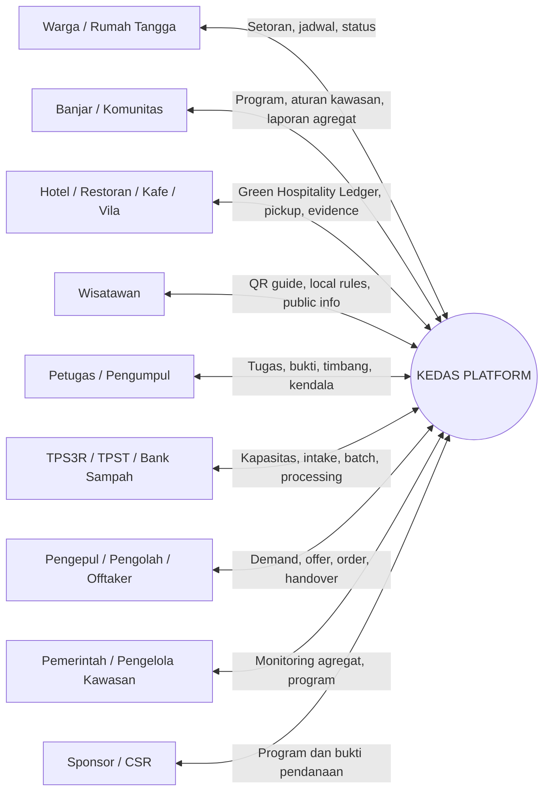
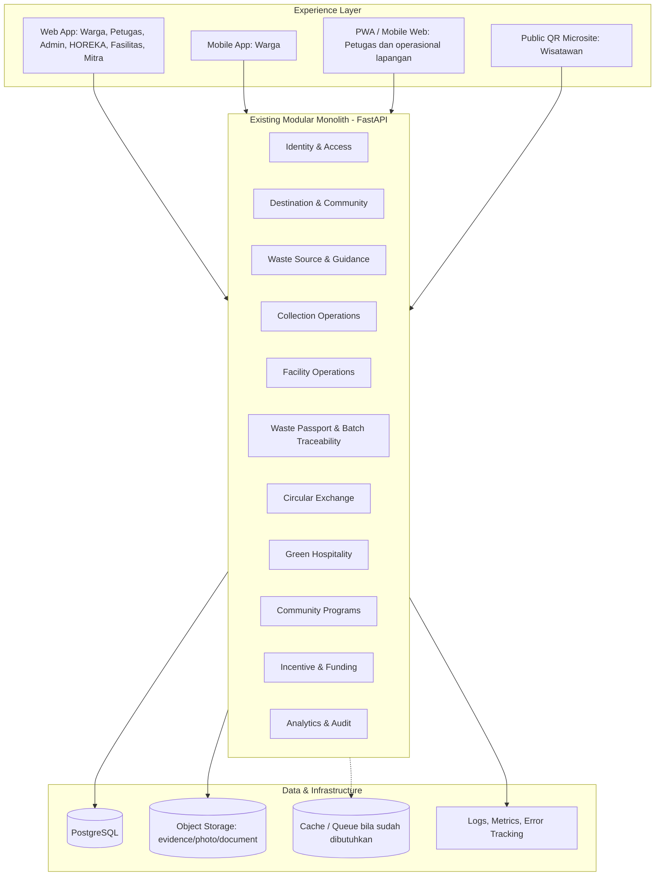
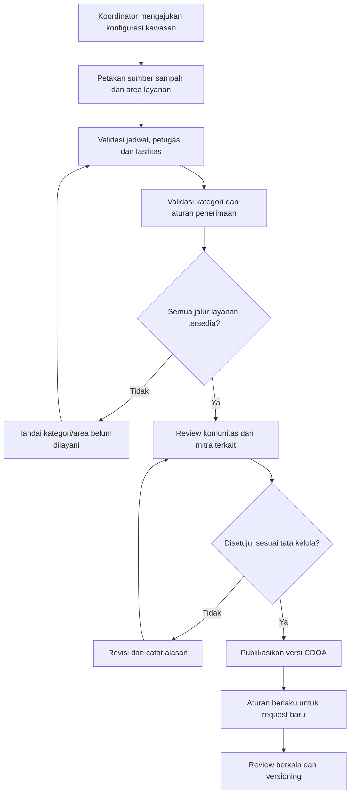
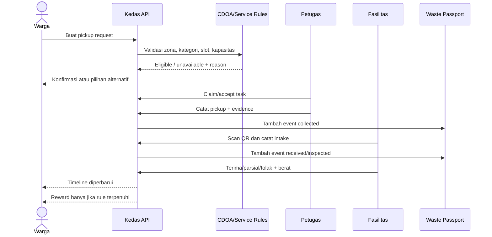
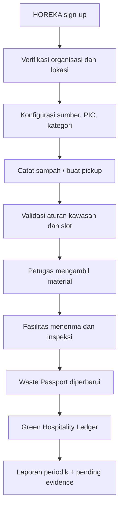
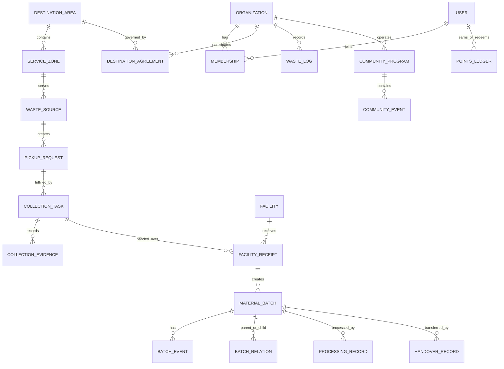
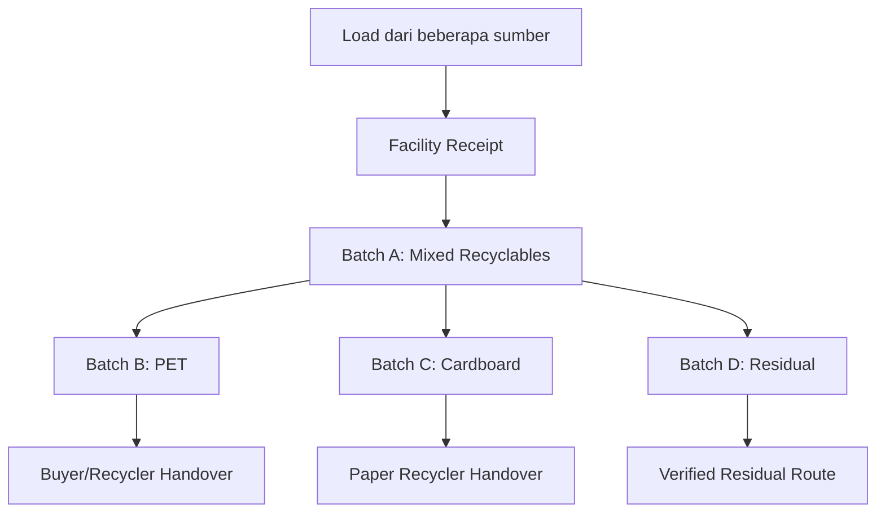
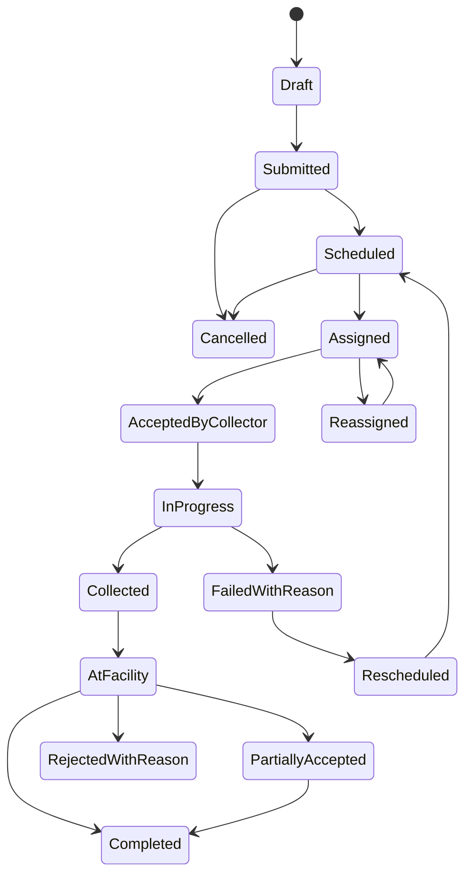
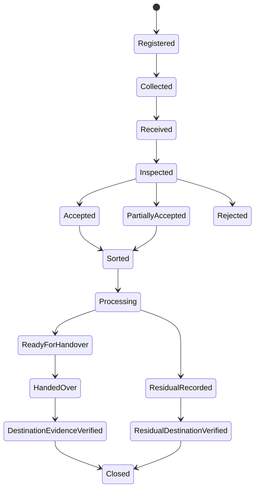
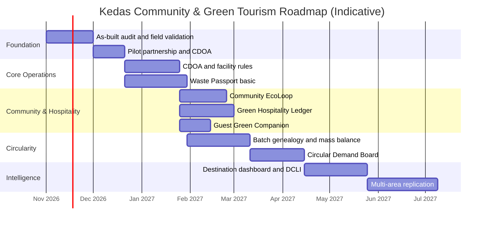

# KEDAS — Product Strategy & System Design
## Community & Green Tourism | Integrated Destination Pilot

**Nama resmi:** Kedas  
**Nama historis:** WasteLink Bali  
**Positioning:** *Community-led Destination Waste Operations & Green Tourism Platform*  
**Tagline:** *Bergerak Bersama untuk Lingkungan yang Lebih Bersih.*  
**Product promise:** *Setiap sumber sampah terhubung dengan layanan yang tersedia, setiap serah-terima tercatat, dan setiap klaim dampak didukung bukti.*

**Status dokumen:** Strategi produk dan desain sistem target (target-state design), disusun berdasarkan ringkasan laporan as-built yang disampaikan pemilik proyek dan dokumen rancangan Kedas sebelumnya. Dokumen ini bukan pernyataan bahwa seluruh fitur target telah tersedia di repository.

---

# 0. Cara Membaca Dokumen dan Batas Bukti

Dokumen ini menggabungkan tiga jenis informasi yang harus tetap dibedakan:

| Label | Makna | Cara menggunakan |
|---|---|---|
| **AS-BUILT / DILAPORKAN** | Kondisi yang dinyatakan sudah ada dalam ringkasan audit Kedas yang diberikan. | Dipertahankan sebagai baseline; tetap cocokkan dengan repository saat implementasi. |
| **DESAIN TARGET** | Rekomendasi sistem dan fitur yang seharusnya dibangun untuk mencapai positioning Community & Green Tourism. | Menjadi arahan produk, backlog, dan desain teknis. |
| **ASUMSI PILOT** | Angka, komposisi mitra, KPI, atau proses yang belum divalidasi dengan operator lapangan. | Harus dikonfirmasi bersama banjar/komunitas, fasilitas, petugas, dan usaha pariwisata. |

## 0.1 Baseline as-built yang tersedia dari laporan

Berdasarkan ringkasan laporan yang disampaikan:

- Nama tampilan telah diselaraskan menjadi **Kedas**, sedangkan identifier teknis lama dipertahankan untuk kompatibilitas.
- Arsitektur dilaporkan menggunakan **modular monolith**.
- Stack yang dilaporkan: Python 3.13, FastAPI, Next.js 15, React 19.
- Laporan menyebut **8 role akun**, **48 endpoint API**, dan **19 model data**. Nama lengkap delapan role dan inventaris endpoint/model harus diambil dari laporan utama dan repository; dokumen ini tidak mengarang nama atau struktur aktualnya.
- Hasil pengujian yang dilaporkan: backend 76/76, frontend 94/94, mobile 15/15; total 185/185 lulus. Ini adalah hasil yang tercantum pada laporan pengguna, bukan hasil eksekusi ulang oleh dokumen ini.
- Temuan yang dilaporkan sudah ditangani mencakup propagasi error HTTP pada collection/staff service, data dashboard warga yang terhubung ke sesi aktif, pengamanan race condition fasilitas menggunakan row-level locking, dan perluasan status badge.
- Laporan menyatakan sistem siap untuk internal demo dan controlled pilot terbatas, tetapi belum siap untuk production unrestricted scale.

## 0.2 Aturan menjaga kompatibilitas

1. Jangan mengganti atau membuat ulang autentikasi, API, tabel, model, dan service yang sudah bekerja sebelum audit repository dilakukan.
2. Pertahankan path REST API, identifier, dan kontrak data lama kecuali ada alasan teknis kuat, rencana migrasi, test, serta dokumentasi kompatibilitas.
3. Setiap fitur target harus dipetakan ke modul, endpoint, model, dan test aktual. Jika entitas serupa sudah ada, perluas secara backward-compatible daripada membuat duplikasi.
4. Dokumen desain terdahulu (PRD, SRS, SDD, desain web/mobile) adalah referensi kebutuhan. Dokumen tersebut tidak otomatis membuktikan bahwa fitur sudah terimplementasi.
5. Sebelum coding, coding agent wajib membuat **As-Built-to-Target Gap Matrix** yang mencatat: sudah ada, ada sebagian, belum ada, tidak relevan, dan perlu keputusan manusia.

---

# 1. Executive Product Strategy

## 1.1 Keputusan strategi

Kedas difokuskan sebagai platform operasi kebersihan kawasan wisata berbasis komunitas, bukan sekadar aplikasi pemilahan sampah atau pemesanan penjemputan.

**Strategic thesis:** kawasan wisata yang bersih hanya dapat dipertahankan jika masyarakat, usaha pariwisata, petugas, fasilitas pengolahan, dan mitra pemanfaat material bekerja melalui tata kelola operasional yang sama.

Kedas menjadi lapisan koordinasi digital yang membantu kawasan:

1. Menetapkan aturan dan layanan pengelolaan sampah berdasarkan kondisi kawasan.
2. Menghubungkan rumah tangga, banjar/komunitas, dan usaha pariwisata dengan layanan yang benar-benar tersedia.
3. Mengoordinasikan penjemputan, penerimaan fasilitas, pemilahan, pengolahan, serta penyerahan material.
4. Memberikan bukti perjalanan material melalui *Kedas Waste Passport*.
5. Menyediakan laporan kinerja kawasan dan usaha pariwisata yang transparan serta tidak melebih-lebihkan dampak.
6. Memperkuat ekonomi lokal dengan menghubungkan material terpilah ke bank sampah, pengepul, agregator, pengolah, dan pembeli.

## 1.2 Problem statement

Di kawasan wisata, sampah tidak berasal dari satu kelompok. Rumah tangga, akomodasi, restoran, kafe, pasar, kegiatan wisata, dan aktivitas komunitas menghasilkan aliran sampah dengan volume, jenis, waktu, serta kualitas berbeda.

Permasalahan produk yang perlu dijawab Kedas:

- Pemilahan di sumber belum selalu diikuti layanan pengambilan dan penerimaan yang jelas.
- Pengelola kawasan belum tentu melihat data operasional dari warga, usaha pariwisata, petugas, dan fasilitas dalam satu gambaran.
- Petugas perlu mengetahui jadwal, lokasi, jenis material, persyaratan pengambilan, dan tujuan fasilitas sebelum berangkat.
- Fasilitas perlu mengelola material masuk berdasarkan kapasitas, jam operasi, kategori yang diterima, dan kondisi aktual.
- Material yang diterima belum tentu sudah diproses atau benar-benar dimanfaatkan.
- Usaha pariwisata membutuhkan pencatatan yang dapat ditelusuri, bukan hanya pernyataan bahwa mereka telah melakukan pemilahan.
- Komunitas membutuhkan data agregat untuk menjalankan program, mengedukasi warga, dan mengawasi layanan tanpa membuka data pribadi individu.
- Sponsor dan pemerintah membutuhkan bukti output/outcome yang dapat diaudit; angka dampak tidak boleh dihitung dari aktivitas yang belum diverifikasi.

## 1.3 Visi produk

**Membangun ekosistem kawasan yang menjadikan pengelolaan sampah sebagai bagian dari tata kelola komunitas dan kualitas pengalaman pariwisata.**

## 1.4 Misi produk

1. Membuat partisipasi warga dan pengelola usaha pariwisata mudah dilakukan.
2. Membuat kerja petugas dan fasilitas lebih terkoordinasi.
3. Membuat aliran material lebih transparan dari sumber hingga tujuan.
4. Membuka akses pasar bagi material yang memenuhi persyaratan pembeli.
5. Membantu kawasan mengukur kinerja kebersihan dan keberlanjutan secara bertanggung jawab.

## 1.5 Product North Star

**Verified Material Loop Completion (VMLC)** — persentase berat material yang tercatat dari sumber, diterima fasilitas, dan memiliki status tujuan akhir yang didukung bukti memadai sesuai kategori material.

Formula awal:

`VMLC = berat material dengan tujuan akhir terverifikasi / berat material yang diterima fasilitas dan masuk ruang lingkup pelacakan × 100%`

Catatan:
- Denominator harus jelas dan periode pengukuran konsisten.
- Material yang hanya dijemput atau diterima belum boleh dihitung sebagai berhasil didaur ulang.
- Jalur organik, anorganik, reuse, dan residu memiliki definisi bukti tujuan yang berbeda.
- Tampilkan juga *data coverage* dan *confidence level*. Jangan menyembunyikan transaksi yang belum memiliki bukti lanjutan.

## 1.6 Positioning dan janji nilai

| Audiens | Janji nilai Kedas |
|---|---|
| Warga | Mengetahui cara memilah, layanan yang tersedia, jadwal pengambilan, dan perjalanan setoran. |
| Banjar/komunitas | Mengelola program kebersihan kawasan berdasarkan data partisipasi dan layanan. |
| Hotel/restoran/kafe/vila | Mengelola pencatatan sampah dan memperoleh laporan operasional berbasis bukti. |
| Petugas/pengumpul | Mendapat tugas yang jelas, informasi material, rute, dan bukti serah-terima. |
| TPS3R/TPST/bank sampah | Memantau material masuk, kapasitas, kualitas, stok, dan distribusi. |
| Pengepul/pendaur ulang | Menemukan pasokan yang sesuai spesifikasi dengan informasi kualitas dan volume. |
| Pengelola kawasan/pemerintah | Melihat kondisi agregat, hambatan operasional, dan hasil program. |
| Sponsor/CSR | Melihat penggunaan dana dan output program yang dapat ditelusuri. |
| Wisatawan | Memahami aturan sederhana menjaga lingkungan kawasan tanpa harus memasang aplikasi. |

---

# 2. Konteks Bali dan Peluang Community & Green Tourism

## 2.1 Fakta eksternal yang relevan

1. Pada 9 Juni 2026, KLH/BPLH menyampaikan dorongan penerapan *green hospitality* di sektor hotel, restoran, dan kafe di Bali. Dalam siaran tersebut, kementerian menyebut tingkat pemilahan di permukiman sekitar 70%, sedangkan sektor HOREKA masih di bawah 25%. Angka ini merupakan pernyataan dalam konteks sosialisasi pemerintah, bukan baseline universal untuk setiap kabupaten atau kawasan. Sumber: [KLH/BPLH — Green Hospitality Bali, 9 Juni 2026](https://kemenlh.go.id/news/detail/warga-sukses-pilah-sampah-menteri-lh-desak-sektor-horeka-bali-terapkan-standar-green-hospitality).
2. Pada 6 Agustus 2026, Pemprov Bali menyampaikan rencana penguatan lima kawasan rendah emisi: Nusa Dua, Kuta, Ubud, Sanur, dan Nusa Penida. Program yang diberitakan mencakup green energy, green mobility, green ecosystem, green tourism, dan green community. Sumber: [Pemprov Bali — Lima Kawasan Rendah Emisi, 6 Agustus 2026](https://www.baliprov.go.id/web/tingkatkan-kualitas-pariwisata-berkelanjutan-gubernur-koster-gencarkan-5-kawasan-bali-rendah-emisi).
3. Kementerian Pariwisata menerbitkan kajian peta jalan Desa Wisata Indonesia 2026–2045 pada 31 Juli 2026, yang membahas kelembagaan, klasifikasi, pembinaan, pendanaan, monitoring, dan pengembangan desa wisata. Ini relevan untuk model Kedas yang melibatkan masyarakat lokal sebagai pengelola dan penerima manfaat. Sumber: [Kajian Peta Jalan Desa Wisata Indonesia 2026–2045](https://www.kemenpar.go.id/pustaka/kajian-peta-jalan-desa-wisata-indonesia-2026-2045).
4. Permenparekraf No. 9 Tahun 2021 tentang Pedoman Destinasi Pariwisata Berkelanjutan tercatat berstatus berlaku pada halaman JDIH BPK yang ditelusuri. Gunakan sebagai salah satu referensi kebijakan, tetapi verifikasi kembali peraturan yang berlaku dan ketentuan daerah sebelum produk dipakai untuk klaim kepatuhan. Sumber: [JDIH BPK — Permenparekraf No. 9 Tahun 2021](https://peraturan.bpk.go.id/Details/203906/permenpar-no-9-tahun-2021).
5. Pemkot Denpasar pada 29 April 2026 mengangkat konsep *Waste to Worth* dan strategi 5R untuk mendorong ekonomi sirkular pada destinasi pariwisata dan HOREKA. Sumber: [Pemkot Denpasar — Ekonomi Sirkular dan Waste to Worth](https://denpasarkota.go.id/berita/pemkot-denpasar-dorong-sektor-pariwisata-destinasi-dan-horeka-terapkan-ekonomi-sirkular-wujudkan-pariwisata-berkelanjutan-tanamkan-konsep-waste-to-worth-dengan-strategi-5-r-260429).

## 2.2 Implikasi ke strategi Kedas

- Jangan merancang solusi yang hanya berorientasi warga; libatkan HOREKA sebagai sumber material dan mitra pembiayaan/layanan potensial.
- Jangan menganggap semua kawasan memiliki infrastruktur dan tata kelola yang sama. Konfigurasi layanan harus dapat disesuaikan per kawasan.
- Jadikan komunitas lokal sebagai pemilik/pengelola program, bukan sekadar tenaga promosi aplikasi.
- Wisatawan dilibatkan melalui informasi perilaku sederhana dan kanal QR tanpa pendaftaran wajib.
- Kedas menyediakan catatan dan bukti operasional, bukan sertifikasi resmi, penilaian hukum, atau pengganti audit pemerintah.
- Pengembangan desa wisata harus menghormati tata kelola lokal, akses warga, budaya, dan kewenangan lembaga setempat.

## 2.3 Strategi pemilihan kawasan pilot

Jangan memilih lokasi semata-mata karena terkenal atau ramai wisatawan. Pilih kawasan berdasarkan kesiapan ekosistem dan peluang membuktikan satu siklus material.

### Kriteria pemilihan lokasi

| Kriteria | Bobot usulan | Hal yang diverifikasi |
|---|---:|---|
| Komitmen banjar/desa/komunitas | 20% | Penanggung jawab, persetujuan, mekanisme koordinasi, dan keterlibatan warga. |
| Kesiapan TPS3R/TPST/bank sampah | 20% | Jam operasi, kategori diterima, kapasitas, alur penerimaan, dan personel. |
| Keterlibatan HOREKA | 15% | Kesediaan mencatat sampah, menyediakan area pemilahan, dan mengikuti layanan. |
| Kepastian petugas/pengangkut | 15% | Armada, wilayah layanan, jadwal, SOP, dan biaya. |
| Jalur pembeli/offtaker | 15% | Pembeli terverifikasi, spesifikasi, volume minimum, harga, dan bukti serah-terima. |
| Kesiapan data dan konektivitas | 5% | Ketersediaan data awal, jaringan, perangkat, dan kemampuan operator. |
| Nilai pembelajaran dan replikasi | 10% | Kawasan mewakili kebutuhan yang dapat direplikasi di wilayah lain. |

Nilai akhir = jumlah (skor kriteria 1–5 × bobot). Lokasi hanya dapat dipilih setelah kunjungan lapangan dan persetujuan pihak yang berwenang. Nusa Dua, Kuta, Ubud, Sanur, dan Nusa Penida dapat menjadi kandidat untuk dievaluasi, bukan lokasi yang otomatis dipilih.

### Komposisi pilot minimum — asumsi awal

- 1 kawasan/banjar/komunitas yang memiliki koordinator resmi.
- 1 fasilitas penerima utama (TPS3R, TPST, atau fasilitas lain yang sah dan sesuai).
- 1 kelompok petugas/pengumpul.
- 3–5 usaha HOREKA yang bersedia menjadi pengguna pilot.
- 1 bank sampah/pengepul/agregator/pembeli sebagai jalur material.
- Warga rumah tangga yang berpartisipasi melalui proses onboarding komunitas.
- Pemerintah/pengelola kawasan sebagai observer atau mitra sesuai kewenangan dan persetujuan.

Jumlah tersebut adalah komposisi uji coba yang disarankan, bukan fakta mitra yang sudah tersedia.

---

# 3. Diferensiasi Produk: Mengapa Kedas Tidak Sekadar Aplikasi Sampah

## 3.1 Diferensiasi inti

Keunggulan Kedas bukan jumlah fitur, melainkan kemampuan menghubungkan tiga domain yang sering terpisah:

1. **Community operations:** warga, banjar, desa/komunitas, dan kegiatan kebersihan.
2. **Tourism business operations:** hotel, restoran, kafe, vila, pasar wisata, dan pengelola destinasi.
3. **Verified circular material flow:** petugas, fasilitas, bank sampah, pengepul, pengolah, pendaur ulang, dan pembeli.

Produk lain mungkin berhenti pada pemilahan, penjemputan, poin, atau marketplace. Kedas harus membuktikan alur dari sumber → layanan → penerimaan → pemrosesan → serah-terima/tujuan, sekaligus menghubungkannya dengan tata kelola kawasan.

## 3.2 Tujuh pembeda strategis

### D1. Community Destination Operating Agreement (CDOA)

**Konsep:** setiap kawasan pilot mempunyai konfigurasi operasi digital yang disepakati bersama komunitas dan operator.

Isi konfigurasi:
- batas wilayah dan titik layanan;
- jenis sumber sampah yang terdaftar;
- kategori material dan panduan pemilahan lokal;
- fasilitas yang menerima setiap jenis material;
- jadwal layanan dan hari khusus;
- kapasitas layanan serta batas penerimaan;
- penanggung jawab dan escalation contact;
- SOP komplain, penolakan, dan kejadian luar biasa;
- masa berlaku, versi, dan riwayat perubahan kesepakatan.

**Mengapa berbeda:** aplikasi tidak mengasumsikan setiap kawasan mengikuti aturan universal. Kedas menerjemahkan kesepakatan operasional lokal menjadi aturan layanan yang dapat dijalankan dan diaudit.

**Batas:** dokumen digital ini tidak menggantikan perjanjian legal, keputusan desa adat, kontrak layanan, atau kewenangan pemerintah. Bentuk dan proses persetujuan harus sesuai tata kelola setempat.

### D2. Kedas Waste Passport

**Konsep:** identitas QR dan histori peristiwa untuk satu permintaan, setoran, wadah, atau batch material.

Passport mencatat:
- asal atau sumber material;
- kategori dan subkategori;
- waktu, berat, dan bukti setoran;
- petugas/armada dan bukti pengambilan;
- penerimaan fasilitas serta hasil inspeksi;
- pemecahan atau penggabungan batch;
- hasil pemilahan/pengolahan;
- penyerahan kepada pembeli/offtaker atau jalur residu;
- bukti dokumen, foto, dan catatan koreksi.

**Mengapa berbeda:** status material tidak berhenti pada “picked up” atau “received”. Riwayat membuktikan tahapan yang benar-benar terjadi.

### D3. Destination Clean Loop Index (DCLI)

**Konsep:** dashboard kesehatan operasional kawasan yang menilai kualitas loop layanan dan material, bukan sekadar banyaknya sampah terkumpul.

Komponen indeks usulan:
- ketepatan penyelesaian pengambilan;
- keberhasilan penerimaan fasilitas;
- kelengkapan traceability;
- rekonsiliasi massa material;
- kesinambungan partisipasi warga dan usaha.

Setiap nilai harus menampilkan periode, cakupan data, sumber, dan tingkat keyakinan. DCLI bukan sertifikat, peringkat resmi, atau klaim kepatuhan lingkungan.

### D4. Green Hospitality Ledger

**Konsep:** buku besar operasional sampah bagi HOREKA.

Mencatat sampah berdasarkan periode, departemen/area bila dibutuhkan, kategori, berat, metode penanganan, layanan eksternal, bukti serah-terima, serta tujuan material.

Output berupa laporan operasional bulanan yang dapat diperiksa oleh manajemen usaha dan dibagikan kepada pihak terkait dengan izin. Tidak boleh disebut sertifikat green hotel, sertifikasi pemerintah, atau jaminan kepatuhan.

### D5. Community EcoLoop

**Konsep:** ruang kerja komunitas untuk mengelola program kebersihan kawasan.

Mencakup agenda, edukasi, kegiatan gotong royong, pengumuman, pelaporan lokasi bermasalah, partisipasi sukarela, target kolektif, dan rekap aktivitas. Data yang ditampilkan ke publik bersifat agregat dan tidak mempermalukan rumah tangga.

### D6. Guest Green Companion

**Konsep:** pengalaman ringan bagi wisatawan tanpa kewajiban memasang aplikasi atau membuat akun.

Wisatawan memindai QR di hotel, restoran, penginapan, atau titik destinasi untuk melihat:
- panduan pemilahan sederhana dalam Bahasa Indonesia dan Inggris;
- informasi titik isi ulang air atau pengurangan plastik jika benar-benar tersedia;
- aturan kebersihan setempat;
- kegiatan komunitas terbuka;
- kanal pelaporan fasilitas umum yang dikelola operator;
- cerita singkat tentang upaya komunitas dan material lokal.

**Mengapa berbeda:** Kedas menjadikan pengalaman wisata sebagai bagian dari perilaku ramah lingkungan, tanpa menjadikan wisatawan sebagai pengganti petugas kebersihan.

### D7. Capacity-aware Collection & Circular Matching

**Konsep:** tugas pengambilan dan tujuan material ditentukan berdasarkan aturan penerimaan, wilayah layanan, jadwal, kapasitas fasilitas, serta kebutuhan offtaker.

Pada MVP gunakan aturan deterministik. Optimasi rute/AI baru ditambahkan setelah data historis cukup dan validasi lapangan tersedia.

## 3.3 Matriks diferensiasi terhadap solusi generik

| Solusi generik | Kedas menambahkan | Nilai pembeda |
|---|---|---|
| Form setoran/penjemputan | CDOA dan aturan layanan lokal | Permintaan hanya dibuat untuk layanan yang benar-benar tersedia. |
| Peta tempat sampah | Kapasitas dan penerimaan fasilitas | Pengguna dan petugas tahu apakah fasilitas dapat menerima material. |
| QR transaksi | Waste Passport lintas serah-terima | Histori material dapat ditelusuri sampai tujuan. |
| Poin/reward | Ledger yang terhubung dengan verifikasi | Insentif tidak terbit dari klaim atau unggahan yang belum sah. |
| Dashboard total kg | Mass balance dan bukti downstream | Mengurangi klaim dampak yang tidak didukung. |
| Dashboard hotel | Green Hospitality Ledger | Laporan operasional berbasis transaksi dan bukti. |
| Kampanye komunitas | Community EcoLoop | Aktivitas masyarakat terhubung dengan hasil layanan dan material. |
| QR wisata | Guest Green Companion | Wisatawan mendapat panduan kawasan tanpa akun wajib. |
| Marketplace material | Circular matching berdasarkan kualitas dan stok | Penawaran berdasarkan material yang tersedia dan spesifikasi pembeli. |

---

# 4. Product Architecture dan Batas Domain

## 4.1 Prinsip arsitektur

Pertahankan **modular monolith** yang telah dilaporkan. Jangan memecah sistem menjadi microservices hanya demi terlihat kompleks untuk hackathon.

Alasan:
- Pilot masih berfokus pada satu kawasan dan jumlah mitra terbatas.
- Alur pickup, receipt, batch, reward, dan inventory membutuhkan transaksi konsisten.
- Modular monolith lebih sederhana untuk debugging, deployment, dan operasional tim kecil.
- Domain boundary yang jelas memungkinkan pemisahan layanan di masa depan jika beban, kepemilikan tim, atau kebutuhan availability benar-benar menuntutnya.

## 4.2 Target bounded contexts

Nama di bawah adalah batas domain konseptual. Cocokkan dengan modul, package, service, dan model aktual di repository sebelum implementasi.

| ID | Domain | Tanggung jawab | Fitur kunci |
|---|---|---|---|
| BC-01 | Identity & Access | Akun, autentikasi, sesi, permission, membership | Existing auth/RBAC; organization membership; scoped access. |
| BC-02 | Destination & Community | Kawasan, komunitas, area layanan, konfigurasi lokal | Community profile, CDOA, area, program. |
| BC-03 | Waste Source & Guidance | Rumah tangga, HOREKA, sumber material, panduan lokal | Waste source profile, sorting guide, service eligibility. |
| BC-04 | Collection Operations | Permintaan, jadwal, penugasan, bukti pengambilan | Existing collection flow; dispatch, task, exception. |
| BC-05 | Facility Operations | Fasilitas, kapasitas, penerimaan, inspeksi, inventory | Facility rules, capacity, intake, equipment status. |
| BC-06 | Material Traceability | Passport, batch, batch event, split/merge, mass balance | QR passport, immutable event history. |
| BC-07 | Circular Exchange | Listing, buyer demand, offer, order, handover | Circular marketplace dan offtake. |
| BC-08 | Green Hospitality | Pencatatan sampah bisnis dan laporan | Business ledger, period report, evidence. |
| BC-09 | Community Programs | Kampanye, kegiatan, edukasi, partisipasi | EcoLoop, volunteer/event, communication. |
| BC-10 | Guest Experience | Halaman QR publik, panduan lokal, visitor info | Guest Green Companion, bilingual microsite. |
| BC-11 | Incentive & Funding | Points, reward, sponsor, biaya program | Existing points ledger; funding attribution. |
| BC-12 | Analytics & Audit | KPI, data quality, laporan, audit trail | DCLI, dashboards, evidence coverage, export. |

## 4.3 Diagram konteks sistem

## 4.4 Diagram arsitektur logis target

**Catatan:** diagram merupakan target konseptual. Jangan menambah cache, queue, storage provider, atau komponen deployment baru jika repository telah memiliki pola yang setara. Gunakan sumber kebenaran teknis aktual.

## 4.5 Pola komunikasi antardomain

- Gunakan service/domain layer internal untuk proses sinkron dalam modular monolith.
- Gunakan transaksi database untuk operasi yang harus konsisten: claim task, intake, inventory, points issuance, dan batch transformation.
- Gunakan outbox/event pattern hanya jika proses asynchronous benar-benar diperlukan. Jangan membuat event bus kompleks untuk pilot kecil.
- Semua event bisnis yang penting memiliki actor, timestamp, organization/area scope, correlation ID, source, dan evidence reference.
- Hindari akses tabel lintas domain tanpa service boundary atau repository contract yang jelas.

---

# 5. Stakeholder, Persona, dan Model Akses

## 5.1 Stakeholder bukan selalu role login

Laporan as-built menyebut delapan role akun. Kedas harus mengaudit dan mempertahankan definisi delapan role aktual tersebut terlebih dahulu. Jangan otomatis menambahkan role login untuk setiap jenis stakeholder.

Gunakan tiga lapisan berbeda:

1. **Account role:** peran keamanan yang menentukan izin dasar akun.
2. **Organization membership:** hubungan akun dengan banjar, fasilitas, HOREKA, vendor, atau organisasi tertentu.
3. **Scope/context:** batas data dan tindakan berdasarkan organisasi, kawasan, atau penugasan.

Contoh: orang yang merupakan warga dan pengurus banjar tidak harus memiliki dua akun. Ia dapat memiliki satu akun dengan membership ke organisasi komunitas dan permission koordinator yang sudah disetujui.

## 5.2 Persona prioritas

| Persona | Kebutuhan utama | Perangkat/pola penggunaan |
|---|---|---|
| Warga | Panduan pemilahan, layanan, pickup, histori, reward | Mobile app/web sederhana. |
| Koordinator banjar/komunitas | Program, daftar partisipan, aturan, area, laporan agregat | Web responsif/tablet. |
| Manajer HOREKA | Pencatatan, jadwal, bukti, laporan bulanan | Web dashboard. |
| Staf operasional HOREKA | Catat kategori/berat dan serah sampah | Mobile web/PWA atau perangkat bersama. |
| Petugas/pengumpul | Task, rute, inspeksi, berat, bukti, kendala | Mobile-first PWA/web, offline queue bila diperlukan. |
| Operator fasilitas | Intake, acceptance, stok, batch, proses, maintenance | Web/tablet. |
| Pembeli/offtaker | Kebutuhan material, penawaran, order, penerimaan | Web portal. |
| Wisatawan | Panduan kawasan, aturan, aktivitas sederhana | QR public microsite tanpa login. |
| Pengelola kawasan/pemerintah | KPI agregat, coverage, isu, laporan | Read-only dashboard sesuai kewenangan. |
| Sponsor | Program, alokasi pendanaan, hasil terverifikasi | Dashboard/report sesuai grant. |

## 5.3 Matriks akses konseptual

Tabel ini adalah prinsip permission target, bukan pengganti matriks role aktual dari repository.

| Aksi | Warga | Koordinator | HOREKA | Petugas | Fasilitas | Buyer | Pengelola kawasan | Guest |
|---|---:|---:|---:|---:|---:|---:|---:|---:|
| Lihat panduan publik | ✓ | ✓ | ✓ | ✓ | ✓ | ✓ | ✓ | ✓ |
| Kelola profil sendiri | ✓ | ✓ | ✓ | ✓ | ✓ | ✓ | ✓ | — |
| Buat pickup sumber sendiri | ✓ | — | ✓ | — | — | — | — | — |
| Lihat data rumah tangga lain | — | Agregat saja | — | Hanya task | — | — | Agregat | — |
| Kelola program komunitas | — | Sesuai membership | — | — | — | — | Sesuai kewenangan | — |
| Jalankan task collection | — | — | — | Assigned task | — | — | — | — |
| Catat facility intake | — | — | — | Handover saja | ✓ | — | Read-only tertentu | — |
| Ubah acceptance/capacity rule | — | — | — | — | Sesuai operator | — | Persetujuan sesuai SOP | — |
| Buat material offer | — | — | — | — | ✓ | ✓ | — | — |
| Lihat laporan organisasi | Milik sendiri | Agregat wilayah | Milik organisasi | Riwayat sendiri | Milik fasilitas | Milik buyer | Agregat berizin | — |

## 5.4 Security rules

- Semua operasi objek harus memeriksa role + membership + scope + ownership di server.
- Jangan mengandalkan hidden menu atau kontrol UI sebagai otorisasi.
- Koordinator komunitas hanya melihat data personal jika ada dasar operasional dan izin yang sah; default dashboard adalah agregat.
- HOREKA hanya mengelola sumber, lokasi, dan laporan organisasinya sendiri.
- Petugas hanya mengakses task yang ditugaskan atau task pool sesuai aturan dispatch.
- Operator fasilitas hanya mengelola fasilitas yang dimiliki/ditugaskan kepadanya.
- Pembeli hanya melihat listing dan order yang menjadi haknya.
- Wisatawan hanya mengakses konten publik yang disetujui.
- Perubahan aturan kawasan, harga, reward, kapasitas, dan data transaksi harus memiliki audit trail.
- Untuk tindakan sensitif, gunakan separation of duties bila diperlukan, misalnya satu petugas mencatat dan pihak penerima mengesahkan berat di titik timbang.

---

# 6. Sistem Layanan Kawasan: Community Destination Operating Agreement

## 6.1 Tujuan

CDOA menjadi konfigurasi operasional kawasan yang menghubungkan aturan komunitas dengan layanan aktual.

## 6.2 Data konfigurasi

| Entitas konseptual | Field minimum | Kegunaan |
|---|---|---|
| DestinationArea | id, name, boundary/reference, timezone, status | Identitas kawasan pilot. |
| CommunityOrganization | id, name, type, contact, verification_status | Banjar/komunitas/organisasi pengelola. |
| AreaMembership | user_id, organization_id, membership_type, status, valid_from/to | Penugasan dan hak akses organisasi. |
| ServiceZone | id, destination_area_id, geometry/reference, active_status | Batas layanan. |
| ServiceCalendar | service_zone_id, waste_category, day/time, capacity_limit | Jadwal layanan. |
| MaterialAcceptanceRule | facility_id, category, condition, max_contamination, status | Aturan material yang diterima. |
| DestinationAgreement | version, owner, participants, effective_date, review_date, approval_record | Kesepakatan operasi. |
| EscalationPolicy | issue_type, responsible_party, response_target | Penanganan masalah. |

Field di atas adalah usulan konseptual; gunakan model existing jika sudah mencakup fungsi serupa.

## 6.3 Alur penetapan aturan kawasan

## 6.4 Aturan bisnis

- Request hanya dapat dibuat untuk kategori dan zona yang saat ini memiliki jalur layanan aktif.
- Jika kapasitas fasilitas habis atau layanan ditutup, slot tidak boleh ditawarkan.
- Perubahan CDOA tidak boleh mengubah histori transaksi masa lalu.
- Setiap versi memiliki tanggal mulai berlaku dan pencatat persetujuan.
- Pengecualian operasional (hari raya, event, kerusakan armada) mempunyai override sementara dengan alasan dan masa berlaku.
- Aturan limbah khusus/B3 tidak boleh dibuat berdasarkan asumsi; rujuk kanal resmi dan mitra berizin yang sudah diverifikasi.

---

# 7. Desain Fitur Prioritas

## 7.1 Prioritas keseluruhan

| Prioritas | Fitur | Status target | Mengapa |
|---|---|---|---|
| P0 | CDOA dan konfigurasi layanan per kawasan | Pengembangan utama | Membuat sistem kontekstual dan mencegah janji layanan palsu. |
| P0 | Kedas Waste Passport versi dasar | Pengembangan utama | Diferensiasi paling kuat: sumber sampai penerimaan. |
| P0 | Facility capacity & acceptance rules | Perlu dipetakan terhadap model existing | Mencegah pengiriman ke tujuan yang tidak siap. |
| P0 | Green Hospitality Ledger dasar | Pengembangan utama | Menghubungkan sektor wisata dengan program kawasan. |
| P0 | Community EcoLoop dasar | Pengembangan utama | Memberi peran tata kelola nyata pada komunitas. |
| P0 | Dashboard alur lintas aktor dan data coverage | Pengembangan utama | Membuktikan operasi end-to-end. |
| P1 | Downstream batch transformation dan mass balance | Pengembangan setelah batch intake terbukti | Memastikan klaim tujuan material. |
| P1 | Circular Demand Board/offtaker | Setelah buyer terverifikasi | Menghubungkan pasokan dan pasar. |
| P1 | Guest Green Companion | Bisa MVP ringan | Diferensiasi green tourism dengan friction rendah. |
| P1 | Program funding & sponsor transparency | Setelah sponsor/program nyata | Mendukung keberlanjutan pendanaan. |
| P2 | Destination Clean Loop Index | Setelah data stabil | Mengukur kualitas kawasan dengan bukti. |
| P2 | Seasonal waste planning | Setelah data historis tersedia | Perencanaan event dan periode ramai. |
| P2 | AI classification / route optimization / IoT scale | Hanya setelah kebutuhan terukur | Menghindari AI/IoT kosmetik. |

## 7.2 P0 — CDOA / konfigurasi layanan kawasan

**Masalah:** satu kategori sampah belum tentu dapat dilayani oleh setiap fasilitas atau setiap zona.

**Fungsi:**
- buat profil kawasan dan organisasi pengelola;
- konfigurasi service zone;
- daftar kategori dan material yang diterima;
- daftar fasilitas aktif serta jam operasi;
- kalender layanan dan slot;
- kapasitas harian/periodik;
- informasi gangguan dan blackout date;
- penanggung jawab dan kontak eskalasi;
- versi serta approval CDOA.

**Acceptance criteria:**
1. Request ditolak secara informatif jika zona, kategori, atau slot tidak tersedia.
2. Kapasitas tidak dapat dipesan melebihi aturan yang berlaku.
3. Perubahan aturan tercatat dan tidak mengubah histori lama.
4. Pengguna melihat jadwal dan instruksi sesuai zona mereka.
5. Admin/operator dapat menjelaskan mengapa suatu layanan tersedia atau tidak.

## 7.3 P0 — Kedas Waste Passport

**Unit traceability:** bedakan `source request`, `collection load`, `facility receipt`, dan `material batch`. Satu request tidak selalu satu batch; beberapa request bisa digabung ke satu load/batch, dan satu batch dapat dipecah menjadi beberapa material output.

**Event minimum:**
- CREATED;
- PICKUP_ASSIGNED;
- COLLECTED;
- WEIGHED_AT_SOURCE (jika tersedia);
- RECEIVED_AT_FACILITY;
- INSPECTED;
- ACCEPTED / PARTIALLY_ACCEPTED / REJECTED;
- BATCH_CREATED;
- BATCH_SPLIT / BATCH_MERGED;
- PROCESSED;
- SOLD / HANDED_OVER / SELF_PROCESSED;
- RESIDUAL_TRANSFERRED;
- CORRECTION_RECORDED.

**Acceptance criteria:**
1. QR mengarah ke passport yang sesuai dan tidak membuka data pribadi ke publik.
2. Event penting memiliki aktor, waktu, status, scope, dan evidence reference.
3. Event yang sudah disahkan tidak dihapus; koreksi dicatat sebagai event baru.
4. Sistem mendukung split/merge batch dengan parent-child relation.
5. Status final hanya diberikan jika persyaratan bukti per jalur terpenuhi.
6. QR scan berulang tidak membuat transaksi ganda.

## 7.4 P0 — Facility Capacity & Acceptance Intelligence

Fungsi:
- status fasilitas buka/tutup/darurat;
- kapasitas penerimaan berdasarkan kategori dan periode;
- acceptance rule dan alasan penolakan;
- jadwal kedatangan;
- pencatatan gross, tare, net, unit, alat timbang, dan operator;
- inspeksi kontaminasi/kualitas;
- inventory material dan status batch;
- status peralatan dan maintenance jika operator menggunakan modul ini.

**Aturan:**
- `net_weight = gross_weight - tare_weight` dengan validasi non-negatif.
- Simpan nilai desimal dan satuan yang konsisten; jangan menggunakan floating point untuk ledger finansial.
- Deviasi berat antar titik tidak boleh menggunakan angka 5% secara global sebelum dikonfirmasi dengan alat dan SOP lapangan.
- Penerimaan dapat parsial, dengan jumlah dan alasan ditolak.
- Pengurangan stok menggunakan transaksi atomik/locking sesuai pola database existing.

## 7.5 P0 — Green Hospitality Ledger

**Onboarding organisasi:**
- verifikasi organisasi/usaha;
- profil lokasi dan PIC;
- tipe bisnis dan jam operasi;
- area produksi sampah yang ingin dicatat (dapur, housekeeping, taman, event, dll. sesuai kebutuhan);
- jenis material dan instruksi lokal;
- lokasi penyimpanan sementara;
- layanan pengangkutan dan fasilitas tujuan.

**Daily/periodic entries:**
- tanggal/periode;
- kategori dan subkategori;
- berat/jumlah dan unit;
- metode penanganan (reuse, reduce, self-process, pickup, handover, residual);
- batch/passport link jika tersedia;
- bukti timbang/foto/dokumen;
- staf pencatat dan status verifikasi.

**Output laporan:**
- total tercatat per kategori;
- material yang disalurkan;
- material yang diolah mandiri dengan catatan proses;
- residu dan tujuan;
- data yang belum terverifikasi;
- tren periodik;
- exception/temuan;
- coverage data dan disclaimer.

**Acceptance criteria:**
- laporan tidak memasukkan log draft sebagai hasil terverifikasi;
- koreksi mempertahankan histori;
- laporan dapat diekspor dengan rentang tanggal dan identitas organisasi;
- angka agregat dapat ditelusuri ke transaksi sumber oleh pihak berwenang;
- istilah “certified”, “compliant”, “carbon neutral”, atau klaim sejenis tidak digunakan tanpa verifikasi/otorisasi yang sah.

## 7.6 P0 — Community EcoLoop

Fungsi awal:
- profil komunitas dan wilayah;
- kalender kerja bakti/kegiatan;
- pengumuman dan edukasi pemilahan;
- kampanye pengurangan sampah;
- laporan masalah lokasi (foto, lokasi, waktu, kategori);
- assignment dan status tindak lanjut;
- dashboard agregat partisipasi dan alur material;
- laporan hasil program.

**Prinsip:**
- tidak menampilkan leaderboard yang mempermalukan rumah tangga;
- gunakan indikator kolektif dan pengakuan kontribusi sukarela;
- data pelapor dan lokasi sensitif dibatasi;
- laporan publik hanya ditayangkan setelah verifikasi;
- kegiatan relawan tidak boleh menjadi pengganti kewajiban layanan resmi.

## 7.7 P1 — Guest Green Companion

**Bentuk:** public microsite ringan yang diakses dari QR di hotel, restoran, homestay, tempat wisata, atau titik informasi.

Konten:
- cara membuang material di lokasi tersebut;
- jenis tempat sampah dan instruksi yang benar;
- pengurangan plastik sekali pakai dan refill station yang benar-benar tersedia;
- kegiatan komunitas yang terbuka bagi pengunjung;
- informasi kebersihan lokal;
- bahasa Indonesia dan Inggris pada tahap awal;
- kanal laporan dengan rate limiting dan moderasi.

**Jangan:** mewajibkan wisatawan membuat akun, meminta data personal berlebihan, menampilkan lokasi sensitif, atau menjanjikan fasilitas yang belum tersedia.

## 7.8 P1 — Circular Demand Board

Fungsi:
- buyer profile dan verifikasi;
- kebutuhan material (category, grade, moisture/contamination requirement jika relevan, volume, lokasi, jadwal);
- listing batch tersedia;
- penawaran dan negosiasi;
- reservasi stok;
- order, delivery, receipt, dispute;
- harga dan settlement bila masuk ruang lingkup.

MVP awal cukup berupa verified listings + request for quotation + handover evidence. Hindari escrow/pembayaran kompleks sampai ada kebutuhan dan legal-operational review.

## 7.9 P2 — Destination Clean Loop Index

Indeks usulan terdiri dari lima dimensi:

| Dimensi | Bobot uji coba | Definisi awal |
|---|---:|---|
| Service Reliability | 20% | Request yang selesai sesuai SLA dibanding request yang memenuhi syarat layanan. |
| Facility Acceptance | 20% | Material yang diterima dibanding material yang dikirim ke fasilitas. |
| Traceability Coverage | 25% | Berat/volume dalam scope yang mempunyai event wajib dan bukti cukup. |
| Mass Balance Reconciliation | 20% | Selisih antara input dan output yang dapat dijelaskan. |
| Community & Business Participation | 15% | Sumber terdaftar yang aktif secara konsisten, dinormalisasi terhadap jumlah sumber eligible. |

**Peringatan desain:** bobot hanya hipotesis awal untuk diuji, tidak boleh dipublikasikan sebagai standar resmi. Jangan merilis indeks sampai definisi, kualitas data, minimum coverage, dan mekanisme audit disepakati. Tampilkan subscore serta confidence/coverage, bukan hanya satu angka.

---

# 8. User Journey End-to-End

## 8.1 Journey A — Warga dari onboarding sampai material terlacak

1. Warga membuka Kedas dan memilih kawasan/komunitas yang tersedia.
2. Warga mendaftar dan memverifikasi akun sesuai mekanisme sistem yang sudah ada.
3. Warga melihat panduan berdasarkan aturan CDOA kawasan, bukan daftar kategori generik saja.
4. Warga membuat request/setoran dan memilih kategori, jumlah perkiraan, foto opsional, lokasi, dan slot.
5. Backend mengecek service zone, kategori yang dilayani, slot, dan kapasitas.
6. Warga menerima konfirmasi request dan instruksi persiapan.
7. Petugas menerima penugasan dan menyelesaikan pickup dengan bukti.
8. Fasilitas memindai QR, menimbang, menginspeksi, lalu menerima sebagian/seluruh/menolak dengan alasan.
9. Waste Passport menampilkan status aktual dan event yang terjadi.
10. WastePoints (jika berlaku) hanya diterbitkan mengikuti aturan verifikasi dan ledger existing.
11. Warga melihat ringkasan kontribusi; angka “didaur ulang” hanya muncul setelah bukti downstream tersedia.

## 8.2 Journey B — HOREKA dari onboarding sampai laporan bulanan

1. Manajer mendaftarkan organisasi/lokasi usaha.
2. Admin/operator memverifikasi data organisasi dan area layanan.
3. Manajer mengatur PIC, area sumber sampah, kategori, jadwal, dan fasilitas/mitra yang disepakati.
4. Staf mencatat berat material per shift/hari atau membuat pickup request.
5. Sistem memberikan QR/passport atau menghubungkan catatan ke batch.
6. Petugas menjemput berdasarkan slot dan aturan pengangkutan.
7. Fasilitas menerima, menimbang, dan menginspeksi material.
8. Manajer melihat laporan: tercatat, diterima, diproses, disalurkan, residu, dan pending evidence.
9. Manajer mengunduh laporan operasional untuk evaluasi internal.
10. Jika laporan dibagikan kepada pengelola kawasan/pemerintah/sponsor, akses mengikuti consent dan perjanjian.

## 8.3 Journey C — Koordinator komunitas mengelola EcoLoop

1. Organisasi komunitas terdaftar dan diverifikasi.
2. Koordinator memperoleh membership serta permission sesuai persetujuan.
3. Koordinator mengonfigurasi batas wilayah dan mengajukan CDOA.
4. Mitra layanan memvalidasi jadwal, fasilitas, dan kapasitas.
5. Komunitas mempublikasikan panduan dan kalender kegiatan.
6. Warga dan pelaku usaha berpartisipasi melalui proses masing-masing.
7. Koordinator memantau KPI agregat serta laporan masalah.
8. Kasus penumpukan/layanan gagal ditugaskan ke penanggung jawab.
9. Hasil tindak lanjut diverifikasi.
10. Laporan program dibuat dengan periode, bukti, coverage, dan catatan risiko.

## 8.4 Journey D — Petugas lapangan

1. Petugas login dan melihat task yang assigned/eligible.
2. Sistem menampilkan alamat/titik, kategori, instruksi, kontak, dan tujuan fasilitas.
3. Petugas menerima tugas; status berubah secara sah dan idempotent.
4. Petugas melakukan pickup, mencatat waktu, foto, dan berat bila ada timbangan lapangan.
5. Petugas dapat menyimpan data secara lokal saat offline jika fitur tersebut tersedia; status sync terlihat jelas.
6. Petugas menuju fasilitas tujuan yang telah divalidasi.
7. Petugas melakukan handover menggunakan QR/passport.
8. Jika ditolak atau ada deviasi, petugas memilih reason code dan evidence.
9. Petugas menutup task hanya setelah kriteria penyelesaian terpenuhi.

## 8.5 Journey E — Operator fasilitas dan batch genealogy

1. Operator memeriksa jadwal kedatangan dan status fasilitas.
2. Operator scan passport/load.
3. Sistem mengecek acceptance rule dan status fasilitas.
4. Operator mencatat gross/tare/net, inspeksi, dan bukti.
5. Material diterima seluruhnya, parsial, atau ditolak.
6. Material yang diterima masuk inventory/batch.
7. Operator memecah batch menjadi output organik, anorganik, residu, dan kategori lain sesuai fakta proses.
8. Setiap hasil memiliki kuantitas dan evidence.
9. Output ditransfer ke proses internal atau buyer.
10. Mass balance dihitung dan deviasi dijelaskan.

## 8.6 Journey F — Wisatawan melalui QR

1. Wisatawan memindai QR pada hotel/restoran/titik publik.
2. Microsite menampilkan lokasi/kawasan dan aturan lokal dalam bahasa yang sesuai.
3. Wisatawan melihat instruksi pemilahan, refill point atau fasilitas yang benar-benar tersedia.
4. Wisatawan dapat melihat agenda komunitas terbuka.
5. Wisatawan dapat melaporkan masalah dengan input minimum dan moderasi.
6. Tidak ada kewajiban akun; data analitik pengunjung diukur secara agregat dan mematuhi privasi.

## 8.7 Journey G — Buyer/offtaker

1. Buyer mendaftar sebagai organisasi dan diverifikasi.
2. Buyer menyampaikan kebutuhan material dan persyaratan kualitas.
3. Fasilitas melihat permintaan dan mencocokkan stok batch yang eligible.
4. Kedua pihak menyepakati volume, harga, jadwal, dan metode serah-terima.
5. Stok direservasi agar tidak dijual ganda.
6. Saat pengiriman, buyer mengkonfirmasi berat dan kualitas.
7. Selisih/penolakan dicatat sebagai dispute.
8. Handover disahkan dan Waste Passport diperbarui.

---

# 9. Model Data Target dan Relasi Konseptual

**Penting:** 19 model existing yang disebut laporan harus diinventarisasi terlebih dahulu. Tabel di bawah adalah logical entities, bukan instruksi untuk langsung menambah 30 tabel baru. Reuse/extend model existing jika cocok.

## 9.1 Kelompok entitas

| Domain | Entitas konseptual | Peran |
|---|---|---|
| Identity | User, Role, Permission, Organization, Membership | Identitas dan hak akses. |
| Destination | DestinationArea, ServiceZone, CommunityOrganization, DestinationAgreement, AgreementVersion | Konteks lokal dan kesepakatan layanan. |
| Source | WasteSource, SourceLocation, MaterialCategory, SortingInstruction | Asal dan klasifikasi. |
| Collection | PickupRequest, CollectionTask, Assignment, CollectionEvidence | Pengambilan. |
| Facility | Facility, FacilityCapacity, AcceptanceRule, FacilityReceipt, WeighingRecord | Operasi penerimaan. |
| Traceability | MaterialBatch, BatchEvent, BatchRelation, ProcessingRecord, MassBalanceRecord | Histori alur material. |
| Circular exchange | BuyerProfile, MaterialDemand, MaterialOffer, SalesOrder, HandoverRecord, Dispute | Jual beli dan serah-terima. |
| Hospitality | BusinessProfile, WasteLog, BusinessPeriodReport | Catatan HOREKA. |
| Community | CommunityProgram, CommunityEvent, IssueReport, ProgramParticipation | Program dan partisipasi. |
| Incentive/Funding | PointsLedger, RewardRule, FundingProgram, FundingTransaction | Insentif dan dana. |
| Analytics | MetricSnapshot, EvidenceReference, AuditLog, ExportJob | Laporan dan audit. |

## 9.2 Mermaid ER konseptual

## 9.3 Data integrity essentials

- IDs stabil dan foreign key jelas.
- Waktu disimpan konsisten (UTC di backend jika sesuai arsitektur), ditampilkan sesuai timezone kawasan; pilot Bali menggunakan Asia/Makassar.
- Berat menggunakan Decimal dengan unit eksplisit.
- Harga/uang menggunakan Decimal dan currency eksplisit (IDR bila transaksi pilot berada di Indonesia).
- Bukti foto/file menggunakan object storage yang terlindungi, bukan blob besar di tabel transaksi kecuali pola existing memang demikian.
- Setiap record penting punya `created_at`, `updated_at`, actor, dan status.
- Catatan histori transaksi harus immutable atau dikoreksi melalui adjustment record.
- Event idempotent dan memiliki deduplication key untuk scan/sync berulang.
- Data pribadi dipisahkan dari dashboard agregat.
- Retention, consent, export, dan deletion mengikuti kebijakan privasi serta peraturan yang relevan.

## 9.4 Batch lineage dan mass balance

Satu batch dapat dipecah menjadi beberapa batch anak; beberapa batch dapat digabung hanya jika asal-usul tetap dapat ditelusuri.

Contoh konseptual:

Formula rekonsiliasi sederhana:

`Input mass = output material mass + residual mass + process loss + documented adjustment`

- `Process loss` hanya dicatat bila relevan dengan jenis proses dan mempunyai dasar.
- Jangan menganggap seluruh input wajib sama persis dengan total output jika proses secara teknis menghasilkan kadar air/penyusutan; jelaskan metode dan satuannya.
- `Unknown/unaccounted` harus ditampilkan sebagai deviasi, bukan disembunyikan.
- Perubahan mass balance setelah event final harus menghasilkan adjustment dengan alasan dan audit trail.

---

# 10. Workflow dan State Machine

## 10.1 Pickup request

Gunakan status aktual di repository. Jika status existing berbeda dari diagram berikut, lakukan mapping secara eksplisit; jangan mengganti enum tanpa migrasi dan test.

## 10.2 Material passport

Status `Closed` tidak berarti semua material didaur ulang. Artinya perjalanan material pada scope tertentu sudah ditutup dengan kategori tujuan yang dapat dijelaskan.

## 10.3 Aturan exception

- Request dibatalkan: alasan, actor, waktu, dan aturan refund/reward jika ada.
- Pickup gagal: reason code (tidak ada orang, akses tertutup, material tidak sesuai, armada bermasalah, cuaca, lainnya), foto bila tepat, opsi reschedule.
- Facility full: jangan mengalihkan otomatis ke fasilitas lain tanpa memeriksa acceptance rule dan persetujuan operator.
- Material ditolak: kuantitas, alasan, bukti, dan keputusan selanjutnya.
- Weight deviation: buat discrepancy case; jangan edit angka asal secara diam-diam.
- Buyer dispute: tahan penutupan batch/settlement terkait sampai diselesaikan sesuai policy.
- Offline sync conflict: pertahankan data mentah lokal, gunakan server sebagai sumber kebenaran transaksi, dan minta resolusi jika ada konflik yang tidak dapat diputuskan deterministik.

---

# 11. Dashboard dan Informasi per Pengguna

## 11.1 Warga

- ringkasan request aktif;
- instruksi layanan berdasarkan kawasan;
- status penjemputan dan passport;
- histori dan poin;
- panduan pemilahan lokal;
- kanal komplain/bantuan;
- dampak pribadi yang hanya menghitung record terverifikasi.

## 11.2 Koordinator komunitas

- status CDOA dan masa berlaku;
- sumber yang terdaftar per kategori (agregat);
- jadwal layanan kawasan;
- pickup fulfillment dan kendala;
- event/aktivitas komunitas;
- laporan lokasi bermasalah dan tindak lanjut;
- ringkasan material dan downstream evidence;
- data coverage dan exception.

## 11.3 HOREKA

- total log material per periode;
- kategori yang belum konsisten dipilah;
- request dan status pickup;
- passport/batch yang terkait;
- bahan yang diolah mandiri;
- material yang diterima facility/buyer;
- residu dan tujuan;
- laporan bulanan dan bukti pending.

## 11.4 Petugas

- task list dan prioritas;
- zona dan rute;
- kategori, jumlah estimasi, instruksi;
- fasilitas tujuan dan jam penerimaan;
- input bukti, berat, dan issue;
- mode offline/sync jika disediakan;
- keselamatan dan kontak darurat.

## 11.5 Operator fasilitas

- capacity by category;
- expected incoming loads;
- intake/inspection queue;
- weight records;
- inventory and batch genealogy;
- processing outputs;
- order/dispatch to buyers;
- equipment/maintenance issue bila digunakan;
- mass balance.

## 11.6 Buyer/offtaker

- demand listing;
- material specification;
- available lots;
- quotation/order;
- pickup/delivery schedule;
- acceptance and dispute;
- transaction history.

## 11.7 Pengelola kawasan/pemerintah/sponsor

- KPI agregat sesuai scope;
- jumlah sumber aktif dan cakupan;
- service reliability;
- total input/accepted/processed/handed-over/residual;
- facility utilization;
- unresolved issues;
- funding allocation and program output;
- quality and confidence indicator.

## 11.8 Public Guest Microsite

- kategori sampah dan petunjuk lokasi;
- aturan singkat kawasan;
- informasi kegiatan publik;
- fasilitas refill/collection yang valid;
- konten ramah wisatawan;
- bahasa Indonesia/Inggris;
- tidak menampilkan dashboard internal.

---

# 12. UX, UI, Motion, dan Aksesibilitas

## 12.1 Pengalaman berbeda sesuai pekerjaan

- **Warga:** mobile-first, langkah singkat, panduan visual, status yang jelas.
- **Koordinator:** dashboard kawasan, kalender, issue list, aggregate insight.
- **HOREKA:** form entry cepat, input berulang, ekspor laporan.
- **Petugas:** tombol besar, kontras tinggi, input minimal, kondisi lapangan, PWA bila sesuai.
- **Fasilitas:** tabel intake dan batch, dukungan tablet/desktop, fokus pada akurasi angka.
- **Wisatawan:** microsite tanpa login, bilingual, halaman cepat dimuat.

## 12.2 Pola animasi yang diperbolehkan

Animasi membantu feedback, bukan menghambat kerja.

- transisi halaman ringan;
- progress step pada pembuatan request;
- status timeline dengan perubahan state;
- animasi scan QR;
- skeleton loading;
- success/error microinteraction;
- chart reveal yang tidak mengganggu;
- edukasi visual kategori sampah;
- reduced motion fallback.

## 12.3 Larangan UX

- animasi panjang pada task lapangan;
- confetti berlebihan pada proses operasional;
- informasi penting hanya dibedakan dengan warna;
- auto-play media berat pada koneksi seluler;
- hidden state yang membuat petugas mengira transaksi sukses padahal belum tersinkron;
- dashboard penuh KPI tanpa definisi dan sumber data.

## 12.4 Accessibility & performance

- target WCAG 2.2 AA sebagai arah desain; lakukan audit aktual sebelum klaim patuh;
- semua input memiliki label dan error message;
- focus state keyboard;
- ukuran tap target memadai;
- kontras warna jelas;
- dukungan reduced motion;
- responsif untuk layar kecil dan koneksi lambat;
- ukuran gambar dan JS dikontrol;
- peta mempunyai alternatif daftar/alamat;
- informasi tidak bergantung pada hover.

---

# 13. Integrasi Reward, Pendanaan, dan Model Bisnis

## 13.1 WastePoints

Pertahankan sistem existing jika sudah berjalan, tetapi pastikan reward tidak menjadi pusat nilai Kedas.

Prinsip:
- poin diterbitkan hanya jika event verifikasi yang disyaratkan terpenuhi;
- ledger append-only dan idempotent;
- poin warga berbeda dari saldo bank sampah atau uang hasil penjualan;
- sumber pendanaan reward dinyatakan jelas;
- penukaran mempunyai aturan, stok/kuota, expiry, dan rekonsiliasi;
- pembatalan/koreksi menghasilkan reversal record, bukan delete.

## 13.2 Model bisnis yang direkomendasikan

| Model | Pembayar potensial | Yang dibayar |
|---|---|---|
| B2B subscription | Hotel/restoran/vila | Waste log, evidence ledger, laporan dan workflow. |
| Area operations contract | Pengelola kawasan/komunitas/pihak yang berwenang | Konfigurasi layanan kawasan, operasi, dashboard, dan dukungan. |
| Facility software/service | Operator fasilitas | Capacity, intake, inventory, batch, dan laporan. |
| Circular transaction fee | Buyer/seller yang menyetujui | Layanan pencocokan material dan administrasi transaksi. |
| Sponsored community program | CSR/sponsor | Program terukur dengan penggunaan dana transparan. |
| Implementation/training | Mitra/operator | Setup kawasan, pelatihan, integrasi dan support. |

Jangan mengenakan biaya atau mengambil komisi atas transaksi sebelum perjanjian, pajak, tanggung jawab pembayaran, dan perlindungan konsumen ditelaah.

## 13.3 Unit economics yang harus diukur

- biaya per pickup selesai;
- biaya per kg yang diterima;
- biaya per kg yang diproses/terserap secara terverifikasi;
- pendapatan per kg material berdasarkan grade;
- biaya tenaga kerja/armada;
- biaya operasional fasilitas;
- biaya platform per organisasi;
- biaya insentif per unit material;
- biaya program per peserta aktif;
- tingkat retensi sumber dan mitra.

---

# 14. KPI, Pengukuran Dampak, dan Data Quality

## 14.1 KPI produk dan operasional

| KPI | Formula/definisi | Frekuensi | Pemilik data |
|---|---|---|---|
| Active Sources | Sumber yang memiliki aktivitas eligible pada periode | Mingguan/bulanan | Source/Community |
| Pickup Fulfillment Rate | Pickup selesai / pickup eligible yang dijadwalkan | Mingguan | Collection |
| On-time Pickup Rate | Pickup selesai dalam SLA / pickup eligible | Mingguan | Collection |
| Facility Acceptance Rate | Berat diterima / berat yang diperiksa di fasilitas | Harian/mingguan | Facility |
| Traceability Coverage | Berat dengan event wajib lengkap / berat dalam scope trace | Mingguan | Passport |
| Mass Balance Variance | Selisih input-output yang belum dapat dijelaskan / input | Per batch/periode | Facility/Analytics |
| Verified Handover Rate | Berat dengan bukti handover / berat yang eligible untuk handover | Bulanan | Circular Exchange |
| HOREKA Reporting Adoption | HOREKA yang mengirim log valid / HOREKA aktif terdaftar | Bulanan | Hospitality |
| Community Participation | Peserta aktif unik / populasi target eligible (jika denominator tersedia) | Bulanan | Community |
| Complaint Resolution Time | Median waktu dari issue created ke resolved | Mingguan | Operations |
| Worker Task Completion | Task selesai / task accepted | Mingguan | Collection |
| Data Evidence Completeness | Event wajib dengan evidence valid / total event wajib | Mingguan | Analytics |

## 14.2 Target pilot sementara

Angka berikut adalah **target uji coba awal**, bukan jaminan performa atau standar eksternal. Finalisasi setelah baseline minggu pertama dan persetujuan mitra.

| Metrik | Target uji awal | Catatan |
|---|---:|---|
| HOREKA aktif mencatat | ≥ 70% dari HOREKA pilot | Definisikan “aktif” sebagai minimal satu log valid sesuai jadwal. |
| Pickup fulfillment | ≥ 85% | Untuk request yang masuk cakupan layanan dan tidak dibatalkan sah. |
| Facility intake linked to passport | ≥ 90% | Untuk batch/request yang memang menggunakan alur passport. |
| Required evidence completeness | ≥ 90% | Event wajib dengan evidence sesuai policy. |
| Mass balance variance | Deviasi tidak terjelaskan ≤ 5% setelah metode timbang disepakati | Bukan toleransi deviasi alat timbang; parameter harus divalidasi terpisah. |
| Complaint acknowledgement | 90% direspons sesuai SLA lokal | SLA disepakati pada CDOA. |
| Buyer handover | Minimal 1 jalur material berjalan | Harus didukung bukti nyata, bukan listing palsu. |

## 14.3 Output, outcome, impact

Pisahkan level pengukuran:

- **Output:** jumlah akun aktif, request, kilogram dicatat, event, kegiatan, laporan.
- **Outcome:** pemilahan lebih konsisten, penerimaan fasilitas meningkat, material terserap, layanan lebih tepat waktu, biaya lebih transparan.
- **Impact:** pengurangan residu yang benar-benar terbukti, kualitas kawasan membaik, manfaat ekonomi lokal, dan perbaikan perilaku jangka panjang.

Jangan menyamakan output digital dengan dampak lingkungan. Penghitungan emisi, penghindaran landfill, atau carbon claim memerlukan metodologi, faktor konversi, baseline, dan verifikasi yang tepat.

---

# 15. Roadmap Pengembangan Produk

Roadmap di bawah merupakan urutan prioritas yang disarankan. Estimasi durasi perlu disesuaikan kapasitas tim, kualitas repo, kerja sama mitra, dan hasil validasi lapangan.

## Phase 0 — As-built validation & pilot readiness

**Tujuan:** mengetahui secara pasti fondasi yang telah berjalan dan mengunci kawasan/mitra pilot.

Pekerjaan:
- inventarisasi 8 role aktual, 48 endpoint, 19 model dan alur utama;
- audit existing collection, staff, facility, points, auth, dan report modules;
- mapping as-built vs target;
- interview dan observasi alur lapangan;
- pilih kawasan dengan scorecard;
- sepakati service boundaries, acceptance rules, jadwal, SOP, dan jalur material;
- kumpulkan baseline minimal (sampah harian, kapasitas fasilitas, jadwal, biaya).

**Gate:** ada penanggung jawab komunitas, fasilitas penerima, kelompok petugas, minimal beberapa HOREKA, dan offtaker/jalur tujuan yang telah disepakati.

## Phase 1 — Core destination operations (P0)

**Tujuan:** mengaktifkan konfigurasi kawasan dan alur material dasar.

Fitur:
- CDOA versi dasar;
- service zone dan calendar;
- acceptance/capacity rules;
- pickup dari rumah tangga dan HOREKA;
- assignment dan collection evidence;
- facility intake + QR/passport event dasar;
- notifikasi/status;
- dashboard operational queue.

**Gate:** satu request dapat ditelusuri dari sumber sampai facility intake tanpa status palsu dan tanpa pencatatan ganda.

## Phase 2 — Community & Green Hospitality experience (P0/P1)

**Tujuan:** menjadikan komunitas dan sektor wisata sebagai pengguna aktif, bukan hanya sumber data.

Fitur:
- Community EcoLoop;
- onboarding HOREKA;
- Green Hospitality Ledger;
- laporan periodik dengan evidence coverage;
- kalender kegiatan dan issue handling;
- Guest Green Companion bilingual;
- public QR content.

**Gate:** komunitas dapat mengelola program; HOREKA dapat membuat laporan operasional; wisatawan dapat memahami instruksi tanpa akun.

## Phase 3 — Circular traceability & material exchange (P1)

**Tujuan:** membuktikan tujuan material dan menghubungkan hasil pemilahan ke pembeli.

Fitur:
- batch split/merge;
- processing records;
- mass balance;
- buyer verification;
- material demand/offer;
- order, delivery, handover, dispute;
- evidence-based close-out.

**Gate:** setidaknya satu kategori material mempunyai jalur downstream yang berjalan dan terdokumentasi.

## Phase 4 — Destination intelligence (P1/P2)

**Tujuan:** mengubah data operasi menjadi prioritas keputusan kawasan.

Fitur:
- community and business performance dashboard;
- facility capacity trends;
- issue hotspot verified reports;
- data quality/coverage;
- Destination Clean Loop Index pilot;
- seasonal planning berbasis pola historis.

**Gate:** KPI memiliki definisi, sumber, denominator, periode, dan dapat direkonsiliasi dengan transaksi.

## Phase 5 — Replication & scale readiness

**Tujuan:** membuktikan model dapat direplikasi tanpa mengunci sistem pada satu kawasan.

Fitur:
- multi-area configuration;
- template onboarding kawasan;
- organization and membership governance;
- API integrations yang memang diperlukan;
- performance, backup, security, audit, observability;
- support playbook dan implementation toolkit.

**Gate:** kawasan kedua dapat di-onboard melalui konfigurasi dan SOP, bukan fork kode atau duplikasi database yang tidak terkendali.

## 15.1 Roadmap visual

Tanggal pada Gantt merupakan ilustrasi urutan mulai November 2026, bukan komitmen deadline. Sesuaikan dengan kapasitas tim dan persetujuan mitra.

---

# 16. Rencana Validasi Lapangan 30 Hari

## Minggu 1 — Discovery

- wawancara koordinator komunitas/banjar;
- wawancara 5–10 rumah tangga (sampel eksploratif, bukan statistik);
- wawancara 3–5 HOREKA;
- observasi 1 fasilitas pengolahan;
- wawancara petugas/pengumpul;
- identifikasi pembeli material;
- petakan alur aktual dan dokumen timbang.

**Output:** current-state journey, masalah prioritas, dan daftar asumsi yang terbukti/tidak terbukti.

## Minggu 2 — Operating agreement

- pilih kategori pilot yang memiliki layanan nyata;
- buat area dan jadwal;
- validasi acceptance rule dan kapasitas;
- setujui prosedur pickup/intake;
- sepakati definisi timbang dan deviasi;
- setujui SOP issue, rejection, dan dispute;
- tentukan siapa pemilik data dan pihak yang boleh melihatnya.

**Output:** CDOA draft dan pilot SOP.

## Minggu 3 — Simulation & controlled run

- jalankan alur dengan data test/simulasi terlebih dahulu;
- uji QR/passport;
- uji pickup dan facility intake;
- uji error, duplicate scan, offline, dan partial acceptance;
- jalankan skenario HOREKA dan komunitas;
- lakukan dry-run report bulanan.

**Output:** test evidence, daftar perbaikan, dan keputusan go/no-go pilot.

## Minggu 4 — Pilot measurement

- mulai penggunaan terbatas setelah SOP dan mitra disetujui;
- catat pickup, intake, acceptance, weight variance, downstream handover;
- ukur beban kerja petugas dan staf HOREKA;
- kumpulkan umpan balik warga/komunitas;
- evaluasi biaya operasional;
- review data quality dan klaim dampak.

**Output:** pilot report dan rekomendasi iterasi.

---

# 17. Quality, Security, dan Non-Functional Requirements

## 17.1 Reliability

- setiap action penting mengembalikan success/failure yang benar; tidak ada mock success ketika API gagal;
- transaksi yang mengubah stok, reward, dan assignment aman dari race condition;
- idempotency untuk create/claim/scan/handover/reward;
- status UI harus mencerminkan status server;
- observability minimal untuk error dan transaksi yang gagal.

## 17.2 Offline readiness

Prioritaskan untuk petugas lapangan bila observasi membuktikan jaringan tidak stabil:
- cache task yang ditugaskan;
- local outbox untuk bukti dan event draft;
- status “belum tersinkron” yang eksplisit;
- retry dengan idempotency key;
- konflik berat/status masuk ke review, tidak dipilih otomatis tanpa aturan;
- jangan mengizinkan penutupan task final jika syarat server-side belum terpenuhi.

## 17.3 Security & privacy

- authentication dan session lifecycle existing tetap digunakan;
- authorization server-side dengan RBAC + organization membership + scope;
- proteksi IDOR dan tenant/organization isolation;
- rate limiting di public QR/reporting endpoint;
- file evidence memakai access control dan retention;
- audit log untuk perubahan status, berat, rule, role, dan transaksi;
- secret tidak berada di repository;
- backup dan restore diuji;
- consent dan tujuan penggunaan data jelas;
- data agregat untuk publik dan sponsor.

## 17.4 Performance

Target engineering awal (perlu baseline):
- halaman transaksi umum terasa responsif pada koneksi seluler moderat;
- dashboard menggunakan pagination/filter server-side bila volume data bertambah;
- upload foto dikompresi dan dibatasi;
- QR public microsite ringan;
- proses laporan berat tidak memblokir request API jika memerlukan waktu lama.

## 17.5 Accessibility

- target WCAG 2.2 AA sebagai pedoman;
- reduced motion;
- keyboard navigation;
- form label/error dan contrast;
- ikon selalu disertai label untuk aksi penting;
- format tanggal, waktu, angka, dan berat konsisten.

---

# 18. Risiko Produk dan Mitigasi

| Risiko | Dampak | Mitigasi |
|---|---|---|
| Fasilitas tidak memiliki kapasitas nyata | Pickup gagal/penumpukan | Konfigurasi capacity dan status fasilitas; validasi sebelum slot dibuka. |
| Tidak ada offtaker | Material berhenti di gudang | Pilot hanya pada kategori dengan jalur material disepakati; tandai status pending jika belum terserap. |
| HOREKA enggan mengisi data | Adopsi rendah | Form singkat, input berulang, integrasi proses kerja, dan laporan yang berguna bagi manajemen. |
| Petugas terbebani aplikasi | Adopsi turun | Mobile-first, langkah minimal, offline queue, uji bersama petugas. |
| Pengurus komunitas tidak punya mandat | Konflik governance | Persetujuan pihak berwenang dan CDOA yang disepakati. |
| Data warga terbuka berlebihan | Risiko privasi | Aggregate-by-default, scoped access, dan consent. |
| Reward tidak didanai | Kewajiban yang tidak berkelanjutan | Reward bersumber dari program/pendapatan yang jelas; dapat dinonaktifkan. |
| Data timbang berbeda | Sengketa dan fraud | SOP alat, tare/gross/net, dua titik timbang, discrepancy process. |
| Batch traceability putus | Klaim dampak tidak valid | Required event, batch genealogy, dan evidence completeness. |
| Indeks kawasan dimanipulasi | Reputasi dan salah keputusan | Definisi terbuka, audit, confidence/coverage, tidak ada ranking sebelum data stabil. |
| Greenwashing | Klaim lingkungan berlebihan | Disclaimer, pemisahan output/outcome/impact, tidak menyebut sertifikasi tanpa dasar. |
| Terlalu banyak fitur | Pengembangan lambat | P0 fokus pada satu loop pilot; AI/IoT/marketplace penuh ditunda. |

---

# 19. Professional Hackathon Demo Strategy

## 19.1 Demo narrative

Judul demo: **“One Destination. One Waste Loop. Verifiable Impact.”**

Satu cerita end-to-end:

1. Koordinator komunitas membuka kawasan Kedas dan melihat CDOA aktif.
2. Manajer restoran membuat catatan sampah dan request.
3. Petugas menerima tugas, mengambil material, dan menautkan QR passport.
4. Operator fasilitas menerima, menimbang, serta memeriksa kualitas.
5. Batch material dipecah menjadi material yang akan diproses, dijual, dan residu.
6. Buyer menerima salah satu material dan mengonfirmasi handover.
7. Dashboard kawasan menunjukkan apa yang telah terverifikasi, apa yang masih pending, dan kualitas data.
8. Wisatawan memindai QR dan melihat panduan kebersihan kawasan.

## 19.2 Jangan demo fitur yang belum berjalan

- Gunakan label **Live**, **Simulated**, atau **Planned** di setiap modul demo.
- Data simulasi harus ditandai dan tidak dicampur dengan transaksi pilot nyata.
- Jangan membuat angka dampak palsu atau menyebut material “recycled” jika hanya dicatat masuk.
- Jika buyer belum terintegrasi, demonstrasikan handover sebagai simulasi yang diberi label jelas.
- Jika QR passport downstream belum tersedia, tampilkan scope yang sudah nyata (misal source-to-facility) dan roadmap tahap lanjut.

## 19.3 Demo data set

Buat data fiktif yang konsisten:
- 1 kawasan;
- 1 organisasi komunitas;
- 3 HOREKA;
- 10–20 rumah tangga simulasi;
- 1 kelompok petugas;
- 1 fasilitas;
- 1 buyer;
- 3 material categories;
- 1 batch yang di-split menjadi beberapa output;
- 1 rejection/discrepancy case.

Data ini hanya untuk demonstrasi dan wajib menggunakan identitas fiktif.

## 19.4 Demo success criteria

- audience memahami masalah dan peran masing-masing stakeholder;
- alur transaksi utama berjalan tanpa intervensi manual tersembunyi;
- sistem membedakan collected, received, processed, handed-over, dan residual;
- dashboard mengungkap data pending/incomplete;
- tidak ada klaim impact berlebihan;
- cerita menunjukkan manfaat pada komunitas, usaha pariwisata, petugas, dan fasilitas.

---

# 20. Backlog Implementasi Prioritas

Gunakan backlog ini setelah membuat gap matrix terhadap repository. Estimasi effort perlu ditentukan tim berdasarkan kode aktual.

| ID | Epic | Story ringkas | Priority | Dependency |
|---|---|---|---|---|
| KED-001 | Destination setup | Sebagai operator, saya dapat mengelola profil kawasan dan zona layanan. | P0 | Audit model Organization/Area |
| KED-002 | CDOA | Sebagai koordinator, saya dapat menyusun dan merevisi aturan layanan kawasan. | P0 | Membership, approval, audit |
| KED-003 | Acceptance rules | Sebagai fasilitas, saya dapat mengatur kategori yang diterima dan jam operasional. | P0 | Facility model |
| KED-004 | Capacity | Sebagai operator, saya dapat mengatur kapasitas per kategori/periode. | P0 | Facility transaction |
| KED-005 | Service eligibility | Sebagai warga/HOREKA, saya hanya melihat layanan yang tersedia. | P0 | CDOA/service zone |
| KED-006 | Waste Passport | Sebagai pengguna, saya dapat melihat riwayat event untuk request/batch. | P0 | Collection/facility |
| KED-007 | QR scan | Sebagai petugas/operator, saya dapat scan dan membuka passport yang tepat. | P0 | Public/private token design |
| KED-008 | Facility intake | Sebagai operator, saya dapat menerima/parsial/menolak material dengan bukti. | P0 | Existing weighing/inspection |
| KED-009 | HOREKA profile | Sebagai usaha, saya dapat mengelola lokasi dan PIC. | P0 | Organization model |
| KED-010 | Waste log | Sebagai HOREKA, saya dapat mencatat material periodik. | P0 | Material taxonomy |
| KED-011 | Community program | Sebagai koordinator, saya dapat membuat kegiatan dan pengumuman. | P0/P1 | Organization membership |
| KED-012 | Community issue | Sebagai warga, saya dapat melaporkan issue yang kemudian diverifikasi operator. | P1 | Moderation/assignment |
| KED-013 | Guest microsite | Sebagai wisatawan, saya dapat mengakses panduan kawasan via QR tanpa login. | P1 | Public content |
| KED-014 | Batch lineage | Sebagai fasilitas, saya dapat split/merge batch dengan histori. | P1 | Passport/event model |
| KED-015 | Mass balance | Sebagai operator, saya dapat merekonsiliasi input dan output batch. | P1 | Processing records |
| KED-016 | Buyer demand | Sebagai buyer, saya dapat mengajukan kebutuhan material. | P1 | Buyer verification |
| KED-017 | Offer/order | Sebagai fasilitas, saya dapat membuat penawaran berdasarkan batch eligible. | P1 | Inventory/locking |
| KED-018 | Handover | Kedua pihak dapat mengonfirmasi serah-terima dan mencatat discrepancy. | P1 | Order workflow |
| KED-019 | Green report | Sebagai HOREKA, saya dapat mengekspor laporan operasional berbukti. | P1 | Waste log/passport |
| KED-020 | DCLI | Pengelola kawasan dapat melihat indikator loop dan coverage. | P2 | KPI data stable |
| KED-021 | Seasonal plan | Operator dapat mengatur kapasitas tambahan untuk event/periode khusus. | P2 | Historical data/calendar |
| KED-022 | Advanced analytics | Sistem menganalisis pola layanan/fasilitas secara periodik. | P2 | Data volume/quality |

---

# 21. Definition of Done untuk Setiap Fitur

Sebuah fitur tidak dianggap selesai hanya karena halaman UI tersedia.

Checklist minimum:

- [ ] kebutuhan dan actor jelas;
- [ ] mapping ke domain/model aktual;
- [ ] authorization server-side;
- [ ] ownership dan organization scope;
- [ ] validation input dan business rules;
- [ ] loading, empty, success, error, dan retry states;
- [ ] audit trail untuk aksi sensitif;
- [ ] idempotency/concurrency jika transaksi memerlukannya;
- [ ] unit/integration/e2e tests sesuai risiko;
- [ ] migration reversible/aman jika ada perubahan skema;
- [ ] dokumentasi API dan UI diperbarui;
- [ ] accessibility dan responsive checked;
- [ ] telemetry/error handling tersedia;
- [ ] sample/demo data diberi label;
- [ ] dokumentasi menyebut batasan dan status fitur.

---

# 22. Keputusan yang Memerlukan Validasi Manusia

Hal-hal berikut tidak boleh diputuskan hanya oleh coding agent:

1. Kawasan/banjar/desa adat yang menjadi pilot.
2. Siapa organisasi yang secara sah menjadi pengelola CDOA.
3. Fasilitas yang menerima material dan kategori yang benar-benar dapat diproses.
4. Jam operasi, kapasitas, SLA, dan biaya penjemputan.
5. Metode penimbangan, alat, kalibrasi, tare, dan ambang deviasi yang diterima.
6. Jalur buyer/offtaker, harga, grade, volume minimum, dan tanggung jawab pengiriman.
7. Sumber pendanaan WastePoints dan benefit.
8. Bentuk dan aturan program komunitas yang selaras dengan tata kelola lokal.
9. Data apa yang boleh dilihat oleh pengelola, pemerintah, sponsor, dan publik.
10. Bentuk laporan dan klaim lingkungan yang boleh digunakan.

---

# 23. Rekomendasi Akhir

Kedas sebaiknya membangun **satu pilot kawasan yang menyatukan komunitas, HOREKA, petugas, fasilitas, dan minimal satu jalur pemanfaat material**. Produk tidak perlu memiliki seluruh fitur lanjutan sejak awal.

Diferensiasi utama yang harus dibuktikan lebih dahulu:

1. **CDOA:** aturan layanan kawasan yang benar-benar sesuai kondisi lokal.
2. **Waste Passport:** histori material yang dapat ditelusuri dan tidak berhenti pada pickup.
3. **Green Hospitality Ledger:** operasional HOREKA yang menghasilkan laporan berbukti.
4. **Community EcoLoop:** komunitas memiliki peran tata kelola dan program yang terukur.
5. **Guest Green Companion:** wisatawan dapat mengikuti perilaku ramah lingkungan dengan friction rendah.
6. **Facility-aware operations:** sistem hanya menawarkan jalur yang fasilitasnya siap menerima.

**Strategic moat yang ingin dibangun:** jaringan hubungan dan data operasional lintas komunitas–bisnis pariwisata–petugas–fasilitas–buyer yang tumbuh dari transaksi nyata, konfigurasi kawasan, histori material, dan SOP lokal. Keunggulan ini lebih sulit ditiru daripada sekadar UI, QR code, atau sistem poin.

Jangan mengklaim Kedas sebagai sistem sertifikasi lingkungan, pengganti pemerintah, atau solusi yang otomatis menghapus sampah. Klaim yang dapat dipertanggungjawabkan adalah: **Kedas membantu kawasan mengoordinasikan layanan, meningkatkan visibilitas alur material, dan mengukur hasil berdasarkan bukti yang tercatat.**

---

# 24. Referensi

1. Kementerian Lingkungan Hidup/BPLH. (9 Juni 2026). [Warga Sukses Pilah Sampah, Menteri LH Desak Sektor HOREKA Bali Terapkan Standar Green Hospitality](https://kemenlh.go.id/news/detail/warga-sukses-pilah-sampah-menteri-lh-desak-sektor-horeka-bali-terapkan-standar-green-hospitality).
2. Pemerintah Provinsi Bali. (6 Agustus 2026). [Tingkatkan Kualitas Pariwisata Berkelanjutan, Gubernur Koster Gencarkan 5 Kawasan di Bali Rendah Emisi](https://www.baliprov.go.id/web/tingkatkan-kualitas-pariwisata-berkelanjutan-gubernur-koster-gencarkan-5-kawasan-bali-rendah-emisi).
3. Kementerian Pariwisata Republik Indonesia. (31 Juli 2026). [Kajian Peta Jalan Desa Wisata Indonesia 2026–2045](https://www.kemenpar.go.id/pustaka/kajian-peta-jalan-desa-wisata-indonesia-2026-2045).
4. JDIH BPK. [Peraturan Menteri Pariwisata dan Ekonomi Kreatif Nomor 9 Tahun 2021 tentang Pedoman Destinasi Pariwisata Berkelanjutan](https://peraturan.bpk.go.id/Details/203906/permenpar-no-9-tahun-2021).
5. Pemerintah Kota Denpasar. (29 April 2026). [Ekonomi Sirkular dan Waste to Worth dengan Strategi 5R](https://denpasarkota.go.id/berita/pemkot-denpasar-dorong-sektor-pariwisata-destinasi-dan-horeka-terapkan-ekonomi-sirkular-wujudkan-pariwisata-berkelanjutan-tanamkan-konsep-waste-to-worth-dengan-strategi-5-r-260429).
6. Dokumen internal proyek yang menjadi referensi: PRD, HRD, SRS, SDD, perancangan lanjutan pembagian kelompok pengelolaan sampah, desain UI web, desain mobile, dan ringkasan laporan as-built yang disampaikan pemilik proyek.

---

**Akhir dokumen — Kedas Product Strategy & System Design, Community & Green Tourism.**
