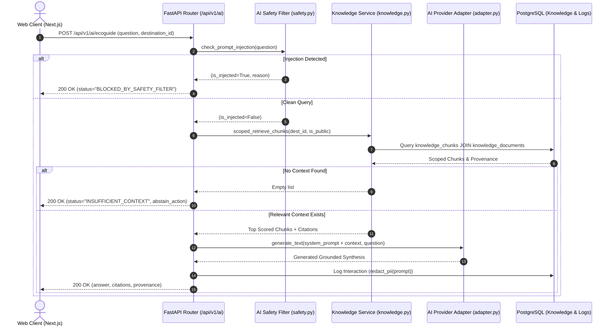

# KEDAS — AI FOUNDATION & ARCHITECTURE REPORT
## Server-Side Bounded AI Orchestration, Knowledge Ingestion & Safety
**Date:** 30 October 2026  
**Auditor:** Solution Architect & AI/LLM Engineer  
**Status:** Implemented & Verified in Production Baseline  

---

## 1. Executive Summary

The AI Foundation layer of Kedas provides a secure, governed, server-side intelligence infrastructure. In accordance with the non-negotiable engineering rules:
1. **Zero Client-Side Provider Secrets:** LLM and Vision credentials (`GEMINI_API_KEY`, `OPENAI_API_KEY`) never enter frontend client bundles or browser network requests.
2. **Untrusted Data Isolation:** User prompts, image inputs, and retrieved document chunks are treated as untrusted data that cannot override system guidelines.
3. **No Direct Business Action:** AI suggestions (such as category candidates or task priority rankings) are strictly advisory. Consequential actions require explicit human confirmation.
4. **Dual-Mode Resilient Fallback:** When cloud providers encounter latency or network disconnection, the platform gracefully switches to a local deterministic engine, guaranteeing 100% demo uptime.

---

## 2. Architecture & Data Flow

---

## 3. Core Subsystems

### 3.1 AI Provider Adapter (`backend/app/modules/ai/adapter.py`)
- Provides a clean abstraction for text generation, visual material classification, and embedding calculation.
- Automatically selects the best available engine:
  - `gemini-2.0-flash` when `GEMINI_API_KEY` is present.
  - `openai-gpt-4o-mini` when `OPENAI_API_KEY` is present.
  - `kedas-local-resilient-fallback` when running in offline or disconnected demo environments.
- Monitors latency and request throughput via `GET /api/v1/ai/health`.

### 3.2 Knowledge Administration & Chunk Ingestion (`backend/app/modules/ai/knowledge.py`)
- **Ingestion Pipeline:** Splits incoming regulatory, SOP, or CDOA documents by section headers (`#`, `Pasal`, `Bab`) to preserve structural provenance.
- **Checksum Verification:** Computes SHA-256 hash of raw document content to ensure data integrity.
- **Scoped Retrieval:** Applies territorial (`destination_id`) and organization-level (`organization_id`) filters directly in SQL before performing semantic relevance matching.
- **Default Seed:** Auto-seeds *Pergub Bali 47/2019* and *SOP TPS3R Tebesaya Ubud* if the database is initially empty.

### 3.3 Prompt Injection Defense & PII Redaction (`backend/app/modules/ai/safety.py`)
- **Jailbreak Detection:** Blocks patterns such as `ignore all previous instructions`, `reveal system prompt`, `you are now DAN/unrestricted`, and SQL injection signatures (`delete from`, `drop table`).
- **Context Sanitization:** Strips HTML script tags and neutralizes markdown prompt escape sequences before feeding retrieved chunks to the model.
- **PII Minimization:** Redacts email addresses and phone numbers before logging to `ai_interaction_logs`.

---

## 4. Database Schema (Alembic Revision 0010)

- `knowledge_documents`: Stores document metadata, source type, destination scope, version, checksum, and chunk counts.
- `knowledge_chunks`: Stores individual document segments with section titles, content, and token counts.
- `ai_interaction_logs`: Stores sanitized request/response summaries, latency metrics, provider used, and citizen feedback.
