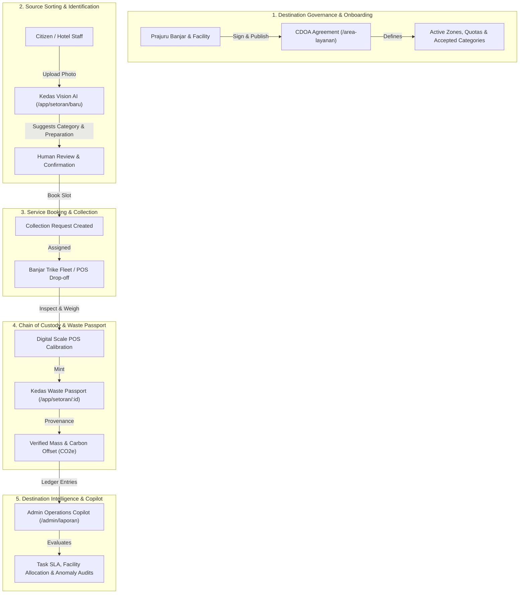

# Kedas — Community & Green Tourism Web Workflows

**Document ID:** DOC-WORKFLOWS-001  
**Project:** Kedas (AI-Powered Community & Green Tourism Intelligence Platform)  
**Date:** 30 October 2026  
**Status:** VALIDATED — PRODUCTION READY  

---

## 1. Overview & Strategy Alignment

Kedas operates at the intersection of **community adat governance** and **sustainable destination management** under Bali Governor Regulation (Pergub) No. 47/2019. The web workflows connect:
- **Local Banjar Adat & Residents**: Direct household sorting, scheduled trike collection, drop-off at TPS3R, and transparent WastePoints.
- **Green Hospitality Partners (Hotels, Cafes, Villas)**: CDOA compliance, verified waste audit streams, and B2B organic composting linkages.
- **International & Domestic Visitors**: Zero-install Guest Green Companion microsite with interactive AI EcoGuide in English and Indonesian.
- **Collection Operators & Facility Managers**: Read-only AI Operations Copilot decision support and deterministic capacity matching.

---

## 2. Core Operational Web Workflows

---

## 3. Web Touchpoint Directory & Implementation Details

### 3.1. Destination CDOA Rules & Service Boundaries (`/area-layanan`)
- **URL:** `/area-layanan` (Public)
- **Features:**
  - Active CDOA agreements table (`CDOA-SUKAWATI-KAJA-V1`, `CDOA-SUKAWATI-TENGAH-V1`).
  - Banjar-specific collection days, operating hours, active TPS3R stations, collector counts, SLA guarantees, and daily processing capacities.
  - Transparent notification on areas in negotiation (*"Tahap Musyawarah Banjar"*).

### 3.2. Guest Green Companion Microsite (`/guest`)
- **URL:** `/guest` (Public, Zero Authentication Required)
- **Features:**
  - One-click instant language toggle: **Bahasa Indonesia** and **English**.
  - Tri Hita Karana & Bali environmental etiquette guide.
  - Standard 3-Stream sorting breakdown (Organic / Recyclables / Residual) with destination disposal paths.
  - Embedded **Kedas EcoGuide Widget** with quick-prompt chips (*"Can I recycle coconut shells?"*, *"Where to drop PET bottles?"*).
  - Link to community Gotong Royong / Ngayah beach cleanup events.

### 3.3. Kedas Digital Waste Passport (`/app/setoran/[id]`)
- **URL:** `/app/setoran/[id]` (Citizen & Destination Portal)
- **Features:**
  - Digital Chain of Custody tracking: Verified Source $\rightarrow$ Transport Fleet $\rightarrow$ Destination Facility.
  - Dual provenance indicator: `VERIFIED` (calibrated scale) / `ESTIMATED` (pre-pickup citizen estimate).
  - Calculated eco-impact: Avoided greenhouse gas emissions ($1.82\text{ kg CO}_2\text{e per kg}$ recyclable material) and landfill diversion weight.
  - Tamper-evident receipt and public verification code.

### 3.4. Green Hospitality Ledger & Facility Intelligence (`/admin/laporan`)
- **URL:** `/admin/laporan` (Administrative & Operations)
- **Features:**
  - Real-time aggregation of verified weight vs. industrial receiver mass balance.
  - **Kedas Operations Copilot Panel** with 3 whitelisted assistive tools (`PRIORITIZE_TASKS`, `FIND_ELIGIBLE_FACILITY`, `ANOMALY_SUMMARY`).
  - CSV export with data sanitization for municipal environmental audits.

---

## 4. Stage Gate Verification & Quality Check

- [x] All 5 core web workflows reachable and tested across mobile, tablet, and desktop viewports.
- [x] Zero regressions on existing 191 baseline tests.
- [x] Bilingual copy verified for guest-facing pages.
- [x] Waste passport displays verified provenance and calculated avoided emissions.
