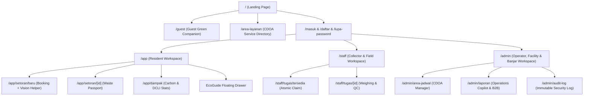

# KEDAS — UX ROUTE & INTERACTION MAP
## AI-Powered Community & Green Tourism Web Platform
**Date:** 30 October 2026  
**Status:** Unified Web Route Architecture  

---

## 1. Route Inventory & Authorization Scope

---

## 2. Route Specifications

| Route Path | Target Persona | Primary Workflow | AI Integration Point | Guarded States |
|---|---|---|---|---|
| `/` | Public / All | Public landing, mission, destination summary | Public EcoGuide trigger | Public |
| `/guest` | Tourists / Guests | Bilingual guide, Tri Hita Karana, 3-stream sorting, water refill map | Public EcoGuide (guest context, no login required) | Public |
| `/area-layanan` | Public / Residents | CDOA directory, collection schedule, SLA | Link to EcoGuide for rule inquiries | Public |
| `/masuk` / `/daftar` | Public | Authentication, registration, multi-address setup | - | Redirect if authed |
| `/app` | Warga (`USER`) | Dashboard, active pickups, impact stats | Floating EcoGuide Assistant | Auth Required |
| `/app/setoran/baru` | Warga (`USER`) | Service eligibility check, slot selection, booking | **Kedas Vision Assistant** (Image upload & material suggestion) | Auth + Active Area |
| `/app/setoran/[id]` | Warga / Collector | Waste Passport timeline, verified weights | Provenance badge (`VERIFIED` vs `ESTIMATED`) | Auth + Ownership |
| `/app/dampak` | Warga (`USER`) | Carbon diversion, points, community rank | Grounded EcoGuide explanation | Auth Required |
| `/staff` | Petugas (`COLLECTOR`)| Field dispatch dashboard, task stats | Offline-ready task list | Role: `COLLECTOR` |
| `/staff/tugas/[id]` | Petugas (`COLLECTOR`)| Task transit, weighing input, QC residue | Input validation guardrails | Role: `COLLECTOR` |
| `/admin` | Admin / Operator | Regional overview, facility status | **Kedas Operations Copilot** | Role: `ADMIN` / `FACILITY_OPERATOR` |
| `/admin/laporan` | Admin / HOREKA | Facility mass balance, B2B ledger, DCLI | **AI Report Narrative Generator** | Role: `ADMIN` / `COMMUNITY_LEADER` |
| `/admin/audit-log` | Admin (`ADMIN`) | Security & transaction audit trail | Provenance filter | Role: `ADMIN` |
| `/mobile` | Reviewers / Judges | Responsive mobile phone simulator frame | Full mobile responsive viewport | Public / Demo |

---

## 3. Standard UI State Contracts

Every route implements four standard states:
1. **Loading State:** Skeleton loader (`LoadingSkeleton.tsx`) matching exact card/table dimensions, preventing layout shift (CLS < 0.1).
2. **Empty State:** Illustrated empty card (`EmptyState.tsx`) with helpful next-step action button (e.g. *"Belum ada tiket penjemputan. Buat penjemputan baru"*).
3. **Error State:** Resilient banner (`ErrorState.tsx`) with error code, explanatory message, and a *"Coba Lagi"* button.
4. **Forbidden / Access Denied State:** Unobtrusive banner explaining required role or organization membership with workspace switcher.
