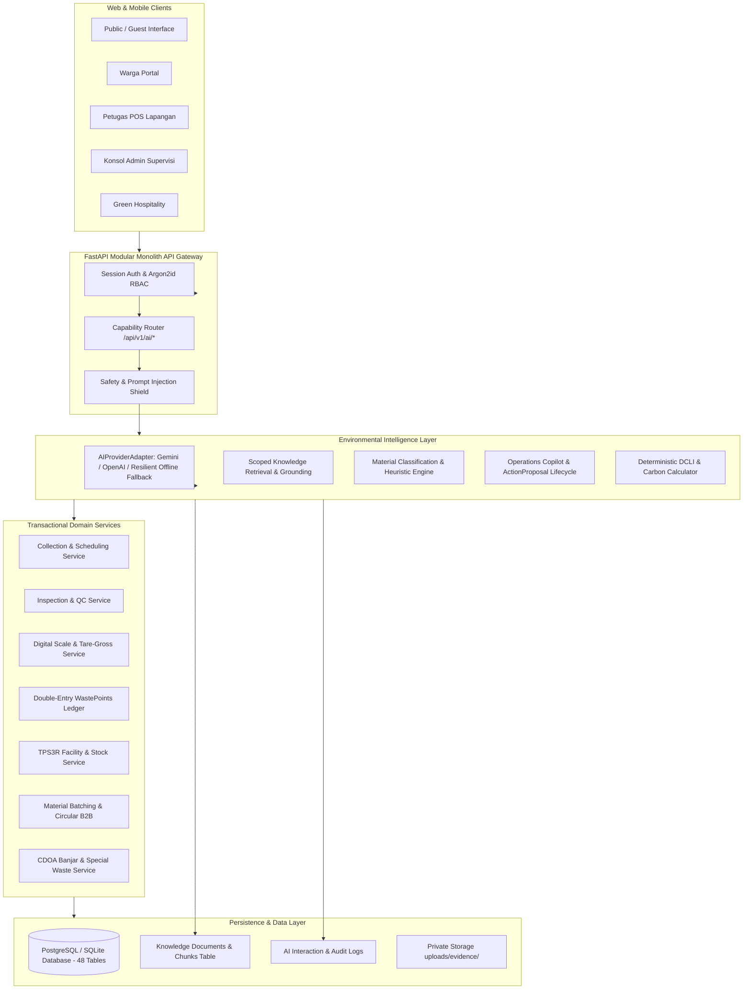

# Kedas AI — Backend & System Architecture

---

## 1. Prinsip Utama Arsitektur

1. **FastAPI Modular Monolith:** Semua layanan beroperasi dalam satu proses terpadu tanpa latensi RPC microservice yang berlebihan.
2. **PostgreSQL as Source of Truth:** Semua data transaksi material, saldo poin, dan verifikasi fisik tersimpan di database relasional berintegritas tinggi. Model AI tidak pernah menjadi pemegang kebenaran data transaksi.
3. **Dual-Mode Adapter:** Sistem siap beroperasi penuh secara online menggunakan Google Gemini 2.0 Flash atau OpenAI, dan otomatis beralih ke *Resilient Grounded Local Fallback* jika terjadi kendala koneksi eksternal.
4. **Deterministic Gatekeepers:** Perhitungan formula matematis (DCLI, reduksi emisi karbon IPCC, saldo poin) menggunakan kode deterministik Python tanpa melibatkan generasi teks LLM.
