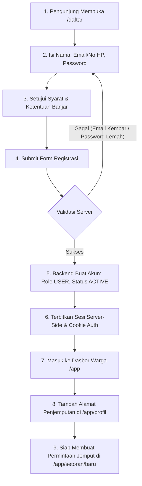
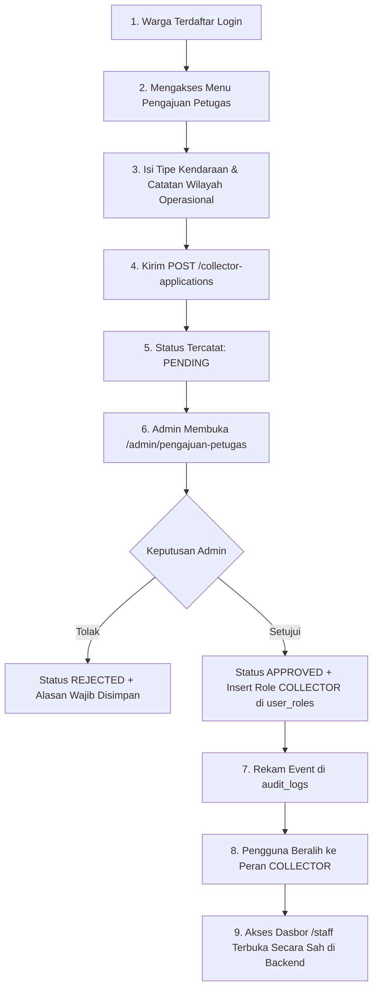

# 01. Peta Perjalanan Registrasi dan Autentikasi — Kedas

**Proyek**: Kedas  
**Tanggal**: 30 Oktober 2026  
**Auditor**: Identity & Access Management Engineer  
**Status**: As-Built Analysis

---

## 1. Peta Perjalanan Akun (Account Journeys)

### Journey A: Warga Baru (Citizen Signup to First Deposit)

- **Kondisi As-Built**: Berjalan penuh. Server-side rule menetapkan default role `USER` dan status `ACTIVE`.
- **Temuan Gap**: Form registrasi di client sempat memiliki fallback mock saat offline; penolakan duplikasi email kini diteruskan secara aman ke UI tanpa membocorkan data pengguna lain.

---

### Journey B: Calon Petugas Pengangkut Sampah (Collector Application & Approval)

- **Kondisi As-Built**: Backend API (`POST /collector-applications`, `POST /admin/collector-applications/{id}/review`) dan panel Admin (`/admin/pengajuan-petugas`) sudah terimplementasi dan teruji di `test_phase3_petugas_dispatch.py`.
- **Area Peningkatan UX**: Menyediakan form interaktif permohonan petugas langsung pada halaman profil warga `/app/profil` agar calon petugas tidak perlu mengakses API manual.

---

### Journey C: Mitra Daur Ulang & Pengolah Material (B2B Marketplace)
- **Alur**:
  1. Perwakilan mitra mendaftar dengan akun dasar.
  2. Profil mitra dan nomor izin usaha didaftarkan ke tabel `partners`.
  3. Administrator platform memverifikasi kelayakan izin usaha dan status aktif.
  4. Pengguna diberikan grant peran `PARTNER` dengan batasan akses ke penawaran batch di `/api/v1/marketplace/batches`.
- **Kondisi As-Built**: Diverifikasi via `test_phase5_marketplace_organic_and_b2b.py`. Akses pembelian material diblokir jika mitra belum berstatus terverifikasi.

---

### Journey D: Pengelola Fasilitas TPS3R & Bank Sampah
- **Alur**:
  1. Profil fasilitas TPS3R didaftarkan dalam tabel `facilities`.
  2. Operator ditugaskan oleh Admin melalui keanggotaan `facility_id` spesifik.
  3. Operator fasilitas hanya berwenang mencatat penerimaan sampah dan pemilahan pada fasilitas tempat ia bernaung.
- **Kondisi As-Built**: Diverifikasi via `test_phase4_facility_and_waste_bank.py`. Operator Fasilitas A diblokir saat mencoba mengubah stok Fasilitas B.

---

### Journey E: Admin & Role Privileged
- **Alur**:
  - Pendaftaran publik **dilarang keras** memberikan role `ADMIN` atau hak istimewa lainnya.
  - Role `ADMIN` hanya dapat diberikan melalui seed awal atau pemberian oleh Super Admin yang tercatat dalam `audit_logs`.
- **Kondisi As-Built**: Diverifikasi via `test_rbac_and_roles.py` dan `test_journey_2_permissions_idor.py`. Setiap percobaan injeksi payload role dari client publik secara tegas diabaikan oleh backend.
