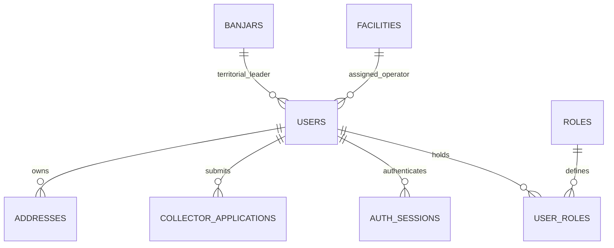

# 01. Matriks Peran, Organisasi, dan Izin Akses — Kedas

**Proyek**: Kedas  
**Tanggal**: 30 Oktober 2026  
**Auditor**: Identity & Access Management Engineer  
**Status**: As-Built Verification

---

## 1. Model Hubungan Pengguna, Peran, dan Organisasi

Sistem Kedas menerapkan model **Multi-Role Scoped RBAC**:
- Pengguna (`users`) memiliki satu preferred active role untuk konteks UI, namun backend selalu memeriksa tabel `user_roles` untuk setiap otorisasi request.
- Setiap grant role memiliki `verification_status` (`ACTIVE`, `PENDING`, `SUSPENDED`, `REVOKED`) dan jejak `granted_by`.
- Organisasi dan fasilitas (`facilities`, `banjars`, `partners`) membatasi scope data operasional.

---

## 2. Matriks Hak Akses & Kewenangan (Role vs Permission)

| Kode Peran | Scope Kewenangan | Izin Membaca (Read) | Izin Menulis / Mutasi (Write) | Aksi yang Dilarang Keras |
|---|---|---|---|---|
| **`USER`** | Data Milik Sendiri (`user_id`) | Profil sendiri, alamat sendiri, riwayat setoran & tiket timbang sendiri, saldo poin sendiri. | Buat permintaan pickup, batalkan pickup berstatus PENDING, perbarui alamat & profil. | Mengakses tugas petugas, melihat data warga lain, menyetujui timbangan, mengakses konsol admin. |
| **`COLLECTOR`** | Wilayah Layanan Tugas | Daftar tugas terbuka di wilayah tugas, detail penjemputan yang ditugaskan, riwayat kerja. | Klaim tugas atomik, input inspeksi kontaminasi, input berat timbangan lapangan, laporkan kendala. | Mengubah data di luar tugasnya, menyetujui penerimaan TPS3R, mengakses laporan admin global. |
| **`DISPATCHER`** | Area Layanan Armada | Seluruh tugas penjemputan dalam wilayah, status armada aktif, kapasitas slot. | Re-assign tugas ke petugas lain, verifikasi sengketa deviasi timbangan, pembaruan kuota slot. | Memanipulasi saldo uang nasabah bank sampah, menghapus log audit sistem. |
| **`FACILITY_OPERATOR`** | Fasilitas Spesifik (`facility_id`) | Manifest penerimaan sampah masuk fasilitas, stok inventaris terpilah, kapasitas gudang. | Konfirmasi serah-terima muatan, pemilahan material (sort), pencatatan residu TPA, buat batch daur ulang. | Mengubah data fasilitas lain, mengklaim tugas penjemputan warga di lapangan. |
| **`WASTE_BANK_STAFF`** | Bank Sampah Terdaftar | Rekening nasabah bank sampah, buku tabungan, riwayat setoran material, harga satuan. | Buka rekening nasabah, catat transaksi setoran, pembaruan saldo tabungan rupiah. | Mengubah poin promosi Kedas, mengakses data rahasia banjar di luar operasional bank sampah. |
| **`PARTNER`** | Akun Mitra Industri | Katalog batch material siap jual, riwayat penawaran dan pesanan daur ulang sendiri. | Ajukan penawaran harga beli batch, konfirmasi penerimaan material daur ulang. | Mengakses identitas warga pengumpul, memodifikasi stok inventaris fasilitas. |
| **`COMMUNITY_LEADER`** | Banjar Adat (`banjar_id`) | Dasbor analitik wilayah banjar, tonase sampah terpilah, tingkat kepatuhan krama, manifes upakara/B3. | Daftarkan aksi bersih lingkungan komunitas, eskalasi pengaduan warga. | Mengakses nomor kontak pribadi atau alamat personal warga tanpa izin paruman. |
| **`ADMIN`** | Seluruh Sistem | Seluruh data operasional, audit log, permohonan petugas, metrik eksekutif. | Setujui/tolak permohonan petugas, kelola kategori sampah, atur aturan poin, kelola izin mitra. | Menghapus log audit historis, melakukan mutasi tanpa rekaman aktor. |

---

## 3. Separation of Duties & Proteksi IDOR

1. **Pemisahan Timbangan Petugas vs Fasilitas**: Petugas di lapangan hanya mencatat estimasi awal; operator TPS3R mencatat penimbangan masuk resmi. Jika deviasi >5%, sistem menandai status `DISCREPANCY_FLAGGED` untuk investigasi.
2. **Pencegahan IDOR (Insecure Direct Object Reference)**:
   - Endpoint `/me/addresses/{id}` memverifikasi `address.user_id == current_user.id`.
   - Endpoint `/pickup-requests/{id}` memverifikasi kepemilikan sebelum menampilkan atau membatalkan data.
3. **Mekanisme Role Switch di Frontend**:
   - Pemilihan peran pada `WorkspaceSwitchBar` hanya mengubah konteks tampilan di antarmuka klien.
   - Setiap pemanggilan endpoint backend diverifikasi melalui dependensi `require_roles(...)` yang mengevaluasi grant nyata di database.
