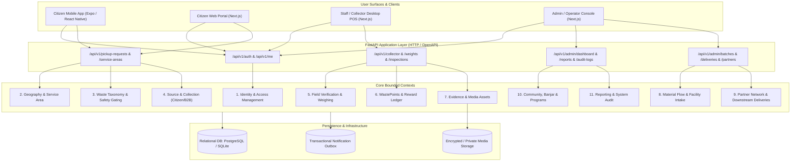
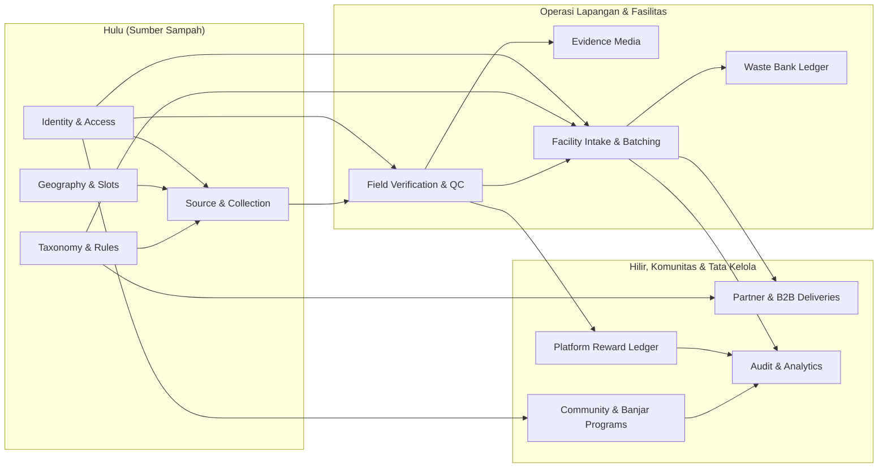

# WasteLink Bali — Bounded Contexts & Architecture Design (Tahap 1)

**Tanggal:** 30 Oktober 2026  
**Status:** Disahkan untuk Ekosistem 12 Kelompok

---

## 1. Arsitektur Tingkat Tinggi (Modular Monolith)

Sistem WasteLink Bali dirancang sebagai **Modular Monolith** terpadu. Pendekatan ini dipilih guna menghindari kompleksitas operasional microservices, namun tetap menjaga isolasi domain yang ketat antar-modul, integritas transaksi database lokal, dan kesederhanaan deployment untuk pilot wilayah Banjar Sukawati, Bali.

---

## 2. Bounded Context & Ownership Matrix

Sesuai arahan `perancangan_lanjutan_wastelink_bali.md`, setiap domain context memiliki tanggung jawab model data, aturan invariant, dan hak akses yang jelas:

### Rincian Tanggung Jawab Modul:

1. **Identity & Access Management (IAM)**:
   - *Entitas Inti*: `User`, `Role`, `UserRole`, `Session`, `CollectorApplication`.
   - *Tanggung Jawab*: Otentikasi token sesi aman (SHA-256), verifikasi status akun (`ACTIVE`, `SUSPENDED`), penegakan otorisasi server-side.
   - *Invariant*: Tidak ada privilege escalation dari payload profil klien.

2. **Geography & Service Configuration**:
   - *Entitas Inti*: `ServiceArea`, `CollectionSlot`, `Address`.
   - *Tanggung Jawab*: Batas administrasi banjar/desa, konfigurasi slot penjemputan harian (zona waktu WITA), validasi kapasitas trike.
   - *Invariant*: Alamat warga hanya dapat dibuat pada wilayah layanan yang aktif.

3. **Waste Taxonomy & Safety Gating**:
   - *Entitas Inti*: `WasteCategory`, `MaterialAcceptanceRule`.
   - *Tanggung Jawab*: Klasifikasi 4 makro (`ORGANIK`, `ANORGANIK`, `RESIDU`, `B3_SPESIFIK`), panduan pemilahan lokal, pencegahan percampuran B3.
   - *Invariant*: Limbah B3 tidak boleh diangkut oleh armada trike harian biasa.

4. **Source & Collection (Citizen & B2B)**:
   - *Entitas Inti*: `PickupRequest`, `PickupStatusEvent`.
   - *Tanggung Jawab*: Pembuatan tiket setoran warga / lokasi usaha, pemesanan slot kuota atomik, riwayat status transisi.
   - *Invariant*: Kuota slot dikurangi secara atomik; pembatalan mengembalikan kuota secara aman.

5. **Field Verification & Weighing**:
   - *Entitas Inti*: `Inspection`, `WeightRecord`.
   - *Tanggung Jawab*: Inspeksi kebersihan QC (Grade A/B/C/D), pencatatan timbangan tara & bruto, versi timbangan imutabel (`SUPERSEDED`).
   - *Invariant*: $\text{Net Weight} = \text{Gross Weight} - \text{Tare Weight}$; bobot tara tidak boleh melebihi atau sama dengan bobot bruto.

6. **WastePoints & Reward Ledger**:
   - *Entitas Inti*: `RewardRule`, `PointLedger`.
   - *Tanggung Jawab*: Perhitungan poin server-side setelah verifikasi timbang sah, buku besar saldo *append-only*.
   - *Invariant*: Poin tidak pernah dihitung oleh klien; koreksi dilakukan via transaksi *reversal* ber-audit trail.

7. **Evidence & Media Storage**:
   - *Entitas Inti*: `EvidenceAsset`.
   - *Tanggung Jawab*: Penyimpanan foto layar timbangan digital, kondisi pemilahan, dan surat jalan mitra secara privat.
   - *Invariant*: Berkas privat diakses melalui URL bertanda tangan atau endpoint terotorisasi.

8. **Material Flow & Facility Intake (TPS3R / TPST)**:
   - *Entitas Inti*: `FacilityReceipt`, `MaterialBatch`, `StockMovement`.
   - *Tanggung Jawab*: Rekonsiliasi penerimaan material pos timbang fasilitas TPS3R, pembentukan lot/batch daur ulang, pencatatan residu.
   - *Invariant*: Setiap batch harus memiliki riwayat sumber yang dapat ditelusuri; massa batch turunan tidak boleh melebihi input.

9. **Partner Network & Downstream Deliveries**:
   - *Entitas Inti*: `Partner`, `Delivery`, `DeliveryReceipt`.
   - *Tanggung Jawab*: Penyaluran material ke pengepul/pabrik daur ulang, pencatatan surat jalan, deteksi selisih timbang pabrik (`DISPUTED`).
   - *Invariant*: Klaim "didaur ulang" hanya sah jika didukung tanda terima pemrosesan mitra hilir terverifikasi.

10. **Community, Banjar & Programs**:
    - *Entitas Inti*: `CommunityEvent`, `ProgramFunding`, `AssistanceRequest`.
    - *Tanggung Jawab*: Koordinasi jadwal gotong royong banjar, aksi bersih pantai/sungai, pelaporan tumpukan sampah liar, alokasi CSR.
    - *Invariant*: Anggaran CSR dibatasi pagu (*budget cap*); kegiatan relawan dipisahkan dari metrik penjemputan rutin.

11. **Reporting, Outbox & System Audit**:
    - *Entitas Inti*: `AuditLog`, `NotificationOutbox`.
    - *Tanggung Jawab*: Catatan penelusuran operasi sensitif imutabel, pengiriman notifikasi terjamin (*at-least-once delivery*), ekspor metrik tersanitasi.
    - *Invariant*: Audit log bersifat *read-only*; seluruh angka laporan dapat ditelusuri ke query sumber.

---

## 3. Strategi Transaksi & Integritas Data

1. **Konsistensi Transaksional**: Operasi kritis seperti `(Timbang Sah + Terbitkan WastePoints + Update Status Tiket)` dieksekusi dalam satu transaksi database atomik (*ACID*).
2. **Pencegahan Kontensi Bersamaan**: Klaim tugas petugas menggunakan *row-level locking* (`SELECT ... FOR UPDATE`), mengembalikan HTTP 409 Conflict bila tugas telah diambil petugas lain.
3. **Penyimpanan Waktu UTC & Tampilan WITA**: Database menyimpan semua timestamp dalam format UTC ISO-8601 (`created_at`, `updated_at`). Lapisan presentasi memformat waktu ke WITA (`Asia/Makassar`) untuk kenyamanan warga dan petugas di Bali.
