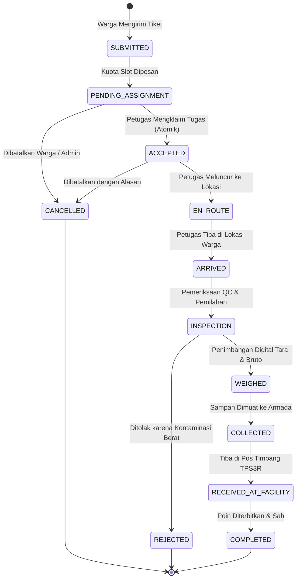

# WasteLink Bali — Data Contracts, Schema Invariants & Migration Plan (Tahap 1)

**Tanggal:** 30 Oktober 2026  
**Status:** Disahkan untuk Standar Teknis Platform

---

## 1. Standar Amplop Respons & Kesalahan API (API Contract Envelope)

Seluruh pemanggilan endpoint HTTP pada backend WasteLink Bali (`/api/v1/*`) menggunakan format kontrak standar yang konsisten di Web maupun Mobile:

### A. Format Respons Berhasil (Success Envelope)
```json
{
  "data": { ... },
  "meta": {
    "page": 1,
    "page_size": 20,
    "total_items": 48,
    "total_pages": 3,
    "timezone": "Asia/Makassar (WITA)"
  }
}
```
*(Catatan: Untuk endpoint entitas tunggal atau detail, payload data dikembalikan langsung sesuai schema Pydantic).*

### B. Format Respons Kesalahan Standar (Standard Error Envelope)
```json
{
  "code": "INVALID_STATE_TRANSITION",
  "message": "Status tugas tidak dapat diubah langsung dari PENDING_ASSIGNMENT ke COMPLETED.",
  "request_id": "req_8f1b9c2a-714e-4e31-89d1-3e4b7b512019",
  "details": [
    {
      "field": "status",
      "issue": "Transisi memerlukan status perantara: ACCEPTED -> EN_ROUTE -> INSPECTION -> COLLECTED"
    }
  ]
}
```

### C. Pemetaan Kode Status HTTP Standar:
- `200 OK`: Pengambilan data atau pembaruan berhasil.
- `201 Created`: Pembuatan resource baru berhasil (misal: Pickup Request, Batch, Alamat).
- `204 No Content`: Penghapusan resource berhasil.
- `400 Bad Request`: Validasi bisnis gagal (misal: berat tara $\ge$ berat bruto).
- `401 Unauthorized`: Token sesi tidak ada atau telah kedaluwarsa.
- `403 Forbidden`: Hak akses ditolak (misal: IDOR alamat orang lain, akun suspended, atau collector belum diverifikasi).
- `404 Not Found`: Resource yang diminta tidak ditemukan di server.
- `409 Conflict`: Benturan status bersamaan (misal: kuota slot penuh, tugas telah diambil petugas lain).
- `422 Unprocessable Entity`: Validasi format payload JSON gagal (misal: tipe data salah, kategori B3 dilarang).
- `500 Internal Server Error`: Kesalahan server internal (tanpa membocorkan stack trace ke klien).

---

## 2. Standar Format Data & Parameter Kueri

1. **Pagination Standar**:
   - `page`: Nomor halaman (1-based, default `1`).
   - `page_size`: Jumlah item per halaman (default `20`, maksimum `100`).
2. **Filtering & Sorting**:
   - `status`: Filter berdasarkan enum status (misal: `status=PENDING_ASSIGNMENT`).
   - `service_area_id`: Filter berdasarkan wilayah kerja banjar.
   - `date_from` & `date_to`: Filter rentang waktu ISO-8601.
3. **Format Tanggal & Waktu**:
   - **Database & API JSON**: Wajib disimpan dan dikirim dalam format **UTC ISO-8601** (`YYYY-MM-DDTHH:mm:ss.sssZ`).
   - **Antarmuka Pengguna (UI Presentation)**: Wajib diformat ke zona waktu operasional Bali **WITA (Asia/Makassar, UTC+8)**.

---

## 3. State Machine Siklus Hidup Setoran (Pickup State Machine)



### Invariant Transisi:
- Transisi status hanya dapat dimajukan satu langkah oleh aktor yang memiliki kewenangan tugas terkait.
- Pembatalan (`CANCELLED`) pada status `PENDING_ASSIGNMENT` secara otomatis mengembalikan kuota slot penjemputan.
- Status `REJECTED` pada saat inspeksi memblokir pencatatan timbangan dan membatalkan penerbitan poin.

---

## 4. Rencana & Strategi Migrasi Database (Alembic)

1. **Prinsip Non-Destruktif**:
   - Dilarang keras menjalankan `DROP TABLE` atau menghapus kolom historis secara langsung pada database berjalan.
   - Setiap perubahan skema wajib menggunakan script migrasi Alembic (`backend/alembic/versions/`).
2. **Backward-Compatibility**:
   - Kolom baru wajib memiliki nilai bawaan (*default value*) atau didefinisikan sebagai *nullable* agar tidak memutus kode aplikasi lama.
   - Penggantian nama field dilakukan bertahap (tambah kolom baru &rarr; migrasi data &rarr; deprecate kolom lama).
3. **Indeks Performa & Kendala Integritas**:
   - Indeks unik (*Unique Constraint*) pada pasangan `(service_area_id, code)` dan `(pickup_id, version)` untuk penimbangan.
   - Indeks komposit pada `(reporter_user_id, status)` dan `(assigned_collector_id, status)` untuk efisiensi kueri antrean tugas.

---

## 5. Strategi Penyimpanan Media & Bukti Berkas

1. **Privasi Berkas (Private-by-Default)**:
   - Foto kondisi sampah, layar timbangan, dan surat jalan tidak boleh disimpan dalam bucket publik tanpa proteksi.
   - Pengunduhan berkas wajib melalui endpoint `/api/v1/evidence/{id}/download` yang memverifikasi kepemilikan dan hak akses aktor.
2. **Verifikasi Integritas & Keamanan Upload**:
   - Ukuran berkas maksimum: **10 MB**.
   - Validasi MIME type: `image/jpeg`, `image/png`, `image/webp`, `application/pdf`.
   - Pencegahan *Path Traversal*: Nama berkas disimpan menggunakan hash SHA-256 unik yang dihasilkan sistem.
   - Penyimpanan dalam database hanya menyimpan metadata (`storage_key`, `mime_type`, `file_size_bytes`, `sha256_hash`), bukan payload Base64 raksasa.
