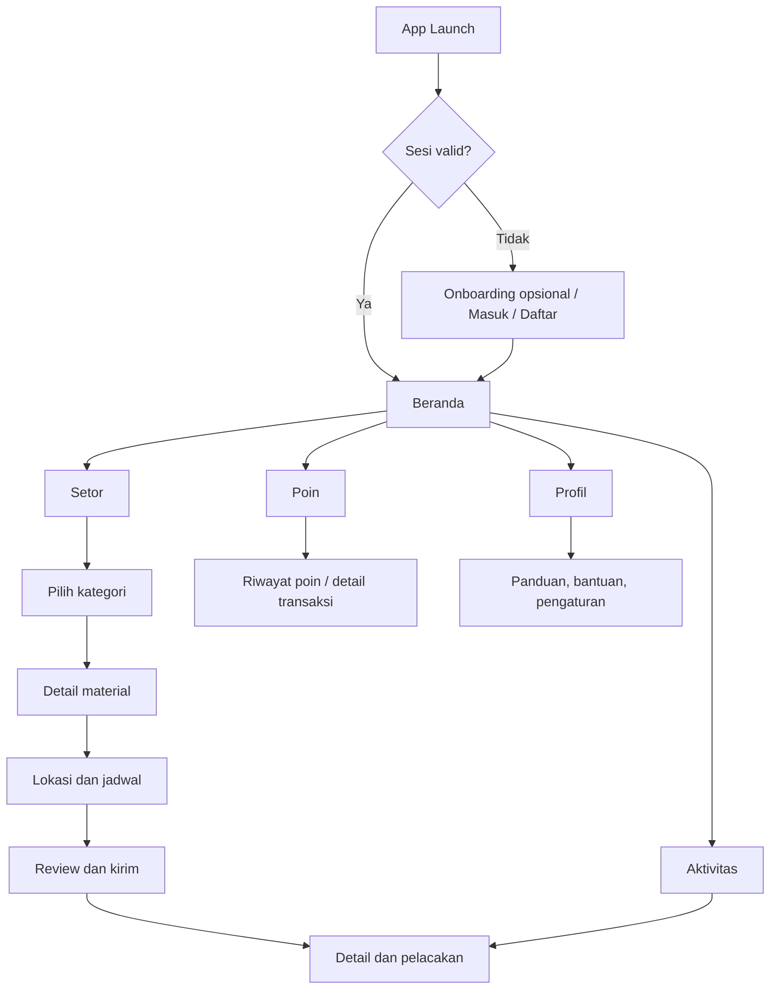
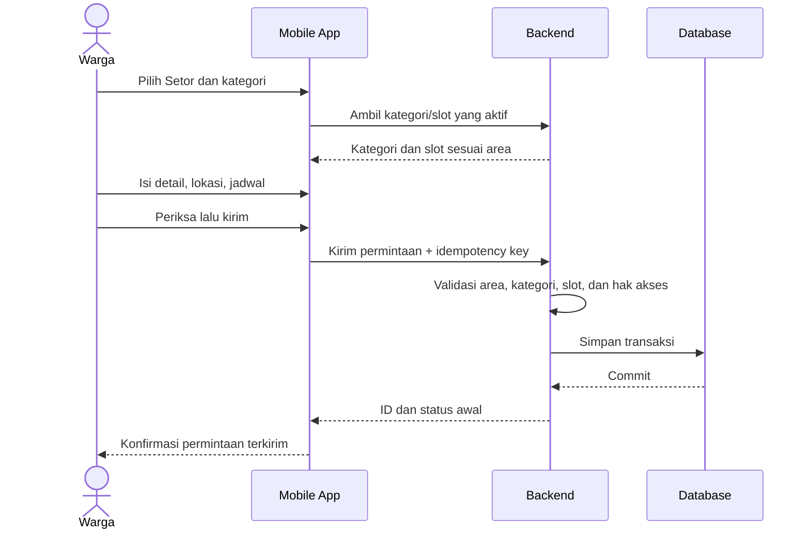
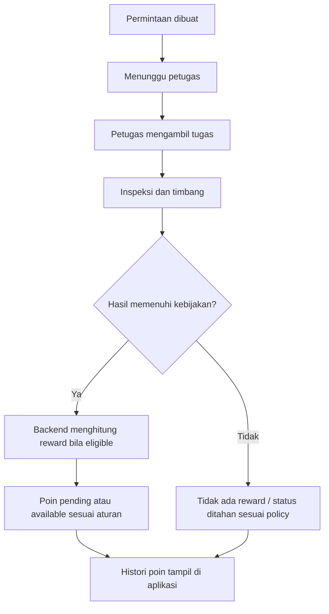

# WasteLink Bali — Mobile App UI Design Specification

> **Nama file:** `designapps.md`  
> **Jenis dokumen:** UI/UX Design Specification — Mobile App  
> **Versi:** 1.0  
> **Status:** Draft desain untuk MVP/hackathon  
> **Tanggal:** 29 Oktober 2026  
> **Dokumen acuan:** `PRD_WasteLink_Bali.md`, `HRD_WasteLink_Bali.md`, `SDD_WasteLink_Bali.md`, `SRS_WasteLink_Bali.md`, `designweb.md`  
> **Target pengguna aplikasi:** User/Warga saja  
> **Bahasa antarmuka:** Bahasa Indonesia

---

## Daftar Isi

1. Tujuan dan Ruang Lingkup
2. Hubungan dengan Desain Web dan Perubahan Scope
3. Prinsip Desain Aplikasi
4. Persona dan Konteks Penggunaan
5. Arah Visual dan Design Tokens
6. Navigasi dan Information Architecture
7. Onboarding, Login, dan Registrasi
8. Beranda User
9. Membuat Setoran Sampah
10. Pelacakan dan Detail Setoran
11. Riwayat Aktivitas
12. WastePoints dan Benefit
13. Panduan Pemilahan
14. Dampak Pribadi
15. Notifikasi, Bantuan, dan Komplain
16. Profil dan Pengaturan
17. Sistem Status dan Microcopy
18. Form, Validasi, dan Feedback
19. Network, Permission, dan Gangguan
20. Aksesibilitas dan Gestur
21. Privasi dan Keamanan
22. Komponen UI Aplikasi
23. Rekomendasi Arsitektur Navigasi dan Route
24. Spesifikasi Alur Utama
25. Acceptance Checklist
26. Traceability ke PRD/HRD/SDD/SRS
27. Keputusan Terbuka dan Catatan Perubahan

---

## 1. Tujuan dan Ruang Lingkup

Dokumen ini menetapkan desain pengalaman **aplikasi mobile khusus User/Warga** WasteLink Bali. Aplikasi membantu warga memilah sampah, mengirim permintaan setoran/penjemputan, memantau status, melihat hasil penimbangan, serta memahami WastePoints dan panduan pengelolaan sampah.

Aplikasi adalah permukaan produk kedua bagi User/Warga. Warga dapat memakai web maupun aplikasi mobile. Data akun, setoran, status, berat final, poin, dan histori harus konsisten pada kedua permukaan tersebut karena keduanya memakai backend dan aturan bisnis yang sama.

### 1.1 Termasuk dalam desain

- Android sebagai target pengalaman awal, dengan prinsip desain yang tetap mendukung iOS.
- Beranda User, buat setoran, daftar/detail setoran, status penjemputan, WastePoints, panduan, dampak, notifikasi, bantuan/komplain, profil, dan pengaturan.
- Form mobile yang nyaman dipakai dengan satu tangan, keyboard yang tepat, serta pilihan jadwal dan lokasi yang jelas.
- Loading, empty, offline, error, retry, permission, serta status transaksi.
- Penggunaan kamera/galeri/lokasi/notifikasi hanya saat dibutuhkan dan dengan penjelasan yang jelas.

### 1.2 Tidak termasuk dalam desain

- Aplikasi mobile Admin.
- Aplikasi mobile Petugas Sampah/Collector.
- Form timbang dan workflow operasional Petugas.
- Pengelolaan kategori, reward rule, keuangan, mitra, batch, laporan admin, audit, dan ekspor.
- Penentuan nilai reward, harga material, kapasitas pickup, atau persyaratan operasional final.

**Aturan produk:** Admin dan Petugas Sampah hanya menjalankan pekerjaan operasional melalui **Staff Web pada komputer pos operasional/pos penjagaan TPU sesuai model yang disepakati**. Aplikasi ini tidak menyediakan tab, tombol, halaman, atau mode tugas Petugas.

### 1.3 Tujuan pengalaman

- Warga dapat membuat permintaan dengan jelas tanpa memahami istilah teknis pengolahan sampah.
- Pengguna tahu kapan harus menyiapkan setoran dan apa yang terjadi setelah petugas datang.
- Status poin tidak membingungkan pengguna dengan janji uang tunai.
- Alur penjemputan organik mengikuti slot dan kapasitas fasilitas yang benar-benar tersedia.
- Layanan tetap jujur ketika jaringan, jadwal, mitra, atau fitur belum tersedia.

---

## 2. Hubungan dengan Desain Web dan Perubahan Scope

### 2.1 Dua permukaan untuk User/Warga

| Fitur | User Web | User Mobile App |
|---|---|---|
| Membuat setoran | Ya | Ya |
| Melacak status dan histori | Ya | Ya |
| Melihat WastePoints | Ya | Ya |
| Panduan pemilahan | Ya | Ya |
| Notifikasi | In-app; kanal lain jika aktif | In-app; push jika diizinkan dan provider aktif |
| Profil dan bantuan | Ya | Ya |
| Administrasi sistem | Tidak | Tidak |
| Menjalankan tugas Petugas | Tidak dalam workspace User | Tidak |
| Menimbang dan mengunggah bukti sebagai Petugas | Tidak | Tidak |

Ketersediaan fitur pada kedua permukaan harus mengikuti release feature set. Jika fitur redemption, peta, push notification, atau analisis dampak belum aktif, jangan menampilkan interaksi seolah-olah sudah bekerja.

### 2.2 Konsistensi backend

- Aplikasi mobile menggunakan API dan sumber data domain yang sama dengan web.
- Status setoran, perhitungan poin, validasi slot, dan permission diputuskan oleh backend.
- Aplikasi tidak boleh menghitung atau menerbitkan poin sebagai sumber kebenaran.
- Jika user mengubah setoran di web, aplikasi perlu memperbarui data dari server ketika layar dibuka, saat pull-to-refresh, atau setelah notifikasi relevan.

### 2.3 Catatan keselarasan SDD/SRS

Dokumen awal menyebut web responsif sebagai antarmuka awal dan mengutamakan operasi melalui web. Dengan ditambahkannya aplikasi mobile khusus User, proyek memperoleh **permukaan klien baru**. Sebelum implementasi final, owner perlu memperbarui keputusan arsitektur/lingkup di SDD serta kebutuhan antarmuka pada SRS agar mencakup build aplikasi, distribusi, pengelolaan versi, push notification jika dipakai, deep link, dan pengujian Android/iOS.

Penambahan ini tidak mengubah prinsip bahwa transaksi harus dikonfirmasi server dan workflow Petugas tetap web-only.

---

## 3. Prinsip Desain Aplikasi

### 3.1 Prinsip inti

1. **Satu tugas utama per layar.** Pada layar awal, utamakan aksi membuat setoran dan melihat permintaan aktif.
2. **Mobile-first, bukan sekadar web yang diperkecil.** Gunakan bottom navigation, form bertahap, kontrol yang nyaman disentuh, dan keyboard sesuai jenis input.
3. **Peka terhadap konteks.** Kategori, slot, lokasi, dan instruksi hanya ditampilkan saat relevan.
4. **Transparan terhadap proses.** “Permintaan terkirim”, “berat final”, dan “poin tersedia” adalah kondisi berbeda.
5. **Data yang dapat dipercaya.** Tidak membuat angka dampak, testimoni, hadiah, atau janji pickup yang tidak didukung data aktual.
6. **Lokal dan sederhana.** Gunakan foto material/lingkungan yang nyata bila tersedia; hindari dekorasi generik bertema teknologi hijau.
7. **Ramah koneksi lemah.** Tampilkan status sinkronisasi; jangan mengklaim transaksi tersimpan saat offline.
8. **Izin tepat waktu.** Minta akses lokasi, kamera, galeri, dan notifikasi hanya ketika manfaatnya relevan dan sudah dijelaskan.
9. **Tidak memaksa AI.** Saran klasifikasi boleh membantu, tetapi user harus dapat mengoreksi pilihan.
10. **Privasi sebagai default.** Alamat dan foto setoran bukan konten publik.

### 3.2 Prinsip anti-AI slop

Jangan menggunakan:
- Hero gradient ungu/hijau, glassmorphism, blur dekoratif, atau orb 3D yang tidak membantu tugas.
- Banyak kartu putih identik dengan ikon besar dan angka dummy.
- Ilustrasi AI yang menggambarkan fasilitas, petugas, atau bukti operasional yang tidak nyata.
- Copy abstrak seperti “Let’s make the planet better” yang tidak menerangkan langkah konkret.
- Animasi konfeti berlebihan setelah setiap aksi.
- Gamifikasi berupa leaderboard volume sampah yang mendorong pengguna mengirim material lebih banyak tanpa kontrol kualitas.
- Push notification promosi yang terlalu sering.

Gunakan layout tenang, heading spesifik, warna terbatas, komponen konsisten, dan feedback fungsional.

---

## 4. Persona dan Konteks Penggunaan

### 4.1 Warga yang rutin menyetor

- Ingin mengulang setoran dengan cepat.
- Membutuhkan histori, jadwal, dan status yang mudah ditemukan.
- Membutuhkan konfirmasi ketika poin tersedia.

### 4.2 Warga baru

- Belum yakin material masuk kategori apa.
- Membutuhkan panduan singkat dan contoh diterima/tidak diterima.
- Tidak seharusnya dipaksa mengisi estimasi berat yang tidak diketahui.

### 4.3 Warga dengan akses digital terbatas

- Mungkin menggunakan ponsel dengan layar kecil atau koneksi yang tidak stabil.
- Membutuhkan label jelas, target sentuh besar, form pendek, dan error yang menjelaskan cara melanjutkan.
- Tidak boleh bergantung pada hover, gestur kompleks, atau informasi yang hanya muncul melalui animasi.

### 4.4 Konteks lapangan

Pengguna dapat membuat permintaan dari rumah, lingkungan, atau lokasi setoran. Lokasi yang dipakai harus dikonfirmasi secara eksplisit sebelum dikirim. Aplikasi tidak perlu melacak lokasi secara terus-menerus.

---

## 5. Arah Visual dan Design Tokens

Aplikasi berbagi bahasa visual dengan `designweb.md`, tetapi menerapkan ukuran, navigasi, dan target sentuh yang sesuai mobile.

### 5.1 Palet warna

| Token | Nilai | Penggunaan |
|---|---|---|
| Brand utama | `#2F6552` | Tombol utama, status navigasi aktif |
| Brand gelap | `#1D3F35` | Heading, identitas, kontras kuat |
| Brand lembut | `#E8F0E9` | Permukaan kategori/seleksi |
| Latar | `#F6F6F1` | Latar halaman |
| Permukaan | `#FFFFFF` | Form, sheet, konten utama |
| Teks utama | `#1E2A25` | Konten utama |
| Teks sekunder | `#5D6B63` | Keterangan |
| Border | `#DCE3DD` | Pemisah dan field |
| Warning | `#98631C` | Slot terbatas, butuh perhatian |
| Warning background | `#FFF4D9` | Latar warning |
| Danger | `#A43F35` | Error, penolakan |
| Danger background | `#FBEAE7` | Latar error |
| Info | `#315F86` | Informasi |
| Info background | `#EAF2F9` | Latar informasi |
| Success | `#276749` | Konfirmasi/status berhasil |
| Success background | `#E7F4EA` | Latar berhasil |

Tidak ada kebutuhan memakai gradien. Warna status selalu ditemani teks yang jelas.

### 5.2 Tipografi

- Gunakan Inter atau font sans-serif platform yang mudah dibaca.
- Body utama 16 px / setara ukuran sistem; caption penting tidak boleh terlalu kecil.
- Judul layar 24–28 sp, section title 18–20 sp, label 14–16 sp.
- Hormati pengaturan dynamic type/font scaling; layout harus tetap berfungsi saat teks diperbesar.
- Gunakan angka tabular untuk saldo dan berat bila font mendukung.

### 5.3 Ukuran, spacing, dan radius

- Sistem spacing 4/8/12/16/24/32 px.
- Target sentuh utama minimal 44×44 pt/dp sebagai baseline desain.
- Tombol primer umumnya tinggi 48–52 dp.
- Input tinggi 48–52 dp.
- Card dengan radius 12–16 dp; bottom sheet memakai radius atas 20 dp jika sesuai sistem platform.
- Padding horizontal halaman 16–20 dp pada ponsel; lebih lebar pada tablet.
- Hindari shadow tebal; pemisahan dapat memakai surface dan divider.

### 5.4 Ikon dan ilustrasi

- Satu keluarga ikon line (misalnya Lucide atau ikon platform yang konsisten).
- Kategori sampah menggunakan ikon sederhana yang dapat dipahami tanpa warna.
- Foto material membantu mengenali benda; foto harus nyata dan memiliki label singkat.
- Jangan gunakan emoji sebagai satu-satunya identitas kategori.
- Foto yang dikirim oleh user dibedakan jelas dari foto panduan resmi.

---

## 6. Navigasi dan Information Architecture

### 6.1 Bottom navigation

Gunakan lima item tetap:

1. **Beranda** — ringkasan dan permintaan aktif.
2. **Setor** — mulai membuat setoran; tampil sebagai aksi utama yang paling mudah ditemukan.
3. **Aktivitas** — daftar dan histori setoran.
4. **Poin** — saldo dan histori WastePoints.
5. **Profil** — data akun, pengaturan, bantuan, dan privasi.

Item yang dipilih mempunyai label dan indikator visual; jangan mengandalkan ikon saja. Jika desain platform mengharuskan lima item ditata rata, “Setor” tetap dibedakan melalui warna atau treatment yang tidak mengganggu konsistensi.

### 6.2 Struktur halaman

### 6.3 Navigasi sekunder

Halaman bantuan, panduan, detail aktivitas, pengaturan notifikasi, kebijakan privasi, dan detail profil dibuka sebagai halaman stack. Tombol kembali mengikuti pola platform dan tidak menghapus form secara tidak sengaja.

### 6.4 Akses ke fitur yang belum aktif

- Tidak menampilkan tab mati atau halaman kosong tanpa penjelasan.
- Bila fitur perlu diperkenalkan tetapi belum aktif, tampilkan status nonaktif dengan sebab dan tautan bantuan jika relevan.
- Fitur redemption voucher hanya tampil ketika katalog, aturan, inventori, dan endpoint redemption aktif.

---

## 7. Onboarding, Login, dan Registrasi

### 7.1 App launch / splash

- Gunakan wordmark sederhana dengan latar brand/canvas.
- Animasi singkat boleh digunakan hanya untuk transisi; jangan membuat splash lama.
- Setelah sesi diperiksa, arahkan langsung ke Beranda atau layar Masuk.
- Kegagalan jaringan tidak boleh membuat aplikasi stuck pada splash; tampilkan error dan tindakan coba lagi.

### 7.2 Onboarding

Onboarding maksimal tiga layar dan dapat dilewati. Tujuannya hanya menjelaskan:
1. Pilah material dengan panduan lokal.
2. Buat permintaan setoran sesuai slot area.
3. Pantau penjemputan dan hasil verifikasi.

Jangan meminta izin lokasi/kamera/notifikasi di tengah onboarding hanya untuk mengejar opt-in. Izin diminta pada saat pengguna memakai fitur terkait.

### 7.3 Login

Elemen:
- Judul “Masuk ke WasteLink”.
- Email/nomor telepon sesuai autentikasi yang benar-benar didukung.
- Password dengan opsi tampil/sembunyikan.
- Tombol “Masuk”.
- “Lupa password?” dan tautan daftar.
- Link bantuan.

Ketentuan:
- Keyboard yang sesuai field.
- Tampilkan error di dekat field; error autentikasi tidak membocorkan apakah akun tertentu terdaftar.
- Setelah login berhasil, sesi dikonfirmasi server sebelum Beranda tampil sebagai terautentikasi.
- Gunakan autofill/password manager standar bila didukung.

### 7.4 Registrasi

- Tampilkan hanya field minimum yang dibutuhkan kebijakan akun.
- Email/nomor telepon dan password mempunyai validasi format yang jelas.
- Checkbox persetujuan kebijakan/ketentuan hanya jika benar-benar diperlukan dan ada tautan dokumen.
- Pertahankan field valid saat error.
- Jelaskan langkah verifikasi akun bila ada; jangan menyebut akun aktif sebelum konfirmasi.

### 7.5 Sesi dan logout

- Profil menyediakan tindakan keluar dengan konfirmasi hanya bila ada perubahan form yang belum disimpan.
- Sesi kedaluwarsa menampilkan dialog yang jelas dan melanjutkan pengguna ke login.
- Data cache sensitif harus dibatasi/dibersihkan sesuai kebijakan keamanan.

---

## 8. Beranda User

### 8.1 Tujuan

Beranda memberi akses cepat ke setoran baru dan menunjukkan status terbaru dari aktivitas yang sedang berlangsung.

### 8.2 Susunan konten

1. Header ringkas: “WasteLink” dan akses notifikasi/profil yang jelas.
2. Greeting singkat jika nama pengguna tersedia: “Selamat pagi” atau “Halo”. Tidak perlu mengulang nama di setiap komponen.
3. Informasi area layanan yang aktif atau selector area bila pengguna memiliki pilihan area resmi.
4. CTA utama **Setor sampah**.
5. Kartu permintaan aktif jika ada: status, jadwal, kategori, pembaruan terakhir, tombol “Lacak”.
6. Ringkasan WastePoints: poin tersedia dan poin tertunda dipisahkan, tautan “Lihat poin”.
7. Panduan cepat: kategori/hal yang sering dibutuhkan dan tautan “Lihat semua panduan”.
8. Aktivitas terbaru dalam jumlah terbatas.

### 8.3 Jika belum ada setoran

Tampilkan empty state singkat:

> **Belum ada setoran**  
> Pilih jenis sampah yang ingin disetor dan periksa jadwal yang tersedia di area Anda.

CTA: **Mulai setoran**.

Jangan menampilkan grafik kosong, angka 0 besar di setiap kartu, atau ilustrasi generik yang memenuhi layar.

### 8.4 Jika permintaan aktif ada

- Hanya satu ringkasan utama untuk permintaan yang paling membutuhkan perhatian.
- Bila beberapa permintaan aktif, tampilkan jumlah dan tautan “Lihat aktivitas”.
- Informasi terbaru selalu mengambil sumber dari server.
- Tampilkan waktu pembaruan yang relevan, bukan perkiraan ETA jika backend belum menghasilkannya.

### 8.5 Refresh

- Pull-to-refresh dapat dipakai di Beranda dan Aktivitas.
- Tampilkan indikator refresh yang tidak menutupi semua konten.
- Jika gagal, pertahankan data terakhir dengan label “Data terakhir diperbarui …” dan pesan kegagalan singkat.

---

## 9. Membuat Setoran Sampah

### 9.1 Prinsip flow

Buat setoran menjadi flow bertahap, dengan satu keputusan utama setiap layar. Tampilkan progres langkah, tombol Kembali, dan tombol Lanjut. Ringkasan data harus tetap ada saat pengguna kembali ke langkah sebelumnya.

Flow baseline:

1. Pilih kategori.
2. Isi detail material.
3. Tentukan lokasi dan jadwal.
4. Periksa ringkasan.
5. Kirim dan tampilkan konfirmasi server.

Jangan menggunakan lima layar hanya untuk memecah field sederhana; gabungkan field yang saling berkaitan jika usability test menunjukkan lebih mudah.

### 9.2 Layar 1 — Pilih kategori

Kategori utama:

- **Organik** — sisa makanan/tumbuhan yang diterima fasilitas setempat.
- **Anorganik bernilai/daur ulang** — material yang diterima pada area dan spesifikasi tertentu.
- **Residu** — material yang tidak tersedia rute daur ulang/organik pada layanan aktif.
- **Limbah khusus** — item yang memerlukan penanganan/rute khusus.

Tiap opsi berisi:
- Nama kategori.
- Deskripsi satu baris.
- Ikon atau foto contoh.
- Penjelasan ringkas jenis yang diterima.

Aturan:
- Kategori harus berasal dari konfigurasi backend yang berlaku untuk area terkait.
- Jika kategori tidak tersedia di area, beri alasan dan cara alternatif.
- Jika pengguna memilih limbah khusus, periksa jalur resmi. Jangan meneruskan ke pickup standar tanpa layanan khusus yang aktif.
- AI classifier, bila ada, hanya memberi saran setelah foto/teks diberikan; pengguna harus dapat mengubah kategori.

### 9.3 Layar 2 — Detail material

Field ditentukan oleh kategori dan subkategori:
- Material/subkategori.
- Perkiraan jumlah atau berat (opsional jika tidak diketahui dan tidak diwajibkan).
- Kondisi/kebersihan bila relevan.
- Catatan singkat opsional.
- Foto opsional/wajib jika kebijakan kategori menetapkannya.

UX detail:
- Tampilkan satuan di dalam atau di samping field.
- Label perkiraan harus eksplisit: “Perkiraan berat (opsional)”.
- Jangan menjadikan foto sebagai persyaratan umum tanpa alasan operasional.
- Tampilkan panduan singkat saat field dipilih, bukan paragraf panjang.
- Beberapa item boleh diinput jika backend dan kebijakan mengizinkan; gunakan ringkasan item yang dapat diedit/dihapus dengan jelas.

### 9.4 Foto dari kamera atau galeri

- Minta izin kamera hanya ketika pengguna menekan “Ambil foto”.
- Sediakan “Pilih dari galeri” jika kebijakan mengizinkan.
- Berikan panduan sederhana: foto material harus terlihat jelas, tidak perlu memuat wajah, identitas, atau orang lain.
- Tampilkan preview dan tombol ganti/hapus sebelum submit.
- Progres upload dan hasil upload harus terlihat.
- Bila foto gagal terunggah, beri pilihan coba lagi atau lanjut tanpa foto jika foto opsional.
- Hapus metadata yang tidak dibutuhkan jika pipeline upload menerapkannya; jangan menampilkan informasi EXIF kepada pengguna.

### 9.5 Layar 3 — Lokasi dan jadwal

Field:
- Lokasi/alamat penjemputan.
- Detail alamat: banjar, nomor rumah, patokan, atau instruksi seperlunya.
- Pilihan titik peta bila peta aktif.
- Tanggal/slot yang benar-benar tersedia.
- Kontak/nomor alternatif hanya jika diperlukan dan sesuai kebijakan privasi.

Aturan lokasi:
- Permintaan lokasi sistem operasi hanya ketika pengguna memilih “Gunakan lokasi saat ini”.
- Pengguna selalu dapat mengisi atau memperbaiki alamat secara manual.
- Tampilkan titik/alamat yang dipilih sebelum pengguna melanjutkan.
- Jangan mengaktifkan background location tracking.

Aturan jadwal:
- Slot bersumber dari backend dan memperhitungkan area, kategori, kapasitas petugas, serta kemampuan fasilitas/mitra.
- Jadwal organik harus sesuai kapasitas dan jam penerimaan pengolah yang dikonfirmasi.
- Slot penuh/nonaktif tidak dapat dipilih.
- Jika slot berubah setelah dipilih, tampilkan pesan dan minta pengguna memilih ulang sebelum kirim.
- Jangan menjanjikan waktu kedatangan presisi jika sistem hanya menyimpan slot waktu.

### 9.6 Layar 4 — Ringkasan

Tampilkan:
- Kategori dan item.
- Kondisi dan perkiraan jumlah.
- Foto yang dilampirkan.
- Lokasi/patokan.
- Hari dan slot jadwal.
- Catatan.
- Pernyataan hasil timbang dan poin ditentukan setelah verifikasi.

CTA: **Kirim permintaan setoran**.

Setelah tombol ditekan:
- Tampilkan loading di tombol.
- Cegah submit ganda.
- Jika server mengonfirmasi, tampilkan nomor permintaan dan status awal.
- Jika timeout, periksa status request sebelum mengizinkan submit ulang.
- Jika gagal validasi server, tunjukkan field/slot yang harus diperbaiki tanpa menghapus seluruh form.

### 9.7 Layar konfirmasi setelah submit

Judul: “Permintaan setoran terkirim” hanya setelah server mengonfirmasi.

Tampilkan:
- ID permintaan.
- Status awal.
- Ringkasan slot dan alamat.
- Keterangan langkah berikutnya.
- CTA **Lacak setoran** dan tindakan sekunder kembali ke Beranda.

Jangan menggunakan confetti atau membuat pesan seolah petugas telah menerima tugas pada tahap permintaan baru dibuat.

### 9.8 Penanganan rute sampah khusus

Jika kategori khusus belum memiliki rute aktif:
- Hentikan alur pickup biasa sebelum submit.
- Jelaskan kategori tersebut memerlukan penanganan khusus.
- Tampilkan instruksi aman yang telah divalidasi dan kanal bantuan/mitra resmi bila tersedia.
- Jangan memberikan saran pemrosesan bahan berbahaya yang tidak sesuai SOP.

Untuk residu yang tidak dilayani di area tertentu, tampilkan layanan alternatif yang terkonfirmasi atau jelaskan bahwa permintaan belum bisa dibuat.

---

## 10. Pelacakan dan Detail Setoran

### 10.1 Header detail

Tampilkan:
- ID permintaan yang dapat disalin.
- Badge status.
- Tanggal dibuat dan slot penjemputan.
- Kategori utama.
- Tombol bantuan/komplain bila diperlukan.

### 10.2 Timeline

Timeline referensi:
1. Permintaan diterima / menunggu Petugas.
2. Petugas menerima tugas.
3. Penjadwalan terkonfirmasi.
4. Petugas menuju lokasi, jika tahap ini dipakai SOP.
5. Pemeriksaan dan penimbangan.
6. Selesai, perlu jadwal ulang, ditolak, atau dibatalkan.

- Hanya tahap yang benar-benar terjadi yang boleh ditandai selesai.
- Tanggal/jam ditampilkan dari event server dengan format lokal.
- Jika jadwal ulang, tampilkan alasannya dan CTA yang tersedia.
- “Penjemputan selesai” tidak boleh ditulis sebagai “sampah sudah didaur ulang”.

### 10.3 Detail item dan penimbangan

Sebelum timbang:
- Perkiraan jumlah/berat dari user tampil terpisah dan diberi label “Perkiraan”.

Setelah timbang tervalidasi:
- Tampilkan berat final per item dan total.
- Jika ada item yang ditolak sebagian, jelaskan item dan alasan yang relevan.
- Jika data sedang menunggu konfirmasi, tampilkan status tertunda.
- Jangan menampilkan nilai final yang belum dikonfirmasi backend.

### 10.4 Bukti penyelesaian

- Bukti hanya ditampilkan jika user berhak mengaksesnya.
- Berikan keterangan konteks dan waktu.
- Hindari menampilkan data personal pihak lain yang tidak diperlukan.
- Jika bukti tidak tersedia karena kegagalan upload, sampaikan sebagai informasi layanan, bukan menyalahkan user.

### 10.5 Aksi ubah jadwal dan batal

- Hanya tampil jika state dan policy backend mengizinkan.
- Tampilkan ringkasan sebelum konfirmasi.
- Jelaskan konsekuensi pembatalan atau perubahan jadwal.
- Setelah berhasil, render status baru dari server.
- Jika aksi sudah tidak diizinkan karena Petugas telah mengambil/memulai tugas, jelaskan dan arahkan ke bantuan bila tersedia.

---

## 11. Riwayat Aktivitas

### 11.1 Daftar aktivitas

Setiap item menampilkan:
- Kategori utama atau ringkasan item.
- Tanggal.
- Status terakhir.
- ID pendek.
- Berat final bila sudah terverifikasi.

Filter yang didukung:
- Semua.
- Aktif.
- Selesai.
- Perlu tindakan.

Filter tanggal/kategori lanjutan dapat ditambahkan bila diperlukan, tetapi jangan memenuhi header dengan banyak filter pada layar kecil.

### 11.2 Detail histori

- Aktivitas selesai tetap read-only untuk data final.
- Jika ada koreksi sah, tampilkan bahwa nilai dikoreksi dengan tanggal dan penjelasan yang boleh dilihat user.
- Pengguna dapat mengajukan komplain jika mekanisme tersebut tersedia.

### 11.3 Empty state

> **Belum ada aktivitas**  
> Setoran yang Anda buat akan muncul di sini setelah dikirim.

CTA: **Buat setoran**.

---

## 12. WastePoints dan Benefit

### 12.1 Ringkasan poin

Tampilkan dua angka terpisah:
- **Poin tersedia** — dapat digunakan sesuai program aktif.
- **Poin tertunda** — menunggu verifikasi, settlement, atau pemeriksaan.

Jangan tampilkan keduanya sebagai satu saldo total tanpa rincian. Jangan memakai simbol `Rp` untuk poin.

### 12.2 Histori ledger

Setiap transaksi menampilkan:
- Tanggal.
- Sumber, misalnya setoran atau kampanye.
- Perubahan poin (`+25 poin`, `−50 poin`).
- Status.
- Referensi setoran/penukaran bila tersedia.
- Alasan ringkas untuk reversal, expired, frozen, atau adjustment bila boleh ditampilkan.

### 12.3 Detail perolehan poin

- Tampilkan formula/rate yang berlaku jika kebijakan mengizinkan dan tersedia.
- Pisahkan perkiraan poin dan poin final.
- Jelaskan persyaratan verifikasi, berat, kualitas, dan settlement.
- Bila poin tidak diberikan, tampilkan alasan yang telah ditentukan sistem dan tautan bantuan bila sesuai.
- Jangan mengubah saldo dengan perhitungan lokal aplikasi.

### 12.4 Katalog penukaran

Hanya aktif apabila fitur redemption tersedia. Item katalog menampilkan:
- Nama benefit/voucher.
- Poin yang diperlukan.
- Syarat, masa berlaku, stok, dan batas penggunaan.
- Mitra penyedia.
- Konfirmasi penukaran dan hasil server.

Jika redemption tidak aktif, layar Poin fokus pada saldo dan histori; jangan menampilkan tombol “Tukar” yang tidak berfungsi.

### 12.5 Notifikasi poin

Notifikasi baru diberikan untuk event yang bermakna, misalnya poin tersedia, penukaran berhasil, atau koreksi poin. Jangan mengirim promosi berulang untuk setiap perubahan kecil kecuali kebijakan program menyatakannya.

---

## 13. Panduan Pemilahan

### 13.1 Struktur panduan

- Ringkasan empat kategori utama.
- Search material.
- Filter kategori bila katalog cukup besar.
- Artikel material dengan contoh diterima/tidak diterima.
- Keterangan aturan lokal dan status layanan pada area user.

### 13.2 Organik

Jelaskan jenis organik yang diterima oleh fasilitas terpilih, cara memisahkan material nonorganik/cairan bila sesuai SOP, dan alasan mengapa jadwal dapat lebih terbatas. Jangan menjanjikan organik diolah menjadi kompos atau produk lain sebelum ada konfirmasi pengolah.

### 13.3 Anorganik bernilai/daur ulang

- Tampilkan subkategori yang benar-benar diterima.
- Beri instruksi bersih/kering hanya bila diwajibkan untuk item tersebut.
- Jelaskan bahwa penerimaan akhir dapat bergantung pada inspeksi/kualitas dan spesifikasi mitra.
- Jangan menyatakan semua jenis plastik/kertas/logam punya nilai atau reward yang sama.

### 13.4 Residu

- Jelaskan secara praktis contoh material residu sesuai kebijakan lokal.
- Tampilkan rute layanan yang tersedia.
- Jangan memasukkan residu ke kategori daur ulang demi membuat pengguna merasa semua item punya reward.

### 13.5 Limbah khusus

- Tampilkan tanda/peringatan visual yang jelas tanpa menakut-nakuti.
- Berikan instruksi aman yang telah diverifikasi.
- Pisahkan dari alur pickup standar.
- Jika rute belum tersedia, jujur bahwa aplikasi belum dapat membuat permintaan untuk item tersebut dan arahkan ke bantuan/kanal resmi.

### 13.6 Foto contoh

- Gunakan foto material yang jelas, natural, dan kontekstual.
- Untuk gambar perbandingan, beri label teks “Diterima jika …” dan “Tidak diterima jika …”.
- Hindari menyamakan foto panduan dengan bukti dari setoran warga.
- Berikan alt text/deskripsi bagi pengguna pembaca layar.

---

## 14. Dampak Pribadi

Halaman dampak harus menjelaskan data yang diukur, bukan memberikan estimasi ekologis yang tidak memiliki dasar.

Metrik yang dapat ditampilkan bila tersedia:
- Jumlah setoran selesai.
- Total berat tervalidasi.
- Berat menurut kategori.
- Poin yang diperoleh/tersedia.

Bedakan:
- **Dikumpulkan:** dicatat di tahap pickup.
- **Diterima pengolah/buyer:** ada konfirmasi pihak penerima.
- **Diproses:** ada konfirmasi proses dari pihak yang bertanggung jawab.

Jangan mengonversi berat menjadi pohon, emisi yang dihindari, atau dampak lain tanpa metode terverifikasi. Jika tidak ada data, gunakan empty state informatif.

---

## 15. Notifikasi, Bantuan, dan Komplain

### 15.1 Inbox notifikasi

- Urutkan dari yang terbaru.
- Tandai belum dibaca secara tidak mengganggu.
- Tiap notifikasi memiliki judul, isi ringkas, waktu, dan deep link ke objek jika user berhak.
- Perubahan status penting dapat muncul di inbox meski push notification dimatikan.

### 15.2 Push notification

Push notification opsional dan hanya bekerja jika provider terpasang, pengguna memberikan izin, dan preference mengizinkan.

Kandidat event:
- Permintaan diterima.
- Petugas menerima tugas atau jadwal dikonfirmasi.
- Perubahan jadwal.
- Penjemputan selesai/ditolak/perlu penjadwalan ulang.
- Poin tersedia atau penukaran selesai.
- Respons bantuan/komplain.

Aturan:
- Jangan sertakan alamat lengkap, catatan pribadi, atau detail sensitif pada preview notifikasi lock screen.
- Deep link memerlukan autentikasi dan pengecekan ownership.
- Penolakan izin push tidak menghalangi fungsi inti aplikasi.

### 15.3 Bantuan dan komplain

Flow:
1. Pilih kategori masalah.
2. Kaitkan dengan setoran/ transaksi jika relevan.
3. Tulis ringkasan.
4. Lampirkan bukti opsional bila kebijakan mengizinkan.
5. Periksa dan kirim.
6. Tampilkan nomor tiket/status setelah konfirmasi server.

Kategori contoh: jadwal, hasil timbang, WastePoints, kendala lokasi, kategori sampah, dan masalah lain.

Jangan menjanjikan waktu respons yang belum disetujui SOP. Tampilkan status penanganan aktual.

---

## 16. Profil dan Pengaturan

### 16.1 Profil

- Nama tampilan.
- Data kontak yang sesuai kebijakan.
- Area layanan.
- Edit profil.
- Preferensi notifikasi.
- Bantuan.
- Privasi dan ketentuan.
- Keluar.

Jangan menampilkan seluruh alamat rumah pada halaman profil jika tidak diperlukan.

### 16.2 Role Petugas

Aplikasi ini **bukan aplikasi Petugas**. Jika akun user juga mempunyai grant role Petugas atau pernah mengajukan role tersebut:
- Aplikasi tetap menampilkan fitur User/Warga.
- Status pengajuan/role boleh ditampilkan dalam bagian profil jika sesuai kebutuhan.
- Tidak ada tombol untuk mengklaim tugas, menimbang, mengunggah bukti operasional, atau mengubah status sebagai Petugas.
- Arahkan Petugas yang disetujui ke Staff Web di komputer pos operasional untuk menjalankan tugas sesuai SOP.

Jangan menampilkan switch role yang seolah-olah mengaktifkan workflow Petugas pada aplikasi ini.

### 16.3 Pengaturan

- Preferensi notifikasi.
- Bahasa jika dukungan multi-bahasa diaktifkan.
- Privasi/data akun sesuai fitur yang benar-benar tersedia.
- Versi aplikasi.
- Ketentuan dan kebijakan privasi.
- Keluar.

---

## 17. Sistem Status dan Microcopy

### 17.1 Status permintaan

Label tampilan baseline:

| Makna | Label |
|---|---|
| Baru dibuat, menunggu assignment | Menunggu petugas |
| Diterima Petugas | Diterima petugas |
| Slot terkonfirmasi | Dijadwalkan |
| Petugas sedang menuju lokasi (jika dipakai) | Menuju lokasi |
| Pemeriksaan sedang berjalan | Pemeriksaan material |
| Butuh perubahan jadwal | Perlu jadwal ulang |
| Material tidak dapat diterima | Tidak dapat diterima |
| Pickup selesai | Selesai |
| Dibatalkan | Dibatalkan |

Label akhir harus diselaraskan dengan state machine SRS dan SOP. Jangan tampilkan “Sudah didaur ulang” sebagai sinonim “Selesai”.

### 17.2 Status poin

- Tertunda.
- Tersedia.
- Ditukar.
- Kedaluwarsa.
- Ditahan untuk pemeriksaan.
- Dikoreksi/dibatalkan dengan catatan.

Status yang tidak dapat digunakan tidak boleh sekadar menghilang dari histori.

### 17.3 Contoh microcopy

| Keadaan | Copy |
|---|---|
| Setoran kosong | “Belum ada setoran. Mulai dengan memilih jenis sampah yang ingin Anda setor.” |
| Slot habis | “Jadwal ini baru saja penuh. Pilih slot lain yang tersedia.” |
| Lokasi belum dipilih | “Tambahkan lokasi penjemputan sebelum melanjutkan.” |
| Poin tertunda | “Poin akan tersedia setelah hasil setoran selesai diverifikasi.” |
| Tidak eligible poin | “Setoran ini belum memenuhi syarat poin: [alasan]. Lihat panduan atau hubungi bantuan jika ada kekeliruan.” |
| Offline | “Anda sedang offline. Perubahan belum dikirim ke WasteLink.” |
| Submit timeout | “Kami belum mendapat konfirmasi. Sedang memeriksa apakah permintaan berhasil dibuat.” |
| Upload foto gagal | “Foto belum terunggah. Coba lagi atau lanjutkan tanpa foto jika tidak wajib.” |
| Fitur tidak tersedia | “Layanan ini belum tersedia di area Anda.” |
| Role Petugas | “Tugas Petugas dikelola melalui web operasional di komputer pos.” |

### 17.4 Format data

- Tanggal: `29 Okt 2026`.
- Waktu: `14.30 WITA`.
- Berat: `1,25 kg`.
- Poin: `120 poin`.
- Uang IDR, jika benar-benar ada: `Rp150.000`.
- Saldo poin tidak boleh berawalan `Rp`.

---

## 18. Form, Validasi, dan Feedback

### 18.1 Form control

- Tinggi field 48–52 dp.
- Label permanen di atas field atau pola yang dapat diakses; jangan mengandalkan placeholder saja.
- Keyboard angka untuk jumlah/berat, keyboard telepon untuk nomor, dan keyboard email untuk alamat email.
- Field opsional ditandai dengan jelas jika tidak semua field wajib.
- Validasi tidak boleh menghapus nilai yang sudah valid.

### 18.2 Tombol dan loading

- CTA utama berada di posisi yang mudah dijangkau, bila cocok dengan platform dapat memakai bottom action bar.
- Button menampilkan label aksi eksplisit.
- Ketika request berlangsung, cegah submit ganda dan tampilkan progres.
- Jangan menutup layar atau menghapus form sebelum response sukses.

### 18.3 Toast, banner, dialog

- Snackbar/toast untuk hasil ringan seperti “Tersimpan” setelah server mengonfirmasi.
- Inline message untuk error field.
- Banner untuk kondisi jaringan/layanan yang memengaruhi banyak aksi.
- Dialog untuk keputusan berisiko, misalnya batal setoran atau menukar poin.
- Hindari dialog konfirmasi berulang untuk tindakan non-kritis.

### 18.4 Penanganan error

Error harus menyatakan:
1. Apa yang gagal.
2. Apakah data sudah tersimpan atau belum diketahui.
3. Apa yang dapat dilakukan berikutnya.

Jangan menampilkan stack trace, error code mentah, atau detail internal server.

---

## 19. Network, Permission, dan Gangguan

### 19.1 Koneksi internet

Transaksi yang mengubah status memerlukan koneksi dan konfirmasi backend pada MVP. Aplikasi boleh menyimpan draft lokal non-sensitif jika implementasi menyepakati hal tersebut, tetapi **tidak boleh mengantrekan atau mengklaim setoran sudah terkirim ketika offline**.

Saat offline:
- Tampilkan indikator offline.
- Panduan yang telah di-cache boleh tetap dibaca jika implementasi mendukung cache.
- Data terakhir dapat ditampilkan dengan label waktu pembaruan.
- Tombol submit dinonaktifkan atau memunculkan pesan yang jelas.
- Ketika online kembali, jangan otomatis mengirim mutasi yang hasilnya tidak diketahui tanpa pengecekan status.

### 19.2 Izin lokasi

- Minta izin hanya setelah pengguna memilih penggunaan lokasi saat ini.
- Jelaskan manfaat: membantu mengisi titik penjemputan.
- Jika izin ditolak, sediakan input alamat manual.
- Tidak memerlukan background location.
- Tampilkan preview lokasi sebelum submit.

### 19.3 Izin kamera/galeri

- Minta pada saat penggunaan.
- Jangan memblokir pembuatan setoran apabila foto opsional.
- Jika foto wajib dan izin ditolak, jelaskan opsi pengaturan perangkat atau metode alternatif yang diizinkan.

### 19.4 Izin notifikasi

- Minta setelah pengguna memahami bahwa notifikasi membantu mengikuti perubahan status.
- Jika ditolak, inbox notifikasi tetap tersedia dalam aplikasi.
- Jangan mengulang prompt izin setiap membuka Beranda.

### 19.5 Provider eksternal gagal

| Dependensi | UI fallback |
|---|---|
| Peta/geocoding | Field alamat dan petunjuk manual |
| Push notification | Inbox in-app dan status pada detail setoran |
| Kamera/galeri | Pilihan alternatif sesuai policy; jangan memalsukan unggahan |
| AI klasifikasi | Pilihan kategori manual |
| Slot/fasilitas | Tampilkan tidak tersedia dan opsi lain yang terkonfirmasi |
| Backend/API | Tampilkan error, pertahankan draft aman, retry sesuai jenis request |
| Upload media | Tampilkan file belum terunggah; coba ulang |

### 19.6 Kasus tepi yang harus diuji

- User menekan submit berulang kali.
- Slot penuh setelah dipilih.
- Sesi berakhir ketika form terbuka.
- Dua perangkat mengubah data akun/permintaan bersamaan.
- Upload gagal setelah permintaan utama berhasil.
- Notifikasi diklik saat sesi sudah berakhir.
- Permission lokasi ditolak.
- Aplikasi ditutup pada tengah form.
- Backend menerima request tetapi response hilang.
- Poin belum final, dibekukan, atau dikoreksi.
- Area tidak memiliki rute untuk kategori tertentu.
- Akun punya role Petugas tetapi membuka aplikasi User.

---

## 20. Aksesibilitas dan Gestur

- Target sentuh minimal 44×44 pt/dp sebagai baseline desain.
- Dukungan screen reader: label kontrol, urutan fokus, deskripsi status, dan alt text.
- Jangan menggunakan warna sebagai satu-satunya indikasi status.
- Teks bisa diperbesar tanpa memotong label/tombol.
- Konten inti tidak bergantung pada animasi atau gestur swipe tersembunyi.
- Tombol kembali mengikuti pola platform.
- Gunakan reduce-motion bila tersedia dan batasi animasi transisi.
- Form dapat digunakan tanpa harus memakai keyboard pihak ketiga atau gesture kompleks.
- Status baru yang penting diumumkan secara aksesibel tanpa mengganggu input yang sedang dikerjakan.
- Pastikan kontras teks/kontrol mengarah pada WCAG 2.2 AA sebagai target.

---

## 21. Privasi dan Keamanan

- Sediakan informasi privasi yang mudah dicapai dari registrasi dan Profil.
- Jangan meminta akses lokasi sepanjang waktu.
- Jangan menampilkan alamat lengkap pada push notification lock screen.
- Jangan mengirim data pribadi, alamat, atau isi catatan setoran ke analytics/event tracking.
- Cache lokal tidak menjadi sumber kebenaran transaksi; batasi data sensitif pada perangkat.
- Token dan secret tidak boleh disimpan dalam storage yang tidak aman.
- Deep link memeriksa sesi dan ownership sebelum detail setoran ditampilkan.
- User hanya dapat mengakses setoran, foto, histori, dan poin miliknya sendiri.
- Logout membersihkan state yang sensitif sesuai rancangan sesi.
- Jangan memakai data pribadi nyata dalam screenshot demo, log, atau contoh UI.

---

## 22. Komponen UI Aplikasi

### 22.1 Shell dan navigasi

- `AppRoot` / `AuthGate`.
- `BottomNavigation`.
- `ScreenHeader`.
- `BackButton` mengikuti pola platform.
- `BottomActionBar` untuk aksi utama pada form bila relevan.

### 22.2 Komponen domain

- `WasteCategoryTile`.
- `MaterialItemForm`.
- `LocationPicker` dengan fallback alamat manual.
- `ScheduleSlotPicker`.
- `SubmissionReviewCard`.
- `PickupStatusTimeline`.
- `PickupSummaryCard`.
- `PointsBalanceSummary`.
- `PointsLedgerRow`.
- `GuideArticleCard`.
- `NotificationRow`.
- `EmptyState`.
- `OfflineBanner`.
- `InlineError`.
- `UploadPreview`.
- `ConfirmActionSheet`.

Komponen domain mengutamakan penggunaan ulang dengan semantik yang jelas. Hindari satu komponen “Card” generik yang memaksa semua informasi menjadi kotak seragam.

### 22.3 Skeleton dan placeholder

- Skeleton mengikuti bentuk data yang akan tampil.
- Placeholder gambar kategori memakai ikon netral jika foto belum tersedia.
- Jangan menggunakan foto default palsu sebagai bukti.
- Jangan menampilkan angka `0` pada ringkasan sebelum data selesai dimuat jika nilai 0 belum dikonfirmasi server; gunakan skeleton/placeholder.

### 22.4 Pola platform

- Gunakan status bar/safe area native.
- Keyboard tidak menutupi field atau CTA yang sedang aktif.
- Date/time picker, share, camera/galeri, dan permission dialog sebaiknya memanfaatkan pattern standar platform.
- Perilaku Android back button dan iOS navigation stack diuji secara terpisah.

---

## 23. Rekomendasi Arsitektur Navigasi dan Route

Nama screen berikut merupakan acuan untuk penamaan implementasi; bentuk fisik route mengikuti framework mobile yang dipilih.

### 23.1 Auth

- `WelcomeScreen` (opsional)
- `LoginScreen`
- `RegisterScreen`
- `ForgotPasswordScreen`
- `VerifyAccountScreen` (jika metode autentikasi memerlukannya)

### 23.2 Tab Beranda

- `HomeScreen`
- `NotificationsScreen`

### 23.3 Tab Setor

- `CreateSubmissionCategoryScreen`
- `CreateSubmissionDetailsScreen`
- `CreateSubmissionLocationScreen`
- `CreateSubmissionReviewScreen`
- `SubmissionConfirmationScreen`

### 23.4 Tab Aktivitas

- `ActivityListScreen`
- `ActivityFilterScreen` (jika diperlukan)
- `SubmissionDetailScreen`
- `RescheduleScreen` (hanya saat diizinkan)
- `CancelSubmissionConfirmationScreen` (hanya saat diizinkan)

### 23.5 Tab Poin

- `PointsHomeScreen`
- `PointsLedgerScreen`
- `PointsTransactionDetailScreen`
- `RewardCatalogScreen` / `RedemptionDetailScreen` (hanya jika aktif)

### 23.6 Tab Profil

- `ProfileScreen`
- `EditProfileScreen`
- `NotificationPreferencesScreen`
- `HelpCenterScreen`
- `CreateComplaintScreen`
- `ComplaintDetailScreen`
- `PrivacyScreen`
- `TermsScreen`
- `AppSettingsScreen`

Tidak semua screen perlu menjadi route terpisah jika framework memakai nested flow, tetapi tanggung jawab dan jalur kembali harus jelas.

---

## 24. Spesifikasi Alur Utama

### 24.1 Alur membuat setoran

### 24.2 Alur status dan WastePoints

### 24.3 Alur data berubah dari web

- Aplikasi memuat detail dari backend saat pengguna membuka objek.
- Saat melakukan pull-to-refresh atau menerima notifikasi, aplikasi mengambil status terbaru.
- Jika status berubah di web atau oleh Petugas, aplikasi memperbarui data; UI lokal lama tidak boleh menimpa server.
- Jika update gagal, tampilkan waktu data terakhir diperbarui dan opsi mencoba lagi.

### 24.4 Deep link notifikasi

- Buka aplikasi atau arahkan ke login bila sesi berakhir.
- Setelah autentikasi, cek ownership/permission pada server.
- Jika objek tidak lagi tersedia atau sudah dihapus menurut kebijakan, tampilkan pesan aman dan arahkan ke Aktivitas.
- Jangan membuka detail pribadi dari payload notifikasi tanpa validasi server.

---

## 25. Acceptance Checklist

### 25.1 Dasar aplikasi

- [ ] Aplikasi hanya menyediakan fungsi User/Warga.
- [ ] Tidak ada layar operasional Petugas/Admin.
- [ ] Beranda dan bottom navigation konsisten pada layar utama.
- [ ] User dapat masuk, daftar, dan keluar sesuai flow autentikasi yang diimplementasikan.
- [ ] Sesi habis ditangani dengan aman.

### 25.2 Setoran

- [ ] Form memisahkan kategori, detail, lokasi/jadwal, dan review.
- [ ] Perkiraan berat dipisahkan dari berat final.
- [ ] Slot berasal dari data aktual, bukan opsi statis yang selalu tersedia.
- [ ] Organik mengikuti kapasitas/jam penerimaan pengolah.
- [ ] Limbah khusus tidak masuk jalur pickup biasa tanpa rute aktif.
- [ ] Form mempertahankan input non-sensitif setelah error.
- [ ] Double-submit dicegah di UI dan backend memakai idempotensi.
- [ ] Konfirmasi hanya ditampilkan setelah server memastikan permintaan tersimpan.

### 25.3 Aktivitas dan status

- [ ] Status, timestamp, dan langkah berikutnya jelas.
- [ ] Detail setoran memperlihatkan berat final jika sudah tervalidasi.
- [ ] Status “selesai” tidak dianggap sebagai status “diproses”.
- [ ] Aksi batal/ubah jadwal hanya tampil ketika diizinkan.
- [ ] Perubahan di web tercermin setelah refresh/reload dari server.

### 25.4 WastePoints

- [ ] Poin tersedia dan tertunda terpisah.
- [ ] Poin tidak diformat sebagai rupiah.
- [ ] Setiap mutasi poin memiliki sumber/status yang dapat dijelaskan.
- [ ] Katalog redemption hanya muncul saat fitur aktif.
- [ ] Aplikasi tidak menghitung atau mengedit saldo final secara lokal.

### 25.5 Network, privacy, accessibility

- [ ] Offline state tidak mengklaim transaksi berhasil.
- [ ] Penolakan izin lokasi/kamera/notifikasi memiliki fallback yang layak.
- [ ] Notifikasi lock screen tidak membocorkan alamat lengkap.
- [ ] Target sentuh nyaman, label aksesibel, teks dapat diperbesar.
- [ ] Error mengandung tindakan berikutnya dan tidak menampilkan detail internal.
- [ ] Foto gagal diunggah tidak dianggap sebagai bukti yang tersimpan.

---

## 26. Traceability ke PRD/HRD/SDD/SRS

| Kebutuhan | Desain aplikasi | Referensi |
|---|---|---|
| Pengalaman User di mobile | Bottom navigation dan halaman User | SRS `REQ-RPT-001`, UX/UI section |
| Multi-role namun Petugas web-only | Aplikasi tetap hanya User; operasi Petugas diarahkan ke web pos | PRD bagian switch role; SRS `REQ-IAM-*` |
| Form setoran | Flow kategori → detail → lokasi/jadwal → review | SRS `REQ-UX-103`, setoran/pickup requirements |
| Panduan pemilahan | Panduan empat kategori dan aturan penerimaan | SRS `REQ-UX-104`, `REQ-TAX-*`, `REQ-SAF-*` |
| Status pickup yang jelas | Timeline dengan timestamp dan aksi sesuai state | SRS `REQ-UX-105`, pickup state machine |
| Berat final dan reward transparan | Detail timbang dan status poin | SRS `REQ-UX-106`, `REQ-QC-*`, `REQ-PTS-*` |
| Form dan kegagalan | Inline validation, preserve input, retry aman | SRS `REQ-UX-108`, `REQ-UX-110` |
| AI sebagai saran | Koreksi manual tersedia | SRS `REQ-UX-111` |
| Empty/error state | Penjelasan penyebab dan langkah selanjutnya | SRS `REQ-UX-112` |
| Integritas poin dan transaksi | Backend authoritative; idempotency; ledger read-only dari aplikasi | SDD WastePoints/ledger, SRS API/idempotency |
| Privasi dan akses | Ownership checks, push preview minimal, izin kontekstual | SRS security/privacy/NFR |
| Perbedaan collected/accepted/processed | Label dampak tidak menyamakan ketiganya | PRD KPI, SRS reporting |

---

## 27. Keputusan Terbuka dan Catatan Perubahan

### 27.1 Keputusan implementasi yang perlu ditetapkan

1. Pilihan framework mobile (native atau cross-platform) dan target versi Android/iOS.
2. Metode autentikasi, penyimpanan sesi, dan strategi refresh token yang sesuai SDD.
3. Provider push notification dan deep link, jika diaktifkan.
4. Kebijakan cache lokal dan apakah draft boleh disimpan setelah aplikasi ditutup.
5. Provider peta/geocoding dan fallback yang didukung.
6. Kebijakan foto per kategori dan batas tipe/ukuran file.
7. Apakah katalog reward/redemption masuk MVP.
8. Apakah aplikasi dipublikasikan melalui store publik atau distribusi demo/pilot terbatas.
9. Dukungan aksesibilitas dan versi OS minimum yang akan diuji.

### 27.2 Catatan integrasi

- API, status, dan permission harus mengikuti SRS/SDD.
- Endpoint tidak boleh menganggap jenis klien sebagai bukti role.
- Penanganan retry untuk mutation mengikuti idempotency key dan kontrak API.
- Push notification hanya memicu navigasi; otorisasi detail tetap dilakukan backend.
- Jika salah satu fitur belum punya dukungan backend, hilangkan dari rilis atau tampilkan nonaktif secara jujur.

### 27.3 Changelog

| Versi | Tanggal | Perubahan |
|---|---|---|
| 1.0 | 29 Okt 2026 | Baseline desain aplikasi mobile khusus User/Warga; menegaskan operasi Admin/Petugas hanya melalui web desktop. |

---

**Akhir dokumen — `designapps.md`**
