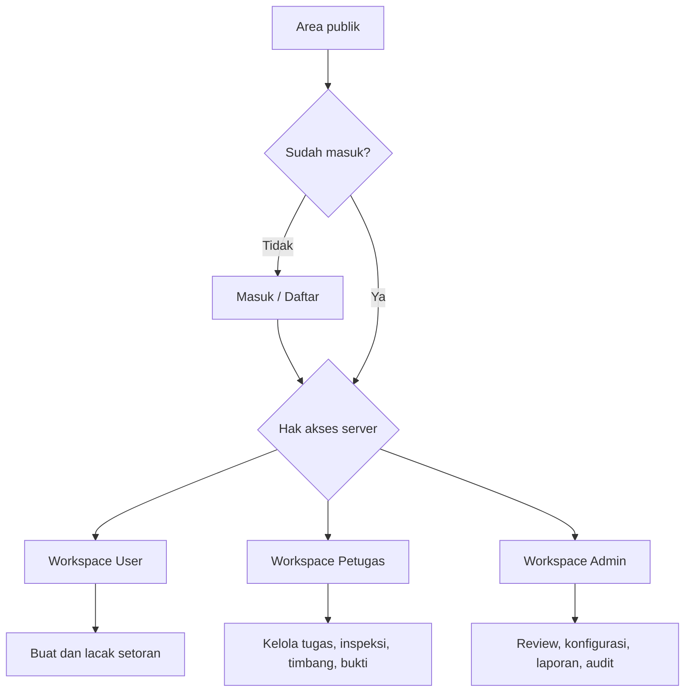
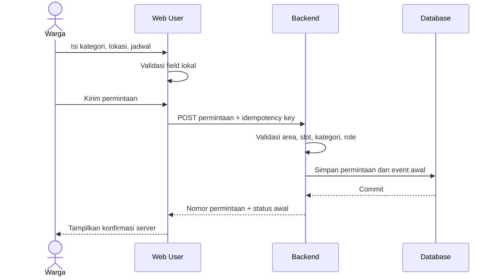
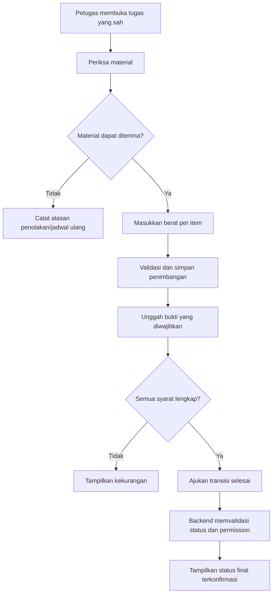

# WasteLink Bali — Web UI Design Specification

> **Nama file:** `designweb.md`  
> **Jenis dokumen:** UI/UX Design Specification — Web  
> **Versi:** 1.0  
> **Status:** Draft desain untuk MVP/hackathon  
> **Tanggal:** 29 Oktober 2026  
> **Dokumen acuan:** `PRD_WasteLink_Bali.md`, `HRD_WasteLink_Bali.md`, `SDD_WasteLink_Bali.md`, `SRS_WasteLink_Bali.md`  
> **Bahasa antarmuka:** Bahasa Indonesia  
> **Zona waktu operasional:** WITA (Asia/Makassar)

---

## Daftar Isi

1. Tujuan dan Ruang Lingkup
2. Prinsip Pengalaman Produk
3. Strategi Dua Tampilan Web
4. Pengguna dan Konteks Penggunaan
5. Arah Visual: Profesional, Lokal, dan Tidak Generik
6. Design Tokens
7. Grid, Layout, dan Responsivitas
8. Arsitektur Informasi dan Navigasi
9. Tampilan Publik dan Autentikasi
10. Tampilan Web User/Warga
11. Tampilan Web Petugas Sampah
12. Tampilan Web Admin/Operator
13. Komponen UI Bersama
14. Status, Form, dan Feedback
15. Aturan Konten dan Microcopy
16. Aksesibilitas dan Bahasa
17. Privasi, Keamanan, dan Hak Akses pada UI
18. Loading, Empty, Error, dan Edge Cases
19. Perilaku Responsif dan Batas Perangkat
20. Spesifikasi Interaksi Penting
21. Struktur Route yang Direkomendasikan
22. Arahan Implementasi Frontend
23. Acceptance Checklist Desain Web
24. Traceability ke PRD/HRD/SDD/SRS
25. Keputusan Terbuka dan Catatan Perubahan

---

## 1. Tujuan dan Ruang Lingkup

Dokumen ini menjadi acuan desain antarmuka web WasteLink Bali untuk mengurangi perbedaan interpretasi antara product owner, UI/UX designer, frontend developer, backend developer, dan QA.

Web mempunyai **dua keluarga tampilan utama**:

1. **User/Warga Web** — untuk membuat setoran, melihat jadwal dan status penjemputan, memeriksa hasil penimbangan, melihat WastePoints, membaca panduan, serta mengelola profil.
2. **Staff Web** — lingkungan operasional untuk Petugas Sampah (Collector) dan Admin/Operator. Keduanya menggunakan web, tetapi **menu, data, serta izin tetap dibedakan menurut role**. Halaman admin tidak boleh sekadar menjadi dashboard petugas dengan lebih banyak tombol.

Area publik seperti landing page, panduan kategori, FAQ, login, dan registrasi digunakan sebagai pintu masuk sebelum pengguna masuk ke workspace.

### 1.1 Cakupan

- Desktop-first untuk kegiatan operasional Petugas dan Admin.
- Responsif untuk User/Warga yang menggunakan browser desktop, tablet, atau ponsel.
- Tampilan desktop operasional dirancang untuk komputer di pos penjagaan/pos operasional TPU sesuai model operasi yang ditetapkan tim.
- Desain alur autentikasi, role, tabel, formulir, detail setoran, penimbangan, bukti, WastePoints, mitra, batch, dan laporan.
- Komponen untuk loading, error, empty state, permission state, dan koneksi yang terganggu.

### 1.2 Di luar cakupan dokumen ini

- Desain aplikasi mobile/native khusus User/Warga; hal tersebut ditetapkan dalam `designapps.md`.
- Tampilan aplikasi operasional untuk Petugas Sampah. Petugas menggunakan **web di komputer pos**, bukan aplikasi mobile petugas.
- Perancangan identitas merek final, logo legal, kampanye pemasaran, dashboard BI eksternal, dan desain perangkat keras timbangan.
- Menentukan nilai finansial atau tarif reward final. UI hanya menampilkan kebijakan yang telah dikonfigurasi dan disetujui.

### 1.3 Hubungan dengan dokumen kebutuhan

- PRD menjelaskan masalah, pengguna, nilai produk, dan alur bisnis.
- HRD memecah kebutuhan tingkat tinggi dan batas tanggung jawab.
- SDD menentukan arsitektur dan batas teknis.
- SRS menetapkan requirement dan kriteria penerimaan.
- Dokumen ini menentukan bagaimana kebutuhan tersebut ditampilkan dan dioperasikan melalui antarmuka web.

Jika desain bertentangan dengan aturan bisnis, status, permission, atau kontrak API yang telah disepakati, aturan pada SRS/SDD menjadi sumber kebenaran dan desain harus diperbarui.

---

## 2. Prinsip Pengalaman Produk

### 2.1 Prinsip utama

1. **Action first.** Setiap halaman menonjolkan tugas utama yang relevan untuk role aktif; jangan membuat pengguna mencari aksi di antara banyak kartu.
2. **Informasi yang dapat dipercaya.** Berat, status, poin, dan tujuan material harus dibedakan antara perkiraan, tertunda, terverifikasi, dan selesai.
3. **Satu layar, satu prioritas.** Gunakan hierarki visual yang jelas. Tidak semua informasi perlu dijadikan kartu.
4. **Bahasa sehari-hari.** Tulis label yang dipahami warga dan petugas; istilah teknis hanya muncul bila disertai penjelasan.
5. **Konteks lokal tanpa ornamen berlebihan.** Identitas Bali diwujudkan melalui foto komunitas/lingkungan yang nyata, bahasa yang relevan, dan detail operasional—bukan pola dekoratif Bali yang ditempel di semua tempat.
6. **Nyaman untuk pekerjaan rutin.** Petugas harus dapat mengerjakan tugas berulang dengan tabel, filter, tombol yang konsisten, dan konfirmasi hanya saat diperlukan.
7. **Tidak mengandalkan warna saja.** Status selalu memakai label teks, ikon bila membantu, dan warna sebagai penunjang.
8. **Tidak menyatakan dampak tanpa bukti.** “Diambil”, “diterima pengolah”, dan “sudah diproses” merupakan status yang berbeda.
9. **Tidak memaksa fitur AI.** Saran klasifikasi, apabila tersedia, ditampilkan sebagai saran yang dapat dikoreksi, bukan keputusan final.
10. **Hindari AI slop.** Jangan menggunakan dashboard penuh kartu identik, gradien neon, glassmorphism, angka statistik dekoratif, ilustrasi robot, atau teks hero generik yang tidak membantu tugas pengguna.

### 2.2 Sasaran kualitas pengalaman

- Warga dapat menemukan tombol **Buat setoran** tanpa harus membaca seluruh halaman.
- Pengguna memahami apakah permintaan masih menunggu petugas, sedang dijemput, sudah ditimbang, atau selesai.
- Petugas dapat memindai daftar tugas dan mengidentifikasi tindakan berikutnya dengan cepat.
- Admin dapat menemukan anomali operasional, meninjau pengajuan petugas, serta memeriksa transaksi/aktivitas yang perlu ditindaklanjuti.
- Pengguna tidak salah mengira WastePoints sebagai saldo uang tunai.

### 2.3 Anti-pattern yang dilarang

- Hero dua layar dengan headline abstrak seperti “Transforming Tomorrow, One Green Step at a Time”.
- Gradien hijau-biru sebagai latar setiap section.
- Glass card transparan pada dashboard operasional.
- Grafik dummy, angka dampak yang belum bersumber, testimoni fiktif, rating palsu, atau angka pengguna yang belum diverifikasi.
- Tombol berlabel “Explore”, “Discover”, atau “Get Started” ketika label Indonesia yang spesifik lebih jelas.
- Emoji sebagai pengganti seluruh ikon sistem.
- Animasi parallax, animasi masuk bertingkat, cursor custom, atau efek yang memperlambat pekerjaan.
- Menyembunyikan alasan penolakan/penundaan hanya dengan warna merah.
- Memunculkan fitur keuangan atau koreksi poin kepada role yang tidak punya kewenangan.

---

## 3. Strategi Dua Tampilan Web

### 3.1 Ringkasan

| Aspek | User/Warga Web | Staff Web |
|---|---|---|
| Tujuan utama | Membuat setoran dan memantau hasil | Menjalankan operasi, verifikasi, dan administrasi |
| Pola navigasi | Navigasi sederhana, berorientasi tugas | Sidebar kerja tetap, tabel dan filter |
| Perangkat utama | Laptop/desktop; harus responsif untuk browser ponsel | Komputer desktop di pos operasional atau meja admin |
| Struktur halaman | Dashboard, form bertahap, status, poin, panduan | Daftar kerja, detail tugas, inspeksi, administrasi, laporan |
| Kepadatan informasi | Rendah sampai sedang | Sedang sampai tinggi dengan hierarki yang jelas |
| Aksi utama | Buat setoran, lacak status, lihat poin | Ambil/kelola tugas, timbang, catat bukti, verifikasi, tindak lanjuti |
| Hak akses | Data milik sendiri dan informasi publik | Sesuai grant Petugas atau permission Admin tertentu |
| UI mobile | Responsif untuk penggunaan warga | Tidak menjadi target operasional Petugas; jangan mengandalkan layar ponsel |

### 3.2 Role Petugas dan Admin tidak digabung secara otorisasi

“Staff Web” adalah satu keluarga desain dan shell, bukan satu tingkat akses.

- **Petugas Sampah/Collector:** melihat tugas yang tersedia dan tugasnya sendiri; memperbarui status yang diizinkan; melakukan inspeksi, memasukkan berat, mengunggah bukti, serta mencatat kendala.
- **Admin/Operator:** mengelola akun dan role sesuai izin; memeriksa pengajuan Petugas; mengatur kategori, area/slot, mitra, batch, reward, komplain, laporan, dan konfigurasi yang diizinkan.
- **Admin khusus/Finance/Auditor:** tindakan sensitif seperti perubahan aturan reward, adjustment ledger, ekspor, rekonsiliasi, dan audit harus memakai permission terpisah. Jangan mengasumsikan semua admin memiliki seluruh akses.

UI hanya menampilkan fungsi yang sesuai permission server. Menyembunyikan tombol bukan kontrol keamanan; server tetap harus memvalidasi setiap aksi.

### 3.3 Konsep shell

- Area publik memakai header sederhana dan konten terpusat.
- User/Warga memakai workspace ringan dengan header dan navigasi samping pada desktop; navigasi menjadi drawer pada layar kecil.
- Staff memakai sidebar yang stabil, header konteks area/pos, breadcrumb, judul halaman, dan area konten yang dapat discan.
- Admin dapat memakai sub-navigasi di dalam modul bila tabel dan pengaturan menjadi padat; jangan membuat seluruh menu ditampilkan sekaligus tanpa pengelompokan.

---

## 4. Pengguna dan Konteks Penggunaan

### 4.1 User/Warga

Konteks: pengguna ingin membuang sampah dengan cara yang benar tanpa menebak kategori, menunggu tanpa informasi, atau tidak memahami cara poin dihitung.

Kebutuhan UX:
- Panduan pemilahan dapat ditemukan sebelum membuat setoran.
- Input tidak meminta informasi yang belum dibutuhkan.
- Lokasi dan jadwal terlihat sebelum konfirmasi.
- Status mempunyai timestamp dan langkah berikutnya.
- Berat final, poin tertunda/tersedia, dan alasan penolakan dijelaskan.

### 4.2 Petugas Sampah/Collector

Konteks: bekerja dari komputer di pos operasional, menangani banyak tugas, perlu mencatat hasil lapangan, dan bisa menghadapi koneksi atau bukti yang gagal diunggah.

Kebutuhan UX:
- Daftar tugas menampilkan lokasi ringkas, jadwal, kategori, dan status.
- Detail tugas menampilkan informasi yang dibutuhkan untuk pekerjaan yang sah.
- Form timbang mengurangi salah satuan dan salah input.
- Bukti yang diwajibkan tampak jelas sebelum tugas dapat ditandai selesai.
- Alasan gagal, penolakan, atau penjadwalan ulang tersedia dalam pilihan standar dengan catatan opsional.
- UI mencegah double-submit dan menjelaskan status tindakan.

### 4.3 Admin/Operator

Konteks: mengawasi volume operasi, mengelola akses petugas, kapasitas, kategori, mitra, reward, keluhan, dan pelaporan.

Kebutuhan UX:
- Ringkasan menampilkan angka yang dapat ditelusuri ke data sumber.
- Tabel mendukung pencarian, filter, sorting, pagination, dan ekspor bila diizinkan.
- Perubahan sensitif menampilkan dampak dan konfirmasi yang sesuai.
- Histori perubahan dan alasan dapat ditemukan tanpa membuka banyak layar yang tidak relevan.

---

## 5. Arah Visual: Profesional, Lokal, dan Tidak Generik

### 5.1 Konsep visual

**“Calm field operations”** — antarmuka terasa bersih, membumi, teratur, dan dapat dipercaya. Identitas hijau menunjukkan pengelolaan lingkungan tanpa memenuhi seluruh layar dengan warna hijau.

### 5.2 Komposisi visual

- Mayoritas halaman memakai latar netral hangat dan permukaan putih.
- Hijau tua digunakan untuk aksi utama, navigasi aktif, serta elemen brand.
- Kuning tanah dipakai secara terbatas untuk status perhatian atau highlight informasi penting, bukan untuk tombol utama di semua tempat.
- Warna merah bata digunakan hanya untuk bahaya/penolakan/kegagalan, bukan sebagai dekorasi.
- Garis pembatas tipis lebih diutamakan daripada bayangan tebal.
- Foto dipakai secara editorial pada area publik/panduan saja; dashboard operasional lebih mengutamakan data dan kontrol.

### 5.3 Foto dan ilustrasi

- Pilih foto dokumenter asli/berlisensi yang merepresentasikan lingkungan, warga, sarana pilah, dan operasi persampahan lokal.
- Hindari foto stok dengan senyum berlebihan, tangan memegang bibit secara simbolis, atau visual “eco-tech” yang tidak terkait layanan.
- Jangan menggunakan gambar AI sebagai bukti operasi, testimoni, foto petugas, atau gambaran fasilitas mitra nyata.
- Kartu kategori boleh menggunakan ikon sederhana dan foto contoh material yang nyata dengan label “contoh diterima” / “contoh tidak diterima”.
- Jika aset belum tersedia, gunakan ikon dan layout netral; jangan isi halaman dengan foto placeholder yang seolah-olah real.

### 5.4 Logo dan identitas

- Wordmark teks “WasteLink Bali” cukup untuk MVP.
- Jika belum ada logo final, gunakan simbol sederhana berbasis bentuk sirkular/daun yang tetap jelas pada ukuran 24 px.
- Jangan membuat simbol kompleks dengan banyak warna atau efek 3D.
- Logo tidak mengalahkan judul halaman maupun aksi utama.

---

## 6. Design Tokens

Token di bawah merupakan baseline desain yang dapat diubah setelah usability test. Nilai ini bukan ketentuan bisnis.

### 6.1 Warna

| Token | Nilai | Kegunaan |
|---|---|---|
| `color-brand-900` | `#1D3F35` | Sidebar aktif, heading/brand kuat |
| `color-brand-700` | `#2F6552` | Tombol utama, link aktif |
| `color-brand-100` | `#E8F0E9` | Permukaan halus, selected state |
| `color-canvas` | `#F6F6F1` | Latar halaman |
| `color-surface` | `#FFFFFF` | Konten, dialog, tabel |
| `color-text-primary` | `#1E2A25` | Teks utama |
| `color-text-secondary` | `#5D6B63` | Teks pendukung |
| `color-border` | `#DCE3DD` | Border dan divider |
| `color-warning` | `#98631C` | Peringatan |
| `color-warning-bg` | `#FFF4D9` | Latar peringatan |
| `color-danger` | `#A43F35` | Error, aksi berbahaya, penolakan |
| `color-danger-bg` | `#FBEAE7` | Latar error |
| `color-info` | `#315F86` | Informasi status |
| `color-info-bg` | `#EAF2F9` | Latar informasi |
| `color-success` | `#276749` | Status berhasil/terverifikasi |
| `color-success-bg` | `#E7F4EA` | Latar berhasil |

Aturan:
- Tombol utama memakai warna brand dengan kontras teks yang memadai.
- Jangan pakai warna status sebagai satu-satunya indikator; selalu sertakan label.
- Tidak perlu gradien pada tombol, latar, chart, atau card.
- Warna grafik harus konsisten dan memiliki label/legend.

### 6.2 Tipografi

Font utama: **Inter** bila tersedia, dengan fallback `system-ui, -apple-system, BlinkMacSystemFont, "Segoe UI", sans-serif`.

| Jenis | Ukuran desktop | Bobot | Penggunaan |
|---|---:|---:|---|
| Page title | 28–32 px | 650–700 | Judul halaman utama |
| Section title | 20–24 px | 600–650 | Bagian halaman |
| Card/table title | 15–17 px | 600 | Judul modul/kartu |
| Body | 14–16 px | 400 | Konten normal |
| Helper/caption | 12–13 px | 400 | Keterangan; bukan untuk instruksi penting |
| Button/label | 14 px | 550–600 | Aksi/form |
| Numeric highlight | 26–32 px | 650 | KPI penting dengan definisi yang jelas |

- Gunakan line-height body 1.45–1.65.
- Hindari terlalu banyak kapital penuh.
- Jangan menjadikan teks kecil sebagai cara memasukkan lebih banyak data ke satu layar.
- Angka penting dapat menggunakan tabular numerals agar mudah dibandingkan.

### 6.3 Spacing, radius, dan elevation

- Unit dasar spacing: 4 px.
- Spacing utama: 8, 12, 16, 24, 32, 40, 48 px.
- Radius input/button: 8 px.
- Radius panel/card: 12 px.
- Radius chip: 6 px atau pill jika pola status yang digunakan.
- Border default: 1 px solid `color-border`.
- Shadow hanya pada popover/dialog atau elemen yang perlu terpisah dari latar; jangan shadow semua kartu.
- Lebar maksimum halaman publik: 1200–1280 px; area teks panjang 680–760 px.

### 6.4 Ikon

- Gunakan satu keluarga ikon line yang konsisten, misalnya Lucide.
- Ukuran umum 16/18/20 px; navigasi 18–20 px.
- Stroke konsisten; hindari campuran ikon outline, filled emoji, dan ilustrasi berbeda gaya.
- Ikon wajib disertai label bila maknanya tidak universal.

### 6.5 Komponen dasar

- Button: tinggi 40 px default, 44 px pada kontrol utama/layar sentuh.
- Input: tinggi 42–44 px, label persisten di atas, helper/error di bawah.
- Checkbox/radio/switch: target klik minimal 24 px desktop dan 44 px pada layout touch-friendly.
- Badge: tinggi 24 px, teks pendek.
- Card: padding 16–24 px tergantung kepadatan.
- Table row: 48–56 px; tidak memadatkan tabel sampai sulit dibaca.

---

## 7. Grid, Layout, dan Responsivitas

### 7.1 Breakpoint desain

| Breakpoint | Rentang referensi | Perilaku |
|---|---|---|
| Small | < 640 px | User web menjadi satu kolom; navigasi menjadi drawer; tabel berubah ke list/card bila perlu |
| Medium | 640–1023 px | Layout User dua kolom bila konten sesuai; filter menjadi panel/collapse |
| Large | 1024–1279 px | Sidebar user/staff lebih ringkas; konten tetap memiliki ruang baca |
| Desktop | ≥ 1280 px | Layout staff penuh dan tabel operasional |

Breakpoints adalah patokan desain, bukan daftar perangkat yang dijamin.

### 7.2 User Web layout

Desktop:
- Header setinggi sekitar 64 px.
- Navigasi sisi 220–240 px pada area setelah login, dapat diciutkan.
- Area konten menggunakan padding 24–32 px.
- Lebar konten fokus sekitar 1200 px.
- Dashboard berisi satu CTA utama, status setoran, poin, dan riwayat ringkas.

Mobile browser:
- Header ringkas dengan wordmark dan menu akun.
- Navigasi samping berubah menjadi drawer.
- Form menjadi satu kolom.
- Tabel riwayat berubah menjadi list yang tiap itemnya memiliki label status dan tanggal.
- Aksi utama tetap terlihat tanpa membuat pengguna harus menggulir melalui kartu dekoratif.

### 7.3 Staff Web layout

Target utama: desktop 1366×768 atau lebih besar pada komputer pos operasional.

- Sidebar tetap sekitar 240 px, bisa diciutkan menjadi 72 px.
- Header atas 64 px berisi breadcrumb/area kerja, status koneksi bila relevan, notifikasi, dan akun.
- Konten menggunakan padding 24 px, lebar mengikuti kebutuhan tabel.
- Filter diletakkan dekat tabel dan dapat diringkas.
- Aksi penting di tabel berada pada kolom aksi atau menu kontekstual yang jelas.
- Detail tugas menggunakan layout dua area: informasi inti dan panel tindakan berikutnya.

**Batas desain:** interface Petugas tidak ditargetkan untuk menjalankan pekerjaan melalui ponsel. Jika layar terlalu sempit untuk form timbang/tabel, tampilkan pesan bahwa workspace operasional membutuhkan layar desktop, bukan versi mobile yang rapuh.

### 7.4 Prinsip dashboard

- Dashboard tidak boleh menjadi sekumpulan kartu dengan semua ukuran sama.
- Gunakan urutan: tindakan yang perlu dilakukan → status/pengecualian → ringkasan angka → laporan pendukung.
- Maksimal 3–4 KPI utama di bagian atas. Sisanya masuk ke laporan/modul terkait.
- Setiap KPI harus punya label, periode, dan definisi yang konsisten.
- Gunakan tabel atau list untuk pekerjaan yang harus ditindaklanjuti; grafik hanya digunakan saat membantu melihat tren/perbandingan.

---

## 8. Arsitektur Informasi dan Navigasi

### 8.1 Area publik

- Beranda
- Cara kerja
- Panduan pemilahan
- Area layanan dan jenis material yang diterima
- FAQ / Bantuan
- Kebijakan privasi
- Masuk
- Daftar

### 8.2 Navigasi User/Warga

1. Ringkasan
2. Buat setoran
3. Setoran saya
4. Panduan pemilahan
5. WastePoints
6. Dampak saya
7. Notifikasi
8. Bantuan/komplain
9. Profil dan pengaturan

Navigasi tidak perlu menampilkan seluruh halaman jika fitur belum aktif. Menu fitur yang nonaktif sebaiknya tidak muncul sebagai tautan mati; bila harus diketahui pengguna, jelaskan status “Belum tersedia di area Anda” secara kontekstual.

### 8.3 Navigasi Petugas

1. Ringkasan tugas
2. Tugas tersedia
3. Tugas saya
4. Riwayat pekerjaan
5. Panduan/SOP keselamatan
6. Bantuan operasional
7. Profil Petugas

### 8.4 Navigasi Admin/Operator

Kelompokkan menu agar sidebar tidak menjadi daftar panjang:

**Operasi**
- Ringkasan operasi
- Permintaan penjemputan
- Tugas dan penugasan
- Inspeksi/penimbangan bila memerlukan review
- Komplain dan sengketa

**Pengguna dan layanan**
- Pengguna dan role
- Pengajuan Petugas
- Kategori dan panduan
- Area layanan, slot, kapasitas

**Material dan mitra**
- Mitra/pengolah/buyer
- Batch material
- Distribusi dan penerimaan

**Program dan keuangan**
- Aturan WastePoints
- Voucher/kampanye (jika aktif)
- Pendanaan dan rekonsiliasi

**Tata kelola**
- Laporan dan ekspor
- Audit log
- Konfigurasi

Menu ditampilkan berdasarkan permission, bukan hanya berdasarkan role label.

### 8.5 Diagram alur halaman

---

## 9. Tampilan Publik dan Autentikasi

### 9.1 Landing page

Tujuan landing page adalah menjelaskan apa yang dapat dilakukan WasteLink dan mengarahkan pengguna ke layanan yang tersedia di wilayahnya.

Urutan section:
1. Header: logo/wordmark, Cara kerja, Panduan, Masuk, tombol “Mulai setor”.
2. Hero: judul spesifik, deskripsi satu paragraf, CTA “Lihat cara memilah” dan “Masuk untuk setor”. Gunakan satu foto dokumenter/visual kategori, bukan dekorasi 3D.
3. Cara kerja dalam tiga langkah: Pilah → Jadwalkan setoran → Petugas verifikasi.
4. Jenis sampah dan rute singkat: organik, material daur ulang, residu, limbah khusus.
5. Ketersediaan layanan: area dan kategori yang benar-benar aktif dari data sistem.
6. Bagian transparansi: WastePoints diterbitkan setelah verifikasi, bukan janji uang tunai.
7. FAQ dan footer berisi kontak/bantuan, privasi, dan informasi program.

Jangan menampilkan klaim “mengurangi sekian ton sampah” atau jumlah anggota kecuali datanya benar-benar tersedia dan definisinya jelas.

### 9.2 Login

Layout dua kolom hanya jika mempunyai tujuan: form pada satu sisi dan informasi keamanan/bantuan pada sisi lain. Pada layar kecil, form tampil lebih dulu dan satu kolom.

Elemen:
- Wordmark.
- Judul “Masuk ke WasteLink”.
- Email/nomor telepon sesuai metode autentikasi yang benar-benar diterapkan.
- Password dan toggle tampilkan/sembunyikan.
- Tombol “Masuk”.
- Tautan lupa password, daftar, serta bantuan.
- Pesan error generik yang tidak membocorkan apakah akun tertentu terdaftar.

Jangan menampilkan “Masuk sebagai Admin” atau pilihan role yang menentukan hak akses sebelum autentikasi. Role dan permission berasal dari server.

### 9.3 Registrasi

- Minta data minimum yang diperlukan.
- Label dan contoh format selalu tampak.
- Syarat dan privasi disertai tautan yang dapat dibuka.
- Error muncul di dekat field dan rangkuman error di bagian atas hanya jika beberapa field bermasalah.
- Jangan menghapus field valid saat satu field gagal.
- Setelah berhasil, tampilkan langkah berikutnya yang jelas; jangan menyatakan verifikasi selesai jika masih ada tahapan.

### 9.4 Lupa password dan sesi

- Tampilkan proses pemulihan yang sesuai dengan metode autentikasi aktual.
- Sediakan feedback saat email/OTP sedang dikirim, gagal, atau kedaluwarsa.
- Peringatan sesi habis harus mengarahkan pengguna masuk kembali tanpa menghapus data form yang aman jika memungkinkan.

---

## 10. Tampilan Web User/Warga

### 10.1 Dashboard User

Tujuan: memudahkan pengguna memulai setoran atau melanjutkan permintaan aktif.

Urutan konten yang direkomendasikan:
1. Sapaan dan area layanan aktif, misalnya “Area layanan: Banjar/Desa [nama dari data]”.
2. CTA primer **Buat setoran**.
3. Kartu status setoran aktif—hanya jika ada permintaan aktif. Tampilkan status, kategori, slot, pembaruan terakhir, dan tautan “Lihat detail”.
4. Ringkasan WastePoints: tersedia dan tertunda dipisahkan; tautan “Lihat riwayat poin”.
5. Riwayat terakhir (maksimum beberapa entri) dan tombol “Lihat semua”.
6. Panduan pemilahan singkat atau informasi layanan relevan.

Jangan menampilkan statistik dampak yang tidak memiliki sumber data. Jika belum memiliki setoran, gunakan empty state yang membantu: “Belum ada setoran. Pilah material sesuai panduan, lalu buat setoran pertama.” dan CTA.

### 10.2 Membuat setoran — form bertahap

Gunakan stepper dengan 4 tahap yang namanya tetap:

1. **Pilih sampah**
2. **Detail setoran**
3. **Lokasi dan jadwal**
4. **Periksa dan kirim**

Stepper hanya menunjukkan progres form, bukan status operasional pickup.

#### Tahap 1 — Pilih sampah

- Kategori utama: **Organik**, **Anorganik bernilai/daur ulang**, **Residu**, **Limbah khusus**.
- Setiap opsi memberi ringkasan rute dan contoh material yang diterima.
- Izinkan beberapa item dalam satu setoran jika model data dan kebijakan area mendukungnya.
- Tidak mengasumsikan seluruh material daur ulang diterima oleh semua buyer/area.
- Untuk limbah khusus, arahkan ke instruksi/rute khusus yang aktif. Jangan menempatkannya ke antrean pickup biasa.

#### Tahap 2 — Detail setoran

Field ditampilkan menurut kategori:
- Jenis/subkategori material.
- Perkiraan jumlah/berat bila pengguna mengetahuinya (ditandai **perkiraan**, bukan berat final).
- Kondisi material: kering/basah, bersih/terkontaminasi bila relevan.
- Catatan singkat opsional.
- Foto bila diminta oleh aturan layanan; tampilkan thumbnail, hapus/ganti, dan status upload.

Panduan harus menyebut hal yang umum ditolak/bermasalah. Hindari memaksa user memilih istilah kualitas teknis yang tidak dipahaminya.

#### Tahap 3 — Lokasi dan jadwal

- Lokasi/alamat penjemputan dan detail petunjuk lokasi.
- Peta hanya jika provider tersedia; alamat teks dan edit manual tetap tersedia.
- Hari/jam yang tersedia berasal dari slot aktif dan kapasitas aktual.
- Untuk organik, prioritaskan ketersediaan slot yang sesuai dengan jam penerimaan pengolah.
- Tampilkan zona layanan dan kebijakan perubahan jadwal sebelum pengguna lanjut.
- Jangan menunjukkan slot penuh sebagai pilihan aktif.

#### Tahap 4 — Periksa dan kirim

Ringkasan sebelum kirim:
- Kategori/item dan jumlah perkiraan.
- Lokasi.
- Jadwal.
- Catatan/foto.
- Penjelasan bahwa berat final dan reward mengikuti inspeksi/penimbangan.

Tombol akhir: **Kirim permintaan setoran**. Setelah ditekan, tampilkan loading dan nonaktifkan aksi ganda. Jangan menunjukkan status berhasil sebelum server mengonfirmasi.

### 10.3 Detail dan pelacakan setoran

Header:
- ID permintaan yang dapat disalin.
- Label status yang jelas.
- Jadwal dan lokasi ringkas.
- Tombol tindakan kontekstual (mis. ubah jadwal atau batalkan hanya bila diizinkan).

Timeline status:
- Permintaan diterima / menunggu petugas.
- Petugas menerima tugas.
- Penjemputan dijadwalkan / petugas menuju lokasi bila tahap digunakan.
- Pemeriksaan dan penimbangan.
- Selesai atau status alternatif (ditolak, perlu jadwal ulang, dibatalkan, sengketa).

Setiap langkah yang terjadi menampilkan waktu pembaruan bila tersedia. Jangan menampilkan tahap yang belum didukung operasi seolah-olah sudah terjadi.

Bagian tambahan:
- Item/kategori.
- Perkiraan berat vs berat final, dengan unit kg.
- Hasil inspeksi dan catatan relevan.
- Bukti penyelesaian yang dapat dilihat pemilik setoran.
- WastePoints: tertunda/tersedia/tidak eligible beserta alasan yang mudah dipahami.
- Bantuan/ajukan komplain apabila informasi tidak sesuai.

### 10.4 Setoran saya / riwayat

- Filter tanggal, kategori, dan status.
- Default sort: aktivitas terbaru.
- Setiap item menampilkan ID pendek, tanggal, kategori utama, status, dan berat final bila sudah ada.
- Filter harus tetap dapat digunakan tanpa mouse.
- Pada layar kecil gunakan list dengan ringkasan, bukan tabel horizontal yang harus digeser jauh.

### 10.5 WastePoints

Halaman WastePoints harus membedakan:
- **Poin tersedia** — dapat digunakan sesuai aturan yang aktif.
- **Poin tertunda** — belum final karena verifikasi, settlement, atau pemeriksaan.
- **Poin ditukar/expired/dikoreksi** — tercantum dalam riwayat.

Komponen:
- Saldo tersedia dan tertunda.
- Tanggal/periode transaksi.
- Sumber transaksi (mis. setoran ID, bonus kampanye, penukaran, koreksi).
- Jumlah bertambah/berkurang.
- Status dan alasan yang dapat ditampilkan kepada user.
- Tautan detail ke setoran asal jika berwenang.

Aturan visual:
- Jangan memakai simbol rupiah pada saldo poin.
- Jangan menyebut “uang kamu” atau “cashback” jika kebijakan tidak mengizinkan pencairan.
- Jika rate tidak tersedia, tampilkan aturan program dan keterbatasannya; jangan menghitung estimasi palsu.
- Katalog voucher/benefit hanya ditampilkan jika redemption benar-benar diaktifkan dan persediaan tersedia.

### 10.6 Panduan pemilahan

Bagi materi ke empat rute utama:

- **Organik:** sisa makanan/tumbuhan sesuai jenis yang diterima pengolah setempat. Perlihatkan cara memisahkan cairan, kemasan, dan kontaminan yang relevan.
- **Anorganik bernilai/daur ulang:** item dikelompokkan per subkategori sesuai daftar penerimaan lokal; beri contoh bersih/kering bila diwajibkan.
- **Residu:** material yang tidak diterima sebagai organik atau daur ulang pada area tersebut; jelaskan rute yang tersedia.
- **Limbah khusus:** baterai, elektronik kecil, bahan berbahaya, atau jenis khusus lain sesuai daftar kebijakan. Beri instruksi aman dan rute resmi; jangan menampilkan CTA pickup biasa jika belum tersedia.

Setiap artikel panduan memuat:
- Nama material.
- Diterima / tidak diterima / perlu pemeriksaan.
- Cara persiapan.
- Alasan singkat.
- Rute/layanan yang tersedia di area pengguna.
- Tanggal pembaruan atau versi panduan jika diperlukan.

Saran AI, jika ada, tampil sebagai “Saran kategori” dan selalu menyediakan pilihan koreksi manual.

### 10.7 Dampak saya

- Tampilkan hanya metrik yang dapat diatribusikan ke akun dan mempunyai definisi jelas, misalnya total berat yang telah diverifikasi.
- Pisahkan “berat dikumpulkan” dari “berat diterima pengolah” dan “berat diproses”.
- Jangan mengubah kilogram menjadi jumlah pohon, emisi, atau dampak ekologis tanpa metode perhitungan yang terdokumentasi.
- Jika belum ada data yang sah, tampilkan empty state, bukan angka dekoratif.

### 10.8 Profil, role, dan bantuan

Profil berisi data yang boleh diedit, area layanan, pengaturan notifikasi, privasi, dan keluar.

Jika pengajuan role Petugas disediakan pada web User:
- Status `Menunggu review`, `Disetujui`, `Ditolak`, atau `Ditangguhkan` ditampilkan dengan label dan alasan yang sesuai.
- User tidak dapat memulai operasi Petugas sebelum role diverifikasi.
- Operasi Petugas tetap dilakukan melalui Staff Web di komputer pos; bukan melalui workspace User.

Bantuan/komplain:
- Pilih jenis masalah.
- Tautkan ke setoran terkait bila ada.
- Jelaskan kejadian; lampiran bersifat opsional sesuai kebijakan.
- Tampilkan nomor tiket dan status penanganan setelah server mengonfirmasi.

---

## 11. Tampilan Web Petugas Sampah

### 11.1 Prinsip workspace Petugas

- Desain **desktop-first** untuk komputer kerja di pos operasional/pos penjagaan TPU yang ditetapkan.
- Tidak memakai antarmuka bergaya konsumen; fokus pada tugas, kecepatan pemindaian, ketelitian data, dan keselamatan.
- Semua tindakan operasional terkait tugas tampil secara berurutan; jangan menempatkan input berat, unggah bukti, atau status final dalam menu tersembunyi yang sulit ditemukan.
- Data pribadi warga dibatasi pada informasi yang diperlukan untuk tugas yang sah.

### 11.2 Dashboard Petugas

Urutan konten:
1. Konteks operasional: nama pos/area yang diberikan sistem dan status akun Petugas.
2. Ringkasan kerja: tugas aktif, tugas yang dapat diambil, tugas memerlukan tindak lanjut.
3. Bagian “Prioritas berikutnya”: tugas yang harus ditangani lebih dahulu menurut jadwal/SOP.
4. Daftar tugas tersedia dan tugas saya.
5. Indikator kendala: bukti gagal diunggah, penjadwalan ulang, atau tugas yang butuh admin.

Hindari leaderboard antarpetugas. Jangan menampilkan poin/bonus staf jika sistem remunerasi semacam itu tidak ada.

### 11.3 Daftar tugas

Kolom yang direkomendasikan:
- ID tugas.
- Slot/jadwal.
- Area/alamat ringkas.
- Kategori utama.
- Ringkasan item.
- Status.
- Tindakan.

Filter:
- Status.
- Jadwal/hari.
- Area layanan yang menjadi kewenangan Petugas.
- Kategori.

Perilaku:
- Default menampilkan tugas yang relevan dan bisa diambil atau tugas aktif milik Petugas.
- Tombol **Ambil tugas** hanya aktif bila task memenuhi eligibility.
- Setelah aksi, status list diperbarui dari response server.
- Bila tugas sudah diambil Petugas lain, tampilkan konflik yang jelas dan refresh daftar; jangan menunjukkan seolah klaim berhasil.

### 11.4 Detail tugas

Susunan:
- Header: ID, status, waktu pickup, aksi utama yang sedang relevan.
- Informasi lokasi dan instruksi penjemputan.
- Kontak warga hanya sesuai izin dan status tugas.
- Item serta kategori yang dilaporkan.
- Perkiraan berat bila diberikan oleh user, dengan label jelas.
- Catatan dan foto awal.
- Timeline status dengan timestamp.
- Panel inspeksi/penimbangan/bukti.
- Bagian kendala dan bantuan operasional.

Tombol tindakan harus mengikuti state machine dari backend. Jangan menawarkan “Selesaikan” ketika inspeksi, penimbangan, atau bukti wajib belum lengkap.

### 11.5 Status operasional

Teks UI yang disarankan (pemetaan ke status backend tetap ditentukan SRS):

| Makna | Label UI | Catatan |
|---|---|---|
| Permintaan menunggu tugas | Menunggu petugas | Tidak dapat ditandai selesai oleh Petugas |
| Tugas diambil | Diterima petugas | Menampilkan Petugas yang ditugaskan |
| Dalam perjalanan (jika digunakan) | Menuju lokasi | Jangan diwajibkan jika SOP tidak menggunakan tahap ini |
| Tiba dan melakukan pemeriksaan | Pemeriksaan material | Gunakan sebelum hasil timbang final |
| Menunggu slot ulang | Perlu jadwal ulang | Alasan wajib |
| Material tidak dapat diterima | Tidak dapat diterima | Alasan dan hasil inspeksi wajib |
| Menunggu penyelesaian alur | Menunggu konfirmasi | Jelaskan bagian apa yang belum selesai |
| Siklus pickup selesai | Selesai | Tidak berarti material sudah diproses/didaur ulang |

Status tidak boleh diubah hanya berdasarkan perubahan lokal pada frontend. Setiap transisi harus mendapat response sah dari server.

### 11.6 Form inspeksi

Field:
- Kondisi material.
- Kontaminasi (tidak ada/ada/belum dapat ditentukan sesuai taksonomi konfigurasi).
- Hasil: diterima, perlu jadwal ulang, ditolak, atau pilihan yang didukung SOP.
- Kode alasan jika hasil bukan normal.
- Catatan tambahan.

Aturan:
- Label pilihan menggunakan bahasa operasional yang jelas.
- Alasan wajib untuk penolakan dan jadwal ulang.
- Jika jenis material tidak jelas atau situasi tidak aman, sediakan jalur “Perlu bantuan admin / pemeriksaan lanjutan”.
- Jangan gunakan AI sebagai otoritas final untuk menerima/menolak material.

### 11.7 Form penimbangan

Field dan susunan:
- Kategori/subkategori item.
- Berat kotor (kg) bila proses memerlukan.
- Berat tara (kg) bila proses memerlukan.
- Berat bersih (kg) dihitung/ditampilkan jelas sesuai rule.
- Satuan eksplisit di samping field.
- Kualitas/grade bila diatur untuk material tertentu.
- Catatan penimbangan.

Validasi:
- Nilai numerik dan tidak negatif.
- Berat tara tidak boleh melebihi berat kotor.
- Berat bersih tidak boleh dihitung dari data yang invalid.
- Gunakan pembulatan konsisten sesuai SRS/config; jangan hardcode presisi pada UI bila rule belum diputuskan.
- Jika koreksi dilakukan setelah simpan, alur koreksi terpisah memerlukan izin, alasan, dan audit.

Jika satu setoran memuat beberapa kategori, tiap item harus mempunyai hasil timbang sendiri sesuai model data, lalu ringkasan setoran dihitung dari data valid.

### 11.8 Bukti penyelesaian

- Gunakan tombol “Tambah bukti” yang membuka file picker.
- Tampilkan file yang dipilih, ukuran, progress, hasil upload, dan pilihan ulang jika gagal.
- Foto bukti tidak otomatis membuktikan berat; penimbangan tetap menjadi catatan terpisah.
- Hanya nyatakan bukti tersimpan setelah server mengonfirmasi upload.
- Jika bukti wajib belum lengkap, tampilkan alasan mengapa status selesai belum dapat digunakan.

### 11.9 Kendala lapangan dan keselamatan

Pilihan kendala standar dapat meliputi:
- Warga tidak berada di lokasi.
- Alamat tidak ditemukan.
- Setoran tidak sesuai kategori.
- Material terkontaminasi.
- Slot/fasilitas tidak dapat menerima material.
- Situasi tidak aman.
- Kendala akses atau teknis.
- Lainnya (catatan wajib).

Jangan meminta Petugas mengambil risiko untuk menyelesaikan target. Bila “Situasi tidak aman” dipilih, arahkan pengguna untuk menghentikan pekerjaan sesuai SOP dan mencatat kejadian; admin dapat menindaklanjuti.

### 11.10 Riwayat pekerjaan

- Menampilkan tugas yang ditangani Petugas dengan filter tanggal dan status.
- Detail riwayat read-only kecuali tindakan koreksi yang secara eksplisit diizinkan.
- Angka produktivitas harus memiliki definisi; jangan mengadu Petugas berdasarkan jumlah tugas tanpa konteks kategori/jarak/kendala.

---

## 12. Tampilan Web Admin/Operator

### 12.1 Dashboard Admin

Dashboard harus menjawab “apa yang perlu ditindaklanjuti hari ini?” bukan sekadar menampilkan semua angka.

Urutan prioritas:
1. Permintaan/tugas yang membutuhkan tindakan admin.
2. Pengajuan Petugas menunggu keputusan.
3. Slot atau kapasitas yang penuh/bermasalah.
4. Batch material yang belum tersalurkan atau menunggu konfirmasi.
5. Peringatan reward/rekonsiliasi dan komplain yang belum ditangani.
6. KPI ringkas dengan periode yang jelas.

KPI yang dapat ditampilkan bila sumber datanya tersedia:
- Permintaan per status.
- Berat terkumpul (bukan berat diproses).
- Rasio penyelesaian.
- Poin diterbitkan/tertunda/ditukar.
- Batch menunggu penerimaan.
- Komplain terbuka.

Setiap KPI sebaiknya mengarah ke tampilan detail terfilter.

### 12.2 Pengajuan dan manajemen Petugas

Tabel pengajuan menampilkan nama/identitas minimum, area yang diajukan, tanggal, status, dan tindakan review.

Detail pengajuan:
- Informasi yang dikirim pemohon.
- Status verifikasi.
- Riwayat perubahan.
- Tombol Setujui / Tolak / Minta informasi tambahan hanya jika workflow mendukung.
- Alasan wajib saat menolak/menangguhkan.
- Dialog konfirmasi menyebut dampak akses.

Persetujuan tidak boleh dilakukan dari row action tanpa konteks jika keputusan memerlukan pemeriksaan data.

### 12.3 Pengelolaan area, jadwal, dan kapasitas

- Daftar area/banjar/desa yang aktif.
- Kategori yang diterima per area.
- Slot tanggal/waktu, kuota, kapasitas fasilitas, dan status aktif.
- Indikator kapasitas penuh.
- Perubahan slot memengaruhi calon permintaan baru; perubahan pada permintaan yang telah dikonfirmasi harus mengikuti kebijakan perubahan jadwal dan audit.

Jangan menampilkan area fiktif sebagai layanan aktif. Bila tidak ada slot, tampilkan penyebab dan alternatif yang benar-benar tersedia.

### 12.4 Kategori dan panduan

- Nama kategori/subkategori.
- Deskripsi warga.
- Contoh diterima/tidak diterima.
- Persyaratan kebersihan/kualitas.
- Rute pengolahan atau mitra terkait.
- Status aktif dan tanggal berlaku.

Perubahan taksonomi harus mempertimbangkan permintaan berjalan; jangan merubah arti setoran lama secara retroaktif.

### 12.5 Mitra, batch, dan distribusi material

- Daftar mitra dengan tipe dan status verifikasi.
- Jenis material yang diterima setiap mitra.
- Batas kualitas, kapasitas, dan area layanan bila diketahui.
- Daftar batch: kategori material, berat tercatat, asal, status, mitra tujuan, jadwal, dan bukti penerimaan.
- Workflow penawaran/alokasi/pengiriman/konfirmasi mengikuti model yang benar-benar diaktifkan.

Jangan menampilkan batch “diproses” hanya karena status sudah “dikirim”. Konfirmasi proses harus berasal dari pihak yang berwenang.

### 12.6 Aturan WastePoints dan kampanye

Halaman rule menampilkan:
- Nama dan ID rule.
- Material/area/masa berlaku.
- Formula/rate dan satuan.
- Status aktif/draft/berakhir.
- Batas atau anggaran yang berlaku.
- Prasyarat verifikasi dan waktu settlement.

Perubahan rule harus menggunakan versi atau tanggal efektif baru sesuai kebijakan. Jangan mengedit rule lama sehingga transaksi historis berubah diam-diam.

Jika menampilkan estimasi reward, beri label “estimasi”. Reward final dihitung oleh backend sesuai berat dan quality yang terverifikasi.

### 12.7 Pendanaan, rekonsiliasi, dan ledger

- Pisahkan pendapatan material, dana sponsor/CSR, kontrak layanan, dan alokasi reward/biaya operasi.
- Gunakan filter periode dan sumber dana.
- Setiap penyesuaian ledger memerlukan permission spesifik, alasan, referensi transaksi, dan audit.
- Tidak ada pengeditan langsung saldo user.
- Dialog koreksi harus menampilkan nilai saat ini, nilai perubahan, dampak terhadap saldo, alasan, dan konsekuensi.
- Ekspor data hanya untuk role yang berhak dan harus tercatat.

### 12.8 Komplain, sengketa, dan audit

Komplain menampilkan ID, waktu, tipe, status, pemilik/penanggung jawab, dan hubungan dengan setoran/transaksi. Detail menyimpan catatan tindak lanjut.

Audit log:
- Read-only.
- Filter aktor, aksi, objek, waktu, dan hasil.
- Menampilkan nilai sebelum/sesudah hanya jika diizinkan dan tidak mengekspos data sensitif yang tidak perlu.
- Tidak menyediakan tombol edit/hapus log.

### 12.9 Laporan dan grafik

- Pilih periode dan area; label definisi metrik selalu tersedia.
- Gunakan grafik garis untuk tren waktu, bar untuk perbandingan kategori, dan tabel untuk rincian transaksi.
- Jangan memakai pie chart untuk banyak kategori kecil.
- Tampilkan unit (kg, jumlah permintaan, poin) dan basis waktu.
- Sediakan tabel data pendamping atau deskripsi tekstual; grafik tidak boleh menjadi satu-satunya representasi.
- Ekspor hanya jika tersedia dan berizin; filter dan periode ekspor harus terlihat.

---

## 13. Komponen UI Bersama

### 13.1 Buttons

Jenis:
- Primary: satu tindakan terpenting pada konteks.
- Secondary: aksi alternatif.
- Tertiary/ghost: aksi ringan seperti melihat detail.
- Danger: membatalkan/menolak/menghapus jika benar-benar tersedia.

Aturan:
- Gunakan kata kerja spesifik: “Kirim permintaan”, “Simpan hasil timbang”, “Tolak pengajuan”.
- Jangan gunakan beberapa tombol primary dalam satu kelompok tanpa hierarki.
- Tombol disabled harus tetap mempunyai alasan yang bisa ditemukan, bukan sekadar terlihat abu-abu tanpa konteks.

### 13.2 Form field

Setiap field mempunyai label, format/unit bila diperlukan, helper jika bermanfaat, dan error dekat field. Placeholder bukan pengganti label.

- Validasi inline dilakukan sesudah interaksi atau saat submit; jangan memarahi pengguna sebelum ia sempat menyelesaikan input.
- Field wajib memiliki tanda dan keterangan yang konsisten.
- Gunakan select untuk pilihan terkontrol dan textarea hanya untuk catatan yang memang perlu.
- Simpan field non-sensitif saat validasi gagal.

### 13.3 Status badge

Setiap badge mengandung teks, contoh: `Menunggu petugas`, `Diterima`, `Dalam pemeriksaan`, `Perlu jadwal ulang`, `Ditolak`, `Selesai`, `Poin tertunda`.

- Maksimal 1–3 kata bila memungkinkan.
- Tidak menggunakan “Success”/“Warning” dalam UI bahasa Indonesia.
- Status yang berbeda tidak boleh berbagi warna tanpa pembeda teks yang jelas.

### 13.4 Timeline

- Urutan kronologis.
- Status selesai, saat ini, dan berikutnya memiliki pembeda visual.
- Setiap event memakai timestamp lokal dan deskripsi singkat.
- Event gagal/ditolak menyebut alasan bila boleh ditampilkan.
- Jangan menampilkan timestamp yang belum diterima server.

### 13.5 Tabel

- Header kolom ringkas dan jelas.
- Teks panjang dapat wrap pada kolom tertentu; jangan membuat seluruh baris menjadi satu baris horizontal yang tidak terbaca.
- Aksi primer terlihat; aksi sekunder bisa berada dalam menu.
- Tampilkan jumlah hasil, filter aktif, reset filter, pagination, sort yang aktif, dan empty state.
- Seleksi massal untuk aksi sensitif memerlukan review/konfirmasi.
- Pada layar sempit, ubah menjadi list atau izinkan scroll horizontal dengan indikator yang jelas jika transformasi tidak masuk akal.

### 13.6 Dialog dan drawer

Gunakan dialog untuk keputusan yang membutuhkan perhatian atau konfirmasi. Gunakan drawer untuk detail tambahan yang tidak memutus konteks tabel.

Dialog tindakan sensitif perlu memuat:
- Objek yang akan berubah.
- Dampak.
- Alasan jika diwajibkan.
- Tombol batal dan tindakan eksplisit.

Hindari confirmation dialog untuk tindakan ringan yang bisa di-undo. Jangan menumpuk dialog di atas dialog.

### 13.7 Upload media

- Perlihatkan tipe dan batas ukuran file yang benar-benar dikonfigurasi.
- Perlihatkan progress, sukses, gagal, dan tindakan coba lagi.
- File yang belum berhasil diunggah tidak boleh tampil sebagai bukti tersimpan.
- Jangan menampilkan URL/object storage internal ke pengguna.

### 13.8 Toast, banner, dan notifikasi

- Toast untuk feedback singkat atas aksi.
- Banner untuk kondisi yang berpengaruh pada halaman, misalnya layanan sedang terganggu.
- Inline error untuk field atau operasi tertentu.
- Notifikasi penting tidak boleh hilang hanya sebagai toast singkat; simpan pada inbox/notifikasi bila perlu.

---

## 14. Status, Form, dan Feedback

### 14.1 Status pickup warga

Teks yang tampil dapat disederhanakan, tetapi maknanya harus konsisten dengan state machine SRS:

| Keadaan | Pesan utama | CTA yang mungkin |
|---|---|---|
| Menunggu penugasan | “Permintaan diterima. Kami sedang mencari petugas.” | Lihat detail / Batalkan bila diizinkan |
| Diterima Petugas | “Petugas sudah menerima permintaan.” | Lihat jadwal/detail |
| Dijadwalkan | “Penjemputan dijadwalkan.” | Ubah jadwal bila diizinkan |
| Menuju lokasi | “Petugas sedang menuju lokasi.” | Hubungi/bantuan bila tersedia |
| Pemeriksaan | “Material sedang diperiksa dan ditimbang.” | Lihat detail |
| Perlu jadwal ulang | “Penjemputan perlu dijadwalkan ulang.” | Pilih slot / Hubungi bantuan |
| Ditolak | “Setoran belum dapat diterima.” | Baca alasan / Ajukan bantuan |
| Selesai | “Penjemputan selesai.” | Lihat berat final dan poin |

### 14.2 Feedback setelah aksi

- **Loading:** tombol menunjukkan state proses; cegah request ganda.
- **Success:** tampil hanya setelah server mengonfirmasi. Sertakan nomor referensi bila relevan.
- **Partial success:** jelaskan bagian yang berhasil/gagal (misalnya data tersimpan tetapi foto belum terunggah).
- **Failure:** jelaskan apakah data tersimpan atau tidak; sediakan langkah berikutnya.
- **Conflict:** jelaskan bahwa status sudah berubah di sistem dan refresh data.

### 14.3 Konflik data

Jika status diperbarui oleh aktor lain:
- Ambil ulang data dari server.
- Beri pesan “Data berubah sejak halaman ini dibuka. Informasi terbaru sudah dimuat.”
- Jangan menimpa perubahan terbaru dengan state lokal lama.

### 14.4 Pengiriman ulang dan idempotensi

Frontend harus menjaga interaksi pengguna, tetapi idempotensi ditegakkan backend. Setelah aksi submit dikonfirmasi, cegah klik ganda. Bila timeout terjadi dan hasil tidak diketahui, tampilkan “Memeriksa status permintaan…” lalu lakukan query status; jangan otomatis membuat objek baru.

---

## 15. Aturan Konten dan Microcopy

### 15.1 Gaya bahasa

- Bahasa Indonesia yang sederhana, jelas, dan sopan tanpa terlalu formal.
- Kalimat langsung menggunakan kata kerja.
- Hindari campuran istilah Indonesia/Inggris apabila istilah Indonesia mudah dipahami.
- Konsisten menggunakan “setoran”, “penjemputan”, “petugas”, “berat final”, dan “WastePoints”.
- “Selesai” tidak sama dengan “sudah didaur ulang”.

### 15.2 Contoh microcopy

| Situasi | Copy yang disarankan |
|---|---|
| Empty dashboard | “Belum ada setoran. Mulai dengan memilih jenis sampah yang ingin disetor.” |
| Schedule empty | “Belum ada jadwal yang tersedia untuk pilihan ini. Coba tanggal lain atau hubungi pengelola.” |
| Point pending | “Poin masih tertunda karena hasil setoran belum selesai diverifikasi.” |
| Rejected material | “Setoran belum dapat diterima karena [alasan]. Baca panduan agar setoran berikutnya sesuai.” |
| Upload failed | “Bukti belum berhasil diunggah. Periksa koneksi lalu coba lagi.” |
| Service unavailable | “Layanan untuk kategori ini belum tersedia di area Anda.” |
| Staff conflict | “Tugas baru saja diambil petugas lain. Daftar tugas telah diperbarui.” |
| Unauthorized | “Akses ini tidak tersedia untuk akun Anda. Hubungi admin jika menurut Anda ini keliru.” |
| No data in report | “Belum ada data pada periode dan area yang dipilih.” |

Jangan menyalahkan pengguna dengan bahasa seperti “Anda salah”. Sebutkan masalah dan cara memperbaikinya.

### 15.3 Format data

- Tanggal: `29 Okt 2026` dalam tampilan ringkas; tanggal lengkap dapat memakai `29 Oktober 2026`.
- Waktu: format lokal 24 jam, mis. `14.30 WITA`.
- Berat: `1,25 kg` untuk bahasa Indonesia; pemrosesan internal tetap menggunakan format numerik API yang ditetapkan.
- Mata uang: `Rp150.000` untuk nominal IDR yang memang merupakan nilai uang.
- Poin: gunakan `120 poin`, bukan `Rp120`.
- Tampilkan periode di setiap metrik agregat.

---

## 16. Aksesibilitas dan Bahasa

- Semua alur inti dapat dioperasikan menggunakan keyboard.
- Fokus keyboard terlihat dan mengikuti urutan logis.
- Kontras teks dan kontrol memenuhi setidaknya WCAG 2.2 AA sebagai target desain.
- Input mempunyai label programatik; ikon-only control mempunyai accessible name.
- Error tidak dibedakan dengan warna saja.
- Gunakan heading secara hierarkis dan teks link yang menjelaskan tujuan.
- Hindari font kecil untuk informasi penting; teks body normal minimal 14 px desktop dan diutamakan 16 px untuk pengalaman warga.
- Tabel menyediakan header yang dapat dipahami pembaca layar.
- Grafik disertai ringkasan tekstual/tabel.
- Hormati preferensi reduce motion; animasi hanya berupa transisi singkat untuk menjelaskan perubahan state.
- Jangan gunakan bahasa Bali atau istilah lokal yang dapat menimbulkan kebingungan tanpa glosarium; lokalisasi tambahan dapat menjadi tahap berikutnya.

---

## 17. Privasi, Keamanan, dan Hak Akses pada UI

- Jangan memasukkan data warga pribadi ke URL query string.
- Alamat dan kontak hanya ditampilkan kepada pihak yang memiliki alasan operasional dan izin yang sesuai.
- Masking data ditentukan berdasarkan kebutuhan kerja, bukan sekadar estetika.
- Tombol sensitif tidak muncul pada role tanpa permission; backend tetap mengotorisasi setiap request.
- Jangan simpan token, secret, atau informasi sensitif di local storage jika arsitektur sesi tidak mengizinkannya.
- Jangan menampilkan stack trace, SQL error, internal ID storage, atau detail provider ke pengguna.
- Aksi koreksi berat, adjustment poin, suspend role, ekspor data, dan perubahan reward memerlukan jejak audit di backend dan pesan UI yang transparan.
- Bukti foto dan dokumen tidak boleh dapat diakses publik hanya karena URL diketahui.
- Logout dan sesi habis harus mengarahkan ke login; halaman sensitif tidak boleh tetap dapat diakses melalui data cache yang tidak aman.
- Jangan menggunakan data produksi asli pada screenshot demo tanpa anonimisasi dan izin.

---

## 18. Loading, Empty, Error, dan Edge Cases

### 18.1 Loading

- Gunakan skeleton hanya untuk struktur yang diketahui, misalnya list atau card status.
- Jangan menampilkan skeleton berlebihan saat hanya satu aksi sedang berjalan.
- Aksi form menampilkan progress pada tombol atau area terkait.
- Hindari animasi infinite tanpa makna.

### 18.2 Empty state

Setiap halaman utama mempunyai empty state yang menyebut:
1. Apa yang belum tersedia.
2. Mengapa hal itu mungkin terjadi bila diketahui.
3. Apa yang dapat dilakukan berikutnya.

Contoh: tidak ada tugas tersedia, tidak ada setoran, tidak ada poin, tidak ada batch, tidak ada hasil laporan, atau tidak ada slot jadwal.

### 18.3 Koneksi lemah / kegagalan backend

- Pertahankan input non-sensitif yang belum terkirim.
- Beri pesan bahwa data belum tersimpan, bukan notifikasi sukses.
- Sediakan retry untuk operasi yang aman.
- Untuk operasi yang hasilnya tidak diketahui setelah timeout, cek status terbaru sebelum mengulang mutasi.
- Jika gambar gagal diunggah, jangan anggap bukti lengkap.

### 18.4 Skenario yang harus dirancang

- Slot penuh setelah dipilih.
- Area tidak aktif.
- Petugas lain mengambil tugas terlebih dahulu.
- Berat tidak valid.
- Penolakan material tanpa alasan.
- Foto terlalu besar/format tidak didukung.
- Poin masih tertunda atau dibekukan.
- Reward rule habis masa berlaku atau anggaran habis.
- Mitra tidak dapat menerima batch.
- Permission dicabut saat pengguna sedang membuka halaman.
- Sesi berakhir saat mengisi form.
- Laporan tidak memiliki data.
- Fitur redemption belum aktif.

---

## 19. Perilaku Responsif dan Batas Perangkat

### 19.1 User Web

- Wajib responsif sampai lebar 360 px sebagai baseline praktis.
- Navigasi desktop menjadi drawer, form menjadi satu kolom, tabel menjadi list yang dapat dibaca.
- Area klik dan tombol cukup besar untuk perangkat sentuh.
- Form tidak mengandalkan hover.

### 19.2 Staff Web

- Target kerja utama: monitor/komputer desktop di pos/ruang admin.
- Minimum desain operasional yang direkomendasikan: lebar viewport sekitar 1280 px; resolusi 1366×768 menjadi baseline pengujian.
- Pada viewport lebih kecil, utamakan keterbacaan dan tampilkan peringatan kebutuhan layar lebih lebar untuk proses yang sangat padat.
- Jangan mengandalkan Petugas mengisi data timbang dari layar ponsel; tidak ada desain aplikasi Petugas dalam cakupan ini.

### 19.3 Print dan ekspor

Jika fitur print tersedia, buat template ringkas untuk bukti/rekap yang dibutuhkan operasional. Print tidak boleh mengekspos data tambahan yang tidak berhak dilihat penerima.

---

## 20. Spesifikasi Interaksi Penting

### 20.1 Submit setoran User

### 20.2 Selesaikan pickup oleh Petugas

### 20.3 Review tindakan admin

- Buka item dan periksa informasi lengkap.
- Tampilkan dampak keputusan.
- Minta alasan jika penolakan, suspend, adjustment, atau koreksi memerlukannya.
- Kirim mutasi dan tunggu response server.
- Setelah berhasil, tampilkan hasil dan histori; jika gagal, pertahankan input.

---

## 21. Struktur Route yang Direkomendasikan

Route adalah usulan struktur frontend dan perlu disesuaikan dengan implementasi. Semua route privat membutuhkan autentikasi dan kontrol akses di server.

### 21.1 Publik dan autentikasi

- `/`
- `/cara-kerja`
- `/panduan`
- `/panduan/[slug]`
- `/area-layanan`
- `/faq`
- `/masuk`
- `/daftar`
- `/lupa-password`

### 21.2 User/Warga

- `/app`
- `/app/setoran/baru`
- `/app/setoran`
- `/app/setoran/[id]`
- `/app/panduan`
- `/app/waste-points`
- `/app/dampak`
- `/app/notifikasi`
- `/app/bantuan`
- `/app/profil`

### 21.3 Petugas

- `/staff`
- `/staff/tugas/tersedia`
- `/staff/tugas/saya`
- `/staff/tugas/[id]`
- `/staff/riwayat`
- `/staff/panduan-keselamatan`
- `/staff/bantuan`
- `/staff/profil`

### 21.4 Admin

- `/admin`
- `/admin/permintaan`
- `/admin/petugas`
- `/admin/pengajuan-petugas`
- `/admin/pengguna`
- `/admin/kategori`
- `/admin/area-jadwal`
- `/admin/mitra`
- `/admin/batch-material`
- `/admin/waste-points/rules`
- `/admin/pendanaan`
- `/admin/komplain`
- `/admin/laporan`
- `/admin/audit-log`
- `/admin/pengaturan`

Route di atas bukan daftar fitur yang otomatis wajib dirilis; menu muncul sesuai status implementasi dan permission.

---

## 22. Arahan Implementasi Frontend

### 22.1 Pendekatan komponen

Buat komponen reusable untuk:
- `AppShell`, `PublicHeader`, `UserSidebar`, `StaffSidebar`, `AdminSidebar`.
- `PageHeader`, `Breadcrumbs`, `FilterBar`.
- `StatusBadge`, `StatusTimeline`, `EmptyState`, `ErrorState`, `LoadingSkeleton`.
- `PickupSummary`, `WasteCategorySelector`, `WeightInput`, `EvidenceUploader`.
- `PointsBalance`, `LedgerTable`, `ConfirmDialog`, `PermissionNotice`.
- `DataTable` dengan filter/sort/pagination konsisten.

Jangan membangun komponen “universal card” dengan terlalu banyak prop yang membuat semua bagian terlihat identik. Komponen dibagi menurut semantik domain dan dapat menggunakan variasi layout seperlunya.

### 22.2 Pemisahan domain

- Pisahkan shell User, Petugas, dan Admin pada level navigasi dan route.
- Role aktif hanya bersifat tampilan; server adalah sumber kebenaran otorisasi.
- State tampilan tidak boleh menjadi sumber saldo, berat final, status final, atau izin.
- Mutasi berisiko memakai invalidasi/refetch setelah server berhasil.
- Audit-sensitive actions harus menampilkan hasil dari backend, bukan hanya memperbarui UI secara optimistis.

### 22.3 Penggunaan data demo

- Setiap data simulasi diberi label “Data demo”.
- Nama, nomor telepon, alamat, foto, transaksi, dan angka tidak boleh terlihat seperti data real jika sebenarnya dummy.
- Grafik demo tidak boleh ditampilkan di production atau dipakai untuk mengklaim keberhasilan program.

### 22.4 Telemetry UX

Jika analytics produk diaktifkan, catat event minimisasi data seperti mulai formulir, submit berhasil/gagal, abandon step, dan error upload. Jangan merekam isi alamat, catatan setoran, foto, atau data pribadi ke event analytics.

---

## 23. Acceptance Checklist Desain Web

### 23.1 Global

- [ ] Bahasa, format tanggal/waktu, berat, uang, dan poin konsisten.
- [ ] Tidak ada statistik, testimoni, foto, atau klaim dampak yang dibuat-buat.
- [ ] Focus state, keyboard, label field, dan error state dapat diakses.
- [ ] Empty/loading/error state ditentukan untuk setiap halaman inti.
- [ ] Tidak ada tombol sukses yang muncul sebelum server mengonfirmasi.
- [ ] Aksi sensitif jelas dan memiliki konfirmasi/alasan sesuai kebutuhan.

### 23.2 User/Warga

- [ ] CTA Buat setoran terlihat di dashboard.
- [ ] Form setoran memisahkan pemilihan kategori, detail, lokasi/jadwal, dan review.
- [ ] Kategori limbah khusus tidak dikirim ke pickup normal tanpa rute resmi.
- [ ] Perkiraan berat dibedakan dari berat final.
- [ ] Status menampilkan waktu pembaruan dan langkah berikutnya.
- [ ] Poin tertunda dan tersedia tidak dicampur.
- [ ] Tidak ada asumsi bahwa poin adalah uang tunai.
- [ ] User hanya melihat data yang dimiliki atau diizinkan.

### 23.3 Petugas

- [ ] Workspace bisa dipakai pada layar desktop 1366×768.
- [ ] Daftar tugas mendukung filter dan tindakan jelas.
- [ ] Klaim tugas ganda ditangani sebagai konflik, tidak sebagai sukses.
- [ ] Inspeksi, timbang, bukti, dan transisi status memiliki validasi.
- [ ] Penolakan/jadwal ulang memerlukan alasan.
- [ ] Foto bukan pengganti catatan berat.
- [ ] UI Petugas tidak menawarkan workflow operasional mobile.

### 23.4 Admin

- [ ] Dashboard mengutamakan hal yang memerlukan tindakan.
- [ ] Menu sesuai permission, bukan hanya label role.
- [ ] Rule reward memiliki masa berlaku/versi yang terlihat.
- [ ] Adjustment ledger tidak mengedit saldo secara langsung.
- [ ] Ekspor dan akses audit dibatasi dan tercatat.
- [ ] Data terkumpul, diterima, dan diproses dibedakan.

---

## 24. Traceability ke PRD/HRD/SDD/SRS

| Kebutuhan | Implementasi desain | Referensi SRS/PRD |
|---|---|---|
| Dashboard sesuai role | Shell User, Petugas, Admin terpisah | `REQ-UX-101`, `REQ-RPT-001/002` |
| Role/switch role transparan | Indikator role dan status verifikasi; operasi Petugas terpisah | `REQ-IAM-*`, `REQ-UX-102` |
| Form setoran bertahap | Wizard 4 langkah | `REQ-UX-103`, `REQ-COL-*` / setoran |
| Panduan pemilahan | Katalog empat rute, contoh terima/tolak | `REQ-UX-104`, `REQ-TAX-*`, `REQ-SAF-*` |
| Status, berat, reward transparan | Timeline, timbang final, status poin | `REQ-UX-105/106`, `REQ-QC-*`, `REQ-PTS-*` |
| Tidak menampilkan aksi salah role | Permission-based navigation/action | `REQ-UX-107`, `REQ-IAM-*` |
| Validasi form dan error | Inline errors dan mempertahankan input | `REQ-UX-108`, SRS NFR |
| Konfirmasi aksi penting | Dialog dan reason fields | `REQ-UX-109`, audit requirements |
| Gangguan provider/koneksi | Retry aman dan status tidak diklaim sukses | `REQ-UX-110`, SDD fallback |
| AI sebagai saran | Label saran dan koreksi manual | `REQ-UX-111` |
| Empty state | Empty state dengan sebab/next step | `REQ-UX-112` |
| Dampak tidak berlebihan | Definisi collected/accepted/processed terpisah | PRD KPI, SRS reporting |

---

## 25. Keputusan Terbuka dan Catatan Perubahan

### 25.1 Harus dikonfirmasi sebelum implementasi final

1. Metode login yang benar-benar digunakan (email, nomor telepon, atau kombinasi).
2. Nama resmi area pilot serta apakah “pos penjagaan TPU” adalah lokasi operasi yang akan dipakai untuk semua Petugas atau istilah internal tim.
3. Apakah modul voucher/redemption aktif pada MVP.
4. Field foto yang wajib untuk kategori tertentu.
5. Role permission spesifik untuk perubahan reward, koreksi berat, finance, export, dan audit.
6. Label final status pickup yang sesuai SOP lapangan.
7. Breakpoint minimum dan perangkat komputer aktual di pos operasional.

### 25.2 Prinsip perubahan

- Perubahan desain yang berdampak pada status bisnis, role, poin, atau data sensitif harus diperiksa terhadap SRS.
- Semua perubahan desain besar dicatat dalam changelog/PR agar dapat direview.
- Jika fitur tidak didukung backend, UI tidak boleh menyimulasikan keberhasilan. Tampilkan feature flag/disabled state yang jujur atau keluarkan fitur dari navigasi.

### 25.3 Changelog

| Versi | Tanggal | Perubahan |
|---|---|---|
| 1.0 | 29 Okt 2026 | Baseline desain web untuk User, Petugas desktop, dan Admin/Operator; diturunkan dari PRD, HRD, SDD, SRS. |

---

**Akhir dokumen — `designweb.md`**
