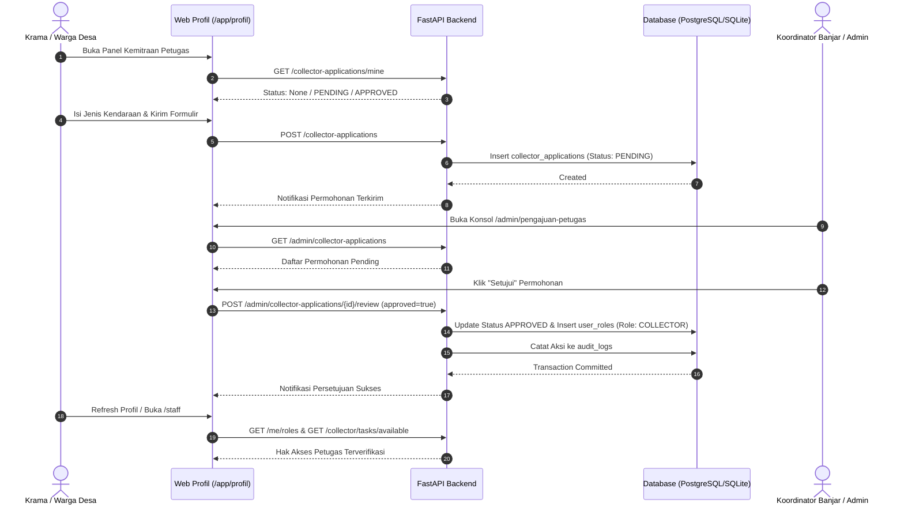

# 03. Panduan Onboarding Peran & Organisasi — Kedas

**Proyek**: Kedas  
**Tanggal**: 30 Oktober 2026  
**Auditor**: Software Architect & IAM Engineer  
**Status**: Implemented & Verified

---

## 1. Prinsip Onboarding Berbasis Kewenangan

Kedas membedakan alur bergabungnya masing-masing entitas:
1. **Pendaftaran Publik (Self-Registration)**:
   - Hanya terbuka untuk peran dasar **`USER` (Warga/Rumah Tangga)**.
   - Pendaftaran publik tidak memiliki akses ke hak istimewa operasional armada atau fasilitas.
2. **Pengajuan Peran Operasional (Role Application Workflow)**:
   - Warga yang ingin menjadi petugas kebersihan (`COLLECTOR`) harus melalui formulir pengajuan di `/app/profil`.
   - Permohonan mencatat jenis kendaraan, catatan operasional, dan komitmen APD keselamatan kerja.
   - Permohonan berstatus `PENDING` dan masuk ke antrean peninjauan administrator di `/admin/pengajuan-petugas`.
   - Hanya setelah Admin menyetujui (`approved = true`), grant peran `COLLECTOR` disisipkan ke tabel `user_roles` dan status verifikasi menjadi `ACTIVE`.
3. **Pendaftaran Fasilitas & Organisasi (Organization-Scoped Onboarding)**:
   - Profil TPS3R / TPST (`facilities`) didaftarkan dengan wilayah layanan, kapasitas olah, dan koordinat.
   - Operator TPS3R ditugaskan dengan `facility_id` spesifik. Operator tidak dapat melakukan transaksi di fasilitas lain.
   - Mitra pembeli industri (`partners`) harus mencantumkan nomor izin usaha daur ulang dan diverifikasi status keaktifannya oleh admin sebelum dapat menebus batch material.

---

## 2. Diagram Alur Pengajuan dan Persetujuan Petugas

