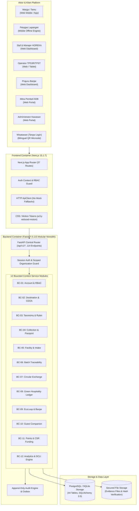
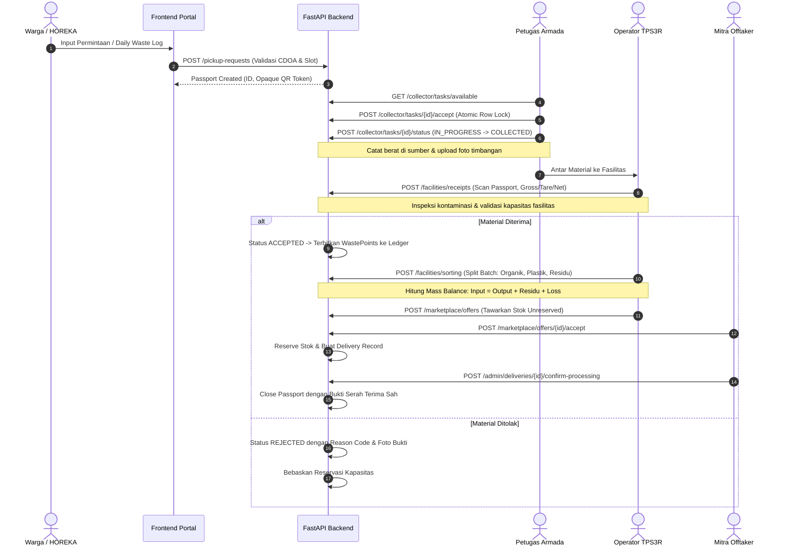

# KEDAS TECHNICAL BLUEPRINT
## Arsitektur Sistem, Alur Data, dan Spesifikasi Teknis Platform Kedas

**Versi:** 1.0  
**Dokumen:** Technical Blueprint  
**Status:** Approved for Implementation  
**Tanggal:** 2026-10-30T12:32:00+08:00 (WITA)

---

## 1. System Context & Container Architecture

Platform Kedas dirancang menggunakan pola **Modular Monolith** yang memisahkan boundary domain dengan tegas di tingkat service, model, dan API sub-router tanpa kompleksitas jaringan microservices.

---

## 2. Canonical Data Flow: Source to Verified Circular Outcome

Alur perjalanan material dari sumber (rumah tangga / HOREKA) hingga pemanfaatan terverifikasi dijamin oleh **Kedas Waste Passport**:

---

## 3. Data Integrity & Security Architecture

1. **Precision & Unit Enforcement**:
   - Seluruh kalkulasi berat menggunakan tipe data `Decimal` (bukan IEEE floating point) untuk mencegah floating rounding errors.
   - Unit berat standar adalah kilogram (`kg`), dengan toleransi selisih penimbangan yang tercatat eksplisit.

2. **Access Control & Anti-IDOR**:
   - Setiap endpoint sensitif memeriksa:
     - `current_user`: Token sesi aktif terverifikasi.
     - `RBAC Role`: Hak akses berbasis salah satu dari 8 role resmi.
     - `Ownership & Organization Scope`: ID objek harus dimiliki pengguna atau berada dalam entitas organisasi/banjar/fasilitas yang menjadi wewenang aktifnya.
     - Upaya mengakses data lintas tenant/organisasi menghasilkan error `403 FORBIDDEN` dengan log audit otomatis.

3. **Concurrency & Race Condition Prevention**:
   - Pengambilan kuota slot penjemputan dan klaim tugas menggunakan `with_for_update()` row-level locking pada database transaction.
   - Penambahan/pengurangan saldo WastePoints menggunakan pattern append-only transaction ledger dengan idempotency key.

4. **Kedas Waste Passport & QR Token Security**:
   - QR code tidak mengekspos ID auto-increment database dan tidak mengekspos PII warga.
   - Token QR bersifat random opaque URL-safe string yang diverifikasi melalui signature server.
