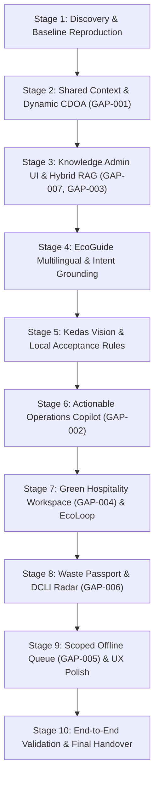

# Master Implementation Plan — Kedas AI Web Innovation

**Project:** Kedas (Historical: WasteLink Bali)  
**Product Positioning:** AI-Powered Community & Green Tourism Intelligence Platform  
**Target:** Bali Digifest AI Web Innovation Challenge 2026 / Production-Ready Hackathon Submission  
**Execution Mode:** Autonomous Sequential 10-Stage Pipeline  
**Date:** 30 October 2026  

---

## 1. Executive Strategy & Guiding Principles

1. **Repository-First & Evidence-Based:** All baseline metrics, contracts, entities, and tests are derived directly from actual code and execution proofs, not assumptions.
2. **Web-First Focus:** Primary user and operator experiences are delivered via modern responsive web (desktop, tablet, mobile browser). Legacy native mobile codebase is preserved as a green baseline (15 tests passing).
3. **AI with Strict Boundaries & Human-in-the-Loop:**
   - **Kedas EcoGuide:** Grounded local knowledge via scoped RAG with explicit abstention protocol (`INSUFFICIENT_CONTEXT`) and verifiable citation cards.
   - **Kedas Vision:** Context-aware image classification with confidence bands, mandatory human review gate, and zero physical weight/reward prediction from photos.
   - **Kedas Operations Copilot:** Read-only decision support with deterministic facility constraints, mass-balance anomaly auditing, and typed pre-filled action proposals that require authorized human confirmation prior to execution.
4. **Deterministic Business Authority:** All RBAC authorization, slot quotas, physical weighing, WastePoints ledgers, mass-balance reconciliation, and DCLI scores are calculated exclusively by backend domain logic.
5. **Dual-Mode AI Resilience:** Online cloud execution (Gemini 2.0 Flash) with seamless local deterministic heuristic fallback ensuring 100% demo uptime and offline reliability.

---

## 2. Gap-to-Stage Resolution Mapping

| Audit Gap ID | Problem Statement in Repository | Target Stage for Complete Resolution | Resolution Approach |
| :---: | :--- | :---: | :--- |
| **GAP-001** | `/area-layanan` uses static hardcoded data array | **Stage 2** | Dynamic binding to `/api/v1/service-areas` and CDOA agreement API; canonical destination context resolver. |
| **GAP-002** | Copilot recommendation CTA only triggers a toast notification | **Stage 6** | Typed action proposal lifecycle (`ADJUST_SERVICE_SLOT`, `CREATE_STAFF_TASK`, etc.), pre-filled editable modal, revalidation, human confirm, domain execution, and audit link. |
| **GAP-003** | EcoGuide RAG uses lexical exact token match | **Stage 3 & 4** | Hybrid retrieval foundation; structured intent routing; exact + semantic scoring with stopword removal; bilingual ID/EN evaluation. |
| **GAP-004** | B2B models exist, but dedicated `/hospitality` workspace is absent | **Stage 7** | Dedicated Next.js workspace `/hospitality` with daily waste logging, B2B contract tracking, and strict tenant isolation. |
| **GAP-005** | Staff collection & weighing form lacks offline capability | **Stage 9** | Scoped IndexedDB outbox queue for collectors in rural blank-spot areas with conflict resolution and server-side validation. |
| **GAP-006** | DCLI backend formula exists, but visual interactive chart is missing | **Stage 8** | Interactive 4-dimension DCLI radar chart with definition drawer, historical trend, and data coverage indicators. |
| **GAP-007** | Knowledge ingestion endpoint exists, but admin web form is missing | **Stage 3** | Web management portal at `/admin/pengetahuan` supporting SOP upload/entry, metadata tagging, chunk preview, and publish approval. |

---

## 3. 10-Stage Milestone Roadmap

