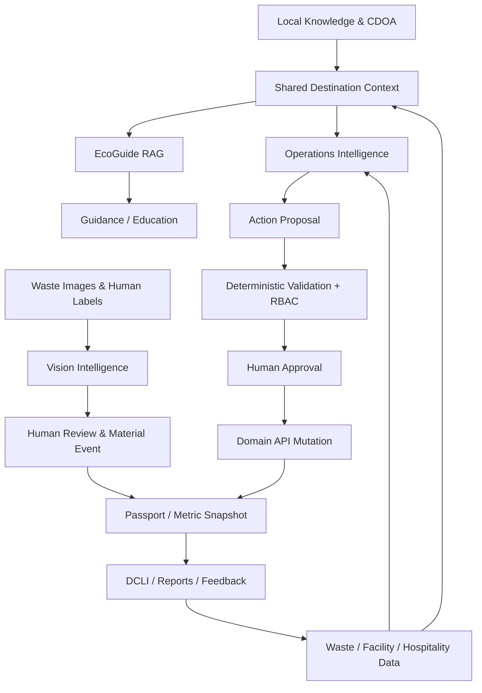

# 01 — Strategi Ekosistem AI Kedas

## 1. Visi dan positioning

**Kedas — AI-Powered Community & Green Tourism Intelligence Platform.**

Kedas menghubungkan pengetahuan lokal, data operasional, pengenalan material, fasilitas, usaha pariwisata, komunitas, dan laporan dampak ke dalam satu lapisan kecerdasan lingkungan.

### Product promise

> Membantu setiap aktor memahami kondisi kawasan, memilih tindakan yang sesuai aturan lokal, dan membuktikan hasil melalui data yang dapat ditelusuri.

Kedas bukan kumpulan chatbot. Kedas adalah sistem dengan beberapa AI capability yang menggunakan **shared destination context**, tetapi tetap dibatasi oleh domain service, permission, dan deterministic rules.

## 2. Environmental Intelligence Loop

AI components berbagi context service dan metric definitions; mereka tidak saling memberikan otoritas tulis.

## 3. Aturan klasifikasi capability

Setiap AI feature harus dimasukkan ke salah satu kelas berikut:

| Kelas | Kegunaan | Batas |
|---|---|---|
| `GENERATIVE_ASSISTANT` | Rangkuman, penjelasan, Q&A, laporan naratif | Wajib grounding bila menyampaikan fakta lokal. |
| `RETRIEVAL_AUGMENTED` | Mengambil informasi dari dokumen yang dipublikasikan | Retrieval harus scoped dan citation-valid. |
| `PERCEPTION` | Gambar/teks terstruktur, kandidat kategori, kontaminasi | Output probabilistik; human review untuk keputusan penting. |
| `PREDICTIVE_ML` | Forecasting volume, kapasitas, tren | Hanya bila data cukup dan model mengalahkan baseline sederhana. |
| `DETECTION` | Anomaly, outlier, perubahan pola | Alert bukan bukti fraud atau pelanggaran. |
| `OPTIMIZATION` | Routing, scheduling, material matching | Hard constraints deterministik; AI hanya ranking/heuristic. |
| `DETERMINISTIC_ANALYTICS` | DCLI, mass balance, carbon factor calculation | Formula dan sumber eksplisit; bukan LLM. |
| `AGENTIC_WORKFLOW` | Mengubah rekomendasi menjadi action proposal | Allowlisted tools, minimal privilege, human approval. |

## 4. Capability registry

Status awal di bawah adalah interpretasi dari laporan audit yang diberikan. Agent wajib memverifikasi ulang.

| ID | Capability | Kelas | Status audit awal | Prioritas | Data dependency |
|---|---|---|---|---|---|
| AI-01 | EcoGuide grounded Q&A | RAG + LLM | Existing; retrieval lexical | P0 | Published SOP, CDOA, source metadata |
| AI-02 | Waste Vision classification | Vision | Existing; benchmark dataset perlu diperkuat | P0 | Label taxonomy, image dataset, facility rules |
| AI-03 | Operations Copilot | LLM + tools | Existing; action UI belum lengkap | P0 | Operational snapshots, tool registry, permission |
| AI-04 | Shared Area Context | Context service | Partial/proposed | P0 | Destination, CDOA, active facility config |
| AI-05 | Knowledge Admin & Ingestion | Document pipeline | Endpoint ada; UI gap dilaporkan | P0 | Document store, parser, approval workflow |
| AI-06 | Facility Eligibility Engine | Deterministic + ranking | Existing/verify | P0 | Material taxonomy, acceptance rules, capacity |
| AI-07 | Capacity Forecasting | Predictive ML | Proposed | P1 | Time-series intake and capacity history |
| AI-08 | Waste Contamination Assistant | Vision + rules | Proposed/possible extension of Vision | P1 | Labeled contaminated/clean image set |
| AI-09 | Waste Composition Analytics | CV + analytics | Proposed | P1 | Consistent material-event records, sampled audits |
| AI-10 | Hospitality Waste Intelligence | Analytics + LLM | Data model reported; workspace gap | P1 | HOREKA logs, occupancy/activity context if permitted |
| AI-11 | Material Matching | Rules + ranking | Proposed extension | P1 | Qualified buyer demand, grade, quantity, location |
| AI-12 | Waste Volume Forecasting | Forecast ML | Proposed | P1 | Sufficient historical series, calendar/context features |
| AI-13 | DCLI Insight Narrative | Deterministic metrics + LLM | Formula reported; visualization gap | P1 | Versioned DCLI definition and snapshots |
| AI-14 | Evidence-based Report Generator | LLM over snapshots | Proposed/partial | P1 | Immutable metric snapshots and source provenance |
| AI-15 | Route & Collection Optimization | Optimization | Future | P2 | Geocoded stops, vehicle constraints, road data, privacy |
| AI-16 | Predictive Maintenance | Predictive ML | Future | P2 | Equipment downtime and maintenance history |
| AI-17 | Community Engagement Insights | Analytics + cautious LLM | Future | P2 | Aggregated participation metrics, consent and bias review |
| AI-18 | Multilingual/Voice Assistant | Speech + LLM | Future | P2 | Approved locales, speech provider, consent |
| AI-19 | Carbon Impact Calculator | Deterministic calculator | Partial/verify | P1 | Approved factors, boundary, year, units, method |
| AI-20 | Environmental Risk Signals | Detection + rules | Future | P2 | Verified reports/sensor data, response protocol |

## 5. Feature-level design cards

### AI-01 EcoGuide — Grounded Local Knowledge

**Purpose:** Menjawab pertanyaan berdasarkan aturan dan SOP kawasan, bukan pengetahuan umum yang diasumsikan berlaku lokal.

**Input:** question, language, destination context, actor visibility, optional conversation context.

**Pipeline:** validate → resolve scope → lexical/vector retrieval → metadata filter → rerank → assemble prompt with untrusted context delimiters → generate structured answer → validate citations → safety/PII checks → log.

**Output:** answer, answer status (`ANSWERED`, `PARTIAL`, `ABSTAINED`), citations, effective dates, source freshness, limitations, suggested next action.

**Hard rules:** hanya `PUBLISHED` source; retrieval filter dilakukan sebelum text dikirim ke model; citation harus menunjuk chunk yang benar-benar retrieved; conflicting/expired source memunculkan warning; tidak ada sumber berarti abstain.

**Evaluation:** Recall@5, MRR/nDCG, citation precision, groundedness, answer relevance, correct abstention, scoped retrieval isolation.

### AI-02 Kedas Vision — Visual Material Assistant

**Purpose:** Membantu pengguna mengenali kandidat kategori material dan cara penanganan sesuai taxonomy/aturan kawasan.

**Input:** private image reference, destination, optional user hint, active taxonomy version.

**Pipeline:** upload validation → malware/content check → metadata strip → safe resize → inference → taxonomy mapping → confidence calibration → facility-rule lookup → response schema → human confirmation.

**Output:** candidates, confidence band, detected visible attributes, `NEEDS_REVIEW` flag, suggested sorting, facility-specific handling note, model/taxonomy version.

**Hard rules:** foto tidak menentukan berat; AI tidak mengesahkan limbah B3; confidence mentah tidak dianggap probabilitas terkalibrasi; unknown/ambiguous image harus diarahkan ke human review.

**Evaluation:** macro-F1, per-class precision/recall, confusion matrix, calibration error, unknown detection, human correction rate.

### AI-03 Operations Copilot — Decision Support to Controlled Action

**Purpose:** Mengubah data operasional menjadi analisis dan action proposal yang ditinjau pengelola.

**Input:** user question, destination/organization scope, period, allowed context.

**Pipeline:** authorization → read-only tools → deterministic aggregation → evidence snapshot → anomaly/rule checks → LLM explanation → schema validation → proposal creation → policy validation → human approval → domain service execution.

**Output:** diagnosis, evidence, assumptions, options, impact estimate (jika metodologinya tersedia), action proposal, required permission, expiry, approval requirement.

**Hard rules:** LLM tidak boleh menjalankan SQL bebas; default tool read-only; semua mutation melalui domain service; tidak ada auto-approval; tool arguments divalidasi ulang; proposal stale harus dihitung ulang.

**Evaluation:** hard-constraint violation = 0; evidence coverage; schema validity; recommendation usefulness; acceptance rate; time-to-action; unauthorized action = 0.

### AI-04 Shared Area Context

Context assembler mengambil hanya data yang diperlukan: destination ID, active CDOA version, material taxonomy, facilities, acceptance rules, service windows, language preferences, data freshness. Cache harus invalidated/versioned saat CDOA/facility rule diterbitkan ulang. Context object mempunyai `context_version`, `as_of`, `scope`, dan source IDs.

### AI-05 Knowledge Management

Admin register → scan/validate → parse → chunk → embed → reviewer check → approve/publish → retrieval index. Dokumen selalu memiliki version, owner, destination scope, classification, effective date, expiry, checksum, language, approval event. Updating creates new version; jangan overwrite source yang pernah disitir.

### AI-06 Facility Eligibility Engine

Hard filters deterministik: active facility, permitted destination scope, material accepted, operating window, capacity remaining, facility state, permit/partner validity if recorded. Baru setelah itu ranking dapat memakai travel distance, operational preference, service quality, atau SLA. AI tidak dapat mengembalikan facility yang gagal hard filter.

### AI-07 Capacity Forecasting

Forecast pada granularitas dan horizon yang didefinisikan (misalnya harian 7 hari). Bandingkan minimal dengan naive/seasonal-naive baseline pada rolling time split. Jika history kurang, data gap besar, atau model tidak mengalahkan baseline, tampilkan `INSUFFICIENT_DATA` atau historical trend.

### AI-08 Contamination Assistant

Vision menghasilkan indikasi visual; taxonomy/rules memberi daftar contamination yang relevan; petugas mengesahkan grading akhir. Jangan menghitung komposisi kimia atau keselamatan material dari foto saja.

### AI-09 Waste Composition Analytics

Gunakan sampling/weighing terverifikasi untuk komposisi kuantitatif. Foto dapat membantu kategorisasi, tetapi total persentase harus dihitung dari bobot/data sampling, bukan proporsi piksel tanpa metode tervalidasi.

### AI-10 Hospitality Waste Intelligence

HOREKA workspace mencatat self-reported dan verified weights secara terpisah. Analisis kategori, tren, cost proxy, kontaminasi, pickup reliability, dan opportunities. Hindari menginferensikan occupancy/guest count bila tidak disediakan dan diizinkan.

### AI-11 Circular Material Matching

Eligibility filters harus menyingkirkan calon pembeli yang tidak menerima grade, volume, wilayah, atau kategori. Ranking menggunakan kecocokan kualitas, MOQ, jarak, jadwal, dan harga penawaran aktif. Harga usang ditandai; kontrak/transaksi memerlukan pihak manusia.

### AI-12 Waste Forecasting

Prediksi timbulan/permintaan layanan memakai time-series, kalender kegiatan, data operasional, dan weather/event hanya bila sumber valid tersedia. Backtest harus time-based; random split tidak boleh digunakan untuk menguji forecasting.

### AI-13 DCLI Insight

Angka DCLI dihitung backend deterministic dengan formula versioned. AI hanya menerjemahkan hasil, menjelaskan driver, dan menandai data yang kurang. Tidak boleh mengubah score atau mengklaim dampak kausal.

### AI-14 Evidence-based Report Generator

Input hanya metric snapshot immutable dan approved metric definitions. LLM membuat narasi, bukan menghitung angka. Validator membandingkan setiap angka/claim dengan snapshot; unsupported claim dihapus atau report ditandai `NEEDS_REVIEW`.

### AI-15 Route Optimization

P2. Gunakan optimization solver/heuristic, bukan meminta LLM menghitung rute. Constraints: vehicle capacity, time windows, material compatibility, facility acceptance, staff shift, stop priority. Peta/routing external data memerlukan provider dan freshness. Operator dapat override.

### AI-16 Predictive Maintenance

P2. Memerlukan work order, fault code, downtime, usage hours, part replacement. Jika data tidak cukup, mulai dengan rule-based maintenance reminder. Jangan mengklaim predictive maintenance sebelum model dievaluasi.

### AI-17 Community Insights

Gunakan aggregate data saja. Jangan membuat inferensi sensitif mengenai individu/keluarga. Waspadai bias komunitas kecil dan suppression minimum group size.

### AI-18 Voice Assistant

P2. Consent sebelum akses mikrofon; visual fallback; transcript dapat diedit; language detection bukan dasar keputusan legal/operasional; jangan simpan audio default tanpa alasan dan consent.

### AI-19 Carbon Calculator

Deterministic calculation. Faktor emisi wajib menyertakan source, version/year, geography, unit, boundary, conversion, and uncertainty. Estimasi harus dinamai estimasi, bukan verified carbon reduction.

### AI-20 Environmental Risk Signals

P2. Hanya menggabungkan laporan/sensor yang tervalidasi dan menunjukkan confidence/data freshness. Sistem menyarankan verifikasi, bukan membuat tuduhan atau mengumumkan pelanggaran otomatis.

## 6. North Star dan metrik produk

**North Star:** Verified, correctly routed material events per active destination per period.

Turunan:
- verified source-to-facility event completeness;
- percentage of accepted material with valid downstream disposition evidence;
- service eligibility error rate;
- AI-assisted task completion rate;
- human correction rate for Vision;
- EcoGuide correct-grounded-answer rate;
- Copilot proposal acceptance/completion rate;
- cost per successful AI-assisted task.

## 7. Prioritas investasi

- **P0:** Shared Area Context, Knowledge Management, Hybrid RAG EcoGuide, Vision evaluation/guardrails, Copilot action proposal, facility eligibility deterministic, AI observability.
- **P1:** Capacity/waste forecast (jika data cukup), Hospitality Intelligence, Circular Matching, DCLI narrative/reporting, material quality assistant.
- **P2:** Route optimization, predictive maintenance, voice, community prediction, environmental anomaly signals.

P2 tidak boleh mendahului fondasi data dan metric quality. Jangan membangun model prediktif hanya agar daftar fitur tampak lebih panjang.
