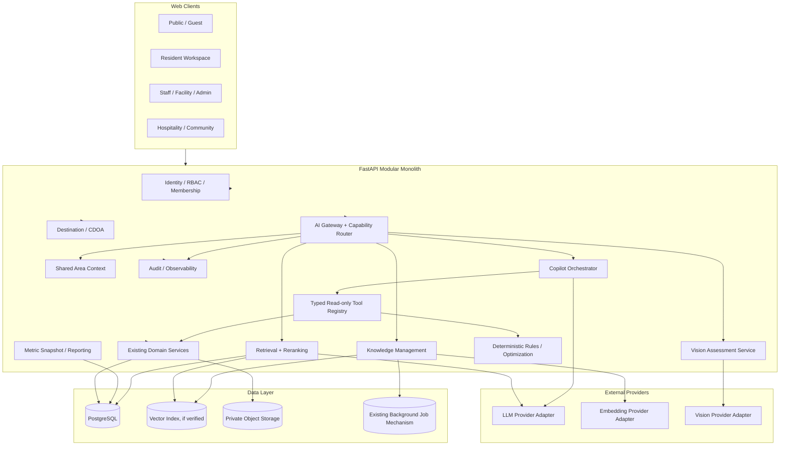
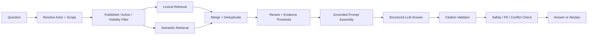
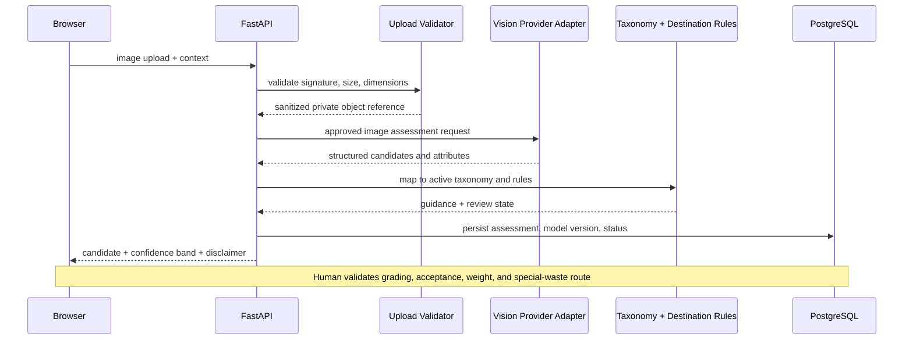
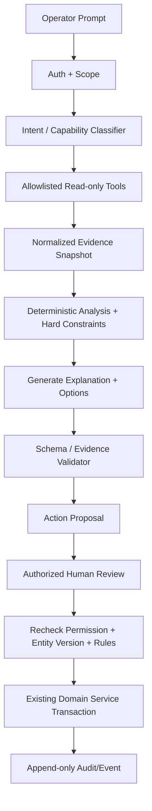

# 04 — High-Level Design Document: AI & Backend Kedas

## 1. Design goals

1. Preserve existing FastAPI modular monolith and domain boundaries.
2. Add AI services without allowing provider/model concerns to leak into domain code.
3. Keep PostgreSQL/domain service as transaction source of truth.
4. Make AI capabilities measurable and replaceable.
5. Keep all high-impact decisions deterministic + human-approved.
6. Support failure isolation, audit, and controlled release.

## 2. Baseline note

The 30 October 2026 audit supplied by the team reports 44 SQLAlchemy tables, 10 Alembic revisions, 116 REST endpoints, 38 Next.js routes, and 203/203 automated tests. Older Kedas documents report different counts (48 endpoints/19 model entries or prior 185-test snapshot). **Do not treat any document count as authoritative until repository commands verify it.** This HDD proposes logical architecture; it does not assert current implementation details.

## 3. Target logical architecture

## 4. Architecture layers

### 4.1 API / policy layer

Responsibilities:
- parse request and attach authenticated actor context;
- enforce permission and destination/organization scope;
- apply rate/size/token quotas;
- validate API schema and idempotency;
- create correlation/interaction ID;
- normalize safe response and errors.

### 4.2 Application orchestration layer

Responsibilities:
- compose context and use cases;
- route capability to EcoGuide/Vision/Copilot/report service;
- coordinate retrieval, tools, validation, and persistence;
- avoid business logic duplication.

### 4.3 Domain layer

Existing domain services remain responsible for transactions: pickup, facility, weighing, material batch, rewards, approvals, CDOA, and partner status. AI services call domain services through typed use cases; they never write tables directly as a shortcut.

### 4.4 Infrastructure layer

Contains provider adapters, object storage, embedding/vector adapter, parser, background job runner, cache, telemetry, and external integration. Provider SDKs must not be imported into domain model modules.

## 5. AI platform components

### 5.1 AI Gateway

One server-side entry point handles:
- capability allowlist;
- policy/version selection;
- actor/scope checks;
- provider/model routing;
- quotas and budgets;
- structured output validation;
- audit/metrics.

It is not a free-form tool-using super-agent.

### 5.2 Capability Router

Routes to explicit typed use cases: `ecoguide.answer`, `vision.assess`, `copilot.analyze`, `report.generate`, `forecast.predict`, `material.match`. Unknown capability is rejected. The router cannot create arbitrary tool names.

### 5.3 Provider Adapter

Interface contract should support capabilities such as:
- `generate_structured(...)`
- `embed_texts(...)`
- `embed_query(...)`
- `analyze_image(...)`
- `stream_text(...)` if the selected provider/API and UX support it.

Provider adapters translate internal schema to provider-specific request/response. They implement timeout, retry, rate limit, token usage parsing, and normalized provider errors. Provider switching requires a smoke/evaluation suite.

### 5.4 Model registry

Registry metadata:
- capability;
- provider/model identifier;
- adapter version;
- prompt version;
- schema version;
- temperature/sampling parameters where supported;
- max input/output size;
- timeout/retry policy;
- cost metadata if available;
- data handling classification;
- evaluation status;
- enabled environments;
- fallback model/policy.

Do not hardcode a model name across domain modules. Use configuration plus a tested registry entry.

## 6. Capability architecture

### 6.1 EcoGuide RAG

Retrieval details:
1. Resolve scope from server-side auth and active destination context.
2. Filter published, effective, visible docs before ranking.
3. Run BM25/lexical and vector retrieval where available.
4. Merge with reciprocal-rank fusion or validated equivalent; tune via eval set.
5. Rerank only candidate chunks already in scope.
6. Preserve document ID, version, chunk ID, section/page, effective dates, and retrieval score.
7. Build prompt that explicitly treats context as untrusted source content.
8. Require structured citation IDs in output.
9. Verify each citation ID belongs to retrieved candidates.
10. Abstain if evidence threshold or source freshness fails.

If pgvector is used, validate actual PostgreSQL extension availability, index strategy, filtering behavior, backup/restore, and query plans. Exact/approximate vector search can behave differently under selective filters; benchmark tenant/destination filtering and recall before choosing HNSW/IVFFlat. See current pgvector guidance in references.

### 6.2 Vision pipeline

Use background processing if provider latency and image workload require it. Store object reference and checksum; avoid base64 blobs in relational rows. Re-authorize every image read. Model may use provider vision or dedicated classifier; capability contract should not depend on one choice.

### 6.3 Operations Copilot

Tool safety:
- each tool has explicit scope, permission, schema, timeout, and read/write declaration;
- no SQL generation/execution by model;
- tool result must be normalized and size-limited;
- model cannot choose actor identity or expand destination scope;
- write tool is not exposed in the default toolset;
- approval endpoint is regular API, not hidden model action.

### 6.4 Deterministic facility eligibility

Hard-filter algorithm:
1. Load active facilities within allowed scope.
2. Filter material type/category and grade acceptance.
3. Filter status (active, maintenance, blocked).
4. Filter operating time window.
5. Verify capacity freshness and available capacity.
6. Verify service/partner permit condition if configured.
7. Return only eligible facilities.
8. Rank eligible facilities using explainable score (distance, SLA, quality, current workload) if data is present.
9. If no valid facility exists, return `NO_ELIGIBLE_FACILITY`.

AI may explain why candidates ranked; it cannot override a rejected hard filter.

### 6.5 Forecasting

Use a dedicated forecasting service, not LLM arithmetic. Steps: validate series → detect gaps/outliers → define horizon/granularity → choose baseline → train/call candidate model → rolling-origin backtest → calculate metrics/interval → compare baseline → apply release gate → persist forecast metadata. If the gate fails, return historical trend and `INSUFFICIENT_DATA`.

### 6.6 Matching and optimization

Material matching pipeline: rule filters → candidate feature calculation → deterministic or ML ranking → explanation → freshness checks → manual quotation/contract. Route optimization uses OR/constraint solver or heuristic with capacity, time-window, vehicle, and facility constraints. LLM may translate user intent and explain results, not compute constraint validity.

### 6.7 DCLI and report pipeline

Metric service calculates versioned DCLI and mass-balance values. Create immutable `MetricSnapshot` including scope, period, definition version, source IDs, provenance class, missingness, and generated time. Report generator receives that snapshot and approved definitions. A claim validator checks numeric values and units. Invalid output is rejected or set to `NEEDS_REVIEW`.

## 7. Data architecture

- PostgreSQL remains system of record.
- Vector index is an extension/read-optimized retrieval store, not source of truth for documents.
- Object storage holds private images and source files.
- Background worker handles ingestion/embedding/evaluation/reporting when needed.
- Cache may hold safe, version-keyed context; never cache permission-sensitive results without scope keys.
- Analytics read model/snapshots should isolate expensive aggregation from transaction paths.

## 8. Background job architecture

Recommended job classes:
- `knowledge_ingestion`;
- `embedding_generation`;
- `vision_assessment` (if async);
- `forecast_training_or_prediction`;
- `report_generation`;
- `evaluation_run`;
- `cleanup_retention`.

Use repository's existing worker/queue/scheduler when present. A new queue technology requires an ADR stating throughput, failure recovery, ops cost, observability, and deployment need.

All jobs require job ID, idempotency, attempts, `run_after`, status, trace ID, error class, and bounded retry. Permanent failures go to a visible failed state/dead-letter equivalent.

## 9. Persistence and migration rules

- Audit existing ORM models before designing entities.
- Reuse existing documents, batches, facilities, logs, partner, and AI interaction models if available.
- Add only missing entities/columns.
- Keep migrations small, reversible where practical, and tested against a copy/snapshot.
- Avoid large embedding payloads in frequently updated domain tables.
- Add unique constraints for document version/checksum and idempotency keys.
- Use transactional outbox pattern only if external event publishing requires it; do not add speculative infrastructure.

## 10. API execution flow and errors

Each request follows: request validation → authentication → permission/scope → quota → use case → provider or rules → output validation → persistence/audit → response. Normalize errors such as `AI_PROVIDER_UNAVAILABLE`, `AI_RATE_LIMITED`, `AI_OUTPUT_INVALID`, `KNOWLEDGE_NOT_FOUND`, `INSUFFICIENT_EVIDENCE`, `SCOPE_FORBIDDEN`, `IMAGE_INVALID`, `PROPOSAL_STALE`, `NO_ELIGIBLE_FACILITY`.

Do not return provider stack traces or secrets.

## 11. Security boundaries

- Browser input untrusted.
- Uploaded documents/images untrusted.
- Retrieved chunks untrusted content, never executable instructions.
- LLM output untrusted until schema/evidence/policy validation.
- Provider response untrusted until normalized.
- Domain service executes only after auth, rules, and approval.
- Public guest requests have public-only knowledge scope and lower quotas.

## 12. Architecture decision records

| ADR | Decision | Default |
|---|---|---|
| AI-ADR-001 | Keep modular monolith | Accepted |
| AI-ADR-002 | Provider-neutral adapter | Required |
| AI-ADR-003 | Hybrid retrieval | Target; requires benchmark |
| AI-ADR-004 | PostgreSQL/pgvector | Conditional on verified extension and benchmark |
| AI-ADR-005 | Read-only Copilot tools by default | Required |
| AI-ADR-006 | Human approval for consequential mutations | Required |
| AI-ADR-007 | Deterministic hard constraints | Required |
| AI-ADR-008 | Immutable metric snapshots | Required |
| AI-ADR-009 | Async worker | Reuse current mechanism first |
| AI-ADR-010 | Dedicated ML model training | Only when dataset/benefit justifies |
| AI-ADR-011 | Multi-agent autonomous framework | Not required for initial scope |

## 13. Required diagrams for final implementation

Agent must update diagrams from actual code: context, container, component, data flow, RAG sequence, Vision sequence, Copilot action sequence, ERD, deployment, and trust boundaries. Proposed diagrams must be labelled target, never as-built.
