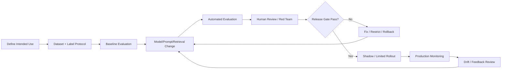

# 06 — AI Evaluation & Governance: Kedas

## 1. Tujuan

Dokumen ini memastikan setiap AI capability dinilai berdasarkan benchmark yang dapat direproduksi, bukan impresi demo. Metrik harus sesuai jenis tugas; satu nilai “akurasi AI” tidak cukup untuk seluruh sistem.

## 2. Evaluation operating model

## 3. Dataset governance

Setiap dataset memiliki:
- dataset ID, version, owner, creation date;
- purpose and intended use;
- data source and permission/consent basis;
- label schema and instructions;
- annotator/reviewer identity or pseudonymous ID;
- disagreement resolution;
- class distribution and exclusions;
- train/validation/test split policy;
- leakage checks;
- retention/deletion rules;
- known limitations and representativeness statement.

Data pribadi, foto anak, wajah, nomor kendaraan, alamat rumah, atau metadata lokasi harus diminimalkan/blur/redact jika tidak dibutuhkan. Jangan menambah data sensitif semata-mata untuk meningkatkan dataset.

## 4. EcoGuide evaluation

### 4.1 Benchmark composition

Minimum initial benchmark proposal: 150–200 query cases, terdiri dari:
- 40 common local-rule questions;
- 25 synonym/paraphrase and mixed-language questions;
- 20 multi-source questions;
- 20 ambiguous/underspecified questions;
- 20 no-evidence/abstention questions;
- 15 outdated/conflicting source cases;
- 15 prompt-injection/adversarial cases;
- 10 cross-destination isolation cases.

Counts may overlap if test tags are multi-label. Use reviewed gold answers, acceptable citations, expected status, and risk category.

### 4.2 Metrics

| Metric | Definition | Proposed initial gate |
|---|---|---:|
| Recall@5 | Relevant gold chunk appears in top 5 | ≥0.85 |
| MRR@10 | Reciprocal rank of first relevant result | Report baseline; target ≥0.75 |
| Citation precision | Valid, supportive cited chunks / sampled citations | ≥0.95 |
| Groundedness | Claims supported by cited retrieved evidence | ≥0.90 reviewer score |
| Answer relevance | Directly addresses query | ≥0.85 reviewer score |
| Correct abstention | Abstains when evidence insufficient | ≥0.90 |
| Scope leakage | Unauthorized document retrieved/shown | 0 |
| Unsupported critical local claims | Critical incorrect rule/route | 0 in release set |

### 4.3 Rubric

Each answer scored 0–2 for grounding, relevance, completeness, citation support, and safe uncertainty. Publish rubric and reviewer instructions. Report inter-rater agreement if multiple reviewers.

## 5. Vision evaluation

### 5.1 Dataset proposal

The prior audit proposed 500 local waste images. Treat this as an initial benchmark target only, not enough by itself for a production-grade model. Build representative classes using active Kedas taxonomy; capture varied light, background, camera quality, clean/dirty, occluded, and mixed items. Split by capture session/person/location to prevent near-duplicate leakage.

Recommended initial data readiness:
- minimum 5–8 classes only if they represent active taxonomy and labels are reliable;
- aim ≥80 reviewed images per class for initial pilot benchmark, but report actual imbalance;
- at least 20% locked holdout, with no near-duplicate across splits;
- two annotators for ambiguous samples, adjudicator for disagreement;
- separate unknown/out-of-scope set.

If these thresholds cannot be reached, classify result as research/experimental and keep human confirmation mandatory.

### 5.2 Metrics and gates

| Metric | Purpose | Proposed initial gate |
|---|---|---:|
| Macro-F1 | Balance across classes | ≥0.80 for limited pilot |
| Per-class precision | Avoid confident wrong suggestion | ≥0.85 for class-specific high-confidence suggestion; risk-dependent |
| Per-class recall | Detect missed category | ≥0.75 initial; improve with data |
| Calibration error | Compare confidence to correctness | ECE ≤0.10 target after calibration |
| Unknown detection recall | Route out-of-scope to review | ≥0.90 on locked unknown set |
| Hazard-sensitive false-safe result | Dangerous/unknown treated as normal safe | 0 on release suite |
| Human correction rate | Monitor poor predictions | Report by class/confidence; no universal threshold initially |

Raw model score is not called probability unless calibrated. High confidence gate must be tuned per class using precision target and validation curve.

### 5.3 Human label workflow

Prediction → user/staff review → accept/correct/reject → reason code → adjudicated gold label (if consent/data policy permits) → dataset candidate → reviewed release. Never automatically promote all feedback into training labels.

## 6. Operations Copilot evaluation

Create at least 50 scenario tests for initial gate, expanding by risk class:
- facility nearing capacity;
- stale/unknown capacity;
- no eligible alternative;
- acceptance-rule mismatch;
- schedule conflict;
- overweight/weight discrepancy anomaly;
- insufficient evidence;
- cross-destination query;
- prompt injection asking to ignore policy;
- unauthorized user requesting action;
- stale proposal after state changes;
- duplicate approval/replay.

Gates:
- hard eligibility violation = 0;
- mutation without explicit authorized approval = 0;
- evidence references present for all consequential claims = 100%;
- tool authorization test pass = 100%;
- structured output schema pass ≥99% after bounded retry;
- every recommendation's assumptions and data freshness displayed.

Human usefulness is scored 1–5 by operators. Report acceptance rate, rejection reason, completion rate, and median time-to-action; do not game metric by making approval automatic.

## 7. Forecasting evaluation

Use data sufficiency gate before model selection:
- minimum required history is defined per granularity and forecast horizon;
- for seasonal yearly patterns, preferably >=52 weekly points or equivalent seasonal coverage;
- missingness, zero periods, facility closures, policy changes, and outliers are labeled;
- compare naive and seasonal-naive baselines;
- rolling-origin backtesting, never random shuffle split;
- report MAE, WAPE (with handling for near-zero actuals), bias, prediction interval coverage, and performance per facility/category.

Proposed release rule: candidate must beat chosen naive baseline by ≥10% on agreed primary error metric without unacceptable bias. If not, show historical trend/scenario only, status `EXPERIMENTAL` or `INSUFFICIENT_DATA`.

## 8. Matching/optimization evaluation

For material matching:
- all candidate hard eligibility tests pass;
- ineligible result count = 0;
- ranking relevance reviewed on representative scenarios;
- data freshness and no-match behavior tested;
- explain top reasons and excluded reason codes.

For routing:
- constraint violations = 0 in generated plans;
- compare distance/time/cost to current/manual baseline;
- report assumption quality and missing geodata;
- no deployment until operator validates sample routes.

## 9. Report and impact evaluation

- Metric numeric fidelity = 100% against snapshot test fixtures.
- Every displayed metric includes unit, period, scope, definition version, provenance, and source timestamp.
- Carbon calculations use deterministic factor library with factor source/version/geography/year and uncertainty.
- AI narrative cannot create new numerical facts; unsupported values rejected.
- DCLI formula is versioned; formula changes do not silently rewrite historical snapshots.

## 10. AI release tiers

| Tier | Allowed use | Requirements |
|---|---|---|
| T0 Research | Internal experiment | Dataset and known limitations documented |
| T1 Demo | Simulated/non-operational demo | Clear simulated label; no real mutation |
| T2 Assisted | Limited real-user assistance | Evaluation gate + human review + monitoring |
| T3 Operational | Repeated operational use | Stronger evidence, drift monitoring, rollback, incident process |

A feature cannot self-promote tiers. Release owner approves.

## 11. Model card template

Each model/capability must have a card containing:
1. Name/version/capability owner.
2. Intended and prohibited uses.
3. Provider/model architecture and model version.
4. Training/evaluation data summary and rights.
5. Labels/taxonomy and reviewer method.
6. Metrics by class/language/role/destination where appropriate.
7. Known limitations and confidence behavior.
8. Privacy/security controls.
9. Human oversight and escalation.
10. Cost/latency profile.
11. Rollback/fallback version.
12. Approval date and release tier.

## 12. Governance roles

- Product owner: intended use, value, release priority.
- Domain owner: CDOA, taxonomy, operating rules.
- Data steward: quality, provenance, retention.
- AI engineer: model/retrieval/prompt implementation.
- Backend owner: API, security, integration.
- QA/evaluator: independent benchmark and regression.
- Human approver: consequential operational actions.

## 13. Monitoring and drift

Monitor input distribution, confidence distribution, abstention, human correction, citation feedback, retrieval miss, provider change, token/cost, latency, and failure. Do not automatically retrain from live feedback. Trigger review when metric moves beyond agreed control limits or there is a major policy/taxonomy change.
