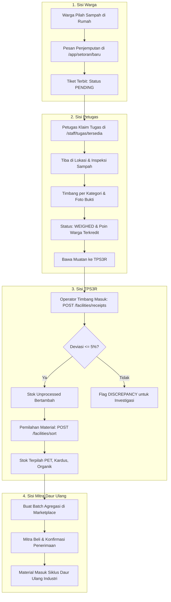

# 04. Workspace Operasional & Alur Kerja Lintas Peran — Kedas

**Proyek**: Kedas  
**Tanggal**: 30 Oktober 2026  
**Auditor**: Principal Full-Stack Architect  
**Status**: Implemented & Verified

---

## 1. Dasbor Operasional Berbasis Peran (Role Dashboards)

### A. Dasbor Warga Desa (`/app`)
- **Fitur Utama**:
  - Ringkasan saldo WastePoints dinamis dan estimasi ekuivalen rupiah.
  - Kartu tombol tindakan cepat (*CTA*): "+ Buat Permintaan Jemput" dan "Setor Mandiri".
  - Status tiket setoran terkini dengan lencana status dan pelacakan lini masa.
  - Ringkasan tonase terpilah pribadi dan kontribusi pengurangan emisi CO2.
  - Integrasi otentikasi via `useAuth()` dan service layer teruji.

### B. Dasbor Meja Petugas Pengangkut (`/staff`)
- **Fitur Utama**:
  - Pengecekan status shift kerja aktif dan area banjar tugas.
  - Tab "Tugas Tersedia": Daftar tugas siap ambil dengan proteksi klaim atomik (mencegah dua petugas mengklaim tugas yang sama).
  - Tab "Tugas Saya": Lini masa penjemputan, navigasi alamat warga, kontak telepon warga.
  - Alur Tugas Lapangan (`/staff/tugas/[id]`):
    - Formulir inspeksi skor kontaminasi (0–100%) dan catatan kualitas.
    - Penimbangan multi-kategori (Organik, Plastik, Kertas/Kardus, Kaca).
    - Unggah foto timbangan digital dan kantong sampah terpilah.
    - Pelaporan kendala lapangan (*field failure*) dengan alasan wajib (warga tidak di tempat, jalan ditutup upacara) yang secara otomatis melepaskan slot penjemputan.

### C. Dasbor Operator Fasilitas TPS3R / TPST (`/admin/laporan`, `/facilities`)
- **Fitur Utama**:
  - Penerimaan muatan sampah masuk dari petugas dengan verifikasi surat jalan.
  - Rekonsiliasi otomatis timbangan lapangan vs timbangan fasilitas (ambang deviasi 5%).
  - Formulir pemilahan stok (`/facilities/{id}/sort`) dengan perlindungan *pessimistic row-level lock* (`with_for_update()`) untuk mencegah anomali inventaris negatif.
  - Pencatatan residu yang dikirim ke Tempat Pemrosesan Akhir (TPA).

### D. Dasbor Bank Sampah Mandiri (`/admin`, `/waste-bank`)
- **Fitur Utama**:
  - Pembukuan rekening nasabah krama banjar.
  - Pencatatan setoran material tabungan dengan konversi nilai rupiah berdasarkan daftar harga resmi yang memiliki masa berlaku.
  - Pemisahan struktural antara saldo tabungan kas rupiah bank sampah dengan poin apresiasi promosi platform Kedas.

### E. Dasbor Mitra Industri Daur Ulang & B2B (`/admin/mitra`, `/marketplace`)
- **Fitur Utama**:
  - Agregasi stok material terpilah TPS3R menjadi batch daur ulang siap jual.
  - Penawaran harga beli batch oleh mitra berizin daur ulang terverifikasi.
  - Surat perintah angkut dan konfirmasi penerimaan material pabrik.

### F. Dasbor Prajuru Banjar & Tata Kelola Lingkungan (`/admin`, `/community`)
- **Fitur Utama**:
  - Pemantauan tonase sampah terpilah dan rasio kepatuhan warga di wilayah banjar terkait.
  - Manajemen aksi bersih lingkungan (*cleanup*) dan keterlibatan relawan komunitas.
  - Pengawasan manifes limbah khusus (medis, elektronik) dan limbah upakara keagamaan (*canang sari*).

---

## 2. Rincian Alur Kerja Lintas Peran End-to-End

