# Perancangan Lanjutan WasteLink Bali
## Pembagian Pengembangan Produk Berdasarkan Potensi Kelompok Pengelolaan Kebersihan dan Sampah

> **Status:** Dokumen rancangan lanjutan / working design  
> **Versi:** 1.0  
> **Tanggal:** 30 Oktober 2026  
> **Produk:** WasteLink Bali — Platform Pengelolaan Sampah Berbasis Komunitas dan Ekonomi Sirkular  
> **Cakupan awal:** rancangan produk, pembagian peran, alur operasional, modul perangkat lunak, dan strategi pilot  
> **Asumsi awal:** pilot pada satu wilayah yang memiliki operator dan jalur penanganan sampah nyata; bukan peluncuran serentak seluruh Bali.

---

## 1. Ringkasan Eksekutif

WasteLink Bali sebaiknya dirancang sebagai **platform koordinasi rantai pengelolaan sampah**, bukan sekadar aplikasi penjemputan. Tiap kelompok dalam ekosistem persampahan mempunyai pekerjaan, informasi, insentif, dan keterbatasan yang berbeda. Karena itu, pembagian pengembangan yang paling tepat adalah berdasarkan **fungsi operasional dan nilai yang dapat diberikan kepada tiap kelompok**.

Produk inti tetap satu, tetapi pengalaman dan hak aksesnya berbeda:

1. **Warga/rumah tangga:** memilah, meminta penjemputan atau melakukan setoran, memantau status, memperoleh edukasi, dan melihat poin yang sudah tervalidasi.
2. **Petugas pengangkut:** menerima penugasan, merencanakan rute, mencatat pengambilan, mendokumentasikan kendala, serta menyerahkan material ke fasilitas atau mitra.
3. **Operator TPS3R/TPST/pusat pemilahan:** menerima material, memeriksa kategori dan kualitas, menimbang, mengelola stok/batch, serta mencatat hasil pengolahan dan residu.
4. **Bank sampah dan kelompok komunitas:** menjadwalkan setoran, menimbang, mencatat tabungan atau insentif sesuai kebijakan organisasi, dan menyalurkan material ke pembeli.
5. **Pengepul, agregator, pendaur ulang, dan pengolah material:** menyampaikan kebutuhan, spesifikasi kualitas, volume minimum, harga indikatif, dan bukti serah-terima.
6. **Pelaku usaha (hotel, restoran, vila, pasar, kantor):** membuat jadwal layanan, memantau volume serta bukti pengangkutan, dan mengakses laporan internal sesuai kontrak.
7. **Desa/banjar/desa adat, pengelola program, dan pemerintah daerah:** mengoordinasikan wilayah, operator, layanan, pelaporan, edukasi, dan pengawasan program.
8. **Pengelola limbah khusus dan kegiatan kebersihan lingkungan:** hanya dilibatkan melalui alur khusus yang tervalidasi; jangan dicampurkan dengan penjemputan umum.
9. **Sponsor/CSR/mitra pendanaan:** mendanai program dengan pembatasan anggaran, bukti kegiatan, dan pelaporan dampak yang dapat diaudit.

### Rekomendasi produk

- Bangun **inti sistem bersama**: identitas, wilayah, kategori, permintaan penjemputan/setoran, tugas petugas, inspeksi, penimbangan, serah-terima, bukti foto, notifikasi, audit log, dan dashboard dasar.
- Kembangkan fitur khusus kelompok secara bertahap. Jangan membuat sembilan aplikasi terpisah.
- **Jangan memberi poin hanya berdasarkan klaim warga.** Poin baru diterbitkan setelah berat dan kategori diverifikasi menurut kebijakan operator.
- Bedakan status **dijemput**, **diterima fasilitas**, **terjual/diserahkan ke mitra**, dan **diproses**. Penjemputan bukan bukti bahwa material sudah didaur ulang.
- Mulai di satu wilayah dengan operator yang jelas, layanan yang benar-benar berjalan, dan jalur hilir yang terkonfirmasi.

## 2. Latar Belakang dan Interpretasi Konteks Bali

Kebutuhan WasteLink berkaitan dengan pemilahan dari sumber, konsistensi pengumpulan, kapasitas pengolahan, dan keterhubungan ke pihak yang dapat menerima material. Peraturan, kondisi lapangan, dan kapasitas layanan dapat berbeda antar-kabupaten/kota serta antar-operator; sistem harus mendukung konfigurasi wilayah, bukan menanam asumsi bahwa seluruh Bali mempunyai proses yang identik.

### 2.1 Referensi konteks publik

- **BPS Provinsi Bali — statistik pemilahan rumah tangga tahun 2025** melaporkan secara agregat Bali: 33,29% rumah tangga melakukan pemilahan dua jenis, 6,60% melakukan pemilahan tiga jenis, dan 60,10% tidak melakukan pemilahan. Angka rinci berbeda menurut kabupaten/kota. Data ini berguna sebagai baseline historis, bukan bukti kondisi setiap banjar pada saat implementasi. [Sumber BPS Bali](https://bali.bps.go.id/id/statistics-table/1/MjA2IzE%3D/persentase-rumah-tangga-menurut-kabupaten-kota-dan-pemilahan-sampah-yang-dilakukan-di-provinsi-bali-2025.html)
- **KLH/BPLH, 10 Juni 2026** mengumumkan gerakan “Bali 100 Persen Memilah Sampah” dan kewajiban pemilahan dari sumber mulai 1 Juli 2026. Artikel tersebut juga menyebut capaian kepatuhan yang diklaim pada Juni 2026. Angka ini berasal dari pelaporan/konteks kebijakan yang berbeda dengan survei rumah tangga BPS; **jangan membandingkan keduanya secara langsung sebagai tren tanpa menyamakan definisi, periode, dan metode pengukuran**. [Sumber KLH/BPLH](https://kemenlh.go.id/news/detail/tegas-klhbplh-dan-pemprov-bali-wajibkan-warga-pilah-sampah-100-persen-mulai-1-juli)
- **KLH/BPLH, 8 Juli 2026** melaporkan dimulainya pembangunan fasilitas PSEL di Pedungan, Denpasar, dan menempatkannya sebagai bagian dari transformasi pengelolaan sampah. PSEL bukan pengganti untuk pengurangan, pemilahan, kompos, pemulihan material, dan jalur residu yang bertanggung jawab. [Sumber KLH/BPLH](https://kemenlh.go.id/news/detail/akhiri-ketergantungan-tempat-pemrosesan-akhir-menteri-lh-transformasi-kelola-sampah-lewat-fasilitas-energi-terbarukan-telah-dimulai-di-bali)
- **Pedoman teknis TPS 3R dari DKLH Provinsi Bali** menjelaskan kebutuhan ruang penerimaan, pemilahan, pengolahan organik, penyimpanan produk daur ulang, dan residu. Ini mendukung pemisahan fungsi modul penerimaan, pengolahan, stok material, dan residu. [Sumber pedoman teknis](https://dklh.baliprov.go.id/wp-content/uploads/2022/04/PEDOMAN-TEKNIS-PENGELOLAAN-SAMPAH-BERBASIS-SUMBER-1_compressed-2.pdf)

### 2.2 Implikasi desain untuk WasteLink

| Temuan/konteks | Implikasi pada desain |
|---|---|
| Pemilahan perlu dilakukan dari sumber | Sediakan panduan kategori, pengingat, dan catatan kualitas; jangan hanya menampilkan tombol “jemput sampah”. |
| Kondisi dan kapasitas berbeda antarwilayah | Wilayah layanan, jadwal, kategori yang diterima, kapasitas, dan jalur material harus dapat dikonfigurasi. |
| Organik, daur ulang, residu, dan limbah khusus memiliki penanganan berbeda | Gunakan kategori dan aturan rute yang berbeda; limbah khusus wajib memiliki jalur yang disetujui. |
| Fasilitas membutuhkan penerimaan, pemilahan, penyimpanan, dan penanganan residu | Buat modul fasilitas/batch/stok yang terhubung ke transaksi penjemputan. |
| Program melibatkan pemerintah, komunitas, fasilitas, dan sektor usaha | Terapkan dashboard terpisah dan pelaporan berdasarkan kewenangan. |
| Klaim dampak perlu bukti | Simpan sumber data, bukti timbang, bukti serah-terima, dan status pemrosesan secara terpisah. |

**Batas kesimpulan:** angka publik menunjukkan relevansi masalah dan arah kebijakan, tetapi tidak cukup untuk menetapkan potensi pendapatan, biaya per pickup, harga jual material, jumlah petugas, atau target pengurangan sampah pada satu wilayah. Semua nilai tersebut perlu divalidasi melalui wawancara dan pilot lapangan.

---

## 3. Tujuan, Batasan, dan Prinsip Rancangan

### 3.1 Tujuan

1. Menyusun pembagian pengembangan berdasarkan tugas nyata tiap kelompok pengelolaan sampah.
2. Mengurangi pencatatan berulang dan ketidakjelasan tanggung jawab antar-pelaku.
3. Memastikan material memiliki jalur tujuan yang jelas sebelum dijemput atau diterima.
4. Memungkinkan penimbangan, kualitas, dan insentif terlacak.
5. Membuat alur material dapat ditelusuri dari sumber sampai tujuan berikutnya.
6. Menghasilkan data operasional yang bisa dipakai untuk memperbaiki layanan dan mengukur hasil.
7. Menjaga agar aplikasi tidak menambah beban administrasi yang tidak sebanding dengan manfaat bagi petugas.

### 3.2 Bukan tujuan MVP

- Menggantikan sistem operasional resmi pemerintah atau sistem yang sudah diwajibkan oleh operator.
- Mengklaim seluruh sampah yang dijemput telah didaur ulang.
- Menawarkan harga jual atau nilai poin yang dijamin sebelum pendanaan dan pembeli terverifikasi.
- Mengotomatisasi penanganan limbah B3/limbah khusus tanpa mitra dan prosedur yang berwenang.
- Meluncurkan semua fitur untuk semua kabupaten/kota sekaligus.
- Memaksakan blockchain, AI computer vision, optimasi rute kompleks, IoT timbangan, atau integrasi lintas-instansi sebelum proses dasar berjalan.

### 3.3 Prinsip rancangan produk

- **One platform, role-based workflows:** platform dan data inti satu, pengalaman menyesuaikan peran.
- **Mobile-first untuk pekerjaan lapangan, desktop-friendly untuk operasi fasilitas:** petugas lapangan harus bisa memakai tampilan responsif sederhana; operator pos/fasilitas membutuhkan tabel, antrean, dan laporan yang nyaman di komputer.
- **Offline-tolerant:** formulir tugas dan bukti minimum dapat disimpan sementara bila sinyal buruk; sinkronisasi harus aman dan menampilkan konflik.
- **Proof before reward:** poin dan klaim dampak harus bersandar pada hasil verifikasi.
- **Traceability over vanity metrics:** prioritaskan bukti arus material dan penyelesaian tugas dibanding jumlah akun/unduhan.
- **Do not digitize broken processes blindly:** sederhanakan proses manual terlebih dahulu sebelum mengotomatiskan.
- **No false certainty:** aplikasi harus menunjukkan data yang belum diverifikasi dan tujuan material yang belum dikonfirmasi.
- **Human override with audit trail:** supervisor dapat memperbaiki data, tetapi perubahan dicatat siapa, kapan, dan alasannya.

---

## 4. Peta Ekosistem: Kelompok yang Dilibatkan

Istilah “petugas kebersihan” tidak menunjuk satu jenis pekerjaan saja. Dalam konteks WasteLink, kelompok berikut harus dipisahkan karena tugas dan keberhasilan masing-masing tidak sama.

| Kode | Kelompok | Peran tipikal | Potensi kontribusi terhadap WasteLink | Prioritas awal |
|---|---|---|---|---|
| G1 | Warga/rumah tangga | Pemilah dan sumber material | Data sumber, permintaan layanan, pemilahan, kebiasaan baru | Sangat tinggi |
| G2 | Petugas pengangkut/kebersihan | Mengambil dan mengantarkan material | Eksekusi pickup, bukti lapangan, ketepatan waktu, kualitas informasi | Sangat tinggi |
| G3 | Pengurus banjar/desa/desa adat/komunitas | Koordinasi warga, jadwal, kegiatan komunitas | Legitimasi lokal, penyebaran informasi, penyelesaian eskalasi | Tinggi untuk pilot komunitas |
| G4 | Operator TPS3R | Penerimaan, pemilahan, pengolahan skala lokal | Validasi material, kapasitas, pemulihan material, residu | Sangat tinggi jika menjadi tujuan resmi |
| G5 | Operator TPST/MRF/fasilitas terpadu | Konsolidasi/pemilahan/pengolahan sesuai fasilitas | Data aliran masuk/keluar, stok, batch, kinerja fasilitas | Tinggi jika terlibat di wilayah pilot |
| G6 | Bank sampah | Penerimaan setoran terpilah dan pencatatan nilai | Jalur material anorganik bernilai, pencatatan nasabah/setoran | Tinggi untuk pilot material daur ulang |
| G7 | Pengepul/agregator/pendaur ulang/pengerajin | Membeli atau memakai material sesuai spesifikasi | Informasi permintaan, harga, volume minimum, penyerapan material | Tinggi untuk circular marketplace sederhana |
| G8 | Hotel, restoran, vila, pasar, kantor dan usaha | Penghasil material komersial | Volume lebih terkonsentrasi, kontrak layanan, pembiayaan layanan | Menengah–tinggi, setelah proses warga stabil |
| G9 | Pengolah organik/kompos/biokonversi yang sah dan layak | Menerima organik sesuai kapasitas | Jalur organik, data kontaminasi, hasil pengolahan | Tinggi bila organik menjadi fokus wilayah |
| G10 | Petugas lingkungan, relawan, kelompok bersih pantai/sungai | Kegiatan bersih lingkungan atau pengumpulan khusus | Pemetaan kegiatan, titik penumpukan, hasil aksi | Menengah; modul terpisah setelah MVP |
| G11 | Pengelola limbah khusus dan mitra berwenang | Menangani jenis limbah tertentu sesuai prosedur | Permintaan jalur khusus dan bukti serah-terima | Rendah pada MVP umum; wajib jalur aman jika kasus masuk |
| G12 | Admin program/pemerintah/pendana/CSR | Pengawasan, program, audit dan pembiayaan | Dashboard wilayah, anggaran, laporan, audit | Admin minimum sejak awal; pendanaan bertahap |

**Catatan:** beberapa organisasi dapat memegang lebih dari satu fungsi. Contohnya, organisasi komunitas dapat mengelola bank sampah sekaligus kegiatan edukasi. Di sistem, satu orang boleh mempunyai beberapa peran yang telah disetujui; hak akses tetap mengikuti izin server, bukan hanya pilihan menu di antarmuka.

### 4.1 Mermaid — ekosistem dan hubungan antarpelaku

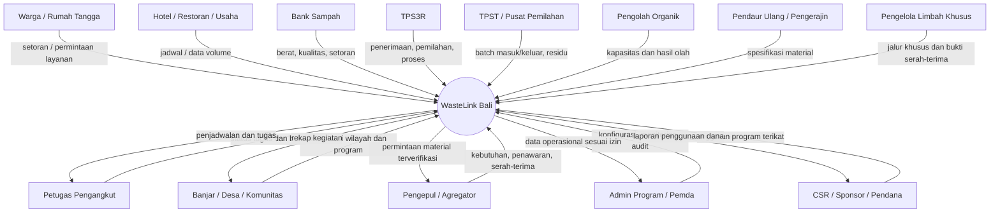

### 4.2 Alur end-to-end dan titik serah tanggung jawab

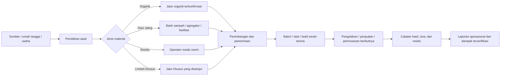

**Prinsip penting:** WasteLink mencatat perpindahan tanggung jawab. Sistem harus mengetahui siapa yang menyerahkan, siapa yang menerima, kapan, berapa beratnya, dengan kategori dan kondisi apa, serta apa tujuan berikutnya. Bila tujuan material belum tersedia, statusnya harus tetap “menunggu tujuan/penanganan”, bukan otomatis “didaur ulang”.

---

## 5. Model Pembagian Pengembangan

Pembagian pengembangan jangan dilakukan dengan membuat satu tim membangun “aplikasi petugas”, tim lain “aplikasi bank sampah”, dan tim lain “aplikasi pemda” dari nol. Pembagian yang lebih sehat adalah **tim domain/fitur yang menggunakan fondasi bersama**, lalu setiap kelompok memperoleh alur khusus.

### 5.1 Lapisan sistem

1. **Lapisan inti (shared core):** akun, role, organisasi, wilayah, kategori, permintaan, penugasan, status, bukti, timbang, serah-terima, notifikasi, audit log.
2. **Lapisan workflow per kelompok:** layar warga, dashboard petugas, workstation fasilitas, transaksi bank sampah, katalog kebutuhan material, dashboard usaha, dan dashboard program.
3. **Lapisan analitik dan pembiayaan:** laporan layanan, aliran material, kualitas, biaya, anggaran reward, program CSR, dan indikator kinerja.
4. **Lapisan integrasi (belakangan):** perangkat timbang, sistem pemda/mitra, peta dan geocoding, payment jika diperlukan, atau analitik lanjutan.

### 5.2 Mermaid — arsitektur modul per kelompok

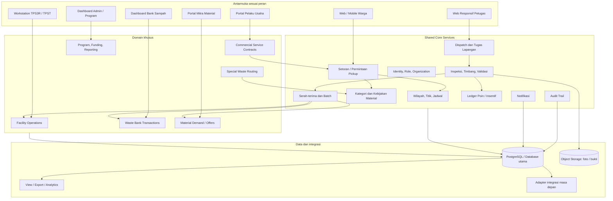

### 5.3 Pembagian tanggung jawab pengembangan

| Paket kerja | Fokus | Dependensi utama | Keluaran minimum |
|---|---|---|---|
| P0 — Product & Field Research | Memvalidasi cara kerja nyata, aktor, istilah, tujuan material, biaya | Wawancara dan observasi | Peta proses aktual, daftar asumsi, keputusan pilot |
| P1 — Shared Platform Core | Auth, role, organisasi, wilayah, kategori, audit | P0, desain data | API inti dan izin per role |
| P2 — Source & Collection | Setoran, penjadwalan, dispatch, tugas petugas, bukti | P1 | Alur pickup end-to-end |
| P3 — Verification & Material Flow | Inspeksi, timbang, penerimaan, serah-terima, batch | P1, P2 | Riwayat material yang bisa ditelusuri |
| P4 — Facility & Waste Bank | Penerimaan, stok, pengolahan dasar, transaksi bank sampah | P3 | Pencatatan fasilitas atau bank sampah |
| P5 — Material Network & Business | Kebutuhan material, penawaran, kontrak usaha | P3, P4 | Jalur material dan layanan B2B terkonfirmasi |
| P6 — Program, Funding & Analytics | Laporan, anggaran, reward rules, ekspor, audit | P1–P4 | Dashboard kinerja dan kontrol dana |
| P7 — Special Workflows | Limbah khusus, bersih pantai/sungai, fitur IoT/AI | Semua proses dasar stabil | Modul khusus dengan pengendalian tersendiri |

**Catatan implementasi:** jika tim kecil, satu orang dapat mengerjakan lebih dari satu paket, tetapi kontrak API dan ownership data harus tetap jelas. Jangan membagi pekerjaan hanya berdasarkan halaman UI; tentukan siapa pemilik domain, schema, validasi, endpoint, dan test-nya.

---

## 6. Desain Mendalam per Kelompok

## 6.1 G1 — Warga dan Rumah Tangga

### Peran dalam ekosistem
Warga adalah sumber material dan pihak yang melakukan pemilahan pertama. Penggunaan aplikasi hanya akan berdampak jika alur yang ditawarkan lebih mudah daripada kebiasaan sekarang dan sesuai dengan layanan nyata di wilayahnya.

### Masalah yang perlu divalidasi
- Warga belum tentu tahu kategori yang diterima oleh layanan setempat.
- Jadwal pengangkutan atau lokasi setoran dapat berbeda antar-area.
- Warga bisa mencampurkan material karena tidak memahami perbedaan jalur pengolahan.
- Warga dapat mengharapkan reward tunai, padahal dana atau pasar material belum tersedia.
- Warga mungkin tidak nyaman memasukkan alamat rinci, foto rumah, atau data identitas tanpa alasan yang jelas.

### Fitur yang direkomendasikan
**MVP:**
1. Onboarding singkat, lokasi layanan/area, dan profil minimum.
2. Panduan pemilahan per kategori dengan bahasa sederhana dan contoh yang relevan.
3. Pilihan **setoran mandiri** atau **permintaan penjemputan**, hanya jika layanan tersebut tersedia di area warga.
4. Pilihan kategori, perkiraan volume, waktu siap diambil, instruksi akses yang opsional, dan foto jika diperlukan.
5. Status permintaan dan estimasi jadwal yang tidak menjanjikan waktu palsu.
6. Riwayat setoran, hasil timbang final, alasan koreksi berat/kategori, serta ledger poin.
7. Notifikasi perubahan status dan edukasi berbasis masalah yang sering terjadi.
8. Kanal pelaporan masalah, pembatalan, atau permintaan koreksi.

**Tahap berikutnya:** pengingat jadwal, kalender pengumpulan kolektif, panduan berbasis wilayah, program komunitas, dan rekomendasi pengurangan sampah berdasarkan histori.

### Aturan bisnis
- Perkiraan berat dari warga bukan dasar pembayaran poin final.
- Warga harus dapat melihat perbedaan antara berat perkiraan dan berat terverifikasi.
- Poin yang dikoreksi harus memiliki alasan dan riwayat; catatan lama tidak boleh dihapus.
- Warga tidak perlu melihat nomor telepon pribadi petugas kecuali memang dibutuhkan oleh operasi dan disetujui kebijakan.
- Warga tidak dapat membuat pickup untuk kategori yang tidak diterima di area atau operator yang dipilih.

### KPI
- Persentase permintaan yang berhasil diselesaikan.
- Persentase setoran dengan kategori awal yang benar.
- Tingkat pembatalan dan no-show.
- Waktu median dari permintaan ke pengambilan.
- Persentase pengguna yang kembali menggunakan layanan.
- Persentase warga yang memahami berat final dan status material.

### Potensi nilai
Warga memperoleh kepastian proses dan transparansi. Operator memperoleh data kebutuhan dan potensi pasokan yang lebih terencana. Nilai ekonomi pada warga hanya boleh diklaim sesuai sumber dana dan aturan yang berlaku.

---

## 6.2 G2 — Petugas Pengangkut/Kebersihan

### Peran dalam ekosistem
Petugas melaksanakan penjemputan, pengumpulan atau pemindahan material. Kelompok ini dapat terdiri atas petugas pemerintah, petugas kontraktor, pekerja operator lokal, atau tim swadaya—struktur organisasi harus diperiksa di wilayah pilot.

### Kebutuhan operasional
- Daftar tugas yang benar-benar ditugaskan kepada petugas/kelompoknya.
- Lokasi dan instruksi yang cukup tanpa membuka data warga yang tidak diperlukan.
- Status tugas yang sederhana dan konsisten.
- Proses cepat untuk menandai warga tidak ada, material tidak sesuai, akses terhalang, kendaraan penuh, atau lokasi salah.
- Bukti foto/berat seperlunya tanpa berlebihan.
- Tujuan penyerahan material yang telah disetujui dan mampu menerima kategori tersebut.
- Antarmuka yang tetap dapat digunakan pada layar ponsel/tablet dan jaringan tidak stabil.

### Fitur yang direkomendasikan
**MVP:**
1. Antrean tugas berdasarkan tanggal, area, dan prioritas.
2. Detail lokasi yang diperlukan, kategori, perkiraan volume, dan catatan akses.
3. Tombol status: menerima tugas, menuju lokasi, pengambilan berlangsung, diambil, gagal dengan alasan, dan selesai serah-terima—nama dan urutan status harus disepakati dengan operator.
4. Bukti minimum: waktu, pengguna petugas, lokasi bila diizinkan, foto sesuai kebijakan, kategori aktual, dan alasan perubahan.
5. Input berat hanya jika petugas memiliki kewenangan dan alat ukur; jika tidak, berat dicatat di fasilitas penerima.
6. Penugasan ulang oleh supervisor dengan alasan dan audit trail.
7. Ringkasan tugas hari itu dan daftar tugas tertunda.
8. Mode sinkronisasi aman untuk sinyal buruk; UI harus memberi tanda “belum tersinkron”.

**Tahap berikutnya:** optimasi urutan rute, prediksi durasi, peta kepadatan tugas, integrasi lokasi kendaraan, pemindaian QR untuk serah-terima, dan pelaporan produktivitas tim. Semua fitur lokasi harus dibatasi untuk kebutuhan operasi dan waktu kerja yang wajar.

### Desain perangkat
- **Web desktop di pos/operator:** baik untuk supervisor, dispatch, peninjauan bukti, dan laporan.
- **Web responsif di ponsel:** cocok sebagai baseline bagi petugas lapangan agar tidak wajib memasang aplikasi native baru.
- **Aplikasi native petugas:** baru dipertimbangkan jika ada kebutuhan terverifikasi seperti penggunaan offline yang berat, kamera/lokasi yang intensif, atau perangkat terkelola. Ini tidak harus masuk MVP.

### Aturan bisnis dan keselamatan
- Petugas tidak boleh mengubah berat final atau poin setelah diverifikasi kecuali memiliki izin koreksi.
- “Diambil” tidak sama dengan “diterima fasilitas”.
- Petugas tidak boleh mengarahkan limbah khusus ke pickup umum hanya karena pengguna memilihnya.
- Foto bukti harus mengikuti kebijakan privasi, bukan memotret wajah/penghuni tanpa kebutuhan.
- Kinerja petugas tidak boleh dinilai dari banyaknya pickup saja; pertimbangkan jarak, volume, akses, kualitas, dan kondisi lapangan.

### KPI
- Tingkat tugas selesai per shift.
- Persentase tugas gagal dan distribusi alasan kegagalan.
- Median waktu pickup dan serah-terima.
- Persentase serah-terima dengan bukti lengkap.
- Rasio perubahan kategori/berat di fasilitas.
- Rata-rata waktu pencatatan per pickup.
- Insiden keselamatan atau keluhan lapangan.

### Potensi nilai
Mengurangi penugasan yang tidak jelas, menghindari pencatatan ganda, memberikan bukti kerja, serta membuat supervisor mengetahui kendala yang benar-benar terjadi. Produk harus **mengurangi** pekerjaan administrasi petugas, bukan hanya memindahkan formulir kertas ke layar.

---

## 6.3 G3 — Banjar, Desa, Desa Adat, dan Kelompok Komunitas

### Peran dalam ekosistem
Kelompok komunitas dapat menjadi penghubung antara kebiasaan warga, aturan wilayah, kerja bakti, operator pengangkut, dan fasilitas. Namun, kewenangan, struktur, jadwal, dan aturan adat harus dipastikan secara lokal; WasteLink tidak boleh menganggap semua komunitas memiliki struktur yang sama.

### Fitur yang direkomendasikan
**MVP opsional bila pilot berbasis komunitas:**
1. Direktori zona layanan dan penanggung jawab operasional.
2. Pengumuman jadwal pengumpulan dan edukasi pemilahan.
3. Pendaftaran kegiatan bersama, seperti setoran kolektif atau kerja bakti.
4. Rekap permintaan, penyelesaian pickup, dan kendala per zona.
5. Eskalasi ke operator jika permintaan tidak terlayani.

**Tahap berikutnya:** kalender aksi lingkungan, pelaporan titik penumpukan, relawan, target komunitas, dan anggaran kegiatan.

### Hak akses
- Melihat rekap wilayah yang menjadi kewenangannya.
- Mengelola jadwal/program komunitas jika disetujui admin wilayah.
- Tidak otomatis melihat alamat lengkap, foto privat, histori poin, atau kontak pribadi semua warga.
- Tidak dapat menyetujui transaksi timbang atau pembayaran material kecuali organisasi tersebut juga mempunyai mandat dan role yang berbeda.

### KPI
- Partisipasi warga per kegiatan.
- Tingkat keberhasilan pengumpulan kolektif.
- Perubahan pemilahan yang diukur dengan metode yang konsisten.
- Jumlah eskalasi yang selesai.
- Ketepatan dan keterjangkauan jadwal layanan.

### Potensi nilai
Memperkuat koordinasi sosial dan edukasi. Nilai utamanya bukan memperoleh komisi per transaksi, melainkan memperbaiki partisipasi dan operasi lokal—kecuali ada model pendanaan yang transparan dan disetujui.

---

## 6.4 G4 — Operator TPS3R

### Peran dalam ekosistem
TPS3R dapat menerima material dari warga atau pengangkut, melakukan pemilahan, mengolah fraksi tertentu, menyimpan material yang masih bernilai, dan mengatur residu. Fasilitas yang berbeda mungkin memiliki mesin, kapasitas, jam operasi, dan daftar penerimaan yang berbeda.

### Masalah operasional yang perlu diperiksa
- Apakah material diterima langsung dari warga, melalui petugas, atau keduanya?
- Kategori apa yang benar-benar diterima dan pada hari/jam berapa?
- Apakah timbang dilakukan saat masuk, setelah pemilahan, atau keduanya?
- Bagaimana kualitas dan kontaminasi dicatat?
- Apakah hasil organik diolah di fasilitas yang sama atau dikirim ke mitra lain?
- Apakah residu diangkut oleh operator lain dan bagaimana bukti serah-terimanya?
- Bagaimana pencatatan stok dan penjualan berlangsung sekarang?

### Fitur yang direkomendasikan
**MVP fasilitas:**
1. Profil fasilitas: lokasi, jam penerimaan, kategori diterima, kapasitas indikatif, dan status operasi.
2. Antrean penerimaan (dari pickup atau setoran mandiri).
3. Catatan timbang bruto/tara/neto jika mekanisme fasilitas membutuhkannya, serta satuan dan alat/penanggung jawab timbang.
4. Pemeriksaan kualitas: kategori aktual, tingkat kontaminasi, material ditolak, dan alasan.
5. Penerimaan/penolakan sebagian atau seluruh muatan.
6. Pembentukan batch dengan kode unik, sumber asal, tanggal, kategori, berat, dan status.
7. Pencatatan proses dasar: diterima, disortir, diproses, disimpan, dijual/diserahkan, atau menjadi residu.
8. Stok sederhana berdasarkan kategori, lokasi penyimpanan, dan status kualitas.
9. Bukti keluar/serah-terima ke pengolah atau pembeli.
10. Rekap masuk-keluar dan selisih berat dengan alasan yang tercatat.

**Tahap berikutnya:** manajemen kapasitas harian, pemeliharaan alat, prediksi pasokan, kontrol kualitas, pencatatan hasil kompos, pelacakan residu, dan biaya operasi.

### Aturan bisnis
- Satu batch tidak boleh memiliki dua berat akhir yang aktif tanpa riwayat koreksi.
- Setiap pengurangan stok harus memiliki tujuan atau alasan.
- Berat masuk fasilitas tidak otomatis sama dengan berat material layak jual.
- Residu harus dicatat sebagai hasil proses, bukan dihapus dari catatan agar angka daur ulang terlihat besar.
- Kapasitas yang tampil pada aplikasi adalah kapasitas yang diperbarui operator, bukan angka statis tanpa pemilik data.

### KPI
- Tonase/berat masuk per kategori.
- Persentase kontaminasi dan material ditolak.
- Rasio hasil sortir terhadap input.
- Persentase material dengan tujuan berikutnya yang terkonfirmasi.
- Waktu rata-rata proses penerimaan.
- Selisih stok dan kelengkapan audit.
- Rasio residu terhadap input, dengan metode dan periode yang dijelaskan.

### Potensi nilai
TPS3R dapat menjadi **titik kendali data material** yang menghubungkan permintaan warga, pekerjaan pengangkut, dan penyerapan pasar. Jika TPS3R belum menjadi mitra pilot, modul ini tidak perlu dipaksakan pada tahap pertama.

---

## 6.5 G5 — Operator TPST / Pusat Pemilahan / Fasilitas Terpadu

### Perbedaan dari TPS3R
TPS3R dan TPST tidak boleh diasumsikan sama kapasitas maupun prosesnya. Fasilitas terpadu atau pusat pemilahan dapat memiliki volume, jalur mekanis, sistem pencatatan, dan kontrak tujuan yang lebih kompleks. Dalam model data, tipe fasilitas sebaiknya dapat dikonfigurasi, sementara modul inti penerimaan dan batch dapat digunakan bersama.

### Fitur prioritas
- Konfigurasi area penerimaan dan kategori yang dapat diterima.
- Pencatatan inbound/outbound berdasarkan muatan atau batch.
- Timbang kendaraan atau muatan jika infrastrukturnya tersedia; jangan menganggap jembatan timbang sudah terintegrasi.
- Tracking sumber asal, jadwal kendaraan, operator pengangkut, dan tujuan berikutnya.
- Pemilahan/pemrosesan per kategori atau batch.
- Pencatatan fraksi hasil, bahan yang dipulihkan, residu, dan kehilangan proses yang dijelaskan.
- Laporan per shift/hari/periode dan ekspor yang sesuai kebutuhan pengelola.
- Pengendalian akses berlapis untuk operator, supervisor, dan auditor.

### Fitur lanjutan
- Integrasi alat timbang dan tiket timbang.
- Kapasitas antrean dan slot penerimaan.
- Integrasi armada/dispatch.
- Perencanaan pemrosesan berdasarkan kualitas pasokan.
- Laporan rekonsiliasi dan perbandingan antar-periode.

### Risiko khusus
- Jangan membuat sistem pendamping yang menggandakan seluruh input sistem fasilitas tanpa kesepakatan.
- Jangan mengintegrasikan API atau database fasilitas sebelum izin dan tanggung jawab pemilik data jelas.
- Jangan menjanjikan data real-time jika petugas masih memasukkan catatan secara batch pada akhir shift.
- Jangan menyamakan output yang siap dijual, output yang sedang disimpan, dan residu.

### KPI
Akurasi timbang, waktu antrean, throughput terukur, rasio data lengkap, waktu rekonsiliasi, aliran material yang memiliki tujuan jelas, dan pelaporan residu.

---

## 6.6 G6 — Bank Sampah

### Peran dalam ekosistem
Bank sampah cocok untuk alur material anorganik yang dikumpulkan, dipilah, ditimbang, dan dicatat per nasabah atau kelompok. Sistem harus mendukung kebijakan organisasi yang berbeda tanpa mengunci semua bank sampah ke model tabungan yang sama.

### Fitur yang direkomendasikan
**MVP:**
1. Registrasi nasabah/kelompok dengan data minimum.
2. Jadwal penerimaan setoran dan daftar material yang diterima.
3. Pencatatan transaksi timbang per kategori/subkategori.
4. Harga atau nilai material yang berlaku pada saat transaksi, termasuk tanggal efektif dan sumber penetapan harga.
5. Buku transaksi/ledger yang tidak menghapus histori.
6. Pengelolaan saldo tabungan atau reward jika memang digunakan oleh bank sampah tersebut.
7. Pembatalan/koreksi dengan persetujuan supervisor dan alasan.
8. Rekap stok, penjualan, dan hasil per periode.
9. Bukti serah-terima ketika material dijual atau dikirim ke pengepul.

### Perbedaan poin WasteLink dan tabungan bank sampah
Keduanya tidak boleh otomatis dianggap sama:
- **WastePoints:** poin program platform, hanya diterbitkan berdasarkan aturan reward yang didanai dan setelah verifikasi.
- **Saldo bank sampah:** kewajiban/rekam transaksi milik organisasi bank sampah sesuai perjanjian mereka.
- **Harga jual material:** nilai transaksi antar-organisasi atau penjualan yang bergantung pada kualitas, volume, pasar, dan kesepakatan.

Ketiganya harus memiliki buku transaksi terpisah agar nilai finansial tidak tercampur dengan poin promosi.

### KPI
Berat diterima per material, nilai transaksi, selisih stok, jumlah nasabah aktif, waktu transaksi, persentase setoran berkualitas, serta persentase material yang benar-benar diserahkan ke pembeli tercatat.

### Potensi nilai
Menguatkan pencatatan dan transparansi transaksi, memperbaiki konsolidasi material, serta membuka jalur pasokan yang lebih dapat diprediksi bagi pengepul dan pendaur ulang.

---

## 6.7 G7 — Pengepul, Agregator, Pendaur Ulang, dan Pengerajin

### Peran dalam ekosistem
Kelompok ini mewakili sisi permintaan dan pemanfaatan material. Mereka mungkin hanya tertarik pada material tertentu, kualitas tertentu, jumlah minimum, jadwal, dan lokasi tertentu. Karena itu, fitur marketplace tidak boleh dimulai sebagai katalog jual-beli umum yang mengabaikan spesifikasi material.

### Fitur prioritas
**MVP ringan:**
1. Profil organisasi dan kontak operasional yang diverifikasi.
2. Daftar material yang dibutuhkan/dapat diterima.
3. Spesifikasi kualitas: jenis, toleransi kontaminasi, kondisi, cara pengemasan, rentang volume, dan tanggal berlaku.
4. Harga indikatif atau status “minta penawaran”; harga bukan janji final.
5. Lokasi, radius layanan, jadwal pengambilan, minimum kuantitas, serta kebutuhan logistik.
6. Permintaan penawaran atau pencocokan batch.
7. Konfirmasi minat, negosiasi, jadwal pengambilan, dan status serah-terima.
8. Catatan berat diterima dan alasan selisih atau penolakan.
9. Riwayat transaksi per mitra dan bukti penerimaan.

### Model pencocokan
Gunakan aturan yang dapat dijelaskan dahulu:
- kategori/subkategori cocok;
- kualitas sesuai minimum;
- volume tersedia memenuhi batas minimum;
- lokasi dan biaya angkut masuk akal;
- kapasitas dan jadwal mitra sesuai;
- mitra memiliki status verifikasi yang diperlukan.

Peringkat penawaran bisa dilakukan manual pada MVP. Hindari model AI yang menyarankan jalur material tanpa data kualitas dan keputusan operator.

### KPI
- Jumlah batch yang mendapat tujuan terkonfirmasi.
- Rasio penawaran menjadi serah-terima.
- Waktu rata-rata untuk menemukan pembeli/pengolah.
- Persentase penolakan karena kualitas.
- Selisih berat saat keluar dan diterima.
- Pendapatan kotor tercatat dan biaya logistik yang dicatat; bedakan dari laba bersih.

### Risiko dan perlindungan
- Harga indikatif harus memiliki timestamp dan pihak sumber.
- Jangan menyebut transaksi “daur ulang berhasil” hanya karena sudah cocok dengan pembeli.
- Verifikasi dokumen dan kelayakan mitra sesuai jenis material serta persyaratan yang berlaku.
- Hindari mengungkap informasi bisnis atau harga mitra kepada pengguna yang tidak berwenang.

---

## 6.8 G8 — Hotel, Restoran, Vila, Pasar, Kantor, dan Pelaku Usaha

### Mengapa kelompok ini potensial
Tempat usaha dapat menghasilkan material dalam jumlah dan pola yang relatif terjadwal; sebagian juga memiliki kebutuhan laporan internal atau program keberlanjutan. Namun, tidak semua usaha mempunyai volume tinggi, anggaran, atau kesiapan memilah. Nilai B2B harus diuji melalui wawancara, bukan diasumsikan.

### Fitur awal
1. Profil lokasi usaha, kontak PIC, jam akses, dan instruksi pengambilan.
2. Jenis layanan: pengumpulan terjadwal, permintaan sekali jalan, atau setoran mandiri.
3. Kategori yang dihasilkan dan estimasi volume.
4. Jadwal pickup berulang yang dapat disunting sesuai kapasitas operator.
5. Bukti pengambilan dan penerimaan.
6. Rekap berat per kategori/per lokasi/per periode.
7. Laporan untuk kebutuhan internal, disertai metodologi dan status verifikasi.
8. Pencatatan biaya layanan atau invoice pada tahap berikutnya, hanya jika model kontrak sudah disepakati.

### Fitur lanjutan
- Multi-cabang/lokasi usaha.
- Perjanjian layanan dan SLA.
- Pelaporan tren dan estimasi pengurangan residu.
- Pencocokan dengan pengolah organik atau mitra daur ulang.
- Pengingat saat kapasitas atau jadwal tidak tersedia.

### Batas klaim lingkungan
Laporan sebaiknya menggunakan istilah faktual seperti “kg material tercatat diterima di fasilitas” atau “kg diserahkan ke mitra”. Istilah “berhasil didaur ulang”, “carbon avoided”, “zero waste”, atau klaim sejenis hanya boleh digunakan jika ada bukti dan metode perhitungan yang layak.

### KPI
- Kontrak/lokasi aktif.
- Pengambilan tepat waktu.
- Berat terverifikasi per lokasi.
- Rasio material terpilah yang diterima.
- Retensi pelanggan usaha.
- Biaya layanan per pickup dan tingkat kontribusi pendapatan setelah divalidasi.

### Model bisnis yang bisa diuji
- Biaya layanan berulang untuk pengumpulan terjadwal.
- Biaya layanan per pickup/volume.
- Paket laporan/operasional bagi jaringan multi-lokasi.
- Program CSR atau sponsorship dengan hasil yang dapat diaudit.

Model-model ini adalah **hipotesis bisnis**, bukan proyeksi pendapatan. Validasi willingness-to-pay dan biaya pelayanan sebelum menetapkan harga.

---

## 6.9 G9 — Pengolah Organik, Kompos, dan Biokonversi

### Tantangan khusus
Organik memerlukan jadwal, kebersihan, dan waktu penanganan yang berbeda dari material kering. Material yang terlalu terkontaminasi mungkin tidak dapat diterima. Kapasitas pengolah dan hasil akhir juga harus benar-benar tersedia.

### Fitur MVP bila jalur organik tersedia
1. Daftar mitra organik yang sudah diverifikasi.
2. Batas kategori dan kondisi penerimaan.
3. Slot/jadwal dan kapasitas indikatif.
4. Pencatatan berat masuk, kontaminasi, penolakan, dan tujuan.
5. Batch organik dan proses yang dilakukan (misalnya pengomposan), tanpa menganggap semua batch selesai pada hari yang sama.
6. Pencatatan hasil keluaran jika operator mengukur dan mengonfirmasi, seperti kompos matang atau produk lain.
7. Pencatatan residu dan alasan.

### KPI
- Berat organik diterima.
- Tingkat kontaminasi.
- Persentase muatan ditolak.
- Waktu dari penerimaan sampai status proses/hasil yang didefinisikan.
- Berat hasil yang benar-benar tercatat.
- Rasio residu yang diketahui tujuannya.

### Batasan
Jangan memberikan poin lebih tinggi kepada organik hanya karena model bisnis menginginkannya. Aturan insentif harus mempertimbangkan biaya pengumpulan, kualitas, kapasitas, tujuan pengolahan, risiko penyalahgunaan, dan dana yang tersedia. Jangan klaim pengurangan emisi tanpa metodologi dan data yang memadai.

---

## 6.10 G10 — Relawan, Kelompok Bersih Pantai/Sungai, dan Kegiatan Kebersihan Umum

### Peran dan ruang lingkup
Kegiatan bersih pantai/sungai, penanganan titik penumpukan, kerja bakti, dan aksi kebersihan dapat memiliki tujuan berbeda dari pengumpulan rumah tangga reguler. Aksi ini sebaiknya dicatat sebagai **kegiatan** dengan lokasi, peserta, jenis material, dan tujuan serah-terima yang jelas.

### Fitur lanjutan
- Pembuatan kegiatan dan lokasi sasaran.
- Pendaftaran relawan dan pembagian tugas.
- Checklist keselamatan dan perlengkapan.
- Pencatatan jumlah peserta, waktu, foto lokasi sebelum/sesudah bila sesuai, berat terkumpul jika ditimbang, kategori, dan tujuan penyerahan.
- Catatan bahwa foto sebelum/sesudah tidak setara dengan pengukuran berat atau bukti pemrosesan.
- Laporan kegiatan dan sponsor dengan batas klaim yang tegas.

### Mengapa bukan fitur utama MVP?
Alur relawan dapat menambah koordinasi, keamanan, izin, dan jenis bukti yang berbeda. Bangun setelah alur pengumpulan dan penerimaan material reguler terbukti berjalan, kecuali pilot memang secara khusus berfokus pada aksi lingkungan.

---

## 6.11 G11 — Limbah Khusus dan Mitra Penanganan Berwenang

### Prinsip keselamatan
Kategori limbah khusus tidak boleh diperlakukan sebagai pickup umum dengan catatan tambahan. Sifat material, pembatasan penyimpanan, alat pelindung diri, dokumentasi, dan jalur tujuan mungkin berbeda. WasteLink hanya boleh menawarkan kategori ini jika tersedia prosedur dan mitra yang sesuai untuk wilayah serta jenis material tersebut.

### Fitur minimum bila diaktifkan
1. Daftar jenis limbah khusus yang secara eksplisit diizinkan di sistem.
2. Petunjuk keselamatan yang disetujui pihak kompeten.
3. Pemeriksaan kelayakan permintaan sebelum jadwal dibuat.
4. Penanganan dokumen/foto minimum sesuai kebutuhan, dengan akses ketat.
5. Penugasan ke mitra berwenang yang telah diverifikasi.
6. Status chain-of-custody: diminta, ditinjau, diterima, dijadwalkan, diserahkan, dan konfirmasi penanganan sesuai dokumen mitra.
7. Penolakan aman dan instruksi kontak resmi jika jalur belum tersedia.
8. Audit akses dan penyimpanan bukti.

### Larangan desain
- Jangan menerima bahan yang belum teridentifikasi melalui alur biasa.
- Jangan menampilkan petugas reguler sebagai penerima limbah khusus tanpa pelatihan/izin yang relevan.
- Jangan menginstruksikan warga membongkar, mencampur, atau memindahkan bahan berbahaya.
- Jangan menampilkan status “selesai ditangani” hanya karena penjemputan selesai.

### Prioritas
Rendah untuk MVP umum, tetapi **prioritas keselamatan tinggi** jika kategori tersebut muncul. Lebih baik kategori dinonaktifkan dengan pesan yang jujur daripada dibuka tanpa jalur aman.

---

## 6.12 G12 — Admin Program, Pemerintah Daerah, Sponsor, dan CSR

Peran ini tidak satu jenis: admin aplikasi mengelola konfigurasi; pengelola program mengawasi pelaksanaan; pemerintah/pemilik wilayah memerlukan laporan sesuai kewenangan; sponsor mengawasi dana yang didukung. Jangan memberikan semua data kepada seluruh pihak hanya karena sama-sama disebut “admin”.

### Admin platform
- Verifikasi akun/organisasi dan role.
- Pengelolaan kategori, area layanan, operator, jadwal, dan aturan validasi.
- Penanganan laporan masalah dan koreksi transaksi melalui mekanisme yang tercatat.
- Monitoring error, anomali transaksi, serta audit akses.

### Pengelola program/pemda
- Rekap permintaan dan layanan per area/operator/periode.
- Rekap berat masuk, diterima, disalurkan, diproses, dan residu—dengan definisi berbeda.
- Analisis SLA, kapasitas, dan keluhan.
- Ekspor data agregat; data individu hanya bila ada dasar operasional dan otorisasi.
- Riwayat metode dan sumber angka.

### Sponsor/CSR
- Menentukan program, periode, area, dan batas anggaran.
- Menetapkan penggunaan dana yang diperbolehkan.
- Melihat agregat hasil dan transaksi program yang relevan.
- Audit pemakaian dana dan bukti kegiatan.
- Tidak dapat mengubah timbang, memilih penerima poin, atau membuka data privat yang tidak diperlukan.

### KPI
- Kelengkapan dan ketepatan waktu pelaporan.
- Persentase transaksi yang dapat diaudit.
- Serapan anggaran dibandingkan anggaran tersedia.
- Biaya per layanan/aktivitas jika data cukup.
- Penyelesaian anomali dan komplain.
- Persentase data yang mempunyai definisi, satuan, periode, dan sumber yang jelas.

---

## 7. Matriks Fitur per Kelompok

Legenda: **M** = MVP direkomendasikan; **P2** = setelah proses dasar stabil; **P3** = fase lanjutan/berbasis kebutuhan; **Kondisional** = hanya jika proses nyata memerlukan dan ada pihak yang bertanggung jawab.

| Modul / Fitur | Warga | Petugas | Banjar/Desa | TPS3R/TPST | Bank Sampah | Pengepul/Pengolah | Usaha | Admin/Program |
|---|---:|---:|---:|---:|---:|---:|---:|---:|
| Login, profil, role dan organisasi | M | M | M | M | M | M | M | M |
| Area layanan dan kalender | M | M | M | M | M | P2 | M | M |
| Panduan kategori | M | M | M | P2 | M | P2 | M | M |
| Permintaan pickup/setoran | M | — | P2 | — | M | — | M | Pantau |
| Dispatch dan antrean tugas | — | M | Pantau | — | Opsional | — | — | M |
| Bukti tugas dan alasan gagal | Lihat status | M | Rekap | — | — | — | Lihat bukti | Audit |
| Penimbangan/verifikasi | Lihat hasil | Kondisional | — | M | M | M saat terima | Lihat | Audit |
| Penerimaan dan kualitas material | Lihat alasan | Input awal | — | M | M | M | Lihat | Audit |
| Batch/stok masuk-keluar | — | Ringkas | — | M | M | M | — | Laporan |
| Reward/poin program | Lihat ledger | Tidak mengubah | Lihat agregat | Verifikasi sumber | Pisahkan dari tabungan | — | — | Konfigurasi terbatas |
| Tabungan bank sampah | — | — | — | — | M | Lihat transaksi yang relevan | — | Audit sesuai izin |
| Kebutuhan/penawaran material | — | — | — | M | M | M | — | Pantau |
| Kontrak/jadwal usaha | — | — | Rekap | — | — | — | M | M |
| Anggaran program/CSR | — | — | M terbatas | — | — | — | — | M |
| Laporan regional | — | Rekap tugas sendiri | Area sendiri | Fasilitas sendiri | Organisasi sendiri | Transaksi sendiri | Lokasi sendiri | M sesuai kewenangan |
| Limbah khusus | Request bila aktif | Dilarang tanpa izin | Edukasi/eskalasi | Kondisional | Kondisional | Mitra sah | Kondisional | Konfigurasi & audit |
| Integrasi timbangan/GPS | — | P3 | — | P2/P3 | P2 | P3 | — | Audit |
| Optimasi rute berbasis algoritme | — | P3 | — | — | — | — | — | Pantau |

**Catatan:** “—” berarti tidak menjadi fitur langsung kelompok tersebut, bukan berarti kelompok tidak berinteraksi sama sekali dengan informasi modul terkait.

---

## 8. Alur Operasional Rinci

## 8.1 Flow permintaan pickup hingga reward

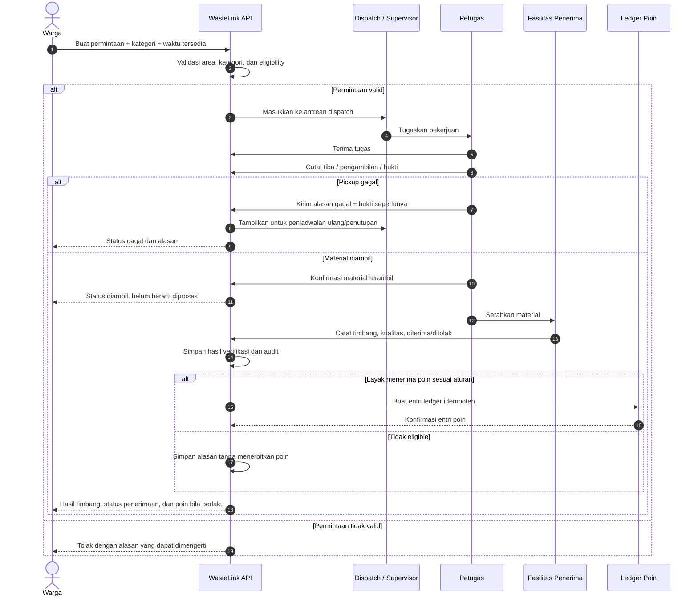

### 8.2 Flow penerimaan fasilitas dan pembentukan batch

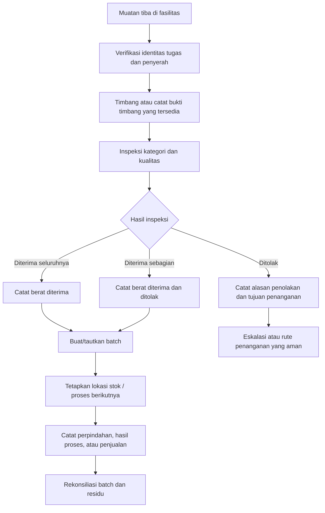

### 8.3 Flow material ke pembeli/pengolah

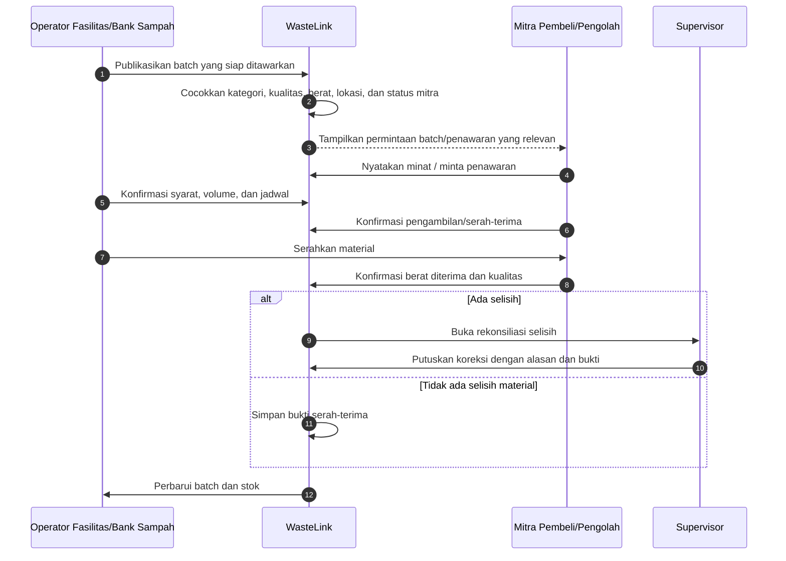

### 8.4 State machine permintaan pickup

Status berikut adalah **usulan konseptual**. Enum akhir harus diselaraskan dengan API/backend yang dipakai; jangan mengubah nama status frontend tanpa mengubah kontrak domain secara konsisten.

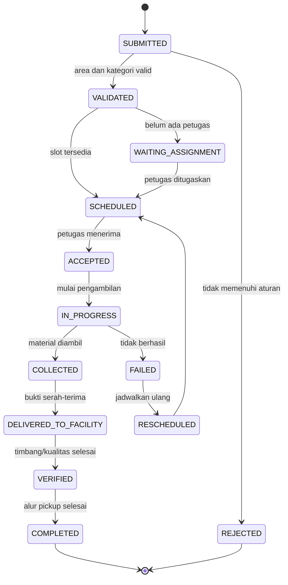

**Penting:** untuk material yang tak perlu pickup, alur setoran mandiri dapat masuk ke status penerimaan fasilitas secara langsung. Status `COMPLETED` hanya bermakna bahwa proses layanan sesuai definisi selesai; tidak otomatis bermakna bahwa semua material sudah menjadi produk daur ulang.

---

## 9. Model Data yang Dibutuhkan

### 9.1 Entitas inti

| Entitas | Fungsi | Atribut penting (konseptual) |
|---|---|---|
| `User` | Identitas pengguna | id, nama tampilan, kontak minimum, status |
| `RoleGrant` | Hak pengguna | user_id, role, organization_id, scope_area, status verifikasi |
| `Organization` | Organisasi/mitra | id, tipe, nama, status verifikasi, kontak operasional |
| `ServiceArea` | Wilayah layanan | id, nama, parent_area_id, boundary/reference, zona waktu |
| `MaterialCategory` | Kategori material | id, parent_id, kode, definisi, aturan penerimaan |
| `ServiceCapability` | Kemampuan operator/fasilitas | operator_id, kategori, kondisi, kapasitas, jadwal berlaku |
| `PickupRequest` | Permintaan pengambilan | id, requester_id, area_id, status, slot, perkiraan volume |
| `RequestItem` | Jenis material dalam permintaan | request_id, category_id, perkiraan berat/volume, instruksi |
| `Assignment` | Penugasan | request_id, team_id/user_id, assigned_at, accepted_at |
| `TaskEvent` | Riwayat transisi/status | task_id, status, actor_id, timestamp, reason |
| `Inspection` | Pemeriksaan material | request/item/batch ref, kategori aktual, kualitas, hasil |
| `Weighing` | Hasil timbang | berat bruto/tara/neto bila dipakai, satuan, alat, petugas, waktu |
| `Handover` | Serah-terima | from_org, to_org, waktu, bukti, status penerimaan |
| `MaterialBatch` | Konsolidasi material | kode, sumber, kategori, berat, kualitas, lokasi, status |
| `BatchMovement` | Perpindahan/hasil | batch_id, aksi, jumlah, lokasi asal/tujuan, referensi bukti |
| `BuyerRequirement` | Kebutuhan mitra | kategori, kualitas minimum, volume, wilayah, harga indikatif, berlaku sampai |
| `MaterialDeal` | Kesepakatan/transaksi | pihak, batch, syarat, berat diterima, harga final, status |
| `RewardRule` | Konfigurasi poin | kategori, formula, batas, periode berlaku, sponsor/budget scope |
| `RewardLedger` | Catatan poin | user_id, transaksi sumber, delta, status, idempotency_key, reason |
| `BankLedger` | Tabungan bank sampah terpisah | nasabah, transaksi, jumlah, satuan nilai, saldo per transaksi |
| `FundingProgram` | Program pendanaan | sponsor, area, periode, batas anggaran, aturan penggunaan |
| `EvidenceFile` | Bukti digital | object_key, tipe, uploader, timestamp, access policy |
| `AuditLog` | Jejak perubahan | actor, action, entity, before/after reference, reason, timestamp |
| `Notification` | Pesan/status kepada pengguna | recipient, type, status, created_at, read_at |

### 9.2 Mermaid ER diagram

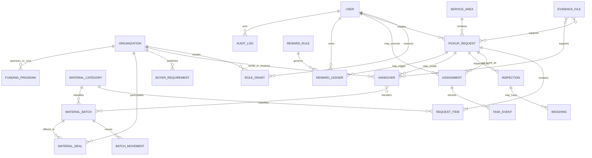

**Catatan implementasi model data:** diagram di atas konseptual. Relasi persis antara `HANDOVER`, `MATERIAL_BATCH`, `INSPECTION`, dan `WEIGHING` harus disesuaikan dengan keputusan apakah satu pengambilan dapat memiliki beberapa item, satu muatan dapat menjadi beberapa batch, dan bagaimana serah-terima sebagian direpresentasikan. Hindari menyimpan `weight`, `category`, atau `points` hanya sebagai satu nilai yang dapat ditimpa pada `PickupRequest` jika alur nyata membutuhkan riwayat perubahan dan item jamak.

### 9.3 Kategori material yang disarankan

Gunakan kategori internal yang konsisten, tetapi label, daftar contoh, dan subkategori dapat dikonfigurasi per wilayah/operator.

- `ORGANIC`: material organik yang jalur pengolahannya dikonfirmasi.
- `RECYCLABLE`: material yang secara praktis dapat diterima bank sampah/pengolah/mitra sesuai spesifikasi.
- `RESIDUAL`: material yang tidak masuk jalur pemulihan yang tersedia dan harus disalurkan ke operator yang sesuai.
- `SPECIAL`: limbah khusus; default nonaktif untuk pickup umum sampai jalurnya divalidasi.

Kategori di atas tidak cukup untuk menetapkan seluruh aturan operasional. Setiap operator harus mendefinisikan subkategori, kondisi penerimaan, kemasan, batas kontaminasi, dan tujuan berikutnya.

---

## 10. Role, Hak Akses, dan Perlindungan Data

### 10.1 Prinsip otorisasi

- Role aktif pada antarmuka hanya memengaruhi navigasi; bukan sumber otorisasi.
- Backend harus memvalidasi role, organisasi, wilayah, status verifikasi, dan kepemilikan objek setiap kali ada permintaan.
- Hak akses bersifat **least privilege**: pengguna hanya menerima data yang diperlukan untuk tugasnya.
- Supervisor dapat meninjau dan mengoreksi transaksi tertentu, tetapi semua perubahan harus mencatat aktor, waktu, alasan, dan nilai sebelumnya.
- Mitra tidak boleh melihat transaksi organisasi lain kecuali ada hubungan serah-terima/kontrak yang sah.
- Sponsor menerima laporan sesuai program yang didanai, bukan akses bebas ke profil personal.

### 10.2 Matriks otorisasi ringkas

| Aksi | Warga | Petugas | Supervisor | Operator fasilitas/bank sampah | Mitra pembeli | Admin platform | Pengelola program/CSR |
|---|---|---|---|---|---|---|---|
| Buat permintaan milik sendiri | Ya | Tidak | Kondisional | Setoran organisasi | Tidak | Dukungan | Tidak |
| Lihat detail permintaan | Milik sendiri | Ditugaskan | Area/organisasi | Terkait penerimaan | Terkait deal | Sesuai kewenangan | Umumnya agregat |
| Ubah status pickup | Tidak | Tugas sendiri | Tugas area | Tidak | Tidak | Tidak rutin | Tidak |
| Finalisasi timbang | Tidak | Hanya bila diberi kewenangan | Review/koreksi | Ya sesuai organisasi | Konfirmasi penerimaan sisi mitra | Tidak rutin | Tidak |
| Ubah aturan poin | Tidak | Tidak | Tidak/terbatas | Tidak | Tidak | Terbatas dan diaudit | Persetujuan program bila berlaku |
| Lihat ledger poin | Milik sendiri | Tidak | Ringkasan bila perlu | Tidak | Tidak | Dukungan terkontrol | Agregat program |
| Ubah saldo bank sampah | Tidak | Tidak | Review | Ya sesuai organisasi | Tidak | Tidak rutin | Tidak |
| Terbitkan penawaran material | Tidak | Tidak | Tidak | Jika diizinkan | Ya sesuai verifikasi | Tidak | Tidak |
| Ekspor laporan wilayah | Tidak | Tugas sendiri | Area sendiri | Fasilitas sendiri | Deal sendiri | Berdasarkan izin | Ruang lingkup program |

### 10.3 Data sensitif yang sebaiknya diminimalkan

- Alamat lengkap warga ditampilkan hanya kepada petugas yang ditugaskan dan hanya selama dibutuhkan.
- Foto bukti tidak boleh menjadi ruang penyimpanan bebas; aksesnya harus sesuai kebutuhan operasional dan retensi.
- Lokasi GPS petugas tidak dilacak terus-menerus secara default. Simpan bukti lokasi hanya pada peristiwa tugas jika benar-benar dibutuhkan dan disetujui kebijakan.
- Hindari menyimpan NIK atau data identitas berlebihan jika tidak diperlukan.
- Ekspor laporan publik/sponsor harus agregat dan menghindari identitas rumah tangga.
- Terapkan masa simpan dan penghapusan/anonimisasi sesuai kebijakan yang disepakati serta kewajiban yang berlaku.

---

## 11. Reward, Insentif, dan Pembiayaan yang Berkelanjutan

### 11.1 Model reward yang aman

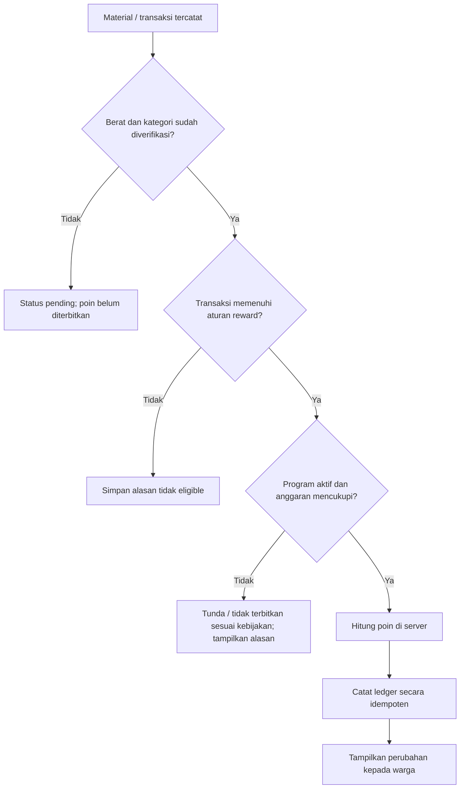

### 11.2 Aturan yang perlu ditetapkan sebelum peluncuran

1. Siapa yang membayar reward: anggaran program, sponsor, usaha, atau model lain?
2. Reward berbentuk poin non-tunai, diskon, saldo, atau nilai lain? Jangan menyebutnya uang bila bukan uang.
3. Apakah poin diberikan berdasarkan berat bruto, berat bersih yang diterima, atau kategori tertentu setelah inspeksi?
4. Bagaimana penanganan pembatalan, penolakan, perubahan berat, duplikasi, transaksi offline, dan dugaan penyalahgunaan?
5. Siapa yang berwenang mengubah aturan, berapa masa berlakunya, dan bagaimana aturan lama diterapkan pada transaksi lampau?
6. Apa yang terjadi jika dana sponsor habis saat program masih aktif?

### 11.3 Kontrol teknis

- Perhitungan poin harus dilakukan backend, bukan dipercaya dari klien.
- Gunakan idempotency key atau batasan unik berbasis transaksi sumber agar retry request tidak mencetak poin dua kali.
- Ledger bersifat append-only untuk transaksi bisnis; koreksi dibuat sebagai entri pembalik/koreksi, bukan menghapus histori.
- Catat `rule_version`, `funding_program_id`, dan sumber transaksi untuk penelusuran.
- Jangan menerbitkan poin berdasarkan foto saja tanpa validasi sesuai model operasional.
- Tampilkan status poin pending/confirmed/reversed dengan alasan yang jelas.
- Jangan mencampurkan ledger poin, saldo bank sampah, dan hasil penjualan material.

---

## 12. Dashboard, Laporan, dan Definisi Metrik

Dashboard harus membedakan indikator **aktivitas**, **aliran material**, **hasil pengolahan**, dan **dampak**.

### 12.1 Definisi metrik dasar

| Metrik | Definisi yang disarankan | Jangan disamakan dengan |
|---|---|---|
| Permintaan dibuat | Jumlah permintaan yang berhasil tercatat | Jumlah permintaan selesai |
| Pickup selesai | Tugas pengambilan yang berhasil menurut definisi operator | Material diterima pengolah |
| Berat diambil | Berat tercatat saat pengambilan jika ada alat ukur yang layak | Berat final diterima fasilitas |
| Berat diterima | Berat yang dikonfirmasi oleh penerima | Berat yang siap dijual |
| Berat layak jual | Berat yang lolos spesifikasi pembeli/mitra | Semua material daur ulang yang terkumpul |
| Berat diproses | Berat yang tercatat masuk ke proses tertentu | Berat yang berubah menjadi produk akhir |
| Berat output | Berat produk/hasil yang diukur oleh operator | Berat input yang diklaim berhasil diproses |
| Residu tercatat | Berat residu yang diketahui pada tahapan tertentu | Seluruh residu wilayah bila cakupan data parsial |
| Poin diterbitkan | Total poin yang dikreditkan ke ledger | Pendapatan atau nilai tunai |
| Estimasi dampak | Hasil perhitungan dengan metode dan asumsi yang diumumkan | Pengukuran langsung jika bukan hasil ukur langsung |

### 12.2 Dashboard per kelompok

- **Warga:** status permintaan, jadwal, histori setoran, berat terverifikasi, poin, edukasi, dan kendala.
- **Petugas:** tugas hari ini, penundaan, pickup gagal, bukti yang perlu diselesaikan, serah-terima tertunda.
- **Fasilitas:** antrean penerimaan, berat masuk per kategori, kontaminasi, stok, batch, pengeluaran, residu.
- **Bank sampah:** setoran per nasabah, stok per material, ledger transaksi, penjualan dan rekonsiliasi.
- **Mitra material:** kebutuhan/penawaran, batch tersedia, jadwal pengambilan, status deal, kualitas dan selisih.
- **Pelaku usaha:** jadwal, riwayat pickup, volume per lokasi/kategori, bukti layanan, laporan periode.
- **Admin/pengelola:** layanan per area/operator, anomali, kapasitas, komplain, data yang belum diverifikasi, dan status anggaran.
- **Sponsor:** hanya program yang didanai, progres dan penggunaan dana yang relevan, metrik dengan definisi dan sumber jelas.

### 12.3 Prinsip pelaporan

- Setiap grafik harus menampilkan periode, satuan, cakupan wilayah, status verifikasi, dan tanggal pembaruan.
- Data kosong harus ditampilkan sebagai “belum tersedia”, bukan nol.
- Jika sebagian operator tidak mengirim data, jangan menampilkan laporan regional sebagai cakupan penuh.
- Simpan versi metodologi jika definisi kategori atau metrik berubah.
- Ekspor data privat harus dibatasi role dan dicatat pada audit log.

---

## 13. Model Bisnis dan Potensi Nilai per Kelompok

Tabel berikut merupakan hipotesis untuk diuji, bukan janji pendapatan.

| Segmen | Nilai utama yang ditawarkan | Model keberlanjutan yang bisa diuji | Bukti yang perlu dikumpulkan |
|---|---|---|---|
| Warga | Proses setoran/pickup lebih jelas, edukasi, transparansi | Umumnya bukan pembayar utama di tahap pilot; insentif dapat didanai sponsor | Penggunaan berulang, waktu layanan, feedback |
| Petugas/operator | Penugasan, bukti kerja, pengurangan pencatatan ganda | Kontrak software/layanan dengan operator atau pemerintah jika pengadaan dan kebutuhannya sesuai | Waktu pencatatan, tugas selesai, biaya operasi |
| Banjar/desa/komunitas | Koordinasi kegiatan dan rekap wilayah | Dana program, dukungan komunitas/CSR | Partisipasi, penyelesaian kegiatan, akuntabilitas |
| TPS3R/TPST | Penerimaan, stok/batch, laporan operasi | Langganan/layanan B2B, biaya implementasi, atau program pemerintah sesuai procurement | Pengurangan selisih, kelengkapan data, nilai manfaat operasional |
| Bank sampah | Transaksi dan stok lebih transparan | Paket SaaS/dukungan program atau kerja sama daerah | Volume transaksi, waktu administrasi, akurasi stok |
| Pengepul/pendaur ulang | Pasokan lebih terstruktur dan sesuai spesifikasi | Langganan, fee layanan yang transparan, atau layanan pencocokan bila terbukti bernilai | Batch match, penolakan, biaya logistik, retensi mitra |
| Hotel/restoran/vila | Layanan terjadwal dan laporan terverifikasi | Biaya per lokasi/per pickup/per volume/kontrak | Willingness-to-pay, biaya aktual, SLA |
| Pengolah organik | Pasokan dan kualitas lebih terprediksi | Kontrak layanan, nilai produk, atau pendanaan program | Kapasitas, kontaminasi, hasil, biaya angkut |
| Sponsor/CSR | Pendanaan dengan bukti dan pelaporan | Sponsorship program yang dibatasi dan diaudit | Outcome terverifikasi, biaya per aktivitas, audit penggunaan dana |

### 13.1 Urutan validasi pendapatan

1. **Buktikan masalah dan manfaat operasional:** apakah pencatatan/koordinasi membaik?
2. **Buktikan aliran material:** apakah material benar-benar diterima dan memiliki tujuan berikutnya?
3. **Hitung biaya nyata:** staf, pengangkutan, bahan bakar, waktu administrasi, penolakan, alat, dan biaya operasional lainnya.
4. **Uji pembayar:** siapa yang mempunyai anggaran, kebutuhan, dan kewenangan membeli?
5. **Uji willingness-to-pay:** gunakan percakapan dan pilot berbayar skala kecil bila memungkinkan, bukan hanya survei “tertarik/tidak”.
6. **Hitung unit economics:** pendapatan per layanan/akun dibandingkan biaya melayani, dukungan, dan infrastruktur.

Jangan menyimpulkan potensi bisnis hanya dari besarnya volume sampah Bali. Volume besar tidak otomatis berarti margin besar, jalur material tersedia, biaya logistik rendah, atau pembeli siap menyerap.

---

## 14. Prioritas Pengembangan: MVP hingga Fase Lanjutan

### Fase 0 — Validasi lapangan dan pemilihan pilot

**Tujuan:** menghindari pembangunan alur yang tidak sesuai operasi nyata.

Kegiatan:
- Wawancara 5–10 petugas/operator/pengurus fasilitas, 10–20 warga, dan beberapa calon mitra hilir sebagai sampel eksploratif, bukan survei representatif.
- Observasi satu siklus aktual dari sumber sampai tujuan berikutnya.
- Identifikasi siapa yang menjadwalkan, mengambil, menimbang, menerima, memproses, dan mencatat residu.
- Mencatat jenis material yang benar-benar diterima dan jam operasional.
- Uji apakah operator menerima pencatatan digital dan perangkat yang tersedia.
- Menentukan masalah utama dan baseline sebelum menulis target KPI.

**Gate lanjut:** ada satu operator utama, satu wilayah, satu jadwal/arus material yang nyata, dan setidaknya satu tujuan material yang disepakati.

### Fase 1 — MVP Collection + Verification

Termasuk:
- autentikasi dan role;
- organisasi/wilayah;
- konfigurasi kategori dan kemampuan operator;
- permintaan warga;
- dispatch/penugasan;
- status tugas dan alasan gagal;
- bukti pengambilan;
- penerimaan/timbang/verifikasi dasar;
- riwayat transaksi;
- audit log dan notifikasi dasar;
- dashboard operasional sederhana.

**Belum perlu:** marketplace kompleks, rekomendasi AI, carbon calculator, blockchain, sistem keuangan multi-organisasi, atau integrasi alat yang belum tersedia.

### Fase 2 — Facility/Bank Sampah dan Traceability

Tambahkan:
- batch/stok sederhana;
- penerimaan dan inspeksi kualitas;
- transaksi bank sampah bila menjadi bagian pilot;
- serah-terima ke pembeli/pengolah;
- rekonsiliasi berat dan residu;
- laporan material dari sumber ke tujuan berikutnya.

### Fase 3 — B2B, Mitra, dan Pendanaan

Tambahkan setelah nilai inti terbukti:
- profil dan kebutuhan mitra;
- pencocokan penawaran batch;
- jadwal pickup usaha berulang;
- laporan per lokasi usaha;
- program pendanaan, aturan reward, dan kontrol anggaran;
- laporan audit sponsor dan ekspor data.

### Fase 4 — Otomasi dan ekspansi

Hanya jika kebutuhan serta data cukup:
- optimasi rute;
- integrasi timbangan atau tiket timbang;
- aplikasi native petugas jika web responsif tidak memadai;
- analitik kualitas dan prediksi pasokan;
- deteksi gambar/AI sebagai saran, bukan penentu tunggal;
- integrasi sistem pemda/mitra berdasarkan izin dan API yang tersedia;
- modul kegiatan bersih pantai/sungai dan alur limbah khusus yang telah tervalidasi.

### 14.1 Mermaid — roadmap dan dependensi

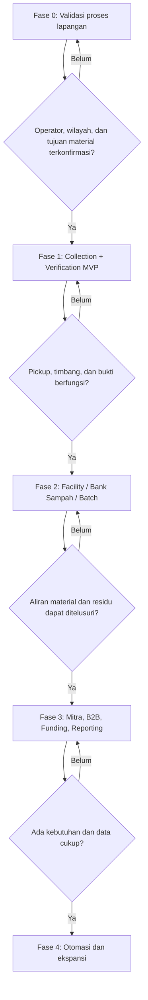

---

## 15. Pembagian Tim Produk dan Pengembangan

Pembagian berikut cocok untuk tim produk/engineering kecil-menengah. Jumlah anggota dapat disesuaikan; yang wajib dipertahankan adalah kepemilikan domain dan kesepakatan kontrak API.

| Squad/domain | Tanggung jawab | Keluaran yang bisa dites |
|---|---|---|
| Product & Field Research | wawancara, observasi, pemetaan operasi, definisi metrik, prioritas | peta proses aktual, backlog validasi, baseline |
| Platform & Access | auth, role grant, organisasi, area, audit, notifikasi | test akses lintas organisasi, API identitas |
| Source & Collection | alur warga, pickup, dispatch, task state, bukti | end-to-end request → assignment → pickup |
| Verification & Ledger | inspeksi, weighing, koreksi, idempotent reward | tes tidak ada poin ganda, riwayat koreksi |
| Facility & Material Flow | penerimaan, batch, movement, stok, residu | rekonsiliasi input-output dan serah-terima |
| Partner & B2B | buyer needs, penawaran, deal, jadwal usaha | batch ke tujuan yang terkonfirmasi |
| Analytics & Program | dashboard, definisi KPI, funding, ekspor, laporan | laporan dengan cakupan dan sumber jelas |
| UX, QA & Accessibility | usability petugas/warga, aksesibilitas, jaringan buruk, pengujian | temuan uji pengguna dan regressions |

### 15.1 Kontrak integrasi antar-squad

Sebelum pekerjaan paralel:
- sepakati entity id dan format timestamp/timezone;
- sepakati enum/status dan transisi yang diizinkan;
- tetapkan owner tiap tabel/entity dan service;
- dokumentasikan API request/response, error code, dan pagination;
- tentukan standar bukti file dan kebijakan akses;
- definisikan sumber kebenaran berat, kategori final, dan reward;
- buat test kontrak agar perubahan satu domain tidak merusak domain lain.

### 15.2 Kriteria selesai (Definition of Done)

Suatu fitur belum selesai hanya karena halaman UI sudah tampil. Minimal:
1. API tervalidasi dan otorisasi berjalan di server.
2. State transition dan aturan bisnis diuji.
3. Loading, empty state, error, retry, dan offline/pending sync ditangani jika relevan.
4. Audit dan pesan koreksi tersedia untuk operasi kritis.
5. Pengujian unit/integrasi dan pemeriksaan akses lintas-role berjalan.
6. Data sensitif tidak muncul pada role yang salah.
7. Operator lapangan memahami cara memakai fitur tanpa penjelasan panjang.
8. Metrik yang akan dipakai untuk menilai fitur dapat diambil.

---

## 16. KPI Pilot 30–90 Hari

Target angka akhir sebaiknya ditentukan setelah baseline awal. Berikut adalah metrik yang diukur, bukan target angka yang sudah dianggap pasti.

### 16.1 KPI operasi
- Jumlah permintaan pickup/setoran yang diajukan.
- Rasio permintaan valid, dijadwalkan, selesai, gagal, dan dijadwalkan ulang.
- Median dan persentil ke-90 waktu dari permintaan ke pickup.
- Median waktu kerja administrasi per tugas sebelum vs sesudah menggunakan sistem.
- Persentase tugas dengan bukti lengkap.
- Persentase penerimaan dengan berat/kategori final.

### 16.2 KPI material
- Berat diterima per kategori dan periode.
- Rasio kontaminasi/penolakan.
- Persentase batch dengan tujuan berikutnya terkonfirmasi.
- Persentase serah-terima yang cocok antara berat keluar dan berat diterima.
- Berat diproses/output/residu **hanya bila ada pencatatan yang memadai**.

### 16.3 KPI pengguna dan mitra
- Pengguna yang melakukan transaksi berulang.
- Tingkat kepuasan warga dan petugas.
- Jumlah mitra aktif dan rasio penawaran ke serah-terima.
- Waktu yang diperlukan operator untuk menemukan tujuan material.
- Keluhan, penyebab, waktu penyelesaian, dan kejadian berulang.

### 16.4 KPI biaya dan keberlanjutan
- Biaya langsung per pickup dan per kg yang ditangani jika data tersedia.
- Biaya administrasi sebelum vs sesudah.
- Nilai material terjual (bila ada bukti transaksi) dan biaya logistik.
- Total reward yang dijanjikan, pending, diterbitkan, dan dibalik.
- Kecukupan anggaran program terhadap kewajiban reward.
- Indikasi kesediaan membayar dari operator/usaha dan hasil pilot berbayar jika dilakukan.

### 16.5 Gate keputusan setelah pilot

Lanjut ke fase berikutnya hanya bila sebagian besar kondisi berikut terpenuhi:
- petugas/operator benar-benar memakai alur sistem;
- pencatatan tidak membuat pekerjaan lebih lambat secara material tanpa manfaat sebanding;
- ada jalur material yang nyata;
- berat dan serah-terima cukup dapat direkonsiliasi;
- masalah utama dapat dijelaskan dengan data;
- ada pihak yang menyatakan tanggung jawab atas biaya berulang;
- reward, jika ada, didukung anggaran yang jelas.

---

## 17. Risiko, Mitigasi, dan Keputusan yang Harus Divalidasi

| Risiko | Dampak | Mitigasi rancangan | Pertanyaan validasi |
|---|---|---|---|
| Petugas merasa aplikasi menambah pekerjaan | Adopsi rendah, data kosong | Form singkat, default yang masuk akal, minim input ulang, uji lapangan | Langkah mana yang paling menyita waktu sekarang? |
| Warga meminta pickup pada area tanpa layanan | Ekspektasi buruk | Validasi area dan jadwal sebelum permintaan dibuat | Area mana yang benar-benar dilayani? |
| Tidak ada tujuan material yang pasti | Material menumpuk / klaim dampak salah | Daftar tujuan terverifikasi, status batch transparan | Siapa penerima berikutnya dan berapa kapasitasnya? |
| Kategori salah/terkontaminasi | Penolakan, biaya tambahan | Panduan kategori, inspeksi, alasan penolakan | Standar kualitas apa yang diterapkan operator? |
| Poin diterbitkan berlebih atau ganda | Kerugian, hilangnya kepercayaan | Server-side calculation, idempotency, ledger append-only | Sumber pendanaan dan aturan koreksi bagaimana? |
| Harga material berubah | Penawaran tidak relevan | Timestamp harga, rentang indikatif, konfirmasi final | Seberapa sering harga diperbarui? |
| Timbang tidak konsisten | Konflik antar pihak | Definisi titik timbang, satuan, petugas dan bukti | Timbang terjadi di titik mana dan memakai alat apa? |
| Internet buruk | Status tidak sinkron | Offline-tolerant, idempotent sync, indikator pending | Operator menggunakan perangkat dan koneksi apa? |
| Data pribadi bocor | Risiko privasi dan keselamatan | RBAC, minimisasi, retensi, audit, akses terbatas | Siapa yang benar-benar membutuhkan data alamat? |
| Klaim dampak berlebihan | Risiko reputasi dan greenwashing | Definisi metrik, bukti, batas klaim | Bukti apa yang tersedia sampai tahap akhir? |
| Fasilitas tidak aktif/kapasitas penuh | Layanan gagal | Status kapasitas dan kalender operator; rencana fallback | Siapa memperbarui kapasitas dan seberapa sering? |
| Integrasi terlalu dini | Waktu habis di konektor yang tidak tersedia | Integrasi hanya dengan izin dan API terdokumentasi | Apakah mitra benar-benar punya API dan izin integrasi? |
| Pengembangan terlalu luas | MVP terlambat, kualitas rendah | Fase dan gate yang eksplisit | Fitur mana yang wajib untuk menguji hipotesis utama? |
| Konflik peran komunitas/operator | Transaksi tidak jelas | RACI, role scope, audit perubahan | Siapa penanggung jawab final tiap keputusan? |

### 17.1 Daftar keputusan wajib sebelum coding besar

1. Wilayah pilot dan aktor pemilik layanan.
2. Apakah alur utama adalah pickup rumah tangga, setoran ke bank sampah, alur fasilitas, atau kombinasi kecil yang terdefinisi.
3. Kategori material yang benar-benar diterima tiap operator.
4. Siapa menimbang dan pada tahap mana berat menjadi final.
5. Jalur tujuan organik, anorganik, residu, dan limbah khusus jika dibuka.
6. Apakah poin dibutuhkan di pilot; bila ya, siapa sumber dana dan aturan penerbitannya.
7. Perangkat yang tersedia dan cara kerja bila koneksi buruk.
8. Data apa yang dibutuhkan petugas dan kapan data itu tidak lagi perlu.
9. Siapa yang akan memperbarui kapasitas, harga, jadwal, dan status mitra.
10. Bentuk laporan yang benar-benar dibutuhkan pengelola dan pihak pendanaan.

---

## 18. Rekomendasi Fokus Pengembangan Pertama

Untuk menghindari ruang lingkup yang terlalu luas, paket awal yang paling berpeluang menguji nilai WasteLink adalah:

1. **Warga:** panduan kategori + permintaan pickup/setoran + status + riwayat timbang.
2. **Petugas:** daftar tugas + pembaruan status + alasan gagal + bukti penjemputan.
3. **Satu operator penerima (TPS3R/TPST/bank sampah sesuai kondisi pilot):** timbang + inspeksi + penerimaan + penolakan + bukti serah-terima.
4. **Admin/supervisor:** konfigurasi wilayah, jadwal, kategori, penugasan, koreksi, dan laporan sederhana.
5. **Material traceability minimum:** dari transaksi sumber ke penerima berikutnya, termasuk berat dan status verifikasi.
6. **Reward hanya jika siap dibiayai:** ledger poin sederhana dan aturan server-side; jika belum ada pendanaan, tampilkan dampak non-finansial dan tunda poin.

### 18.1 Yang belum menjadi prioritas pertama

- Marketplace multi-vendor penuh.
- AI untuk mengidentifikasi seluruh sampah dari foto.
- Prediksi nilai jual atau emisi tanpa data dasar.
- Native app terpisah untuk setiap kelompok.
- Pelacakan GPS live sepanjang hari.
- Tokenisasi atau blockchain.
- Integrasi ke semua sistem pemerintah/fasilitas sekaligus.
- Klaim “zero waste” sebelum cakupan aliran material benar-benar terbukti.

### 18.2 Mermaid — fokus MVP

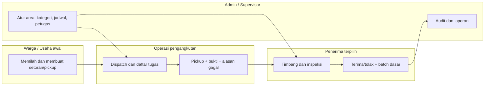

---

## 19. Checklist Validasi Lapangan

Gunakan daftar ini saat observasi/wawancara. Catat fakta, bukan asumsi.

### Tentang warga/sumber
- [ ] Bagaimana warga memilah hari ini?
- [ ] Kategori apa yang mereka pahami dan kategori apa yang membingungkan?
- [ ] Apakah warga membayar iuran atau layanan saat ini? Kepada siapa?
- [ ] Apakah pickup tersedia, terjadwal, atas permintaan, atau setoran mandiri?
- [ ] Apakah warga mengharapkan reward; bentuk apa yang benar-benar bernilai?

### Tentang petugas
- [ ] Siapa pemberi tugas dan siapa supervisor?
- [ ] Perangkat apa yang dapat digunakan di lapangan?
- [ ] Bagaimana tugas dicatat hari ini?
- [ ] Bagaimana petugas membuktikan pickup, penolakan, dan kendala?
- [ ] Berapa lama pencatatan saat ini?
- [ ] Apakah ada prosedur untuk keselamatan dan limbah khusus?

### Tentang fasilitas/bank sampah
- [ ] Kategori apa yang diterima dan ditolak?
- [ ] Di mana dan kapan berat final ditentukan?
- [ ] Bagaimana stok, batch, penjualan, dan residu dicatat?
- [ ] Apakah material punya pembeli/pengolah tetap?
- [ ] Berapa kapasitas dan kapan kapasitas diperbarui?
- [ ] Apakah pencatatan digital dapat menggantikan atau harus mendampingi sistem yang sudah ada?

### Tentang mitra hilir
- [ ] Spesifikasi material seperti apa yang dibutuhkan?
- [ ] Volume minimum dan biaya pengambilan?
- [ ] Harga indikatif, masa berlaku, dan faktor kualitas yang memengaruhi harga?
- [ ] Siapa mengonfirmasi berat dan kualitas saat penerimaan?
- [ ] Bukti apa yang dapat disediakan bahwa material diterima atau diproses?

### Tentang pengelola/pendana
- [ ] Siapa pemilik proses, data, dan biaya berulang?
- [ ] Laporan apa yang wajib disusun dan untuk siapa?
- [ ] Apakah ada anggaran reward, operasional digital, atau layanan B2B?
- [ ] Apa indikator keberhasilan yang dapat diaudit?
- [ ] Siapa yang menyetujui perubahan aturan, koreksi, dan akses data?

---

## 20. Kesimpulan

Pembagian pengembangan WasteLink Bali yang paling kuat adalah membangun **alur inti yang menyambungkan kelompok-kelompok yang sudah melakukan pekerjaan nyata**, lalu menambahkan fitur berdasarkan kebutuhan mereka—bukan berdasarkan banyaknya ide fitur.

- Warga membutuhkan cara memilah dan menyerahkan material yang jelas.
- Petugas membutuhkan penugasan dan pencatatan yang cepat.
- TPS3R/TPST membutuhkan penerimaan, inspeksi, stok/batch, dan aliran residu yang dapat direkonsiliasi.
- Bank sampah membutuhkan transaksi, stok dan ledger yang transparan.
- Pengepul/pengolah membutuhkan material yang sesuai spesifikasi dan tujuan serah-terima yang jelas.
- Pelaku usaha dapat menjadi pengguna layanan berulang dan calon pembayar, apabila nilai serta biaya aktual terbukti.
- Banjar/desa/komunitas dapat memperkuat koordinasi lokal.
- Pemerintah/pengelola program dan sponsor membutuhkan laporan yang bisa diaudit, dengan akses data sesuai kewenangan.
- Limbah khusus harus memiliki jalur tersendiri dan tidak dibuka tanpa mitra/prosedur yang sesuai.

**Rekomendasi utama:** pilih satu area pilot, satu operator penerima yang nyata, beberapa jenis material yang benar-benar diterima, serta satu alur serah-terima yang dapat dibuktikan. Bangun dulu permintaan → tugas petugas → timbang/inspeksi → penerimaan → tujuan material. Setelah alur itu stabil, tambah bank sampah, marketplace, layanan usaha, program CSR, dan automasi sesuai bukti kebutuhan.

Keberhasilan WasteLink bukan ditentukan oleh berapa banyak dashboard atau fitur yang dibuat, tetapi oleh apakah sistem membantu para pelaku menyelesaikan pekerjaan dengan lebih jelas, mengurangi pencatatan yang tidak perlu, memperbaiki mutu data, dan menelusuri material ke tujuan yang benar-benar terkonfirmasi.

---

## Referensi

1. Badan Pusat Statistik Provinsi Bali. **Persentase Rumah Tangga Menurut Kabupaten/Kota dan Pemilahan Sampah yang Dilakukan di Provinsi Bali, 2025**. Data terakhir diperbarui 30 Juli 2026. https://bali.bps.go.id/id/statistics-table/1/MjA2IzE%3D/persentase-rumah-tangga-menurut-kabupaten-kota-dan-pemilahan-sampah-yang-dilakukan-di-provinsi-bali-2025.html
2. Kementerian Lingkungan Hidup/Badan Pengendalian Lingkungan Hidup. **Tegas! KLH/BPLH dan Pemprov Bali Wajibkan Warga Pilah Sampah 100 Persen Mulai 1 Juli**. 10 Juni 2026. https://kemenlh.go.id/news/detail/tegas-klhbplh-dan-pemprov-bali-wajibkan-warga-pilah-sampah-100-persen-mulai-1-juli
3. Kementerian Lingkungan Hidup/Badan Pengendalian Lingkungan Hidup. **Akhiri Ketergantungan Tempat Pemrosesan Akhir, Menteri LH: Transformasi Kelola Sampah Lewat Fasilitas Energi Terbarukan Telah Dimulai di Bali**. 8 Juli 2026. https://kemenlh.go.id/news/detail/akhiri-ketergantungan-tempat-pemrosesan-akhir-menteri-lh-transformasi-kelola-sampah-lewat-fasilitas-energi-terbarukan-telah-dimulai-di-bali
4. Dinas Kehutanan dan Lingkungan Hidup Provinsi Bali. **Pedoman Teknis Pengelolaan Sampah Berbasis Sumber**. https://dklh.baliprov.go.id/wp-content/uploads/2022/04/PEDOMAN-TEKNIS-PENGELOLAAN-SAMPAH-BERBASIS-SUMBER-1_compressed-2.pdf

> **Disclaimer:** Dokumen ini merupakan rancangan produk dan teknis untuk perencanaan, validasi lapangan, dan pengembangan bertahap. Struktur organisasi, peraturan operasional, kapasitas fasilitas, harga, jalur material, kewenangan petugas, dan model pendanaan harus diverifikasi dengan pemangku kepentingan resmi serta operator yang benar-benar terlibat di lokasi pilot.
