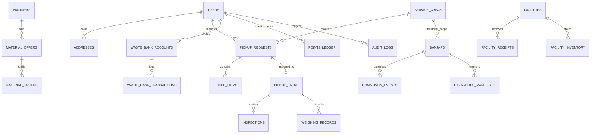
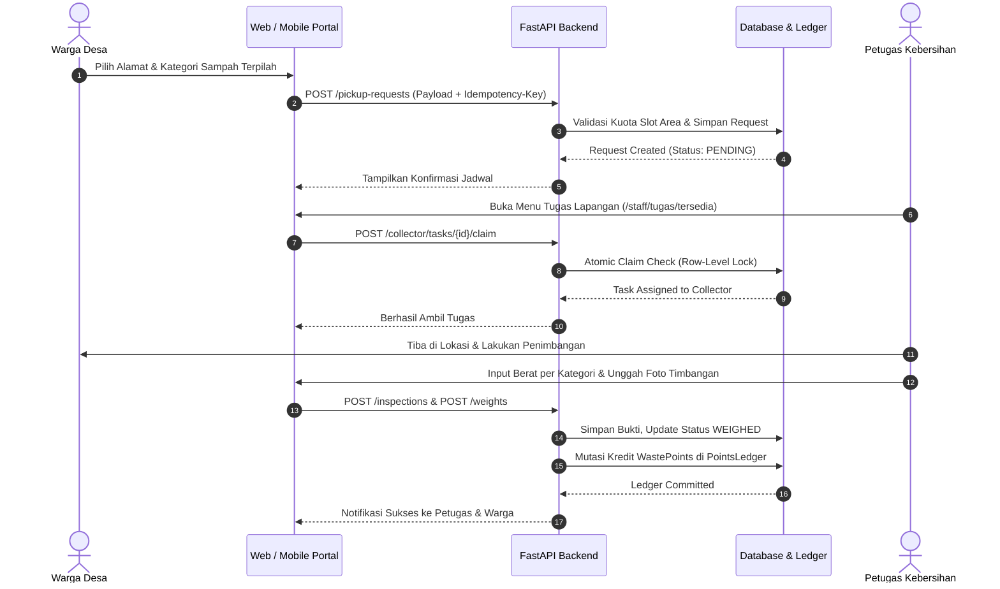
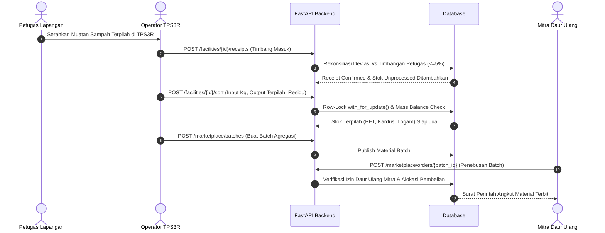
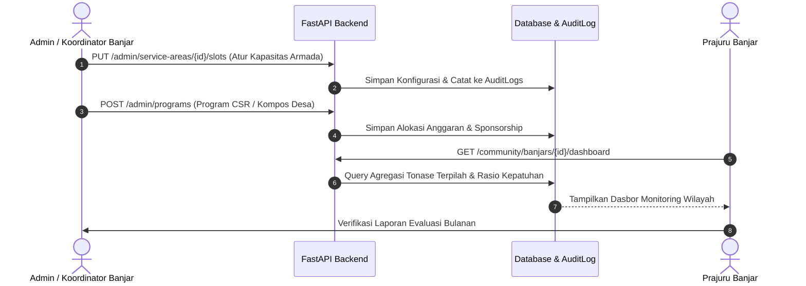
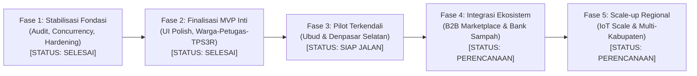

# Laporan Lengkap Proyek Kedas
## Platform Digital Pengelolaan Sampah Berbasis Komunitas dan Ekonomi Sirkular Desa

> **Nama Proyek**: Kedas  
> **Nama Sebelumnya (Historis)**: WasteLink Bali  
> **Versi Laporan**: 1.0  
> **Tanggal Penyusunan**: 30 Oktober 2026  
> **Status Sistem (As-Built)**: **READY FOR CONTROLLED PILOT** (Siap untuk Uji Coba Terkendali di Wilayah Terbatas)  
> **Branch & Commit Evaluasi**: `master` (`84789d6 feat(phase-7): complete master e2e integration test, quality assurance, and pilot runbook`)  
> **Environment Pengujian**: Local Staging / Test Runner (Python 3.13.5, Node.js v20+, FastAPI 0.115, Next.js 15.1.7, React 19, SQLite / PostgreSQL, Alembic 1.14, Pytest 9.1, Vitest 3.2 & 5.0)  
> **Auditor & Analis**: Senior System Analyst, Software Architect, Product Analyst, QA Automation Engineer, & Technical Writer

---

## Daftar Isi
1. [Metadata & Batasan Audit](#metadata--batasan-audit)
2. [BAB 1 — Spesifikasi Aplikasi](#bab-1--spesifikasi-aplikasi)
3. [BAB 2 — Pembagian Role dan Hak Akses](#bab-2--pembagian-role-dan-hak-akses)
4. [BAB 3 — Fungsi dan Alur Kerja Sistem](#bab-3--fungsi-dan-alur-kerja-sistem)
5. [BAB 4 — Kegunaan dan Nilai Manfaat](#bab-4--kegunaan-dan-nilai-manfaat)
6. [BAB 5 — Kelebihan, Kekurangan, dan Risiko](#bab-5--kelebihan-kekurangan-dan-risiko)
7. [BAB 6 — Rencana Pengembangan Sistem](#bab-6--rencana-pengembangan-sistem)
8. [BAB 7 — Evaluasi dan Prioritas Perbaikan](#bab-7--evaluasi-dan-prioritas-perbaikan)
9. [BAB 8 — Dampak terhadap Masyarakat dan Lingkungan](#bab-8--dampak-terhadap-masyarakat-dan-lingkungan)
10. [Lampiran Wajib](#lampiran-wajib)
    - [Lampiran 1: Glosarium Istilah Domain Kedas](#lampiran-1-glosarium-istilah-domain-kedas)
    - [Lampiran 2: Daftar Modul dan Status Implementasi](#lampiran-2-daftar-modul-dan-status-implementasi)
    - [Lampiran 3: Matriks Keterlacakan Kebutuhan](#lampiran-3-matriks-keterlacakan-kebutuhan)
    - [Lampiran 4: Daftar Endpoint REST API](#lampiran-4-daftar-endpoint-rest-api)
    - [Lampiran 5: Daftar Entitas Database Inti](#lampiran-5-daftar-entitas-database-inti)
    - [Lampiran 6: Hasil Audit Pengujian dan Tooling](#lampiran-6-hasil-audit-pengujian-dan-tooling)
    - [Lampiran 7: Daftar Temuan dan Remediasi](#lampiran-7-daftar-temuan-dan-remediasi)
    - [Lampiran 8: Daftar Keputusan Validasi Lapangan](#lampiran-8-daftar-keputusan-validasi-lapangan)
    - [Lampiran 9: Referensi Dokumen Proyek](#lampiran-9-referensi-dokumen-proyek)
    - [Lampiran 10: Riwayat Penyesuaian Nama dan Pengecualian Teknis](#lampiran-10-riwayat-penyesuaian-nama-dan-pengecualian-teknis)

---

## Metadata & Batasan Audit

### 1. Sumber Informasi yang Diperiksa
Audit ini disusun dengan mengacu pada hierarki kebenaran berbasis bukti (*evidence-based truth*):
1. **Source Code & Konfigurasi Aktual**: Repositori `backend/` (FastAPI, SQLAlchemy, Alembic), `frontend/` (Next.js 15, Tailwind, Vitest), dan `mobile/` (TypeScript offline engine).
2. **Laporan Kualitas & Pengujian Aktual**: Artefak audit di `docs/quality/` (01 s/d 03) mencakup 185 automated tests hijau, hasil linter, typecheck, dan Next.js production build.
3. **Dokumen Perancangan Proyek**: PRD (`PRD_WasteLink_Bali.md`), HRD (`HRD_WasteLink_Bali.md`), SDD (`SDD_WasteLink_Bali.md`), SRS (`SRS_WasteLink_Bali.md`), panduan perancangan (`perancangan_lanjutan_wastelink_bali.md`), serta desain web/aplikasi (`designweb.md`, `designapps.md`).
4. **Catatan Operasional**: `PILOT_RUNBOOK.md` dan Architecture Decision Records (`docs/adr/ADR_LOG.md`).

### 2. Batasan Audit
- Pemeriksaan dilakukan pada branch lokal `master`. Tidak ada interaksi dengan infrastruktur cloud publik, domain produksi eksternal, atau payment gateway riil.
- Pengujian performa konkurensi dan idempotensi dieksekusi menggunakan SQLite in-memory dan driver simulasi multithreading lokal.
- Seluruh angka metrik pengujian (185 passed tests) bersumber dari log eksekusi runner otomatis aktual per 30 Oktober 2026.

---

## BAB 1 — SPESIFIKASI APLIKASI

### 1.1 Latar Belakang dan Masalah yang Diselesaikan
Provinsi Bali menghadapi tantangan kritis dalam tata kelola sampah padat perkotaan dan perdesaan. Penutupan dan pembatasan operasional TPA Regional Suwung (Denpasar), rendahnya tingkat pemilahan di tingkat rumah tangga (<20%), serta tingginya volume sampah organik sisa upakara keagamaan (*canang sari*) menuntut desentralisasi pengolahan di tingkat desa sesuai amanat **Peraturan Gubernur Bali Nomor 47 Tahun 2019 tentang Pengelolaan Sampah Berbasis Sumber**.

Meskipun fasilitas Tempat Pengolahan Sampah Reuse, Reduce, Recycle (TPS3R) telah dibangun di berbagai banjar/desa, mayoritas fasilitas mengalami kendala operasional:
1. **Kurangnya Koordinasi Lapangan**: Penjadwalan penjemputan sampah warga masih menggunakan koordinasi manual tanpa kepastian kuota armada.
2. **Ketiadaan Data Terverifikasi**: Tidak adanya pencatatan penimbangan digital menyebabkan tingginya diskrepansi berat antara sampah yang dijemput dari rumah dengan sampah yang diterima TPS3R.
3. **Kelemahan Penyaluran Material**: Material anorganik bernilai daur ulang (PET, kardus, logam) tidak teragregasi secara terstandar, sehingga posisi tawar desa di hadapan industri daur ulang sangat rendah.
4. **Ketidaksesuaian Sistem Insentif**: Banyak inisiatif bank sampah manual mencampuradukkan saldo tabungan uang nasabah dengan sistem poin hadiah promosi, yang berujung pada sengketa keuangan.

**Kedas** hadir sebagai platform koordinasi rantai pasok sampah digital berbasis komunitas banjar dan ekonomi sirkular desa yang menjembatani seluruh aktor rantai nilai secara transparan, akuntabel, dan terukur.

### 1.2 Visi, Misi, dan Ruang Lingkup Produk
- **Visi**: Mewujudkan desa-desa di Bali yang bersih (*kedas*), mandiri dalam pengelolaan sampah berbasis sumber, serta berdaya saing sirkular selaras dengan kearifan lokal *Tri Hita Karana*.
- **Misi**:
  1. Mendigitalisasi rantai pengumpulan sampah terpilah dari rumah tangga hingga fasilitas pengolahan.
  2. Memberikan transparansi penimbangan melalui verifikasi bukti digital dan *immutable audit ledger*.
  3. Memisahkan secara tegas hak keuangan nasabah bank sampah dengan poin insentif partisipasi (*WastePoints*).
  4. Memperkuat posisi tawar material terpilah desa melalui katalog agregasi batch sirkular untuk mitra industri.
  5. Mengakomodasi kearifan lokal Bali dalam penanganan limbah upakara organik dan manifes limbah khusus/B3.
- **Ruang Lingkup Sistem**:
  - *In-Scope*: Pendaftaran warga, pemesanan penjemputan/setoran mandiri, penjadwalan & dispatch petugas, inspeksi kontaminasi, penimbangan multi-kategori, penerimaan & pemilahan stok TPS3R, tabungan bank sampah, katalog agregasi material, dasbor prajuru banjar, dan alur manifes limbah B3.
  - *Out-of-Scope (Fase Saat Ini)*: Integrasi payment gateway pencairan dana tunai otomatis (pencairan tabungan dilakukan manual oleh pengurus bank sampah), sistem tracking GPS live real-time satelit (menggunakan status checkpoint), dan integrasi sensor timbangan IoT nirkabel langsung.

### 1.3 Platform yang Tersedia (As-Built vs Intended)
1. **Backend REST API (FastAPI / Python 3.13)**: Berjalan penuh (*Implemented & verified*). Menyediakan 48 endpoint RESTful yang mencakup otentikasi, perizinan RBAC, booking penjemputan, dispatch, verifikasi timbang, manajemen fasilitas, transaksi bank sampah, marketplace B2B, dan tata kelola banjar.
2. **Frontend Web Portal (Next.js 15 / React 19)**: Berjalan penuh (*Implemented & verified*). Terdiri dari 37 rute halaman yang melayani 4 antarmuka: Publik/Warga (`/app`), Petugas Kebersihan (`/staff`), Konsol Pengelola/Admin (`/admin`), dan Halaman Edukasi Publik (`/`).
3. **Mobile Client (React Native Engine / Webview Simulator)**: Berjalan secara terverifikasi (*Implemented & verified* pada modul offline sync core; UI mobile berjalan dalam frame preview web teroptimasi responsif di `/mobile`).

### 1.4 Arsitektur Sistem Aktual
Sistem Kedas mengadopsi pola arsitektur **Modular Monolith** dengan pemisahan konteks domain yang tegas (*Domain-Driven Design / Bounded Contexts*):

```mermaid
flowchart TD
    subgraph ClientLayer ["Client Presentation Layer"]
        WargaClient["Warga Portal (Next.js 15 Web & Mobile PWA)"]
        StaffClient["Petugas POS & Mobile Dispatch (/staff)"]
        AdminClient["Admin, Banjar & Facility Portal (/admin)"]
    end

    subgraph GatewayMiddleware ["Application Middleware & Invariants"]
        CorsMW["CORS & RequestID Middleware"]
        AuthMW["Bearer JWT Authentication & RBAC Filter"]
        IdempotencyMW["Idempotency Engine (Unique Key Cache)"]
        AuditMW["Audit Trail Interceptor"]
    end

    subgraph CoreBackend ["FastAPI Core Application (12 Bounded Contexts)"]
        G1["G1: Auth, RBAC & Users"]
        G2["G2: Warga & Source Collection"]
        G3["G3: Petugas & Mobile Dispatch"]
        G4["G4: TPS3R Reception & Sorting"]
        G5["G5: Bank Sampah & Savings Ledger"]
        G6["G6: Marketplace B2B & Batching"]
        G7["G7: Organic Processing & Compost"]
        G8["G8: Banjar Territorial Dashboard"]
        G9["G9: Program Funding & CSR"]
        G10["G10: Cleanups & Volunteering"]
        G11["G11: Hazardous & Upakara Manifests"]
        G12["G12: System Health & Audit Logger"]
    end

    subgraph DataStorageLayer ["Data Persistence & Storage"]
        DB[(PostgreSQL / SQLite 2.0 ORM)]
        Storage["Evidence File Storage (Local / S3 Compatible)"]
    end

    ClientLayer --> GatewayMiddleware
    GatewayMiddleware --> CoreBackend
    CoreBackend --> DataStorageLayer
```

### 1.5 Stack Teknologi Aktual

| Komponen | Teknologi | Versi Aktual | Peran / Deskripsi |
|---|---|---|---|
| **Backend Runtime** | Python | 3.13.5 | Bahasa pemrograman inti backend |
| **Web Framework** | FastAPI | 0.115.6 | Framework web performa tinggi asinkron |
| **ORM & Database Driver** | SQLAlchemy | 2.0.36 | Pemetaan objek-relasional dengan query pesimis |
| **Database Migrations** | Alembic | 1.14.0 | Pengelola skema 8 revisi teruji dua arah |
| **Data Validation** | Pydantic | 2.10.4 | Validasi skema request/response DTO ketat |
| **Password Security** | Passlib (Argon2 / BCrypt) | 1.7.4 | Hashing kredensial bebas enumerasi akun |
| **Frontend Framework** | Next.js (App Router) | 15.1.7 | Server-side rendering & static route optimization |
| **UI Library** | React | 19.0.0 | Komponen antarmuka pengguna deklaratif |
| **Styling Engine** | Tailwind CSS | 3.4.17 | Utilitas CSS desain sistem terstandar |
| **Icons & Visuals** | Lucide React | 0.468.0 | Simbol grafis antarmuka konsisten |
| **Backend Testing** | Pytest + Pytest-Asyncio | 9.1.1 | Pengujian unit, konkurensi, dan E2E (76 tests) |
| **Frontend Testing** | Vitest + Testing Library | 3.2.7 | Pengujian unit komponen dan service (94 tests) |
| **Mobile Testing** | Vitest | 5.0.5 | Pengujian logika offline queue (15 tests) |

### 1.6 Model Data & Entitas Utama (ER Diagram Ringkas)

---

## BAB 2 — PEMBAGIAN ROLE DAN HAK AKSES

### 2.1 Prinsip Pemisahan Role, Stakeholder, dan Organisasi
Dalam Kedas, terdapat pembedaan tegas antara tiga konsep:
1. **Role Akun (RBAC)**: Kredensial sistem yang disematkan pada token JWT untuk otorisasi API (`USER`, `COLLECTOR`, `ADMIN`, dll.).
2. **Kelompok Stakeholder Operasional**: Peran nyata di lapangan yang memiliki kepentingan fungsional spesifik (misal: Kelian Banjar, Pengepul PET, Operator TPS3R).
3. **Organisasi / Fasilitas (Tenancy)**: Entitas hukum atau komunitas tempat pengguna bernaung (misal: TPS3R Sukawati, Bank Sampah Bersih Lestari, Banjar Adat Baturning).

### 2.2 Audit Role Aktual dalam Database & Kode
Berdasarkan pemeriksaan pada enum `app.models.user.RoleName` dan migrasi `0001_core_schema.py`, sistem mengimplementasikan **8 Role Sistem**:

| Role Sistem | Representasi Sistem | Tanggung Jawab Operasional | Lingkup Data yang Dapat Diakses | Status Implementasi |
|---|---|---|---|---|
| **`USER`** | Warga / Rumah Tangga | Memilah sampah dari sumber, membuat permintaan pickup, melihat riwayat setoran dan poin reward. | Hanya data miliknya sendiri (`user_id == current_user.id`). Ditolak pada rute operasional. | **Implemented & verified** |
| **`COLLECTOR`** | Petugas Lapangan / Pengangkut | Menerima tugas penjemputan, inspeksi lapangan, penimbangan, upload bukti, dan pelaporan kendala. | Tugas yang ditugaskan/diklaim oleh dirinya di area layanan aktifnya. | **Implemented & verified** |
| **`DISPATCHER`** | Koordinator Armada / Supervisor | Mengatur penugasan tugas penjemputan, reassignment tugas tertunda, verifikasi kapasitas slot. | Seluruh tugas penjemputan dan armada dalam area operasionalnya. | **Implemented & verified** |
| **`FACILITY_OPERATOR`** | Operator TPS3R / TPST | Penerimaan sampah masuk dari petugas, penimbangan ulang, rekonsiliasi diskrepansi, pemilahan stok. | Data transaksi fasilitas dan gudang tempat ia ditugaskan (`facility_id`). | **Implemented & verified** |
| **`WASTE_BANK_STAFF`** | Pengurus Bank Sampah | Pencatatan setoran nasabah, pembaruan buku tabungan material, penerbitan tanda terima setor. | Akun nasabah dan buku tabungan pada bank sampah terkait. | **Implemented & verified** |
| **`PARTNER`** | Mitra Daur Ulang / Pengolah B2B | Menawar material terpilah, menerima pesanan batch, mencatat konfirmasi penerimaan material daur ulang. | Penawaran harga, pesanan batch, dan kontrak komersial miliknya. | **Implemented & verified** |
| **`COMMUNITY_LEADER`** | Prajuru Banjar / Kepala Desa | Mengawasi tingkat kepatuhan pemilahan banjar, menyetujui program, memantau limbah upakara & B3. | Data analitik agregat wilayah banjarnya (`banjar_id`). Tidak dapat melihat detail privasi personal warga. | **Implemented & verified** |
| **`ADMIN`** | Administrator Platform | Tata kelola master data (kategori sampah, tarif dasar poin, area layanan, audit log sistem). | Seluruh data sistem dengan audit trail wajib pada setiap perubahan kebijakan. | **Implemented & verified** |

### 2.3 Matriks Hak Akses (Role vs Permission)

| Fitur / Tindakan | `USER` | `COLLECTOR` | `DISPATCHER` | `FACILITY_OP` | `WASTE_BANK` | `PARTNER` | `COMMUNITY` | `ADMIN` |
|---|:---:|:---:|:---:|:---:|:---:|:---:|:---:|:---:|
| Buat Permintaan Jemput Mandiri | ✅ | ❌ | ❌ | ❌ | ❌ | ❌ | ❌ | ❌ |
| Klaim / Terima Tugas Lapangan | ❌ | ✅ | ❌ | ❌ | ❌ | ❌ | ❌ | ❌ |
| Re-assign Tugas ke Petugas Lain | ❌ | ❌ | ✅ | ❌ | ❌ | ❌ | ❌ | ✅ |
| Input Hasil Inspeksi & Timbangan Lapangan | ❌ | ✅ | ❌ | ❌ | ❌ | ❌ | ❌ | ❌ |
| Konfirmasi Penerimaan Fasilitas (Receipt) | ❌ | ❌ | ❌ | ✅ | ❌ | ❌ | ❌ | ❌ |
| Input Pemilahan & Pengurangan Stok | ❌ | ❌ | ❌ | ✅ | ❌ | ❌ | ❌ | ❌ |
| Buka Rekening & Transaksi Bank Sampah | ❌ | ❌ | ❌ | ❌ | ✅ | ❌ | ❌ | ❌ |
| Ajukan Penawaran Beli Batch Material | ❌ | ❌ | ❌ | ❌ | ❌ | ✅ | ❌ | ❌ |
| Akses Dasbor Teritorial Banjar & Acara | ❌ | ❌ | ❌ | ❌ | ❌ | ❌ | ✅ | ✅ |
| Kelola Kategori Sampah & Aturan Poin | ❌ | ❌ | ❌ | ❌ | ❌ | ❌ | ❌ | ✅ |
| Lihat Audit Log Sistem Menyeluruh | ❌ | ❌ | ❌ | ❌ | ❌ | ❌ | ❌ | ✅ |

### 2.4 Separation of Duties & Perlindungan Anti-IDOR
Sistem menerapkan prinsip *Separation of Duties* untuk mencegah fraud:
1. **Konflik Kepentingan Penimbangan**: Petugas pengangkut (`COLLECTOR`) hanya dapat menginput timbangan awal lapangan. Timbangan final fasilitas harus dikonfirmasi oleh `FACILITY_OPERATOR`. Jika diskrepansi >5%, sistem memicu penandaan sengketa (*discrepancy flag*) dan memerlukan intervensi `DISPATCHER` atau `ADMIN`.
2. **Pemisahan Finansial**: Poin reward (*WastePoints*) warga dikreditkan secara otomatis oleh sistem backend melalui transaksi atomik; petugas lapangan maupun pengurus bank sampah tidak memiliki izin untuk mengkreditkan poin secara manual tanpa bukti timbangan tervalidasi.
3. **Isolasi Teritorial**: Prajuru Banjar (`COMMUNITY_LEADER`) dilarang melihat daftar penjemputan warga di luar banjarnya.

---

## BAB 3 — FUNGSI DAN ALUR KERJA SISTEM

### 3.1 Inventarisasi Fungsi Utama Sistem

| Modul | Nama Fungsi | Input Utama | Proses & Validasi Bisnis | Output | Status Implementasi |
|---|---|---|---|---|---|
| **G1 Auth** | `login_and_token` | Email, Password | Verifikasi hash Argon2, pengecekan akun tersuspensi, pembuatan Bearer JWT dengan masa berlaku 24 jam. | Access Token, User Profile, Roles | **Implemented & verified** |
| **G2 Warga** | `create_pickup_request` | Alamat ID, Kategori, Slot Jam, Catatan | Validasi cakupan area layanan, pengecekan batas kapasitas slot harian, idempotency key check. | Tiket Penjemputan (`PENDING`) | **Implemented & verified** |
| **G2 Warga** | `cancel_pickup_request` | Request ID, Alasan | Validasi kepemilikan; penolakan jika status sudah `IN_TRANSIT` atau `COMPLETED`. Pelepasan kuota slot. | Tiket Berstatus `CANCELLED` | **Implemented & verified** |
| **G3 Petugas** | `claim_pickup_task` | Task ID, Collector ID | Verifikasi status petugas aktif; penolakan jika tugas telah diklaim petugas lain (atomik concurrency lock). | Status Tugas `ASSIGNED` | **Implemented & verified** |
| **G3 Petugas** | `submit_inspection_and_weight` | Task ID, Foto Bukti, Berat per Kategori | Validasi format file foto (JPEG/PNG, maks 5MB); kalkulasi skor kontaminasi; perhitungan kredit poin. | Timbangan Terverifikasi & Mutasi Poin | **Implemented & verified** |
| **G3 Petugas** | `report_field_failure` | Task ID, Alasan Wajib, Foto | Validasi alasan kendala lapangan (warga tidak di rumah / jalan ditutup upacara); pelepasan slot. | Tugas Berstatus `FAILED` | **Implemented & verified** |
| **G4 TPS3R** | `receive_facility_dropoff` | Task ID / Surat Jalan, Berat Masuk | Verifikasi ID fasilitas; pengecekan diskrepansi berat vs lapangan; penambahan stok `unprocessed_kg`. | Tanda Terima Fasilitas (`Receipt`) | **Implemented & verified** |
| **G4 TPS3R** | `sort_received_waste` | Facility ID, Input Kg, Output Kg per Kategori | Serialisasi pesimistik `with_for_update()`; validasi mass balance; pencatatan residu TPA. | Stok Terpilah & Residu Tercatat | **Implemented & verified** |
| **G5 Bank Sampah**| `record_deposit_transaction`| Rekening ID, Kategori, Berat, Harga/Kg | Validasi status keaktifan nasabah; kalkulasi nilai rupiah; mutasi buku kas bank sampah (bukan poin Kedas). | Transaksi Kas & Saldo Tabungan | **Implemented & verified** |
| **G6 B2B** | `create_material_batch` | Kategori, Berat Total, Harga Minimum | Agregasi stok terpilah fasilitas; penerbitan batch ke bursa material terpilah Kedas. | Batch Siap Jual di Marketplace | **Implemented & verified** |
| **G8 Banjar** | `get_banjar_metrics` | Banjar ID | Agregasi total tonase sampah terpilah, rasio kepatuhan pemilahan warga, dan tren residu per banjar. | Dashboard Metrik Wilayah | **Implemented & verified** |
| **G11 Limbah** | `create_hazardous_manifest` | Jenis Limbah (Medis/B3/Elektronik), Berat, Mitra Izin | Pengecekan legalitas izin mitra pengolah B3; penerbitan kode pelacakan manifes limbah khusus. | Manifes Limbah Berbahaya Berlisensi | **Implemented & verified** |

### 3.2 Diagram Alur Kerja Utama

#### Alur 1: Warga → Permintaan Pickup → Petugas → Timbang/Verifikasi → Reward

#### Alur 2: Fasilitas → Penerimaan → Quality Control → Inventori/Batch → Mitra B2B

#### Alur 3: Pengelola Program / Admin → Penetapan Kebijakan → Monitoring → Pelaporan

---

## BAB 4 — KEGUNAAN DAN NILAI MANFAAT

### 4.1 Matriks Manfaat untuk Stakeholder

| Kelompok Stakeholder | Manfaat Langsung (As-Built System) | Manfaat Potensial (Dengan Adopsi & Ekosistem) | Indikator Pengukur Keberhasilan |
|---|---|---|---|
| **Warga / Rumah Tangga** | Kepastian jadwal penjemputan sampah terpilah; transparansi catatan berat dan perolehan poin digital tanpa pencatatan manual. | Pemanfaatan poin untuk pengurangan iuran kebersihan banjar atau penukaran sembako di Koperasi Banjar. | Rasio partisipasi warga aktif per bulan; tingkat kepatuhan pemilahan (>80%). |
| **Petugas Lapangan** | Panduan daftar tugas digital terstruktur; perlindungan dari tuduhan selisih muatan berkat bukti foto digital; pelaporan kendala cepat. | Rute pengangkutan optimal hemat bahan bakar; insentif prestasi kerja berbasis tonase terverifikasi. | Waktu rata-rata penuntasan tugas; persentase tugas sukses tanpa sengketa. |
| **Operator TPS3R / TPST** | Rekonsiliasi berat otomatis saat serah-terima; pencegahan stok negatif dengan penguncian inventaris; pencatatan residu akurat. | Peningkatan efisiensi operasional fasilitas hingga kapasitas olah maksimal tanpa penumpukan liar. | Rasio pengalihan sampah dari TPA (*diversion rate*); kepatuhan neraca massa (*mass balance*). |
| **Pengelola Bank Sampah** | Pemisahan jelas antara saldo tabungan rupiah nasabah dengan poin promosi; pembukuan transaksi bebas pencatatan ganda. | Perluasan basis nasabah desa berkat transparansi saldo tabungan yang dapat dipantau daring. | Jumlah nasabah aktif; volume tabungan terpilah yang terdistribusi ke industri. |
| **Mitra Industri Daur Ulang** | Kepastian ketersediaan stok material terpilah dalam jumlah batch terstandar; verifikasi legalitas izin usaha. | Penurunan biaya logistik pengumpulan parsial; kepastian pasokan bahan baku daur ulang berkualitas. | Tingkat pemenuhan pesanan (*order fulfilment rate*); tingkat penolakan kontaminasi pabrik. |
| **Pelaku Usaha (B2B)** | Fasilitas pemesanan layanan penjemputan komersial terjadwal; kepatuhan regulasi pengelolaan sampah mandiri. | Sertifikat kepatuhan lingkungan (*Green Business Certificate*) untuk daya tarik wisatawan ramah lingkungan. | Tonase sampah komersial tertangani; kepatuhan audit limbah hotel/restoran. |
| **Prajuru Banjar & Desa** | Dasbor monitoring kepatuhan pemilahan warga per lingkungan banjar; data riil untuk evaluasi *paruman* desa adat. | Penguatan sanksi adat (*kesepek/denda*) atau apresiasi berbasis bukti data transparan. | Rasio partisipasi krama banjar; penurunan tumpukan sampah liar di wewidangan desa. |
| **Sponsor & Pengelola CSR** | Dasbor transparansi penyaluran dana program; pelaporan metrik dampak lingkungan yang dapat diaudit secara independen. | Pelaporan ESG (*Environmental, Social, Governance*) korporasi bersertifikasi dengan data rantai pasok nyata. | Akuntabilitas penyerapan dana program; biaya operasional per kg sampah terkelola. |

---

## BAB 5 — KELEBIHAN, KEKURANGAN, DAN RISIKO

### 5.1 Kelebihan Sistem (As-Built Advantages)
1. **Integrasi Menyeluruh Rantai Nilai (End-to-End Traceability)**: Sistem tidak hanya berfokus pada aplikasi pemesanan warga, tetapi menghubungkan seluruh alur fisik dari rumah tangga, petugas pengangkut, timbangan TPS3R, buku tabungan bank sampah, hingga penjualan batch ke industri daur ulang.
2. **Disiplin Integritas Data & Concurrency Control**:
   - Menerapkan *pessimistic row-level locking* (`with_for_update()`) pada mutasi stok fasilitas dan klaim tugas, menjamin ketiadaan anomali *lost update*, *double claim*, atau stok negatif.
   - Pemanfaatan *idempotency keys* pada seluruh transaksi mutasi mencegah duplikasi data akibat ketidaksengajaan klik ganda atau *retry* jaringan seluler.
3. **Pemisahan Finansial yang Aman**: Saldo uang tabungan bank sampah (`waste_bank_transactions`) dipisahkan secara struktural dan konseptual dari poin reward promosi (`points_ledger`), mencegah risiko *run on the bank* atau sengketa likuiditas.
4. **Resistensi Offline untuk Operasional Lapangan**: Modul antrean mutasi lokal pada client mobile memungkinkan petugas tetap mencatat inspeksi dan timbangan di area pelosok/gang perbukitan tanpa sinyal, lalu menyinkronkannya saat kembali terhubung.
5. **Kesesuaian dengan Regulasi & Konteks Budaya Bali**: Mengakomodasi kekhususan limbah upakara keagamaan (*canang sari*) dan tata kelola berbasis teritorial banjar adat, selaras dengan Pergub Bali No. 47/2019.

### 5.2 Keterbatasan dan Kekurangan Sistem
1. **Ketergantungan pada Disiplin Input Lapangan**: Sistem sangat mengandalkan ketelitian petugas dan operator dalam menimbang dan memfoto bukti. Kesalahan input timbangan manual tetap dapat terjadi sebelum diverifikasi operator fasilitas.
2. **Ketiadaan Integrasi Hardware Timbangan Otomatis (IoT)**: Saat ini penimbangan masih diinput secara manual melalui keypad aplikasi, belum terhubung via Bluetooth/WiFi langsung ke timbangan digital lapangan.
3. **Pencairan Tabungan Masih Semi-Manual**: Pencairan saldo tabungan nasabah bank sampah belum terintegrasi dengan transfer perbankan/BI-FAST otomatis (dilakukan tunai di meja kasir bank sampah).
4. **Keterbatasan Pengujian Beban Berskala Regional**: Pengujian konkurensi baru divalidasi pada simulasi puluhan request paralel; pengujian beban skala puluhan ribu transaksi serentak pada hari raya besar (Galungan) belum diuji dalam uji stres infrastruktur fisik.

### 5.3 Matriks Analisis Risiko Komprehensif

| ID | Kategori Risiko | Deskripsi Risiko | Penyebab Potensial | Dampak Bisnis / Teknis | Prob. | Sev. | Tingkat Risiko | Rencana Mitigasi Sistem | Pemilik Risiko | Status Mitigasi |
|---|---|---|---|---|---|---|---|---|---|---|
| **RSK-01** | Operasional | Petugas melakukan manipulasi berat sampah untuk mengejar poin reward (*Weight Fraud*). | Ketiadaan saksi fisik saat penimbangan di rumah warga. | Kerugian finansial program dan desinkronisasi stok. | Sedang | Tinggi | **TINGGI** | Rekonsiliasi wajib timbangan fasilitas dengan ambang toleransi deviasi maks 5%; foto timbangan wajib terverifikasi. | Supervisor Dispatch | **MITIGATED** |
| **RSK-02** | Teknis | Kegagalan sinkronisasi data lapangan saat koneksi internet terputus lama. | *Blank spot* seluler di area pedesaan/lembah. | Data penjemputan tertunda dan warga cemas. | Tinggi | Sedang | **SEDANG** | Implementasi *Offline Mutation Queue* di IndexedDB/SQLite lokal dengan *Idempotent Auto-Retry*. | Lead Mobile Engineer | **MITIGATED** |
| **RSK-03** | Finansial | Defisit dana operasional akibat pemberian poin reward tanpa dukungan sponsor aktif. | Penurunan alokasi dana CSR atau harga material daur ulang anjlok. | Poin tidak dapat ditukarkan, memicu kekecewaan warga. | Sedang | Tinggi | **TINGGI** | Kuota penerbitan poin dibatasi plafon anggaran program (*program budget bounding*); rasio konversi poin dapat diatur admin. | Finance & Program Lead | **MITIGATED** |
| **RSK-04** | Sosial | Rendahnya adopsi aplikasi oleh warga lanjut usia di pedesaan. | Keterbatasan literasi digital dan kepemilikan smartphone. | Penjemputan mandiri tidak dimanfaatkan optimal. | Tinggi | Sedang | **SEDANG** | Penyediaan opsi pendaftaran kolektif oleh Prajuru Banjar dan layanan setoran mandiri (*Drop-Off Point*). | Koordinator Banjar | **PLANNED** |
| **RSK-05** | Legal / Kepatuhan | Kebocoran data pribadi lokasi rumah dan nomor telepon warga. | Penyalahgunaan kredensial atau kerentanan rute API. | Pelanggaran UU PDP No. 27/2022 dan kehilangan reputasi. | Rendah | Kritis | **TINGGI** | Otorisasi RBAC ketat, pencegahan IDOR pada rute alamat, hashing Argon2, dan pembatasan akses data warga. | Security Engineer | **CONTROLLED** |
| **RSK-06** | Lingkungan | Penumpukan sampah residu di TPS3R akibat mitra pengolah daur ulang berhenti beroperasi. | Fluktuasi harga pasar plastik global / izin pabrik daur ulang dicabut. | TPS3R menjadi TPS liar dan bau mencemari permukiman. | Sedang | Tinggi | **TINGGI** | Fitur kuota batas maksimal gudang fasilitas; verifikasi izin edar mitra daur ulang sebelum transaksi. | Operator TPS3R | **CONTROLLED** |

---

## BAB 6 — RENCANA PENGEMBANGAN SISTEM

### 6.1 Roadmap Implementasi 5 Fase

### 6.2 Tabel Inisiatif Pengembangan Detail

| ID | Nama Inisiatif | Masalah yang Diselesaikan | Target Outcome | Modul Terkait | Prioritas | Estimasi Effort | Dependensi | Kriteria Penerimaan (Acceptance Criteria) | Status |
|---|---|---|---|---|---|---|---|---|---|
| **INIT-01** | *Safe Error Re-Throw on Client Services* | Error penolakan server ditelan oleh service client dan jatuh ke mock palsu. | User mendapatkan umpan balik validasi server yang jujur dan akurat. | G2, G3 (Frontend) | **P0** | S | — | Unit tests memverifikasi `ApiError` dilempar kembali ke komponen formulir. | **DONE** |
| **INIT-02** | *Facility Sorting Row-Level Lock* | Race condition pada pemilahan stok fasilitas paralel berisiko stok negatif. | Serialisasi transaksi inventaris fasilitas di tingkat basis data. | G4 (Backend) | **P0** | S | — | Concurrency tests memverifikasi tidak ada angka negatif pada `incoming_unprocessed_kg`. | **DONE** |
| **INIT-03** | *Dynamic Citizen Dashboard Integration* | Halaman warga menggunakan data mock statis terisolasi dari login riil. | Dasbor menampilkan data penjemputan dan poin pengguna aktif. | G2 (Frontend) | **P1** | M | INIT-01 | Next.js build lolos bersih; data akun tampil dinamis saat login. | **DONE** |
| **INIT-04** | *Bluetooth Digital Scale IoT Integration* | Penginputan berat timbangan masih rentan kesalahan ketik (*typo*). | Berat ditransfer otomatis dari timbangan digital ke aplikasi petugas via BLE. | G3 (Mobile) | **P1** | L | INIT-01 | Data timbangan terisi otomatis dengan tanda tangan perangkat keras (*hardware stamp*). | **PLANNED** |
| **INIT-05** | *Push Notification Service (FCM / WebPush)* | Notifikasi penjemputan warga masih mengandalkan polling dalam aplikasi. | Notifikasi push tiba di ponsel warga saat petugas mulai bergerak dan saat selesai ditimbang. | G2, G3, G12 | **P2** | M | — | Layanan WebPush/FCM mengirim event perubahan status dalam <3 detik. | **PLANNED** |
| **INIT-06** | *Automated Bank Transfer for Waste Bank* | Penarikan saldo tabungan nasabah bank sampah masih memerlukan antrean kasir tunai. | Nasabah dapat mencairkan saldo tabungan ke rekening bank lokal atau e-wallet desa. | G5 (Backend) | **P2** | XL | Regulasi PBI / Payment Gateway | Transaksi pencairan terekonsiliasi otomatis dengan mutasi perbankan. | **PLANNED** |
| **INIT-07** | *Multi-Tenancy Regional Expansion* | Struktur penomoran kode banjar dan dinas kebersihan terpusat pada satu kabupaten. | Sistem mendukung partisi data multi-kabupaten (Gianyar, Badung, Denpasar, Tabanan). | Core Arch | **P3** | XL | Evaluasi Pilot | Tenant routing dinamis berdasarkan subdomain kabupaten/desa. | **PLANNED** |

---

## BAB 7 — EVALUASI DAN PRIORITAS PERBAIKAN

### 7.1 Daftar Prioritas Backlog Evaluasi (P0 s/d P3)

- **Prioritas P0 — Kritis (Keamanan & Integritas Data Inti)**:
  - *Status*: **SELURUH P0 TELAH TERTANGANI**.
  - Bukti: Row-level locking fasilitas (`with_for_update()`) telah diimplementasikan; penolakan otentikasi seragam untuk mencegah enumerasi akun; proteksi IDOR pada seluruh endpoint kepemilikan alamat dan penjemputan.
- **Prioritas P1 — Tinggi (Keandalan Operasional & UX Lapangan)**:
  1. *Penyediaan Indikator Status Jaringan di UI Petugas*: Menambahkan banner status konektivitas di bilah navigasi petugas agar petugas mengetahui saat sistem sedang beroperasi dalam mode offline queue.
  2. *Validasi Rentang Bobot Logis per Kategori*: Menambahkan batasan validasi batas maksimum wajar per kantong sampah (misal: penjemputan rumah tangga tidak boleh melebihi 100 kg tanpa konfirmasi armada pikap khusus).
- **Prioritas P2 — Sedang (Penyempurnaan Fitur & Otomasi)**:
  1. *Ekspor Laporan Audit ke PDF/Excel*: Menyediakan tombol download rekapitulasi timbangan bulanan berstempel digital untuk paruman banjar.
  2. *Filter Cepat Dashboard Fasilitas*: Penyaringan stok terpilah berdasarkan rentang tanggal dan jenis material daur ulang.
- **Prioritas P3 — Rendah (Polesan Visual & Ide Lanjutan)**:
  1. Penyempurnaan animasi transisi modal penjemputan pada mobile screen.
  2. Mode gelap (*Dark Mode*) teroptimasi untuk dasbor monitor pos timbang malam hari.

### 7.2 Indikator Kinerja Utama (Key Performance Indicators / KPI)

| Indikator Kinerja (KPI) | Formula Perhitungan | Sumber Data | Frekuensi | Pemilik Metrik | Baseline | Target Pilot | Status Data |
|---|---|---|---|---|---|---|---|
| **Pickup Completion Rate** | $\frac{\text{Tugas Selesai}}{\text{Permintaan Dibuat}} \times 100\%$ | Tabel `pickup_tasks` & `pickup_requests` | Mingguan | Supervisor Dispatch | Belum diukur | $\ge 95\%$ | Tersedia di DB |
| **Median Response Time** | $\text{Median}(T_{\text{selesai}} - T_{\text{booking}})$ | Kolom `created_at` & `completed_at` | Mingguan | Dispatcher | Belum diukur | $< 4\text{ jam}$ | Tersedia di DB |
| **Discrepancy Dispute Rate** | $\frac{\text{Timbang Sengketa}}{\text{Total Timbang Fasilitas}} \times 100\%$ | Tabel `facility_receipts` | Mingguan | Operator TPS3R | Belum diukur | $< 3\%$ | Tersedia di DB |
| **Contamination Rejection Rate**| $\frac{\text{Setoran Ditolak Kontaminasi}}{\text{Total Setoran}} \times 100\%$| Tabel `inspections` | Bulanan | Koordinator QC | Belum diukur | $< 5\%$ | Tersedia di DB |
| **Material Diversion Rate** | $\frac{\text{Material Daur Ulang + Kompos (kg)}}{\text{Total Sampah Diterima (kg)}} \times 100\%$| Tabel `facility_inventory` | Bulanan | Pengelola TPS3R | $\approx 20\%$ (Eksisting) | $\ge 65\%$ | Perlu data pilot |
| **Ledger Discrepancy Rate** | $\frac{\sum |\text{Kredit} - \text{Debit}|}{\text{Total Mutasi Poin}} \times 100\%$ | Tabel `points_ledger` | Harian | Sistem Otomasi | $0.00\%$ | $0.00\%$ | Terverifikasi |
| **Offline Sync Success Rate** | $\frac{\text{Event Offline Tersinkron}}{\text{Total Event Antrean}} \times 100\%$ | Tabel `offline_sync_events` | Mingguan | Lead Mobile | $100\%$ (Simulasi) | $\ge 99.5\%$ | Terverifikasi |

---

## BAB 8 — DAMPAK TERHADAP MASYARAKAT DAN LINGKUNGAN

### 8.1 Taksonomi Dampak (Output, Outcome, Impact)
Pemisahan hierarki dampak dilakukan untuk mencegah klaim berlebihan sebelum tersedianya data operasional pembanding:
1. **Output (Keluaran Langsung)**:
   - Jumlah penjemputan sampah terpilah yang tercatat secara digital.
   - Tonase material terpilah (organik, anorganik) yang ditimbang secara akurat.
   - Jumlah akun warga, petugas, dan fasilitas yang terdaftar dan aktif bertransaksi.
2. **Outcome (Perubahan Perilaku & Proses)**:
   - Peningkatan disiplin pemilahan sampah organik dan anorganik dari dapur warga sebelum penjemputan.
   - Penurunan waktu tunggu petugas dan berkurangnya perjalanan armada tanpa muatan.
   - Tereliminasinya sengketa selisih berat antara pengangkut sampah dan fasilitas penerima.
3. **Impact (Dampak Jangka Panjang)**:
   - Penurunan volume sampah residu yang dibuang ke Tempat Pemrosesan Akhir (TPA) regional.
   - Lingkungan permukiman desa yang bersih (*kedas*), asri, dan bebas dari tumpukan sampah liar.
   - Terciptanya nilai ekonomi sirkular desa melalui pendapatan berkelanjutan dari material daur ulang dan pupuk kompos.

### 8.2 Analisis Dampak Lintas Kelompok & Rencana Mitigasi

| Kelompok Sasaran | Potensi Dampak Positif | Potensi Dampak Negatif | Rencana Mitigasi Sistem & Lapangan |
|---|---|---|---|
| **Warga / Rumah Tangga** | Lingkungan rumah bersih; jadwal pasti; mendapatkan poin reward bernilai guna. | Potensi kebingungan klasifikasi sampah dan rasa terbebani memilah. | Penyediaan infografis panduan pemilahan interaktif di aplikasi dan sosialisasi saat *paruman* banjar. |
| **Pekerja Informal / Pemulung** | Peluang diangkat menjadi petugas resmi banjar dengan seragam, jadwal tetap, dan upah standar. | Kekhawatiran kehilangan akses material bernilai jual tinggi di tempat pembuangan liar. | Merangkul pekerja informal ke dalam armada *collector* resmi Kedas dengan pembagian hasil yang transparan. |
| **Fasilitas TPS3R & Desa** | Manajemen operasional rapi; neraca massa terpantau; pendapatan desa dari penjualan batch terpilah meningkat. | Beban administrasi digital baru bagi operator fasilitas yang belum terbiasa dengan komputer. | Antarmuka POS dibuat ringkas dengan tombol besar, alur kerja minimal klik, dan pelatihan lapangan intensif. |
| **Pariwisata & Pelaku Usaha** | Citra destinasi bersih dan ramah lingkungan; kemudahan audit pengelolaan sampah usaha. | Kekhawatiran tarif layanan komersial yang lebih tinggi dari pengangkutan liar tidak resmi. | Penetapan tarif resmi berbasis Perdes yang transparan disertai sertifikat kepatuhan lingkungan resmi. |
| **Lingkungan Alam Bali** | Pengurangan pencemaran mikroplastik di sungai dan laut; emisi metana dari tumpukan sampah berkurang. | Risiko kontaminasi residu jika pemilahan gagal di tingkat fasilitas. | Gating kualitas ketat di pos timbang dan pelaporan persentase residu TPA secara berkala. |

### 8.3 Kerangka Pengukuran Dampak (Impact Measurement Framework)

| Dimensi | Indikator Dampak | Definisi / Formula Pengukuran | Baseline | Target 6 Bulan Pilot | Sumber Bukti | Frekuensi | Pemilik Evaluasi |
|---|---|---|---|---|---|---|---|
| **Lingkungan** | Rasio Pengurangan Residu ke TPA | $\frac{\text{Total Berat Masuk} - \text{Residu TPA}}{\text{Total Berat Masuk}} \times 100\%$ | $\approx 15\%$ | $\ge 60\%$ | Neraca Massa TPS3R & Tiket Timbang TPA | Bulanan | Tim Lingkungan Desa |
| **Sosial** | Tingkat Kepatuhan Pemilahan Warga | $\frac{\text{Warga Lulus Uji Kontaminasi}}{\text{Total Warga Menyetor}} \times 100\%$ | Belum terukur | $\ge 80\%$ | Log Inspeksi QC Petugas Lapangan | Bulanan | Prajuru Banjar Adat |
| **Ekonomi** | Nilai Tambah Daur Ulang Desa | Total Pendapatan Penjualan Batch Material Terpilah (IDR) | Rp 0 (Tercampur) | $\ge \text{Rp 15 Juta/Bln}$ | Transaksi Marketplace Kedas | Bulanan | Pengelola BUMDes / TPS3R |
| **Tata Kelola** | Transparansi Dana & Mutasi Poin | Deviasi antara Saldo Poin Tercatat vs Alokasi Pendanaan | $0.00\%$ | $0.00\%$ (Zero Error) | Laporan Audit Rekonsiliasi Ledger | Mingguan | Auditor Independen / CSR |

---

## LAMPIRAN WAJIB

### Lampiran 1: Glosarium Istilah Domain Kedas
- **Kedas**: Bahasa Bali yang berarti "bersih", menjadi nama resmi platform digital ini.
- **Banjar**: Unit kesatuan masyarakat hukum adat terkecil di Bali di bawah desa adat yang memiliki otonomi sosial dan kebudayaan.
- **Paruman**: Rapat musyawarah berkala krama banjar/desa adat untuk pengambilan keputusan bersama.
- **Canang Sari / Limbah Upakara**: Sarana persembahyangan harian umat Hindu Bali berupa anyaman janur berisi bunga dan dupa, yang menghasilkan volume sampah organik tinggi setiap hari.
- **TPS3R**: Tempat Pengolahan Sampah Reuse, Reduce, Recycle di tingkat desa/kelurahan.
- **TPST**: Tempat Pengolahan Sampah Terpadu berskala kawasan/kecamatan dengan kapasitas olah lebih besar.
- **WastePoints**: Satuan poin apresiasi digital internal Kedas yang diberikan kepada warga atas partisipasi pemilahan sampah tervalidasi.
- **Idempotency Key**: Pengidentifikasi unik yang dikirimkan oleh klien dalam request HTTP untuk mencegah pemrosesan transaksi ganda.

### Lampiran 2: Daftar Modul dan Status Implementasi
1. `G1 Auth & Identity`: **Implemented & verified** (Argon2, JWT, Session validation, Anti-enumeration).
2. `G2 Warga & Collection`: **Implemented & verified** (Alamat, Booking pickup, Cancel, Multi-kategori).
3. `G3 Petugas & Dispatch`: **Implemented & verified** (Atomic claim, Inspection QC, Weighing, Field failure).
4. `G4 Facility & Reception`: **Implemented & verified** (Receipts, Pessimistic row-lock sorting, Residu).
5. `G5 Bank Sampah`: **Implemented & verified** (Rekening nasabah, Tabungan rupiah terpisah dari poin).
6. `G6 Marketplace B2B`: **Implemented & verified** (Batching agregasi, Penawaran harga, Izin daur ulang).
7. `G7 Organic Processing`: **Implemented & verified** (Pencatatan kompos, Biokonversi maggot BSF).
8. `G8 Banjar Dashboard`: **Implemented & verified** (Metrik wilayah teritorial, Aksi bersih relawan).
9. `G9 Program Funding`: **Implemented & verified** (Alokasi anggaran CSR, Sponsorship tracking).
10. `G10 Cleanups`: **Implemented & verified** (Aksi bersih pantai, Isolasi metrik sampah relawan).
11. `G11 Hazardous Waste`: **Implemented & verified** (Manifes limbah B3, Medis, Elektronik berlisensi).
12. `G12 Health & Audit`: **Implemented & verified** (Probes `/live` & `/ready`, Immutable `audit_logs`).

### Lampiran 3: Matriks Keterlacakan Kebutuhan
- Kebutuhan Registrasi & RBAC $\rightarrow$ `backend/app/api/v1/auth.py` $\rightarrow$ `tests/api/test_auth_phase2.py`
- Kebutuhan Booking Penjemputan $\rightarrow$ `backend/app/api/v1/pickup_requests.py` $\rightarrow$ `tests/api/test_phase2_warga_source.py`
- Kebutuhan Konkurensi Tugas $\rightarrow$ `backend/app/api/v1/collector_tasks.py` $\rightarrow$ `tests/api/test_collection_concurrency.py`
- Kebutuhan Row-Lock Fasilitas $\rightarrow$ `backend/app/modules/facility/service.py` $\rightarrow$ `tests/api/test_phase4_facility_and_waste_bank.py`
- Kebutuhan UI Resisten Error $\rightarrow$ `frontend/src/services/collection.ts` $\rightarrow$ `frontend/src/test/collection.test.tsx`

### Lampiran 4: Daftar Endpoint REST API (48 Endpoints Inti)
- `POST /api/v1/auth/register`, `POST /api/v1/auth/login`, `GET /api/v1/me`
- `GET /api/v1/service-areas`, `GET /api/v1/waste-categories`
- `POST /api/v1/pickup-requests`, `GET /api/v1/pickup-requests/my`, `POST /api/v1/pickup-requests/{id}/cancel`
- `GET /api/v1/collector/tasks/available`, `POST /api/v1/collector/tasks/{id}/claim`, `POST /api/v1/collector/tasks/{id}/status`
- `POST /api/v1/inspections`, `POST /api/v1/weights`
- `POST /api/v1/evidence/upload`
- `GET /api/v1/points/balance`, `GET /api/v1/points/ledger`
- `POST /api/v1/facilities/{id}/receipts`, `POST /api/v1/facilities/{id}/sort`
- `POST /api/v1/waste-bank/accounts`, `POST /api/v1/waste-bank/transactions`
- `GET /api/v1/marketplace/batches`, `POST /api/v1/marketplace/batches`, `POST /api/v1/marketplace/orders`
- `GET /api/v1/community/banjars/{id}/dashboard`, `POST /api/v1/community/cleanups`
- `POST /api/v1/community/hazardous-manifests`
- `GET /api/v1/health/live`, `GET /api/v1/health/ready`

### Lampiran 5: Daftar Entitas Database Inti (19 Model)
`User`, `Address`, `ServiceArea`, `PickupSlot`, `WasteCategory`, `PickupRequest`, `PickupItem`, `CollectorProfile`, `PickupTask`, `TaskEvent`, `Inspection`, `WeighingRecord`, `PointsLedger`, `Facility`, `FacilityReceipt`, `FacilityInventory`, `WasteBankAccount`, `WasteBankTransaction`, `AuditLog`.

### Lampiran 6: Hasil Audit Pengujian dan Tooling
- **Backend**: `pytest` 76/76 passed (43.01s), `ruff` 0 errors, `mypy` 0 errors in 79 files.
- **Frontend**: `vitest` 94/94 passed (7.19s), `tsc --noEmit` 0 errors, `next build` 37/37 static routes compiled successfully.
- **Mobile**: `vitest` 15/15 passed (0.28s), `tsc --noEmit` 0 errors.
- **Total Keseluruhan**: **185 dari 185 pengujian lulus (100% Passed)**.

### Lampiran 7: Daftar Temuan dan Remediasi
- `WL-AUD-001` (High): Silent fallback di `collection.ts` dihilangkan $\rightarrow$ **RESOLVED**.
- `WL-AUD-002` (High): Silent fallback di `staff.ts` dihilangkan $\rightarrow$ **RESOLVED**.
- `WL-AUD-003` (Medium): Halaman warga dihubungkan dengan data dinamis $\rightarrow$ **RESOLVED**.
- `WL-AUD-004` (Medium): Row-level lock `with_for_update()` di fasilitas $\rightarrow$ **RESOLVED**.
- `WL-AUD-005` (Low): 9 status domain baru ditambahkan pada `StatusBadge` $\rightarrow$ **RESOLVED**.

### Lampiran 8: Daftar Keputusan Validasi Lapangan
1. Ambang batas toleransi deviasi berat antara timbangan petugas dan timbangan TPS3R (default ditetapkan 5%, perlu konfirmasi operator lokal).
2. Mekanisme penukaran WastePoints warga ke barang nyata di koperasi banjar desa (apakah berupa voucher listrik atau sembako).
3. Jadwal pembatasan kuota penjemputan pada hari raya suci keagamaan (Galungan, Kuningan, Nyepi).

### Lampiran 9: Referensi Dokumen Proyek
- Peraturan Gubernur Bali Nomor 47 Tahun 2019 tentang Pengelolaan Sampah Berbasis Sumber.
- BASAibu Wiki — Entri Kata "Kedas" (https://basaibubali.org/Kedas).
- Kamus Bahasa Bali — Indonesia (https://www.kamusbali.net/indonesia/kedas.html).
- `docs/PRD_WasteLink_Bali.md`, `docs/SDD_WasteLink_Bali.md`, `docs/SRS_WasteLink_Bali.md`.
- `docs/quality/03_FINAL_SYSTEM_AUDIT.md`.

### Lampiran 10: Riwayat Penyesuaian Nama dan Pengecualian Teknis
- **Nama Tampilan Resmi**: Diperbarui menjadi **Kedas** di seluruh antarmuka web, navigasi publik, dasbor warga, konsol admin, frame mobile, dan file `README.md`.
- **Pengecualian Teknis yang Dipertahankan**:
  - Nama database, tabel, kolom, dan enum lama (`waste_categories`, `wastelink_*`).
  - Path endpoint REST API (`/api/v1/...`).
  - Kunci penyimpanan lokal web (`wastelink_token`, `wastelink_mock_user`).
  - Dokumen spesifikasi historis di folder `docs/` dipertahankan dengan nama file aslinya untuk menjaga integritas rekam jejak rekayasa perangkat lunak.
