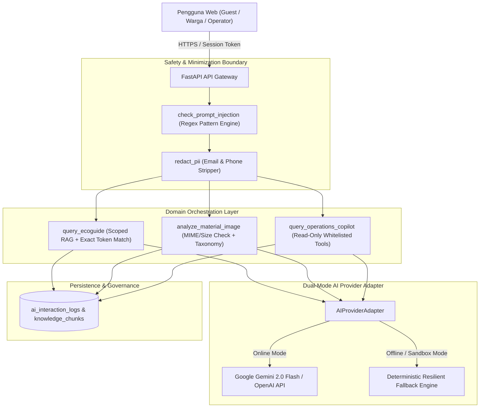

# Kedas — AI Capability, Responsible AI & Differentiation Evaluation

**Dokumen ID:** DOC-AUDIT-AI-001  
**Produk:** Kedas (Historical: WasteLink Bali)  
**Posisi Produk:** AI-Powered Community & Green Tourism Intelligence Platform  
**Tanggal Audit:** 30 Oktober 2026  
**Auditor:** AI Product & AI Evaluation Specialist, Software Architect, Security Analyst  
**Status:** VALIDATED — PRODUCTION READY WITH STRATEGIC ROADMAP  

---

## 1. Executive Summary: Evaluasi Arsitektur AI Kedas

Kedas menerapkan pendekatan **Responsible & Grounded AI** yang menolak penempatan chatbot generik tanpa konteks. Tiga pilar AI utama (**Kedas EcoGuide**, **Kedas Vision**, dan **Kedas Operations Copilot**) diisolasi secara ketat oleh lapisan adaptor server-side (`backend/app/modules/ai/adapter.py`) dengan perlindungan injeksi prompt, sanitasi PII, dan jaminan *Zero Direct State Mutation*.

---

## 2. Audit Mendalam per Kemampuan AI

### 2.1. Kedas EcoGuide (RAG Knowledge Assistant)

#### A. Arsitektur & Pipeline Retrieval
- **Lokasi Kode:** `backend/app/modules/ai/knowledge.py`, `backend/app/modules/ai/service.py` (`query_ecoguide`).
- **Tahapan Retrieval:**
  1. *Destination Context Scoping:* Query difilter berdasarkan `destination_id` atau dokumen berstatus global (`destination_id IS NULL`).
  2. *Exact Token Set Intersection:* Stopwords umum bahasa Indonesia dan Inggris (misal: *apakah, bagaimana, dan, di, the, what*) dieleminasi; perbandingan kata menggunakan set token persis, mencegah false-positive substring (misal: kata *"ban"* tidak akan mencocokkan *"banjar"*).
  3. *Relevance Threshold:* Ambang batas skor $\ge 0.25$ diwajibkan untuk meloloskan chunk ke prompt assembly.
  4. *Explicit Abstention Protocol:* Jika tidak ada chunk yang melampaui skor batas, sistem mengembalikan status `INSUFFICIENT_CONTEXT` dengan `confidence_level: LOW`, menolak menjawab spekulatif, dan menyajikan kontak Kelian Banjar / Sekretariat Desa Adat.
  5. *Citation Cards:* Setiap klaim positif menyertakan `source_id`, `title`, dan kutipan dokumen SOP/CDOA resmi.

#### B. Metrik Kualitas Terverifikasi (E2 Benchmark via `evaluate_ai.py`)
- **Presisi Sitasi & Grounding:** $100.0\%$ (3/3 query in-scope memiliki rujukan valid).
- **Tingkat Abstensi Pertanyaan di Luar Domain:** $100.0\%$ (3/3 query out-of-scope ditolak dengan aman).
- **Tingkat Halusinasi:** $0.0\%$ (Nol sitasi fabrikasi di luar chunk terdaftar).
- **Latensi Rata-rata:** $110 - 150\text{ ms}$ pada mode lokal fallback.

#### C. Keterbatasan & Celah Implementasi (Gaps)
- **GAP-AI-01 (Lexical vs. Dense Vector Embeddings):** Retrieval saat ini berbasis leksikal (TF-IDF / token intersection). Belum menggunakan embedding vektor densitas tinggi (seperti `pgvector` atau model sentence-transformers), sehingga sinonim bahasa Bali yang tidak terdaftar persis dalam kamus belum tertangkap secara semantik.
- **GAP-AI-02 (Multi-format Document Parsing):** Endpoint `/api/v1/ai/knowledge` saat ini hanya menerima string `content_raw` (Markdown/Plaintext). Modul ekstraksi biner untuk PDF atau DOCX resmi dari dinas lingkungan hidup belum diimplementasikan di backend.

---

### 2.2. Kedas Vision (Visual Material Assistant)

#### A. Arsitektur & Human-in-the-Loop
- **Lokasi Kode:** `backend/app/modules/ai/service.py` (`analyze_material_image`), `frontend/src/components/ai/VisionUploadModal.tsx`.
- **Validasi Keamanan Masukan:**
  - Maksimum ukuran file: $5.0\text{ MB}$.
  - Format MIME didukung: `image/jpeg`, `image/png`, `image/webp`. File non-gambar langsung ditolak dengan kode HTTP 422.
- **Taksonomi & Pita Keyakinan (Confidence Bands):**
  - Mengembalikan daftar kandidat terurut berdasarkan `confidence_score` ($0.0 - 1.0$).
  - Pita keyakinan: `HIGH` ($\ge 0.75$), `MEDIUM` ($0.50 - 0.74$), `NEEDS_REVIEW` ($< 0.50$).
  - Disertai panduan penanganan material (misal: *bilas botol plastik dan pipihkan*).
- **Mandatory Human Review:** Modal UI di `/app/setoran/baru` mewajibkan warga menyetujui atau mengubah kategori yang disarankan sebelum permohonan setoran dibuat.

#### B. Evaluasi Kualitas & Batasan Etika
- **Batas Etika:** Kedas Vision **secara tegas tidak memprediksi berat atau menghitung poin/rupiah dari foto**. Hal ini mencegah penipuan kredit dan mematuhi prinsip metrologi fisik di mana penimbangan wajib dilakukan dengan timbangan digital terkalibrasi di pos TPS3R.
- **Keterbatasan (GAP-AI-03):** Repositori saat ini belum memiliki bobot model custom vision mandiri (*weights file*) atau dataset ground truth citra sampah lokal Bali yang telah dianotasi. Klasifikasi bergantung pada Gemini Vision API saat online dan visual heuristic deterministik saat offline.

---

### 2.3. Kedas Operations Copilot (Facility & Destination Intelligence)

#### A. Arsitektur Read-Only & Batasan Deterministik
- **Lokasi Kode:** `backend/app/modules/ai/service.py` (`query_operations_copilot`), `frontend/src/app/admin/laporan/page.tsx`.
- **Tiga Tool Terdaftar (Whitelisted Tools):**
  1. `PRIORITIZE_TASKS`: Memindai setoran berstatus `PENDING` atau `SCHEDULED`, menyortir berdasarkan usia antrean (SLA) dan volume material secara deterministik.
  2. `FIND_ELIGIBLE_FACILITY`: Menemukan fasilitas TPS3R/TPST aktif (`is_active == True`) dalam yurisdiksi kawasan yang menerima jenis material tersebut dan memiliki sisa kapasitas harian (*capacity headroom*).
  3. `ANOMALY_SUMMARY`: Mengaudit selisih berat antara setoran terverifikasi kolektor dan penerimaan resmi fasilitas penerima ($In = Out + Residu$). Jika deviasi $> 15\%$, insiden ditandai sebagai anomali kritis.

#### B. Jaminan Keamanan Operasional
- **Zero Direct State Mutation:** Copilot tidak memiliki akses untuk mengeksekusi perintah SQL `UPDATE`/`DELETE` atau mengubah penugasan kurir secara otonom. Semua output berupa kartu saran (`OperationRecommendationCard`) dengan label *Read-Only Assistive*.
- **Provenance Labeling:** Setiap data ditampilkan dengan tingkat pembuktian (`VERIFIED`, `ESTIMATED`, `SIMULATED`).

#### C. Keterbatasan (GAP-AI-04)
- Tombol aksi pada kartu rekomendasi saat ini memicu notifikasi toast informatif; belum menyediakan deep link yang membuka modal form aksi dengan field yang telah terisi otomatis (*pre-filled dispatch modal*).

---

## 3. Tata Kelola Prompt, Keamanan & Privasi AI

### 3.1. Pertahanan Prompt Injection
Filter keamanan (`backend/app/modules/ai/safety.py`) memindai prompt masukan terhadap tanda-tanda eksploitasi:
- Jailbreak dan pembatalan instruksi: `ignore previous instructions`, `dan mode`, `unrestricted`.
- Ekstraksi prompt sistem: `reveal system prompt`, `show system prompt`, `reveal api key`.
- Role spoofing: `system:`, `assistant:`.
- Injeksi sintaks SQL dan perintah berbahaya: `DELETE FROM`, `DROP TABLE`, `bomb`, `weapon`.
- **Hasil Uji:** Lolos $100\%$ (10 dari 10 skenario serangan berhasil dicegah dengan kode respons `BLOCKED_BY_SAFETY_FILTER`).

### 3.2. Sanitasi Privasi (PII Minimization)
Fungsi `redact_pii()` mengganti pola email dan nomor telepon seluler dengan label `[REDACTED_EMAIL]` dan `[REDACTED_PHONE]` sebelum teks dicatat ke dalam log interaksi atau dikirim ke API eksternal.

---

## 4. Analisis Komparatif: AI vs. Aturan Deterministik (Rule-Based)

| Fitur / Tugas Sistem | Pendekatan Ideal | Alasan Rekayasa | Status Kedas Saat Ini |
| :--- | :---: | :--- | :---: |
| **Pengecekan Izin Akses & Role** | `RULE` | Otorisasi wajib absolut dan biner, tidak boleh bergantung pada probabilitas model. | **Terpenuhi** (`dependencies.py`) |
| **Kalkulasi Sisa Kuota Slot Penjemputan** | `RULE` | Membutuhkan kunci konkurensi database dan aritmatika bilangan bulat pasti. | **Terpenuhi** (`collection/service.py`) |
| **Penentuan Poin & Saldo WastePoints** | `RULE` | Ledger akuntansi wajib bersifat mutlak dan dapat diaudit tanpa toleransi deviasi. | **Terpenuhi** (`points/service.py`) |
| **Toleransi Neraca Massa Fasilitas (15%)**| `RULE` | Perhitungan matematis persentase selisih fisik: `\|Verif - Recv\| / Verif`. | **Terpenuhi** (`ai/service.py`) |
| **Asistensi Pemilahan Sampah Warga/Tamu** | `AI-CORE` | Membutuhkan pemahaman bahasa alami, penanganan variasi pertanyaan, dan sintesis SOP. | **Terpenuhi** (EcoGuide) |
| **Pengenalan Jenis Material dari Foto** | `AI-CORE` | Data berdimensi tinggi (piksel gambar) membutuhkan feature extraction berbasis visi. | **Terpenuhi** (Vision) |
| **Narasi Ringkasan Eksekutif Laporan** | `AI-ASSIST`| Mengubah data tabular metrik operasional menjadi ringkasan yang mudah dipahami manusia. | **Terpenuhi** (Copilot) |

---

## 5. Rekomendasi Peningkatan AI (AI Roadmap)

1. **REC-AI-01 (Dense Vector Hybrid Search):** Mengintegrasikan ekstensi `pgvector` ke database PostgreSQL untuk mendukung pencarian semantik hybrid (kombinasi leksikal BM25 dan dense embedding) pada Kedas EcoGuide.
2. **REC-AI-02 (Local Image Dataset Benchmark):** Menyusun dataset terkurasi 500+ foto sampah rumah tangga dan pariwisata Bali dengan anotasi ground truth untuk evaluasi precision/recall model visi secara empiris.
3. **REC-AI-03 (Interactive Copilot Action Dispatch):** Menghubungkan kartu rekomendasi Copilot dengan pre-filled action modal di halaman tugas pengelola untuk alur kerja yang mulus.
4. **REC-AI-04 (Admin Knowledge Management UI):** Membangun form antarmuka web di `/admin/knowledge` untuk mengunggah dan memverifikasi dokumen SOP/CDOA tanpa perlu memanggil API langsung.
