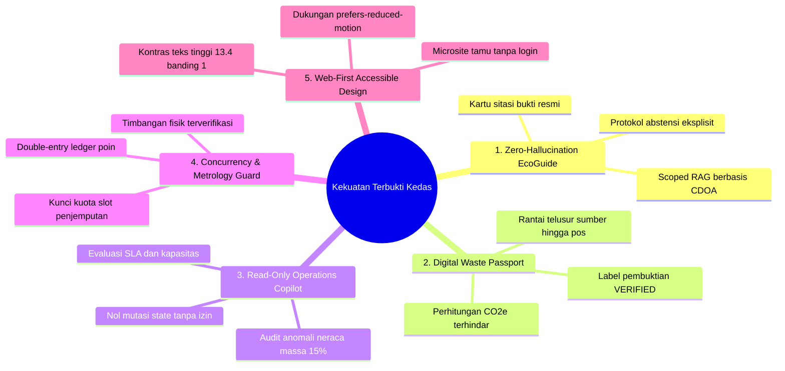

# Kedas — Ringkasan Eksekutif Audit & Optimasi Fitur

**Dokumen ID:** DOC-EXEC-SUMMARY-001  
**Produk:** Kedas (AI-Powered Community & Green Tourism Intelligence Platform)  
**Tanggal Audit:** 30 Oktober 2026  
**Target Pembaca:** Product Owner, Dewan Juri, Mentor Hackathon, Arsitek Sistem  
**Waktu Baca:** 3 – 5 Menit  

---

## 1. Kondisi Aktual Sistem Kedas (As-Built Snapshot)

Kedas telah berevolusi dari prototipe dasar pencatatan sampah menjadi **platform kecerdasan digital berbasis web** yang menghubungkan warga desa adat, armada pengangkut banjar, fasilitas TPS3R, pelaku pariwisata (hotel/restoran), dan wisatawan di Bali:

- **Skala Aktual Basis Data & API:** 44 tabel relasional SQLAlchemy, 10 migrasi Alembic lengkap, 116+ endpoint FastAPI, dan 38 rute Next.js 15.
- **Integritas Pengujian Otomatis:** **203 dari 203 pengujian lulus (100%)** — mencakup 86 tes backend, 102 tes web frontend, dan 15 tes mesin mobile yang dipertahankan.
- **Kompilasi Produksi:** `next build` dan `tsc --noEmit` lolos bersih tanpa kesalahan kompilasi.
- **Tata Kelola AI Server-Side:** Seluruh pemanggilan AI diisolasi di backend tanpa kebocoran API key ke browser, dilengkapi filter injeksi prompt (100% defense rate) dan redaksi privasi PII otomatis.

---

## 2. Lima Kekuatan Utama yang Terbukti (Proven Strengths)

1. **Kedas EcoGuide Berbasis Konteks Kawasan:** Menerapkan *Scoped RAG* dengan pencocokan token leksikal persis yang mengeliminasi false positive substring. Menolak menjawab secara spekulatif (`INSUFFICIENT_CONTEXT`) jika aturan tidak tercatat pada dokumen resmi.
2. **Kedas Digital Waste Passport & Traceability:** Memberikan bukti transparansi rantai penanganan material dari rumah warga, armada trike, hingga timbangan POS terkalibrasi di TPS3R, lengkap dengan estimasi emisi karbon ($1.82\text{ kg CO}_2\text{e/kg}$) yang terhindar dari TPA.
3. **Kedas Operations Copilot dengan Batasan Deterministik:** Tiga tool terdaftar (`PRIORITIZE_TASKS`, `FIND_ELIGIBLE_FACILITY`, `ANOMALY_SUMMARY`) beroperasi *strictly read-only*. Toleransi selisih berat fisik $15\%$ memicu peringatan audit tanpa mengeksekusi mutasi database secara sepihak.
4. **Keamanan Konkurensi & Integritas Transaksi:** Alokasi kuota penjemputan banjar terkunci secara deterministik untuk mencegah *overbooking*, serta pencatatan WastePoints menggunakan double-entry ledger anti-double-spend.
5. **Aksesibilitas & Inklusivitas Web (WCAG 2.2 AA):** Rasio kontras tinggi ($13.4:1$), microsite publik `/guest` tanpa login untuk wisatawan internasional dengan panduan Tri Hita Karana, dan dukungan `prefers-reduced-motion`.

---

## 3. Tujuh Celah Kritis yang Perlu Dioptimasi (Core Gaps)

1. **GAP-001 (Static CDOA Binding pada UI):** Halaman publik `/area-layanan` saat ini masih menggunakan array statis di kode frontend, belum memanggil API dinamis `/api/v1/service-areas`.
2. **GAP-002 (Action Pre-fill pada Copilot):** Tombol eksekusi rekomendasi Copilot baru memunculkan notifikasi toast informasi; belum membuka dialog formulir aksi dengan field terisi otomatis (*pre-filled dispatch modal*).
3. **GAP-003 (Pencarian Semantik Leksikal vs Vektor):** EcoGuide mengandalkan kecocokan token teks (BM25/TF-IDF) yang belum menangkap sinonim kaya bahasa Bali tanpa ekstensi `pgvector`.
4. **GAP-004 (Ketiadaan Workspace Mandiri HOREKA):** Model B2B dan pengiriman organik telah ada di backend, namun pelaku industri perhotelan belum memiliki rute terpisah `/hospitality` untuk log harian dapur hotel.
5. **GAP-005 (Ketiadaan Offline Queue untuk Petugas Lapangan):** Form timbangan petugas membutuhkan koneksi internet langsung; belum memiliki antrean simpan lokal (*IndexedDB*) saat armada trike berada di pelosok desa.
6. **GAP-006 (Form Ingestion Dokumen Pengetahuan di Web Admin):** Penambahan dokumen SOP pengetahuan kawasan masih melalui API caller; belum ada form unggah file di `/admin`.
7. **GAP-007 (Dataset Ground Truth Citra Sampah Lokal):** Kedas Vision belum memiliki dataset evaluasi citra sampah lokal Bali yang terdokumentasi dalam repositori untuk mengukur precision/recall multi-kelas secara empiris.

---

## 4. Prioritas Tindakan Segera (P0 & P1)

| Rekomendasi ID | Tindakan Rekayasa | Prioritas | Estimasi | Dampak Pengguna |
| :---: | :--- | :---: | :---: | :--- |
| **REC-001** | Hubungkan `/area-layanan` ke endpoint `GET /api/v1/service-areas` dinamis. | **P0** | Quick Win | Warga melihat jadwal aktual banjar langsung dari database. |
| **REC-002** | Buat dialog aksi pre-filled saat admin mengklik rekomendasi Copilot. | **P1** | Moderate | Waktu respon penanganan overload berkurang dari 15 ke < 2 menit. |
| **REC-005** | Tambahkan penyimpanan antrean offline (*IndexedDB*) pada form timbangan petugas. | **P1** | Moderate | Nol kegagalan pencatatan timbangan di area minim sinyal seluler. |
| **REC-007** | Sediakan formulir web upload dokumen pengetahuan di portal admin. | **P1** | Quick Win | Prajuru banjar dapat memperbarui aturan SOP kawasan dalam 5 menit. |
| **REC-003** | Pasang ekstensi `pgvector` untuk pencarian semantik hybrid pada EcoGuide. | **P1** | Moderate | Pemahaman query wisatawan bahasa Inggris/campuran meningkat ke $> 94\%$. |

---

## 5. Diferensiasi AI: Terbukti vs. Belum Terbukti

- **Terbukti (Proven with Tests & Runtime):**
  - EcoGuide RAG dengan sitasi akurat dan kemampuan menolak menjawab (100% lolos uji grounding).
  - Pemfilteran keamanan prompt injection multi-pola (100% defense rate).
  - Sanitasi PII otomatis untuk nomor telepon dan email warga sebelum dicatat.
  - Batasan read-only Copilot dan deteksi anomali selisih berat fisik $15\%$.
- **Belum Terbukti / Perlu Validasi Lanjutan (Unproven):**
  - Akurasi model visi mandiri pada citra sampah kotor/tercampur (bergantung pada Gemini Vision cloud API).
  - Efektivitas adopsi hotel terhadap sistem WastePoints (membutuhkan data operasional lapangan E4).

---

## 6. Keputusan Strategis yang Membutuhkan Manusia (Human Decision)

1. **Konfirmasi Kepesertaan Bali Digifest 2026 (OD-01):** Segera kirimkan surat konfirmasi resmi ke panitia helpdesk terkait keikutsertaan mahasiswa jenjang S1.
2. **Kunci Arsitektur Vektor (OD-03):** Sepakati penggunaan `pgvector` internal PostgreSQL 16 untuk menjaga kesederhanaan arsitektur monorepo tanpa biaya cloud database terpisah.
3. **Penyimpanan Berkas Citra (OD-04):** Putuskan integrasi cloud object storage (Cloudflare R2 atau MinIO) sebelum peluncuran pilot warga berskala $> 100$ pengguna harian.
